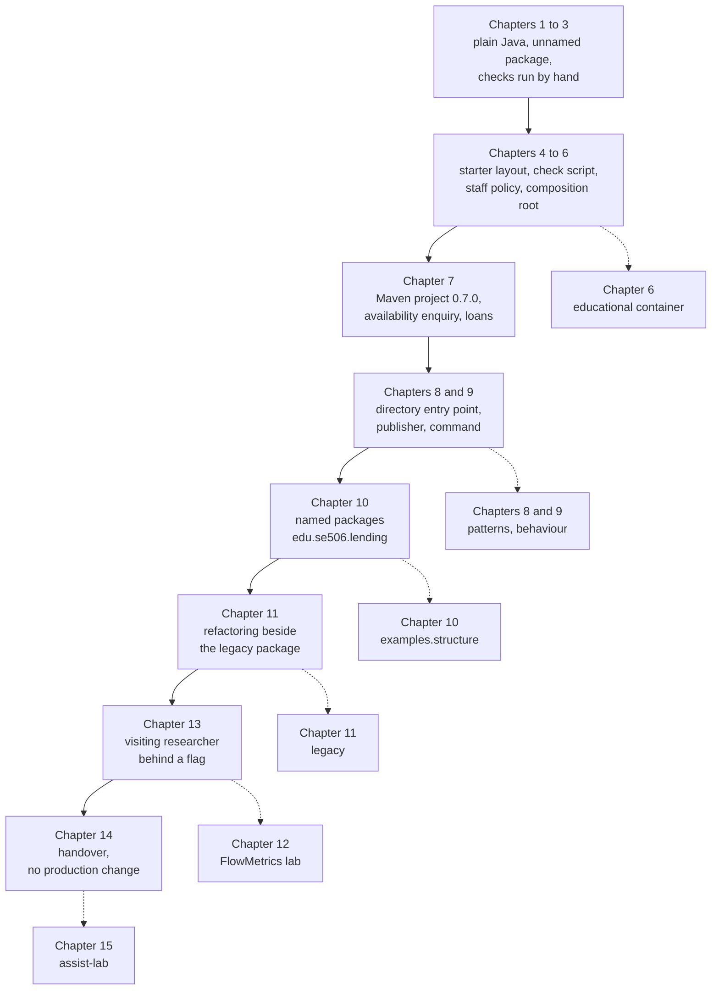
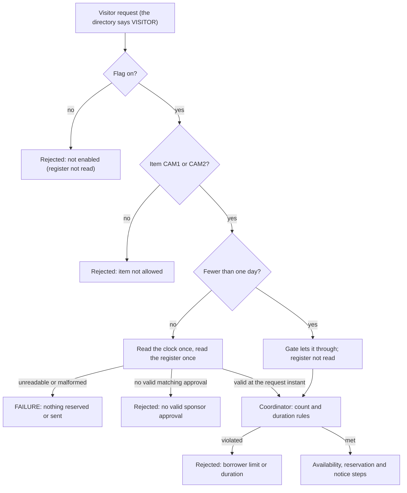
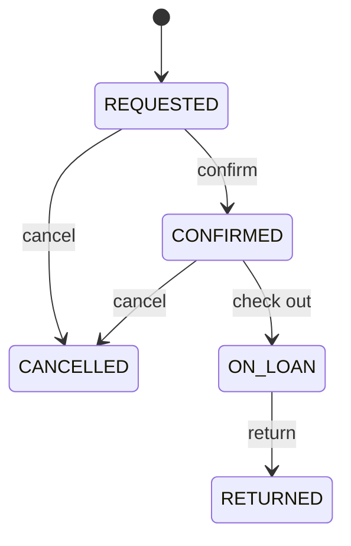
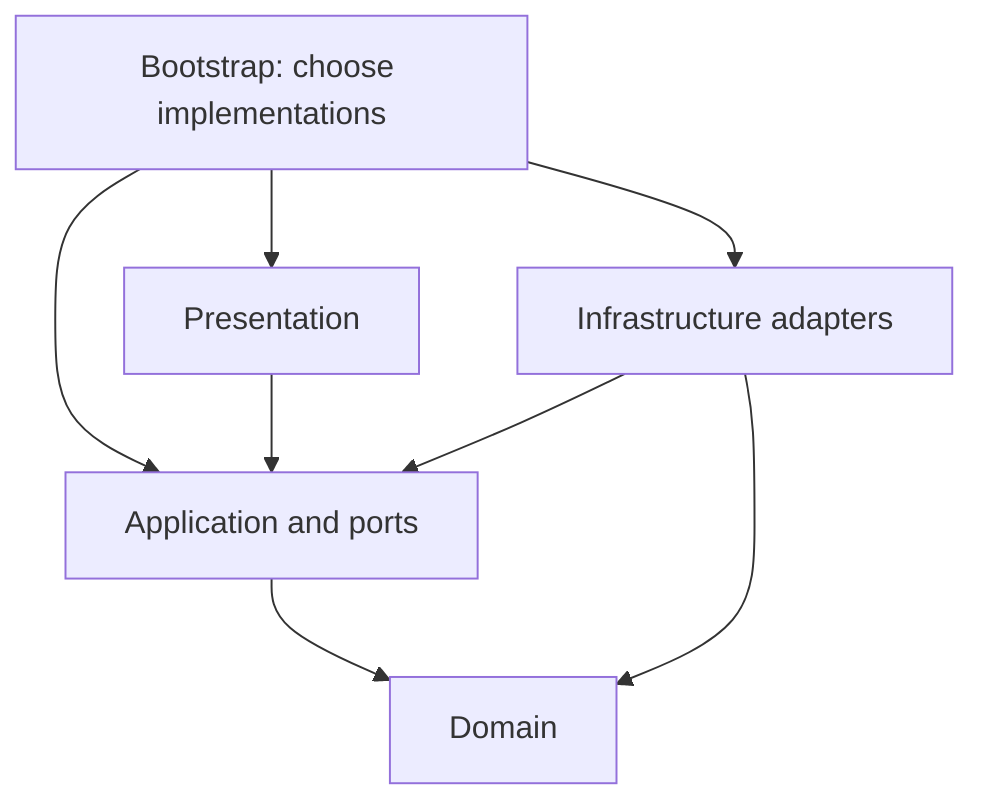

*OO Development and Agile Practices*  
*Designing, Testing and Evolving Software with AI Assistance*

## How to use this appendix

The chapters build one project, the Campus Equipment Lending System, and use it to teach design, testing and change. A reader who joins at Chapter 9, or who is checking a build against the text, needs three things in one place: where the project stands at each chapter, what the build should report, and what the rules of the domain are. This appendix gathers them. It also lists the terms the book uses and says where each is explained.

Everything here is taken from the chapters and their companions. If this appendix and a chapter ever differ, the chapter's companion is the authority, because that is where the code and its checks are listed.

* **D.1** shows how the cumulative project and the isolated examples fit together.
* **D.2** is the table of checkpoints: version, location, count and command for each chapter.
* **D.3** explains what the counts mean and lists the open questions the chapters name.
* **D.4** records the rules of the domain, with the chapter that states each.
* **D.5** suggests how to carry the same questions to another domain.
* **D.6** is the glossary.

## D.1 The cumulative project and the isolated examples

The book keeps two kinds of code apart. The **cumulative project** grows from chapter to chapter and is the code a build must keep working. **Isolated examples** teach one idea in a corner of the repository and are never used by the project.



**Figure D.1.** Solid arrows are the cumulative project. Dashed arrows lead to examples that are kept apart from it.

The isolated examples are:

1. `ContainerWalkthrough` (Chapter 6), a small educational container, outside the normal gate.
2. `patterns` (Chapter 8, extended in Chapter 9) and `behaviour` (Chapter 9), the pattern and lifecycle exercises. The lifecycle exercise does not modify the real application.
3. `examples.structure` (Chapter 10), deliberately flawed packages for the dependency exercises.
4. `legacy` (Chapter 11), the overdue-report routine that the chapter characterises and refactors. Production code under `edu.se506.lending` does not use it, and from Chapter 11 a compiled dependency test checks this. Only the bootstrap code launches it or feeds it rows.
5. `FlowMetrics` (Chapter 12), the calculator for the metrics lab. The application stays where Chapter 11 left it.
6. `assist-lab` (Chapter 15), a separate Maven project with its own copy of `LoanPeriod`. It does not depend on the lending project and does not change it.
7. `risk-lab` (Appendix F), a separate Maven project, package `risk`, with 67 tests (56 without the `integration` tag and 11 with it). It puts a stub model behind one domain question and does not touch the lending project.

Until Chapter 10 the production code is in the unnamed package. From Chapter 10 it is under `edu.se506.lending`, in the packages `domain`, `application`, `application.port`, `infrastructure`, `presentation` and `bootstrap`.

## D.2 Checkpoints

The table gives, for each chapter, the project version, where the code lives, the count that the chapter's own build reports, what the chapter adds and the command that runs it. Chapters 1 to 6 report **checks**: the lines a plain-Java checking program prints. From Chapter 7 the build is Maven and the count is of JUnit **invocations** (see D.3). A count from a later chapter includes the earlier ones that it inherits.

| Chapter | Project version | Where the code lives | Count that the chapter reports | What the chapter adds | Command |
|---|---|---|---|---|---|
| 1 | none | Plain Java, unnamed package | 12 checks | `ReservationRules`: at most three active reservations, one to seven days | `javac ReservationRules.java Chapter01Demo.java Chapter01Checks.java`, then `java Chapter01Checks` |
| 2 | none | Plain Java, unnamed package | 34 checks | `LoanPeriod`, `Reservation`, `ReservationCoordinator`; extracting the confirmation text | `javac --release 17 -d out ...`, then `java -cp out Chapter02Checks` |
| 3 | none | Plain Java, unnamed package | 5 acceptance example groups; no production change | Backlog, acceptance criteria, Definition of Done; `Chapter03AcceptanceExamples` | `java -cp out Chapter03AcceptanceExamples` |
| 4 | none | Plain Java, `src/main/java` and `src/test/java` | 34 checks and the 5 groups | The starter layout, `scripts/check.sh`, a hosted-check workflow file, `Chapter04Demo` | `bash scripts/check.sh` |
| 5 | none | Plain Java, folders `before`, `refactored`, `after` | 44 Chapter 5 checks, with the 34 checks and 5 groups still run | Staff policy, `ConfirmationFormatter`, the PMD 7.28.0 lab | `bash after/scripts/check.sh`, `bash scripts/pmd.sh` |
| 6 | none | Plain Java, unnamed package | 28 Chapter 6 checks, with the earlier ones still run | Notification sender, composition root `ReservationApplication`, policy map | `bash scripts/check.sh` |
| 7 | 0.7.0 | Maven project, unnamed package | 35 JUnit invocations, four of which wrap the earlier runners | Availability enquiry (US-02), a checkout and return flow, one Mockito interface double | `mvn --batch-mode verify` |
| 8 | 0.8.0 | Maven; `patterns` isolated | 63 invocations: 35 inherited, 17 directory-boundary, 11 pattern | A directory-backed entry point that translates synthetic provider records | `mvn --batch-mode verify` |
| 9 | 0.9.0 | Maven; `behaviour` isolated | 107 invocations: 63 inherited and 44 new | Strategy selection, `NotificationPublisher`, `ReserveEquipmentCommand`, an isolated lifecycle exercise | `mvn --batch-mode verify` |
| 10 | 0.10.0 | `edu.se506.lending.*`; `examples.structure` isolated | 121 invocations | Named packages, `ReservationRepository`, a console adapter, compiled dependency tests | `mvn --batch-mode verify` |
| 11 | 0.11.0 | As Chapter 10, plus `legacy` isolated | 159 invocations: 121 inherited, 28 for the legacy report and 10 for the bridge | The legacy overdue report: characterisation, seams, small refactorings | `mvn --batch-mode verify` |
| 12 | no new version | No code change; `FlowMetrics` in a separate `lab` folder | No new tests; the checkpoint stays at 159 | Flow metrics, the repository lab, the specified change (CR-12) | Plain JDK, as the companion lists |
| 13 | 0.13.1 | As Chapter 11, plus the visitor change | 232 invocations: 203 unit, 26 integration, 3 end-to-end | The visiting-researcher rules behind a flag, an approval-file adapter, an HTTP directory client, the pipeline | `mvn --batch-mode verify`, `bash scripts/pipeline.sh` |
| 14 | 0.14.0 | As Chapter 13; no production change | 235 invocations: 206 unit, 26 integration, 3 end-to-end | `TraceabilityTest`, the handover documents, the handover check, a rehearsed flag removal | `mvn --batch-mode verify`, `bash scripts/handover-check.sh` |
| 15 | 1.0.0 (`assist-lab`) | Separate project, package `assist` | 9 acceptance tests | The AI-assistance lab: two constructed attempts, a record and a record check | `mvn --batch-mode test` in the lab folder |

Chapters 11, 13 and 14 list only the files that are new or changed. To reconstruct a checkpoint, start from the Chapter 10 companion and apply each later companion in order, as each says.

## D.3 What the counts mean, and the questions left open

### Invocations are not methods

From Chapter 7 the build runs Maven's Surefire plugin with JUnit Jupiter. Surefire reports **invocations**. A plain test method runs once and counts once. A parameterised test with three values runs three times and counts three. A class with ten methods can therefore report more than ten. Report the number the build prints, and say what it counts. Do not compare it with a count from a different project.

The count grows as each chapter inherits the one before:

| Step | Arithmetic the chapters give |
|---|---|
| Chapter 8 | 35 inherited + 17 directory-boundary + 11 pattern = 63 |
| Chapter 9 | 63 inherited + 9 Strategy + 21 lifecycle + 10 publisher + 4 Command = 107 |
| Chapter 10 | 107 migrated + 7 repository + 2 value-semantics + 3 console + 2 dependency = 121 |
| Chapter 11 | 121 inherited + 28 for the legacy report (27 characterisation and one differential) + 10 for the bridge = 159 |
| Chapter 13 | 159 inherited + 73 new = 232 |
| Chapter 14 | 232 + the three `TraceabilityTest` tests = 235 |

Chapter 12 changes no code. If a text quotes a different count for the Chapter 11 suite, the Chapter 11 companion is the authority.

### The stages of the pipeline (Chapter 13)

The pipeline runs five stages in order and stops at the first failure. Tests are selected by JUnit tags, and **only two tags exist**: `integration` and `e2e`. Unit tests carry no tag; the unit stage is "everything not tagged".

| Stage | Command | Chapter 13 count | Chapter 14 count |
|---|---|---|---|
| 1 compile | `mvn compile` | | |
| 2 unit tests and architecture checks | `mvn test -DexcludedGroups=integration,e2e` | 203 | 206 |
| 3 integration | `mvn test -Dgroups=integration` | 26 | 26 |
| 4 end-to-end | `mvn test -Dgroups=e2e` | 3 | 3 |
| 5 package | `mvn package -DskipTests` | | |

A stage that selects no tests fails, so a mistyped tag cannot give a green stage that checked nothing.

### Questions the chapters leave open

These are written down in the chapters and not settled by the code. They belong to the person who owns the requirement.

| Reference | What is open | Chapter |
|---|---|---|
| SD-11-1 | Any other borrower kind pays 1.00 a day with no grace and no cap. Do other kinds exist, and should they be rejected? A late visitor now reaches this rule | 11, 13 |
| SD-11-2 | A loan within the grace period is listed with fine 0.00 and counted as overdue. Should it appear at all? | 11 |
| SD-11-3 | A null kind throws `NullPointerException`, only for a loan that is overdue and unreturned. Can the export contain one? | 11 |
| SD-11-4 | Amounts use the default locale (`0,50` under `Locale.GERMANY`). Should the separator follow the machine or the office? | 11 |
| SD-12 | The coordinator counts every retained reservation, although a variable is called `activeCount`. Should a future rule count active loans, future reservations or all retained reservations? | 12, 13 |

## D.4 The rules of the domain

### Time and periods

A period includes its start day and excludes its end day, written `[start, end)`. Dates are `java.time.LocalDate` values. Two periods overlap exactly when each starts before the other ends:

```text
A.start < B.endExclusive  and  B.start < A.endExclusive
```

Periods that meet at a boundary do not overlap. A reservation ending on 22 October and one starting on 22 October can both hold the same item. Where an instant matters (the approval window of Chapter 13) the code reads one `Clock` and decides on that reading, so tests can fix the time.

### Identifiers and equality

Identifiers in the examples are `B1` for a borrower, `CAM1` for an item and `R1` for a reservation. The first checkpoints check only that an identifier is not blank; they do not look it up in a directory or catalogue. The coordinator allocates reservation identifiers in sequence, and a rejected request does not use one.

`LoanPeriod` and `Reservation` do not override `equals` or `hashCode`. Two separate objects with the same data are not equal through Java's inherited equality. The repository (Chapter 10) uses the reservation's identifier as its key and rejects a duplicate. Domain identity and Java object identity are different ideas (Chapter 2, Section 2.1, and Chapter 10, Section 10.6).

### Borrower categories and limits

The count is the number of reservations the borrower already holds before the new one. All stored reservations count; the code does not remove a reservation when a loan is returned.

| Category | Existing reservations allowed before a successful request | Duration | Other conditions |
|---|---|---|---|
| Student | 0, 1 or 2 | 1 to 7 days | None |
| Staff | 0 to 4 | 1 to 14 days | The staff limits are an illustrative teaching requirement (Chapter 5) |
| Visitor | Fewer than three | 1 to 3 days | Only CAM1 or CAM2; a matching sponsor approval; the flag must be on (Chapter 13) |

Both the student and staff policies reject a negative count or a non-positive duration. Chapter 1's first rule returns `false` for a negative count.

A **visitor** needs one approval record, read from a tab-separated register, that matches the exact borrower, item and period, carries a non-blank sponsor identifier and the status APPROVED, and is valid at the request instant. Approval for another borrower, item or period does not count. The gate and the coordinator decide in this order:



**Figure D.2.** The visitor decision, as Chapter 13's code makes it. Rectangles are results. Every rejection is an ordinary return value; only an unreadable register is a failure.

### The directory

Borrower categories come from the directory in Chapters 8 and later. The adapter translates the provider's records exactly; it does not trim, normalise or guess.

| Provider outcome | Application outcome |
|---|---|
| Kind `S`, status `Y`, matching identifier | A student borrower |
| Kind `T`, status `Y`, matching identifier | A staff borrower |
| Kind `V` (added by the visitor change) | A visitor |
| No row | An empty result: the borrower is absent |
| A recognised kind with status `N` | An empty result: the borrower is inactive |
| An unknown or null kind or status, or a mismatched identifier | A `DirectoryException`: invalid provider data |
| The provider's declared failure | A `DirectoryException` that keeps the cause |
| An unexpected programming exception | It propagates and is never turned into absence |

An outage is never “not found”, and an unknown code never defaults to a category, least of all to student or staff. From Chapter 13 the HTTP client makes one attempt, bounds the whole wait, and neither retries nor falls back.

### Failure and what stays stored

When a reservation is accepted, the coordinator stores it **before** it notifies. If notification fails with the expected exception, the reservation stays and the result carries a failure suffix (Chapter 9). If the approval register is unreadable, nothing is reserved and nothing is sent (Chapter 13).

### The reservation lifecycle (an isolated exercise)

Chapter 9's lifecycle exercise models a reservation as REQUESTED, CONFIRMED, ON_LOAN, RETURNED or CANCELLED. The cumulative system does not use it: it confirms accepted reservations immediately, tracks loans separately and has no cancellation operation.



**Figure D.3.** The proposed lifecycle. RETURNED and CANCELLED allow no further action. Every other combination is a rejection that throws `IllegalStateException` and leaves the status unchanged.

### Packages and the direction of dependencies

From Chapter 10 the packages are grouped as follows. An arrow means that classes in the first group may refer to classes in the second. A missing arrow means the reference is not permitted: `Domain` refers to nothing else in the application. A compiled test checks the direction and the absence of package cycles.



**Figure D.4.** Permitted source dependencies. The figure shows references in the source, not the order of calls.

### Snapshots

A method that returns a collection returns an unmodifiable snapshot, `List.copyOf(...)`, so that a caller cannot change the coordinator's state through it. A snapshot does not freeze the objects inside it.

## D.5 Carrying the questions to another domain

The book builds on equipment lending and supplies no starter checkpoint for another domain. The descriptor names an ML model-serving tool as another possible starter domain. If your team works on one, the same questions apply. The table is a suggestion for reading the book, not a provided checkpoint.

| In the lending project | A possible counterpart in a model-serving service | The question to ask |
|---|---|---|
| Borrower and category | A client and its tier | Who is asking, and who decides the tier? Never default an unknown client to a higher tier |
| Item such as `CAM1` | A model deployment or a worker | What is the unit that is reserved? |
| `LoanPeriod` | A reserved capacity window | Is the window half-open, and when do two windows overlap? |
| `ReservationRules` | A quota policy | What does the rule count, and does the count include everything retained? |
| The directory and its outage rule | A model registry or an identity service | What happens on an outage? Say “unavailable”, not “not found” |
| `VisitorGate` | A flag for an external client | Is the flag off by default, and are both settings tested? |
| Notification after storing | An alert after accepting a job | If the alert fails, does the accepted job stay? |

## D.6 Glossary

The entries follow the chapters. The reference after each says where the term is explained.

**Acceptance criteria.** The behaviour expected of one backlog item, specific enough that a second team can tell whether an implementation meets it (Chapter 3, Section 3.7). An acceptance example is one concrete case of a criterion.

**ADR (architecture decision record).** A short record in the repository of a decision, its context, the alternatives, the consequences, how it was checked and what would reopen it (Chapter 10, Section 10.8; Chapter 14, Section 14.3; Appendix C).

**Afferent coupling (Ca).** For a package, the number of classes outside it that depend on classes inside it (Chapter 10, Section 10.5).

**Arrange–Act–Assert.** A test structure: establish the state, perform the operation being examined and inspect the outcome (Chapter 7, Section 7.2).

**Association, aggregation, composition, dependency.** UML relationships between classes: a structural link; a grouping claim; strong ownership with a lifecycle; and a use that is not held in a field (Chapter 2, Section 2.6; Appendix A, A.8).

**Boundary.** The place where our code meets something it does not control, such as a file, a network service or a setting (Chapter 13, Section 13.1).

**Characterisation test.** A test that records what code does today, whatever that is, so that a change which alters it is noticed (Chapter 11, Section 11.3).

**Cohesion and coupling.** How closely the responsibilities inside a component belong together, and how much components depend on each other (Chapter 2, Section 2.4).

**Composition root.** The small application-entry area where concrete collaborators are assembled (Chapter 6, Section 6.5).

**Continuous delivery and continuous deployment.** Building software so that it can be released at any time; and going further, releasing every change that passes the pipeline automatically (Chapter 13, Section 13.5).

**Contract test.** A test that states what callers may rely on and checks that an implementation honours it (Chapter 13, Section 13.2).

**Cycle time and lead time.** In Chapter 12's history, lead time runs from Accepted to Done and cycle time from Started to Done. The difference is the recorded wait before starting. Neither measures hands-on effort (Chapter 12, Section 12.5).

**Definition of Done.** The shared quality standard that an increment must meet, whatever the story (Chapter 3, Section 3.7; Appendix C).

**Dependency injection.** Supplying collaborators to an object from outside it (Chapter 6, Sections 6.5 and 6.6).

**Dependency Inversion Principle (DIP).** High-level policy should not depend on low-level detail; both depend on an abstraction that the policy owns (Chapter 6, Section 6.4).

**Efferent coupling (Ce).** For a package, the number of classes inside it that depend on classes outside it (Chapter 10, Section 10.5).

**Encapsulation and information hiding.** Grouping state with the operations that govern it and controlling access to it; and deciding which implementation choices callers need not know (Chapter 2, Section 2.3).

**End-to-end journey.** A test that starts the whole program the way a user would, in a separate process (Chapter 13, Sections 13.1 and 13.3).

**Fault experiment.** Making one deliberate change at a time, in a scratch copy, to see whether the tests notice it. A change that cannot be noticed because it behaves the same is called equivalent (the companions of Chapters 5 to 15).

**Feature flag.** A switch that lets code ship without turning its behaviour on. The book's flag is off by default and both settings are tested (Chapter 13, Section 13.6).

**Gate.** A rule that stops the pipeline (Chapter 13, Section 13.4).

**Half-open interval.** A period that includes its start and excludes its end (D.4).

**Instability.** For a package, I = Ce / (Ca + Ce), from 0 (maximally stable) to 1 (maximally unstable) (Chapter 10, Section 10.5).

**Integration test.** A test that runs an adapter against the real mechanism it adapts, such as a real file or a real HTTP client talking to a service under our control (Chapter 13, Sections 13.1 and 13.2).

**Interface Segregation Principle (ISP).** A client should not be forced to depend on operations it does not use (Chapter 6, Section 6.2).

**Invariant.** A condition that must hold for valid objects or valid system states (Chapter 2, Section 2.2).

**Liskov Substitution Principle (LSP).** An object of a subtype must be usable wherever its supertype is promised, without breaking the promise (Chapter 5, Section 5.5).

**Open–Closed Principle (OCP).** Where variation is anticipated, add behaviour by adding code and not by editing code that already works (Chapter 5, Section 5.3).

**Precondition and postcondition.** What must hold before an operation for its promise to apply, and what the operation guarantees afterwards (Chapter 5, Section 5.4).

**Refactoring.** Improving the internal organisation of code while preserving its observable behaviour (Chapter 1, Section 1.2; Chapter 11, Section 11.5).

**Regression and regression test.** An unintended loss or change of behaviour that used to work; and a test that protects behaviour everyone agrees is correct (Chapter 1, Section 1.4; Chapter 11, Section 11.3).

**Seam and enabling point.** A place where you can change what the program does without editing the code at that place, and the place where you choose the other behaviour (Chapter 11, Section 11.4).

**Single Responsibility Principle (SRP).** A unit should have one reason to change (Chapter 5, Section 5.2).

**Suspected defect.** Behaviour that looks wrong but is not confirmed. The book keeps it apart from a known defect, accepted behaviour and an open question (Chapter 11, Section 11.7).

**Technical debt.** A metaphor, attributed to Ward Cunningham, for accumulated cruft that makes a system harder to change. The book treats it as evidence to point at and not as a complaint (Chapter 11, Section 11.7).

**Test double.** A substitute for a collaborator in a test. The roles are dummy, stub, fake, spy and mock; the tool does not decide the role (Chapter 7, Section 7.5).

**Test-driven development (red–green–refactor).** Writing a failing test, making it pass with the simplest change, then improving the structure while the tests stay green (Chapter 7, Section 7.3).

**Throughput, velocity and work in progress.** Completed items over a stated period; the sum of estimates of the items completed in an iteration; and the items started but not finished at a stated moment (Chapter 12, Sections 12.3 and 12.5).

**Traceability.** The chain from a requirement to the code that decides it and the test that checks it (Chapter 14, Section 14.4).

**Unit test.** A test that runs a small part of the system in memory with everything it collaborates with under control (Chapter 13, Section 13.1).

**User story, epic and vertical slice.** A small user-centred need; a label for a large area of work that needs dividing; and a slice that passes through the necessary parts of the system to deliver one observable outcome (Chapter 3, Section 3.6; Chapter 4, Section 4.3).

**Verification record.** The record of what was asked of an AI assistant, what was received, what was accepted or rejected and what checks were run (Chapter 15, Section 15.8; Appendix C).

## D.7 Sources

The definitions and rules above come from the chapters and their companions. Each chapter's own source list gives the references behind them. Three outside sources are used directly, all opened on 13 October 2026:

1. Schwaber, K. and Sutherland, J., [The Scrum Guide](https://scrumguides.org/scrum-guide.html), November 2020. The Definition of Done and the Increment (D.6).
2. Fowler, M., [Test Double](https://martinfowler.com/bliki/TestDouble.html), 2006. A summary of Gerard Meszaros's vocabulary of test doubles, as used in Chapter 7, Section 7.5.
3. Fowler, M., [Technical Debt](https://martinfowler.com/bliki/TechnicalDebt.html). The metaphor attributed to Ward Cunningham, as used in Chapter 11, Section 11.7.
