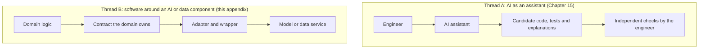
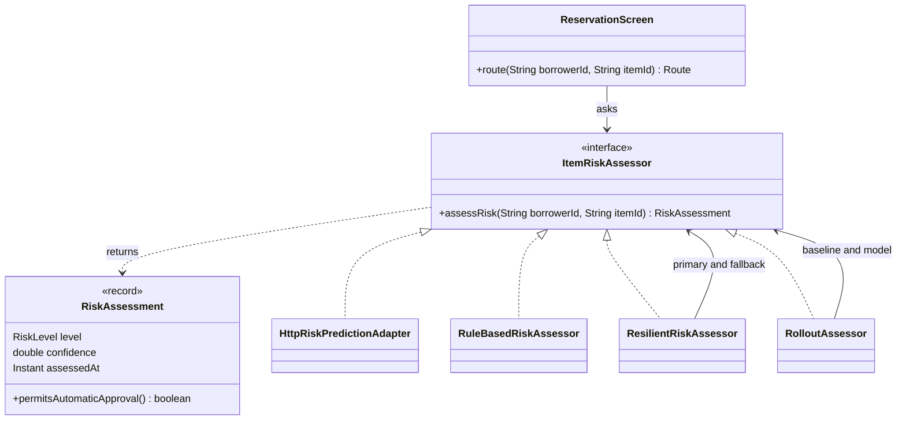

*OO Development and Agile Practices*  
*Designing, Testing and Evolving Software with AI Assistance*

## How to use this appendix

Some of the software you will build or maintain depends on something that is not ordinary code: a trained model that scores a request, a service that returns data you do not control, a pipeline whose output changes when someone retrains it. The risk is not that such a component is clever. The risk is that its answers change without a code change, that it can be slow or silent, and that its types and units leak into the code around it.

This appendix applies the book's principles to that situation: a contract that the domain owns, tests that do not depend on the model, a bounded wait, a cautious fallback, and a staged rollout that leaves a record. It does so through a small stand-alone project, the **risk lab**, whose code compiles for Java 17, has 67 tests and is listed in full in the appendix's companion. The lab does not touch the lending project. It asks one question, “how risky is it to lend this item to this borrower?”, and puts a model behind the answer.

* **F.1** separates the two ways AI appears in this book.
* **F.2** replaces a leaky integration with a contract the domain owns.
* **F.3** shows how to test when an answer can change.
* **F.4** names the technical debt that machine learning systems collect.
* **F.5** deals with failure: a bounded wait and a cautious fallback.
* **F.6** rolls a model out in stages and records what each decision rested on.
* **F.7** is an exercise on the lab.

The appendix assumes Chapters 6 (interfaces and dependency inversion), 7 (test doubles), 8 (adapters) and 13 (boundaries, timeouts and flags). It does not teach machine learning. It says nothing about whether a model is accurate: no test here can.

## F.1 Two ways AI appears in this book



**Figure F.1.** The two threads are independent.

In **Thread A** an assistant helps you write software, and the software may have nothing to do with machine learning. Chapter 15 is about that. In **Thread B** the software you write contains or calls an AI or data component. The component is an architectural dependency: you must encapsulate it, test around it, bound it and evolve it safely. The lending project has already met this thread. The borrower directory of Chapters 8 and 13 is a data component outside your control, and Chapter 13 sets its policy: one attempt, a bounded wait, no retry, and a failure that is never reported as “not found”.

Neither thread replaces the other. A strong assistant cannot rescue an application that is tangled with its model, and a clean domain model cannot make up for a model nobody is watching.

## F.2 A contract the domain owns

### The starting point

The exercise begins with a class that works on a good day. This is its one method:

```java
public boolean approve(String borrowerId, String itemId) {
    try {
        HttpURLConnection connection = (HttpURLConnection)
                URI.create(serviceUrl + "/risk?borrower=" + borrowerId + "&item=" + itemId).toURL().openConnection();
        BufferedReader in = new BufferedReader(new InputStreamReader(connection.getInputStream()));
        String line = in.readLine();
        String[] parts = line.split(" ");
        float score = Float.parseFloat(parts[1]);
        if (parts[0].equals("LOW")) {
            return score > 0.8f;
        }
        return false;
    } catch (Exception anything) {
        return false;
    }
}
```

Run against a small local service, it behaves like this:

```text
good day            : true
confidence of 1.7   : true
service that is slow: true after 1502 ms
service that is down: false
```

The time on the third line varies from run to run. Read the class and the output together, and notice what is wrong:

1. **No timeout.** The slow service held the caller for about a second and a half, and nothing limits that. A stalled service would hold it for as long as it liked.
2. **An outage looks like a refusal.** The service that is down gives `false`, the same answer as a high-risk borrower. The caller cannot tell the two apart.
3. **A nonsense answer is accepted.** A confidence of 1.7 cannot exist, and the class approved it.
4. **A magic number and a string comparison.** `0.8f` and `"LOW"` are in the middle of the method with no name and no owner.
5. **Identifiers are pasted into the address** without encoding.
6. **It cannot be tested** without a running service.

All six are boundary failures, and they have a common cause: the domain's decision and the service's wire format are in the same place.

### The contract

The remedy is Chapter 6's dependency inversion applied to a model. The domain defines the question in its own words, and everything else adapts to it.



**Figure F.2.** The domain owns `ItemRiskAssessor` and `RiskAssessment`. Everything else implements or uses the contract.

The contract itself is small:

```java
package risk.domain;

/**
 * The domain's question about risk, in the domain's words. An implementation may be a model, a table
 * of rules or a test fake. The contract: the result is never null; if there is no trustworthy answer
 * the call throws {@link RiskAssessmentException}. It never returns a default that looks like an answer.
 */
public interface ItemRiskAssessor {
    RiskAssessment assessRisk(String borrowerId, String itemId);
}
```

```java
package risk.domain;

import java.time.Instant;
import java.util.Objects;

/** One answer to the question “how risky is it to lend this item to this borrower?”. */
public record RiskAssessment(RiskLevel level, double confidence, Instant assessedAt) {

    /** The least confidence at which a LOW assessment may approve a request without a person. */
    public static final double AUTOMATIC_APPROVAL_CONFIDENCE = 0.80;

    public RiskAssessment {
        Objects.requireNonNull(level, "level");
        Objects.requireNonNull(assessedAt, "assessedAt");
        if (Double.isNaN(confidence) || confidence < 0.0 || confidence > 1.0) {
            throw new IllegalArgumentException("Confidence must be between 0.0 and 1.0: " + confidence);
        }
    }

    /** Only a LOW level held with enough confidence may skip a person. */
    public boolean permitsAutomaticApproval() {
        return level == RiskLevel.LOW && confidence >= AUTOMATIC_APPROVAL_CONFIDENCE;
    }
}
```

Notice what the domain decided, and where. The confidence is validated in the constructor, so a value of 1.7 cannot become an assessment (an invariant, Chapter 2). The threshold has a name and an owner, the domain. `UNKNOWN` is a level that can never approve. Failure is a different thing from an answer: the contract says a failed call throws and never returns a default that looks like an answer. And the class that makes the decision knows none of this about models:

```java
public Route route(String borrowerId, String itemId) {
    requireText(borrowerId, "borrowerId");
    requireText(itemId, "itemId");
    RiskAssessment assessment = assessor.assessRisk(borrowerId, itemId);
    if (assessment.level() == RiskLevel.HIGH) {
        return Route.REJECT;
    }
    return assessment.permitsAutomaticApproval() ? Route.AUTO_APPROVE : Route.SUPERVISOR_REVIEW;
}
```

`ReservationScreen` does not catch `RiskAssessmentException`. That is deliberate. An outage must not be turned into an approval by a convenient `catch`; where to fall back is a policy decision, made in one place (F.5).

## F.3 Testing when an answer can change

A model's answer to the same input can change after retraining. It can vary between calls, and it can arrive late. If your unit tests call the model, your build becomes **flaky**: it fails without a code change, and the team stops believing it. The book's rule from Chapter 7 holds here: tests that decide whether the code is right must be deterministic. So each layer of the lab replaces the model with something controlled.

| Layer | Tests | Count | What stands in for the model |
|---|---|---|---|
| The domain's own rules | `RiskAssessmentTest`, `ReservationScreenTest` | 12 and 10 | A hand-written `FakeItemRiskAssessor` |
| The cautious fallback, with a metamorphic property | `RuleBasedRiskAssessorTest` | 16 | A one-line history |
| The wrapper's policy | `ResilientRiskAssessorTest` | 8 | Fakes and a latch that never opens |
| The rollout | `RolloutAssessorTest` | 10 | Fakes that count their calls |
| The adapter against a real client | `HttpRiskPredictionAdapterContractTest` (tagged `integration`) | 11 | A local stub service built on the JDK's HTTP server |

The lab has **67 invocations**: 56 run without the `integration` tag and 11 with it. Offline evaluation of the model itself (precision, recall, drift) is a different activity. It needs real data, runs out of process and is not in the lab. A green lab says that the code around a model keeps its promises. It says nothing about whether the model is any good.

### A property instead of an exact value

You cannot write an exact assertion for every answer of a model, but you can assert a relation that must hold whatever the model learns. A **metamorphic** test states how two answers must relate. Here, a borrower with more late returns must never be assessed as less risky:

```java
@ParameterizedTest
@CsvSource({"0, 1", "0, 3", "1, 2", "2, 3", "0, 8", "3, 4", "2, 9"})
void moreViolationsNeverLowerTheRisk(int fewer, int more) {
    // a metamorphic property: it does not say what the level is, only how two answers relate
    assertTrue(assess(more).level().compareTo(assess(fewer).level()) >= 0);
}
```

The test does not say what the level is. It checks that raising an input never lowers the output. The lab runs it on the rule-based assessor, which is deterministic. For a real model the same relation can be run over a sample of borrowers; a failure then tells you something about the model, and may not be a bug in your code.

### A stub that misbehaves on purpose

The adapter is tested against a service you control, so that you can make it misbehave: `StubRiskService` answers well, answers nonsense, answers 500, sends nothing, and, most usefully, **sends its headers and the first byte of the body and then stalls**. Chapter 13 explained why that case matters: a client's request timeout need not cover a body that stops. The lab's adapter bounds the whole answer, and its test has an outer deadline (`@Timeout(5)`) so that a missing bound shows as a failed test and not as a hang. Fault E11 in the companion removes the bound and shows exactly that.

## F.4 Technical debt in machine learning systems

Sculley and colleagues argued that machine learning systems collect a particular kind of technical debt [1]. Their first figure makes the point visually: only a small fraction of a real-world system is the model code, and the surrounding infrastructure is vast and complex. In the paper's section on glue code the authors say that a mature system might end up being at most 5% machine learning code and at least 95% glue code. The paper names several risks. The ones that this book's techniques address are:

| The paper's risk | What it means | A move from this book | Where in the lab |
|---|---|---|---|
| Entanglement (“changing anything changes everything”) | No input is really independent, so a change to one signal can change all the answers | Give clients a small, focused view of the answer (interface segregation, Chapter 6) | `RiskAssessment` carries a level and a confidence, not a feature vector |
| Boundary erosion | Complex models blur the abstraction boundaries that encapsulation provides | Let the domain own the abstraction (dependency inversion, Chapter 6) | `ItemRiskAssessor` |
| Glue code and pipeline jungles | Code that surrounds a general-purpose package, and pipelines that grow without design | Wrap a black-box package in a common interface; keep each step small and testable | `HttpRiskPredictionAdapter` |
| Data dependencies | Inputs that change meaning or quality without a compiler error | Treat incoming data as untrusted input: validate and reject malformed rows with a clear failure (Chapter 8) | The adapter's `parse` and the `RiskAssessment` constructor |
| Changes in the external world | The data the model sees drifts | Record what each decision rested on and be able to switch back | `ProvenanceRecord` and `RolloutMode.OFF` (F.6) |

The paper names other risks, among them hidden feedback loops and undeclared consumers, that the lab does not address. A second paper, Breck and colleagues' *ML Test Score*, is a checklist of tests and monitoring for production readiness [2]; read it after this appendix.

## F.5 Failure, a bounded wait and a cautious fallback

When your software depends on a component that can be slow, wrong or unavailable, decide in advance what it does. The book has three rules, from Chapters 8 and 13 and from the change specification of Chapter 12:

1. **An outage is never “not found”.** If the service does not answer, the system must not assume the record does not exist, or that the risk is zero.
2. **Never default to a category.** If a borrower's category cannot be established, the request fails. Chapter 8 notes that defaulting to staff would be worse than defaulting to student, because it grants more, and Chapter 13 tests that an unknown code is defaulted to neither.
3. **Bound the whole wait.** A call to an outside component has a limit that covers the entire answer, and the limit is tested.

### Fail, or fall back?

For the borrower directory, Chapter 13 chose to **fail**: one attempt, a bounded wait, no retry and no fallback, because a category cannot be guessed safely. For a risk assessment there is a safe fallback, which the directory lacks: a cautious answer that cannot do harm. The lab's `RuleBasedRiskAssessor` is deterministic and never approves without a person, because its confidence is fixed below the automatic-approval threshold. If the model cannot answer, a request goes to a supervisor, or is rejected if the history is bad, and is never approved on a guess. The decision between failing and falling back is a design decision. Record it in a decision record (Appendix C).

### A wrapper that enforces its limit

```java
@Override
public RiskAssessment assessRisk(String borrowerId, String itemId) {
    Future<RiskAssessment> pending = executor.submit(() -> primary.assessRisk(borrowerId, itemId));
    try {
        return Objects.requireNonNull(pending.get(limit.toNanos(), TimeUnit.NANOSECONDS),
                "the primary assessor returned null");
    } catch (TimeoutException late) {
        pending.cancel(true);
        return fallBackBecause("no answer within " + limit.toMillis() + " ms", borrowerId, itemId);
    } catch (InterruptedException interrupted) {
        pending.cancel(true);
        Thread.currentThread().interrupt();
        throw new RiskAssessmentException("Interrupted while waiting for the risk service.", interrupted);
    } catch (ExecutionException failed) {
        Throwable cause = failed.getCause();
        if (cause instanceof RiskAssessmentException) {
            return fallBackBecause(cause.getMessage(), borrowerId, itemId);
        }
        if (cause instanceof RuntimeException runtime) {
            throw runtime;
        }
        if (cause instanceof Error error) {
            throw error;
        }
        throw new IllegalStateException("The primary assessor failed unexpectedly.", cause);
    }
}
```

The wrapper runs the primary on its own thread and waits for it for at most the limit. When the limit passes it asks the thread to stop with `cancel(true)` and answers from the fallback. Asking is all it can do: a primary that ignores interruption keeps running, but the caller no longer depends on it, because the caller has stopped waiting [3]. Look at what else the method decides:

* **Only the expected failure leads to the fallback.** A `RiskAssessmentException` does. An `IllegalStateException` or any other programming error propagates, so a bug is found and not hidden by a quiet fallback.
* **A primary that returns null is a bug** and is reported as one.
* **An interrupted caller keeps its interrupt flag** and gets a failure, not a fallback.
* **If the fallback also fails, the caller sees the failure.** An outage never becomes an approval.
* **The fallback is counted** (`fallbackCount()`), so that a monitor can notice that the model has been silent.

Each of those has a test. The companion's fault experiments remove them one at a time. E1, a wait of an hour in place of the limit, makes two tests fail by their deadline; E2, no `cancel`, fails the test that checks the stalled call is asked to stop; E3, any runtime failure falling back, fails the test for a programming error; E4, no restored flag, fails the interrupt test.

## F.6 Rolling a model out in stages

Replacing a model is a change in behaviour even though no line of your code changes. Chapter 13 introduced the feature flag for exactly this: ship the change turned off, test both settings, and plan its removal. For a model the same idea has four settings:

| Mode | Who decides | What happens to the model |
|---|---|---|
| `OFF` | The baseline | Never called |
| `SHADOW` | The baseline | Called, and its answer is only recorded. A failure of the model never affects the decision |
| `CANARY` | The model for a stable share of borrowers, the baseline for the rest | Called for the share |
| `ON` | The model | Called for everyone |

The class that chooses is short:

```java
public boolean inCanary(String borrowerId) {
    return Math.floorMod(borrowerId.hashCode(), 100) < canaryPercent;
}
```

```java
@Override
public RiskAssessment assessRisk(String borrowerId, String itemId) {
    return switch (mode) {
        case OFF -> baseline.assessRisk(borrowerId, itemId);
        case SHADOW -> shadow(borrowerId, itemId);
        case CANARY -> inCanary(borrowerId) ? modelDecides(borrowerId, itemId) : baseline.assessRisk(borrowerId, itemId);
        case ON -> modelDecides(borrowerId, itemId);
    };
}
```

The canary's share is **stable**: the same borrower is always in or always out for a given percentage, so a person does not get one answer today and another tomorrow. And every decision in which the model took part is recorded with the model version, the model's answer (empty if it did not answer), the assessment actually used, and whether the model decided (`ProvenanceRecord`). That record is what lets you answer, after an incident, “what was the model doing, and who decided?”. Record identifiers and decisions, and no more personal data than the review needs; Chapter 15, Section 15.7 discusses what not to log.

Be clear about what a flag does not do. It switches which component decides. It cannot undo decisions that have been made, and it does not repair drift. Setting the mode to `OFF` is a rollback of future decisions only. As in Chapter 13, a flag is inventory with a cost: plan how it will be removed, and test both settings until then.

## F.7 Practical exercise: wrap a scoring service

**Book project.** Work on the risk lab. **Team project.** Apply the same steps to a model or data service in your own system, or to the model-serving mapping suggested in Appendix D, Section D.5.

The companion supplies the starting class `UnsafeRiskScorer`, the probe that runs it, and the lab's tests. The tests are the acceptance tests for the exercise. The companion also lists a model solution; attempt each part before reading it.

| Part | Do | Evidence |
|---|---|---|
| A | Run the probe. Read `UnsafeRiskScorer` and list every way it can fail. The probe shows three. Find at least five more by reading | Your list, with the line each comes from |
| B | In package `risk.domain`, write `RiskLevel`, `RiskAssessment`, `RiskAssessmentException` and `ItemRiskAssessor` so that `RiskAssessmentTest` compiles and passes | The test result |
| C | Write `Route`, `ReservationScreen` and a `FakeItemRiskAssessor`. Make `ReservationScreenTest` pass | The test result |
| D | Write `RuleBasedRiskAssessor`. Make `RuleBasedRiskAssessorTest`, including the metamorphic test, pass | The test result |
| E | Write `HttpRiskPredictionAdapter`. Make the adapter's contract test pass, including both stalls | The test result and the time the stalled cases took |
| F | Write `ResilientRiskAssessor`. Make its tests pass. Then remove the limit in a scratch copy and read what fails | The failure, and what it told you |
| G | Write `RolloutAssessor`, `RolloutMode` and the provenance types. Make the rollout tests pass | The test result |

**Exit artefact.** A short note: your list of flaws from part A, the number of tests that pass, one fault you introduced and the test that caught it, and one thing the tests do not show. A transfer note for a team on another domain: replace “borrower” and “item” by the entities of your system, and keep the contract, the stub, the bound and the fallback policy.

## F.8 Sources

Opened on 13 October 2026. The lab, its tests and the explanations are original.

1. Sculley, D., Holt, G., Golovin, D., Davydov, E., Phillips, T., Ebner, D., Chaudhary, V., Young, M., Crespo, J.-F. and Dennison, D., [Hidden Technical Debt in Machine Learning Systems](https://papers.nips.cc/paper_files/paper/2015/hash/86df7dcfd896fcaf2674f757a2463eba-Abstract.html), *Advances in Neural Information Processing Systems* 28, 2015. The first figure (a small fraction of the system is model code), the CACE principle, boundary erosion, glue code and pipeline jungles, data dependencies; the remark about 5% and 95% is in the glue-code section.
2. Breck, E., Cai, S., Nielsen, E., Salib, M. and Sculley, D., [The ML Test Score: A Rubric for ML Production Readiness and Technical Debt Reduction](https://research.google/pubs/the-ml-test-score-a-rubric-for-ml-production-readiness-and-technical-debt-reduction/), IEEE Big Data, 2017. A checklist of tests and monitoring for production readiness.
3. Oracle, [HttpClient (Java SE 17)](https://docs.oracle.com/en/java/javase/17/docs/api/java.net.http/java/net/http/HttpClient.html) and [CompletableFuture (Java SE 17)](https://docs.oracle.com/en/java/javase/17/docs/api/java.base/java/util/concurrent/CompletableFuture.html). Cancelling attempts to cancel the exchange and is not guaranteed to be prompt; `get` with a timeout throws `TimeoutException` without cancelling. Also cited in Chapter 13.
4. Oracle, [HttpRequest.Builder (Java SE 17)](https://docs.oracle.com/en/java/javase/17/docs/api/java.net.http/java/net/http/HttpRequest.Builder.html) and [com.sun.net.httpserver (Java SE 17)](https://docs.oracle.com/en/java/javase/17/docs/api/jdk.httpserver/com/sun/net/httpserver/package-summary.html). The request timeout, and the embedded server used by the stub. Also cited in Chapter 13.
