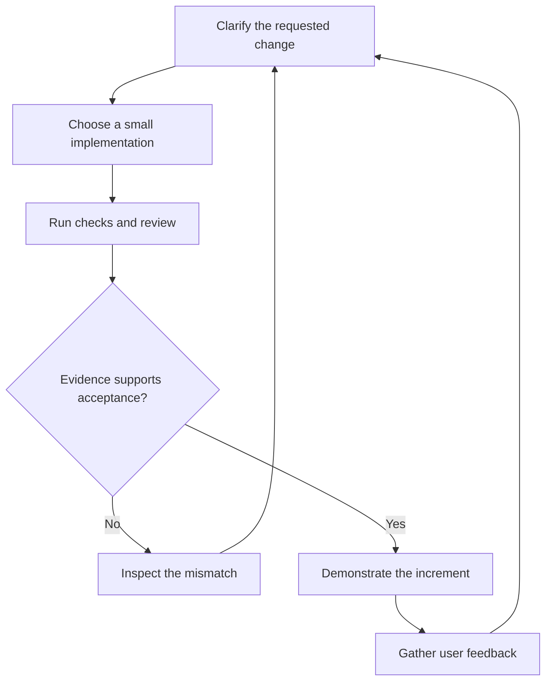

*OO Development and Agile Practices*  
*Designing, Testing and Evolving Software with AI Assistance*

Imagine a university that lends cameras, microphones and other equipment to its students. Your team has written a small program that decides whether a student may request another reservation. It looks at two things, the number of reservations the student already holds and the length of the loan requested, and every example you have tried gives the answer you expected. The program works, and for a little while that feels like the end of the story.

Then the equipment officer walks in with a change:

> Staff should also be able to borrow equipment, but their reservation limits will be different. The existing student limits should stay the same.

It sounds small: another condition, two new numbers, an afternoon's work. But the moment you try to start, questions arrive faster than answers. Where do the current limits live in the code? How will the program know whether a borrower is a student or a member of staff? Which of today's behaviours must not change? And when you are finished, what will convince anyone, including you, that the new rule works?

Those questions are the real subject of this book. Writing code that works is the beginning of software engineering, not the end of it. Over the next fifteen chapters we will build a small lending system, but we will spend just as much effort on how software is understood, tested, reviewed and changed, because change is where software spends most of its life. The aim is to make decisions that another developer can inspect and that your team can revise when the requirements move.

This first chapter is a warm-up, and it works the way the rest of the book will. You will read one small Java class closely enough to say what it does and, just as importantly, what it does not do. You will see why a program that works can still be hard to change, and how object-oriented design, iterative delivery, testing and review each help make a change controlled instead of risky. You will meet an AI assistant's explanation of that class and learn to separate the claims the code supports from the ones it does not. And you will finish with a short readiness check that tells you where to spend your effort in the chapters ahead.

A few practical words before you start. This chapter belongs to Week 1 but adds no week of its own, and it only previews ideas that later chapters teach properly, so do not expect it to be complete on any one topic. The class we study, `ReservationRules`, is a warm-up example, separate from the lending system that we build from Chapter 2 onwards. You need no more than basic familiarity with variables, conditions, methods and classes: no design patterns, no testing framework and no project-management tool. If some Java syntax is unfamiliar, read the explanation that follows each example and use the Java tutorial in the source list [1]; Appendix A has a short refresher and a readiness diagnostic.

Sections 1.1 to 1.8 are the heart of the chapter, so read them carefully. Then do the exercises in Section 1.9: Task A, the paper part of Task B (find one input that tells the original rule from the changed one), Task C and Activity 1A. Together they leave you with five things: a table of predictions, an input that exposes a fault, a short change note with a statement of what would convince you, your analysis of an AI explanation, and a readiness checklist. Everything you need is in the chapter, and you can do all of it on paper by tracing the code. If you have a Java Development Kit installed, you can also run the program and the deliberate fault from Task B, and you can answer the review questions and the transfer challenge. Section 15.1 has a longer introduction to working with AI assistants, but Activity 1A does not depend on it.

## 1.1 When a working program meets a new request

Let us start with the program itself. The equipment office gives us three rules to enforce:

- A student may have at most three active reservations.
- A requested loan lasts from one to seven days, inclusive.
- A request should be rejected if the supplied active-reservation count is negative.

These rules are invented for this book; they are not university policy. By an *active reservation* we mean one that has been confirmed and has not been cancelled or completed. The method will be handed the count of such reservations **before** the new one is added, and it is the caller's job to count them correctly.

Here is the whole class:

```java
public final class ReservationRules {
    public boolean mayRequest(int activeReservations, int requestedDays) {
        return activeReservations >= 0
                && activeReservations < 3
                && requestedDays >= 1
                && requestedDays <= 7;
    }
}
```

The class is just a named home for one calculation. Its method, `mayRequest`, takes two integers and answers `true` or `false`, and the `&&` operator means that all four conditions must hold at once. (`public` lets other code use the class and the method, and `final` stops anyone from building subclasses on top of it. Neither keyword says anything about whether the rule is right.)

The comparison `activeReservations < 3` is the one to read twice. Someone who already holds two reservations may ask for a third; someone who holds three may not ask for a fourth. Writing `<= 3` would quietly allow a fourth.

| Existing active reservations | Requested days | Result | Reason |
|---:|---:|---|---|
| 2 | 7 | `true` | One more reservation would reach the limit, and seven days is permitted |
| 3 | 7 | `false` | The borrower is already at the reservation limit |
| 0 | 0 | `false` | A zero-day loan is outside the stated range |
| 0 | 8 | `false` | Eight days exceeds the duration limit |
| -1 | 2 | `false` | The supplied count is invalid |

Now look at what `true` does and does not mean. The method does not know who the borrower is, has no calendar to consult, cannot tell whether the camera is free and stores nothing. It answers one narrow question: do these two numbers satisfy the rules? Everything else has to be checked by the rest of the application before a reservation is confirmed.

That narrowness is easy to forget, because a method's name suggests more than its body delivers. A developer who reads `true` as "the reservation is confirmed" will build a defect on top of a class that behaves exactly as written.

There is one more simplification, and it is better to say it aloud. Returning `false` for a negative count treats an impossible input like an ordinary refusal, so a bug in the caller could pass for a policy decision. We accept that here to keep the example small. Chapter 5 comes back to contracts, and to what code should do when a caller breaks one.

### What the new request really asks for

Suppose the officer clarifies the request:

> Students retain the limit of three active reservations and seven days. Staff may have up to five active reservations and request up to fourteen days.

The tempting edit is to replace `3` with `5` and `7` with `14`. That makes the method more generous to everybody, students included, and it still does not distinguish students from staff: the method is never told which kind of borrower is asking, so it has nothing to decide with.

So the first job is not to edit the code but to ask how the program learns a borrower's category, and what should happen when the category is missing or unknown. Do not quietly decide that every unrecognised borrower gets the staff allowance. That is a requirements decision, and nothing in the original code can settle it for us.

There are several ways to build the change. We could add an explicit category and a small conditional. We could pass in a limit chosen elsewhere. If more variations appear, we might give the policy a class of its own. Each approach asks something different of the callers and offers different places for mistakes to hide.

For now we do not need to pick a design pattern. We need to understand the rule, keep the student behaviour intact and choose something proportionate to the problem. Chapters 5 and 6 return to this situation with sharper design tools.

## 1.2 What does “it works” actually mean?

Ask whether a program works and you will usually get a quick yes. The better question is: works how, and under which conditions? Until we say what behaviour we expect, "it works" means only that nothing has gone wrong yet.

For the reservation rule that is easy to state: a seven-day student request with two reservations on record should be allowed. For a whole application it is not. We also expect it to know whether the equipment is available, to record reservations and to report failures sensibly, and a successful demonstration of one request answers none of those expectations.

There is a second question that matters just as much: how hard will it be to change this software correctly? **Maintainability** is our ability to understand, diagnose, test and modify software over its useful life. We will look for practical signs of it, not treat it as a label that someone attaches to a diagram.

Picture the seven-day limit appearing in a command-line screen, a reservation service and a report generator. A developer updates two of the three and misses the other. Each line, read alone, is perfectly clear, yet the system cannot be changed consistently, because one decision lives in three places. The trouble is in how the decision is spread across the **codebase**, the body of source code and supporting material that a team maintains together. That includes tests, build instructions and configuration, which decide whether a newcomer can work with the code at all. A beautifully clear method inside a project nobody else can build is only part of a maintainable solution.

### Turning “good quality” into questions you can answer

When you judge the reservation application, ask questions like these, and look for the evidence that would answer them:

| Concern | Question to investigate | Useful evidence |
|---|---|---|
| Functional behaviour | Are the stated reservation rules enforced? | Examples and tests linked to those rules |
| Modifiability | Can one policy change be made without unrelated edits? | A reviewed change and an explanation of affected responsibilities |
| Understandability | Can another developer explain where the decision is made? | A code walkthrough supported by accurate names and documentation |
| Testability | Can the rule be checked with controlled inputs? | Repeatable checks that do not depend on a live university service |
| Failure handling | What happens when required information is unavailable? | Explicit expectations and checks for the failure path |

These concerns pull against each other. Moving a rule into its own component can make it easier to test, but a swarm of tiny components makes the program harder to navigate. So a design choice should always be explained by the problem it solves and the cost it brings.

Not every change is the same kind of change, either. Correcting a wrong limit changes behaviour to meet the requirement. Adding staff borrowing introduces new behaviour. Reorganising the code while the visible behaviour stays exactly the same is **refactoring**, using the distinction Fowler describes [3]. It helps to keep these intentions apart, so that a reviewer knows whether a changed result was deliberate or an accident.

Nobody expects you to make a project ready for every possible future. You are expected to say what it assumes, and to respond thoughtfully when one of those assumptions stops being true.

## 1.3 How design and delivery fit together

So far we have looked at one class. Software never stays one class, and two kinds of thinking take over: how the code is organised, and how the team works on it over time.

Object-oriented development organises software around objects that have state, behaviour and responsibilities. A **responsibility** is something a part of the system is obliged to do: represent a loan period, decide whether a borrower is eligible, record a confirmed reservation. Putting code inside a class does not make a design good. A class can still mix unrelated decisions, expose information that callers misuse, or depend on details scattered across the application; Chapter 2 examines those problems through encapsulation, cohesion and coupling.

The domain gives us a first example of keeping meanings straight. An equipment item and a reservation are different things: the item is something the university owns, and the reservation is an arrangement about that item for a period. If the team keeps those two ideas apart, it can discuss requirements before it decides which fields and methods it needs.

Iterative delivery is about the other kind of thinking, how a team's understanding and software grow together. An **iteration** is a repeated period of work followed by feedback, and an **increment** adds usable capability to what already exists. A team might improve the reservation workflow over several iterations and deliver a new capability in each one. The Agile principles tie frequent delivery and adaptation to continued care for technical quality, and they ask teams to reflect and adjust how they work [2]. For us that means feedback should change not only what we build but how we build it.

Here is the kind of thing that happens. In an early demonstration the equipment officer turns out to use "reservation" for a confirmed allocation, while the team has been using it for a request nobody has approved yet. That one conversation can change names, states and user messages. Because it happened in a small working increment, there is a concrete example to talk about and only a little code to revise.

Design and process therefore meet at the change itself. Planning decides which behaviour the team intends to deliver. Design decides where its decisions belong. Tests and review help show whether the code matches the intention, and feedback may revise the intention or reveal that the structure was weak.



**Figure 1.1.** A change moves through clarification, implementation and evaluation. A mismatch may reveal a defect, a mistaken expectation or an unclear requirement. User feedback can begin another cycle after the increment is accepted.

Read the figure as a way of thinking, not a script. In practice you may clear up a detail while writing a test, or rethink a design during review. Chapter 3 introduces Agile approaches without asking us to settle those process questions now.

## 1.4 How do we know a change is right?

Suppose the student and staff rules are clear. What would make us willing to accept the change?

A good place to start is a set of **acceptance examples**: concrete situations with expected outcomes, agreed from the requirement. Before a new reservation is added, a student with two active reservations asking for seven days is eligible, and a student with three is not. A staff member with four reservations asking for fourteen days is eligible, and one with five is not. Writing the examples down has two benefits. It stops us from testing only the staff cases and forgetting that students must behave as before. And it shows what we still do not know, because nothing in these examples settles what to do with a borrower whose category is unknown.

An **automated test** runs a check again and again and compares what the code does with what we expected. A **regression** is an unintended change to behaviour that used to work, and regression checks help catch it, though how well they do depends on what they examine and whether their expectations are right.

Here is a small case. A test that asks for a two-day loan would not notice if someone changed `requestedDays <= 7` to `requestedDays < 7` by accident. A test with a seven-day request would. Both versions compile, because the compiler checks the rules of the language and has no idea that the equipment office allows seven days.

### What each kind of evidence can and cannot tell you

| Evidence | What it can help establish | What it does not establish by itself |
|---|---|---|
| Successful compilation | The source satisfies the compiler’s checks | The program implements the requested policy |
| Passing behavioural tests | The tested cases match their expected results | All relevant cases were identified correctly |
| Code review | Another person examined decisions, changes and risks | Every defect was discovered |
| User demonstration | The demonstrated workflow can be inspected against user expectations | Untested failure paths work correctly |
| Version history | The team can inspect what changed and why | Each recorded change was necessary or correct |

A good review connects these kinds of evidence. The reviewer might ask why the staff category is trusted, whether the student boundary is still covered, and whether the explanation matches the actual **diff**, the comparison that shows exactly what changed between two versions of the files. The diff gives the discussion something concrete to point at.

Feedback is only useful when it leads somewhere. "This is bad design" gives the author nothing to investigate. "The fourteen-day limit is repeated in two places, so the next change could leave them inconsistent" names a problem and its consequence.

As the project grows, the evidence grows with it. Chapter 7 develops automated testing and test-driven development, Chapter 11 looks at changing unfamiliar code safely, and Chapter 13 checks how components work together and introduces delivery pipelines. The habit to start building now is simple: for every claim you make about the code, know which check could show that you are wrong.

## 1.5 Working with an AI assistant without giving up your judgement

An AI coding assistant can explain code, suggest an implementation, propose test cases or review a change. Treat each of those as a candidate to examine, not an answer to accept. An assistant does not decide what the system should do, and a fluent reply is not the same as a correct one.

GitHub's documentation for Copilot inline suggestions says as much: a suggestion can look valid and still be incorrect, and users are responsible for reviewing and validating suggestions before accepting them [4]. That is guidance about one tool, not a claim that every model behaves the same way. In this book we apply the same discipline to any candidate output we use.

### Activity 1A: evaluate a candidate explanation

| | For this activity |
|---|---|
| Your goal | Decide which statements in an explanation the code actually supports |
| You start with | The class in Section 1.1 and its three stated rules |
| What is in bounds | Judge this one method. Do not rewrite it or reason about the rest of the application |
| How to check | The code itself, a hand trace of two inputs, and the stated rules |
| How to decide | Accept each claim the evidence supports, reject each it contradicts, and mark the rest as undetermined |
| No AI account? | The candidate output below is all you need |

The candidate output below was written by the author as a plausible AI response. It is a teaching example, not a recorded answer from any particular model.

> The method permits a request only when the active-reservation count is non-negative and below three, and the requested duration is between one and seven days inclusive. It returns a Boolean result. Before returning true, it consults the equipment database to confirm that the requested item is available.

Break the explanation into individual claims. For each claim, note:

1. Whether the code supports it, contradicts it, or gives too little information.
2. The expression, input or operation that justifies your decision.
3. What more you would need to know before making a broader claim about the application.

Then write a corrected explanation in two or three sentences. Keep the accurate parts; do not throw the whole response away because one part is wrong.

The skill being practised is finding where the evidence is. A real application might well have a database somewhere, but that does not show that this method consults it. Equally, the absence of a database call in this class does not prove that nothing else ever checks availability. Keep your conclusion as narrow as your evidence.

### If you use a live assistant

The supplied example is enough for the activity. If your course rules allow a live assistant and you have access to one, you can try this prompt:

> Explain only the behaviour visible in this Java class. Identify its inputs, returned result and any state changes. Separate facts visible in the code from assumptions about its caller. Do not invent surrounding services or rewrite the program.

Give it the class and compare its answer with your own trace. A confident explanation still needs checking, and a careful prompt does not guarantee a correct answer. Write down which tool you used, which claim you accepted or rejected, and the evidence behind the decision.

There is one danger worth naming now. If a misunderstood requirement shapes both an implementation and its tests, the two will agree with each other while both disagree with the intended policy. So always compare expected results with the clarified requirement, even when every generated test passes.

Use made-up project data, and follow the module leader's current rules about AI in assessments. Every AI exercise in this book has a route that needs no paid service. Chapter 15 gathers the recurring workflows and is meant to be consulted alongside any chapter; the activity in this chapter stands on its own.

## 1.6 The project we will build, and the road ahead

Throughout the book we will build the **Campus Equipment Lending System** in Java. A first useful version supports a handful of activities: look up availability, request a reservation, confirm an eligible request, hand over the equipment and record its return.

We start with a simple interface and data held in memory, so that the early chapters can stay focused on the rules of the domain. Later chapters introduce the boundaries needed for storage and for outside services. The `ReservationRules` class from the start of this chapter is only a warm-up. It is not the finished application and its structure is not a promise: the lending system proper begins with the Chapter 2 starter, and each later chapter says whether its code joins that project or stays in a separate teaching example. Appendix D lists, for every chapter, where the project stands, how many tests a build should report, and the rules of the domain.

### Words we will use

| Term | Meaning in the book |
|---|---|
| Borrower | A person seeking permission to borrow equipment |
| Equipment item | One individually identifiable piece of equipment |
| Reservation | A recorded arrangement for an item over a period, whose status matters |
| Loan | The actual issue of an item to a borrower, followed by its return |
| Loan period | The intended interval during which the item is borrowed |

A reservation and a loan are related but not the same. A confirmed reservation can exist before the borrower ever collects the equipment, and cancelling it is a different act from returning an item that has already been handed over.

We begin with a deliberately small scope: one item per reservation, explicit periods and invented borrowers. Once we use real dates we must decide when two periods overlap, and whether one may begin exactly when another ends. The plain number of days in Section 1.1 does not settle those calendar rules.

Along the way we will keep **invariants**: conditions the domain requires to stay true whenever the system is operating validly. A loan period must be valid, two confirmed reservations must not clash over the same item and period, and an inactive loan cannot be returned. These are goals for the implementation to grow into; the little rule class from Section 1.1 enforces none of them yet.

### The road ahead

| Chapters | What changes in your understanding |
|---|---|
| 2–4 | Objects and their responsibilities, a backlog of work, and a shared delivery workflow |
| 5–7 | Better responsibilities and dependencies, then behaviour developed with useful automated tests |
| 8–10 | Recurring design solutions, and how to organise a modest application |
| 11–13 | Improving unfamiliar code, reading project evidence, and absorbing a changed requirement across integration boundaries |
| 14 | Judging the result, documenting decisions and preparing a handover someone else can follow |
| 15 | Working with AI assistants, to consult alongside the relevant chapters |

Chapters 2 to 14 follow the thirteen teaching weeks; this chapter and Chapter 15 support that sequence without adding weeks of their own. Along the way the project reaches four stages: a kickoff in Week 3, a minimum viable product in Week 6, patterns and application structure in Week 9, and a verified response to a changed requirement in Week 12. The change itself is announced in Week 11.

The book's own lending system gives us shared examples, and each practical activity says whether you do it on the book's project or on your team's project. Teams choose their project domain from those the module offers; equipment lending and an ML model-serving tool are two examples. If your team works on another domain, its change requests will be different. That is why each chapter ends with a note on transfer: learn the reasoning well enough to apply it, because copying an equipment-related class name into another project does not show that the responsibility belongs there.

The module aims to prepare you to build reliable software around AI and data components, and the project reflects that without training a model. The book takes the data-component route. Its outside collaborator is the **equipment directory**, which answers the question "who is this borrower, and which category are they in?" from beyond the application. The application depends on it only through a contract, so a test can stand in for it and an outage can be told apart from an absent borrower. You will meet it in steps: Chapter 6 previews the contract, Chapter 7 shows how a test stands in for it, Chapter 8 builds the adapter that translates the provider's codes, Chapter 10 places it in the application structure, and Chapter 13 adds what a real provider needs. Each of those terms is explained where it first appears. If your team's project is a model-serving domain, the same questions apply to the component that calls the model. Using AI to help write software is a different subject, and Chapter 15 covers it.

## 1.7 How to read this book, and any other

When you meet code, predict its behaviour before you run it. Pick one ordinary case and one case near a limit, trace the decisions, write down the result you expect, and only then compare it with what the program prints. A mismatch is useful: it tells you that your understanding, the code or the requirement needs correcting, and you get to find out which.

When the book introduces extra structure, ask what problem made it worth having. If it adds a class, name the responsibility that class receives. If it adds an interface, name the caller that benefits. If you cannot, reread the problem before you copy the solution.

It also pays to keep a small learning record, with three entries for every practical session: the decision you made, the evidence you used and the uncertainty that remains. "I changed the condition" describes an action. "I kept the student limit and checked requests at two and three existing reservations" explains your intent and your evidence.

### Reading advice critically

Technical books recommend practices that suit particular circumstances. Read their advice as claims to understand and test, not as rules. Take an imaginary recommendation: "Give every class an interface." Ask which callers need interchangeable behaviour, what coupling the interface removes, and whether the extra files make this example easier or harder to follow. And when you criticise advice, criticise its strongest reasonable reading, not a cartoon of it.

A simple reading record helps:

| Entry | Question |
|---|---|
| Claim and location | What exactly does the author recommend, and where? |
| Context | What problem and assumptions surround the advice? |
| Supporting example | How does the example demonstrate the claimed benefit? |
| Limitation | Under what conditions might the cost outweigh the benefit? |
| Project application | What would change if we applied it to our system? |
| Further evidence | Which independently checked source or experiment helps evaluate it? |

The module includes an individual critical review of a book from the approved software-design and Agile-engineering list, due in Week 8. You will evaluate the book's principles and examples, discuss their trade-offs and limits, and consider how they apply to engineering AI-enabled systems, supported by further sources. Start reading early, and follow the current assignment brief for exactly what it requires. This textbook does not replace the book you choose, and an AI summary of a book you have not read is no evidence about it. Appendix E develops the review method; the reading record above is enough to begin with today.

## 1.8 Easy mistakes, and how to spot them

Each of these mistakes can be shown wrong with a small example from this chapter.

| Mistake | Counterexample | Better habit |
|---|---|---|
| Reading `true` as “the reservation is confirmed” | `mayRequest(0, 1)` returns `true` even if the camera is already reserved for that day | State what a result does and does not establish |
| Changing the numbers to add the new behaviour | Replacing `3` and `7` with `5` and `14` accepts a student request for eight days | Preserve existing cases while adding the new ones |
| Treating passing tests as proof | A test that expects students to borrow for fourteen days passes beside an implementation with the same error | Check expected results against the clarified requirement |
| Trusting a fluent explanation | Activity 1A’s explanation mixes accurate claims with an invented database call | Locate the code or requirement behind each claim |
| Assuming the edit is local | The seven-day limit may also appear in a screen and a report | Search for where each decision is represented before editing |

## 1.9 Try it yourself: a readiness check

This is a chance to find out what you need to practise. It is not a graded assessment. You only need the Java class from Section 1.1, its stated rules and the staff change; no team code is involved.

### Task A: read and explain

Without running the code, predict the result of each call below, and explain each answer by naming the condition that decides it.

| Call | Your predicted result | Your reason |
|---|---|---|
| `mayRequest(0, 1)` |  |  |
| `mayRequest(2, 7)` |  |  |
| `mayRequest(3, 1)` |  |  |
| `mayRequest(1, 8)` |  |  |
| `mayRequest(-1, 1)` |  |  |
| `mayRequest(1, 0)` |  |  |

Then identify the class name, method name, parameter types and return type, and say whether a call changes a reservation count or records a new reservation. If a keyword is unfamiliar, notice the difference between a gap in your Java syntax and a difficulty in understanding the rule; they need different remedies.

### Task B: examine one small fault

A developer changes `requestedDays <= 7` to `requestedDays < 7`. Find one input that tells the original and the modified versions apart. State both results and say which one agrees with the original requirement.

If you have a Java Development Kit, you can run it. Save the class as `ReservationRules.java` and create a separate file named `Chapter01Demo.java` containing:

```java
public class Chapter01Demo {
    public static void main(String[] args) {
        ReservationRules rules = new ReservationRules();
        System.out.println(rules.mayRequest(2, 7));
        System.out.println(rules.mayRequest(3, 7));
    }
}
```

From the directory containing both files, run:

```sh
javac ReservationRules.java Chapter01Demo.java
java Chapter01Demo
```

For the original class the output is:

```text
true
false
```

Now make the deliberate fault, repeat the same calls and explain the difference, then restore the original expression. Appendix B gives a complete, reproducible setup, but for this exercise a Java Development Kit and the commands above are all you need, and you do not have to install anything to do the paper version.

### Task C: plan the staff change

Write a short change note. Do not try to implement a complete redesign. The note should contain:

- The behaviour that must stay the same for students.
- The new staff behaviour, and the extra information needed to select it.
- One open question that should be clarified rather than guessed.
- At least four acceptance examples covering both categories and their limits.
- One simple way to implement the change, and one trade-off it brings.
- A statement, in two or three sentences, of what you would need to see before accepting the change as safe, and what that evidence would still not show.

Do Activity 1A as part of the same exercise, and make your analysis of the AI explanation distinguish what is said about this method from what is said about the whole application.

### What to produce

Keep, or hand in as your instructor directs: the completed prediction table, your input that exposes the fault, the change note with its statement of evidence, your analysis of the AI explanation, and the readiness checklist below. If you ran the program, include what you observed and say which version produced it.

You are done when your predictions follow the code, your proposed change keeps the original student rule, your acceptance examples could expose a boundary error, and your evidence statement names checks that could show the change to be wrong. You should also be able to explain why the method alone cannot confirm that equipment is available.

If you want more, once your team has chosen its project domain, repeat Task C for one numeric limit in that domain.

| Readiness question | Confident | Need practice |
|---|---|---|
| I can trace a Boolean expression with several conditions. | ☐ | ☐ |
| I can distinguish a method’s inputs, returned result and state changes. | ☐ | ☐ |
| I can identify a case at the edge of an allowed range. | ☐ | ☐ |
| I can separate a confirmed requirement from an assumption. | ☐ | ☐ |
| I can explain what evidence supports a code explanation. | ☐ | ☐ |
| I can describe a small change and the behaviour it must preserve. | ☐ | ☐ |

Choose one item marked "Need practice" and decide what you will do about it. For syntax, use the relevant Java tutorial [1]; Appendix A has a refresher. For tracing, work through another input with a partner. For requirements, rewrite the rule as concrete examples and see what is left unanswered.

## 1.10 Questions to think with

### Concept questions

1. Give an example of software that produces the expected result today but is difficult to maintain. What makes the next change risky?
2. Explain the difference between an iteration and an increment using the equipment-lending project.
3. Why does passing a set of tests give useful but limited evidence? Include an example of an incorrect expectation.
4. Distinguish a behaviour change from a refactoring. Why should a reviewer know which one is intended?

### Applied diagnosis

5. A developer replaces the student limits of three reservations and seven days with five and fourteen. Staff examples now pass. Explain why this is not enough to show the requested change is correct, and give a student example that exposes the problem.
6. An AI assistant writes a method and tests for it. Every test passes, so the team accepts the change without comparing it with the equipment officer's rules. Identify the gap in the reasoning and propose a check that closes it.

### Transfer challenge

A room-booking application allows each student society to make up to two active bookings, each lasting at most two hours. University departments now need up to four active bookings, each lasting at most three hours. The society rules should stay as they are.

Prepare a change note using the method from Task C. State any assumptions you need about duration values and booking status. Give one example that must still be rejected for a society but is allowed for a department, and name one fact about room availability that these numeric rules alone cannot establish.

No design pattern is needed. Your task is to explain the change, keep existing behaviour and identify the evidence that would support accepting it.

## What to take away, and what comes next

A program that works is where engineering begins. To change it responsibly we have to understand the behaviour being asked for, find the decisions that implement it and know what must stay true afterwards.

Object-oriented design helps us organise responsibilities, and iterative delivery gives us regular chances to look at a useful increment and revise our understanding. Tests, reviews, demonstrations and version history each contribute a different kind of evidence, and none of them is a guarantee beyond its own reach.

The little reservation example also showed why working with AI takes judgement. A plausible explanation can mix accurate observations with an invented operation, so we weigh each claim against the code and the requirements, and we record why we accepted or rejected it.

In **Chapter 2: Object-Oriented Development Beyond Syntax** we look inside a small lending system: how objects protect their state, how responsibilities are handed out, and how cohesion and coupling shape the changes we make.

## Sources and further reading

The scenario, project rules, code, diagrams and exercises in this chapter are original teaching examples. External sources support the specific concepts identified below. Web sources were checked on 12 October 2026.

1. **Dev.java.** [Classes and Objects](https://dev.java/learn/language/oop/classes-objects/). Official Java learning material on classes, methods, constructors and objects. Use the relevant subsection to address a syntax gap; reading the entire tutorial is not a prerequisite for this chapter.
2. **Authors of the Agile Manifesto.** [Principles behind the Agile Manifesto](https://agilemanifesto.org/principles.html), 2001. Supports the discussion of frequent delivery, adaptation, technical quality and team reflection in Section 1.3. This chapter does not yet teach a complete Agile framework.
3. **Fowler, Martin.** [Definition of Refactoring](https://martinfowler.com/bliki/DefinitionOfRefactoring.html), 1 September 2004. Supports the distinction between internal restructuring and changes to observable behaviour in Section 1.2.
4. **GitHub Docs.** [Application card: GitHub Copilot inline suggestions](https://docs.github.com/en/copilot/responsible-use/inline-suggestions). A vendor’s account of its tool’s uses and limitations, including the warning that suggestions can look valid while incorrect and the user’s responsibility to review and validate them. Used as a specific example in Section 1.5, not as an endorsement or a general evaluation of all AI assistants.