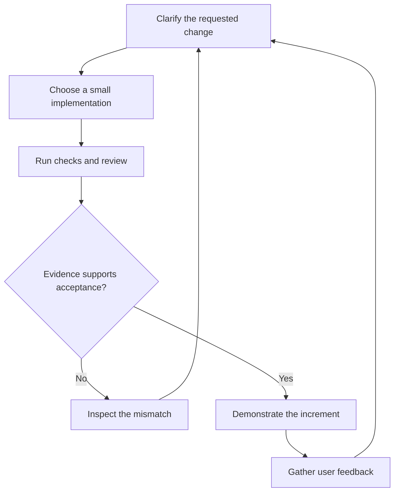

*OO Development and Agile Practices*  
*Designing, Testing and Evolving Software with AI Assistance*

## Opening scenario

A university lends cameras, microphones and other equipment to students. Your team has written a small program that decides whether a student may request another reservation. It checks the number of active reservations and the requested duration. The examples you tried produce the expected answers.

Then the equipment officer asks for a change:

> Staff should also be able to borrow equipment, but their reservation limits will be different. The existing student limits should stay the same.

The change sounds simple. Perhaps it requires another condition and two new numbers. However, the team now needs to answer several questions. Where do the current limits appear? How will the program know whether a borrower is a student or a staff member? Which existing behaviours must be preserved? What evidence will show that the new rule works?

These questions are the starting point of this book. We will build software, but we will also examine how it is understood, tested, reviewed and changed. The goal is to make decisions that another developer can inspect and that the team can revise when requirements develop.

## Learning outcomes and reading route

After working through this chapter, you should be able to:

1. Explain why a functioning program may still be difficult to maintain.
2. Describe how object-oriented design, iterative delivery, testing and review contribute to a controlled change.
3. Read a small Java class and distinguish its actual behaviour from assumptions about the larger system.
4. Identify evidence needed to evaluate a proposed change or an AI-generated explanation.
5. Use the book’s learning route and a readiness diagnostic to plan your study.

This is an orientation chapter for Week 1. It adds no teaching week and previews ideas that later chapters teach in full. Its code is a **Book project** orientation example: `ReservationRules` stays outside the cumulative Campus Equipment Lending code, which starts with the Chapter 2 starter.

**Prerequisites.** You need basic familiarity with variables, conditions, methods and classes. You do not yet need design patterns, a testing framework or an Agile project-management tool. If Java syntax is unfamiliar, read the explanation that accompanies each example, then use the Java reading in the source list [1]; Appendix A has a short Java refresher and a readiness diagnostic.

**Core reading.** Read Sections 1.1–1.8.

**Minimum required lab.** Complete Task A, Task B (the paper part: find one input that separates the original rule from the changed one), Task C and Activity 1A. Together they produce every item in “What to produce”: the prediction table, the fault-revealing input, the change note with its evidence statement, the AI claim analysis and the readiness checklist. Everything needed is in this chapter, and you can do all of it by tracing the code on paper.

**Optional extension.** Run the program and the deliberate fault (the optional execution exercise in Task B, which needs a Java Development Kit), then answer the review questions and the transfer challenge. Section 15.1 gives a longer introduction to assistance and accountability, but Activity 1A does not depend on it.

## 1.1 A working program meets a new requirement

For the opening example, the equipment office gives us these initial rules:

- A student may have at most three active reservations.
- A requested loan lasts from one to seven days, inclusive.
- A request should be rejected if the supplied active-reservation count is negative.

These are fictional teaching rules for our project, not university policy. Here, *active reservation* means a confirmed reservation that has not been cancelled or completed. The count supplied to the method is the count **before** the proposed reservation is added. The caller must obtain that count correctly.

Consider this complete Java class:

```java
public final class ReservationRules {
    public boolean mayRequest(int activeReservations, int requestedDays) {
        return activeReservations >= 0
                && activeReservations < 3
                && requestedDays >= 1
                && requestedDays <= 7;
    }
}
```

The class groups a rule calculation under the name `ReservationRules`. Its `mayRequest` method receives two integers and returns a Boolean result: `true` or `false`. The `&&` operator requires all four conditions to hold. `public` makes the class and method accessible to other code; `final` prevents this class from being subclassed. Neither keyword proves that the rule is correct.

The comparison `activeReservations < 3` deserves attention. A borrower who already has two active reservations may request a third. A borrower who already has three may not request a fourth. Writing `<= 3` would allow one reservation too many if a successful request were subsequently confirmed.

| Existing active reservations | Requested days | Result | Reason |
|---:|---:|---|---|
| 2 | 7 | `true` | One more reservation would reach the limit, and seven days is permitted |
| 3 | 7 | `false` | The borrower is already at the reservation limit |
| 0 | 0 | `false` | A zero-day loan is outside the stated range |
| 0 | 8 | `false` | Eight days exceeds the duration limit |
| -1 | 2 | `false` | The supplied count is invalid |

Notice the limited meaning of `true`. The method does not identify a borrower, inspect a calendar, check whether a camera is available or store a reservation. It answers only whether the two supplied numbers satisfy these rules. A larger application must perform the other checks before confirming a reservation.

This distinction matters because method names can suggest more than their implementations establish. A developer who interprets `true` as “the reservation is confirmed” may introduce a defect even though this class behaves exactly as written.

One more simplification deserves a label. Returning `false` for a negative count treats an impossible input like an ordinary refusal, so a caller bug could look like a policy decision. We accept this here to keep the example small. Chapter 5 returns to contracts and to how code should respond when a caller breaks them.

### Clarifying the changed requirement

Suppose the equipment officer clarifies the new request as follows:

> Students retain the limit of three active reservations and seven days. Staff may have up to five active reservations and request up to fourteen days.

Replacing `3` with `5` and `7` with `14` would make the method more permissive for everyone. It would not implement the distinction between students and staff. The existing method receives no borrower category, so it cannot make that distinction from its inputs.

Before editing it, ask how borrower categories are established and what should happen if a category is missing or unknown. Do not silently decide that every unrecognised borrower should receive the staff allowance. That is a requirements decision, not a fact we can infer from the original code.

We have several possible implementation approaches. We could add an explicit category and a small conditional. We could pass a separately selected limit into the calculation. As further variations emerge, we might give the policy its own responsibility. Each approach creates different obligations for callers and different places where mistakes could occur.

At this stage, we do not need to select a design pattern. We need to understand the rule, preserve student behaviour and choose a proportionate implementation. Chapters 5 and 6 will return to this kind of problem with more precise design tools.

## 1.2 Behaviour, quality and maintenance

The first question about a program is often whether it works. To answer that question usefully, we must say what behaviour is expected and under which conditions.

For the reservation rule, we can state an expected result for a seven-day student request. For the complete application, we also need expectations about equipment availability, recording reservations and reporting failures. A successful demonstration of one request does not answer all of those questions.

There is a further question: how difficult will the software be to change correctly? **Maintainability** concerns our ability to understand, diagnose, test and modify software over its useful life. In this book, we will look for practical evidence of that ability rather than treat maintainability as a label attached to a diagram.

Imagine that the seven-day limit appears in a command-line screen, a reservation service and a report generator. A developer updates two locations and misses the third. Each individual expression may be easy to read, yet the system is difficult to change consistently. The problem lies in how one decision is represented across the codebase.

A **codebase** is the body of source code and supporting material that the team maintains together. Its tests, build instructions and configuration affect whether another person can work with it. A clear method inside a project that no one else can build is only part of a maintainable solution.

### Making quality claims concrete

Consider the following questions when evaluating the reservation application:

| Concern | Question to investigate | Useful evidence |
|---|---|---|
| Functional behaviour | Are the stated reservation rules enforced? | Examples and tests linked to those rules |
| Modifiability | Can one policy change be made without unrelated edits? | A reviewed change and an explanation of affected responsibilities |
| Understandability | Can another developer explain where the decision is made? | A code walkthrough supported by accurate names and documentation |
| Testability | Can the rule be checked with controlled inputs? | Repeatable checks that do not depend on a live university service |
| Failure handling | What happens when required information is unavailable? | Explicit expectations and checks for the failure path |

These concerns may interact. Moving a rule into a separate component can make testing easier, but creating many tiny components can make navigation harder. A design choice should therefore be explained in relation to the problem it solves and the cost it introduces.

Maintenance also includes different kinds of change. Correcting a wrong limit changes behaviour to meet the requirement. Adding staff borrowing introduces new behaviour. Improving the internal organisation while preserving observable behaviour is **refactoring**, following the distinction described by Fowler [3]. Keeping these intentions separate makes review easier: a reviewer should know whether a changed result is deliberate or accidental.

You will not be expected to make the project ready for every possible future. You will be expected to state its assumptions and respond thoughtfully when a relevant assumption changes.

## 1.3 Connecting object-oriented development with iterative delivery

Object-oriented development gives us a way to organise software around objects with state, behaviour and responsibilities. A **responsibility** is an obligation assigned to part of the system: for example, representing a loan period, deciding whether a borrower is eligible, or recording a confirmed reservation.

Putting code inside a class does not automatically create a useful design. A class can still contain unrelated decisions, expose information that callers can misuse, or depend on details scattered throughout the application. Chapter 2 examines these problems through encapsulation, cohesion and coupling.

In the equipment-lending domain, an equipment item and a reservation represent different things. The item is something the university owns; the reservation is an arrangement concerning that item for a period. Keeping those meanings clear helps the team discuss requirements before it decides exactly which fields or methods are needed.

Iterative delivery addresses how the team develops its understanding and software over time. An **iteration** is a repeated period of work and feedback. An **increment** adds usable capability to what already exists. A team can improve a reservation workflow over several iterations while delivering successive increments of functionality.

The Agile principles connect frequent delivery and adaptation with continuing attention to technical quality. They also call for teams to reflect and adjust their way of working [2]. The implication for our project is practical: feedback should influence both what we build and how we build it.

Suppose an early demonstration reveals that the equipment officer uses “reservation” to mean a confirmed allocation, while the team has used it for an unapproved request. That feedback can change names, states and user messages. Discovering the mismatch in a small working increment gives us a concrete example to discuss and a bounded amount of code to revise.

Design and process therefore meet at the change itself. Planning determines which behaviour the team intends to deliver. Design determines where its decisions belong. Tests and review help determine whether the implementation matches those intentions. Feedback may revise the intentions or reveal a weakness in the structure.



**Figure 1.1.** A change moves through clarification, implementation and evaluation. A mismatch may reveal a defect, a mistaken expectation or an unclear requirement. User feedback can begin another cycle after the increment is accepted.

The diagram is a learning model, not a mandatory sequence in which every activity happens only once. In practice, a developer may clarify a detail while writing a test or revisit a design during review. Chapter 3 introduces Agile approaches without requiring us to settle those process details here.

## 1.4 Testing, review and feedback

Once the student and staff rules are understood, what would make us willing to accept the change?

A useful starting point is a set of **acceptance examples**: concrete situations with expected outcomes agreed from the requirement. Before a new reservation is added, a student with two active reservations requesting seven days is eligible under the numeric rules. A student with three is not. A staff member with four requesting fourteen days is eligible; one with five is not.

These examples make the distinction visible. They also prevent us from validating the change using only staff cases and forgetting existing student behaviour. They do not resolve an unknown borrower category; that expectation still needs clarification.

An **automated test** performs a check repeatedly and compares observed behaviour with an expected result. A **regression** is an unintended loss or alteration of behaviour that previously worked. Regression checks help reveal such changes, although their usefulness depends on what they examine and whether their expectations are correct.

For example, a test of a two-day request would not reveal an accidental change from `requestedDays <= 7` to `requestedDays < 7`. A seven-day example would. Both implementations can compile. The compiler checks language rules; it does not know that the equipment office permits seven days.

### Several kinds of evidence

| Evidence | What it can help establish | What it does not establish by itself |
|---|---|---|
| Successful compilation | The source satisfies the compiler’s checks | The program implements the requested policy |
| Passing behavioural tests | The tested cases match their expected results | All relevant cases were identified correctly |
| Code review | Another person examined decisions, changes and risks | Every defect was discovered |
| User demonstration | The demonstrated workflow can be inspected against user expectations | Untested failure paths work correctly |
| Version history | The team can inspect what changed and why | Each recorded change was necessary or correct |

A review should connect the evidence. The reviewer might ask why the staff category is trusted, whether the student boundary remains covered and whether the explanation matches the actual diff. A **diff** is a comparison showing changes between versions of files. It gives the discussion a concrete object: the team can inspect precisely what is being proposed.

Feedback should lead to an action or a justified decision. “This is bad design” gives the author little to investigate. “The fourteen-day limit is repeated in two places, so the next change could leave them inconsistent” identifies a problem and its consequence.

As the project grows, the evidence will become richer. Chapter 7 develops automated testing and test-driven development. Chapter 11 examines safe changes to unfamiliar code. Chapter 13 checks interactions between components and introduces delivery pipelines. Here, the essential habit is to match each claim with a check that could reveal it to be wrong.

## 1.5 AI assistance and human judgement

An AI coding assistant may offer an explanation, suggest an implementation, propose test cases or review a change. These are useful candidate contributions to examine. They do not automatically settle what the system should do or whether an answer is correct.

GitHub’s documentation for Copilot inline suggestions, for example, warns that a suggestion can look valid and still be incorrect, and it says users are responsible for reviewing and validating suggestions before accepting them [4]. This is guidance about a particular tool, not evidence that every model has identical behaviour. In this book, we will apply the same review discipline to any candidate output we use.

### Activity 1A Evaluate a candidate explanation

| Element | For this activity |
|---|---|
| Engineering objective | Decide which statements in an explanation the code actually supports |
| Input | The class in Section 1.1 and its three stated rules |
| Permitted scope | Judge this one method. Do not rewrite it or reason about the rest of the application |
| Independent checks | The code itself, a hand trace of two inputs, and the stated rules |
| Accept or reject | Accept each claim the evidence supports, reject each it contradicts, and mark the rest as undetermined |
| No-account route | The candidate output below is all you need |

The candidate output is an **author-written teaching example of a plausible AI response**. It was constructed for this exercise and is not a recorded output from a particular model.

> The method permits a request only when the active-reservation count is non-negative and below three, and the requested duration is between one and seven days inclusive. It returns a Boolean result. Before returning true, it consults the equipment database to confirm that the requested item is available.

Break the explanation into individual claims. For each claim, record:

1. Whether the code supports it, contradicts it, or provides insufficient information.
2. The expression, input or operation that justifies your decision.
3. Any further information needed to make a broader claim about the application.

Then write a corrected explanation in two or three sentences. Preserve the accurate parts instead of rejecting the entire response because one part is wrong.

The key skill is locating evidence. The presence of a database elsewhere in a real application would not establish that this method consults it. Likewise, a missing database call in this class would not prove that no other component ever checks availability. Keep the scope of your conclusion precise.

### Using a live assistant

The supplied example is sufficient for the activity. If live AI use is permitted and available, an optional prompt is:

> Explain only the behaviour visible in this Java class. Identify its inputs, returned result and any state changes. Separate facts visible in the code from assumptions about its caller. Do not invent surrounding services or rewrite the program.

Provide the class and compare the response with your own trace. A confident explanation still needs checking, and a careful prompt does not guarantee a correct answer. Record the tool used, the claim you accepted or rejected and the evidence behind that decision.

An important danger arises when the same misunderstood requirement influences both an implementation and its tests. They may agree with each other while both disagree with the intended policy. Reviewing expected results against a clarified requirement is therefore necessary even when all generated tests pass.

Use synthetic project data, and follow the module leader’s current rules for permitted AI use in assessments. Every AI exercise in this book has a route that does not require a paid service. Chapter 15 collects the recurring workflows and is meant to be consulted alongside any chapter; this chapter’s activity is self-contained.

## 1.6 The running example and the semester route

Throughout the book, we will develop the **Campus Equipment Lending System** in Java. The first useful system will support a small set of activities: inspect availability, request a reservation, confirm an eligible request, issue the equipment and record its return.

We will begin with a simple interface and data held in memory. This keeps the early examples focused on domain behaviour. Later chapters introduce the boundaries needed to work with storage and external services. The opening `ReservationRules` class is a small orientation example, not the completed application or a promise that its structure will remain unchanged. It is a separate teaching example: the cumulative project begins with the Chapter 2 starter, and each later chapter states whether its code joins that project or stays on a separate teaching branch. Appendix D lists, for every chapter, where the project stands, which count a build should report and the rules of the domain.

### Domain vocabulary

| Term | Meaning in the book |
|---|---|
| Borrower | A person seeking permission to borrow equipment |
| Equipment item | One individually identifiable piece of equipment |
| Reservation | A recorded arrangement for an item over a period, whose status matters |
| Loan | The actual issue of an item to a borrower, followed by its return |
| Loan period | The intended interval during which the item is borrowed |

A reservation and a loan are related but distinct. A confirmed reservation can exist before the borrower collects the equipment. Cancelling that reservation is different from returning an item already issued.

The initial scope is deliberately small: one item per reservation, explicit periods, and synthetic borrowers. Once we represent actual dates and times, we must define when periods overlap and whether one period can begin exactly when another ends. The integer duration in Section 1.1 does not settle those calendar rules.

We will also preserve **invariants**: conditions that the domain requires to remain true during valid operation. Examples include a valid loan period, no conflicting confirmed reservations for the same item and period, and no return operation on an inactive loan. These requirements will guide the evolving implementation; the small rule class has not already implemented all of them.

### How the chapters build on one another

| Reading | Main development in your understanding |
|---|---|
| Chapters 2–4 | Understand objects and responsibilities, create a backlog, and establish a shared delivery workflow |
| Chapters 5–7 | Improve responsibilities and dependencies, then develop behaviour with useful automated tests |
| Chapters 8–10 | Evaluate recurring design solutions and organise a modest application |
| Chapters 11–13 | Improve unfamiliar code, interpret project evidence, and implement a changed requirement across integration boundaries |
| Chapter 14 | Evaluate the result, document decisions and prepare a reproducible handover |
| Chapter 15 | Consult AI-assisted engineering methods alongside the relevant chapters |

Chapters 2–14 follow the thirteen teaching weeks. This introduction and Chapter 15 support that sequence without adding teaching weeks. The project checkpoints correspond to kickoff in Week 3, an MVP in Week 6, patterns and application structure in Week 9, and a verified response to changed requirements in Week 12. The later assessment change is introduced in Week 11.

The book’s worked system provides shared examples, and each practical activity says whether it runs on the **Book project** or on your **Team project**. Teams choose a project domain from those the module provides; equipment lending and an ML model-serving tool are examples. If your team uses another domain, its change requests will differ. Each chapter therefore ends with a transfer note. Learn the reasoning well enough to apply it: copying an equipment-related class name into another project does not establish that the responsibility belongs there.

The module aims to prepare you to build reliable software around AI and data components, and the running project reflects that. It does not require training a model. The book takes the data-component route. Its data-backed collaborator is the **equipment directory**, which answers the question “who is this borrower, and which category are they in?” from outside the application. The domain code depends on it only through a contract. You meet it in steps: Chapter 6 previews the contract, Chapter 7 shows how a test substitutes it, Chapter 8 builds the adapter that translates the provider's codes, Chapter 10 places it in the application structure, and Chapter 13 adds what a real provider needs, namely timeouts and an explicit fallback-or-failure policy. It gives us a concrete place to discuss interpreting inputs, handling failures, evaluating outputs and substituting a test double. If your team's project uses a model-serving domain, the same questions apply to the component that calls the model. Using AI to help write software is a different topic, and Chapter 15 covers it. Neither turns this book into a machine-learning implementation course.

## 1.7 How to study and read critically

When you encounter code, predict its behaviour before executing it. Select one ordinary case and one case near a limit. Trace the decisions, write the expected result, and only then compare it with the program’s output. A mismatch is an opportunity to identify whether your understanding, the code or the requirement needs correction.

For a worked design, ask what problem made the additional structure useful. If the chapter introduces a new class, identify the responsibility it receives. If it introduces an interface, identify the caller that benefits from it. If you cannot name the benefit, reread the problem before copying the solution.

Keep a small learning record with three entries for each practical session: the decision you made, the evidence you used and the uncertainty that remains. For example, “I changed the condition” describes an action. “I retained the student limit and checked requests at two and three existing reservations” explains intent and evidence.

### Reading software-engineering advice

Technical books often recommend useful practices for particular circumstances. Read those recommendations as claims to understand and evaluate. Consider a hypothetical statement: “Give every class an interface.” Ask which callers need interchangeable behaviour, what coupling the interface reduces and whether the additional files make this example easier to understand. A criticism should examine the strongest reasonable interpretation of the advice, not an exaggerated version.

Use this reading record:

| Entry | Question |
|---|---|
| Claim and location | What exactly does the author recommend, and where? |
| Context | What problem and assumptions surround the advice? |
| Supporting example | How does the example demonstrate the claimed benefit? |
| Limitation | Under what conditions might the cost outweigh the benefit? |
| Project application | What would change if we applied it to our system? |
| Further evidence | Which independently checked source or experiment helps evaluate it? |

The module includes an individual critical review of a book from the approved software-design and Agile-engineering list, due in Week 8. The review asks you to evaluate the book’s principles and examples, discuss their trade-offs and limits, and consider how they apply to engineering AI-enabled systems, supported by additional sources. Begin reading early and follow the current assignment brief for its exact requirements. This textbook does not replace the book you select, and an AI summary of a book you have not read is not evidence about it. Appendix E develops the review method; the table above is enough to start a useful reading record now.

## 1.8 Common mistakes

Each mistake below can be exposed with a small counterexample from this chapter.

| Mistake | Counterexample | Better habit |
|---|---|---|
| Reading `true` as “the reservation is confirmed” | `mayRequest(0, 1)` returns `true` even if the camera is already reserved for that day | State what a result does and does not establish |
| Changing the numbers to add the new behaviour | Replacing `3` and `7` with `5` and `14` accepts a student request for eight days | Preserve existing cases while adding the new ones |
| Treating passing tests as proof | A test that expects students to borrow for fourteen days passes beside an implementation with the same error | Check expected results against the clarified requirement |
| Trusting a fluent explanation | Activity 1A’s explanation mixes accurate claims with an invented database call | Locate the code or requirement behind each claim |
| Assuming the edit is local | The seven-day limit may also appear in a screen and a report | Search for where each decision is represented before editing |

## 1.9 Readiness diagnostic and practical task

This diagnostic helps identify what you need to practise. It is not a new graded assessment. It runs on the **Book project**: use the Java class in Section 1.1, its stated rules and the staff change as your materials. No team code is needed.

### Task A Read and explain

Without running the code, predict the results of these calls. Explain each answer by identifying the relevant condition.

| Call | Your predicted result | Your reason |
|---|---|---|
| `mayRequest(0, 1)` |  |  |
| `mayRequest(2, 7)` |  |  |
| `mayRequest(3, 1)` |  |  |
| `mayRequest(1, 8)` |  |  |
| `mayRequest(-1, 1)` |  |  |
| `mayRequest(1, 0)` |  |  |

Identify the class name, method name, parameter types and return type. Explain whether a call modifies a reservation count or records a new reservation. If you are unfamiliar with a keyword, distinguish that syntax gap from a difficulty understanding the rule.

### Task B Examine one small fault

A developer changes `requestedDays <= 7` to `requestedDays < 7`. Provide one input that distinguishes the original and modified versions. State both results and explain which result agrees with the initial requirement.

Optional execution: save the class as `ReservationRules.java` and create a separate file named `Chapter01Demo.java` containing:

```java
public class Chapter01Demo {
    public static void main(String[] args) {
        ReservationRules rules = new ReservationRules();
        System.out.println(rules.mayRequest(2, 7));
        System.out.println(rules.mayRequest(3, 7));
    }
}
```

From the directory containing both files, use a Java Development Kit:

```sh
javac ReservationRules.java Chapter01Demo.java
java Chapter01Demo
```

For the original class, the output is:

```text
true
false
```

If you make the deliberate fault, repeat the same calls and explain the difference. Restore the original expression afterwards. Appendix B gives a full, reproducible development setup; a Java Development Kit and the commands shown above are all this exercise needs, and installing tools is not required to complete the paper diagnostic.

### Task C Plan the staff change

Write a short change note without implementing a complete redesign. Include:

- The behaviour that must remain unchanged for students.
- The new staff behaviour and the extra information needed to select it.
- One unresolved question that should be clarified rather than guessed.
- At least four acceptance examples covering both categories and their limits.
- One simple implementation approach and one trade-off it introduces.
- An evidence statement of two or three sentences: what you would need to see before accepting the change as safe, and what that evidence would still not show.

Complete Activity 1A as part of the same exercise. Your AI claim analysis should distinguish statements about this method from statements about the whole application.

### What to produce

Submit or retain, as your instructor directs, your completed prediction table, your fault-revealing input, the short change note with its evidence statement, the AI claim analysis and the readiness checklist below. If you run the program, include the observed result and identify which version produced it.

The task is complete when your predictions follow the code, your proposed change preserves the original student rule, your acceptance examples could reveal a boundary error, and your evidence statement names checks that could show the change to be wrong. You should be able to explain why the method alone cannot confirm equipment availability.

An optional extension: once your team has chosen its project domain, repeat Task C for one numeric limit in that domain.

| Readiness question | Confident | Need practice |
|---|---|---|
| I can trace a Boolean expression with several conditions. | ☐ | ☐ |
| I can distinguish a method’s inputs, returned result and state changes. | ☐ | ☐ |
| I can identify a case at the edge of an allowed range. | ☐ | ☐ |
| I can separate a confirmed requirement from an assumption. | ☐ | ☐ |
| I can explain what evidence supports a code explanation. | ☐ | ☐ |
| I can describe a small change and the behaviour it must preserve. | ☐ | ☐ |

Choose one item marked “Need practice” and state your next action. For syntax, use the relevant Java tutorial [1] (Appendix A has a refresher). For tracing, work through another input with a partner. For requirements, rewrite the rule as concrete examples and identify what remains unanswered.

## 1.10 Review questions and a transfer challenge

### Concept questions

1. Give an example of software that produces the expected result today but is difficult to maintain. What makes the next change risky?
2. Explain the difference between an iteration and an increment using the equipment-lending project.
3. Why does passing a set of tests provide useful but limited evidence? Include an example of an incorrect expectation.
4. Distinguish a behaviour change from a refactoring. Why should a reviewer know which one is intended?

### Diagnosis questions

5. A developer replaces the student limits of three reservations and seven days with five and fourteen. Staff examples now pass. Explain why this is insufficient evidence that the requested change is correct, and give a student example that exposes the problem.
6. An AI assistant writes a method and tests for it. Every test passes, so the team accepts the change without comparing it with the equipment officer’s rules. Identify the gap in the reasoning and propose a check that addresses it.

### Transfer challenge

A room-booking application allows each student society to make up to two active bookings, each lasting at most two hours. University departments now need up to four active bookings, each lasting at most three hours. The society rules should remain unchanged.

Prepare a change note using the method from Task C. State any assumptions you need about duration values and booking status. Give one example that must remain rejected for a society but is allowed for a department. Identify one fact about room availability that these numeric rules alone cannot establish.

No design pattern is required. Your task is to explain the change, preserve existing behaviour and identify evidence that would support acceptance.

## 1.11 Chapter summary

A functioning program is a starting point for engineering work. To change it responsibly, we need to understand the requested behaviour, locate the decisions that implement it and identify what must remain true.

Object-oriented design helps organise responsibilities. Iterative delivery creates opportunities to inspect useful increments and revise our understanding. Tests, reviews, demonstrations and version history contribute different kinds of evidence; none should be mistaken for a guarantee beyond its scope.

The small reservation example also shows why AI-assisted work requires judgement. A plausible explanation can combine accurate observations with an invented operation. Evaluate individual claims against the code and requirements, and record why a contribution was accepted or rejected.

In **Chapter 2: Object-Oriented Development Beyond Syntax**, we will examine how objects protect their state, how responsibilities are assigned, and how cohesion and coupling affect the changes we make. The equipment-lending project will give those ideas a concrete setting.

## Sources and further reading

The scenario, project rules, code, diagrams and exercises in this chapter are original teaching examples. External sources support the specific concepts identified below. Web sources were checked on 12 October 2026.

1. **Dev.java.** [Classes and Objects](https://dev.java/learn/language/oop/classes-objects/). Official Java learning material on classes, methods, constructors and objects. Use the relevant subsection to address a syntax gap; reading the entire tutorial is not a prerequisite for this chapter.
2. **Authors of the Agile Manifesto.** [Principles behind the Agile Manifesto](https://agilemanifesto.org/principles.html), 2001. Supports the discussion of frequent delivery, adaptation, technical quality and team reflection in Section 1.3. This chapter does not yet teach a complete Agile framework.
3. **Fowler, Martin.** [Definition of Refactoring](https://martinfowler.com/bliki/DefinitionOfRefactoring.html), 1 September 2004. Supports the distinction between internal restructuring and changes to observable behaviour in Section 1.2.
4. **GitHub Docs.** [Application card: GitHub Copilot inline suggestions](https://docs.github.com/en/copilot/responsible-use/inline-suggestions). A vendor’s account of its tool’s uses and limitations, including the warning that suggestions can look valid while incorrect and the user’s responsibility to review and validate them. Used as a specific example in Section 1.5, not as an endorsement or a general evaluation of all AI assistants.