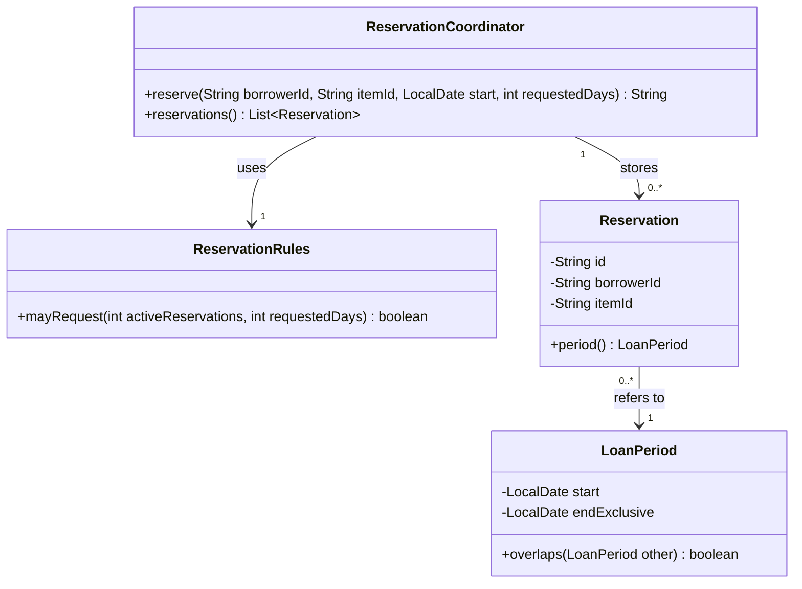
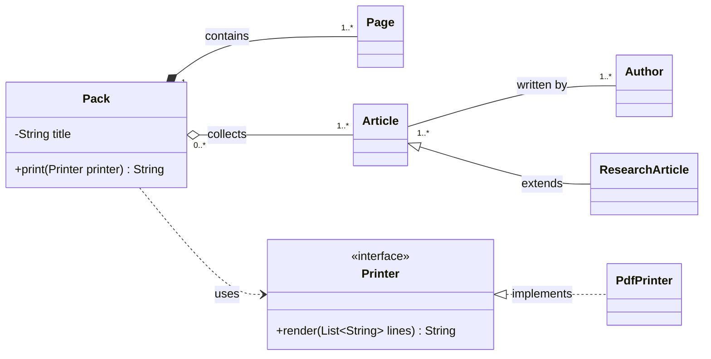
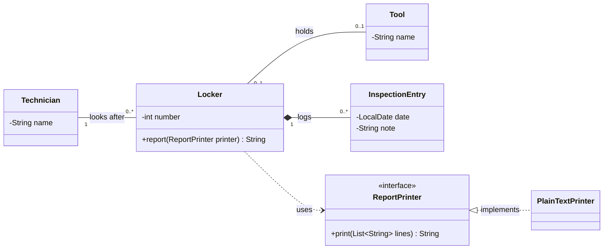
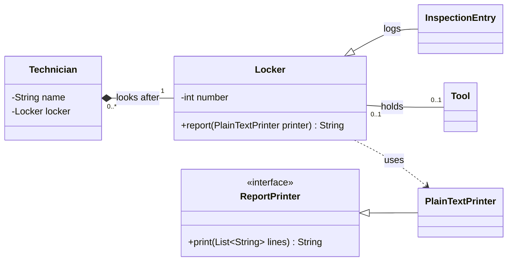

*OO Development and Agile Practices*  
*Designing, Testing and Evolving Software with AI Assistance*

## Opening scenario

The equipment officer can now try a small reservation application. It checks a borrower's limit, looks for a conflicting reservation, records a successful request and returns a confirmation message. A demonstration works. However, the developer who wrote it is absent when another team member is asked to change the message.

The new developer opens `ReservationCoordinator`. The same method counts reservations, applies a borrowing rule, searches for date conflicts, creates a record and assembles the confirmation text. Which lines may be changed safely? Why is the conflict check concerned with an equipment item while the count is concerned with a borrower? Could the list of stored reservations be changed from outside the class?

These questions concern the design of collaborating objects. Knowing how to declare a class is necessary, but it does not tell us which responsibilities should belong together or how other code should be allowed to use them. This chapter develops that reasoning through a small, executable system.

## Learning outcomes and reading route

By the end of the chapter, you should be able to:

1. Assign responsibilities to objects and explain the state they protect.
2. Distinguish encapsulation and information hiding from mechanically adding getters and setters.
3. Diagnose cohesion and coupling problems using concrete change scenarios.
4. Compare composition with inheritance and justify a modest design choice.
5. Draw and interpret a small UML class diagram that matches the code, using associations, multiplicity, aggregation, composition, inheritance and interface realisation appropriately.
6. Make a behaviour-preserving improvement and present it as a reviewed Git change.

This chapter corresponds to **Week 1** and supports LO1 and LO6. It builds on Chapter 1's reservation-rule example. You should be able to trace conditions, call methods and explain a returned value. Java's official class tutorial provides targeted syntax revision [1]; Appendix A has a short refresher.

The companion file for this chapter contains every complete source file, a starting version, a completed refactoring, checks and suggested answers. Use its starting listings and execution instructions first; consult solutions after attempting the activity. Java excerpts in this chapter are labelled where they omit surrounding code.

The examples use a Java 17 language and API baseline, with no preview features or external dependencies. A JDK is required to compile them. JUnit, Maven and automated CI configuration are not prerequisites for this first design exercise; they will be introduced with the relevant later work, and Appendix B records the toolchain and commands for the whole book.

**Core reading.** Read Sections 2.1–2.9. Section 2.6 (UML class diagrams) is the notation that the midterm assesses, so give it the most time.

**Minimum required lab.** Complete the Section 2.8 AI activity and Parts A–D of the practical activity in Section 2.10: the annotated diagram and scenario model, the responsibility diagnosis, the checked extraction commit with its review, and your team's issue board and branch policy. Parts A–C run on the **Book project**; Part D concerns your **Team project**.

**Optional extension.** Do the optional investigation at the end of Section 2.10, then the review questions and the transfer challenge.

**Weekly reading.** The module's Week 1 reading is Martin [10], the Part I introduction and the object-oriented design fundamentals; Sections 2.1–2.5 are the practical counterpart. Use the Moodle links for the exact pages.

**Project checkpoint.** The starting checkpoint is the Chapter 2 starter in the companion file. The resulting checkpoint is the same code after the confirmation extraction. It becomes the cumulative baseline for later chapters. The fault demonstrations and the notation examples in Section 2.6 are separate teaching material and do not join the project.

## 2.1 Objects, identity, state and behaviour

A class defines a type and its implementation. An object is an instance created at run time. Two objects created from the same class can represent different things and hold different state. Java's class model gives us fields, constructors and methods with which to express these distinctions [1].

In our project, a `Reservation` records an arrangement involving a borrower, an equipment item and a period. Its state includes an identifier such as `R1`, a borrower identifier such as `B1`, an item identifier such as `CAM1`, and a `LoanPeriod`.

These identifiers are different kinds of identity. Two physical cameras may have the same model name but need different item identifiers. Two reservations for the same camera on different dates are still separate reservations. The borrower's name would be a poor substitute for a stable identifier because names can change or be shared by different people.

Java object identity is another distinction. Two references can point to the same instance, or to distinct instances that represent the same domain identifier. The `==` operator on references checks whether they refer to the same object. Domain equality needs a deliberate definition; it is not automatically established by matching fields. Our small `Reservation` class does not override `equals`, so do not assume it already implements identifier-based equality.

**State** is information an object holds. **Behaviour** is what it can do through its operations. A reservation record can expose its identifier and period without allowing callers to replace them. A coordinator can add a new record after checking the request. A period can answer whether it overlaps another period.

These objects do not all need to be mutable. In the starter, each `Reservation` and `LoanPeriod` is immutable after construction: their fields cannot be reassigned, their referenced values are immutable, and their operations do not modify state. The coordinator is different. It accumulates reservations in a private list.

That distinction explains why the same request can produce a different answer after an earlier successful call. Chapter 1's `mayRequest` method only examined supplied numbers. Here, a call to the coordinator may change the state that the next call examines.

### From the numeric rule to a small system

We keep Chapter 1's `ReservationRules` unchanged: a borrower may have at most three active reservations and request one to seven days. The staff variation remains a future design exercise; this checkpoint applies the initial student policy to every borrower identifier.

The new starter has four domain and application classes:

| Class | Main role | State held |
|---|---|---|
| `ReservationRules` | Evaluate the initial numeric borrowing policy | No instance fields |
| `LoanPeriod` | Represent a valid period and answer overlap questions | Start date and exclusive end date |
| `Reservation` | Record the identity and details of a confirmed reservation | Reservation, borrower and item identifiers; period |
| `ReservationCoordinator` | Process requests using policy checks and existing records | In-memory reservations and a rules object |

The identifiers stand in for borrower and equipment records. We do not yet implement complete `Borrower` and `EquipmentItem` classes or a catalogue. A non-blank identifier is therefore not proof that a real person or item exists.

## 2.2 Responsibilities and invariants

A responsibility is an obligation assigned to part of the system. “Hold two dates” describes data. “Represent a period whose end follows its start” describes an obligation that gives those data meaning.

An **invariant** is a condition that must hold for valid objects or valid system states. Different invariants belong at different boundaries. One `LoanPeriod` can ensure its end is after its start. It cannot, by itself, ensure that another reservation has not already claimed the same equipment.

### A period convention we can test

For this checkpoint, dates are calendar dates with no time of day. We represent a period as **start inclusive, end exclusive**, written `[start, end)`. A period from 20 October to 22 October covers the 20th and 21st; another may begin on the 22nd. This is an explicit teaching policy. A real lending service might require a cleaning or inspection interval, which would need another rule.

Java's `LocalDate` is immutable and represents a date without a time or time zone [2]. We use `isBefore` and `plusDays` to express the convention; we do not interpret these dates as UTC instants or fixed numbers of elapsed hours.

The constructor rejects a missing date or an end that is not after the start. The overlap operation then has a small, clear implementation:

```java
// Method excerpt from LoanPeriod.java.
public boolean overlaps(LoanPeriod other) {
    Objects.requireNonNull(other, "other");
    return start.isBefore(other.endExclusive)
            && other.start.isBefore(endExclusive);
}
```

Two periods overlap when each begins before the other ends. Both comparisons are strict, so adjacent periods do not overlap. `Objects.requireNonNull` throws `NullPointerException` for a null argument; it does not fabricate a replacement period [3].

| First period | Second period | Overlap? | Explanation |
|---|---|---|---|
| `[20 Oct, 22 Oct)` | `[21 Oct, 23 Oct)` | Yes | Both include 21 October |
| `[20 Oct, 22 Oct)` | `[22 Oct, 23 Oct)` | No | The second begins at the first's exclusive end |
| `[20 Oct, 22 Oct)` | `[20 Oct, 22 Oct)` | Yes | Identical periods overlap |
| `[20 Oct, 22 Oct)` | `[19 Oct, 24 Oct)` | Yes | The second contains the first |

Comparing start dates alone would miss some of these relationships. Concrete examples help us check the meaning of a short expression.

### Who protects which condition?

The constructor protects the local validity of a period. `ReservationRules` protects the numeric policy only when given an accurate count. The coordinator counts its records and checks item conflicts before storing a new reservation. No one class can enforce all of those conditions without information from the others.

The starter has intentionally limited operating assumptions. All stored records are confirmed and remain active because cancellation, completion and automatic expiry are not implemented. Calls occur sequentially in one process. Data disappear when the process ends. Identifiers are matched exactly, without normalisation or authentication. The coordinator checks availability only against its own stored records; maintenance schedules and other coordinators are outside this checkpoint.

These limits matter when describing correctness. Within a single sequential coordinator, checking conflicts before adding a record prevents the demonstrated overlap. It does not establish safe concurrent booking by multiple processes. Later integration work will revisit that boundary.

## 2.3 Encapsulation and information hiding

**Encapsulation** groups state with the operations that govern its use and controls access to that state. **Information hiding** concerns which implementation decisions callers should not need to know. The two ideas reinforce each other, but neither is achieved simply by placing the word `private` before every field.

**Abstraction** presents the aspects relevant to a caller while leaving out unnecessary detail. A caller can ask a period whether it overlaps another period without repeating the date comparisons. That abstraction exists through an ordinary public method; it does not require Java's `abstract` keyword or a separate interface. A useful abstraction still needs a clear contract, including our decision that adjacent periods do not overlap.

Suppose a class exposes separate setters for a period's start and end. A caller could move the start beyond the current end. If each setter merely assigns a field, making those fields private has not protected the relationship between them.

Our `LoanPeriod` constructor requires both dates together and validates the relationship. It provides readers but no setters. To express another period, a caller creates another valid object. This keeps an invalid intermediate state out of the public protocol. In another domain, a controlled mutation operation could be appropriate; immutability is a design choice rather than a rule that every object must follow.

### A getter can expose a mutation path

Consider this deliberately unsafe alternative inside the coordinator:

```java
// Unsafe alternative for diagnosis; not the starter implementation.
public List<Reservation> reservations() {
    return reservations;
}
```

A caller could invoke `coordinator.reservations().clear()`. That would erase records without passing through the coordinator's request checks. The field would still be private, yet callers would possess a reference to the mutable list it uses.

The starter instead returns:

```java
// Method excerpt from the supplied coordinator.
public List<Reservation> reservations() {
    return List.copyOf(reservations);
}
```

`List.copyOf` produces an unmodifiable list whose contents are not updated by later changes to the source collection [4]. This protects the list structure and provides a snapshot. It does not deep-copy the elements or make mutable elements immutable. Here, `Reservation`, `LoanPeriod`, `String` and `LocalDate` provide the necessary immutability for the values we expose.

This is also why `private final List<Reservation>` alone would be insufficient. `final` prevents reassignment of the field to another list; it does not prohibit `add` or `clear` on that list.

The coordinator still exposes more representation than a mature system might require: callers know that stored reservations can be inspected as a list. That is acceptable for a small teaching checkpoint. If a caller later needs only a count or an availability answer, a narrower operation may reduce what the caller must understand.

## 2.4 Cohesion, coupling and dependencies

**Cohesion** concerns how closely the responsibilities within a component belong together. `LoanPeriod` has a focused purpose: its validation and overlap calculation concern the same period concept. A coordinator that also knows message wording, storage details and borrowing policy has more varied responsibilities.

**Coupling** concerns the dependencies between components. A component depends on another when it relies on its type, operations, data format or behaviour. Some dependency is necessary: software works because components collaborate. The question is whether the dependency expresses a useful relationship or makes unrelated changes spread.

Look at this excerpt from the end of the starter's `reserve` method:

```java
// Excerpt from the starting ReservationCoordinator.java.
Reservation reservation = new Reservation(
        "R" + (reservations.size() + 1), borrowerId, itemId, requested);
reservations.add(reservation);
return "Confirmed: " + reservation.id()
        + " for " + reservation.borrowerId()
        + " on " + reservation.itemId()
        + " [" + reservation.period().start()
        + ", " + reservation.period().endExclusive() + ").";
```

The excerpt creates and stores a reservation, then assembles its confirmation. Earlier lines count the borrower's records and check conflicts. All of this is visible in the companion's complete starting file.

The method is not wrong merely because it contains several steps. Coordination often involves several collaborators. The useful question is which decisions have independent reasons to change.

| Possible request | Decision it affects | Current location |
|---|---|---|
| Change a borrowing limit | Numeric policy | `ReservationRules` |
| Add a maintenance gap between reservations | Availability policy and period use | Coordinator conflict check and possibly period-related rules |
| Store records beyond process lifetime | Storage mechanism | Coordinator's list and storage operations |
| Translate a confirmation message | Presentation wording | Coordinator's final return expression |

This table provides a better diagnosis than “the method is long.” It identifies which changes currently require editing the coordinator and why. It also distinguishes likely work from hypothetical generality: a future database is a possible boundary, not a reason to implement a repository framework in this chapter.

### A small improvement with a limited claim

We will extract the confirmation expression into a private method named `confirmationFor`. The request method will still add the record first and then return the helper's result. The helper will receive the existing reservation and return exactly the same text:

```java
// Method added to ReservationCoordinator.java by the extraction.
private String confirmationFor(Reservation reservation) {
    return "Confirmed: " + reservation.id()
            + " for " + reservation.borrowerId()
            + " on " + reservation.itemId()
            + " [" + reservation.period().start()
            + ", " + reservation.period().endExclusive() + ").";
}
```

The request method then ends with `reservations.add(reservation); return confirmationFor(reservation);`, so the record is still stored before the text is built.

This is a modest refactoring. It gives the formatting operation a name and allows a reader to follow the request steps without reading every concatenation. It does **not** create a separate presentation component, remove storage coupling or make the coordinator thread-safe. A private helper changes readability inside the class; a new component would change the collaboration between classes.

The distinction prevents us from overstating the benefit of a small edit. If translation later needs its own collaborators, a separate formatting responsibility may become justified. For now, a named private operation is enough for the stated task.

The supplied checks examine both returned messages and stored state. After the extraction, both must remain the same. Merely preserving a success string while forgetting to store the reservation would not preserve behaviour.

## 2.5 Composition and inheritance

**Composition**, in the broad programming sense, means building behaviour by giving an object collaborators or component objects. A `Reservation` has a `LoanPeriod`; it delegates the question of overlap through that period. A coordinator has a `ReservationRules` object rather than inheriting from it.

This fits the domain meanings. A coordinator is not a kind of borrowing rule, and a reservation is not a kind of period. Their relationships concern what they use or contain, not a subtype relationship.

**Inheritance** defines a derived class in relation to a superclass. Java supports inherited members, method overriding and run-time selection of overridden instance methods [5]. These mechanisms can express a useful family of related behaviours, but they also establish expectations that callers may rely on.

Consider a hypothetical `SpecialReservation` subclass introduced only because some borrowers have longer limits. Is the difference really a new kind of reservation, or a policy governing whether a reservation may be created? If staff status can change while an existing reservation retains its identity, forcing that distinction into a reservation hierarchy may be awkward.

This does not prove that inheritance is always unsuitable. It directs us to ask what varies, what remains stable and what a caller expects from the base type. Chapter 5 develops behavioural substitutability more formally. For this checkpoint, the constructors, fields and collaborators already express the required relationships without a custom inheritance hierarchy.

| Question | Composition can help when | Inheritance deserves consideration when |
|---|---|---|
| What is the relationship? | One object uses or contains another | One type has a meaningful subtype relationship to another |
| What varies? | A collaborator or delegated responsibility | Behaviour shared through a stable base contract |
| What must be reviewed? | How collaborators are selected and called | Whether derived behaviour preserves caller expectations |

Composition has costs too. Too many small collaborators make it harder to follow a request. Avoid replacing one readable expression with several classes unless that organisation solves an actual problem. The design goal is understandable responsibility boundaries, not the maximum number of objects.

## 2.6 UML class diagrams: reading, drawing and checking

A class diagram is a selective explanation of a design. It answers one question for one audience, such as “which objects take part in a reservation request, and how are they related?” It is not a copy of the source code, and a diagram that tries to show every field and method answers no question well. This section teaches you to read a diagram, to draw one from a written description, and to check one against code. Class diagrams are the only UML notation used in this chapter; later chapters introduce other kinds where they are first needed.

You will often draw these by hand, and a hand-drawn diagram uses the same symbols as the ones in this book. The diagrams here are written as text in a tool called Mermaid so that they can be kept beside the code. Appendix A shows the text syntax.

### Reading the classes

For our starter, Figure 2.1 shows the collaborators that matter to understanding a request.



**Figure 2.1.** Selected classes and navigable associations for one coordinator's records. The displayed multiplicities describe this teaching model. The Java types do not prevent a caller from holding additional references to the same immutable objects.

Each box is a class and has up to three compartments. The top holds the class name. The middle holds the **attributes**, the data the class keeps. The bottom holds the **operations**, the methods other code can call. A label in double angle brackets above the name, such as `<<interface>>`, says what kind of class the box is.

Compare the `LoanPeriod` box with the Java it describes:

```java
// Excerpt from LoanPeriod.java; method bodies omitted.
public final class LoanPeriod {
    private final LocalDate start;
    private final LocalDate endExclusive;

    public LoanPeriod(LocalDate start, LocalDate endExclusive) { ... }
    public LocalDate start() { ... }
    public LocalDate endExclusive() { ... }
    public boolean overlaps(LoanPeriod other) { ... }
}
```

| Part of the box | In the Java source | How to read it |
|---|---|---|
| `LoanPeriod` | `class LoanPeriod` | The class name |
| `-LocalDate start` | `private final LocalDate start;` | A private attribute called `start` whose type is `LocalDate` |
| `+overlaps(LoanPeriod other) boolean` | `public boolean overlaps(LoanPeriod other)` | A public operation that takes a `LoanPeriod` called `other` and returns a `boolean` |

A `+` marks a public member and a `-` a private one. These diagrams put the type before the name, as Java does, and an operation's return type after its parameter list.

Notice what the box leaves out. The constructor and the two accessors `start()` and `endExclusive()` exist in the code but not in the box, because the explanation does not need them. You can trust a diagram for what it shows. You cannot assume that what it omits does not exist.

A field whose type is a plain value, such as `String`, `int` or `LocalDate`, is normally written as an attribute. A field whose type is another class of your design is normally shown as a line to that class's box instead. Do not show it both ways: a `-LoanPeriod period` attribute beside a line to `LoanPeriod` makes the diagram say one thing twice.

### Reading the lines

Every line between two boxes is a statement about two classes. The number at each end is a **multiplicity**: how many objects take part. Read it by standing at one class and looking at the number at the *far* end of the line. That number is how many objects of the far class one object of your class is linked to. `1` means exactly one, `0..1` none or one, `0..*` zero or more, and `1..*` one or more.

The line `ReservationCoordinator "1" --> "0..*" Reservation : stores` in Figure 2.1 reads in two directions. From the coordinator: “each coordinator stores zero or more reservations.” From a reservation: “each reservation is stored by exactly one coordinator.” The arrowhead shows which object holds the reference.

**Try it 1.** Write one sentence for each of the other two lines in Figure 2.1, reading from both ends. Then, for each number, find where the Java code enforces it and where the model merely assumes it. The companion gives the answers.

### The relationships you need to read and draw

| Relationship | Drawn as | Read it as | Use it when |
|---|---|---|---|
| Association | Solid line, with or without an open arrow | One object is linked to another; an arrowhead shows which holds the reference | The link is structural and lasting |
| Dependency | Dashed arrow | One class uses another without keeping it | A parameter or brief call is the only link |
| Aggregation | Hollow diamond at the whole | A whole groups parts that can exist without it | Parts can be shared or removed and still exist |
| Composition | Filled diamond at the whole | A whole owns parts that have no meaning without it | A part's lifetime is tied to its owner |
| Inheritance | Solid line, hollow triangle at the superclass | The subclass is a kind of the superclass | A real subtype relationship holds |
| Interface realisation | Dashed line, hollow triangle at the interface | The class implements the interface's contract | Several classes satisfy one contract that callers rely on |

Figure 2.2 shows every relationship in the table in one small system. It is a notation sampler for a course-pack printing service and is not part of the reservation project.



**Figure 2.2.** A notation sampler. A pack owns its pages, so a page has no meaning without its pack (composition). A pack only collects articles, which exist independently and can appear in many packs (aggregation). Articles and authors are joined by a plain association with no arrowheads, because the description does not say which side holds the reference. A research article is a kind of article (inheritance). A pack uses a printer only while printing (dependency), and `PdfPrinter` implements the `Printer` interface (realisation).

### Choosing a relationship

Choose a relationship by what it means, not by how it looks. For each pair of classes, ask:

1. Does one class implement a contract, an interface, that other classes rely on? That is **realisation**.
2. Is A a kind of B, so that a client of B could be handed an A without noticing? That is **inheritance**. Chapter 5 tests this claim with the Liskov Substitution Principle.
3. Does A keep a lasting reference to B in a field? If not, and A only uses B as a parameter, a local variable or a short-lived object, that is a **dependency**.
4. If A keeps the reference, does B belong to A so completely that it has no meaning without A and is discarded with it? That is **composition**.
5. Does A group Bs that exist independently and could be shared or removed? That is **aggregation**, but only if you can say what the grouping adds. Otherwise it is a plain **association**.

Aggregation is often indistinguishable from association in code, and composition describes a lifetime that the Java types do not enforce, so both are claims about meaning. Figure 2.1 uses plain associations because periods can be shared by reference and the code does not enforce a lifetime. Also distinguish “composition” as a general programming idea, building behaviour from collaborating objects, from UML's filled diamond, which makes a stronger ownership claim.

### From code to diagram

When you draw from existing code, each construct has a usual home in the diagram.

| In the Java source | In the diagram |
|---|---|
| `private final LocalDate start;` | Attribute `-LocalDate start` |
| `private final List<Reservation> reservations` | Association to `Reservation`, with `0..*` at the `Reservation` end |
| `private final ReservationRules rules` (a class of your design) | Association to `ReservationRules`, with `1` at that end |
| A parameter, local variable or `new X()` used only inside a method | Dependency on `X` |
| `class A extends B` | Inheritance, with the triangle at `B` |
| `class A implements I` | Realisation, with the triangle at `I` |
| `public` and `private` | `+` and `-` |

Two cautions. The Java type does not settle the meaning: a `List<Reservation>` might be an association or a composition, and only the design decides. And a field that can be `null` is `0..1`, not `1`.

### A worked example: from scenario to diagram

Here is a short description, and a six-step method for turning it into a diagram.

> The workshop keeps tools in numbered lockers. A locker holds at most one tool at a time, and a tool sits in at most one locker. A technician looks after any number of lockers, but each locker is looked after by exactly one technician at a time; a locker can be reassigned to another technician. Every inspection of a locker is logged as an entry with a date and a note, and an entry is meaningless without its locker. Locker reports are printed as plain text now, and the workshop expects to add other formats later.

**Step 1: find the nouns.** Workshop, tools, lockers, technician, inspection, entry, date, note, report, plain text, formats.

**Step 2: decide which become classes.** Keep a noun as a class when it has data or rules the description needs.

| Candidate | Decision | Reason |
|---|---|---|
| Workshop | Leave out | It is the whole system, and no behaviour is described for it |
| Locker | Class | It has a number, a log and a report |
| Tool | Class | A locker holds one |
| Technician | Class | Looks after lockers |
| Inspection entry | Class | Has a date and a note and belongs to a locker |
| Date, note, number, name | Attributes | Plain values describing a class |
| Report | Operation of `Locker` | Something a locker does, not a thing with its own data |
| Plain text, other formats | A `ReportPrinter` interface and a `PlainTextPrinter` class | The description expects the format to vary |

**Step 3: write the attributes and operations.** Separate what the description states from what you assume. The description states a locker's number and report, and an entry's date and note. Everything else is a design assumption that you should label as one: here, a technician's name and a tool's name as identifying attributes, and a single `print` operation on the printer, which is one reasonable way to give the report a format-independent contract. A different, justified choice is acceptable, and the answer guidance in the companion accepts it.

**Step 4: choose a relationship for each pair**, using the questions in the previous subsection.

| Pair | What decides it | Result |
|---|---|---|
| Technician and locker | Neither owns the other, and a locker can be reassigned | Plain association |
| Locker and tool | Neither is part of the other | Plain association |
| Locker and inspection entry | An entry is meaningless without its locker | Composition, with the diamond at `Locker` |
| Locker and `ReportPrinter` | A locker uses a printer only while reporting | Dependency |
| `PlainTextPrinter` and `ReportPrinter` | The class implements the contract | Realisation |

**Step 5: write each multiplicity as a sentence.** Each locker is looked after by exactly one technician, so the number at the `Technician` end is `1`. A technician looks after any number of lockers, so the number at the `Locker` end is `0..*`. A locker holds at most one tool and a tool sits in at most one locker, so both ends are `0..1`. A locker has any number of entries and an entry belongs to exactly one locker.

**Step 6: read it aloud and delete.** Read every line in both directions against the description, and remove anything the description does not say.



**Figure 2.3.** The model that results. The two plain associations have no arrowheads because the description does not say which object holds the reference. A model should record what the description says and no more. Other answers are defensible: you might show `Tool` only as an attribute, or add a `Workshop` class if you were asked to model scheduling.

### Checking a diagram against the code

A diagram that disagrees with its code is worse than no diagram, because readers trust it. To check one:

- For every box, find the class. For every attribute, find the field with that name and type.
- For every line, find the field, parameter or `extends`/`implements` clause that creates it. If you cannot find one, remove the line or fix the code.
- For every multiplicity, find where the code enforces it (a constructor check, a `final` field, a collection type). If nothing enforces it, mark it as an assumption.
- List what the diagram leaves out, and decide whether each omission is deliberate.

**Try it 2.** Find two details that are present in the Java for Figure 2.1 but absent from the diagram, and say why leaving each out is acceptable. The companion gives the answers.

The diagram is intentionally incomplete. It omits standard library classes and some accessors. It does not establish the order of operations, display every validation or prove that overlapping bookings are rejected. Read the method body and the period convention for those questions. After extracting a private formatting method, the relationships in Figure 2.1 remain unchanged. This is useful evidence about the scale of the edit: we improved one operation's organisation without redesigning the object collaboration.

### Spot the errors

Another student drew a first attempt at the workshop model. It contains at least five mistakes.



**Figure 2.4.** A flawed attempt, for diagnosis.

**Try it 3.** List every mistake you can find. For each, say why it is wrong using the description, and say what the correct notation is. Then redraw the diagram. The companion lists the mistakes.

### Common drawing mistakes

| Mistake | Why it is wrong | Better habit |
|---|---|---|
| Putting a multiplicity at the wrong end | The number at the far end counts the far class, so reversed numbers say the opposite | Read every line aloud in both directions |
| Treating an arrowhead as ownership | An arrowhead shows which object holds the reference, not who owns whom | Use diamonds, and only with a reason, for ownership |
| Inheritance for “uses” or “has” | A locker is not a kind of technician, and an entry is not a kind of locker | Test the sentence “A is a kind of B” and its promises |
| A solid line for interface realisation | Realisation is dashed; a solid line with a triangle means inheritance | Check the line style of every triangle |
| A filled diamond because the field is `final` | Composition claims a lifetime, and `final` only fixes a reference | Ask whether the part can exist without the owner |
| Showing a relationship twice | A `-Locker locker` attribute plus a line to `Locker` repeats one fact | Show a field of a design class as a line only |
| Depending on a concrete class when an interface exists | A client that names `PlainTextPrinter` cannot accept another format | Point the dependency at the interface |
| Drawing every class and member | The design question disappears among the detail | One diagram, one question, only the members it needs |
| A diagram that disagrees with the code | Readers trust the diagram | Run the checking steps above before you share it |

## 2.7 Git history, branches and review

A codebase becomes a shared engineering artefact when the team can inspect its changes, reproduce its behaviour and explain its decisions. Version control supports that work, but a commit alone is not evidence of a good design.

Git separates the working files, the staging area and recorded commits. You edit working files, select content for the next commit and record that selected state. The staging area matters when unrelated edits are present: the next commit should contain the change you intend to explain [6].

A **branch** gives a name to a line of development. For our lab, use a short-lived branch containing the confirmation extraction. A **pull request** or **merge request** is a hosting-platform review proposal; it is not the same operation as a local commit. A local peer review can still serve the learning objective when no hosting account is available.

Teams using trunk-based development integrate small changes frequently into a main line, sometimes through very short-lived branches. A feature-branch workflow groups a feature's work on a branch before integration. These approaches overlap in practice: a short reviewed branch can be part of frequent integration. For this course, focus on keeping changes small, reviewable and integrated regularly. Git's branching discussion illustrates why topic branches can help organise independent work [7].

### A reviewable change

Begin with the supplied starting files and a recorded baseline. Confirm that the checks pass before editing. Create a branch, perform only the extraction, rerun the checks and inspect the diff. The companion contains the complete setup commands.

The key inspection commands are:

```sh
git status
git diff
git diff --staged
```

The first reports file state. The second normally shows tracked changes not yet staged; the third shows staged changes against the current commit [8]. An empty `git diff` after staging does not mean there is nothing to commit. Untracked files also need attention in `git status`.

Appendix B collects the Git commands and the pull-request workflow used in this book (B.8); the Pro Git readings [6][7] and the commands above are enough for this chapter.

A useful commit message is `Extract reservation confirmation formatting`. Many teams adopt a written convention for such messages. Conventional Commits, for example, puts a type before a short description, as in `refactor: extract reservation confirmation formatting` [9]. Use whichever convention your team agrees, and apply it consistently. A useful review description states the problem, the limited change, and the checks performed. For example: “The request method interleaves storage and confirmation text. This change moves the text assembly into a private helper. The existing messages and stored records remain unchanged in the supplied checks.”

The reviewer should inspect the diff, verify that the helper does not add state changes and check that the record is still added before confirmation is returned. A comment such as “Looks cleaner” is weaker than an explanation of what was inspected and why it matters.

Do not combine this refactoring with changed limits, renamed identifiers or new message punctuation. Each may be legitimate work, but combining them makes it harder to determine why a result changed. Keep compiled class files out of commits; the companion's `.gitignore` handles those generated files.

## 2.8 AI in practice: tracing a coordinator

Chapter 15 collects the recurring AI workflows; this activity is self-contained, and its table gives the contract you need.

| Element | For this activity |
|---|---|
| Engineering objective | Compare an explanation of the coordinator with its actual control flow, state changes and side effects |
| Input | The complete starting `ReservationCoordinator` and its collaborators from the companion |
| Permitted scope | Judge the explanation only; do not change the code |
| Independent checks | Tracing the code, the three-request demonstration and the supplied checks |
| Accept or reject | Keep supported claims, reject contradicted ones and mark claims the code does not establish |
| No-account route | The fixture below is sufficient |

The following **author-written teaching fixture** imitates a plausible AI explanation. It was constructed for this exercise and is not a captured response from a real model:

> The coordinator validates identifiers, counts the borrower's stored reservations and checks the numeric rule. It tests availability using existing reservations for the same item. On success, it adds a reservation before returning a confirmation. It sends that confirmation by email and persists the reservation to a database. Because the list field is final, callers receive a deeply immutable copy and booking is safe under concurrent requests.

Classify each claim as supported, contradicted or not established. Cite the relevant operation, or the absence of one, for each judgement. Pay particular attention to control flow, state changes and side effects.

Keep accurate statements in the revised explanation. Write a four-sentence replacement that describes input validation, successful and rejected paths, state changes and the checkpoint's limits.

If permitted, you may repeat the exercise with a live assistant using the prompt below. The supplied fixture is sufficient without an AI account.

> Trace this coordinator and its supplied collaborators. Identify inputs, returned values and state changes on success and rejection. State what is established about storage, notifications and concurrency. Separate facts visible in the code from assumptions. Do not change the code.

Record one accepted claim and one rejected or qualified claim with evidence. Do not treat a second model's agreement as a substitute for tracing the operations.

## 2.9 Common mistakes

| Mistake | Why it fails in this example | Better question |
|---|---|---|
| Private fields mean the object is safely encapsulated | A returned mutable list can still expose a modification path | What can callers change through the references they receive? |
| A final field makes the referenced object immutable | The coordinator can still add to its final list | Is the reference fixed, the object immutable, or both? |
| Every noun should immediately become a class | Several concepts have no behaviour or state we need yet | What responsibility would that class own now? |
| More interfaces automatically mean less harmful coupling | An interface can repeat an unstable contract without solving a caller's problem | Which dependency would this interface improve? |
| Calling another class means inheriting from it | The coordinator uses a policy; it is not a policy subtype | Is the relationship use, containment or substitution? |
| A filled diamond just means “has a” | Composition claims the part cannot outlive its owner; `LoanPeriod` objects can be shared by reference | Does the code enforce this lifetime, and would the domain agree? |
| A formatting refactoring fixes the whole design | The helper leaves storage and other responsibilities in the coordinator | Which improvement did this edit actually make? |
| Green checks prove the application is production-ready | The starter omits lifecycle, persistence, catalogue validation and concurrency | Which claims have we tested, under which assumptions? |

## 2.10 Practical activity: one checked design improvement

### Inputs and starting point

Parts A–C use the **Book project**; Part D concerns your **Team project**. Use the companion's common source files and **starting** `ReservationCoordinator.java`. Save all six Java files in one directory. Compile and run them using the instructions in the companion. The check runner should report 34 passing checks before you begin. Read the checks as provided evidence; you do not need to master the test-runner implementation yet.

### Part A: understand the request

Trace the three requests in `Chapter02Demo`. Record the returned message and number of stored records after each call. Identify the first condition that rejects the overlapping request. Explain why the adjacent request is accepted and why the rejected request does not consume a reservation identifier.

Draw a small class diagram of the starter using the relationships in the code, without copying Figure 2.1: use the “From code to diagram” table, then run the four checking steps from Section 2.6 on your own drawing. Annotate one local invariant and one condition that needs information from multiple objects. The annotations may sit next to the diagram rather than inside it.

Then complete one separate modelling exercise. It is practice in turning a written scenario into a class diagram, using the six-step method from Section 2.6, and it does not extend the project:

> The equipment office groups laboratory equipment into kits. A kit has a name and holds one or more equipment items. Removing a kit does not delete its items, and an item belongs to at most one kit. Each item keeps any number of maintenance records; a maintenance record belongs to exactly one item and has no meaning without it. A kit summary is produced through an exporter. The office needs CSV output now and expects other formats later.

Draw a class diagram with the classes, their key attributes and multiplicities. Include at least one aggregation, one composition, one interface realisation and one dependency, and state one assumption you had to make. For each relationship you draw, write the question from Section 2.6 that decided it. Then read every line aloud in both directions against the scenario.

### Part B: diagnose the design

Write a short responsibility inventory for the coordinator. Identify two distinct reasons it might change. Explain one cohesive collaborator and one dependency that deserves attention. Avoid judging quality by method length alone.

### Part C: make the change

On a short-lived branch, move only the confirmation-string expression into a private `confirmationFor(Reservation reservation)` method. Keep its output, validation order, identifier allocation and storage effects unchanged. Do not add a new interface or change the public method signatures.

Run the checks again, inspect the diff and ask a peer to review it. In independent study, perform a self-review and label it honestly as such. Produce one focused commit after addressing relevant feedback. A separate hosted pull request is optional for this introductory activity.

### Part D: organise collaboration

Form teams of three or four as directed by the module leader. Confirm which of the module's provided starter domains your assessed project uses. Equipment lending is this book's running example; if your team chooses another domain, use each chapter's transfer note.

Set up an issue board with columns that match how your team will work, and add three cards with concrete completion conditions, such as “extract confirmation formatting with unchanged output and checks”. Agree a branch policy, either very short-lived branches integrated into a main line often or one feature branch per story, and write down your reason. Agree who prepares the next demonstration and who reviews the next change. Roles should rotate; commit counts alone will not explain individual contributions.

### Evidence to retain

Keep the annotated diagram, the scenario model, responsibility diagnosis, before-and-after check results, commit identifier, review note, AI claim analysis, and your team's issue board and branch-policy note. Add a short limitation statement: which risks remain after the extraction?

The activity is complete when the diagram matches the code, the confirmation extraction preserves the checked behaviour, and your review explains both the improvement and its limits. You should also be able to explain the returned list's protection without claiming that all copies are deep copies.

**Optional investigation:** in a temporary copy, replace `List.copyOf(reservations)` with `reservations`. Predict the effect of an external `clear()` call, then run the checks. Restore the original before continuing. This is a deliberate fault demonstration, not a proposed improvement.

## 2.11 Review questions and transfer challenge

### Concept questions

1. Distinguish a Java object reference from a reservation's domain identifier. Why are equal identifier strings not sufficient to make two `Reservation` instances equal through `equals` in this starter?
2. Explain one local invariant and one system-level condition in the project. Why do they need different enforcement points?
3. Explain cohesion and coupling using one likely change to the coordinator. Why is reducing the total number of dependencies not a sufficient design goal?
4. Compare composition and inheritance for the relationship between a reservation and its loan period. What would an inheritance relationship incorrectly suggest?

### Applied diagnosis

5. A developer adds a getter returning the private mutable list and claims that the coordinator is still encapsulated because the field is private. Give a concrete counterexample and explain the limits of the proposed correction using `List.copyOf`.
6. A refactoring returns the same confirmation text but omits `reservations.add(reservation)`. The developer demonstrates the printed text and declares success. Explain the behavioural change and identify evidence that would expose it.

### Transfer challenge

A university room-booking coordinator stores bookings, checks room conflicts and constructs confirmation text. Its users now request a wording change only.

Propose a responsibility diagram with at most four domain or application classes. State a period convention, identify the state that callers must not modify directly, and describe one small behaviour-preserving improvement. Provide two before-and-after observations needed to accept it. Include a brief review description and explain one remaining limitation. A new inheritance hierarchy or pattern is not required.

## Summary and next chapter

Objects become useful design units when their responsibilities and permitted interactions are clear. Constructors and controlled operations can protect invariants, while immutable values and careful collection access can prevent callers from bypassing intended boundaries.

Cohesion and coupling help us discuss the consequences of change. The coordinator's formatting extraction makes one operation easier to follow without resolving every responsibility it currently holds. Explaining that limited improvement is part of sound design reasoning.

Diagrams, checks, diffs and review notes describe different aspects of the same codebase. They should agree with the implementation. An AI explanation is another candidate description to check against that evidence.

In **Chapter 3: Agile Development and the Nature of Change**, we will turn project needs into an ordered backlog, write useful stories and acceptance criteria, and examine how a team plans and learns through feedback.

## Sources and further reading

The teaching scenario, implementation and exercises are original. Sources below support the identified language, API and Git details; they are not claims that the sample is a production system. Web sources were checked on 12 and 13 October 2026.

1. **Dev.java.** [Classes and Objects](https://dev.java/learn/language/oop/classes-objects/). Java class, constructor and method background for Sections 2.1–2.3.
2. **Oracle.** [LocalDate: Java SE 17 API](https://docs.oracle.com/en/java/javase/17/docs/api/java.base/java/time/LocalDate.html). Date semantics and immutability. Our exclusive-end convention is a project decision, not a rule imposed on every application by `LocalDate`.
3. **Oracle.** [Objects: Java SE 17 API](https://docs.oracle.com/en/java/javase/17/docs/api/java.base/java/util/Objects.html). The `requireNonNull` contract used in constructors and the overlap method.
4. **Oracle.** [List: Java SE 17 API](https://docs.oracle.com/en/java/javase/17/docs/api/java.base/java/util/List.html). The `copyOf` contract and the distinction between an unmodifiable list and mutable elements.
5. **Dev.java.** [Inheritance](https://dev.java/learn/language/oop/inheritance/). Language mechanisms supporting the comparison in Section 2.5.
6. **Chacon, Scott, and Ben Straub.** [Pro Git: Recording Changes to the Repository](https://git-scm.com/book/en/v2/Git-Basics-Recording-Changes-to-the-Repository). Working files, staging and commits.
7. **Chacon, Scott, and Ben Straub.** [Pro Git: Branching Workflows](https://git-scm.com/book/en/v2/Git-Branching-Branching-Workflows). Topic branches and integration practices. The course's small-change workflow is a teaching choice.
8. **Git documentation.** [git diff](https://git-scm.com/docs/git-diff) and [git switch](https://git-scm.com/docs/git-switch). Command semantics used in the chapter and companion.
9. **Conventional Commits.** [Conventional Commits 1.0.0](https://www.conventionalcommits.org/en/v1.0.0/). One published commit-message convention, cited in Section 2.7 as an example. The course does not require this convention.
10. **Martin, Robert C.** *Agile Software Development: Principles, Patterns, and Practices.* Prentice Hall, 2002. The module's required text; the Week 1 reading is the Part I introduction and the object-oriented design fundamentals. Publication details and the exact pages are those listed in the module descriptor and on Moodle.