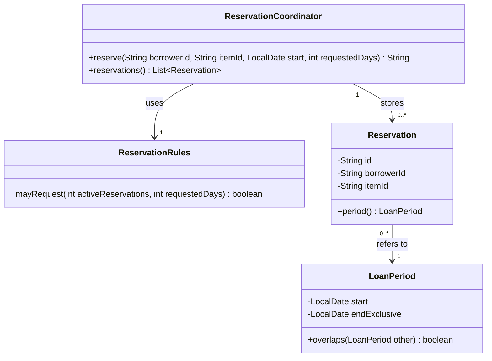
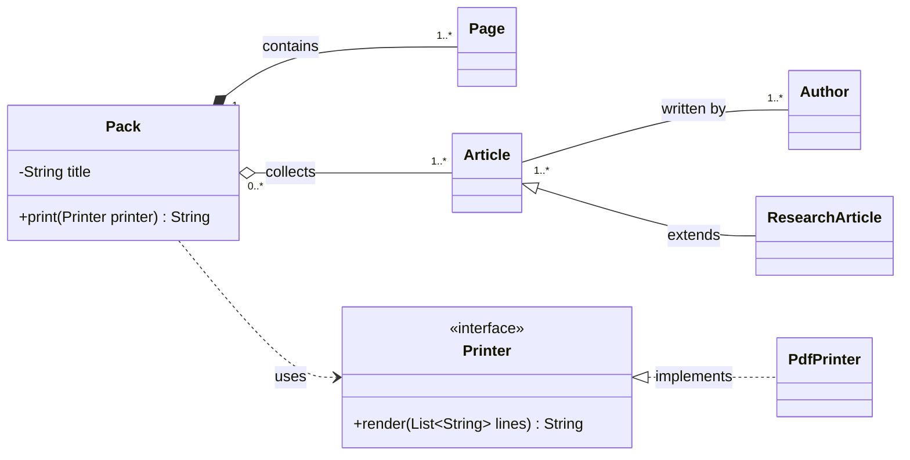
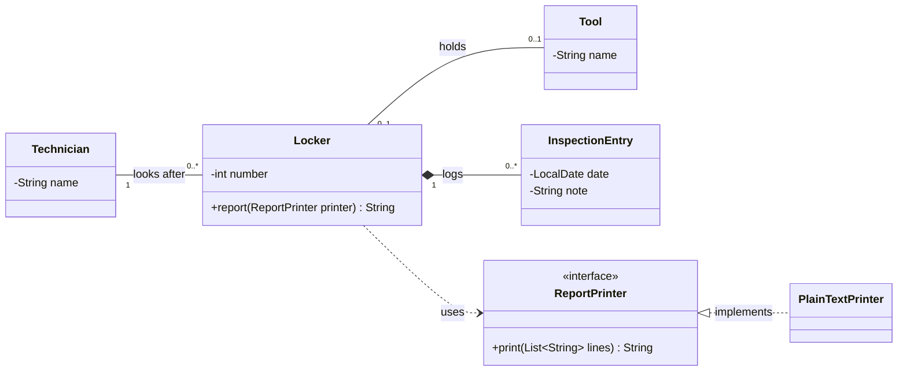
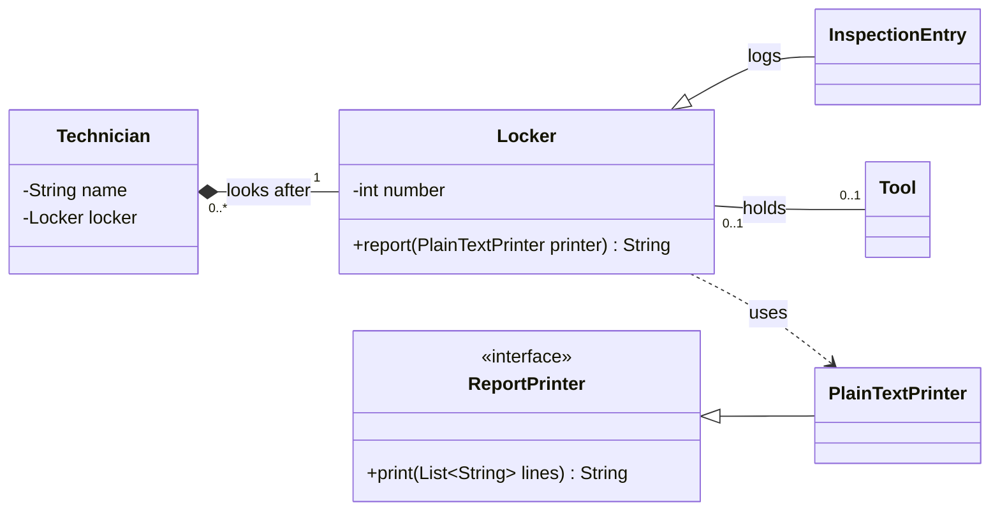

*OO Development and Agile Practices*  
*Designing, Testing and Evolving Software with AI Assistance*

Chapter 1 ended with a rule that fits inside a single method: a few numbers, a few conditions, a Boolean answer. Real programs do not stay like that for long. Soon something has to remember which reservations exist, something has to decide whether a new one clashes with an old one, and something has to tell the user what happened.

Picture the equipment officer trying a first small reservation application. It checks a borrower's limit, looks for a conflicting reservation, records a successful request and returns a confirmation message. The demonstration works. Then the developer who wrote it is away, and another team member is asked to change the wording of the message.

They open `ReservationCoordinator` and find one method that counts reservations, applies a borrowing rule, searches for date conflicts, creates a record and assembles the confirmation text. Which lines can they change safely? Why does the conflict check concern an equipment item when the count concerns a borrower? Could somebody outside the class empty the list of stored reservations?

Knowing how to declare a class does not answer any of that. These are questions about design: which responsibilities belong together, which state a class must protect, and how much other code should be allowed to know. This chapter answers them through a small system you can run. You will assign responsibilities to objects and explain the state each one protects, and you will see why private fields and getters are not the same thing as encapsulation. You will diagnose cohesion and coupling from concrete change scenarios, weigh composition against inheritance, and learn to read, draw and check a small UML class diagram so that it matches the code. You will finish by making one behaviour-preserving improvement and presenting it as a reviewed Git change.

The chapter corresponds to **Week 1** and supports LO1 and LO6. It builds on Chapter 1's reservation rule, so you should be comfortable tracing conditions, calling methods and explaining a returned value; Java's official class tutorial [1] and Appendix A are there if you need to revise syntax. The examples use a Java 17 language and API baseline with no preview features or external dependencies, and you need a JDK to compile them. JUnit, Maven and automated CI are not prerequisites for this first design exercise; they arrive with the later work that needs them, and Appendix B records the toolchain and commands for the whole book.

You start from the Chapter 2 starter in the companion file, and you finish with the same code after the confirmation extraction. That finished version is where the running project picks up in later chapters. The fault demonstrations and the notation examples in Section 2.6 are separate teaching material and do not join the project. The companion holds every complete source file, a starting version, the completed refactoring, the checks and suggested answers: use its starting listings and execution instructions first, and look at the solutions only after you have attempted the activity. Java excerpts in this chapter are labelled where they leave out surrounding code.

Read Sections 2.1 to 2.9 as the core, and give the most time to Section 2.6 on UML class diagrams, because that is the notation the midterm assesses. The module's Week 1 reading is Martin [10], the Part I introduction and the object-oriented design fundamentals, with Sections 2.1 to 2.5 as its practical counterpart; use the Moodle links for the exact pages. What you must do is the Section 2.8 AI activity and Parts A to D of the practical activity in Section 2.10: the annotated diagram and scenario model, the responsibility diagnosis, the checked extraction commit with its review, and your team's issue board and branch policy. Parts A to C run on the book's project, and Part D concerns your team's project. If you want more, try the investigation at the end of Section 2.10, then the questions and the transfer challenge in Section 2.11.

## 2.1 Objects: what they know, what they do, and who they are

Start with the vocabulary. A class describes a kind of thing, and an object is one particular thing of that kind that exists while the program runs. Two objects built from the same class can stand for different things and hold different information; Java gives us fields, constructors and methods to say all this [1].

In our project a `Reservation` records an arrangement between a borrower, an equipment item and a period. Its information includes an identifier such as `R1`, a borrower identifier such as `B1`, an item identifier such as `CAM1` and a `LoanPeriod`.

Notice that these identifiers are different kinds of identity. Two physical cameras may share a model name but still need separate item identifiers. Two reservations for the same camera on different dates are still two reservations. And a borrower's name would be a poor identifier, because names change and different people share them.

Java adds an identity of its own. Two references can point at the very same object, or at two separate objects that stand for the same domain identifier, and the `==` operator on references only tells you about the first case. Whether two objects count as "equal" in the domain is a decision somebody has to make; matching fields do not settle it automatically. Our small `Reservation` class does not override `equals`, so do not assume it already treats two reservations with the same identifier as equal.

It helps to separate what an object *knows* from what it can *do*. The first is its **state**, the information it holds. The second is its **behaviour**, what it can do through its operations. A reservation can reveal its identifier and period without letting anyone replace them. A coordinator can add a new record once it has checked the request. A period can say whether it overlaps another period.

Not every object needs to change over its lifetime. In the starter, each `Reservation` and `LoanPeriod` is immutable once built: its fields cannot be reassigned, the values they refer to cannot change, and none of its operations modifies it. The coordinator is the exception. It collects reservations in a private list as the program runs.

That difference explains something you may already have noticed. The same request can get a different answer after an earlier request succeeded. Chapter 1's `mayRequest` method only looked at the numbers it was given. A call to the coordinator can change the state that the next call looks at.

### From a numeric rule to a small system

We keep Chapter 1's `ReservationRules` exactly as it was: a borrower may hold at most three active reservations and request one to seven days. The staff variation stays a future design exercise, so at this stage the student rules apply to every borrower identifier.

The new starter has four domain and application classes:

| Class | Main role | State held |
|---|---|---|
| `ReservationRules` | Evaluate the initial numeric borrowing policy | No instance fields |
| `LoanPeriod` | Represent a valid period and answer overlap questions | Start date and exclusive end date |
| `Reservation` | Record the identity and details of a confirmed reservation | Reservation, borrower and item identifiers; period |
| `ReservationCoordinator` | Process requests using policy checks and existing records | In-memory reservations and a rules object |

The identifiers stand in for real borrower and equipment records. We have not written full `Borrower` and `EquipmentItem` classes or a catalogue, so a non-blank identifier proves nothing about whether such a person or item exists.

## 2.2 Who is responsible for keeping things true?

Every class has a job, and the useful way to state a job is as an obligation. "Hold two dates" only describes data. "Represent a period whose end follows its start" is an obligation, and it is what gives those two dates their meaning. We call such an obligation a **responsibility**.

Some obligations can be written as a condition that must always hold, and that kind has a name: an **invariant** is a condition that must be true for valid objects or valid states of the system. Different invariants belong in different places. A single `LoanPeriod` can guarantee that its end comes after its start. It cannot guarantee that nobody else has already reserved the same equipment, because it knows nothing about other reservations.

### A period convention we can test

For this stage, dates are calendar dates with no time of day. We write a period as **start inclusive, end exclusive**, or `[start, end)`. A period from 20 October to 22 October covers the 20th and the 21st, and another period may begin on the 22nd. This is an explicit decision for the book; a real lending service might need a cleaning or inspection gap between loans, and that would be another rule.

Java's `LocalDate` is immutable and represents a date with no time and no time zone [2]. We use `isBefore` and `plusDays` to express the convention, and we do not treat these dates as UTC instants or as a fixed number of elapsed hours.

The constructor rejects a missing date or an end that does not come after the start. With that guaranteed, the overlap test is short:

```java
// Method excerpt from LoanPeriod.java.
public boolean overlaps(LoanPeriod other) {
    Objects.requireNonNull(other, "other");
    return start.isBefore(other.endExclusive)
            && other.start.isBefore(endExclusive);
}
```

Two periods overlap when each one begins before the other ends. Both comparisons are strict, which is exactly why two periods that merely touch do not overlap. `Objects.requireNonNull` throws a `NullPointerException` for a null argument instead of inventing a replacement period [3].

| First period | Second period | Overlap? | Explanation |
|---|---|---|---|
| `[20 Oct, 22 Oct)` | `[21 Oct, 23 Oct)` | Yes | Both include 21 October |
| `[20 Oct, 22 Oct)` | `[22 Oct, 23 Oct)` | No | The second begins at the first's exclusive end |
| `[20 Oct, 22 Oct)` | `[20 Oct, 22 Oct)` | Yes | Identical periods overlap |
| `[20 Oct, 22 Oct)` | `[19 Oct, 24 Oct)` | Yes | The second contains the first |

Try comparing only the start dates and you will see that some of these rows go wrong. Concrete examples are the quickest way to check what a short expression really means.

### Who protects which condition?

Each condition has a natural owner. The constructor protects the validity of one period. `ReservationRules` protects the numeric policy, provided it is given an accurate count. The coordinator counts its records and checks for item conflicts before it stores anything. No single class can enforce all of this alone, because each one lacks information that another holds.

The starter also makes some deliberately limited assumptions. Every stored record is confirmed and stays active, because cancellation, completion and expiry do not exist yet. Calls arrive one at a time in one process. The data vanishes when the process ends. Identifiers are matched exactly, with no clean-up and no authentication. And the coordinator checks availability only against its own records, so maintenance schedules and other coordinators are out of scope.

These limits shape what we may claim. Inside one sequential coordinator, checking for conflicts before adding a record prevents the overlap we demonstrate. That is not the same as safe booking by several processes at once, a boundary we revisit when we reach integration.

## 2.3 Keeping state safe: encapsulation and information hiding

You may have been told that making fields `private` is encapsulation. It is a start, and only a start. **Encapsulation** groups state with the operations that govern it and controls who can reach that state. **Information hiding** is about which implementation decisions callers should not need to know. The two support each other, but writing `private` in front of every field achieves neither by itself.

A related word is **abstraction**: showing a caller only what it needs and leaving out the detail. A caller can ask a period whether it overlaps another period without repeating the date comparisons. That is abstraction through an ordinary public method, with no need for Java's `abstract` keyword or an interface. It still needs a clear contract, including our decision that two periods that touch do not overlap.

To see why `private` is not enough, imagine a class with separate setters for a period's start and end. A caller could move the start beyond the current end. If each setter simply assigns a field, the fields are private and the relationship between them is still unprotected.

Our `LoanPeriod` avoids that. Its constructor takes both dates together and checks the relationship, and the class offers readers but no setters. To describe a different period, a caller makes another valid object, so an invalid half-way state never exists. In another domain a controlled way to change an object could be the right choice; immutability is a design decision, not a law.

### A getter can hand out the keys

Here is a deliberately unsafe alternative for the coordinator:

```java
// Unsafe alternative for diagnosis; not the starter implementation.
public List<Reservation> reservations() {
    return reservations;
}
```

Now any caller can write `coordinator.reservations().clear()` and erase every record without passing through the coordinator's checks. The field is private, yet callers hold a reference to the very list the coordinator uses.

The starter returns this instead:

```java
// Method excerpt from the supplied coordinator.
public List<Reservation> reservations() {
    return List.copyOf(reservations);
}
```

`List.copyOf` builds an unmodifiable list, and later changes to the original collection do not show up in it [4]. So callers get a snapshot they cannot modify. It does not copy the elements themselves, and it cannot make a mutable element immutable. Here that is fine, because `Reservation`, `LoanPeriod`, `String` and `LocalDate` are already immutable.

The same reasoning shows why `private final List<Reservation>` alone would not be enough. `final` stops the field from being pointed at a different list, and it does nothing to stop `add` or `clear` on the list it points at.

The coordinator still reveals more of its inner workings than a mature system might, since callers can see that the records are kept as a list. That is acceptable at this stage. If callers later need only a count or an availability answer, a narrower operation would mean they have less to understand.

## 2.4 Why a long method is not the real problem: cohesion and coupling

Reviewers often say "this method is too long", and sometimes they are right, but length is a symptom. Two ideas get closer to the cause. **Cohesion** asks how closely the responsibilities inside one component belong together. `LoanPeriod` is cohesive: its validation and its overlap calculation are about the same idea, a period. A coordinator that also knows message wording, storage details and borrowing policy is mixing more varied responsibilities.

**Coupling** asks how much components depend on each other. One component depends on another when it relies on its type, its operations, its data format or its behaviour. Some dependency is unavoidable, because software works only when its parts cooperate. What matters is whether a dependency expresses a useful relationship or lets unrelated changes spread.

Look at the end of the starter's `reserve` method:

```java
// Excerpt from the starting ReservationCoordinator.java.
Reservation reservation = new Reservation(
        "R" + (reservations.size() + 1), borrowerId, itemId, requested);
reservations.add(reservation);
return "Confirmed: " + reservation.id()
        + " for " + reservation.borrowerId()
        + " on " + reservation.itemId()
        + " [" + reservation.period().start()
        + ", " + reservation.period().endExclusive() + ").";
```

It creates and stores a reservation and then builds its confirmation text. Earlier lines, which you can see in the companion's complete starting file, count the borrower's records and check for conflicts.

Having several steps does not make a method wrong; coordinating often means working with several collaborators. The better question is which of those decisions has its own reasons to change. One way to find out is to imagine some likely requests and ask where each would land:

| Possible request | Decision it affects | Current location |
|---|---|---|
| Change a borrowing limit | Numeric policy | `ReservationRules` |
| Add a maintenance gap between reservations | Availability policy and period use | Coordinator conflict check and possibly period-related rules |
| Store records beyond process lifetime | Storage mechanism | Coordinator's list and storage operations |
| Translate a confirmation message | Presentation wording | Coordinator's final return expression |

That table is a better diagnosis than "the method is long". It shows which changes would force an edit to the coordinator, and why. It also separates likely work from imagined generality: a database may be a future boundary, but that is no reason to build a repository framework now.

### A small improvement, and exactly what it is worth

We will pull the confirmation expression into a private method called `confirmationFor`. The request method still adds the record first and then returns what the helper produces. The helper receives the existing reservation and returns exactly the same text:

```java
// Method added to ReservationCoordinator.java by the extraction.
private String confirmationFor(Reservation reservation) {
    return "Confirmed: " + reservation.id()
            + " for " + reservation.borrowerId()
            + " on " + reservation.itemId()
            + " [" + reservation.period().start()
            + ", " + reservation.period().endExclusive() + ").";
}
```

The request method then ends with `reservations.add(reservation); return confirmationFor(reservation);`, so the record is still stored before the text is built.

It is a modest refactoring. The formatting now has a name, and a reader can follow the steps of a request without wading through every concatenation. It does **not** create a separate presentation component, remove the coupling to storage or make the coordinator thread-safe. A private helper improves readability inside one class; a new component would change how classes collaborate.

It is worth being exact about this, because small edits are easy to oversell. If translation later needs collaborators of its own, a separate formatting responsibility may be justified. For the task at hand a named private operation is enough.

The supplied checks look at both the returned messages and the stored state, and after the extraction both must be unchanged. A version that kept the success message but forgot to store the reservation would not have preserved the behaviour.

## 2.5 Has-a or is-a? Composition and inheritance

If one class needs the services of another, there are two classic ways to arrange it. The first is **composition**: build behaviour by giving an object collaborators or components. A `Reservation` has a `LoanPeriod` and asks it about overlap, and a coordinator has a `ReservationRules` object instead of inheriting from it.

That fits the domain. A coordinator is not a kind of borrowing rule, and a reservation is not a kind of period. The relationships are about what one object uses or contains, not about one being a subtype of the other.

The second way is **inheritance**, where a derived class is defined in terms of a superclass. Java supports inherited members, overriding and run-time selection of the overridden method [5]. These tools can express a real family of related behaviours, but they also create expectations that callers will come to rely on.

Take an imaginary `SpecialReservation` subclass, introduced only because some borrowers have longer limits. Is that really a new kind of reservation, or is it a policy about whether a reservation may be created at all? If a borrower's staff status can change while an existing reservation keeps its identity, forcing that difference into a reservation hierarchy gets awkward quickly.

That does not mean inheritance is always the wrong choice. It means asking what varies, what stays stable and what a caller expects from the base type. Chapter 5 returns to this through behavioural substitutability. For the project at this stage, constructors, fields and collaborators already express every relationship we need, with no custom hierarchy.

| Question | Composition can help when | Inheritance deserves consideration when |
|---|---|---|
| What is the relationship? | One object uses or contains another | One type has a meaningful subtype relationship to another |
| What varies? | A collaborator or delegated responsibility | Behaviour shared through a stable base contract |
| What must be reviewed? | How collaborators are selected and called | Whether derived behaviour preserves caller expectations |

Composition has costs too. If you break a readable expression into many tiny collaborators, a request becomes harder to follow. Do not replace one clear expression with several classes unless that reorganisation solves a real problem. The goal is responsibility boundaries that people can understand, not the largest possible number of objects.

## 2.6 Drawing the design: UML class diagrams you can read, write and check

A class diagram is a selective explanation of a design. It answers one question for one audience, such as “which objects take part in a reservation request, and how are they related?” It is not a copy of the source code, and a diagram that tries to show every field and method answers no question well. This section teaches you to read a diagram, to draw one from a written description, and to check one against code. Class diagrams are the only UML notation used in this chapter; later chapters introduce other kinds where they are first needed.

You will often draw these by hand, and a hand-drawn diagram uses the same symbols as the ones in this book. The diagrams here are written as text in a tool called Mermaid so that they can be kept beside the code. Appendix A shows the text syntax.

### Reading the classes

For our starter, Figure 2.1 shows the collaborators that matter to understanding a request.



**Figure 2.1.** Selected classes and navigable associations for one coordinator's records. The displayed multiplicities describe this teaching model. The Java types do not prevent a caller from holding additional references to the same immutable objects.

Each box is a class and has up to three compartments. The top holds the class name. The middle holds the **attributes**, the data the class keeps. The bottom holds the **operations**, the methods other code can call. A label in double angle brackets above the name, such as `<<interface>>`, says what kind of class the box is.

Compare the `LoanPeriod` box with the Java it describes:

```java
// Excerpt from LoanPeriod.java; method bodies omitted.
public final class LoanPeriod {
    private final LocalDate start;
    private final LocalDate endExclusive;

    public LoanPeriod(LocalDate start, LocalDate endExclusive) { ... }
    public LocalDate start() { ... }
    public LocalDate endExclusive() { ... }
    public boolean overlaps(LoanPeriod other) { ... }
}
```

| Part of the box | In the Java source | How to read it |
|---|---|---|
| `LoanPeriod` | `class LoanPeriod` | The class name |
| `-LocalDate start` | `private final LocalDate start;` | A private attribute called `start` whose type is `LocalDate` |
| `+overlaps(LoanPeriod other) boolean` | `public boolean overlaps(LoanPeriod other)` | A public operation that takes a `LoanPeriod` called `other` and returns a `boolean` |

A `+` marks a public member and a `-` a private one. These diagrams put the type before the name, as Java does, and an operation's return type after its parameter list.

Notice what the box leaves out. The constructor and the two accessors `start()` and `endExclusive()` exist in the code but not in the box, because the explanation does not need them. You can trust a diagram for what it shows. You cannot assume that what it omits does not exist.

A field whose type is a plain value, such as `String`, `int` or `LocalDate`, is normally written as an attribute. A field whose type is another class of your design is normally shown as a line to that class's box instead. Do not show it both ways: a `-LoanPeriod period` attribute beside a line to `LoanPeriod` makes the diagram say one thing twice.

### Reading the lines

Every line between two boxes is a statement about two classes. The number at each end is a **multiplicity**: how many objects take part. Read it by standing at one class and looking at the number at the *far* end of the line. That number is how many objects of the far class one object of your class is linked to. `1` means exactly one, `0..1` none or one, `0..*` zero or more, and `1..*` one or more.

The line `ReservationCoordinator "1" --> "0..*" Reservation : stores` in Figure 2.1 reads in two directions. From the coordinator: “each coordinator stores zero or more reservations.” From a reservation: “each reservation is stored by exactly one coordinator.” The arrowhead shows which object holds the reference.

**Try it 1.** Write one sentence for each of the other two lines in Figure 2.1, reading from both ends. Then, for each number, find where the Java code enforces it and where the model merely assumes it. The companion gives the answers.

### The relationships you need to read and draw

| Relationship | Drawn as | Read it as | Use it when |
|---|---|---|---|
| Association | Solid line, with or without an open arrow | One object is linked to another; an arrowhead shows which holds the reference | The link is structural and lasting |
| Dependency | Dashed arrow | One class uses another without keeping it | A parameter or brief call is the only link |
| Aggregation | Hollow diamond at the whole | A whole groups parts that can exist without it | Parts can be shared or removed and still exist |
| Composition | Filled diamond at the whole | A whole owns parts that have no meaning without it | A part's lifetime is tied to its owner |
| Inheritance | Solid line, hollow triangle at the superclass | The subclass is a kind of the superclass | A real subtype relationship holds |
| Interface realisation | Dashed line, hollow triangle at the interface | The class implements the interface's contract | Several classes satisfy one contract that callers rely on |

Figure 2.2 shows every relationship in the table in one small system. It is a notation sampler for a course-pack printing service and is not part of the reservation project.



**Figure 2.2.** A notation sampler. A pack owns its pages, so a page has no meaning without its pack (composition). A pack only collects articles, which exist independently and can appear in many packs (aggregation). Articles and authors are joined by a plain association with no arrowheads, because the description does not say which side holds the reference. A research article is a kind of article (inheritance). A pack uses a printer only while printing (dependency), and `PdfPrinter` implements the `Printer` interface (realisation).

### Choosing a relationship

Choose a relationship by what it means, not by how it looks. For each pair of classes, ask:

1. Does one class implement a contract, an interface, that other classes rely on? That is **realisation**.
2. Is A a kind of B, so that a client of B could be handed an A without noticing? That is **inheritance**. Chapter 5 tests this claim with the Liskov Substitution Principle.
3. Does A keep a lasting reference to B in a field? If not, and A only uses B as a parameter, a local variable or a short-lived object, that is a **dependency**.
4. If A keeps the reference, does B belong to A so completely that it has no meaning without A and is discarded with it? That is **composition**.
5. Does A group Bs that exist independently and could be shared or removed? That is **aggregation**, but only if you can say what the grouping adds. Otherwise it is a plain **association**.

Aggregation is often indistinguishable from association in code, and composition describes a lifetime that the Java types do not enforce, so both are claims about meaning. Figure 2.1 uses plain associations because periods can be shared by reference and the code does not enforce a lifetime. Also distinguish “composition” as a general programming idea, building behaviour from collaborating objects, from UML's filled diamond, which makes a stronger ownership claim.

### From code to diagram

When you draw from existing code, each construct has a usual home in the diagram.

| In the Java source | In the diagram |
|---|---|
| `private final LocalDate start;` | Attribute `-LocalDate start` |
| `private final List<Reservation> reservations` | Association to `Reservation`, with `0..*` at the `Reservation` end |
| `private final ReservationRules rules` (a class of your design) | Association to `ReservationRules`, with `1` at that end |
| A parameter, local variable or `new X()` used only inside a method | Dependency on `X` |
| `class A extends B` | Inheritance, with the triangle at `B` |
| `class A implements I` | Realisation, with the triangle at `I` |
| `public` and `private` | `+` and `-` |

Two cautions. The Java type does not settle the meaning: a `List<Reservation>` might be an association or a composition, and only the design decides. And a field that can be `null` is `0..1`, not `1`.

### A worked example: from scenario to diagram

Here is a short description, and a six-step method for turning it into a diagram.

> The workshop keeps tools in numbered lockers. A locker holds at most one tool at a time, and a tool sits in at most one locker. A technician looks after any number of lockers, but each locker is looked after by exactly one technician at a time; a locker can be reassigned to another technician. Every inspection of a locker is logged as an entry with a date and a note, and an entry is meaningless without its locker. Locker reports are printed as plain text now, and the workshop expects to add other formats later.

**Step 1: find the nouns.** Workshop, tools, lockers, technician, inspection, entry, date, note, report, plain text, formats.

**Step 2: decide which become classes.** Keep a noun as a class when it has data or rules the description needs.

| Candidate | Decision | Reason |
|---|---|---|
| Workshop | Leave out | It is the whole system, and no behaviour is described for it |
| Locker | Class | It has a number, a log and a report |
| Tool | Class | A locker holds one |
| Technician | Class | Looks after lockers |
| Inspection entry | Class | Has a date and a note and belongs to a locker |
| Date, note, number, name | Attributes | Plain values describing a class |
| Report | Operation of `Locker` | Something a locker does, not a thing with its own data |
| Plain text, other formats | A `ReportPrinter` interface and a `PlainTextPrinter` class | The description expects the format to vary |

**Step 3: write the attributes and operations.** Separate what the description states from what you assume. The description states a locker's number and report, and an entry's date and note. Everything else is a design assumption that you should label as one: here, a technician's name and a tool's name as identifying attributes, and a single `print` operation on the printer, which is one reasonable way to give the report a format-independent contract. A different, justified choice is acceptable, and the answer guidance in the companion accepts it.

**Step 4: choose a relationship for each pair**, using the questions in the previous subsection.

| Pair | What decides it | Result |
|---|---|---|
| Technician and locker | Neither owns the other, and a locker can be reassigned | Plain association |
| Locker and tool | Neither is part of the other | Plain association |
| Locker and inspection entry | An entry is meaningless without its locker | Composition, with the diamond at `Locker` |
| Locker and `ReportPrinter` | A locker uses a printer only while reporting | Dependency |
| `PlainTextPrinter` and `ReportPrinter` | The class implements the contract | Realisation |

**Step 5: write each multiplicity as a sentence.** Each locker is looked after by exactly one technician, so the number at the `Technician` end is `1`. A technician looks after any number of lockers, so the number at the `Locker` end is `0..*`. A locker holds at most one tool and a tool sits in at most one locker, so both ends are `0..1`. A locker has any number of entries and an entry belongs to exactly one locker.

**Step 6: read it aloud and delete.** Read every line in both directions against the description, and remove anything the description does not say.



**Figure 2.3.** The model that results. The two plain associations have no arrowheads because the description does not say which object holds the reference. A model should record what the description says and no more. Other answers are defensible: you might show `Tool` only as an attribute, or add a `Workshop` class if you were asked to model scheduling.

### Checking a diagram against the code

A diagram that disagrees with its code is worse than no diagram, because readers trust it. To check one:

- For every box, find the class. For every attribute, find the field with that name and type.
- For every line, find the field, parameter or `extends`/`implements` clause that creates it. If you cannot find one, remove the line or fix the code.
- For every multiplicity, find where the code enforces it (a constructor check, a `final` field, a collection type). If nothing enforces it, mark it as an assumption.
- List what the diagram leaves out, and decide whether each omission is deliberate.

**Try it 2.** Find two details that are present in the Java for Figure 2.1 but absent from the diagram, and say why leaving each out is acceptable. The companion gives the answers.

The diagram is intentionally incomplete. It omits standard library classes and some accessors. It does not establish the order of operations, display every validation or prove that overlapping bookings are rejected. Read the method body and the period convention for those questions. After extracting a private formatting method, the relationships in Figure 2.1 remain unchanged. This is useful evidence about the scale of the edit: we improved one operation's organisation without redesigning the object collaboration.

### Spot the errors

Another student drew a first attempt at the workshop model. It contains at least five mistakes.



**Figure 2.4.** A flawed attempt, for diagnosis.

**Try it 3.** List every mistake you can find. For each, say why it is wrong using the description, and say what the correct notation is. Then redraw the diagram. The companion lists the mistakes.

### Common drawing mistakes

| Mistake | Why it is wrong | Better habit |
|---|---|---|
| Putting a multiplicity at the wrong end | The number at the far end counts the far class, so reversed numbers say the opposite | Read every line aloud in both directions |
| Treating an arrowhead as ownership | An arrowhead shows which object holds the reference, not who owns whom | Use diamonds, and only with a reason, for ownership |
| Inheritance for “uses” or “has” | A locker is not a kind of technician, and an entry is not a kind of locker | Test the sentence “A is a kind of B” and its promises |
| A solid line for interface realisation | Realisation is dashed; a solid line with a triangle means inheritance | Check the line style of every triangle |
| A filled diamond because the field is `final` | Composition claims a lifetime, and `final` only fixes a reference | Ask whether the part can exist without the owner |
| Showing a relationship twice | A `-Locker locker` attribute plus a line to `Locker` repeats one fact | Show a field of a design class as a line only |
| Depending on a concrete class when an interface exists | A client that names `PlainTextPrinter` cannot accept another format | Point the dependency at the interface |
| Drawing every class and member | The design question disappears among the detail | One diagram, one question, only the members it needs |
| A diagram that disagrees with the code | Readers trust the diagram | Run the checking steps above before you share it |

## 2.7 Making a change someone else can review

A design improvement is only half the job. The other half is making the change in a way that your teammates can inspect, reproduce and understand. Version control exists for that, although a commit on its own is no proof that a design is good.

Git keeps three things apart: the working files, the staging area and the recorded commits. You edit working files, choose what goes into the next commit, and record that chosen state. Staging matters most when your working files hold several unrelated edits, because the next commit should contain the one change you intend to explain [6].

A **branch** gives a name to a line of development. For the practical activity, put the confirmation extraction on a short-lived branch of its own. A **pull request** (some platforms say **merge request**) is a proposal for review on a hosting platform, and it is a different thing from a local commit. If you have no hosting account, a peer review done at your desk still serves the purpose.

You will hear two styles of working. In trunk-based development, small changes are integrated into one main line often, sometimes through very short-lived branches. In a feature-branch workflow, the work for a feature stays on its branch until it is ready to merge. In practice the two overlap, because a short reviewed branch can be part of frequent integration. What we ask in this course is simple: keep changes small, reviewable and integrated regularly. Git's own branching discussion shows why topic branches help to keep independent work apart [7].

### What a reviewable change looks like

Begin from the supplied starting files and a recorded baseline, and confirm that the checks pass before you edit anything. Then create a branch, make only the extraction, run the checks again and inspect the diff. The companion has the full setup commands.

These are the commands you will use to inspect your work:

```sh
git status
git diff
git diff --staged
```

The first reports the state of your files. The second normally shows tracked changes that are not yet staged, and the third shows staged changes against the current commit [8]. One trap: an empty `git diff` after staging does not mean there is nothing to commit, and untracked files need a look in `git status` as well.

Appendix B collects the Git commands and the pull-request routine used in this book (B.8). The Pro Git readings [6][7] and the commands above are all you need for this chapter.

A good commit message here would be `Extract reservation confirmation formatting`. Many teams write their convention down; Conventional Commits, for example, puts a type in front of a short description, as in `refactor: extract reservation confirmation formatting` [9]. Use whatever your team agrees, and use it consistently. A good review description states the problem, the limited change and the checks that were run. For example: “The request method interleaves storage and confirmation text. This change moves the text assembly into a private helper. The existing messages and stored records remain unchanged in the supplied checks.”

A reviewer should read the diff, confirm that the helper adds no state changes, and check that the record is still added before the confirmation is returned. “Looks cleaner” says less than a sentence about what was inspected and why it matters.

Keep this refactoring on its own. Changing limits, renaming identifiers or touching message punctuation may each be fine, but if they arrive together it is hard to tell why a result changed. And keep compiled class files out of your commits; the companion's `.gitignore` takes care of those.

## 2.8 Checking an AI's explanation of the coordinator

Chapter 15 gathers the AI workflows that recur in this book, but this activity is complete on its own and the table below gives you its ground rules.

| | For this activity |
|---|---|
| Your goal | Compare an explanation of the coordinator with its actual control flow, state changes and side effects |
| You start with | The complete starting `ReservationCoordinator` and its collaborators from the companion |
| What is in bounds | Judge the explanation only; do not change the code |
| How to check | Trace the code, run the three-request demonstration and use the supplied checks |
| How to decide | Keep supported claims, reject contradicted ones and mark claims the code does not establish |
| No AI account? | The ready-made explanation below is enough |

The explanation below was written by the author to imitate a plausible AI answer. It is not a captured response from a real model:

> The coordinator validates identifiers, counts the borrower's stored reservations and checks the numeric rule. It tests availability using existing reservations for the same item. On success, it adds a reservation before returning a confirmation. It sends that confirmation by email and persists the reservation to a database. Because the list field is final, callers receive a deeply immutable copy and booking is safe under concurrent requests.

Sort each claim into supported, contradicted or not established, and for each one point to the operation in the code, or to the absence of one, that justifies your verdict. Pay particular attention to control flow, state changes and side effects.

Then write a four-sentence replacement that keeps the accurate parts. It should describe input validation, the successful and rejected paths, the state changes and the limits of this version of the project.

If your course allows it, you can repeat the exercise with a live assistant and this prompt; the ready-made explanation is enough if you have no AI account:

> Trace this coordinator and its supplied collaborators. Identify inputs, returned values and state changes on success and rejection. State what is established about storage, notifications and concurrency. Separate facts visible in the code from assumptions. Do not change the code.

Write down one claim you accepted and one you rejected or qualified, with your evidence for each. A second model agreeing with the first is no substitute for tracing the operations yourself.

## 2.9 Mistakes that look like good design

| Mistake | Why it fails in this example | Better question |
|---|---|---|
| Private fields mean the object is safely encapsulated | A returned mutable list can still expose a modification path | What can callers change through the references they receive? |
| A final field makes the referenced object immutable | The coordinator can still add to its final list | Is the reference fixed, the object immutable, or both? |
| Every noun should immediately become a class | Several concepts have no behaviour or state we need yet | What responsibility would that class own now? |
| More interfaces automatically mean less harmful coupling | An interface can repeat an unstable contract without solving a caller's problem | Which dependency would this interface improve? |
| Calling another class means inheriting from it | The coordinator uses a policy; it is not a policy subtype | Is the relationship use, containment or substitution? |
| A filled diamond just means “has a” | Composition claims the part cannot outlive its owner; `LoanPeriod` objects can be shared by reference | Does the code enforce this lifetime, and would the domain agree? |
| A formatting refactoring fixes the whole design | The helper leaves storage and other responsibilities in the coordinator | Which improvement did this edit actually make? |
| Green checks prove the application is production-ready | The starter omits lifecycle, persistence, catalogue validation and concurrency | Which claims have we tested, under which assumptions? |

## 2.10 Try it yourself: improve the design, with evidence

### What you start with

Parts A to C use the book's project, and Part D is about your own team's project. Use the companion's common source files and the **starting** `ReservationCoordinator.java`. Save all six Java files in one directory, then compile and run them by following the companion's instructions. The check runner should report 34 passing checks before you change anything. Treat those checks as given evidence; you do not need to understand how the runner itself works yet.

### Part A: understand the request

Trace the three requests in `Chapter02Demo`. After each call, record the returned message and the number of stored records. Find the first condition that rejects the overlapping request, and explain why the adjacent request is accepted and why the rejected request does not use up a reservation identifier.

Then draw a small class diagram of the starter that follows the relationships in the code, without copying Figure 2.1. Use the "From code to diagram" table, and run the four checking steps from Section 2.6 on your own drawing. Next to it, mark one invariant that a single object can protect and one condition that needs information from several objects. The notes may sit beside the diagram rather than inside it.

After that, do one separate modelling exercise. It practises turning a written scenario into a class diagram with the six-step method from Section 2.6, and it does not extend the project:

> The equipment office groups laboratory equipment into kits. A kit has a name and holds one or more equipment items. Removing a kit does not delete its items, and an item belongs to at most one kit. Each item keeps any number of maintenance records; a maintenance record belongs to exactly one item and has no meaning without it. A kit summary is produced through an exporter. The office needs CSV output now and expects other formats later.

Draw a class diagram with the classes, their key attributes and multiplicities. Include at least one aggregation, one composition, one interface realisation and one dependency, and state one assumption you had to make. For every relationship, write down the question from Section 2.6 that decided it, then read each line aloud in both directions against the scenario.

### Part B: diagnose the design

Write a short responsibility inventory for the coordinator. Name two separate reasons it might have to change, one collaborator that is cohesive and one dependency that deserves attention. Do not judge quality by method length alone.

### Part C: make the change

On a short-lived branch, move only the confirmation-string expression into a private `confirmationFor(Reservation reservation)` method. Leave its output, validation order, identifier allocation and storage effects exactly as they were, and do not add an interface or change any public method signature.

Run the checks again, read the diff and ask a peer to review it. If you are studying alone, review it yourself and say honestly that it was a self-review. Make one focused commit after dealing with any useful feedback. A separate hosted pull request is optional for this introductory activity.

### Part D: organise your team

Form teams of three or four as the module leader directs, and confirm which of the module's starter domains your project uses. Equipment lending is this book's running example; if your team picks another domain, use each chapter's transfer note.

Set up an issue board with columns that match how your team will really work, and add three cards with concrete completion conditions, for instance "extract confirmation formatting with unchanged output and checks". Agree a branch policy, either very short-lived branches merged often or one feature branch per story, and write down why. Decide who prepares the next demonstration and who reviews the next change, and rotate those roles. Commit counts alone will not explain who contributed what.

### What to keep

Keep your annotated diagram, the scenario model, your responsibility diagnosis, the before-and-after check results, the commit identifier, the review note, your analysis of the AI explanation, and your team's issue board and branch-policy note. Add a short statement of the risks that remain after the extraction.

You are done when the diagram matches the code, the extraction preserves the checked behaviour, and your review explains both the improvement and its limits. You should also be able to explain how the returned list is protected without claiming that every copy is a deep copy.

If you want to go further, try this investigation. In a temporary copy, replace `List.copyOf(reservations)` with `reservations`, predict what an outside `clear()` call would do, then run the checks. Put the original back before you continue. It is a deliberate fault demonstration, not an improvement.

## 2.11 Questions to think with

### Concept questions

1. Distinguish a Java object reference from a reservation's domain identifier. Why are equal identifier strings not enough to make two `Reservation` instances equal through `equals` in this starter?
2. Explain one invariant that a single object can protect and one condition that needs several objects. Why do they need different enforcement points?
3. Explain cohesion and coupling using one likely change to the coordinator. Why is reducing the total number of dependencies not a sufficient design goal?
4. Compare composition and inheritance for the relationship between a reservation and its loan period. What would an inheritance relationship wrongly suggest?

### Applied diagnosis

5. A developer adds a getter that returns the private mutable list and says the coordinator is still encapsulated because the field is private. Give a concrete counterexample, and explain the limits of the proposed correction using `List.copyOf`.
6. A refactoring returns the same confirmation text but leaves out `reservations.add(reservation)`. The developer shows the printed text and declares success. Explain the change in behaviour and name the evidence that would expose it.

### Transfer challenge

A university room-booking coordinator stores bookings, checks room conflicts and builds confirmation text. Its users now ask for a wording change and nothing else.

Propose a responsibility diagram with at most four domain or application classes. State a period convention, name the state that callers must not modify directly, and describe one small behaviour-preserving improvement. Give two before-and-after observations you would need to accept it, a brief review description and one remaining limitation. You need no new inheritance hierarchy or pattern.

## What to take away, and what comes next

Objects become useful design units when their responsibilities, and the ways others may interact with them, are clear. Constructors and controlled operations protect invariants, and immutable values together with careful handling of collections stop callers from bypassing the boundaries you meant.

Cohesion and coupling give us a way to talk about the consequences of change. Extracting the confirmation text made one operation easier to follow without solving every responsibility the coordinator still holds, and being honest about that limit is part of good design reasoning.

Diagrams, checks, diffs and review notes each describe a different side of the same code, and they should all agree with the implementation. An AI explanation is one more description to check against that evidence.

In **Chapter 3: Agile Development and the Nature of Change**, we step back from the code to ask how a team decides what to build next: turning needs into an ordered backlog, writing stories and acceptance criteria, and learning through feedback.

## Sources and further reading

The teaching scenario, implementation and exercises are original. Sources below support the identified language, API and Git details; they are not claims that the sample is a production system. Web sources were checked on 12 and 13 October 2026.

1. **Dev.java.** [Classes and Objects](https://dev.java/learn/language/oop/classes-objects/). Java class, constructor and method background for Sections 2.1–2.3.
2. **Oracle.** [LocalDate: Java SE 17 API](https://docs.oracle.com/en/java/javase/17/docs/api/java.base/java/time/LocalDate.html). Date semantics and immutability. Our exclusive-end convention is a project decision, not a rule imposed on every application by `LocalDate`.
3. **Oracle.** [Objects: Java SE 17 API](https://docs.oracle.com/en/java/javase/17/docs/api/java.base/java/util/Objects.html). The `requireNonNull` contract used in constructors and the overlap method.
4. **Oracle.** [List: Java SE 17 API](https://docs.oracle.com/en/java/javase/17/docs/api/java.base/java/util/List.html). The `copyOf` contract and the distinction between an unmodifiable list and mutable elements.
5. **Dev.java.** [Inheritance](https://dev.java/learn/language/oop/inheritance/). Language mechanisms supporting the comparison in Section 2.5.
6. **Chacon, Scott, and Ben Straub.** [Pro Git: Recording Changes to the Repository](https://git-scm.com/book/en/v2/Git-Basics-Recording-Changes-to-the-Repository). Working files, staging and commits.
7. **Chacon, Scott, and Ben Straub.** [Pro Git: Branching Workflows](https://git-scm.com/book/en/v2/Git-Branching-Branching-Workflows). Topic branches and integration practices. The course's small-change workflow is a teaching choice.
8. **Git documentation.** [git diff](https://git-scm.com/docs/git-diff) and [git switch](https://git-scm.com/docs/git-switch). Command semantics used in the chapter and companion.
9. **Conventional Commits.** [Conventional Commits 1.0.0](https://www.conventionalcommits.org/en/v1.0.0/). One published commit-message convention, cited in Section 2.7 as an example. The course does not require this convention.
10. **Martin, Robert C.** *Agile Software Development: Principles, Patterns, and Practices.* Prentice Hall, 2002. The module's required text; the Week 1 reading is the Part I introduction and the object-oriented design fundamentals. Publication details and the exact pages are those listed in the module descriptor and on Moodle.