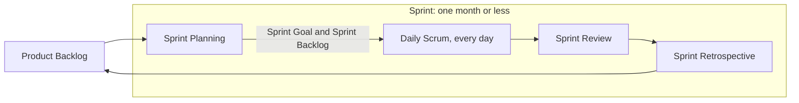
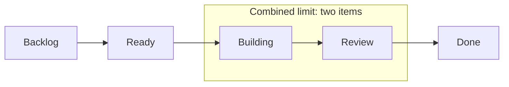

*OO Development and Agile Practices*  
*Designing, Testing and Evolving Software with AI Assistance*

The demonstration goes well. The team shows the reservation coordinator from Chapter 2: a student request succeeds, a conflicting request is rejected, and a booking can begin on the day another one ends. The program does what its developers expected. Then the equipment officer asks a question nobody had planned for: “Can I check whether a camera is available before I create a reservation?”

The team can look inside the stored list, but the application has no such query. That one question has exposed a gap between checking a rule during a request and supporting the officer's real workflow, and the conversation does not stop there. Next come cancellation, a view of one borrower's reservations, and rejecting an equipment identifier that does not exist.

The team cannot do all of it at once, and it should not try. It needs a way to clarify what is being asked, compare the value of each request, be honest about what it does not yet know, and decide what useful work to finish next. That is what agile development is for: not speed for its own sake, but learning quickly while there is still little to undo. In this chapter you will watch that process work on the same small codebase. You will separate iteration from increment, explain the Agile values through concrete project decisions, and compare Scrum's framework with Kanban's attention to flow. You will write small user stories and test them with INVEST, write acceptance criteria and tell them apart from a Definition of Done, and talk about estimates and uncertainty without treating a number as a promise. What you end up with is an ordered backlog, testable stories, shared completion conditions and a visible workflow.

This chapter corresponds to **Week 2** and supports LO5. It assumes you understand Chapter 2's objects, date convention and basic review workflow, and it needs no project-management platform and no new Java framework. It supports the Week 2 readings: the Agile practices and planning chapters of Martin [7], the Scrum Guide [3] and the selected chapters of Rubin [8]. The cumulative application stays at Chapter 2's completed checkpoint, because this chapter plans future work and does not claim that those features already exist. The companion has worked backlog items, board policies, exercise solutions and an optional executable bridge from acceptance examples to the existing Java implementation.

Sections 3.1 to 3.9 are the core reading. The minimum lab is Parts A to C of the practical activity in Section 3.10, done on your **Team project**; the equipment-lending backlog in this chapter is the worked model, not your evidence. The evidence listed at the end of Section 3.10 (backlog, story cards, Definition of Done, workflow policy, process note, estimates and AI decision log) comes out of those three parts and needs nothing more than a text editor or a board. If you want to go further, write the plain-Java acceptance check described at the end of Section 3.10, then answer the review questions and the transfer challenge.

## 3.1 Uncertainty and feedback

At the start of a project, uncertainty appears in several forms. We may not understand what a user needs, how a rule should behave, whether an integration is feasible or how much work a change will require. Treating all of these as “requirements problems” hides useful distinctions.

| Uncertainty | Example in the equipment project | A useful next action |
|---|---|---|
| User need | Does the officer need an availability enquiry without reserving? | Discuss the workflow and demonstrate a small example |
| Domain rule | Can a borrower cancel after equipment has been issued? | Ask the responsible stakeholder and record the decision |
| Technical feasibility | Can the institution's catalogue be accessed? | Conduct a bounded investigation with a concrete result |
| Delivery | Can the team finish a reviewed query workflow in the next iteration? | Examine remaining work, capacity and assumptions |

Different questions require different evidence. A larger estimate will not determine the cancellation policy. More conversation will not prove that an unavailable service can be accessed. Naming the uncertainty helps the team choose an action that can reduce it.

Feedback also varies. A user can expose a missing workflow. A compiler can identify an invalid program. A test can show that an observed result differs from an expectation. A reviewer can identify a dependency that makes the next change harder. None of these observers has complete authority over every question.

For example, the Java implementation currently allows adjacent bookings. That matches our teaching rule. If the equipment officer asks for an inspection day between loans, the team has discovered a possible policy change, not automatically a defect in the original comparison. We should record who proposed the change, why it matters and which examples would differ if it were adopted.

The purpose of a short feedback cycle is to make such discoveries while there is still a manageable amount of work to revise. It does not make change free. Tests, documentation and stored data may also need to change. The team should expose those consequences rather than accept every request without discussion.

## 3.2 Agile values and principles

The Agile Manifesto expresses preferences about how software work is conducted. In paraphrase, it gives greater emphasis to human collaboration, usable software, ongoing customer involvement and adaptation than to relying primarily on tools, exhaustive documents, contractual positions or a fixed plan. It explicitly retains value in the latter activities [1].

The following are applications to our project, not additional statements from the Manifesto:

| Project decision | Applying the values thoughtfully | A mistaken interpretation |
|---|---|---|
| Choosing a board | Select a tool that makes coordination easier | Assume installing a board creates collaboration |
| Recording the period convention | Keep a short, clear decision with examples | Discard documentation because the code exists |
| Handling a new borrowing rule | Discuss its purpose and effect with the equipment officer | Let the team invent policy privately |
| Planning the next increment | Use current information and revise the plan when needed | Stop planning because requirements may change |

The accompanying principles connect regular delivery with technical quality, a sustainable pace and reflection on team effectiveness [2]. In this course, that connection matters because poorly understood code can make a seemingly small request expensive. The design and testing work from earlier chapters supports the team's ability to respond.

Consider the availability enquiry. A useful response is to clarify whether it must merely inspect the coordinator's current in-memory records or include an authoritative inventory and maintenance schedule. The first may be a small teaching increment; the second introduces substantially more work. Calling both “check availability” does not make them equivalent.

Agile work still needs commitments, boundaries and evidence. What changes is the expectation that every detail can be settled correctly at the beginning. We will maintain an explicit record of what we know, what we intend to deliver and what still needs a decision.

## 3.3 Iterations and increments

An **iteration** is a repeated cycle of work and feedback. An **increment** adds integrated, usable capability. The terms describe related but different aspects of development.

Suppose the team revises its reservation messages after a demonstration. It has iterated on the implementation. Suppose it then adds an availability enquiry that works with the existing records and can be used through the agreed interface. It has added an increment of capability.

An isolated database table or a collection of unfinished screens may represent effort without yet providing a usable increment. Technical tasks can be necessary, but the team should explain how they contribute to a result that someone can inspect and use.

### A small route through the project

One possible progression is to make the current reservation flow reproducible, add an enquiry that does not change records, then support a borrower's list of active reservations. Cancellation can follow once its policy and state transitions are understood. This is a proposed learning route, not a new assessment schedule.

Each addition must still work with what came before. If the enquiry answers correctly but creates a reservation as a side effect, it has not delivered the intended capability. If cancellation removes an unrelated record, a successful cancellation message is insufficient evidence.

Do not confuse an increment with a public release. A bounded teaching application can be demonstrated to its intended reviewers while remaining unsuitable for institutional deployment. Its scope and limitations must be explicit. The decision to release software to real users involves additional considerations beyond completing a classroom exercise.

Chapter 4 will turn the selected work into an iteration plan. For now, concentrate on identifying small outcomes and the evidence that would make them credible.

## 3.4 Scrum accountabilities, events and artefacts

Scrum is a framework with defined elements. The November 2020 Scrum Guide is the formal reference used here [3]. Its basic structure can be summarised compactly:

| Element | Meaning |
|---|---|
| Product Owner | Accountable for product value and effective Product Backlog management |
| Developers | Create usable increments and plan their work |
| Scrum Master | Establishes Scrum and supports team effectiveness |
| Sprint | A fixed-length event of one month or less containing the other events |
| Sprint Planning | Establishes why the Sprint matters, selected work and an approach |
| Daily Scrum | Developers inspect progress toward the Sprint Goal and adapt their plan |
| Sprint Review | Inspect the outcome with stakeholders and consider adaptations |
| Sprint Retrospective | Examine how the team worked and choose improvements |

Scrum links three artefacts to commitments: the **Product Backlog** to the **Product Goal**, the **Sprint Backlog** to the **Sprint Goal**, and the **Increment** to the **Definition of Done**. The Sprint Backlog includes the goal, selected work and delivery plan. User-story templates and story points are optional practices, not required Scrum elements [3].



**Figure 3.1.** A Sprint contains all of the Scrum events. Planning selects work from the Product Backlog and sets the Sprint Goal; the Developers inspect progress at each Daily Scrum; the Review inspects the outcome with stakeholders; the Retrospective improves how the team works, and what is learned feeds the Product Backlog and the next Sprint.

### Applying the distinctions to a student team

A possible Product Goal for our learning project is: “Enable the equipment office to manage a small set of student reservations with visible rules and reliable records.” This expresses a useful future state. It does not specify every screen or method.

A possible Sprint Goal is narrower: “Let the officer check availability without changing reservations.” It tells the team why its selected work belongs together. “Finish US-02, update the README and edit three classes” lists work but does not explain the outcome that connects it.

During a short coordination conversation, a developer might say, “The enquiry works, but its result depends on a date convention we have not documented. I will pair with the reviewer to resolve that before adding another feature.” This focuses on the team's progress. The Scrum Guide defines the Daily Scrum as a 15-minute event for the Developers to inspect progress toward the Sprint Goal and adapt their plan; it does not define it as a status report to a supervisor [3].

At a review, the equipment officer might try the enquiry and ask whether a damaged item should ever appear available. That discussion concerns the product and possible next work. The Scrum Guide describes the Sprint Review as a working session and advises against limiting it to a presentation [3].

At a retrospective, the team might notice that reviews consistently arrived too late. It could agree to request review when a small behaviour first works, then inspect whether that agreement helps. The retrospective concerns ways to increase the team's quality and effectiveness, including how it collaborated and verified work [3].

### Classroom adaptations must be named

The module leader may provide stakeholder answers, teams may rotate facilitation and reviews may happen within teaching sessions. These are course arrangements. They do not redefine Scrum's accountabilities or turn every classroom meeting into a formal Scrum event. An academic submission date is also not automatically a Sprint boundary.

The descriptor's later “Sprint 0” label refers to kickoff work. Treat it as a local preparation convention, not another formal Scrum event. Keep the distinction visible when writing reports about the process your team actually followed.

## 3.5 Kanban and an explicit workflow

Kanban focuses on the flow of value through work. The May 2025 Kanban Guide describes defining and visualising a workflow, managing work within it and improving that workflow. Its workflow definition includes work items, start and finish points, states, work-in-progress controls, movement policies and a service-level expectation. That expectation combines elapsed time with a probability; historical evidence should inform it when available [4].

For our introductory board, use five columns:

| Column | Local meaning |
|---|---|
| Backlog | Candidate work, not yet selected to start |
| Ready | Small enough and clear enough to begin under the team's local policy |
| Building | Implementation and associated checks are under way |
| Review | Work is awaiting or receiving review and verification |
| Done | The agreed completion conditions have been met |



**Figure 3.2.** The five-column board. The start point is entry into Building and the finish point is entry into Done. Building and Review share one limit of two items, and a blocked item stays inside it.

These columns are our example, not mandatory names. Define the start point as entry into Building and the finish point as entry into Done. For this exercise, limit the **combined** number of items in Building and Review to two. Blocked work remains within that count; moving it to an uncounted “Blocked” column would hide unfinished work rather than finish it.

Imagine that one item is in Building and another is waiting in Review. The team has reached its limit. Before starting a third, it should investigate what would help an existing item finish: review together, resolve a question or make a smaller change. A limit is useful only when it affects decisions.

A board alone is an incomplete Kanban system. A team also needs the workflow policies, active management and evidence for improvement. For practice, a team might provisionally expect 85% of its small items to finish within five working days after starting. Without historical data, that is an explicitly unvalidated hypothesis, not a measured promise. Chapter 12 develops flow measures and forecasting; we will not derive a delivery guarantee from this invented example.

### Comparing Scrum and Kanban

| Question | Scrum emphasis | Kanban emphasis |
|---|---|---|
| What structures the work? | Goals, Sprints and defined accountabilities/events | Explicit workflow and control of work in progress |
| What is inspected? | Product outcomes and progress toward goals | How work moves, waits and finishes |
| Can a board help? | Yes, to make selected work visible | Yes, to visualise the workflow and its policies |
| Can they be used together? | A Scrum team can also manage flow explicitly | Flow practices can operate within a Sprint cadence |

Do not reduce the choice to “Scrum has meetings; Kanban has none” or “Scrum is planned; Kanban is unplanned.” Our immediate learning goal is to make work and completion conditions visible. The chosen approach should help the team make decisions, not merely supply labels.

## 3.6 Epics, user stories and INVEST

“Manage equipment” is too broad to guide the next implementation. It may refer to stock records, borrowing, maintenance, losses, reporting or purchasing. We need to identify a particular actor, outcome and reason.

An **epic** is a convenient label for a large area of work that needs further division. For this book, “Manage student equipment reservations” is an epic. A **user story** expresses a smaller user-centred need. A familiar form is:

> As an equipment officer, I want to record an eligible, non-conflicting reservation so that the selected item is allocated for the borrower's requested period.

The sentence opens a discussion. It does not define eligibility, conflicts, dates or failure behaviour by itself. Ron Jeffries's account of stories connects a short written reminder with conversation and confirmation [5]. We will keep a card, record the relevant decisions and attach observable examples.

### Stories and implementation tasks

“Create a `HashMap`” names an implementation task. It does not explain the outcome a user needs. A story can lead to tasks involving data structures, checks and interface work, but the tasks should remain connected to the outcome.

Not all backlog work needs a fictional user-story sentence. A build-check task can be labelled a technical enabler and justified by the delivery problem it addresses. Our convention uses `US-` for stories and `EN-` for enablers. These prefixes are local identifiers, not Agile rules.

### Apply INVEST as questions

Bill Wake introduced INVEST to prompt useful qualities in stories [6]. The following questions apply it to our domain:

| Quality | Question to ask about this story |
|---|---|
| Independent | Can it provide an identifiable outcome without another unfinished story? If not, what is the dependency? |
| Negotiable | Which implementation details can still be discussed while preserving the need? |
| Valuable | Who benefits from this behaviour, and how? |
| Estimable | Is the team clear enough about scope and uncertainty to discuss its size? |
| Small | Can the team implement and verify a useful version within its intended work period? |
| Testable | Can we describe observations that distinguish success from failure? |

This is a reasoning aid, not a six-point score that certifies a story. Real dependencies should be recorded. “Independent” should not lead us to pretend that cancellation needs no existing reservation, while “negotiable” should not mean ignoring an agreed safety or domain rule.

For the availability story, a small version might inspect the coordinator's current records for one known item and one period, leaving records unchanged. Adding live inventory, maintenance calendars, permissions and email delivery at the same time would make it harder to identify what is being delivered.

### A backlog is ordered work, not a collection of equal priorities

The Scrum Guide describes the Product Backlog as an emergent, ordered list, and refinement as the ongoing work of breaking items into smaller, more precise ones [3]. Ordering and refinement together help make upcoming work understandable. We will record current support as well as remaining work, because the team inherits code from Chapter 2.

| Order | ID | Outcome or purpose | Relationship to existing code |
|---:|---|---|---|
| 1 | US-01 | Record an eligible, non-conflicting student reservation | Core behaviour exists; delivery and completion evidence must be reviewed |
| 2 | US-02 | Inspect an item's availability without reserving it | No dedicated query operation exists yet |
| 3 | EN-01 | Make the existing checks reproducible in an automated build workflow | Planned enabler for the kickoff work in Chapter 4 |

This is the beginning of a draft backlog, not a report that three items have been delivered. Review inherited capability instead of pretending to implement it again. When a story's complete conditions are met, retain the evidence in completed history rather than counting it again as new work.

## 3.7 Acceptance criteria and Definition of Done

**Acceptance criteria** describe the behaviour expected for a particular item. They should be specific enough that a second team can tell whether an implementation meets them. **Definition of Done** describes the shared quality conditions required for an increment. Scrum makes that definition the commitment associated with the Increment [3].

For US-01, the following criteria use the existing teaching rules. All counts are measured before adding the new reservation; all stored reservations are currently active. Dates use the exclusive-end convention established in Chapter 2.

| Criterion | Required observable behaviour |
|---|---|
| AC-01 | An eligible request for an available item creates one stored reservation and returns its confirmation |
| AC-02 | A request overlapping an existing reservation for the same item is rejected without changing stored records |
| AC-03 | A request that begins at an existing reservation's exclusive end, or ends exactly where an existing reservation begins, is permitted when the other rules hold |
| AC-04 | A borrower with three active reservations cannot add a fourth, even for another item |
| AC-05 | Durations of one through seven whole days are allowed by the duration rule; zero, negative and eight-day requests are rejected without adding records |

These criteria describe a controlled demonstration using non-blank, agreed fixture identifiers and representable dates. They do not establish catalogue membership, authentication, persistence or concurrency safety. Those omissions must remain visible when judging what kind of product the story represents.

### Turn a criterion into an example

For AC-02, use this example:

```text
Given CAM1 is reserved for B1 from 20 October to 22 October,
using a start-inclusive, end-exclusive period,
when B2 requests CAM1 from 21 October for one day,
then the request is rejected as unavailable,
and the original reservation remains the only stored record.
```

The format separates context, action and observations. It is plain text here, not an executable framework. The companion shows a short Java check against the existing coordinator. This introduces traceability between an example and behaviour; it does not yet teach a complete TDD or BDD method.

Notice both observations: the rejection and unchanged state. A program that prints the correct rejection but still adds a reservation has not met the criterion.

### A working Definition of Done for this stage

The team could adopt the following as **DoD version 0.1 for its controlled teaching increment**:

1. Relevant acceptance examples have been checked, including important rejection paths.
2. The code compiles and runs using the documented commands in the agreed environment.
3. The change has been reviewed and acceptance-blocking findings have been resolved.
4. The work is integrated with the team's shared codebase and existing checks still pass.
5. Necessary usage notes, domain decisions and known limitations are current.
6. The increment can be reproduced and demonstrated within its explicitly stated scope.

This is a proposed team agreement, not a university grading policy. It uses checks available now; automated CI gates can be added when the infrastructure is introduced. Do not claim a pipeline has passed before it exists, or weaken the agreed standard merely to move a card to Done.

AC-03 belongs to the reservation story because it defines date behaviour. Reproducible setup belongs to the shared completion agreement. Both matter. Passing a story's examples while leaving an unreviewed, unintegrated change does not meet this example DoD. Appendix C has blank forms, each with a worked example, for a story card (C.2), an acceptance example (C.3) and a Definition of Done (C.4).

“Ready” has a different purpose: it records whether a team considers an item sufficiently understood to start. Our Ready-column policy is a local agreement, not an additional formal Scrum artefact or event.

## 3.8 Relative estimation and uncertainty

An estimate helps a team discuss and forecast work. It is not a guarantee that a specific person will finish at a precise time. Before estimating, establish what is included: implementation alone, or also review, checking and documentation needed to meet Done?

We will use **story points** as an optional local relative scale. A team might use 1, 2, 3, 5 and 8 to compare work while considering effort, complexity and uncertainty. These numbers are not hours, and the same number in two teams need not represent equivalent work.

Suppose a familiar display adjustment is the team's reference item at two points. A small availability query may seem larger because it needs a non-mutating operation, several date examples and a new interaction. One learner estimates three and another eight. Averaging them immediately would discard the most useful information: why they disagree.

The second learner may be assuming that the query includes maintenance schedules. Once that assumption is exposed, the team can narrow the story or record a separate requirement. If the uncertainty concerns an external catalogue whose interface is unknown, a short investigation may be more useful than a larger number.

Such an investigation should have a bounded question and output: for example, “Determine whether a read-only sample catalogue can be accessed and record the fields it provides.” It should not become an unlimited task called “research the system.”

For practice, estimate only clarified items and write the assumption behind each estimate. Leave an item unestimated when a material question remains. Different reasoned estimates are acceptable; claiming certainty without evidence is not.

Do not rank students by points completed, convert points into individual productivity targets or assume that doubling team size doubles delivery. Chapter 12 will examine measured progress and flow. Chapter 4 will combine selected work with actual team capacity to form an iteration plan.

## 3.9 AI in practice: challenge a story without inventing policy

An AI assistant can suggest missing assumptions and candidate criteria, but it has no authority to decide the equipment office's rules. The exercise is to evaluate its proposals against the agreed context.

Chapter 15 collects the recurring AI workflows; this activity is self-contained, and the fixture and classification table below are everything you need.

| Element | For this activity |
|---|---|
| Engineering objective | Decide which suggested assumptions and criteria belong in the story, which do not and which need a stakeholder |
| Input | US-01, AC-01 through AC-05, and Chapter 2's scope |
| Permitted scope | Classify the suggestions; do not change the policy, the code or the story's scope on your own |
| Independent checks | The stated rules, the Chapter 2 code and checks, and the story's scope |
| Accept or reject | **Accept**, **reject for this story**, or **clarify** with a named person or decision |
| No-account route | The fixture below is sufficient |

The following suggestions are an **author-written teaching fixture** constructed for this exercise, not a captured response from a real model:

1. A request for the same item and an identical period must be refused.
2. A request that begins exactly when an existing period ends must be refused.
3. Every confirmation must be emailed within thirty seconds.
4. A refused request must leave stored reservations unchanged.
5. Specify how start dates that are already in the past are treated.
6. A deposit payment must be taken before any reservation can be confirmed.
7. Specify whether cancelled reservations count toward the borrower's limit.

Classify each suggestion, with a reason. “Reject” can mean the proposal contradicts a rule or introduces unapproved scope; it need not mean that the idea could never be useful. A clarification about a future feature does not automatically block today's bounded story.

If permitted and available, use this optional prompt:

> Review this story against the supplied policy and current project scope. Suggest missing assumptions, edge cases and candidate acceptance criteria. Label each suggestion as derived from a stated rule, an open question or a possible scope extension. Do not silently change the policy or claim a feature is already implemented.

Keep a record of what you accepted, rejected and deferred. Refer to the relevant rule or code evidence rather than the assistant's confidence. The supplied fixture makes the activity possible without an AI account.

## 3.10 Practical activity: create a draft backlog

This activity runs on your **Team project**. If your team uses equipment lending, start from the Chapter 2 coordinator, the three backlog entries in Section 3.6 and the teaching rules. If your team chose another provided domain, apply the same steps to that domain's starter codebase and its first user-visible capability. For an ML model-serving tool, for example, you might write “as an analyst, I want a prediction for a supplied record so that I can check the result”. The transfer challenge shows how to adapt the steps. This is preparation for the Week 3 kickoff; it does not change the module's assessment dates or weights.

### Part A: define and refine the work

Write a short proposed Product Goal. Extend the draft backlog to six items by considering a borrower's active-reservation list, cancellation and catalogue-identifier validation. Use stable IDs and identify dependencies or unresolved decisions. Order the items and explain the first two positions.

Record which behaviours are already supported in code, which need new implementation and which cannot yet be judged. Do not label an inherited feature Done solely because a demonstration prints the desired text.

Refine US-02 into a small story with at least four acceptance examples. State that asking about availability must not create or remove reservations. Decide which identifiers and period rules belong to its controlled scope, and mark unresolved policy rather than guessing it.

### Part B: agree completion and workflow

Propose a Definition of Done and explain how it differs from your story criteria. Draw a board using the five example columns or a justified alternative. Define its start and finish points, movement policies, WIP control and handling of blocked work. Record the service-level expectation as provisional if you lack data. Write a short process note naming which Scrum elements your team uses as the Guide defines them, which it adapts for the course, and which optional practices (stories, points, a board) it adopts.

Use this **hypothetical later snapshot** only to practise a decision; it is not a claim about current project progress:

| Ready | Building | Review | Done |
|---|---|---|---|
| US-03, US-04 | US-02 | EN-01, blocked by a setup problem | US-01 |

The combined Building-plus-Review limit is two. Decide what the team should investigate next and explain why moving the blocked card outside the counted area would misrepresent its work.

### Part C: estimate and critique

Choose two clarified items and propose relative estimates with assumptions. Identify one item that needs clarification or investigation before sizing. Complete the AI activity and record the disposition of each suggestion.

Finally, compare these two invented recommendations:

> Advice A: Freeze every detailed story before any implementation begins.

> Advice B: Start implementation immediately and leave acceptance conditions until the demonstration.

Identify the problem each recommendation tries to solve, its risk in this project and a more defensible working agreement. This is practice for the critical reading introduced in Chapter 1, not a claim about a particular author's position.

### Evidence and completion check

Retain the proposed goal, ordered six-item backlog, two refined story cards, acceptance examples, Definition of Done, workflow policy, process note, estimates with assumptions and AI decision log. Exchange the top story with another team.

The activity is complete when the other team can explain the intended outcome, select meaningful inputs and predict observable results without inventing essential policy. Record any question they could not answer and revise the story or explicitly defer the decision.

**Optional extension:** write a plain-Java check for your top story's examples, in the style of the companion's `Chapter03AcceptanceExamples`, and confirm that it fails when you introduce a deliberate fault.

## 3.11 Common mistakes

| Mistake | Consequence | Correction |
|---|---|---|
| Treating Agile as the absence of planning | Dependencies and deadlines remain invisible | Plan at useful detail and revise from evidence |
| Treating a story template as the full requirement | Eligibility and failure behaviour remain ambiguous | Add discussion, decisions and examples |
| Calling every item highest priority | The team has no usable order | Explain why one outcome should be pursued before another |
| Treating acceptance criteria as the whole DoD | Correct examples hide unreviewed or unintegrated work | Check behaviour and shared quality conditions |
| Starting new work whenever review is blocked | Unfinished work accumulates | Make the blockage visible and help existing work finish |
| Treating AI suggestions as stakeholder decisions | The scope or policy changes without agreement | Classify each proposal and justify its disposition |
| Counting inherited working code as newly delivered work | Progress becomes misleading | Record the baseline and the remaining work honestly |

## 3.12 Review questions and transfer challenge

### Concept questions

1. Explain how an iteration can improve an existing feature and how an increment adds usable capability. Give an equipment-lending example of each.
2. Choose one Agile value and explain a decision that respects both sides of its preference rather than discarding one side.
3. Distinguish Sprint Review, Sprint Retrospective and Daily Scrum using the decisions each helps the team make.
4. Explain the difference between acceptance criteria, Definition of Done and the local Ready-column policy.

### Applied diagnosis

5. A team marks an availability story Done because its method returns a correct answer for one date. The enquiry also adds a reservation, and the change has not been reviewed. Identify two separate completion failures and the evidence needed to investigate them.
6. Two items already occupy the team's limited active workflow. One is blocked in Review. A developer moves it to an uncounted column and starts a third item, claiming the WIP limit is still respected. Explain what the board now hides and propose a useful next action.

### Transfer challenge

A laboratory room-booking team receives the request “Make booking easier.” Develop two small user stories and one justified technical enabler. Give one story four acceptance examples, including a failure case and an observation about unchanged state. Propose a shared Definition of Done and a simple WIP policy.

Identify one question that needs a stakeholder answer and one technical uncertainty that might need an investigation. Explain how the team could obtain feedback without pretending that every room-booking rule is already known.

## Summary and next chapter

Agile development combines a willingness to learn with visible work and explicit quality expectations. Short cycles help when feedback changes what the team understands, while careful design and checks help it make the resulting changes safely.

Scrum and Kanban offer different ways to organise that work. Their terminology should clarify responsibilities and decisions. A board, meeting or estimate has little value if the team cannot explain how it affects the next action.

Our immediate result is a draft backlog with clear stories, observable examples, shared completion conditions and a workflow. It distinguishes inherited capability from new work and records the decisions that remain open.

In **Chapter 4: From Requirements to an Iteration**, we will use those artefacts to define project scope, slice features, prepare the kickoff milestone and establish a reproducible repository and initial CI workflow.

## Sources and further reading

All project scenarios, backlog entries, board policies, exercises and AI fixtures are original teaching material. The numeric rules and Java baseline continue the preceding chapters. Sources were checked on 12 and 13 October 2026; the named guide versions keep the conceptual baseline explicit.

1. **Authors of the Agile Manifesto.** [Manifesto for Agile Software Development](https://agilemanifesto.org/), 2001. Section 3.2 paraphrases its preferences; read the original wording alongside the project applications.
2. **Authors of the Agile Manifesto.** [Principles behind the Agile Manifesto](https://agilemanifesto.org/principles.html), 2001. Delivery, technical quality, sustainable work and reflection.
3. **Schwaber, Ken, and Jeff Sutherland.** [The Scrum Guide](https://scrumguides.org/scrum-guide.html), November 2020. Formal accountabilities, events, artefacts and commitments, including the Daily Scrum, Sprint Review, Sprint Retrospective and Product Backlog sections cited in Sections 3.4 and 3.6. The guide mentions neither user stories nor story points. Local teaching conventions and optional practices are identified separately.
4. **Kanban Guides contributors.** [The Kanban Guide](https://kanbanguides.org/the-kanban-guide/2025.5/), May 2025. Workflow, WIP controls and flow. The example limits and provisional expectation in this chapter are invented for practice, not measured recommendations.
5. **Jeffries, Ron.** [Essential XP: Card, Conversation, Confirmation](https://ronjeffries.com/xprog/articles/expcardconversationconfirmation/), 2001. Stories as more than written cards.
6. **Wake, Bill.** [INVEST in Good Stories, and SMART Tasks](https://xp123.com/invest-in-good-stories-and-smart-tasks/), 17 August 2003. Original explanation of INVEST.
7. **Martin, Robert C.** *Agile Software Development: Principles, Patterns, and Practices.* Prentice Hall, 2002. The module's required text; the Week 2 reading is its Agile practices and planning chapters. Publication details as listed in the module descriptor.
8. **Rubin, Kenneth S.** *Essential Scrum.* Addison-Wesley, 2012. A recommended text; read the selected chapters named for Week 2. Publication details as listed in the module descriptor.