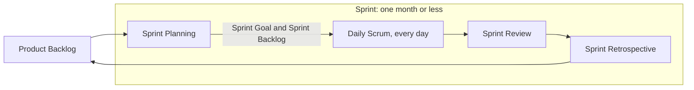
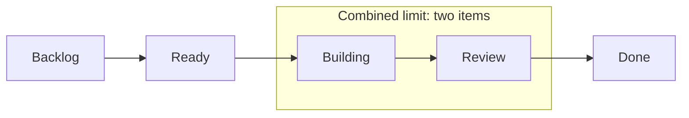

*OO Development and Agile Practices*  
*Designing, Testing and Evolving Software with AI Assistance*

The demonstration goes well. The team shows the reservation coordinator from Chapter 2: a student request succeeds, a conflicting request is rejected, and a booking can begin on the day another one ends. The program does what its developers expected. Then the equipment officer asks a question nobody had planned for: “Can I check whether a camera is available before I create a reservation?”

The team can look inside the stored list, but the application has no such query. That one question has exposed a gap between checking a rule during a request and supporting the officer's real workflow, and the conversation does not stop there. Next come cancellation, a view of one borrower's reservations, and rejecting an equipment identifier that does not exist.

The team cannot do all of it at once, and it should not try. It needs a way to clarify what is being asked, compare the value of each request, be honest about what it does not yet know, and decide what useful work to finish next. That is what agile development is for: not speed for its own sake, but learning quickly while there is still little to undo. In this chapter you will watch that process work on the same small codebase. You will separate iteration from increment, explain the Agile values through concrete project decisions, and compare Scrum's framework with Kanban's attention to flow. You will write small user stories and test them with INVEST, write acceptance criteria and tell them apart from a Definition of Done, and talk about estimates and uncertainty without treating a number as a promise. What you end up with is an ordered backlog, testable stories, shared completion conditions and a visible workflow.

This chapter corresponds to **Week 2** and supports LO5. It assumes you understand Chapter 2's objects, date convention and basic review workflow, and it needs no project-management platform and no new Java framework. It supports the Week 2 readings: the Agile practices and planning chapters of Martin [7], the Scrum Guide [3] and the selected chapters of Rubin [8]. The running project stays exactly where Chapter 2 left it, because this chapter plans future work and does not claim that those features already exist. The companion has worked backlog items, board policies, exercise solutions and an optional executable bridge from acceptance examples to the existing Java implementation.

Sections 3.1 to 3.9 are the core reading. What you must do is Parts A to C of the practical activity in Section 3.10, on your team's project; the equipment-lending backlog in this chapter is the worked model, not your evidence. Everything you keep at the end of Section 3.10 (backlog, story cards, Definition of Done, workflow policy, process note, estimates and AI decision log) comes out of those three parts and needs nothing more than a text editor or a board. If you want more, write the plain-Java acceptance check described at the end of Section 3.10, then work through the questions and the transfer challenge in Section 3.12.

## 3.1 What do we not know yet? Uncertainty and feedback

At the start of a project we are unsure about many different things. We may not understand what a user needs, how a rule should behave, whether an integration is feasible, or how much work a change will take. It is tempting to file all of these under “requirements problems”, but that hides differences that matter.

| Uncertainty | Example in the equipment project | A useful next action |
|---|---|---|
| User need | Does the officer need an availability enquiry without reserving? | Discuss the workflow and demonstrate a small example |
| Domain rule | Can a borrower cancel after equipment has been issued? | Ask the responsible stakeholder and record the decision |
| Technical feasibility | Can the institution's catalogue be accessed? | Conduct a bounded investigation with a concrete result |
| Delivery | Can the team finish a reviewed query workflow in the next iteration? | Examine remaining work, capacity and assumptions |

Each of these needs a different kind of evidence. A bigger estimate will not settle the cancellation policy, and more discussion will not show whether an unavailable service can be reached. Once the team has named what it does not know, it can pick an action that actually reduces the uncertainty.

Feedback comes in different kinds, too. A user can reveal a missing workflow. A compiler can reject an invalid program. A test can show that an observed result differs from what we expected. A reviewer can point out a dependency that will make the next change harder. None of them can answer every question.

Here is an example from our project. The Java implementation currently allows adjacent bookings, which matches a rule invented for this book. Suppose the equipment officer asks for an inspection day between loans. The team has not found a defect in the original comparison; it has found a possible change of policy. So we write down who proposed it, why it matters and which examples would come out differently if we adopted it.

The reason for short feedback cycles is to find out things like this while there is still little work to revise. They do not make change free. Tests, documentation and stored data may all need to change too, and the team should say so openly instead of accepting every request without discussion.

## 3.2 What the Agile values mean for real project decisions

You have probably heard the Agile Manifesto summed up in a slogan. Here is what it actually says, in paraphrase. It puts more weight on people working together, software that works, continuing involvement from customers and responding to change than on relying mainly on tools, exhaustive documents, contract terms or a fixed plan. It does not throw the second group away; it says explicitly that those things still have value [1].

The table below applies these preferences to our project. The right-hand column is what the first two columns are meant to avoid. None of this is wording from the Manifesto itself:

| Project decision | Applying the values thoughtfully | A mistaken interpretation |
|---|---|---|
| Choosing a board | Select a tool that makes coordination easier | Assume installing a board creates collaboration |
| Recording the period convention | Keep a short, clear decision with examples | Discard documentation because the code exists |
| Handling a new borrowing rule | Discuss its purpose and effect with the equipment officer | Let the team invent policy privately |
| Planning the next increment | Use current information and revise the plan when needed | Stop planning because requirements may change |

The Manifesto's accompanying principles link regular delivery to technical quality, a sustainable pace and regular reflection on how the team works [2]. That link matters in this course. Code that nobody understands makes even a small request expensive, so the design and testing work from earlier chapters is what lets a team respond to change at all.

Take the availability enquiry. A good first move is to ask whether it only has to look at the coordinator's current in-memory records, or whether it must also consult a real inventory and a maintenance schedule. The first can be a small teaching increment, and the second is a lot more work. Both can be called “check availability”, but they are not the same job.

Agile work still has commitments, boundaries and evidence. What changes is that nobody expects every detail to be settled correctly on day one. Instead we keep an honest record of what we know, what we plan to deliver and what still needs a decision.

## 3.3 Iteration or increment? Two kinds of progress

The two words get mixed up all the time, so it helps to separate them. An **iteration** is one repeated cycle of work and feedback. An **increment** is a piece of integrated, usable capability. They describe different things about the same development.

Suppose the team changes its reservation messages after a demonstration. It has iterated on the implementation. Now suppose it adds an availability enquiry that works with the existing records and can be used through the agreed interface. That is an increment, because there is new capability somebody can use.

An isolated database table or a pile of unfinished screens may represent a lot of effort and still not be a usable increment. Technical tasks are often necessary. The point is that the team should be able to say how each one contributes to a result that someone can inspect and use.

### A small route through the project

One possible route runs like this. First make the current reservation flow reproducible. Then add an enquiry that does not change any records, and after that a borrower's list of active reservations. Cancellation can come once its policy and state changes are understood. This is a suggested learning route, not a new assessment schedule.

Each addition still has to work with everything before it. If the enquiry gives the right answer but creates a reservation as a side effect, it has not delivered what was wanted. If cancellation removes an unrelated record, a friendly “cancelled” message is not enough evidence.

An increment is also not the same as a public release. A small teaching application can be demonstrated to its intended reviewers and still be unfit for the institution to deploy, so its scope and limitations should be stated openly. Releasing software to real users involves more decisions than finishing a classroom exercise.

Chapter 4 will turn the chosen work into an iteration plan. For now, practise spotting small outcomes and asking what evidence would make each one believable.

## 3.4 Scrum: who is accountable, what happens when, and what it produces

Scrum is a framework with defined parts, and it is easy to describe loosely and get wrong. We use the November 2020 Scrum Guide as the formal reference [3]. Here is its basic structure in one table:

| Element | Meaning |
|---|---|
| Product Owner | Accountable for product value and effective Product Backlog management |
| Developers | Create usable increments and plan their work |
| Scrum Master | Establishes Scrum and supports team effectiveness |
| Sprint | A fixed-length event of one month or less containing the other events |
| Sprint Planning | Establishes why the Sprint matters, selected work and an approach |
| Daily Scrum | Developers inspect progress toward the Sprint Goal and adapt their plan |
| Sprint Review | Inspect the outcome with stakeholders and consider adaptations |
| Sprint Retrospective | Examine how the team worked and choose improvements |

Scrum ties each of its three artefacts to a commitment: the **Product Backlog** to the **Product Goal**, the **Sprint Backlog** to the **Sprint Goal**, and the **Increment** to the **Definition of Done**. The Sprint Backlog holds the goal, the selected work and the plan for delivering it. User-story templates and story points are optional practices, not parts of Scrum [3].



**Figure 3.1.** A Sprint contains all of the Scrum events. Planning selects work from the Product Backlog and sets the Sprint Goal; the Developers inspect progress at each Daily Scrum; the Review inspects the outcome with stakeholders; the Retrospective improves how the team works, and what is learned feeds the Product Backlog and the next Sprint.

### What Scrum looks like for a student team

Definitions only go so far, so let us see them applied. A possible Product Goal for our learning project is: “Enable the equipment office to manage a small set of student reservations with visible rules and reliable records.” It describes a useful future state without fixing every screen or method.

A possible Sprint Goal is narrower: “Let the officer check availability without changing reservations.” It tells the team why its selected work belongs together. Compare it with “Finish US-02, update the README and edit three classes”, which lists tasks but never says what outcome they add up to.

Picture a short coordination conversation. A developer says, “The enquiry works, but its result depends on a date convention we have not documented. I will pair with the reviewer to resolve that before adding another feature.” That is the team talking about its own progress. The Scrum Guide defines the Daily Scrum as a 15-minute event where the Developers inspect progress toward the Sprint Goal and adapt their plan. It is not a status report to a supervisor [3].

At a review, the equipment officer might try the enquiry and ask whether a damaged item should ever show as available. That is a conversation about the product and what to do next. The Scrum Guide calls the Sprint Review a working session and advises against turning it into a presentation [3].

At a retrospective, the team might notice that reviews keep arriving too late. It could agree to ask for a review as soon as a small behaviour first works, and then look later at whether that helped. The retrospective is about raising the team's quality and effectiveness, including how it collaborated and checked its work [3].

### When the classroom bends the rules, say so

In a course, things happen that Scrum does not describe. The module leader may supply stakeholder answers, teams may take turns facilitating, and reviews may happen inside teaching sessions. These are course arrangements. They do not change Scrum's accountabilities, and they do not make every classroom meeting a formal Scrum event. A submission date is not automatically a Sprint boundary either.

The module descriptor's later “Sprint 0” label refers to kickoff work. Treat it as a local convention for preparation, not as another Scrum event. When you write about the process your team really followed, keep that distinction visible.

## 3.5 Kanban: making the workflow visible

Scrum organises work around goals and time boxes. Kanban asks a different question: how does work move through the team, and where does it get stuck? The May 2025 Kanban Guide describes three jobs: define and visualise a workflow, manage work within it, and improve it. A workflow definition includes the work items, start and finish points, states, limits on work in progress, policies for moving work, and a service-level expectation. That expectation combines elapsed time with a probability, and it should be informed by historical evidence when you have it [4].

For our introductory board we use five columns:

| Column | Local meaning |
|---|---|
| Backlog | Candidate work, not yet selected to start |
| Ready | Small enough and clear enough to begin under the team's local policy |
| Building | Implementation and associated checks are under way |
| Review | Work is awaiting or receiving review and verification |
| Done | The agreed completion conditions have been met |



**Figure 3.2.** The five-column board. The start point is entry into Building and the finish point is entry into Done. Building and Review share one limit of two items, and a blocked item stays inside it.

These column names are only our example; your team can choose others. We define the start point as entry into Building and the finish point as entry into Done. For this exercise, the **combined** number of items in Building and Review may not exceed two. Blocked work stays inside that count. Moving it to a “Blocked” column that nobody counts would hide unfinished work instead of finishing it.

Imagine one item in Building and another waiting in Review. The team has reached its limit. Before starting a third item, it should ask what would help an existing one finish: reviewing together, answering an open question, or making a smaller change. A limit is only worth having if it changes what people decide to do.

A board by itself is not yet a Kanban system. The team also needs workflow policies, active management and evidence it can use to improve. For practice, a team might provisionally expect 85% of its small items to finish within five working days after starting. With no historical data, that is an unvalidated hypothesis and not a measured promise. Chapter 12 develops flow measures and forecasting, and we will not derive a delivery guarantee from this invented example.

### Scrum or Kanban? What each pays attention to

| Question | Scrum emphasis | Kanban emphasis |
|---|---|---|
| What structures the work? | Goals, Sprints and defined accountabilities/events | Explicit workflow and control of work in progress |
| What is inspected? | Product outcomes and progress toward goals | How work moves, waits and finishes |
| Can a board help? | Yes, to make selected work visible | Yes, to visualise the workflow and its policies |
| Can they be used together? | A Scrum team can also manage flow explicitly | Flow practices can operate within a Sprint cadence |

Resist the two easy summaries: “Scrum has meetings and Kanban has none”, and “Scrum is planned and Kanban is unplanned.” Neither is true. What we want right now is to make the work and its completion conditions visible. Whichever approach you pick should help the team decide things, and not just give it new labels.

## 3.6 From “manage equipment” to a story you can build: epics, user stories and INVEST

“Manage equipment” is far too broad to tell anyone what to implement next. It could mean stock records, borrowing, maintenance, losses, reports or purchasing. To make progress, we need a particular person, a particular outcome and a reason.

An **epic** is a convenient name for a large area of work that still has to be split up. In this book, “Manage student equipment reservations” is an epic. A **user story** is a smaller need, written from the user's point of view. A familiar form looks like this:

> As an equipment officer, I want to record an eligible, non-conflicting reservation so that the selected item is allocated for the borrower's requested period.

That sentence starts a conversation; it does not finish one. It does not say what “eligible” means, what counts as a conflict, how dates work or what happens on failure. Ron Jeffries describes a story as a short written reminder joined to conversation and confirmation [5]. We will do the same: keep a card, write down the decisions that come out of the discussion, and attach examples someone can observe.

### A story is not a task

“Create a `HashMap`” is an implementation task. It says nothing about what a user needs. A story can lead to tasks about data structures, checks and interface work, but each task should stay tied to the outcome it serves.

Not every item on a backlog needs an invented user-story sentence. A task that sets up a build check can be labelled a technical enabler and justified by the delivery problem it solves. In this book `US-` marks a story and `EN-` marks an enabler. These prefixes are our local identifiers and not Agile rules.

### Using INVEST as a set of questions

Bill Wake introduced INVEST as a prompt for the qualities a good story tends to have [6]. Here are the questions it raises in our domain:

| Quality | Question to ask about this story |
|---|---|
| Independent | Can it provide an identifiable outcome without another unfinished story? If not, what is the dependency? |
| Negotiable | Which implementation details can still be discussed while preserving the need? |
| Valuable | Who benefits from this behaviour, and how? |
| Estimable | Is the team clear enough about scope and uncertainty to discuss its size? |
| Small | Can the team implement and verify a useful version within its intended work period? |
| Testable | Can we describe observations that distinguish success from failure? |

Treat INVEST as a way to reason, not a six-point score that certifies a story. Real dependencies should still be written down. “Independent” should not tempt us into pretending that cancellation needs no existing reservation, and “negotiable” should not mean brushing aside a rule that the team agreed for safety or for the domain.

For the availability story, a small version could look at the coordinator's current records for one known item and one period, and leave the records unchanged. If we also added live inventory, maintenance calendars, permissions and email delivery in the same story, nobody could say clearly what was being delivered.

### A backlog is an ordered list, not a pile of equal priorities

The Scrum Guide describes the Product Backlog as an emergent, ordered list, and refinement as the continuing work of breaking items into smaller, more precise ones [3]. Ordering and refinement together keep upcoming work understandable. Because the team inherits code from Chapter 2, we will also record what the code already supports next to what remains to be done.

| Order | ID | Outcome or purpose | Relationship to existing code |
|---:|---|---|---|
| 1 | US-01 | Record an eligible, non-conflicting student reservation | Core behaviour exists; delivery and completion evidence must be reviewed |
| 2 | US-02 | Inspect an item's availability without reserving it | No dedicated query operation exists yet |
| 3 | EN-01 | Make the existing checks reproducible in an automated build workflow | Planned enabler for the kickoff work in Chapter 4 |

This is the start of a draft backlog, not a report that three items are finished. Review what the code already does instead of pretending to build it a second time. Once a story's conditions are fully met, keep the evidence in the history of completed work and do not count it again as new work.

## 3.7 How do we know a story is finished? Acceptance criteria and Definition of Done

Two ideas answer that question, and they work at different levels. **Acceptance criteria** describe the behaviour expected from one particular item, and they should be precise enough that a second team could tell whether an implementation meets them. The **Definition of Done** describes the quality conditions that every increment must meet. Scrum makes that definition the commitment attached to the Increment [3].

Here are criteria for US-01. They use the rules from earlier chapters. All counts are taken before the new reservation is added, and every stored reservation is currently active. Dates use the exclusive-end convention from Chapter 2.

| Criterion | Required observable behaviour |
|---|---|
| AC-01 | An eligible request for an available item creates one stored reservation and returns its confirmation |
| AC-02 | A request overlapping an existing reservation for the same item is rejected without changing stored records |
| AC-03 | A request that begins at an existing reservation's exclusive end, or ends exactly where an existing reservation begins, is permitted when the other rules hold |
| AC-04 | A borrower with three active reservations cannot add a fourth, even for another item |
| AC-05 | Durations of one through seven whole days are allowed by the duration rule; zero, negative and eight-day requests are rejected without adding records |

These criteria describe a controlled demonstration with non-blank, agreed sample identifiers and dates that can be represented. They say nothing about whether an item exists in a catalogue, about authentication, about persistence or about safety under concurrent use. Keep those gaps in view when you judge what kind of product the story describes.

### Turning a criterion into an example

A criterion becomes much clearer once it has a concrete example. Here is one for AC-02:

```text
Given CAM1 is reserved for B1 from 20 October to 22 October,
using a start-inclusive, end-exclusive period,
when B2 requests CAM1 from 21 October for one day,
then the request is rejected as unavailable,
and the original reservation remains the only stored record.
```

The format separates the starting situation, the action and what we observe afterwards. Here it is just plain text and not something a tool can run. The companion shows a short Java check against the existing coordinator. That gives you a first link between an example and real behaviour, though it is not yet a full TDD or BDD method.

Look at both observations: the rejection, and the unchanged state. A program that prints the correct rejection but still adds a reservation has not met the criterion.

### A working Definition of Done to start with

Acceptance criteria say what one story must do. What must be true of every piece of work before the team calls it finished? Here is a first answer that a team could adopt as **DoD version 0.1 for its controlled teaching increment**:

1. Relevant acceptance examples have been checked, including important rejection paths.
2. The code compiles and runs using the documented commands in the agreed environment.
3. The change has been reviewed and acceptance-blocking findings have been resolved.
4. The work is integrated with the team's shared codebase and existing checks still pass.
5. Necessary usage notes, domain decisions and known limitations are current.
6. The increment can be reproduced and demonstrated within its explicitly stated scope.

This is a proposal for a team to agree on, not a university grading policy. It relies on checks you have now; automated CI gates can join it once the infrastructure exists. Do not claim that a pipeline has passed before it exists, and do not lower the agreed standard just to move a card to Done.

AC-03 belongs to the reservation story, because it defines how dates behave. Reproducible setup belongs to the shared completion agreement. Both matter. If a story's examples pass but the change is unreviewed and not integrated, it does not meet this example DoD. Appendix C has blank forms, each with a worked example, for a story card (C.2), an acceptance example (C.3) and a Definition of Done (C.4).

“Ready” answers a different question: does the team understand an item well enough to start it? Our Ready-column policy is a local agreement. It is not an extra formal Scrum artefact or event.

## 3.8 Estimating without pretending to know: relative estimation and uncertainty

Teams estimate so they can talk about work and make forecasts. An estimate is not a guarantee that a particular person will finish at a precise time. Before anyone estimates, agree what is included: only the implementation, or also the review, checking and documentation needed to reach Done?

We use **story points** as an optional, local, relative scale. A team might use 1, 2, 3, 5 and 8 to compare items, weighing effort, complexity and uncertainty together. Points are not hours, and the same number in two teams need not mean the same amount of work.

Say a familiar display adjustment is the team's reference item at two points. A small availability query may seem bigger, because it needs a read-only operation, several date examples and a new way of interacting. One learner estimates three and another eight. Averaging those two numbers straight away would throw away the most useful thing we have, which is the reason they disagree.

The second learner may be assuming the query covers maintenance schedules. Once that assumption is spoken aloud, the team can narrow the story or record a separate requirement. If the uncertainty is about an outside catalogue whose interface nobody knows, a short investigation is often more useful than a bigger number.

An investigation like that should have a bounded question and a defined output, for example: “Determine whether a read-only sample catalogue can be accessed and record the fields it provides.” It should not turn into an open-ended task called “research the system”.

When you practise, estimate only the items you have clarified, and write down the assumption behind each estimate. If an important question is still open, leave the item unestimated. Different, well-reasoned estimates are fine. Claiming certainty without evidence is not.

Do not rank students by the points they complete, turn points into individual productivity targets, or assume that doubling the team doubles the delivery. Chapter 12 looks at measured progress and flow, and Chapter 4 combines the selected work with the team's real capacity to make an iteration plan.

## 3.9 Challenging a story with AI without letting it invent policy

An AI assistant can suggest assumptions you missed and criteria you could use, but it has no authority over the equipment office's rules. The exercise is to judge what it proposes against the context your team has agreed.

Chapter 15 gathers the AI workflows that recur in this book. This activity is complete on its own, and the ready-made suggestions and the table below are all you need.

| | For this activity |
|---|---|
| Your goal | Decide which suggested assumptions and criteria belong in the story, which do not, and which need a stakeholder |
| You start with | US-01, AC-01 through AC-05, and Chapter 2's scope |
| What is in bounds | Classify the suggestions; do not change the policy, the code or the story's scope on your own |
| How to check | The stated rules, the Chapter 2 code and checks, and the story's scope |
| How to decide | **Accept**, **reject for this story**, or **clarify** with a named person or decision |
| No AI account? | The ready-made suggestions below are enough |

The suggestions below were written by the author for this exercise. They are not a captured response from a real model:

1. A request for the same item and an identical period must be refused.
2. A request that begins exactly when an existing period ends must be refused.
3. Every confirmation must be emailed within thirty seconds.
4. A refused request must leave stored reservations unchanged.
5. Specify how start dates that are already in the past are treated.
6. A deposit payment must be taken before any reservation can be confirmed.
7. Specify whether cancelled reservations count toward the borrower's limit.

Sort each suggestion into one of the three groups and give a reason. To “reject” a suggestion can mean that it contradicts a rule or adds scope nobody approved. It does not have to mean the idea could never be useful. And a question about a future feature does not automatically block today's small story.

If your course allows it, you can also try this prompt with a live assistant:

> Review this story against the supplied policy and current project scope. Suggest missing assumptions, edge cases and candidate acceptance criteria. Label each suggestion as derived from a stated rule, an open question or a possible scope extension. Do not silently change the policy or claim a feature is already implemented.

Keep a record of what you accepted, rejected and deferred, and point to the rule or the code as your evidence, not to how confident the assistant sounded. The ready-made suggestions mean you can do the whole activity without an AI account.

## 3.10 Try it yourself: build a draft backlog

This activity is about your team's project. If your team uses equipment lending, start from the Chapter 2 coordinator, the three backlog entries in Section 3.6 and the rules from earlier chapters. If your team chose another of the provided domains, apply the same steps to that domain's starter codebase and its first user-visible capability. For an ML model-serving tool, for example, you might write “as an analyst, I want a prediction for a supplied record so that I can check the result”. The transfer challenge shows how to adapt the steps. The work prepares you for the Week 3 kickoff; it does not change the module's assessment dates or weights.

### Part A: define and refine the work

Write a short proposed Product Goal. Extend the draft backlog to six items by considering a borrower's active-reservation list, cancellation and catalogue-identifier validation. Give the items stable IDs, and note any dependencies or unresolved decisions. Put the items in order and explain why the first two come first.

Record which behaviours the code already supports, which need new implementation and which you cannot yet judge. Do not label an inherited feature Done just because a demonstration prints the text you wanted.

Refine US-02 into a small story with at least four acceptance examples. State that asking about availability must not create or remove reservations. Decide which identifiers and period rules belong to its controlled scope, and mark any policy that is still unresolved instead of guessing it.

### Part B: agree on completion and workflow

Propose a Definition of Done and explain how it differs from your story criteria. Draw a board with the five example columns, or with an alternative you can justify. Define its start and finish points, its movement policies, its WIP control and how it handles blocked work. If you have no data, mark the service-level expectation as provisional. Then write a short process note that says which Scrum elements your team uses as the Guide defines them, which it adapts for the course, and which optional practices (stories, points, a board) it adopts.

The snapshot below is **hypothetical** and only gives you a decision to practise on. It says nothing about how far your project has really got:

| Ready | Building | Review | Done |
|---|---|---|---|
| US-03, US-04 | US-02 | EN-01, blocked by a setup problem | US-01 |

The combined Building-plus-Review limit is two. Decide what the team should look into next, and explain why moving the blocked card outside the counted area would misrepresent its work.

### Part C: estimate and critique

Pick two clarified items and propose relative estimates with their assumptions. Name one item that needs clarification or an investigation before anyone can size it. Do the AI activity and record what you decided about each suggestion.

Finally, compare these two invented pieces of advice:

> Advice A: Freeze every detailed story before any implementation begins.

> Advice B: Start implementation immediately and leave acceptance conditions until the demonstration.

For each one, say what problem it is trying to solve, what risk it carries in this project, and what working agreement would be easier to defend. This practises the critical reading introduced in Chapter 1; it is not a claim about any particular author's position.

### What to keep, and how to know you are done

Keep the proposed goal, the ordered six-item backlog, two refined story cards, the acceptance examples, the Definition of Done, the workflow policy, the process note, the estimates with their assumptions and the AI decision log. Then swap your top story with another team.

You are done when the other team can explain the intended outcome, choose meaningful inputs and predict what they would observe, all without inventing any essential policy. Write down any question they could not answer, and either revise the story or deliberately put the decision off.

If you want more, write a plain-Java check for your top story's examples in the style of the companion's `Chapter03AcceptanceExamples`, and confirm that it fails when you introduce a deliberate fault.

## 3.11 Habits that sound agile but are not

| Mistake | Consequence | Correction |
|---|---|---|
| Treating Agile as the absence of planning | Dependencies and deadlines remain invisible | Plan at useful detail and revise from evidence |
| Treating a story template as the full requirement | Eligibility and failure behaviour remain ambiguous | Add discussion, decisions and examples |
| Calling every item highest priority | The team has no usable order | Explain why one outcome should be pursued before another |
| Treating acceptance criteria as the whole DoD | Correct examples hide unreviewed or unintegrated work | Check behaviour and shared quality conditions |
| Starting new work whenever review is blocked | Unfinished work accumulates | Make the blockage visible and help existing work finish |
| Treating AI suggestions as stakeholder decisions | The scope or policy changes without agreement | Classify each proposal and justify its disposition |
| Counting inherited working code as newly delivered work | Progress becomes misleading | Record the baseline and the remaining work honestly |

## 3.12 Questions to think with

### Concept questions

1. Explain how an iteration can improve an existing feature and how an increment adds usable capability. Give an equipment-lending example of each.
2. Choose one Agile value and explain a decision that respects both sides of its preference rather than discarding one side.
3. Distinguish Sprint Review, Sprint Retrospective and Daily Scrum using the decisions each helps the team make.
4. Explain the difference between acceptance criteria, Definition of Done and the local Ready-column policy.

### Applied diagnosis

5. A team marks an availability story Done because its method returns a correct answer for one date. The enquiry also adds a reservation, and the change has not been reviewed. Identify two separate completion failures and the evidence needed to investigate them.
6. Two items already occupy the team's limited active workflow. One is blocked in Review. A developer moves it to an uncounted column and starts a third item, claiming the WIP limit is still respected. Explain what the board now hides and propose a useful next action.

### Transfer challenge

A laboratory room-booking team receives the request “Make booking easier.” Develop two small user stories and one justified technical enabler. Give one story four acceptance examples, including a failure case and an observation about unchanged state. Propose a shared Definition of Done and a simple WIP policy.

Identify one question that needs a stakeholder answer and one technical uncertainty that might need an investigation. Explain how the team could obtain feedback without pretending that every room-booking rule is already known.

## What to take away, and what comes next

Agile development pairs a willingness to learn with visible work and clear quality expectations. Short cycles pay off when feedback changes what the team understands, and good design and checks are what let it act on that feedback safely.

Scrum and Kanban are two ways of organising the work. Their vocabulary is there to clarify who is responsible for what and which decisions are being made. A board, a meeting or an estimate has little value if the team cannot explain how it changes the next thing they do.

What you now have is a draft backlog with clear stories, observable examples, shared completion conditions and a workflow. It separates what the code already does from new work, and it records the decisions that are still open.

In **Chapter 4: From Requirements to an Iteration**, we use these documents to define project scope, slice features, prepare for the kickoff milestone, and set up a reproducible repository with an initial CI workflow.

## Sources and further reading

All project scenarios, backlog entries, board policies, exercises and ready-made AI examples are original teaching material. The numeric rules and Java baseline continue the preceding chapters. Sources were checked on 12 and 13 October 2026; the named guide versions keep the conceptual baseline explicit.

1. **Authors of the Agile Manifesto.** [Manifesto for Agile Software Development](https://agilemanifesto.org/), 2001. Section 3.2 paraphrases its preferences; read the original wording alongside the project applications.
2. **Authors of the Agile Manifesto.** [Principles behind the Agile Manifesto](https://agilemanifesto.org/principles.html), 2001. Delivery, technical quality, sustainable work and reflection.
3. **Schwaber, Ken, and Jeff Sutherland.** [The Scrum Guide](https://scrumguides.org/scrum-guide.html), November 2020. Formal accountabilities, events, artefacts and commitments, including the Daily Scrum, Sprint Review, Sprint Retrospective and Product Backlog sections cited in Sections 3.4 and 3.6. The guide mentions neither user stories nor story points. Local teaching conventions and optional practices are identified separately.
4. **Kanban Guides contributors.** [The Kanban Guide](https://kanbanguides.org/the-kanban-guide/2025.5/), May 2025. Workflow, WIP controls and flow. The example limits and provisional expectation in this chapter are invented for practice, not measured recommendations.
5. **Jeffries, Ron.** [Essential XP: Card, Conversation, Confirmation](https://ronjeffries.com/xprog/articles/expcardconversationconfirmation/), 2001. Stories as more than written cards.
6. **Wake, Bill.** [INVEST in Good Stories, and SMART Tasks](https://xp123.com/invest-in-good-stories-and-smart-tasks/), 17 August 2003. Original explanation of INVEST.
7. **Martin, Robert C.** *Agile Software Development: Principles, Patterns, and Practices.* Prentice Hall, 2002. The module's required text; the Week 2 reading is its Agile practices and planning chapters. Publication details as listed in the module descriptor.
8. **Rubin, Kenneth S.** *Essential Scrum.* Addison-Wesley, 2012. A recommended text; read the selected chapters named for Week 2. Publication details as listed in the module descriptor.
