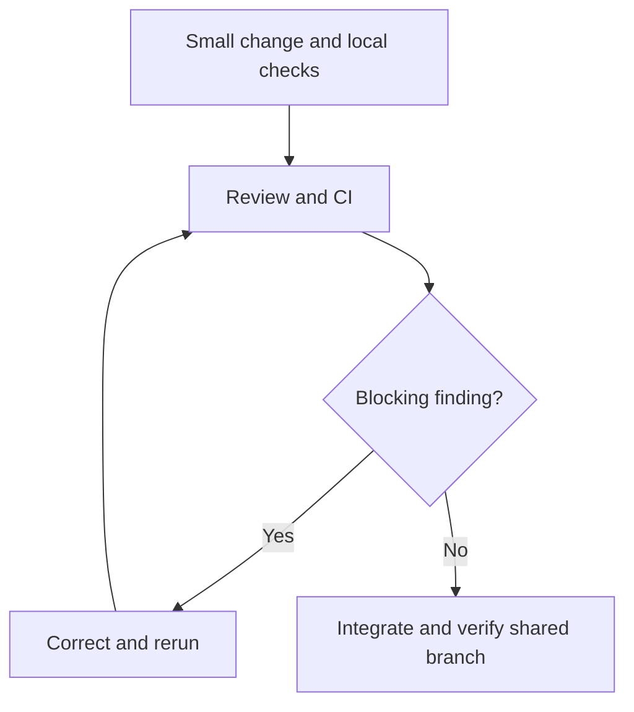

*OO Development and Agile Practices*  
*Designing, Testing and Evolving Software with AI Assistance*

By now the team has a backlog of six items and a working Java reservation coordinator, and it is time for the kickoff meeting. Everyone arrives with an idea. One member wants a mobile interface. Another proposes a database. A third would rather finish every story before anyone outside the team sees a line of it. Everyone is busy and everyone is keen, and yet nobody in the room can say what the equipment officer will actually be able to see at the end of the next iteration.

The trouble is not a shortage of ideas. It is that the team has no shared boundary and no credible route from an idea to evidence. A backlog says what might be valuable; an iteration plan has to say what the team will try to achieve, what it can realistically finish, and how another person will know that it worked.

This chapter builds that route. You will start by writing a project vision with explicit scope, assumptions and constraints, and by slicing one feature into a small increment that gives a user something observable. You will turn the slice into an iteration plan that pays for implementation, review and verification out of realistic capacity, and you will agree how the team shares a repository and reviews each other's changes. Then you will make it concrete: run a starter build and its checks, see for yourself that the checking process notices a deliberate failure, and gather traceable evidence for the kickoff milestone.

The running project remains the **Campus Equipment Lending System**, and its reservation behaviour is preserved. Availability enquiry is still proposed work. Preparing delivery evidence is real progress, but it must not be reported as newly implementing behaviour that the starter already has.

The chapter corresponds to **Week 3** and supports LO5 and LO6, as preparation for Milestone 1. The descriptor's term **Sprint 0** is used here as the local name for the kickoff work; it is not a formal Scrum event. The chapter gives preparation guidance and creates no new assessment weights, submission rules or module wording. It supports the Week 3 readings: the planning and testing chapters of Martin [6] and the sprint-planning chapters of Rubin [7].

You will need the Java code as Chapter 2 left it, Chapter 3's ordered backlog and Definition of Done, and basic Git operations, plus a Java 17 JDK, Git and Bash (on Windows, use Git Bash or WSL). You do not need prior TDD experience. The separate companion supplies all Java listings, repository files, commands, model answers and an offline AI exercise solution.

Read Sections 4.1 to 4.7 in order, and run the supplied checks while you read 4.6. What you must do is steps 1 to 8 of the practical activity in Section 4.10, on your team's project; together they produce the Milestone 1 evidence. The supplied lending repository is a worked model and a starting point, not evidence of your team's own work: your team's availability plan, board, review record and hosted CI runs are what count. Hosted CI needs a repository your team can use, so start steps 6 and 7 early. If you want more, try the AI activity in Section 4.8, the questions in Section 4.11, the transfer challenge in Section 4.12 and the extension at the end of Section 4.10.

## 4.1 What are we building? Vision, scope and constraints

### Start with an outcome you can finish

A vision says whose problem the project addresses and what improvement would matter to them. Its job is to guide choices when time is short. “Build a complete equipment platform” guides almost nothing, because nearly any feature can be justified under it.

For this stage of the book's project, we will use the following working vision:

> Help an equipment officer demonstrate clear reservation decisions for a small, controlled set of student borrowers and equipment, so that accepted requests can be inspected and conflicting requests do not create overlapping records within one running coordinator.

This is deliberately narrower than a production service. It names an actor, an observable improvement and the setting in which we can judge the claim. It does not promise authentication, a maintained inventory or safe operation by several officers at once. The wider product can include borrowing and returns later, while the first evidence stays small enough to inspect.

A Product Goal describes a future state of the product that the team is working toward, and an iteration goal gives the next stretch of work some coherence. Neither is a list of every task. In Scrum, the Sprint Backlog combines the Sprint Goal, the selected backlog items and an actionable plan for delivering them [1]. Our worked plan borrows that distinction without assuming that a classroom team has adopted every element of Scrum.

### Draw the boundary where everyone can see it

Scope helps most when it makes decisions easier. A short table can separate what the system does now, what we have selected to work on, and what we have deliberately put off.

| Area | At this point in Chapter 4 | Planning consequence |
|---|---|---|
| Reservation request | Existing Java behaviour accepts eligible, non-conflicting requests | Verify and demonstrate it; do not rebuild it for credit |
| Availability enquiry | Proposed US-02; no query method or interface yet | Refine and plan a thin next slice |
| Storage | In-memory records in one coordinator | Restarting loses records; demonstrate in one process |
| Identity and equipment | Nonblank identifiers; controlled synthetic examples | No claim of directory or catalogue validation |
| Loan period | Whole calendar days; start inclusive, end exclusive | Label dates and test adjacency |
| Cancellation and completed loans | Not implemented; all stored reservations count as active | Clarify lifecycle before adding those stories |
| User interface | Scripted console demonstration; proposed wireframes | No web or mobile implementation required for kickoff |
| Concurrent use | Sequential teaching example | No claim that a check prevents races across processes |

Constraints and assumptions are not the same thing. Java 17 compatibility is a technical constraint we chose for this starter. Using synthetic borrower identifiers is a teaching boundary. Assuming that an officer can recognise a sample item is an assumption about the demonstration. An unresolved rule about past dates is an open question. If we call all four “requirements”, we lose track of who owns each one and what follows from it.

Every assumption should come with a reason to revisit it. For example: “For the controlled demo, the operator uses CAM1 and MIC1 from a supplied list of sample items. Before opening input to arbitrary equipment, clarify the catalogue authority and unknown-item behaviour.” The trigger ties a temporary simplification to the moment it stops being good enough.

### Write down decisions, and when to revisit them

A useful decision record says what the question was, what was chosen, why, what follows from it and when to look at it again. It does not need to be a long report. “Use in-memory records for kickoff because the immediate question concerns reservation decisions; records disappear on restart; reconsider when a demonstration must survive restarting” is enough to guide a reviewer.

Compare that with “Database later.” It records neither the limitation today nor the condition that would make the work necessary. The team might put off essential persistence for ever, or bring it in at once for no reason. A clear trigger lets the plan change when the evidence changes.

You do not have to settle every future policy before you run the starter. Resolve the questions that decide how the next slice behaves, and keep the others visible with an owner and a date by which someone will decide. That keeps work moving and stops a temporary assumption from quietly becoming a permanent rule.

## 4.2 Sketching the screens and walking through examples

### A wireframe is a question made visible

Before anyone spends time on presentation, a lightweight wireframe lets users and developers talk about the information, actions and outcomes. In this book a wireframe may be a table, a sketch or a simple sequence of views. What matters is the questions it brings up, not how polished it looks.

Think about the journey of a reservation request. What does the officer enter? Does “end date” include that day? What appears when the equipment is unavailable? Does a failed request leave a record? Can the officer tell a successful reservation from an availability observation?

The tables below are **proposed interface sketches**. They are not screenshots of screens that exist.

**View A: Request a reservation**

| Element | Example or behaviour |
|---|---|
| Borrower identifier | B1 |
| Equipment identifier | CAM1 |
| Start date | 2026-10-20 |
| Duration in days | 2 |
| Period explanation | Includes 20 and 21 October; ends before 22 October |
| Action | Request reservation |
| Scope note | Controlled demo; records last only for this session |

**View B: Request outcome**

| Outcome | Information shown |
|---|---|
| Confirmed | Reservation R1, B1, CAM1, `[2026-10-20, 2026-10-22)` |
| Item unavailable | Request rejected; no new reservation stored |
| Limit or duration failure | Request rejected; no new reservation stored |
| Malformed input | Proposed interface should explain the field to correct |

The current coordinator returns confirmation or rejection strings and throws exceptions for certain invalid arguments. A future interaction layer will have to turn malformed input into a useful response, and drawing that response does not mean it is implemented. Notice, too, that the coordinator today gives one message for both a borrower-limit failure and a duration failure. A sketch that shows two precise explanations would introduce new work, and the backlog should say so.

**View C: Availability enquiry, proposed US-02**

| Element | Example or behaviour |
|---|---|
| Equipment identifier | CAM1 from the controlled set of sample items |
| Start date | 2026-10-22 |
| End date, exclusive | 2026-10-23 |
| Action | Check availability |
| Result | Available, unavailable, or an identifiable invalid-period outcome |
| Explanation | An enquiry creates no reservation and does not guarantee a later request will succeed |

Someone can understand this sketch without agreeing on a particular toolkit. That leaves the team free to use a thin console interaction while it learns about the domain. If we chose a web framework now, we would add configuration and presentation tasks and still not have answered the date-boundary question.

### Walking through the examples

Let us follow one example from the sketch down to the stored state. Start with no reservations. Submit B1, CAM1, 20 October, two days, and expect one stored reservation that ends, exclusively, on 22 October. Submit B2, CAM1, 21 October, one day, and expect a rejection with the original record kept. Submit B2, CAM1, 22 October, one day, and expect a second stored reservation.

The third step matters because “no overlap” is ambiguous without it. If an officer expects a collection on 22 October to conflict with the earlier booking, then either the period convention or the operational turnaround rule needs discussion. Do not quietly add a cleaning interval to the current rule. Record it as a candidate requirement, with examples.

For an availability enquiry, record both the answer shown and the unchanged state. A program that says “available” after quietly creating a reservation has not delivered the story. Seeing that an item is available is also different from being allowed to reserve it, because a borrower may already have three active records. The proposed query does not establish whether a borrower is eligible.

Wireframes, examples and code are three descriptions of the same intended behaviour. When they disagree, that is useful evidence. Settle the disagreement openly and do not pick whichever description is easiest to implement.

## 4.3 Prioritisation and vertical slicing: what first, how thin?

### Where the backlog stands now

Chapter 3's order covered US-01, US-02 and EN-01, and its Part A asked you to extend it to six items. This chapter uses the extended order below. It keeps Chapter 3's identifiers and says more clearly what already exists and what remains.

| Order | Item | Current interpretation |
|---|---|---|
| 1 | US-01: Record an eligible reservation | Core behaviour exists; confirm interaction and delivery evidence |
| 2 | US-02: Inspect availability without reserving | New user outcome to refine and forecast |
| 3 | EN-01: Automate build and checks | Enabling work supplied in this chapter; hosted evidence still required |
| 4 | US-03: Inspect a borrower’s active records | Filtering and interaction remain new work |
| 5 | US-04: Cancel a confirmed reservation | Authority, lifecycle and count effects need clarification |
| 6 | US-05: Reject unknown equipment identifiers | Depends on a catalogue source and failure policy |

The order shows our current judgement. It is not an instruction to finish every task of one item before looking at another. EN-01 supports reliable delivery of US-02, so it makes sense to prepare automation during kickoff, as long as you explain that dependency openly. What you should not do is quietly move every technical improvement ahead of feedback from users.

Catalogue validation has a low priority for now, and that is defensible only inside the controlled set of sample items. A real deployment would make the team reconsider the order. “Low priority” is a decision for a particular context; it does not say that unknown equipment is harmless.

### Cut the feature by what the user sees

A **vertical slice** goes through every part of the system it needs in order to deliver one outcome someone can observe. It does not have to use a graphical interface, a database or a network. For this project, a console request that reaches the coordinator and shows a verified decision is already a thin journey through interaction, domain behaviour and storage.

Compare a horizontal split such as “all screens first, then all services, then all storage”. It can leave a lot of finished-looking work and nothing to demonstrate. Those activities may be real implementation tasks, but putting them on separate tickets does not turn them into useful increments.

For US-02, a defensible first slice is:

> The officer supplies one sample item and a valid date interval, receives an availability answer based on current reservations, and can verify that enquiry left every stored reservation unchanged.

The slice also needs a recognisable response when the interval is empty or reversed. It can put off calendar styling, searching several items, live inventory integration and availability across several servers. It cannot put off overlap semantics or keeping state intact, because those decide whether the promised outcome is true.

The examples below carry Chapter 3's query criteria forward.

| ID | Given and enquiry | Expected outcome |
|---|---|---|
| AQ-01 | Empty coordinator; CAM1 `[20 Oct, 22 Oct)` | Available; records unchanged |
| AQ-02 | CAM1 reserved `[20 Oct, 22 Oct)`; enquire `[21 Oct, 23 Oct)` | Unavailable; records unchanged |
| AQ-03 | Same reservation; enquire `[22 Oct, 23 Oct)` | Available; records unchanged |
| AQ-04 | Same reservation; enquire about sample item MIC1 for `[20 Oct, 22 Oct)` | Available; records unchanged |
| AQ-05 | Equal or reversed start and end | Identifiable invalid-input outcome; records unchanged |

All dates above are in 2026. “Records unchanged” means that the contents are kept, not just the count. A query that swaps one reservation for another can leave the size the same and still be wrong. The exact query API and the way invalid input is reported are design choices to settle before implementation; the existing `reserve` method is not a query implementation.

### What has to come with the slice

A feature is small enough when the team can understand it and verify it within the iteration, integration included. You can make a feature smaller by dropping meaningful rejection behaviour, but the result then looks like success when it is not. A reservation feature that accepts requests and ignores conflicts is not a safe reduction of this outcome.

Keep the necessary work apart from the attractive extras. For US-02, interpreting the interval, inspecting the relevant reservations, reporting the result and checking that nothing changed are necessary. A calendar widget is optional. A persistent store becomes necessary only if the chosen outcome needs data to survive a restart. Drawing this line lets the team negotiate scope without treating quality as negotiable.

Use epics to group the direction of travel, not to make the iteration bigger. “Reservation decisions” can hold US-01 and US-02, and “Record lifecycle” can hold US-03 and US-04. EN-01 supports delivery across them. An epic does not call for an architecture layer or a Java package of the same name.

## 4.4 What can we really finish? Release outlook and iteration planning

### An outlook is not a promise

A release outlook tells people the likely steps toward the product goal, and it should show the uncertainty. For the book's project, kickoff makes the baseline reproducible; the MVP stage develops a small reservation and loan flow; later stages bring in integration boundaries and respond to a changed requirement. These are the book's teaching stages. They are not evidence that every team can deliver the same scope on the same dates.

If precise forecasts would be invented, use a short outlook with “now”, “next” and “later”. Leave the module's official milestone schedule as it is. A planning table cannot create an assessment deadline, or promise that a poorly understood story will fit into a particular week.

The goal for the current kickoff is:

> Make the reservation baseline reproducible and reviewable, and prepare a bounded availability slice for the next iteration.

The **candidate goal for the next iteration**, carried from Chapter 3, is:

> Let the officer inspect availability for one sample item and interval without changing reservations.

These are two different goals. Chapter 4 provides the starter materials for the first and plans the second; it does not claim to have implemented US-02.

### Counting the hours the work will really take

The figures below are **invented planning data**. They are not official contact hours or the measured productivity of a team. Suppose four members report 6, 6, 5 and 5 person-hours available for the next iteration, which gives 22 person-hours. Keep four of them for agreed coordination, integration support and routine project administration, which leaves a planning budget of 18 person-hours.

| Forecast work for the next iteration | Person-hours |
|---|---:|
| Resolve the query contract and update examples | 2 |
| Implement the read-only enquiry behaviour | 4 |
| Add the thin interaction and invalid-input response | 3 |
| Add and run query checks alongside regression checks | 3 |
| Review, integrate, update notes and rehearse demonstration | 2 |
| **Selected work** | **14** |
| **Unallocated capacity within the 18-hour budget** | **4** |

The estimates are inputs for discussion, each expressed on its own in person-hours. They are not converted from Chapter 3’s story points. Two people pairing for one hour use two person-hours. Review and correction have to fit somewhere in the budget, and calling them “after development” does not make them free.

The four spare hours are room for uncertainty, and they are not a promise to pull in another feature. If the team finds that the query needs a policy decision nobody expected, it can spend that time resolving the risk while protecting the goal. If everything finishes early, improve the evidence or choose additional work on purpose.

### Does the calendar, and who knows what, allow it?

Eighteen hours in total does not prove the plan is feasible. Suppose the only person who can explain the coordinator is unavailable until the last day, and the reviewer is free only at the start. The work cannot flow the way the arithmetic suggests. So ask when people can actually work together, and whether knowledge has to be shared earlier.

Make ownership visible without creating permanent specialists. A task owner makes sure that progress and questions stay visible; it does not mean nobody else may help. Agree on an early pairing session about the query contract, and a review window before the final demonstration. A little coordination can stop the whole slice from waiting until the end.

Look at the plan again when the evidence changes. If four hours of implementation turn into nine, talk about the forecast and the scope that is left. Do not hide the overrun by putting off checks or calling the interaction “almost done”. In Scrum, scope can be clarified and renegotiated with the Product Owner as the team learns more, while the Sprint Goal is protected [1]. A classroom adaptation should make its decisions visible in the same way.

When you have to replan, a practical question is: “What complete, still useful outcome can we verify with the capacity left?” Sometimes the answer is a smaller interface. Sometimes the behaviour that is still unresolved means the item cannot honestly be called complete. Being honest about unfinished work is more useful than a green status that conceals it.

## 4.5 How the team works together: agreements and review

### Agreeing how work moves

Chapter 3’s board used Backlog, Ready, Building, Review and Done, with a combined work-in-progress limit of two across Building and Review. Keep that policy for the worked team. A blocked item still takes up a slot, and if review is blocked, helping it finish is usually more useful than starting a third item.

A team agreement should answer practical questions: where requirements live, how questions are raised, who reviews a change, what evidence reviewers need, and how unfinished work is reported. The tool for the board can be swapped for another. A shared Markdown table works if updates are visible and ownership is clear.

Start from what your team has already decided: the issue board and branch policy from Part D of Chapter 2, the Definition of Done from Chapter 3, and your process note saying which Scrum elements you use as defined and which you adapt for the course. Change them where experience shows a problem, and record why.

Use small, short-lived branches for this chapter's review exercise. One branch should hold one coherent change that another person can understand. “Set up every tool and rewrite the coordinator” is hard to review, because functional changes and workflow changes get tangled together. A branch that adds the checking script and its documentation has a clearer purpose.



**Figure 4.1.** The team's review-and-CI loop for one small change. A blocking finding sends the change back to the author and the checks run again; only a change with no blocking finding is integrated, and the shared branch is verified after integration.

The figure shows this chapter’s team policy, and Git does not guarantee it automatically. A repository does not enforce review just because the README asks for it. Where your hosting service supports it, configure the shared branch to require the agreed check and a review. Where that is not possible, say that the team follows a manual policy, and keep the evidence of its reviews.

### What a good review looks at

A useful review starts from the behaviour that was intended. The reviewer then follows the relevant code or documentation and asks whether the evidence supports the claim. “Looks good” on its own does not say which risk anyone examined.

For a CI change, ask whether a compilation failure stops the job, whether the check programs really run, and whether a failed assertion reaches the result of the job. When US-02 comes later, look at whether the query changes state or depends on a borrower’s eligibility. A comment about code style should not distract from a defect in behaviour.

The author resolves blocking findings and reruns the affected checks, and the reviewer looks at the correction. Keep the real feedback and the real response; do not invent a review conversation to fill in a milestone template. If you work alone, a documented self-review is fine for practice, but it is not an independent review and should be labelled as such.

### Growing the Definition of Done

Carry forward Chapter 3’s requirements: checked examples, reproducible execution, a real review, integrated code, updated notes and a demonstration you can repeat. For this stage, add that the agreed automated check has passed on the integrated revision and that the team can find its result.

Acceptance criteria stay specific to a story, while the Definition of Done covers the quality and delivery conditions that apply to all work. A passing pipeline is one part of those conditions. It does not show that a wireframe was understood, that a product decision was approved or that a useful outcome was delivered. Appendix C has forms for the iteration plan of Section 4.4 (C.6), a team agreement (C.7), a pull-request description (C.8) and the evidence note of this chapter's companion (C.9).

## 4.6 A starter build and CI you can run

### One command that means something

Continuous integration needs a check that can run without depending on one developer’s open IDE. Our starter uses Java 17, Bash and the supplied executable Java checks, and it has no external Java dependencies. Maven and JUnit remain the planned build and testing tools for the fuller testing stage; for now we keep the existing plain-Java checks so that kickoff does not require learning a test framework first. On Windows, run the script from Git Bash or WSL, because PowerShell cannot interpret it. Three terms will come up below. Temurin is one distribution of the OpenJDK. YAML is the plain-text format in which a hosted workflow is written. An exit status is the number a command returns to the shell, where zero means success and anything else means failure, which is how a script or a CI job learns that a step failed. Appendix B has the setup.

The code file supplies a conventional source layout and a script. If you are continuing from the flat Chapter 2 directory, the move is mechanical: application classes go to `src/main/java`, the check classes go to `src/test/java`, and their contents do not change. The classes stay in the unnamed package, so this is only a change of layout. It is the directory layout Maven expects, so a later move to Maven changes the build file and the checks, not where the sources live. From the repository root, run:

```bash
bash scripts/check.sh
```

The script clears generated class files, compiles the listed source directories, runs Chapter 2’s 34 checks and Chapter 3’s five acceptance example groups, then prints a completion message. Compilation targets Java 17 through `--release 17`, and generated classes go into a separate output directory [2]. The script must stop when compilation or either checking program fails, and the final message must be reached only after success.

The five acceptance examples cover eligible reservation, overlap rejection, adjacency, borrower limit and duration boundaries. They do not test US-02, because that feature is not implemented. So a passing run tells us something limited: the supplied reservation checks passed against this revision in the recorded environment. It is not a claim of complete correctness.

After a successful build, run the scripted journey:

```bash
java -cp build/classes Chapter04Demo
```

It confirms the first request, rejects the conflict, confirms the adjacent request and reports two stored reservations. The values are fixed synthetic examples; this is not an interactive application. Run it in a fresh process to get the same starting state again.

Line endings matter for shell scripts. Git on Windows may convert LF to CRLF when it checks files out, and a CRLF script fails under WSL or Linux with an error such as `set: pipefail: invalid option name`. The supplied repository therefore includes a `.gitattributes` file that keeps `*.sh` files in LF form. Check that it is committed before a teammate tries a fresh clone.

### Reading a check: Arrange, Act, Assert

You do not have to write checks this week, but you should be able to read one. Every supplied check has the same three steps. Here is the AC-02 block from `Chapter03AcceptanceExamples`, with the steps labelled:

```java
// Excerpt from Chapter03AcceptanceExamples.java; the comments are added here.
// Arrange: the coordinator already holds B1's reservation of CAM1 (made by AC-01).
// Act: B2 asks for CAM1 on an overlapping day.
String conflict = coordinator.reserve("B2", "CAM1", day.plusDays(1), 1);
// Assert: the request is refused, and nothing new was stored.
require(conflict.equals("Rejected: item unavailable."), "AC-02 rejection");
require(coordinator.reservations().size() == 1, "AC-02 unchanged count");
```

Arrange builds the situation, Act performs the one operation under test, and Assert states what must be observed, including what must not have changed. A check that asserted only the message would pass for a request that was refused but still stored. Chapter 7 names this structure Arrange–Act–Assert and builds on it.

### Running the same checks on a hosted service

The separate code file supplies a GitHub Actions workflow that checks out the repository, installs Temurin Java 17 and runs the same Bash command. GitHub stores workflows under `.github/workflows`, and its documentation also supports running the project’s own build commands [3]. The action versions in the supplied example were checked against their official repositories [4, 5].

GitHub Actions is one concrete teaching route. If your institution has another CI service, that is fine as long as it checks the revision you intend, runs the agreed command and keeps results someone can inspect. A badge or a YAML file alone is not a passing run. Confirm that the workflow really starts and that its compilation and checking steps run.

Record the revision, environment, command, result and a link or exported log. For a pull request, identify the revision that was tested; after integration, keep the passing result of the shared branch too. A check on a branch can be valid and still become stale after another change is integrated.

The example uses a Java major version and major-version tags for the actions, because that is easier to read. Those selectors can resolve to newer releases, so record the versions they resolved to in your evidence. Stricter pinning of dependencies, wider coverage of environments and delivery stages belong in Chapter 13.

### Making sure a failure really shows up

Start with a passing run. On a clearly labelled disposable branch or copy, change one acceptance check so that it expects two records after the first successful reservation. That expectation is wrong on purpose, because the valid behaviour stores exactly one. Run the same checks and expect a nonzero result that names AC-01.

This shows that an assertion failure travels through the runner and reaches the result. Put the correct expectation back and run again. On a hosted practice branch, keep both the failed run and the restored passing run, and never merge the deliberate defect into the shared baseline.

A failed download or a missing JDK does not prove the same thing. It only shows an environment failure that happened before any assertion was reached, so read the log and find the step that really failed. In the same way, replacing a test command with `echo passed` can give you a green workflow that checks nothing.

**What the author has run:** the supplied compilation, 34 checks, five acceptance groups, demonstration and deliberate failing-check experiment were executed locally. The GitHub Actions workflow is supplied for learners to run; no hosted execution or independent team review is claimed. Completing the milestone’s hosted CI evidence requires an observed run in the team’s repository.

## 4.7 Getting ready for Milestone 1

### Pulling the evidence together

Milestone 1 joins the direction of the project to a starting point that can actually run. Its documents should agree with one another. A vision that promises live inventory, a backlog that assumes sample identifiers and a demonstration that uses invented equipment without explanation would leave a reviewer unable to tell what success means.

The map below is a way to find your way around the supplied milestone, and it is not an extra assessment rubric.

| Evidence | Question it should answer |
|---|---|
| Vision and scope | Whose outcome matters, and under which boundaries? |
| Epics, stories and ordered backlog | What is already supported, what is next, and what remains uncertain? |
| Wireframes and acceptance examples | What will the officer do, see and change? |
| Capacity and iteration plan | Why is the selected work plausible, including verification and review? |
| Team agreement and review record | How will changes be inspected and integrated? |
| Repository and README | Can another person obtain the intended revision and run it? |
| Passing CI result | Did the configured service execute the gate successfully? |
| Deliberate failure and restored pass | Does a failed check produce failure, and is the baseline healthy again? |
| Decision and limitation notes | Which assumptions restrict the claims being made? |

Trace a small number of links that matter: story to acceptance examples, examples to checking program, change to review, revision to CI result. Links are worth having when they let another person answer a question. A large spreadsheet of repeated identifiers adds little if the linked check does not exercise the behaviour that was promised.

### Let someone else try it from scratch

Ask a teammate to follow the README from a fresh checkout, and watch where they need help that is not written down. Does the command assume a shell they do not have? Do they have a development kit or only a runtime? Does the demonstration need records created in an earlier session?

Correct the instructions and repeat the step that was affected. A handoff that works is evidence of shared understanding. Do not report a command you have not run as verified because it looks familiar. If the hosted service is unavailable, keep the local evidence and name the missing hosted result as a gap. An honest gap gives the team a concrete next action.

By the end of this chapter you should have a bounded plan, sketches someone can inspect, and a baseline you can repeat, with checks that gate delivery. You do not need to have implemented every backlog item or designed the final architecture. Chapter 5 will look at the responsibilities in the coordinator, using these checks to protect the behaviour that already exists.

## 4.8 Challenging an overambitious plan with AI

Chapter 15 gathers the AI workflows that recur in this book. This activity is complete on its own and tells you the task, context and constraints you need.

| | For this activity |
|---|---|
| Your goal | Evaluate a proposed iteration plan against scope, capacity, behaviour and delivery evidence |
| You start with | The Chapter 3 backlog, the capacity figures in Section 4.4 and the Chapter 4 starter |
| What is in bounds | Review and replace the plan; do not implement any feature |
| How to check | Your own capacity arithmetic, the code (is there a query method? does `reserve` change state?) and the actual gate output |
| How to decide | A verdict and reason for each distinct proposal, then a bounded replacement plan |
| No AI account? | The ready-made output below is enough |

The goal is to judge proposed work against scope, capacity, behaviour and delivery evidence. The text below is **fictional AI output written by the author** for this offline exercise. It is not a record of a conversation with a real model.

> Four students have 22 person-hours, so plan 22 hours of features. Deliver US-02, cancellation, a mobile app, a database and email confirmations. Assign one student to each layer and integrate on the final evening. Convert the three-point availability story into three hours. Show “available” by calling `reserve` and deleting its record afterwards. Skip failure cases until next sprint. Mark EN-01 complete when the YAML file is committed; a green badge proves the whole story works.

Make a review table with a verdict and a reason for each separate proposal. Then replace the plan with a bounded goal, a selected slice, a capacity calculation and clear evidence. Find at least one domain error, one estimation error, one integration risk and one unsupported claim of completion.

If you use an AI service, give it only the synthetic scope and backlog. Ask it for risks or alternatives instead of accepting a plan from it as authority. Record the prompt, the claims you accepted or rejected, and the independent checks you used. The ready-made output alone is enough to reach the same learning outcome.

## 4.9 Planning mistakes that look reasonable

| Mistake | Why it fails | Better action |
|---|---|---|
| Count starter behaviour as newly delivered | Hides the actual change | Separate existing capability from new evidence or functionality |
| Slice only by technical layers | Leaves no usable end-to-end result | Select one observable journey and its necessary tasks |
| Fill all nominal capacity with features | Leaves review, coordination and uncertainty unfunded | Budget those activities explicitly |
| Use a wireframe as proof of implementation | Confuses an agreed sketch with working behaviour | Label proposal and implementation separately |
| Treat an availability answer as a reservation | Omits eligibility and later state changes | Keep query and command outcomes distinct |
| Create CI configuration without running it | Provides no evidence that the gate executes | Inspect an actual run against the intended revision |
| “Fix” a red job by ignoring its exit status | Conceals the defect | Correct the cause and preserve failure propagation |
| Invent review or meeting evidence | Makes the project state misleading | Report actual observations and remaining gaps |

## 4.10 Try it yourself: prepare for the kickoff

This activity is about your team's project. If your team uses equipment lending, the supplied listings are your starting repository. If your team chose another of the provided domains, apply each step to that domain's starter codebase, and use the supplied files as the model for layout, script and workflow. Do not change domain without following the module's arrangements. You start from the Chapter 3 backlog, the current Java baseline and the supplied Chapter 4 repository listings.

If your instructor runs a demonstration, it walks through the three reservation requests and then compares an ordinary passing run with the deliberately wrong acceptance check. Ask yourselves what each result establishes, precisely. For guided practice, write a one-page scope statement and a wireframe, have another pair explain the journey back to you, and resolve one difference between their reading and the behaviour you intended.

Then work through these steps as a team:

1. Write the vision, boundaries, assumptions and two decision records with review triggers.
2. Group the backlog into epics, preserve story identifiers, and distinguish existing capability from new work.
3. Refine US-02 or an equivalent thin slice with normal, boundary and rejection examples, including state effects.
4. Create an iteration goal and a capacity plan using your actual availability. Show coordination, review and uncertainty explicitly.
5. Agree ownership, review and board policies. Apply them to one small repository change.
6. Create the starter files, run the gate and reproduce the scripted demonstration.
7. Enable the agreed hosted workflow. Retain a passing run, a deliberate assertion-failure run on a practice branch, and a restored passing run. Record the integrated baseline’s result.
8. Assemble the evidence map and ask another team member to follow the README from a fresh checkout.

What you should end up with is: the vision and scope notes, the ordered backlog and selected story, the wireframes, the capacity plan, the team agreement, the review record, the repository instructions, the verification evidence, and the unresolved questions with owners.

You are done when another person can explain the outcome you chose, tell what is implemented from what is only planned, run the baseline, find the real CI results and trace at least one acceptance example to a check that was executed. A missing hosted run stays on the page as an explicit gap. For the assessed hand-in, follow the module leader’s submission requirements.

If you want more, review whether the query slice should use a duration or an exclusive end date at its interaction boundary. Compare the input errors each choice creates, and update the sketch and examples. Do not implement a second interface just for this extension.

## 4.11 Questions to think with

### Concept questions

1. How do a vision, an iteration goal and an implementation task differ? Use the equipment project for each.
2. Why can a console-based journey be a vertical slice even when it has no database?
3. Why is total available person-time insufficient to establish a feasible iteration plan?
4. What does a passing starter check establish, and what does it leave unproven?

### Applied diagnosis

5. A team reports the availability story done because the screen says “available”. Its implementation calls `reserve`, then removes the new record. Identify the violated requirement and the state evidence you would inspect.
6. A CI job compiles successfully, runs `java -cp build/classes Chapter03AcceptanceExamples || true`, then prints “all checks passed”. Explain how this can report success after an assertion failure and how you would verify the correction.

## 4.12 A different setting: the transfer challenge

A small clinic wants reception staff to inspect appointment-slot availability and make bookings. It has one supplied in-memory booking routine, a draft backlog and a four-person student team with uneven availability.

Create a bounded first-iteration goal, a wireframe and a capacity-aware plan. Identify two assumptions that should be revisited before real use. Give one adjacency example and explain why equipment-lending date rules cannot simply be copied into a time-based appointment domain. Show what the first automated gate would establish and what evidence would still require human review.

Use synthetic appointment data. The exercise concerns planning and software behaviour; it does not ask you to determine clinical policy or process real patient records. A team working on another provided domain may instead apply the same steps to that domain's first user-visible capability.

## What to take away, and what comes next

A credible iteration ties a bounded outcome to a thin journey, a plan the team can afford and evidence that someone else can inspect. Scope notes bring assumptions into the open, wireframes raise questions about interaction, and acceptance examples make behaviour testable. Review and automation help the team keep a shared baseline while it learns what to build next.

The application behaviour in Chapter 4 is still the reservation code from Chapters 2 and 3. What is new is the repository layout, a command that runs the checks repeatably, a scripted demonstration and a template for a hosted workflow. US-02 is still planned. Chapter 5 uses this protected starting point to look at responsibilities, extension and substitutability.

## Sources and further reading

Sources checked 12 and 13 October 2026. Process templates, capacity figures, wireframes and classroom policies are author-created examples; they are not requirements imposed by the sources.

1. Schwaber, K. and Sutherland, J. (2020), [The Scrum Guide](https://scrumguides.org/scrum-guide.html). Formal reference for Product Goal, Sprint Goal, Sprint Backlog and adapting scope. “Sprint 0” is a local descriptor label.
2. Oracle, [The `javac` command, Java SE 17](https://docs.oracle.com/en/java/javase/17/docs/specs/man/javac.html). Compilation, output directories and the release target.
3. GitHub, [Building and testing Java with Maven](https://docs.github.com/en/actions/tutorials/build-and-test-code/java-with-maven). Workflow location and reuse of project build commands; this starter runs its Bash gate rather than Maven. The page's own examples show older action versions; the supplied workflow uses the current major versions from the action repositories [4, 5].
4. GitHub Actions, [setup-java](https://github.com/actions/setup-java). Java installation inputs; the supplied workflow uses `setup-java@v6` and Temurin 17.
5. GitHub Actions, [checkout](https://github.com/actions/checkout). Repository checkout action; the supplied workflow uses `checkout@v7`.
6. Martin, R. C. (2002), *Agile Software Development: Principles, Patterns, and Practices*, Prentice Hall. The module's required text; the Week 3 reading is its planning and testing chapters. Publication details as listed in the module descriptor.
7. Rubin, K. S. (2012), *Essential Scrum*, Addison-Wesley. A recommended text; read the sprint-planning chapters named for Week 3. Publication details as listed in the module descriptor.

Read the relevant current action documentation before adopting the workflow in a different runner environment. A template is a starting point whose actual run must still be observed.
