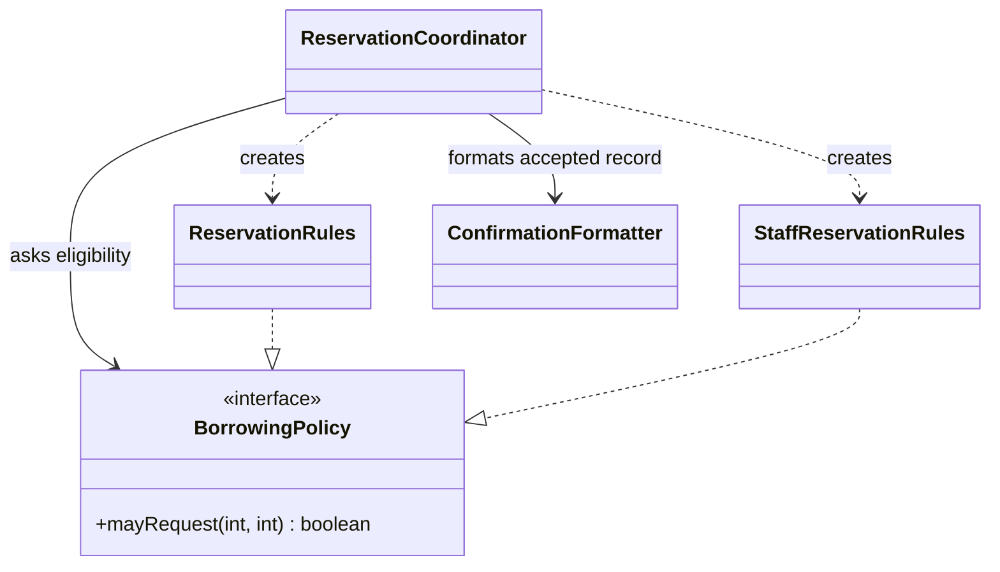

*OO Development and Agile Practices*  
*Designing, Testing and Evolving Software with AI Assistance*

The equipment officer asks for a different confirmation layout. In the same week the team is asked to demonstrate a second borrowing policy for staff. One developer proposes a subclass of the reservation coordinator. Another asks an AI assistant to “make the code SOLID” and gets back interfaces for almost every class and a rejection turned into an exception.

The code certainly looks more elaborate. But the team has not yet answered the questions that matter. Which parts of this program change for different reasons? Which behaviour is meant to vary? What may existing callers keep relying on? And how will anyone tell an internal improvement from a new feature?

Three old principles help with those questions: the **Single Responsibility Principle (SRP)**, the **Open–Closed Principle (OCP)** and the **Liskov Substitution Principle (LSP)**. Treat them as ways to reason about change and about contracts, not as a checklist to satisfy; a design is not better merely because it has more classes, interfaces or principle names in it. In this chapter you will learn to find the independent reasons a class has to change, to apply SRP to separate one responsibility and weigh the cost of the new boundary, and to justify an extension point for a variation you have actually observed, without pretending that existing code must never change. You will describe a behavioural contract and diagnose a subtype that breaks what its clients expect. And you will make a small, protected refactoring, show that it is not a feature change, and report the evidence.

This is the first SOLID chapter. It sits in Week 4, supports LO1 and LO4 and the formative smell analysis, and does not change the module's assessment arrangements. Chapter 6 covers interface segregation, dependency direction and injection, Chapter 7 develops testing practice, and Chapter 11 gives a systematic treatment of smells and legacy refactoring. The Week 4 readings are the SRP, OCP and LSP chapters of Martin [6] and “Bad Smells in Code” from Fowler [7].

You start from Chapter 4's Java 17 reservation starter, its 34 regression checks and its five acceptance example groups. The availability enquiry (US-02) is still planned. The staff rule in this chapter is a small, explicitly introduced teaching variation: it does not mean US-02 is done, and it is not an approved university policy. The companion holds complete listings, intermediate versions, commands, model answers, teaching notes and verification results. Follow the two stages separately: **A, extract formatting without changing existing behaviour; B, add the documented staff variation while preserving the old student entry point.**

Sections 5.1 to 5.7 are the core reading. The minimum lab is steps 1 to 8 of the practical activity in Section 5.10, including the review in step 6 (with another person, or labelled honestly as a solo self-review). Steps 1 to 7 run on the **Book project** and step 8 applies the diagnosis to your **Team project**. The Week 4 lab uses a static-analysis tool, PMD (version 7.28.0 in this edition), which needs a one-time download described in Section 5.1, and comparing its findings with your own reading is part of the lab. The Section 5.8 AI activity, the optional extension in Section 5.10, the review questions and the transfer challenge are optional.

## 5.1 Change pressure in a reservation service

### Begin with the code that exists

The current `ReservationCoordinator` validates arguments, counts a borrower's reservations, asks `ReservationRules` about count and duration, checks overlap, stores a new reservation and constructs a confirmation. Chapter 2 already moved string construction into a private method. Chapter 4 made the checks repeatable. We now have a useful baseline for asking whether a further boundary is justified.

The coordinator is not automatically wrong because it performs several steps. Coordinating a reservation necessarily involves several collaborators and decisions. The more useful question is whether unrelated changes repeatedly force edits into the same place.

Consider these proposed changes:

| Change pressure | Main knowledge involved | Current location |
|---|---|---|
| Change confirmation wording | Presentation of a completed reservation | Coordinator's private formatting method |
| Add a second count/duration policy | Borrower eligibility rules | Existing rule plus new selection behaviour |
| Change interval overlap semantics | Meaning of a loan period | `LoanPeriod` |
| Preserve records across restart | Storage lifetime and retrieval | Coordinator's in-memory list |
| Reject unknown equipment identifiers | Authority for equipment identity | Not implemented |

These are different concerns, but the table is not an instruction to create five interfaces immediately. The first two are the chapter's actual teaching changes. Persistence and catalogue integration remain future questions. Their possible existence is a reason to document a limitation, not sufficient evidence for building an extensibility framework now.

### State the new rule before choosing a design

For the worked example, adopt this **illustrative teaching requirement**:

| Category | Existing active reservations allowed before a successful request | Requested duration |
|---|---|---|
| Student | 0, 1 or 2 | 1 through 7 days |
| Staff | 0, 1, 2, 3 or 4 | 1 through 14 days |

A successful student request may therefore create the third active reservation; a successful staff request may create the fifth. Both policies reject negative counts and nonpositive durations. They decide only count and duration. Both still require a valid period and no overlapping reservation for the same item.

This is a feature change. A staff request for fourteen days can now succeed where the existing four-argument operation would reject it. Moving the existing formatter is a refactoring only if its observable results remain the same. Combining those changes in one unexplained edit would make failures harder to interpret.

The new example receives the category from a trusted fixture caller. It does not authenticate staff status, persist a borrower profile or infer category from an identifier. Passing `STAFF` is not proof that a person is staff. A production boundary would need an authoritative category source before accepting such a claim. The distinction is part of the example's scope, not an implementation task silently completed by adding an enum.

### Define success for each stage

Stage A succeeds when the formatting responsibility has moved and existing outputs, exceptions, state changes and signatures remain compatible for existing callers. Stage B succeeds when the explicit category operation implements the new table while the old operation continues to mean student borrowing.

All stored records still count as active. Storage remains in memory, calls remain sequential and intervals remain half-open. No cancellation, return processing, catalogue, email delivery or availability enquiry is added. Those boundaries prevent a design exercise from accidentally becoming an unreviewable expansion of the system.

### Gather evidence: the compiler, your reading and a static analyser

The change pressures and the two-stage plan above say what we intend to do. Before changing anything, collect evidence about where the code is hard to change today, from three different sources.


A static-analysis tool examines source code without running it and reports patterns that often indicate problems. The Week 4 lab uses one for smell diagnosis. You will gather three kinds of evidence in this order: the compiler's, your own, and the tool's. Setting them side by side is the point of the lab.

**The compiler.** `javac -Xlint:all` asks the compiler for every optional warning. From the Chapter 4 repository root:

```bash
javac --release 17 -Xlint:all -d build/lint src/main/java/*.java src/test/java/*.java
```

On the Chapter 4 starter this prints nothing. That result is informative: the compiler checks language-level hazards such as unchecked conversions and fall-through, not whether message wording and eligibility belong in one class.

**Your own reading.** Do the manual smell review before you run any analyser, so that the tool's output has something to be compared with. Read `ReservationCoordinator` once for each of these four smells and write down each place where you find one, with the line or method:

| Smell | What to look for |
|---|---|
| More than one reason to change | A method that mixes eligibility, conflict search, record creation and message wording |
| Hidden construction | A class that creates its collaborators with `new` inside its own methods |
| Repeated or similar logic | Two loops over the stored list that differ only in the test applied, or rejection outcomes returned as plain strings that a caller must compare |
| Primitive values standing for concepts | Strings or integers that carry meaning (an identifier, a number of days, a rejection reason) without a type of their own |

For each finding, record where it is, what you observed, whether it matches a change pressure in the table above, and whether you would act on it. Also name one pressure from the table that the compiler did not report and that you found only by reading.

**The analyser: PMD.** The book uses PMD, version 7.28.0 [8], which runs on Java 8 or above [8]. Download `pmd-dist-7.28.0-bin.zip` from the project's GitHub release page, compare the file's SHA-256 digest with the one the release page shows for it (the companion records the digest that was checked), unzip it, and set the variable `PMD_HOME` to the unzipped `pmd-bin-7.28.0` folder. This is the only download the chapter asks for.

Before reading the output, five terms. **Cyclomatic complexity** counts the independent paths through a method: each `if`, loop or `case` adds one. **Cognitive complexity** is a variant that penalises nested conditions. **NPath** counts the possible execution paths through a method. A **God class** does too much and knows too much; a **Data class** holds data and little behaviour. In the Data-class line below, WOC, NOPA, NOAM and WMC are PMD's own measures of how much of a class is behaviour (the share of its public methods that are not accessors, its public attributes, its accessor methods and the summed complexity of its methods); you do not need them to read the result.

PMD ships many rules in categories, and the choice of rules is part of using it. On this five-file starter, the quickstart rule set reports 5 findings, all the same one: classes without a package, which the book chooses deliberately until Chapter 10. The code-style category reports 34, for example parameters that “could be final”. Neither helps a smell diagnosis. The lab therefore uses a small rule set of eight design rules from PMD's design category, kept in `config/pmd-smells.xml`, with PMD's default thresholds [9]: cyclomatic complexity from 10, cognitive complexity from 15, NPath from 200, God class, Data class, more than 10 methods, 10 or more parameters, and 30 or more imports. Run the compiler gate first, so that PMD can read the compiled classes, and then run the lab script:

```bash
export PMD_HOME=/path/to/pmd-bin-7.28.0
bash scripts/check.sh
bash scripts/pmd.sh
```

On the Chapter 4 starter it prints the following. The recorded run was on Windows, so the paths contain backslashes; elsewhere they use your operating system's separator:

```text
src\main\java\Reservation.java:3:	DataClass:	The class 'Reservation' is suspected to be a Data Class (WOC=0.000%, NOPA=0, NOAM=4, WMC=9)
src\main\java\ReservationCoordinator.java:10:	CyclomaticComplexity:	The method 'reserve(String, String, LocalDate, int)' has a cyclomatic complexity of 12.
[INFO] Found 2 violations.
```

Now interpret each finding the way you interpreted your own. The second one is **useful**: `reserve` has twelve independent paths because it validates identifiers, counts the borrower's records, applies eligibility, searches for a conflict and creates the record, which is your first smell seen from another side. The first one is **low-value here**: `Reservation` is deliberately an immutable record of an accepted booking, so holding data and little behaviour is its job. It does carry a question, though: where does the behaviour that uses its fields live? In this starter, it lives in the coordinator's confirmation wording. And PMD **missed** things you found by reading: it did not report the `ReservationRules` that the coordinator constructs for itself, and it cannot know that “borrower limit or duration” is one string for two different reasons. Placing each finding in one of the three groups (useful, low-value in this context, a concern the tool missed) is the comparison the lab asks for.

A finding is evidence to investigate, not an instruction. At this scale a tool may report items that do not matter, and it cannot know which changes your team expects. Rerun PMD after each stage of the practical activity: the complexity finding stays at 12 after Stage A and after Stage B, because moving wording and policy out changed who decides, not how many branches the sequence of checks has. The number moves only when you split that sequence. Extract Method alone can lower it while leaving every responsibility where it was, which is why a number is not a verdict. Record only output you actually produced.

## 5.2 Responsibility and SRP

### A reason to change is more useful than a method count

SRP focuses attention on changes arising from different responsibilities. Martin's explanation connects those responsibilities to the people or groups whose needs drive changes [1]. For this project, the people deciding borrowing limits may have different concerns from those deciding how an officer reads a confirmation.

That observation is more informative than counting methods. A class with several methods can support one coherent responsibility. A one-method class can mix policy, storage and presentation. Likewise, several requests from one person may concern different responsibilities; an organisational chart is evidence about change, not a mechanical class-generation algorithm.

Suppose the coordinator's method remains short because it delegates to twenty tiny helpers. If those helpers all reach into the same mutable list and repeat the same decision logic, the design may still be difficult to change. Conversely, `LoanPeriod` has construction, accessors and an overlap operation, yet those methods describe one coherent interval abstraction.

### Extract a collaborator with a clear input

For Stage A, move the confirmation construction into `ConfirmationFormatter`. Its input is the immutable `Reservation` that has already been accepted. Its output is a string. It does not approve a request, add a record or send a message.

The coordinator's final step becomes:

```java
reservations.add(reservation);
return formatter.format(reservation);
```

This preserves the existing order. Formatting is still performed after the reservation is stored. The extraction does not create transaction handling or rollback if some future formatter fails. With the supplied deterministic formatter and valid stored reservation, the ordinary path stays the same. If formatting later gains external dependencies, failure semantics will need a separate design decision.

Passing one coherent reservation object avoids copying the formatting logic's inputs into a long list of unrelated arguments. The object already carries the identifier, borrower, item and period. The formatter must not receive the coordinator's mutable list merely because it could obtain the same data there. That would give presentation unnecessary access to storage decisions.

The original private method was already a useful seam. A separate class now gives the formatting change a named home and permits direct examination without running a reservation scenario. The cost is another file, another object and another call to follow. If the formatting were a stable one-line expression with no independent change pressure, keeping the private method could be a reasonable decision.

### Explain what remains together

The coordinator still creates collaborators directly and owns the list. This chapter does not claim that one extraction finishes its design. It makes one justified improvement while leaving the request workflow readable. Chapter 6 will examine how collaborators are supplied and which dependencies belong at the application boundary.

The existing numeric rules were already outside the coordinator. Do not claim to have newly separated them. The actual change is that both eligibility decisions and confirmation presentation now have named homes, while the coordinator retains responsibility for sequencing the reservation operation.

A short rationale might say:

> Confirmation wording can change independently of eligibility and conflict handling. Move it to a formatter that accepts an accepted reservation. Keep the returned text and storage order unchanged, and run existing exact-output checks.

This rationale identifies a reason, a boundary and evidence. “Applied SRP” alone identifies none of them.

### Avoid leaking decisions into the formatter

A tempting formatter might check the requested duration and return either a confirmation or rejection. That recreates a policy decision in presentation and risks disagreement with `ReservationRules`. Another might allocate the reservation identifier because the identifier appears in the message. Presentation uses an identifier; that does not make presentation responsible for assigning it.

Ask which object has the information and authority to make each decision. The coordinator knows the stored records and whether a request has been accepted. The formatter knows how to represent the accepted record. Preserving that distinction makes later wording changes less likely to alter reservation behaviour.

## 5.3 OCP and anticipated variation

### Name the axis of extension

OCP encourages a design in which an anticipated kind of extension can be introduced without repeatedly rewriting stable behaviour [2]. The relevant question is “closed against which change?” There is no useful promise that every imaginable future requirement can be added without touching existing code.

Here the observed variation is a count-and-duration decision for two borrower categories. It is not storage technology, notification transport, date arithmetic or authentication. A small interface expresses exactly that decision:

```java
public interface BorrowingPolicy {
    boolean mayRequest(int activeReservations, int requestedDays);
}
```

An interface gives the client a common type. A class declares `implements BorrowingPolicy` and supplies its public method; `@Override` lets the compiler check that the declaration implements or overrides a matching method [3]. The interface does not supply the meaning of the operation by itself. We must document its contract as well.

`ReservationRules` keeps its existing student predicate and implements the interface. `StaffReservationRules` implements the new staff predicate. The coordinator obtains a policy and asks the same question of it. Overlap detection and storage are not duplicated into separate student and staff coordinators.

### Preserve the old entry point explicitly

The completed coordinator retains:

```java
reserve(borrowerId, itemId, start, requestedDays)
```

It delegates to a new overload using `BorrowerCategory.STUDENT`. The new overload also accepts an explicit category. Existing code therefore continues to compile and retains its student interpretation. Choosing staff behaviour requires an explicit call.

Do not infer staff status from `borrowerId.startsWith("S")`. That would hide a new identity rule in a convenient string convention. The synthetic identifier S1 in the demonstration is just a label. The category argument selects the policy.

Every record for the same borrower identifier contributes to the active count, regardless of which overload created it. The implementation does not keep separate student and staff count buckets. Nor does it remember a borrower's category. If a caller supplies inconsistent categories, each request uses the supplied category against all that borrower's existing records. This is a limitation of the fixture boundary; it is not a model of authorised category changes.

### Be honest about the remaining selector

The example keeps a small `switch` inside the coordinator to select its directly created student or staff policy. Adding another enum category would still require updating that selector. Therefore the coordinator is not completely closed to new categories.

The narrower improvement is that the reservation algorithm delegates the varying rule. A change to the staff duration limit belongs in the staff policy, while overlap and storage remain unchanged. The selector exposes a composition decision that Chapter 6 can move outward when discussing dependency injection. This deliberate intermediate design is easier to explain than pretending that a factory framework is necessary for two rules.



**Figure 5.1.** The collaborations after Stage B. The solid arrows are associations: the coordinator holds a `BorrowingPolicy` reference and a `ConfirmationFormatter`. The dashed lines ending in a hollow triangle are interface realisations: `ReservationRules` and `StaffReservationRules` each implement `BorrowingPolicy`. The two plain dashed arrows are dependencies: the coordinator creates the concrete policy objects itself.

Those last two arrows are drawn on purpose. The interface gives the coordinator's algorithm one type to ask, but it does not remove the coordinator's dependence on the concrete classes. Chapter 2's notation table explains each symbol. When Chapter 6 moves object creation outward, the two dashed arrows should disappear from this diagram, which is a visible way to check that dependency direction really improved.

### Compare with a smaller alternative

For these exact numeric rules, a single `BorrowingLimits` class with validated `maximumActive` and `maximumDays` parameters could also be reasonable. The two policies differ only in constants. A compact conditional could even be acceptable in a short-lived demonstration with no further variation expected.

The interface approach earns its place here by making the decision contract explicit and allowing separate policy behaviour to be examined. It becomes more valuable if policies later differ in more than limits. It also adds names and selection work. Do not justify it by asserting that two constants always require polymorphism.

Likewise, do not invent sponsor approval, network checks or a rule engine to make the abstraction look necessary. Those changes need their own requirements. The book's later changed-requirement exercise remains later work; this chapter uses only the small second rule stated above.

## 5.4 Behavioural contracts

### Write what a caller may rely on

A method signature describes parameter and result types, but leaves many questions unanswered. Can the method reject input with an exception? Does it mutate anything? Is the result stable for the same input? What exactly does `true` mean?

For `BorrowingPolicy`, use this contract:

| Aspect | Promise |
|---|---|
| Accepted input domain | Every pair of Java `int` values can be passed |
| Invalid numeric values | Negative count or nonpositive duration returns `false` |
| Decision | `true` exactly when the inputs satisfy that implementation's documented count/duration limits |
| Side effects | Does not create reservations, change a counter or perform external I/O |
| Repeatability | Same inputs and fixed policy configuration produce the same result |
| Scope of approval | Only count and duration; no assertion of item availability or borrower identity |

The student and staff implementations have different documented limits, so they can legitimately return different booleans for `(0, 14)`. A client of the common interface must not assume that every policy uses seven days. That limit belongs to the student policy's specific contract.

The interface is still meaningful because all implementations answer the same kind of question under common input and side-effect rules. An interface saying “do anything and return a boolean” would provide little basis for client reasoning.

### Preconditions, postconditions and invariants

A **precondition** states what must hold before an operation for its promised behaviour to apply. A **postcondition** states what the operation guarantees afterwards. An **invariant** is a property maintained by an object's valid observable states. These terms help turn vague expectations into reviewable statements.

For `LoanPeriod`, construction requires non-null dates with the start strictly before the exclusive end. Successful construction establishes that invariant. For the borrowing policy, negative counts are part of its accepted input domain and have a specified `false` result. Treating them as a forbidden precondition would change this particular contract.

Chapter 1 noted that returning `false` for a negative count treats an impossible input like an ordinary refusal, so a caller bug could look like a policy decision. This contract settles that question deliberately instead of leaving it implicit, and the two options have different costs. Returning `false` keeps every existing client working, because they branch on the result and never handle an exception, and it keeps the policy defined for every pair of integers. Treating a negative count as a precondition violation and throwing would signal a caller bug loudly, but it changes a result that existing callers and checks already rely on, and a new exception becomes part of every client's contract. Here, preserving behaviour decides the matter. In new code whose callers you control, the exception can be the better choice. Either way, write the choice into the contract.

For a successful reservation, relevant postconditions include one new stored record and a confirmation identifying it. For an eligibility or overlap rejection, the stored records remain unchanged. The order of decisions also matters: the existing method checks count/duration before constructing the requested period and before checking overlap. Reordering those steps can alter which failure a caller observes.

Contracts include exceptional outcomes when callers rely on them. The existing four-argument operation rejects blank identifiers with `IllegalArgumentException`, null dates with `NullPointerException`, and an unrepresentable end date through Java's date exception. The new explicit-category overload rejects a null category. Refactoring is not an opportunity to normalise those outcomes silently. A more consistent future error model would be a separate API change.

### Check observable behaviour, not only return values

Suppose an implementation returns the expected rejection string but first inserts a reservation. A string-only check would miss the broken state guarantee. Suppose it returns `false` for a negative count on the first call and throws on the second. One isolated assertion would miss the repeatability problem.

Choose checks that correspond to real promises: inspect state after rejection, cover accepted and rejected boundaries, and call policies through the common type. The companion includes direct policy checks and coordinator-level checks because each observes a different risk. Direct checks make policy boundaries easy to diagnose; integrated checks verify that the coordinator selects and applies the right policy.

Passing examples provide evidence, not a proof for every possible integer or call sequence. For these tiny predicates, reading the complete expression complements boundary tests. The lack of fields and external calls also supports the claim that the supplied implementations are stateless. A larger policy would require a different verification strategy.

## 5.5 LSP and unsafe inheritance

### Subtyping promises something to clients

LSP concerns whether clients using a supertype can continue to rely on that type's behavioural promises when given a subtype. Liskov and Wing's treatment includes constraints on input requirements, output guarantees, invariants and changes over an object's history [4]. Matching Java signatures is necessary for many substitutions, but it does not establish those behavioural properties.

A practical review asks whether a subtype requires more from the caller, guarantees less afterwards, violates a valid-state property, or changes state in ways the supertype contract excluded. Different implementations need not produce identical results for every situation; their differences must remain within what the common contract allows.

The staff policy is not a subclass of the student policy. Both implement the broader `BorrowingPolicy` contract. This matters: a client specifically promised the student's seven-day maximum should not receive an object that approves fourteen days while still claiming to fulfil that exact student contract.

### A separate executable counterexample

The reservation classes do not need an inheritance hierarchy merely to illustrate LSP. Use a separate teaching example, `IntHistory`, whose contract accepts any `int`, appends it once and preserves earlier entries in order.

A client is entitled to do this:

```java
history.add(5);
history.add(-2);
```

It then expects `[5, -2]`. An attempted `PositiveOnlyHistory extends IntHistory` overrides `add` and throws when the value is zero or negative. It compiles, but the original client now fails on `-2`.

The subtype has strengthened the input requirement. Its added restriction may make sense for a different domain object, yet it breaks the contract of this supertype. Calling the exception “validation” does not repair the substitution. The key evidence is the valid supertype client and the changed observable result.

A second faulty variant might accept `-2` but ignore it. That avoids the exception while weakening the append guarantee. A third might erase earlier entries whenever a new value arrives, violating preservation of history. These are different failures even though all can share the same `void add(int)` signature.

### Repair the type relationship

One repair is to keep `IntHistory` accepting every integer and use a separate `PositiveHistory` type exposing `addPositive`. That method openly requires a positive value. It may delegate storage to an internal `IntHistory`, but it does not advertise itself as a substitute for the broader type.

Composition alone is not a magic guarantee. If `PositiveHistory` still claimed to implement an interface promising acceptance of every integer, the conflict would remain. The repair works because the public contract and the advertised type relationship now agree.

Another possible repair is to redefine the common abstraction so clients are told which values an operation may reject. That changes the client contract and may require client changes. It is not a behaviour-preserving fix for callers that already depend on accepting every integer. Decide whether the broad contract or the restrictive type is the intended abstraction before editing.

### Exceptions and history require context

Do not memorise “throwing an exception violates LSP”. An exception is compatible when the supertype contract permits that outcome for the input and state in question. The defect in the example is that the supertype promised to accept `-2`, while the subtype rejects it.

Similarly, adding a method to a subtype is not automatically safe. A new method that changes state can invalidate promises observed through inherited methods. If a type promises that previously stored entries remain present, a subtype-specific `eraseAll` operation can contradict that history promise when the same object is also held through the supertype reference.

In a review, state the promise, demonstrate the call sequence and inspect the outcome. “This violates LSP” should be the conclusion of that explanation, not a substitute for it.

## 5.6 Small refactorings and regression checks

### Keep structural and behavioural steps separate

Refactoring changes internal structure while retaining observable behaviour [5]. Stage A follows that idea: introduce the formatter, move the existing expression, replace the call and run the existing checks. Avoid renaming domain concepts, changing validation order and adding staff behaviour in the same step.

A practical sequence is:

1. Run the Chapter 4 gate and record the starting result.
2. Add the concrete formatter with the existing confirmation expression.
3. Replace the private formatting call and remove the now-unused private method.
4. Compile and rerun the original regression and acceptance checks.
5. Inspect the diff for unrelated changes and record what behaviour was preserved.
6. Begin Stage B in a separate change, with the staff rule and its new checks stated explicitly.

The companion supplies the starting, extracted and extended coordinator versions. Keep one coordinator version in a given source directory. Compiling several classes with the same name together is a setup error, not evidence about the design.

### Read the tests in relation to the change

The original exact confirmation assertions protect punctuation, identifiers and date formatting. Overlap, adjacency and count checks protect the reservation algorithm. Snapshot checks protect observation of stored state. These existing checks should remain unchanged through Stage A and the compatibility portion of Stage B.

Stage B adds checks for staff's accepted fifth reservation, rejected sixth, accepted fourteen-day duration and rejected fifteen-day duration. Cross-category scenarios show that a staff booking still blocks an overlapping student request. Another check confirms that the original overload still rejects a student's eight-day request.

The query tests AQ-01–AQ-05 from earlier planning are not part of this result: no availability API has been implemented. State the new checks' scope accurately. The existence of a `BorrowingPolicy` does not fulfil every backlog item involving equipment.

### Diagnose a failing check before editing it

If the old seven-day check fails after introducing staff rules, inspect policy selection before changing the expectation. The old entry point was promised student behaviour. Updating the test to accept fourteen days would hide a compatibility defect.

If an exact confirmation check fails during extraction because the formatter says “Reserved” instead of “Confirmed”, the extraction changed a client-visible result. Either restore the old text for Stage A or explicitly separate and approve a wording change. A test is not sacred, but its replacement needs a reason grounded in the intended contract.

The LSP demonstration intentionally includes an invalid subtype. Its harness observes the expected failure and reports the counterexample. That success means the teaching demonstration behaved as intended; it does not mean the invalid subtype passed the base contract. Keep this example outside the cumulative reservation application.

### Report the evidence and its limits

A useful change record distinguishes the baseline run, Stage A's unchanged checks and Stage B's additional checks. Include the command, revision or checkpoint, observed output and relevant limitations. Do not claim independent review or hosted CI execution when only local checks ran.

The author executed the supplied Java checks locally. The Chapter 4 hosted workflow can continue to invoke the updated gate in a team's repository, but an actual hosted run remains team evidence. A clean local result supports review; it does not replace review or establish production readiness.

## 5.7 Avoiding premature abstraction

### Compare the cost with the change it supports

Every boundary has a cost. A new interface requires a name, a contract, implementations and a place where an implementation is selected. An abstraction that hides a real variation can reduce future edits. One that merely mirrors a single class can add navigation without changing which decisions are coupled.

For the worked example:

| Decision | Benefit | Cost or remaining limitation |
|---|---|---|
| Extract a concrete formatter | Gives independent presentation changes a home | Another object and file; no configurable presentation yet |
| Use a small policy interface | Names the count/duration contract shared by two rules | Extra types and selection; numeric parameterisation is also possible |
| Keep a selector in the coordinator for now | Makes the intermediate stage easy to inspect | New categories still require a coordinator edit |
| Retain direct construction | Keeps focus on SRP, OCP and contracts | Dependency assembly remains coupled until Chapter 6 |
| Avoid coordinator inheritance | Prevents duplicating or overriding the reservation workflow | Variation must be expressed through explicit collaborators |

A reasonable review can conclude that one of these costs outweighs its benefit for a particular project. Principles help make the judgement explainable; they do not remove the need for judgement.

### Notice warning signs without building a smell catalogue

Repeated edits to the same policy conditional, message changes breaking reservation logic, and subclasses that disable inherited operations are useful signals. Investigate the change history or construct a client counterexample before prescribing a repair. A long method alone does not tell you which boundary is needed.

Do not create `IReservation`, `ILoanPeriod`, an abstract coordinator factory and a generic notification bus simply because an automated suggestion calls them “SOLID”. Ask what concrete variation each supports and what client contract it improves. A missing answer is a reason to postpone that abstraction.

The next chapter will move from the existence of a useful contract to the direction of dependencies and the assembly of objects. That is a new question. Keeping the distinction visible prevents students from treating SRP, OCP, LSP, ISP and DIP as interchangeable names for adding interfaces.

## 5.8 AI in practice: review “make this SOLID”

Chapter 15 collects the recurring AI workflows; this activity is self-contained, and its fixture is all you need.

| Element | For this activity |
|---|---|
| Engineering objective | Judge a “make this SOLID” proposal against concrete requirements, contracts and costs |
| Input | The Chapter 4 source, the staff-rule table in Section 5.1 and the policy contract in Section 5.4 |
| Permitted scope | Review the proposal; do not apply it wholesale |
| Independent checks | Compilation (is `ReservationRules` `final`?), the exact-output checks, and the rejection and state checks |
| Accept or reject | A verdict with a concrete defect or cost for each proposal, then the smallest defensible two-stage change |
| No-account route | The fixture below is sufficient |

The following is **author-written fictional AI output**, constructed for an offline exercise. It is not an actual model transcript.

> Create an interface for every class, including immutable reservation and period values. Add a coordinator factory and an abstract base coordinator. Replace all rejection strings with exceptions because exceptions are cleaner. Make `StaffReservationRules` extend `ReservationRules` and override the seven-day limit. Remove all category conditionals so no existing file ever changes. While extracting the formatter, shorten the confirmation to “Reserved”. The green build proves the design follows SOLID.

Review each proposal using a concrete requirement, contract or cost. Identify at least one proposal that would not compile against the current source, one that changes existing behaviour, and one whose benefit has not been demonstrated. Propose the smallest defensible two-stage change.

If using a live AI service, supply only the synthetic source and stated rules. Ask it to separate behaviour-preserving edits from feature changes and to identify remaining dependencies. Record which claims you accepted, rejected or left unresolved, and how you verified them. The fixture supports the same activity without an account.

## 5.9 Common mistakes

| Mistake | Counterexample or consequence | Better reasoning |
|---|---|---|
| SRP means one method per class | A one-method service can still mix policy and presentation | Identify independent change pressures |
| OCP forbids editing existing code | A new category still needs an explicit selection decision | State the protected axis and the remaining edit boundary |
| Same signature means safe subtype | `PositiveOnlyHistory.add(-2)` rejects valid base input | Evaluate the behavioural contract |
| Any different policy result violates LSP | Student and staff intentionally have different limits | Compare with the shared contract, not a stronger concrete policy |
| Better wording is part of a refactoring | “Reserved” breaks the preserved confirmation result | Separate the presentation feature from extraction |
| A passed LSP demo validates the subtype | The harness may have successfully detected a violation | State what the demonstration actually observed |
| A category parameter verifies authority | A caller can supply `STAFF` without proving identity | Label the trusted-fixture boundary |
| More interfaces mean better design | Unused variations add navigation and decisions | Relate every boundary to a concrete need |
| Switch on every analyser rule | Dozens of low-value findings hide the one that matters | Choose a small rule set for a stated purpose and record why |
| Read a finding that did not change as a failed refactoring | A tool measures one thing, such as branching; a refactoring may change another | Say what the tool measures and what the change targeted |

## 5.10 Practical activity: a protected design change

**Input:** Chapter 4's source and checks, this chapter's staff-rule table and the supplied companion listings. Use Java 17. Keep the LSP micro-example separate from the application. Steps 1–7 run on the **Book project**; step 8 runs on your **Team project**.

**Instructor demonstration:** trace the existing reservation operation and identify three independent change pressures. Run one valid base-type client against both `IntHistory` and the invalid subtype, then explain the observed difference.

**Guided practice:** perform Stage A, reviewing the formatter's input, output and lack of reservation authority. Run the unchanged checks and inspect the diff together.

**Independent work:**

1. Produce a responsibility table for the coordinator, rules, period and proposed formatter. Identify a concern you will deliberately leave unchanged and explain why. Run `javac -Xlint:all`, the manual smell review and PMD with the lab rule set from Section 5.1 on the starting code. Place each PMD finding in one of three groups (useful, low-value here, or a concern your own reading found that the tool missed), and compare all three kinds of evidence with your table.
2. Record a passing baseline, extract the formatter and rerun the original checks without altering their expected behaviour.
3. Add the explicit staff variation while preserving the existing student overload. Document the policy contract and the source of the category argument.
4. Add or use the supplied boundary and cross-category checks. Explain what each group establishes.
5. Run the separate LSP example. Identify the violated promise and compare the composition-based repair with changing the base contract.
6. Review the complete diff with another person where available. Retain actual findings and corrections; label solo review honestly.
7. Write a short rationale connecting each new class or interface to a change pressure and naming the remaining dependency-selection limitation. Say what PMD reported after Stage A and after Stage B, and why.
8. On your **Team project**, produce the same kind of responsibility table for one class in your team's starter codebase, run the same compiler, manual and PMD checks on it (PMD works on any Java codebase), and name one change pressure you can point to in its backlog or history.

**Expected output:** a smell/responsibility diagnosis with the tool findings compared against it, plus the step 8 table for your Team project; before, refactored and extended checkpoints or commits; check results; a contract table; a subtype counterexample explanation; and a concise design rationale.

**Completion conditions:** Stage A preserves existing behaviour; Stage B implements the stated staff boundaries and retains student compatibility; rejections leave records unchanged; the learner can explain why the policy interface is useful and why the selector still changes for another category. The rationale must distinguish a teaching rule from an approved institutional rule.

**Optional extension:** in a scratch copy of the Stage B code, extract two private methods from `reserve` (one that counts a borrower's reservations and one that tests whether an item is unavailable), run the gate and rerun PMD, and explain what changed and what did not. Then implement the two numeric policies using a validated limits object in a separate experiment. Compare files changed, clarity and likely future variation. Do not merge both alternative designs into the cumulative application merely to demonstrate them.

## 5.11 Review questions

### Concept questions

1. Why is counting methods an unreliable way to apply SRP? Give one example from the running project.
2. Against which variation is the policy design relatively protected, and which selection code remains open to change?
3. How can two implementations return different booleans and still satisfy the same policy interface contract?
4. Why is extracting the formatter a refactoring while introducing staff limits is a feature change?

### Applied diagnosis

5. A policy implements the right Java signature but throws for a negative active count and increments an internal request counter on every call. Compare it with this chapter's policy contract. What evidence would expose each problem?
6. A developer subclasses a history that promises to append every integer. The subclass silently ignores negative numbers rather than throwing. Explain why avoiding an exception does not make the subtype safe, and propose an honest repair.

## 5.12 Transfer challenge

A coursework feedback tool accepts a score and produces feedback text. A new requirement adds a second grading policy and a different feedback layout. Its current class validates input, selects a grade and formats the message.

Write the change pressures, one proposed responsibility boundary and a contract for the grading decision. Give a small input/output table for two explicitly invented policies. State what remains stable and where a policy is selected. Then construct a subtype counterexample that breaks a stated client promise and explain how you would repair the relationship.

Keep the grading rules illustrative; do not present them as university assessment policy. Explain which edits preserve existing behaviour, which introduce a new feature, and which checks distinguish them.

## Summary and next chapter

Responsibility boundaries are most useful when they respond to distinct change pressures. Extension points should protect a named variation. Subtyping must preserve the promises that clients of the broader type can rely on. Small, separately verified steps make those design claims easier to assess.

The cumulative checkpoint now has a concrete confirmation formatter and student/staff count-and-duration policies, with the original student entry point preserved. The subtype example remains separate, and availability enquiry remains planned. Chapter 6 examines client-specific interfaces, dependency direction and manual object assembly.

## Sources and further reading

Sources checked 12 and 13 October 2026; PMD sources 8 and 9 on 13 October 2026. The reservation policies, code, counterexamples and teaching decisions are author-created applications of the ideas below.

1. Martin, R. C. (2014), [The Single Responsibility Principle](https://blog.cleancoder.com/uncle-bob/2014/05/08/SingleReponsibilityPrinciple.html). A reason-to-change perspective on responsibility.
2. Martin, R. C. (2014), [The Open Closed Principle](https://blog.cleancoder.com/uncle-bob/2014/05/12/TheOpenClosedPrinciple.html). Discussion of extension and stable boundaries. This chapter deliberately evaluates a modest intermediate design rather than claiming universal closure.
3. Oracle, [Java Language Specification, Java SE 17, Chapter 9: Interfaces](https://docs.oracle.com/javase/specs/jls/se17/html/jls-9.html). Interface declarations and implementation rules.
4. Liskov, B. H. and Wing, J. M. (1994), [A Behavioral Notion of Subtyping](https://www.cs.cmu.edu/~wing/publications/LiskovWing94.pdf), *ACM Transactions on Programming Languages and Systems*, 16(6), 1811–1841. DOI: 10.1145/197320.197383. Primary treatment of behavioural subtyping; the executable history example here is original teaching material. The linked PDF is a scanned copy, and the bibliographic details were confirmed through Crossref.
5. Fowler, M. (2004), [Definition of Refactoring](https://martinfowler.com/bliki/DefinitionOfRefactoring.html). The distinction between internal restructuring and observable behaviour change.
6. Martin, R. C. (2002), *Agile Software Development: Principles, Patterns, and Practices*, Prentice Hall. The module's required text; the Week 4 reading is its SRP, OCP and LSP chapters. Publication details as listed in the module descriptor.
7. Fowler, M. (2018), *Refactoring: Improving the Design of Existing Code*, 2nd ed., Addison-Wesley. A recommended text; the Week 4 reading is its “Bad Smells in Code” chapter. Publication details as listed in the module descriptor.
8. PMD, [Installation and basic CLI usage](https://docs.pmd-code.org/latest/pmd_userdocs_installation.html). Java 8 or above to run PMD; the `check` command with `-d`, `-R`, `-f` and `--aux-classpath`. The release used here, 7.28.0 (25 September 2026), is on the project's GitHub release page.
9. PMD, [Java design rules](https://docs.pmd-code.org/latest/pmd_rules_java_design.html). Descriptions and default thresholds of the eight rules used in the lab.