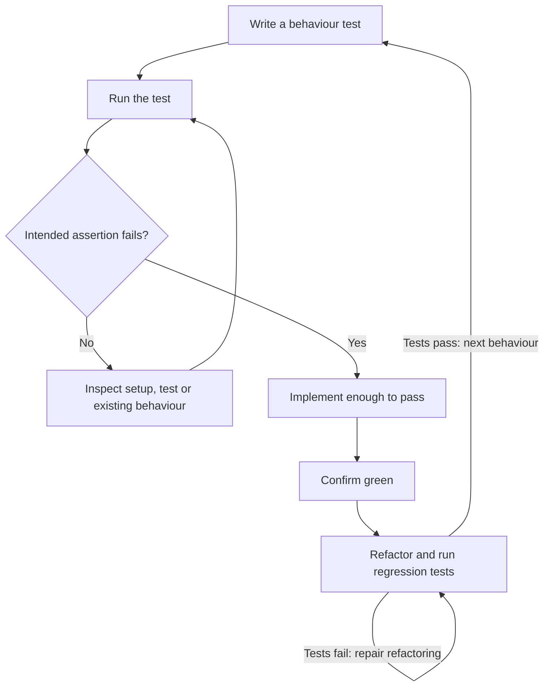

*OO Development and Agile Practices*  
*Designing, Testing and Evolving Software with AI Assistance*

## Opening scenario

A developer adds availability enquiry to the equipment system and reports that the build is green. During the demonstration, the officer enquires about a reserved camera and receives “available”. The test had checked only that the method returned a boolean without throwing.

Another test rejects every enquiry and passes the overlap example. A third accepts adjacent dates incorrectly because it treats the earlier reservation's end as inclusive. Each implementation can look plausible when its tests ask incomplete questions.

The purpose of testing is not to accumulate green indicators. It is to create evidence about specific behaviour, reveal misunderstandings and support changes in design. This chapter turns the availability examples from Chapters 3–4 into executable tests, demonstrates a complete red–green–refactor cycle and uses controlled collaborators to examine notification and lending behaviour.

## Learning outcomes and reading route

By the end of this chapter, you should be able to:

1. Translate acceptance examples into focused tests with meaningful expected outcomes.
2. Demonstrate red–green–refactor and explain why the first failure is the intended one.
3. Control data, time and collaborators to make tests repeatable.
4. Choose a useful test double and distinguish state checks from interaction checks.
5. Diagnose weak or brittle tests and explain the limits of passing evidence.
6. Assemble MVP, testing, demonstration and retrospective evidence for Milestone 2.

**Module connection:** Week 6; LO3; Milestone 2 preparation. The midterm practice near the end draws on Chapters 2–7, corresponding to Weeks 1–6. This chapter does not add assessment weights, deadlines or marking rules. It supports the Week 6 readings: the testing chapter and “A Programming Episode” in Martin [9], and Part I of Beck [10].

**Milestone 2 checklist: use it from the start.** Milestone 2 falls in this week, so do not wait until the end of the chapter. By your demonstration you need:

1. a working MVP flow that someone else can run from written instructions;
2. acceptance examples mapped to named tests;
3. one red–green–refactor sequence recorded from your own code;
4. a justified test double or controlled clock;
5. a build result for the revision you demonstrate;
6. real review feedback and a short retrospective with a next action; and
7. a statement of what the MVP does not do.

Section 7.8 explains each item. Start with items 1 and 3.

**Entry checkpoint:** Chapter 6's Java 17 application, explicit collaborator construction, student/staff policies and local notification outputs. The previous executable checks remain available. We now introduce **Maven, JUnit Jupiter and Mockito**, with an explicitly versioned configuration in the separate code file.

**Core reading.** Read Sections 7.1–7.8. Section 7.5 introduces hand-written doubles before Mockito.

**Minimum required lab.** Complete steps 1–6, 8 and 9 of the practical activity in Section 7.11. Steps 1–6 run on the **Book project**; steps 8 and 9 run on your **Team project**, which is where your Milestone 2 evidence comes from, including the demonstration rehearsal, real review feedback and retrospective in checklist item 6.

**Optional extension.** Do step 7 (the same demonstration rehearsal on the book's project), the Section 7.9 AI activity, the review questions and the transfer challenge. The midterm practice set in Section 7.12 is optional but recommended: it practises the class-diagram, refactoring and unit-test work the midterm covers. Appendix B records the Maven, JUnit and Mockito setup (B.4 and B.5); the companion's `pom.xml` and commands are the exact reference for this chapter.
 The companion for this chapter contains the full cumulative source, test listings, three TDD stages, solutions and observed verification results.

## 7.1 Behaviour and test evidence

### Start from a promise, not an implementation

Chapter 3 proposed US-02: an officer can inspect availability without creating a reservation. Chapter 4 refined five acceptance examples. Those examples are now implemented, rather than left as planning material.

| Example | Setup and action | Required observation |
|---|---|---|
| AQ-01 | Empty schedule; enquire about CAM1 for a valid interval | Available; records and notifications unchanged |
| AQ-02 | CAM1 reserved `[20 Oct, 22 Oct)`; enquire `[21 Oct, 23 Oct)` | Unavailable; no side effects |
| AQ-03 | Same booking; enquire `[22 Oct, 23 Oct)` | Available because the end is exclusive |
| AQ-04 | Same booking; enquire about MIC1 for the same interval | Available for the different fixture item |
| AQ-05 | Equal or reversed interval | Identifiable invalid-input outcome; no side effects |

All dates in these examples are in 2026. The selected Java API is `isAvailable(itemId, start, endExclusive)`. It returns a boolean for a valid interval. Blank or null item identifiers cause `IllegalArgumentException`; equal or reversed dates do likewise; null dates cause `NullPointerException` through `LoanPeriod`. These choices settle the earlier open API question for this teaching checkpoint.

Availability means no conflicting reservation for the item and interval. It does not mean that a particular borrower is eligible. The query accepts any positive interval representable by the dates, including more than seven days; student reservation limits still apply when a reservation is requested. It also does not know whether an item is physically on loan or present in a real catalogue. Those are distinct questions.

### Observe result and state together

The overlap example checks a false result, unchanged reservations and unchanged recorded notifications. An implementation that calls `reserve` and then undoes it would also send a notice, which the unchanged-notices check exposes. One that adds a temporary record directly and removes it again is harder to catch: with identifiers taken from the list size, nothing remains afterwards for a sequential test to see, and only a concurrent caller could observe the intermediate state. We therefore reject that design by reading it, not by testing it. A separate example confirms that an enquiry does not consume the next reservation identifier. With size-based identifiers it overlaps the unchanged-records check, but it protects the promise if identifiers later come from their own counter.

Choose observations according to the promise. For an immutable snapshot, comparing the before and after lists can expose replacement, deletion or reordering. Checking only the count misses changes to contents. Conversely, inspecting a private list field through reflection binds the test to representation when a public snapshot already exposes the behaviour of interest.

The expected answer must come from an agreed example or rule. Calculating it by calling the same method under test is circular. Copying the implementation's overlap expression into a test can reproduce its mistake. Concrete dates with an independently understood boundary provide a better starting point.

### Introduce a test runner without losing earlier evidence

JUnit provides annotations, assertions and reporting for the new tests [1]. Maven compiles the application and runs JUnit through the configured Surefire plugin [2]. The standard command becomes:

```bash
mvn --batch-mode verify
```

The existing `scripts/check.sh` now delegates to that command. The former plain-Java check classes remain intact. A `LegacyRegressionTest` invokes their four `main` methods from four JUnit tests, so the earlier checks are actually executed. Merely placing a class named `Chapter06Checks` in a test directory would not make its `main` method run automatically.

The wrapper reports four JUnit cases while their internal output still reports 34 Chapter 2 checks, five Chapter 3 example groups, 44 Chapter 5 checks and 28 Chapter 6 checks. Do not merge those counts as if they were identical units. The useful question is which behaviours execute and what failures reach the build.

## 7.2 Test anatomy and Arrange–Act–Assert

### Give the test a readable argument

Arrange–Act–Assert is a useful structure: establish the relevant state, perform the operation being examined, and inspect the outcome. It is a reading aid, not a requirement to place exactly one statement in each phase.

The first availability test arranges a two-day CAM1 reservation and takes snapshots of records and notices. It acts by enquiring about an overlapping interval. It asserts that the answer is false and both snapshots still match.

```java
boolean available = coordinator.isAvailable(
        "CAM1", start.plusDays(1), start.plusDays(3));

assertAll(
        () -> assertFalse(available, "An overlapping item must be unavailable"),
        () -> assertEquals(recordsBefore, coordinator.reservations()),
        () -> assertEquals(noticesBefore, inbox.received()));
```

The test name describes the behaviour: `overlappingEnquiryIsUnavailableWithoutChangingRecordsOrNotifying`. A precise name reduces the need to reverse-engineer why a fixture contains particular values. Avoid names such as `test1` or `worksCorrectly` when the failure should tell another developer what promise was broken.

Several assertions can belong together when they describe one outcome. Splitting this test into three methods with identical setup may obscure the relationship between a query result and its non-mutation promise. Combining every query, loan and notification scenario into one giant method would create the opposite problem: a failure would be hard to locate.

### Use assertions that can be wrong

`assertTrue(true)` cannot reject an implementation. “No exception occurred” may be valuable for a specific promise, but it does not establish availability. A meaningful assertion must distinguish the behaviour you want from a plausible defect.

Use `assertThrows` for a specified exceptional outcome and inspect state afterwards when preservation matters. A catch block that simply prints an error and continues does not establish that the right exception occurred. Likewise, wrapping a test in a broad catch can turn a failure into a false success.

The companion uses parameterised tests for small tables of policy boundaries. Each row states category, count, days and expected decision. The test runner reports individual invocations, making a particular boundary failure visible. The table is deliberately authored from the rule: it is not generated by evaluating the policy itself.

### Keep setup independent and small

Each scenario constructs fresh mutable collaborators unless sharing is part of the behaviour being tested. Reusing a static coordinator across tests makes results depend on which test ran first. The same test may then pass alone and fail in the suite.

A helper such as `reserved()` can make a repeated one-reservation fixture clear. A large universal setup that creates borrowers, loans, notices and dates for every test can conceal which state matters. Prefer the smallest fixture that makes the scenario meaningful, while using real simple domain objects rather than mocking their accessors.

## 7.3 Red–green–refactor

### Make the missing behaviour visible

TDD works in short cycles: express an expected behaviour, observe its failure, implement enough to satisfy it and improve structure while preserving the tests [3]. This is a development sequence, not a label for tests added after a complete feature.

The decision at red matters: a failing build is useful only when the test reaches the behaviour it is intended to examine.



**Figure 7.1.** The red–green–refactor cycle. The diamond is the test of the red stage: only the intended assertion failing lets the cycle move on to implementation. A different failure (a compile error, a missing dependency) sends you back to repair the setup, and a refactoring that breaks a test is repaired before the next behaviour starts.

The supplied worked cycle begins with a compiling `isAvailable` method that validates its arguments but always returns true. This intentionally incomplete method supplies an API for the first test without pretending to implement overlap detection.

Run only the new test:

```bash
mvn --batch-mode -Dtest=AvailabilityTddTest test
```

The observed red result is one executed test with one failure and zero errors. Its assertion reports that an overlapping item was expected to be unavailable but the method returned true. The unchanged-state assertions do not fail. This makes the missing behaviour precise.

A missing library, syntax error or inability to resolve a dependency would not be this red result. Those failures prevent or interrupt the experiment. Fix the environment or compilation issue, then rerun until the intended assertion exposes the missing behaviour.

### Green: implement the required decision

The green version constructs a `LoanPeriod`, inspects existing reservations and returns false if the same item has an overlapping period. If no conflict exists, it returns true. It does not call `reserve`, allocate an identifier or invoke the sender.

The same test then passes. This is useful evidence for that example, not permission to stop thinking. An implementation that always returned false would also satisfy the first overlap test. Additional examples are needed to distinguish overlap rejection from universal rejection.

The companion adds empty-schedule, adjacency, different-item, invalid-input, identifier-preservation and eligibility-distinction cases. These examples extend the specification. The complete author workflow includes one explicitly recorded TDD cycle; the chapter does not claim that every supplementary test or loan feature was developed test-first.

### Refactor: share conflict detection

The green query duplicates conflict scanning already present in `reserve`. The refactoring extracts a private `hasConflict(itemId, requestedPeriod)` operation and uses it from both public methods.

The public reservation operation retains its validation and eligibility order. It still stores exactly one record after passing the conflict check. The query uses the same conflict meaning without acquiring reservation's mutation or borrower-limit behaviour.

Rerun the TDD test and the legacy bridge after extraction. The observed refactor run executes five JUnit cases: the new test and four legacy wrappers. They pass. This connects the structural improvement to both the new query and the previous reservation behaviour.

The extraction is not justified because duplicated text is always forbidden. It is justified because the two callers need the same meaning of a reservation conflict. If one caller later needs physical stock or maintenance status, that new meaning should not be forced into this helper merely to avoid duplication.

### Preserve a traceable sequence

The companion includes red, green and refactored coordinator snapshots plus their commands and results. In a team's repository, separate commits or a clearly recorded diff sequence can provide equivalent evidence. Keep the actual failing assertion and correction, not just a final screenshot saying tests passed.

A deliberately wrong implementation supplied after the fact can demonstrate test sensitivity. It does not reconstruct a historical test-first workflow that never happened. Be precise about whether evidence shows an actual development sequence or a later diagnostic experiment.

## 7.4 Boundaries, controlled time and a bounded lending flow

### Test the edges that carry meaning

Borrowing rules have useful boundaries: a student with two existing records may add a third; one with three may not. Seven days are allowed for a student, eight are not. The illustrative staff limits are five total records and fourteen days. Test values around those boundaries rather than a large number of unrelated ordinary values.

Overlap also has boundaries. An enquiry beginning at the exclusive end is available if no other reservation conflicts. Equal start and end is invalid. A different item does not conflict solely because its dates match. Each example distinguishes a plausible error in the rule.

Boundary selection is a form of reasoning. It is not an exhaustive proof over every possible integer or date. Combine examples with source inspection and, where justified, broader techniques later. Do not introduce a coverage target as a substitute for an explanation of the risks.

### Control time where behaviour depends on today

Availability does not depend on the current date in this checkpoint, so it needs no clock. The new loan checkout operation does: checkout is allowed only on a date within the confirmed reservation's half-open period.

`LoanService` therefore receives a Java `Clock`. It obtains `LocalDate.now(clock)`. Tests use `Clock.fixed`, or a small controlled clock when the scenario must advance to a later date. Java's clock abstraction includes an instant and a zone, allowing a test to supply both [4].

A fixed UTC instant is not sufficient to define a local date without a zone. One test uses 19 October at 22:30 UTC with the Asia/Baghdad zone and expects the local checkout date to be 20 October. This is a deliberate example of zone-sensitive date conversion, not reliance on the machine's default zone.

Do not wait until midnight or call `Thread.sleep` to test a date boundary. Change the supplied clock. The application remains quick to test, and the relevant time is visible in the fixture.

### Add a bounded lending flow

The clock example above used checkout as its subject. This subsection states the rules of that small lending flow, which is a new feature and not a testing technique, so that the tests which follow rest on stated rules.


The worked MVP increment adds a small `LoanService` linked to one coordinator in the same process. It records checkout and return against a confirmed reservation. Its teaching rules are explicit:

| Operation | Rule and state effect |
|---|---|
| Checkout | Reservation must exist; today's date must be within its period |
| Repeat checkout | One reservation can create at most one loan, including after return |
| Item already out | A second active loan for the same item is rejected |
| Return | Only an active loan can be returned; repeated return is rejected |
| Return date | Cannot precede the recorded checkout date |
| Observation | Loan snapshots are unmodifiable and contain immutable loan values |

A `Loan` is a Java record with validated identifiers, a checkout date and an optional return date represented by null. Here null has one documented meaning: the loan is active. Records provide concise value-oriented data declarations, but validation still has to be written [8].

The service replaces an active loan value with a returned value instead of mutating earlier snapshots. Tests can therefore compare current state while an earlier snapshot continues to describe the earlier state.

### Do not invent lifecycle rules silently

Returning a loan does not delete or cancel its reservation. The existing reservation-count rule still counts every stored reservation, and reservation availability remains based on those records. An early return therefore does not free a reserved interval or restore a borrower's reservation allowance in this checkpoint.

This inherited limitation is explicit and tested. A production lifecycle would need agreed definitions for completed reservations and active counts. Introducing that rule now without revisiting earlier contracts would disguise a feature change as testing work.

The demonstration uses one coordinator and one loan service for the session. Multiple independent loan services would have independent loan maps; the example provides no shared persistent or concurrent protection. It is a bounded in-memory MVP flow, not a complete lending operation.

## 7.5 Dummies, stubs, fakes, spies and mocks

### Name the role a substitute plays

A test double replaces a collaborator for a testing purpose. The vocabulary below follows the commonly used distinctions described by Meszaros and summarised by Fowler [5]. Roles can overlap; the tool or class name alone does not determine the role.

| Role | Purpose | Example in this project |
|---|---|---|
| Dummy | Supplies an argument that the scenario should not use | A sender passed to an immediately rejected request |
| Stub | Produces a controlled answer or failure | A sender that throws the expected notification exception |
| Fake | Provides a working simplified substitute | An in-memory output standing in for an external delivery destination |
| Spy | Records calls for later inspection | The recorder when a test examines received reservations |
| Mock | Supports verification of expected interactions | A Mockito sender checked for one call or no calls |

The coordinator itself is the subject under test in notification scenarios. Mocking its `reserve` method would replace the behaviour we want to examine. Keep the real coordinator, rules and small immutable values, and replace the output boundary that would otherwise complicate observation.

A hand-written recorder is often clearer than a mocking framework. Its list makes the effect visible. A configured failing sender is similarly easy to understand. Learn those roles first so a framework's fluent syntax does not become a substitute for reasoning.

### Introduce Mockito for a specific interaction

The companion then creates a `NotificationSender` using Mockito. After a successful reservation, it verifies one `send` call and captures the supplied reservation to inspect its identifiers and period. Another test verifies no interaction for an invalid duration. A third makes `send` throw `NotificationException`, then checks the retained record and explicit failure suffix.

These checks concern public boundary behaviour, not private helper calls. The exact number of sender invocations matters because the selected feature says one attempt per acceptance and no automatic retry. Counting how often a private list is inspected would be a different, usually brittle kind of assertion.

Mockito can configure results and verify calls [6]. The supplied setup uses its interface-only proxy mock maker. All mocked types here are interfaces, so the mocks are Java dynamic proxies and no class mocking or static mocking is needed. This keeps the first framework example narrow.

One practical warning. On newer JDKs, Mockito may still attach its ByteBuddy agent when it starts, and the JVM then prints “A Java agent has been loaded dynamically”. This appeared with the Mockito version printed in the companion POM, even with the proxy setting, and the tests still passed; passing `-XX:+EnableDynamicAgentLoading` to the test JVM removed the message. Other JDK and Mockito combinations may behave differently. The JVM states that dynamic loading will be disallowed by default in a future release, so check Mockito's documentation for the setup recommended for your JDK.

### A preview: doubles for an outside data source

Chapter 6 previewed the contract of the book's data-backed collaborator, the equipment directory, and Chapter 8 builds it. You can already see how a test would substitute it. The contract has one method, so a lambda is enough, and each double below answers a different question that a future test will ask:

```java
BorrowerDirectory knownStudent = id -> Optional.of(new Borrower(id, BorrowerCategory.STUDENT));
BorrowerDirectory nobody = id -> Optional.empty();
BorrowerDirectory offline = id -> { throw new DirectoryException("provider offline"); };
```

`knownStudent` is a stub with a fixed answer: it lets you test what the service does with a borrower it can trust. `nobody` is a stub that says “absent or inactive”: it tests the ordinary rejection. `offline` is a throwing stub for the failure case: it tests that an outage is reported as an outage and not as “not found”. None of them needs a framework, and none of them proves that a real provider behaves this way. Those three lines were compiled and run against Chapter 8's types; they print `STUDENT`, `false` and `failure: provider offline` when the three doubles are asked about borrower `B1`. The checkpoint of this chapter does not contain these types, so the snippet is illustrative here and becomes real code in Chapter 8.

### Match the double to the question

Use a recorder when you want to inspect accumulated notices. Use a throwing stub when you need a predictable output failure. Use an interaction-verifying mock when the contractual call itself is the observation. A fixed clock supplies controlled time; it does not prove the real operating-system clock is correct.

Neither the recorder nor the mock proves that email is delivered. A fake may accept inputs a real provider rejects. Later integration checks must examine real adapters and their contracts. Chapter 13 covers that boundary more fully.

Avoid checking every possible interaction automatically. A blanket “nothing else was called” assertion can make harmless implementation changes fail. Verify only absence or ordering that is meaningful to the requirement. Here “no notification after rejection” is meaningful; “exactly three calls to the snapshot getter” is not.

## 7.6 Testability and design feedback

### Difficult setup can reveal a design problem

Chapter 6's constructor injection lets tests choose a recorder, failing sender and policy mapping without altering the coordinator. The new loan service receives a clock for the same reason: time-dependent behaviour can be examined without editing production logic or waiting for a real date.

A difficult test may expose hidden global configuration, mixed responsibilities or an operation with unclear results. It may also expose a poorly chosen test. Before adding another interface, ask whether the scenario is trying to inspect a private implementation detail that should be irrelevant.

The availability query creates no records and has no notification side effects. Its clear contract made it easy to test result and state separately. Attempting to implement it by calling `reserve` would immediately entangle eligibility, identifiers and notifications. Test difficulty would then be useful feedback about the proposed design.

### Use real simple collaborators

`LoanPeriod` is cheap, deterministic and central to the rule being examined. Mocking it to say “overlaps” in every scenario would prevent query tests from exercising actual period semantics. The companion uses real dates and period objects.

Similarly, an ordinary list or map should usually remain real in these tests. Replacing it with a mock can lead to assertions about `add`, `get` and call ordering rather than whether the application preserved the right records. A substitute should remove an obstacle or expose a meaningful boundary, not erase the very behaviour under examination.

### Preserve useful regression evidence during migration

Moving to JUnit does not require rewriting every old assertion at once. The bridge makes the earlier check runners visible to the new build. New tests are focused JUnit methods with readable names and parameterised cases.

This bridge is transitional. Its four coarse test results give less precise runner-level reporting than individual migrated methods, even though internal assertion messages remain useful. Later migration can improve diagnosis without changing the expected behaviour. Do not discard earlier checks simply because their syntax predates the chosen framework.

## 7.7 Weak or brittle tests

### A test can execute code and still ask nothing useful

Coverage records which code was exercised under a particular measurement. It does not establish that the expected answer was correct or that the assertions would reject a defect. A test can execute every line of a method and accept every result.

Compare a query test that only calls `isAvailable` with one that expects an overlapping interval to be false and preserves the recorded state. The second distinguishes a meaningful defect. A further adjacency example distinguishes a different defect that the first overlap example would miss.

One useful diagnostic is to introduce a small, labelled wrong implementation in an isolated copy. The companion changes the end-boundary comparison so adjacent intervals incorrectly overlap. The selected adjacency test must fail. Restoring the correct comparison must return the test to green.

This is a targeted mutation experiment. It shows that one test detects one plausible fault. It does not prove that the suite detects every defect or justify changing tests until an incorrect implementation passes.

The companion repeats the idea with sixteen faults. Fourteen were caught at once. One revealed a real gap: the rule table says loan snapshots are unmodifiable, but no test checked it, so one assertion was added. The last could not be caught by any sequential test at all, because the faulty enquiry leaves nothing behind. A surviving fault is information to examine, not always a defect in the tests.

### Do not let tests reproduce the same misunderstanding

An AI-generated implementation and AI-generated tests may agree because both assume inclusive end dates. Agreement is not independent evidence. Check expected values against the human-reviewed interval convention and concrete examples.

Also avoid expected values derived from the result itself. Asserting that a returned identifier equals the identifier in the same returned object establishes no independent fact. For the first accepted reservation, an explicit expected R1 is meaningful under this checkpoint's identifier contract.

### Avoid unnecessary implementation coupling

A test asserting that the query calls private `hasConflict` exactly once would fail if the implementation used a different correct structure. The public result and state contract should normally survive that refactoring.

Exact text assertions can be useful when text is part of the existing contract, as it is for reservation return strings. They also reveal a cost: wording changes require deliberate expectation updates. A future structured result might separate domain outcome from presentation more cleanly, but that is a separate design change rather than an excuse to weaken current checks.

When a test fails, classify the failure before fixing it: requirement misunderstanding, implementation defect, outdated expectation, environment/configuration problem or test fragility. A green build obtained by suppressing the assertion's exit status answers none of those questions.

## 7.8 Milestone 2 evidence

### Demonstrate an outcome with its boundaries

The Chapter 7 demonstration now follows a complete small journey: inspect reservation availability, create a reservation, observe the changed availability, check out the item within the reserved period and return the loan. It records one accepted-reservation notice. It does not send additional checkout or return notices because those were not part of the selected requirement.

This gives teams a concrete example of a bounded MVP increment. Their assessed domain and scope may differ. The module leader's approved Milestone 2 requirements remain authoritative; the book supplies preparation rather than a new rubric.

| Evidence | What it should establish |
|---|---|
| Working MVP demonstration | A coherent user outcome runs from documented setup |
| Acceptance mapping | Selected examples connect to executed tests |
| TDD sequence | Intended failure, implementation and protected refactoring are visible |
| OO/SOLID rationale | Collaborators and responsibilities have concrete reasons |
| Double choice | Controlled behaviour or interaction is justified |
| Build result | Actual tests ran against the intended revision |
| Review and retrospective | Real feedback, a change in understanding and a next action are recorded |
| Limitations | In-memory storage, lifecycle boundaries and missing integrations are explicit |

A test report is not the whole milestone. Another person should be able to reproduce the demonstration and explain what remains outside its claim. A hosted CI run remains separate evidence from the local Maven runs performed for this chapter.

### Make the retrospective useful

A retrospective note should connect an observation to an action. For example, a team might discover that availability tests had silently assumed the machine's current date, then decide to make all relevant time dependencies explicit. Record that only if it actually happened.

Avoid pre-filled success narratives. “We collaborated well” without an example does not explain how work changed. A useful note might identify a delayed review, its effect on integration and a concrete earlier review checkpoint for the next iteration. Distinguish a proposed improvement from an improvement already tested.

## 7.9 AI in practice: separate implementation from expected behaviour

Use the reviewed AQ-01–AQ-05 examples as the authority. Ask an AI assistant for a candidate query implementation, then separately ask for omitted boundary cases. Evaluate both outputs rather than letting them validate each other.

Chapter 15 collects the recurring AI workflows; this activity is self-contained, and the reviewed AQ-01–AQ-05 examples are all you need.

| Element | For this activity |
|---|---|
| Engineering objective | Separate a proposed implementation from the evidence that would accept or reject it |
| Input | AQ-01–AQ-05 as reviewed, and Chapter 6's coordinator |
| Permitted scope | Evaluate the candidate implementation and its tests; do not treat either as proof of the other |
| Independent checks | The reviewed examples, the labelled wrong-boundary mutation, and the build result |
| Accept or reject | A verdict with independent evidence for each claim |
| No-account route | The fixture below is sufficient |

For offline use, the following is an **author-written fictional AI-output fixture**, constructed for this exercise:

> An enquiry can call `reserve` and remove the temporary record. Treat the end date as inclusive so adjacent bookings conflict. A test is sufficient if the method returns without throwing. Since the implementation and generated tests agree, coverage will prove correctness. For time-sensitive loan tests, use the current date and wait until tomorrow to test the next state.

Identify each unsupported claim, propose an independent expected result and describe the evidence that would reject the candidate. Run the supplied labelled boundary mutation in an isolated copy. Retain its actual failure and the restored pass.

A paid AI service is unnecessary. If using a live service, provide only synthetic data and record the prompt, relevant output, accepted/rejected claims and independent verification. Do not manufacture a transcript or claim a test-first sequence that was not performed.

## 7.10 Common mistakes

| Mistake | Consequence | Better action |
|---|---|---|
| Count a dependency-download error as TDD red | Behaviour was never examined | Reach the intended assertion failure |
| Write expected values by calling the implementation | Reproduces the same mistake | Use independently reviewed examples |
| Mock the object under test | Replaces the behaviour being investigated | Keep the subject real |
| Use real time for a deterministic date rule | Results change with date or zone | Inject an explicit clock |
| Treat every recorder as the same double role | Hides why it is used | Describe its role in the particular test |
| Verify private call counts | Breaks harmless refactoring | Observe public behaviour or meaningful boundary interactions |
| Remove old checks during tool migration | Loses existing evidence | Bridge or migrate them explicitly |
| Call the bounded demo production-ready | Conceals lifecycle and integration gaps | State what the MVP actually demonstrates |

## 7.11 Practical activity

**Input:** Chapter 6's checkpoint, the reviewed query criteria, the new loan-flow rules and the companion's Maven/JUnit setup. Steps 1–7 run on the **Book project**; steps 8 and 9 run on your **Team project**.

**Instructor demonstration:** run the labelled red stage, inspect the precise assertion failure, apply the green implementation, extract conflict detection and rerun both the new test and legacy bridge.

**Guided practice:** convert one policy boundary table into parameterised examples. Discuss which incorrect result each row distinguishes. Compare a hand-written recorder with the Mockito interaction test.

**Independent work:**

1. Reproduce the supplied TDD cycle or conduct a small new one for an agreed missing behaviour. Record the actual sequence.
2. Complete the remaining query examples, including side effects and adjacency.
3. Demonstrate the loan flow with controlled dates and rejection of an invalid return.
4. Choose a substitute for one collaborator and justify its role.
5. Run the labelled wrong-boundary implementation in a separate copy, identify the failing assertion and restore the correct source.
6. Run the full build and map selected acceptance examples to named tests.
7. Rehearse the MVP demonstration from documented instructions, obtain actual review feedback and write a short retrospective with a next action.
8. On your **Team project**, take one behaviour from your backlog and develop it test-first. Record the actual red failure, the green change and the refactoring, as the chapter's worked cycle does. Do not reconstruct a sequence afterwards.
9. On your **Team project**, work through the Milestone 2 checklist at the top of this chapter. Rehearse your own MVP demonstration from written instructions, obtain actual review feedback and write a short retrospective with a next action, as step 7 does for the book's project. Record which checklist items are complete, which are gaps and who will close each one.

**Expected output:** runnable source; focused tests; TDD and mutation evidence; double rationale; actual build result; demonstration notes; review/retrospective notes; explicit limitations; and the step 8 and 9 records for your Team project.

**Completion checks:** the failure is behavioural and understood; query results and state effects match the examples; time-sensitive tests do not depend on the actual day; the whole regression suite executes; the demonstration includes reservation, checkout and return. Use approved module requirements for submission.

**Optional extension:** sketch how completed reservations should affect borrower counts and early-return availability. Identify every earlier contract and check that would need revisiting. Do not silently implement that policy as part of this exercise.

## 7.12 Review questions and midterm practice

### Short concept questions

1. Why is “the method did not throw” insufficient evidence for an availability query?
2. What distinguishes the red stage of the worked cycle from a missing-dependency failure?
3. When does the notification recorder act as a spy, and why can a framework mock serve a similar purpose?
4. Why do both the instant and zone matter when testing a local-date checkout rule?

### Applied diagnosis

5. A test calculates its expected availability by calling the same overlap helper used by production code. Both treat adjacency as overlap. Explain why the green result is weak and replace it with an independent example.
6. A loan test passes alone but fails after another test, and both use a static shared loan service. Diagnose the likely cause and propose a fixture strategy that still allows intentional multi-step scenarios.

### Transfer challenge

A room-booking service permits availability enquiry and check-in only during the booked interval. Design three acceptance examples, one clock-controlled test and one collaborator substitute. Explain which expectations transfer from equipment lending and which rules need stakeholder clarification, such as cleaning time or late check-in.

### Midterm practice set (Chapters 2–7)

The midterm covers Weeks 1–6, which are Chapters 2–7. According to the module descriptor, it asks you to model a scenario with UML class diagrams, identify SOLID violations and smells in supplied code, refactor short snippets by introducing interfaces and dependency injection, and write unit tests with test doubles for a small component. The five tasks below practise those four things. They are separate from the cumulative project. Do not add Chapter 8's patterns, which the midterm does not cover even though they are taught that week. Whether Mockito may be used in the exam is the module leader's decision, and it has not yet been confirmed for this book; follow the module leader's instructions about what the exam permits. The book teaches Mockito as a working tool, separately from what an assessment allows, and hand-written doubles work in any setup.

**Task 1: UML.** Draw a class diagram for this scenario. Include multiplicities, one composition, one interface realisation and one dependency, and write down one rule your diagram cannot express.

> A library lends laptops. Each laptop has an asset tag and a model. A loan links one borrower to one laptop and records a start date and a due date. A borrower and a laptop can each appear in many loans over time. A loan can be renewed any number of times; a renewal records a new due date and has no meaning without its loan. When a loan is overdue, a notice is delivered through a channel. The library uses email today and expects other channels later.

**Task 2: diagnosis.** Read the class below. List every smell or SOLID violation you can find. For each, name a concrete consequence, such as something you could not do or test, instead of naming a principle alone.

```java
// Supplied for practice. MailClient is a supplied class that opens a real
// network connection; assume you cannot call it from a test.
import java.time.LocalDate;

public class OverdueReminder {
    public boolean remind(String borrowerEmail, LocalDate dueDate, String itemName) {
        if (LocalDate.now().isAfter(dueDate)) {
            MailClient client = new MailClient("smtp.campus.example", 25);
            client.send(borrowerEmail, "Overdue: " + itemName, "Please return " + itemName + ".");
            System.out.println("Reminder sent to " + borrowerEmail);
            return true;
        }
        return false;
    }
}
```

**Task 3: refactor.** Rewrite the class so it can be tested without a mail server. Introduce an interface and inject what it needs. State which behaviour you preserved and which part of the class's API changed.

**Task 4: tests.** Write JUnit tests for your refactored class. Use a hand-written test double and a fixed clock. Cover the due date itself, an earlier date and the day after, and state which role your double plays.

**Task 5: trace.** Trace a rejected reservation through the coordinator. Explain why it produces no notification, choose the test observations that would show this, and identify the role of an injected sender. A good answer connects design, behaviour and evidence rather than listing acronyms.

The companion gives the supplied `MailClient`, a model solution for each task and a way to run the tests. Attempt the tasks before reading it.

## Summary and next chapter

Meaningful tests distinguish intended behaviour from plausible mistakes. The worked cycle makes one missing rule fail visibly, implements it and protects the subsequent structural change. Controlled collaborators and clocks make important outcomes reproducible, while carefully chosen assertions keep tests useful during refactoring.

The cumulative project now includes reservation availability enquiry and a bounded checkout/return flow. Its lifecycle and integration limits remain explicit. Chapter 8 examines construction and compatibility patterns, building on these tests rather than replacing design judgement with pattern names.

## Sources and further reading

Sources checked 12 and 13 October 2026. Version pins are the configuration the chapter specifies, not a claim to use every tool's newest release. Examples and policy choices are author-created teaching material.

1. JUnit Team, [JUnit 5 User Guide, version 5.13.4](https://docs.junit.org/5.13.4/user-guide/). Test methods, assertions, parameterised tests and build integration.
2. Apache Maven, [Using JUnit Platform with Surefire](https://maven.apache.org/surefire/maven-surefire-plugin/examples/junit-platform.html), and [Maven 3.9.11 release notes](https://maven.apache.org/docs/3.9.11/release-notes.html).
3. Fowler, M., [Test Driven Development](https://martinfowler.com/bliki/TestDrivenDevelopment.html). Short development cycles and refactoring.
4. Oracle, [Java SE 17 `Clock`](https://docs.oracle.com/en/java/javase/17/docs/api/java.base/java/time/Clock.html). Controlled instants and zones.
5. Fowler, M. (2006), [Test Double](https://martinfowler.com/bliki/TestDouble.html). Summary of Gerard Meszaros's test-double vocabulary.
6. Mockito Team, [Mockito API documentation](https://site.mockito.org/javadoc/current/org/mockito/Mockito.html), for the basic mocking, stubbing and verification concepts. That hosted page identifies itself as 2.2.7; the executable chapter pins and verifies [Mockito 5.20.0](https://javadoc.io/doc/org.mockito/mockito-core/5.20.0/index.html), rather than assuming the URL labelled “current” gives the selected version.
7. Apache Maven, [Compiler Plugin](https://maven.apache.org/plugins/maven-compiler-plugin/). The supplied configuration pins 3.14.1 and Java release 17.
8. Oracle, [Java 17 Record Classes](https://docs.oracle.com/en/java/javase/17/language/records.html). Record declarations and compact constructors.
9. Martin, R. C. (2002), *Agile Software Development: Principles, Patterns, and Practices*, Prentice Hall. The module's required text; the Week 6 reading is its testing chapter and “A Programming Episode”. Publication details as listed in the module descriptor.
10. Beck, K. (2002), *Test-Driven Development: By Example*, Addison-Wesley. A recommended text; the Week 6 reading is Part I. Publication details as listed in the module descriptor.