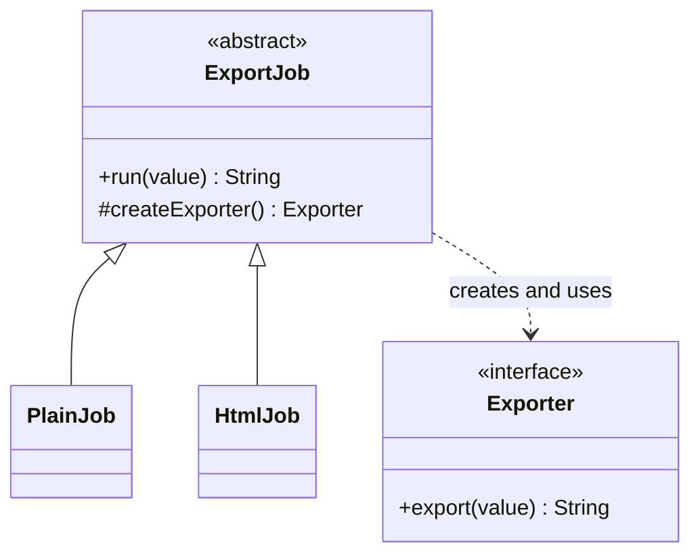
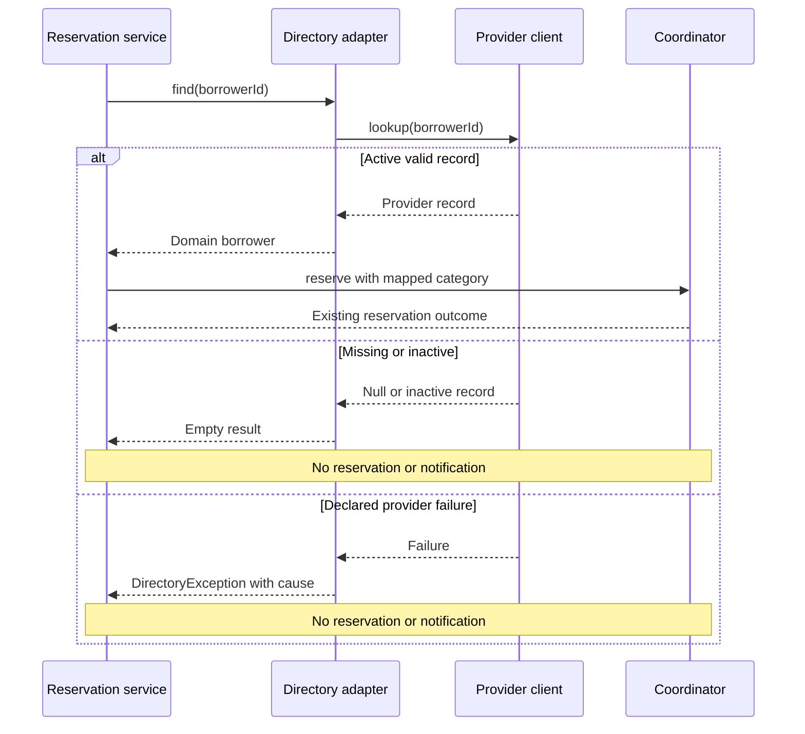

*OO Development and Agile Practices*  
*Designing, Testing and Evolving Software with AI Assistance*

## Opening problem

The equipment office can reserve, check out and return equipment. Now it wants borrower categories to come from a university directory rather than from a category supplied by the calling code. Unfortunately, the proposed directory returns records containing `S`, `T`, `Y` and `N`; it returns null when a person is missing and throws its own exception when lookup fails.

One developer proposes putting these details inside `ReservationCoordinator`. Another proposes a factory, builder, adapter and decorator around every class. Both proposals need a better argument. The first spreads external conventions into reservation behaviour. The second introduces structures before identifying what must vary.

This chapter asks a more useful question: **which responsibility needs a boundary, and what is the smallest design that makes that boundary clear?** The answer adds one justified Adapter to the cumulative project. Separate examples explore construction and optional behaviour without forcing every pattern into the lending system.

## Learning outcomes and reading route

By the end of this chapter, you should be able to:

1. Identify a concrete construction or interface-compatibility problem.
2. Distinguish Factory Method, a simple factory and Abstract Factory by their responsibilities.
3. Build a validated immutable request through a staged construction interface.
4. Adapt provider records, absence and failures into an application-owned contract.
5. Compose decorators and predict the effects of order and exception handling.
6. Justify adopting or declining a pattern using tests and change costs.

**Module connection:** Week 7; LO2. The midterm remains on Weeks 1–6, corresponding to Chapters 2–7. These new patterns are not added to that scope. Assessment rules and the module descriptor remain under the module leader's control.

**Prerequisites:** Chapters 5–7: contracts, interfaces, constructor injection, composition and meaningful tests. Use Java 17 and the Maven/JUnit configuration from Chapter 7.

**Core reading.** Sections 8.1, 8.2, 8.5 and 8.7. Factory Method and Adapter are the two suggested live demonstrations.

**Working-knowledge reading.** Sections 8.3 (Abstract Factory), 8.4 (Builder) and 8.6 (Decorator) give limited, required depth through runnable guided examples: read each, run its example and, for the decorator, predict both audit histories before you run the tests. Working knowledge is not an optional extra, but it asks for understanding, not independent implementation. Their implementations remain separate from the cumulative application.

**Minimum required lab.** Complete steps 1–3, 5 and 9 of the practical activity in Section 8.10. Steps 1–3 and 5 run on the **Book project**; step 9 runs on your **Team project**. This is midterm week, and the midterm does not cover this chapter, so do the minimum lab first.

**Optional extension.** Do steps 4, 6, 7 and 8 (the second-scenario comparison, the Section 8.8 AI activity and the Builder and Decorator exercises), the review questions and the transfer challenge. The Builder and Decorator exercise solutions in the companion's Section 8.4 are a separate checkpoint outside the 63-invocation baseline.

This chapter supports the Week 7 readings: the Factory and Adapter chapters of Martin [7] and the creational and structural patterns in Gamma et al. [1].

The second Markdown file contains complete source listings, tests, reconstruction commands, solutions and teaching notes. All provider records are synthetic. No real university directory, network service or personal data is used.

## 8.1 Why object creation can become a design problem

### Start with the ordinary constructor

Creating a `LoanPeriod` with its two required dates is clear. The constructor validates a small invariant and produces an immediately useful object. Replacing this with a hierarchy of factories would not improve the rule. Likewise, Chapter 6's `ReservationApplication.create(sender)` is a useful assembly function: it connects known policies, a formatter and an explicitly supplied sender.

Construction becomes troublesome when the decision about **which object**, **which compatible group**, or **which configuration** is repeated across places that should not own it. A caller may need only an export operation yet repeatedly inspect an output-format flag. Another may choose a heading renderer independently from a body renderer and accidentally combine incompatible output formats. A third may pass six positional arguments whose meanings are difficult to review.

These are different problems. Giving all three solutions the name “factory” conceals which responsibility changed. A pattern name should shorten a precise explanation after the problem is understood; it should not replace that explanation.

### Distinguish creation, compatibility and added behaviour

Factory Method, Abstract Factory and Builder concern construction decisions. Adapter connects an existing interface to the one a client needs. Decorator attaches an optional responsibility while retaining the component interface. These categories organise discussion, but actual code must still be examined for intent and consequences [1].

Consider the directory request. The awkwardness is not that constructing a directory object requires many arguments. It is that its data and failure meanings differ from the application's. A builder would not answer what `T` means or whether an outage should be treated as a missing borrower. Those are translation decisions.

Similarly, an audit wrapper around a sender may add behaviour without choosing the sender's concrete class. Calling that wrapper a factory would draw attention away from call order and errors, which are the important design questions.

### State the change pressure before the structure

A useful design note names the current simple solution, the change it handles poorly, the selected boundary and the cost of adding it. For this project: passing a trusted category worked for local fixtures; provider codes now need central translation; an application-owned directory interface isolates that translation; additional types and mapping tests are the cost.

This reasoning does not require predicting every future directory. There is already one incompatible interface. Conversely, inventing five hypothetical provider families is not evidence that an Abstract Factory is needed today.

Keep construction visible at the composition point. Hiding it in a global registry can make dependencies harder to discover even if individual classes contain fewer `new` expressions. The goal is understandable ownership, not a ban on constructors.

## 8.2 Factory Method

### Problem and simple attempt

The isolated export example has a small workflow: validate an input, obtain an exporter and execute it. A simple factory can choose a plain-text or HTML exporter from a flag. That is often enough when one assembly location owns the choice.

The separate Factory Method scenario assumes that subclasses must specialise product creation while keeping the workflow inherited from a common creator. The change pressure is therefore an extension point in that workflow, not merely the existence of two product classes.

### Structure: an overridable creation operation

`ExportJob.run` owns the workflow and calls `createExporter`. `PlainJob` and `HtmlJob` override that creation method. Each returns an object implementing `Exporter`. The workflow uses the product interface without inspecting the concrete creator's type.

```java
public abstract static class ExportJob {
    protected abstract Exporter createExporter();

    public final String run(String value) {
        Objects.requireNonNull(value, "value");
        return createExporter().export(value);
    }
}
```

The complete imports and surrounding class appear in the code file. The final `run` method keeps this example's workflow fixed. The protected hook is the deliberate variation point.



**Figure 8.1.** Factory Method. `ExportJob` owns the workflow and declares the creation hook, and each concrete job overrides it.

Read the notation with Chapter 2's table in mind. `#` marks a protected member: subclasses can override `createExporter`, but outside callers cannot call it. `<<abstract>>` marks a class that cannot be instantiated on its own. The solid line with a hollow triangle is inheritance. The dashed arrow is a dependency: `ExportJob` creates and uses exporters without keeping one in a field.

The diagram shows why the design is Factory Method: subclasses vary creation inside an inherited workflow. The concrete product implementations are lambdas in this compact example; they still implement the product interface. A separate named class is unnecessary for a one-operation product with no extra state.

### Compare with a simple factory honestly

`simpleExporter(boolean html)` contains an ordinary selection expression returning the same kinds of products. It is a simple factory, not the subclass-based Factory Method demonstrated above. A static method named `create` is not sufficient evidence of the latter pattern.

Tests can show that both designs produce `TEXT: R1` or an HTML paragraph. Identical output does not make their extension mechanisms identical. One central selection function changes when a new option is added; the other introduces a concrete creator subclass. Code structure and change requirements settle the classification.

### Test, trade-off and non-use case

The tests exercise both concrete jobs and an instrumented creator whose hook returns a distinctive exporter. They check that the inherited workflow uses the chosen product and that null input is rejected before export. The hook-count assertion documents this tiny creator example; it is not advice to verify private call counts throughout the application.

Factory Method provides an explicit subclass extension point, but creates inheritance coupling. Readers must follow the inherited workflow and its override. A constructor accepting an `Exporter` can be simpler when callers already know the product and no framework-style creation hook is required.

For that reason, the cumulative project keeps `ReservationApplication.create(sender)` as a simple assembly function. We do not convert it into a creator hierarchy solely to display the pattern. The separate example demonstrates the mechanism; the design decision explains when to decline it.

## 8.3 Abstract Factory

### Problem: products must belong together

A receipt has two product roles: a heading renderer and a body renderer. A plain-text receipt needs plain versions of both; an HTML fragment needs HTML versions of both. Independent format flags can accidentally select an HTML heading and a plain body.

A simple attempt is one renderer that switches format for every part. For two very small operations, that may remain the best implementation. The teaching scenario adds a requirement to choose the whole related set once while allowing the rendering workflow to use stable product interfaces.

### Structure and family consistency

`ReceiptFamily` exposes `heading()` and `body()`. `PlainFamily` supplies plain implementations of both roles; `HtmlFamily` supplies HTML implementations. The receipt function obtains both products from the supplied family and combines their outputs. It does not contain a format switch.

The essential distinction is the related set of product roles [2]. Abstract Factory is not just a factory declared with Java's `abstract` keyword. An interface implemented by concrete family providers can serve the role. Factory Method instead focused on an overridable product-creation operation inside an inherited workflow.

Our types encourage family consistency by accepting one factory for a receipt. They do not mathematically prevent someone from writing a defective factory that returns a mixed pair. Tests and implementation review still establish that the concrete family fulfils its promise.

### Test the relationship, not only construction

The tests render a complete receipt with each family. They expect `Loan` and `R1` as separate text lines in one case, and an HTML heading and paragraph in the other. An angle-bracket input checks the HTML text-node escaping used by these products. The example creates fragments, not a complete website or general sanitisation library.

A test that merely asserts both product references are non-null would miss a mixed-format family. The expected complete result observes the relationship that motivated the design.

### Trade-off and non-use case

Adding another family can leave the client workflow unchanged. Adding a new product role, such as a footer, changes the factory contract and requires every family to supply it. The design makes one axis of extension convenient by making another more coordinated.

Do not infer a family merely because two objects are constructed near each other. A clock and borrower directory do not automatically form a compatible product family. Nor does one sender with two implementations justify two product roles invented for the diagram. In the lending checkpoint, the small existing assembly function remains sufficient.

The isolated family example is intentionally compact. If the real receipt stays this small, replacing it with one formatter per output style is a reasonable conclusion. The learning outcome is to recognise the trade-off, not to preserve every example's abstraction in production.

## 8.4 Builder

### Problem: configuration becomes difficult to read

Imagine a report request with a required borrower identifier, an optional date interval, a returned-loan option and an ordered collection of requested column labels. A positional constructor could work, but calls containing nulls, a boolean and a list become difficult to review as the options grow.

A sequence of setters on the final request is another simple attempt. It allows clients to observe an incomplete request and to change it after it has been submitted. If the required outcome is an immutable configuration value, construction and later use should be separated.

### Structure: configure, validate, publish

`ReportRequest.forBorrower("B1")` creates a mutable builder. Named operations configure it, and `build()` produces an immutable request.

```java
var request = ReportRequest.forBorrower("B1")
        .during(start, start.plusDays(7))
        .includeReturned(true)
        .column("item")
        .column("date")
        .build();
```

This is a fluent builder variant with one product representation. The classical Builder discussion also includes separating construction steps from representations and, when useful, a director controlling those steps [1]. Our example does not claim to implement that entire arrangement. Chaining methods alone would also be insufficient: what matters here is staged construction followed by a validated, independent product.

### Make defaults and invariants visible

The required identifier must be nonblank. Omitting dates means no date restriction; supplying dates requires a positive half-open interval. Returned loans are excluded by default. Column labels form an ordered list, empty by default; the example stores labels but does not implement report generation or a column-name registry.

Validation belongs before publication of the product. Each `build()` checks the interval, and the constructor copies the builder's column list with `List.copyOf`. Further builder changes therefore cannot change a previously built request. The request exposes the immutable snapshot.

The builder is mutable and intended for one construction sequence at a time. An immutable product does not make its builder thread-safe. Reusing the builder is supported sequentially in this example, but callers must recognise that settings remain until changed.

### Test, trade-off and non-use case

Tests check defaults, explicit options, invalid dates and the independence of two products built before and after another column is added. Attempting to modify a product's columns must fail. Merely checking that chained calls compile would not detect an alias to mutable builder state.

The costs include another type, more methods and a distinction between temporarily configured state and a valid built value. A small constructor with two meaningful required parameters is often clearer. `LoanPeriod(start, endExclusive)` therefore remains a constructor call.

Builder also does not perform the report or authorise access to it. Combining configuration construction with database queries or directory lookups would mix responsibilities. Keep this example separate until the cumulative application has an actual report requirement.

## 8.5 Adapter

### Problem and the tempting direct solution

The illustrative provider exposes `lookup(key)` and returns a `Person(key, kind, status)`. The application wants `find(borrowerId)` returning a domain `Borrower` when an eligible record exists. The methods differ, but the important mismatch includes data meaning and failure behaviour.

Putting provider codes directly in the coordinator would make reservation logic depend on their spelling. Repeating translation in callers would risk inconsistent defaults. An object Adapter instead implements the application interface while holding the incompatible provider collaborator [3].

The provider interface in this chapter is a local model of an external contract, not an implemented HTTP client. Its map-backed fixture makes all cases reproducible. Replacing that fixture with a real client will require provider-specific integration tests later.

### Agree the translation contract first

| Provider outcome | Application outcome |
|---|---|
| Same identifier, kind `S`, status `Y` | Present student borrower |
| Same identifier, kind `T`, status `Y` | Present staff borrower |
| Null row | Empty result: borrower absent |
| Recognised kind, same identifier, status `N` | Empty result: borrower inactive |
| Unknown/null kind or status; mismatched identifier | `DirectoryException`: invalid provider data |
| Provider's declared `Failure` | `DirectoryException` retaining the cause |
| Unexpected programming exception | Propagates; never converted into absence |

Codes are exact and case-sensitive. `T` means staff only because this teaching provider contract says so. The adapter does not trim identifiers, normalise codes or infer a default category. Those changes would require an agreed mapping policy.

The adapter validates the returned identifier and category before interpreting inactivity. Thus an inactive row with an unknown kind is still malformed. Ordering is part of the selected contract and is covered by a test; another policy would need an explicit decision.

### Structure and application entry point

`BorrowerDirectory` belongs to the application's vocabulary. `LegacyDirectoryAdapter` implements it and delegates the lookup to `LegacyDirectoryClient`. A `Borrower` is an immutable identifier/category value. An `Optional<Borrower>` expresses a legitimate empty lookup, while an exception expresses the inability to obtain a trustworthy result. Java's `Optional` represents presence or absence, and its documentation says a variable of type `Optional` should never itself be null; it does not define which failures should become absence [4].

`DirectoryReservationService` is the new application entry point. It validates the local identifier/item/date arguments, looks up the borrower, and calls the existing coordinator only after obtaining a valid domain borrower. The caller supplies no category to this entry point. The coordinator continues to own borrowing limits, interval conflicts, storage and notification.

Figure 8.2 is a **sequence diagram**. Where a class diagram shows what exists, a sequence diagram shows what happens, in time order from top to bottom. Each box at the top is a participant, and the vertical line below it is its lifeline. A solid arrow is a call and a dashed arrow is a return. A frame labelled `alt`, split by `else`, shows alternative paths, of which exactly one happens in a given run. A note spans the participants it concerns. Read it as a story: the service asks the adapter, the adapter asks the provider, and what follows depends on what the provider returns.



**Figure 8.2.** The directory lookup before a reservation. The sequence highlights the point before which reservation state must remain untouched. Malformed provider data follows the same no-mutation boundary as a provider failure, although its exception describes a different cause, and the diagram omits it to stay readable.

### A data-backed collaborator, and the same questions for a model

**The directory is the book's data-backed collaborator.** The module is about software built around AI and data components, and this book takes the data-component route: the equipment directory is the component that stands outside the application and answers from its own data. Chapter 1 promised it, Chapter 6 previewed its contract, Chapter 7 showed three doubles for it, this chapter builds the adapter, Chapter 10 places it in the application structure, and Chapter 13 adds what a real provider needs: timeouts and an explicit fallback-or-failure policy. Here the provider is a synthetic, in-process fixture, so there is no transport, timeout or storage to fail.

The directory is the book's first collaborator whose answers come from outside the application. It can be absent, wrong or unavailable, and its data uses its own vocabulary. Any component that returns data or predictions is in the same position, including one that calls a trained model. The questions are the same: what does an empty answer mean, what counts as a failure, which outputs will you refuse to trust, and how will a test substitute the component? If your team's domain is an ML model-serving tool, your adapter boundary sits between your service and the model runtime. Map its label codes to your own types, treat a missing prediction and a timeout as different outcomes, and reject values outside the documented range.

### Preserve the distinction between rejection and failure

A missing or inactive borrower produces the explicit rejection string. A directory outage throws `DirectoryException`. Returning “borrower not found” for both would make an operational failure look like a valid eligibility decision. Defaulting to staff would be worse: it would permit a longer loan without a trusted category.

The service still delegates duration policy to the coordinator. It therefore performs directory lookup before deciding whether ten requested days are allowed. Local blank identifiers and a null start date fail before lookup. This order is deliberate and documented rather than an accidental consequence of catch blocks.

The new entry point is not authentication. Knowing an identifier does not establish who the caller is or whether they may reserve for that person. The earlier direct coordinator APIs remain available for previous examples and trusted internal use; callers can bypass the directory if they use them. A real exposed application would need a controlled authenticated entry path and reviewed authorisation rules.

### Test the boundary and its cost

The tests use synthetic provider records to check both category mappings, absence, inactivity, unknown codes, null fields, identity mismatch and expected failure translation. A separate service test shows that a staff record permits ten days while a student record rejects ten days using the same existing policies.

Failure tests inspect state and notices, then perform a valid request to show that failure did not consume R1. Unexpected exceptions are not broadly caught and hidden. These observations test semantics, not whether a method happened to have “adapter” in its name.

The cost is a mapping layer and a contract that must evolve with provider changes. If two components already share the same interface and meaning, direct injection is sufficient. If they disagree on essential capabilities, an adapter cannot magically supply them. This implementation does not cache, retry, authenticate, persist or contact a real provider.

## 8.6 Decorator

### Problem: optional behaviour around an operation

Suppose an isolated notification exercise needs optional audit observations and a single retry after a declared delivery failure. Subclasses for every combination would multiply quickly. Adding flags to one large sender is simpler at first, but combines responsibilities and hides order.

A Decorator implements the same component interface as its wrapped delegate and adds behaviour around delegation. Java's `FilterInputStream` illustrates the underlying wrapping mechanism: it is an input stream containing another input stream, with subclasses able to add behaviour [5].

### Structure and order

The exercise defines a separate `Sender.send(String)` interface. `AuditedSender` records an attempt, delegates and records either normal completion or a declared failure. `RetryOnceSender` retries once only for `DeliveryFailure`. Both accept another `Sender`.

For a delegate that fails once and then succeeds, composition order changes the observations:

| Composition | Recorded events | Delegate calls |
|---|---|---|
| Audit outside retry | `attempt`, `sent` | Two |
| Retry outside audit | `attempt`, `failed`, `attempt`, `sent` | Two |

In the first composition, audit observes one logical call whose internal retry succeeds. In the second, each attempt passes through audit separately. Neither event sequence is universally correct. Decide whether the audit requirement concerns operations or individual attempts.

### Failure is part of the contract

If both attempts fail, the second failure propagates and no third attempt occurs. An unexpected `IllegalArgumentException` is not retried. Catching every exception would confuse invalid input or programming defects with the declared retryable condition.

The audit list is an in-memory observation fixture. It is not durable audit storage. The example assumes list recording succeeds; if a real audit sink can fail, the design must decide whether to propagate that failure, preserve the original delivery failure, or report it separately. A same-signature wrapper is not automatically behaviourally substitutable under every error policy.

A real sender may deliver a message and then lose the acknowledgement. Retrying can duplicate the effect. This toy example has no idempotency key or delivery guarantee, and “sent” means only that the delegate returned normally.

### Test, trade-off and non-use case

Tests assert both event sequences, the two-attempt bound and propagation of expected and unexpected failures. These are meaningful interaction observations because order and attempt count are the feature under discussion.

The decorators remain isolated. Chapter 6's cumulative notification contract specifies one attempt after acceptance, no automatic retry and retention of the reservation after the expected notification failure. Installing this retry example there would change that contract. A pattern name does not authorise the change.

Use one straightforward sender when optional combinations are unnecessary. Decorators add another path to trace and can obscure which layer handles an error. They also require clear ownership of closeable resources when the wrapped components own files or connections; this string-based exercise has none.

## 8.7 Choosing the simpler alternative

### Compare by the decision being isolated

| Observed pressure | Candidate | Simpler alternative to consider |
|---|---|---|
| Subclasses must create a workflow's product | Factory Method | Inject a ready product into the workflow |
| Related product roles must vary together | Abstract Factory | One formatter or one assembly function |
| Many named options configure an immutable value | Builder | A clear constructor or named creation method |
| Provider interface and meanings differ | Adapter | Direct injection if the contracts already match |
| Optional responsibilities compose around one interface | Decorator | One explicit implementation with fixed behaviour |

The table is a decision aid, not a rule that each pressure has only one solution. Explain who owns the variation, how failures travel and how the selected structure changes future edits. Prefer the design that makes the current requirement understandable and testable.

### Review the cumulative checkpoint

Chapter 8 adds the directory-backed reservation service, domain borrower and provider adapter. The Chapter 7 coordinator, policies, availability query, loan service and notification implementations remain unchanged. The original test suite remains in the build.

A staff fixture can now request ten days through a category-free entry point; a student fixture cannot. Missing or inactive borrowers are rejected before storage. Provider failures remain identifiable and leave reservation state untouched. These are the new claims the tests support.

The inherited lifecycle limits also remain: returned loans do not remove reservations, free their intervals or restore counted reservation allowances. The project still runs in memory within one process. Pattern work does not resolve these separate requirements.

### Record a decision another developer can challenge

A short problem–solution–consequence note is enough: “Provider codes and null/error conventions differ from the application. An object adapter translates them behind `BorrowerDirectory`. This keeps provider details out of reservation policy, at the cost of mapping tests and explicit provider-contract maintenance.”

Then name what was declined: the existing assembly function needs no creator hierarchy; no related provider product family is required; the core value objects do not need builders; retry would change the notification promise. Declining those structures is part of the design outcome.

Tests establish behaviour for the selected examples. They cannot alone prove that a pattern is economical or necessary. Review the dependency direction and the likely edit for one realistic change. If the explanation is only “this chapter teaches the pattern,” keep it in the teaching examples rather than the cumulative system.

## 8.8 AI in practice: classify before accepting

Chapter 15 collects the recurring AI workflows; this activity is self-contained, and the fictional answer below is all you need.

| Element | For this activity |
|---|---|
| Engineering objective | Classify each suggested structure by what it actually does, and decide which are justified |
| Input | The isolated pattern examples, the directory contract in Section 8.5 and the Chapter 6 notification contract |
| Permitted scope | Classify, correct and decline suggestions; do not wire any pattern into the application unless a requirement supports it |
| Independent checks | The source (is there a subclass hook?), the mapping table, and the tests for unknown codes, outage, immutability and decorator order |
| Accept or reject | A verdict with a structural or behavioural reason for each claim |
| No-account route | The fixture below is sufficient |

The following is an **author-written fictional AI-output fixture**, constructed for offline use:

> Rename the static `create` function to `FactoryMethod` and it becomes Factory Method. Add an Abstract Factory even though there is only one product role. The adapter should catch every exception and return a staff borrower to keep the system available. Wrap all senders in retry decorators; order does not matter. A builder means the finished object is immutable even if it retains the builder's mutable list.

Identify the unsupported claims. For each, specify the missing requirement or structural evidence and a concrete test where applicable. Compare a corrected simple factory with the genuine subclass hook example. Keep one justified boundary in the application and explain which suggested structures you decline.

For live AI assistance, provide only synthetic contracts and fixtures. Retain the proposed answer, your classifications and independently checked outcomes. Do not accept generated tests that assume the same unsafe fallback as the generated implementation. A paid service is unnecessary; the supplied fixture supports the full activity.

## 8.9 Common mistakes

| Mistake | Consequence | Better question |
|---|---|---|
| Classify by names such as `create` or `Factory` | Misidentifies the extension mechanism | Which operation varies, and how? |
| Put provider codes inside borrowing policies | Couples business rules to provider representation | Where should translation live? |
| Treat absence and outage identically | Hides failure as an eligibility decision | Was a valid lookup completed? |
| Assume a family interface prevents all mixing | Overstates guarantees | Do concrete factories return compatible products? |
| Keep the builder's mutable list | Previously built values can change | Does construction copy mutable state? |
| Assume decorator order is irrelevant | Changes audit meaning and failure visibility | Which calls pass through each layer? |
| Install retries without revisiting the contract | Introduces duplicate attempts or effects | What outcome does the existing promise allow? |
| Require all patterns in the semester project | Adds complexity without a problem | Which real change justifies this structure? |

## 8.10 Practical activity

**Input:** the Chapter 7 checkpoint, the synthetic provider contract and mapping table, and the complete Chapter 8 code file. Steps 1–8 run on the **Book project**; step 9 runs on your **Team project**. Steps 4 and 6–8 are optional extensions (see the opening route).

**Instructor demonstrations:** first compare the simple factory and the overridden creation hook; then trace an active borrower and a failed lookup through the adapter boundary.

**Guided practice:** add an independently chosen malformed provider case. Explain why it produces failure rather than absence. Run the decorator tests and predict both audit histories before inspecting the results.

**Independent work:**

1. Integrate the borrower-directory boundary using the selected mapping contract.
2. Show staff and student duration outcomes without accepting a caller-supplied category at the new entry point.
3. Prove that missing, malformed and failed lookups do not create reservations or notices.
4. Compare two designs for a second scenario: injected exporter versus Factory Method, or constructor versus Builder.
5. Write a problem–solution–consequence decision, including a justified non-use case.
6. Inspect the fictional AI answer and retain independent verification of your corrections.
7. **Builder exercise.** In the isolated `patterns` package, add an optional maximum-row setting to the report builder. It must be absent by default, must reject zero and negative values, and must not change a request that was already built. Write the tests first.
8. **Decorator exercise.** Add a third decorator that counts the attempts passed through it. Predict the count for one failure followed by success when it sits outside the retry decorator and when it sits inside, then check your prediction with tests.
9. On your **Team project**, find one place where your code uses an external or mismatched interface directly, such as a service, a library or a data source with its own codes. Decide whether an adapter is justified, using the problem–solution–consequence form, and say what you would decline to build.

**Expected artefacts:** runnable source and tests; a mapping table; a reproducible demonstration; a short design decision; a record of AI claims accepted or rejected with reasons; the two exercise solutions with their tests; and the step 9 note for your Team project.

**Acceptance conditions:** known codes map correctly; unknown codes never grant a category; provider outage is distinct from absence; legacy behaviour remains tested; the second design comparison identifies costs rather than counting classes. The diagram, if useful, must match the implemented boundary.

**Optional extension:** propose a changed provider code for staff, or a second provider contract. Identify the adapter changes and contract tests required. Do not add automatic fallback between providers without defining conflict, outage and identity semantics.

## 8.11 Review and transfer

### Concept questions

1. What distinguishes the worked Factory Method from `simpleExporter`?
2. Why are two unrelated construction methods insufficient justification for Abstract Factory?
3. Which property makes the built report request independent of subsequent builder changes?
4. How do Adapter and Decorator differ even though both may contain another object?

### Applied diagnosis

5. A directory adapter catches `RuntimeException` and returns an empty result. Describe at least two different failures this hides and the resulting problem for the application.
6. A team changes `Audit(Retry(sender))` to `Retry(Audit(sender))` because both satisfy `Sender`. Predict the audit histories for one failure followed by success and explain the requirement that selects between them.

### Transfer challenge

A library application receives patron records from an external system using numeric category codes and a separate inactive flag. Design the application-owned lookup contract, an adapter mapping and three failure cases. Then decide whether constructing its receipt output requires a simple factory or a family factory. Explain what additional requirement would change your answer.

## Summary and next chapter

Creation and connection patterns are useful when they isolate a specific decision. Factory Method varies product creation through a subclass hook; Abstract Factory groups related product roles; Builder stages construction; Adapter translates incompatible contracts; Decorator composes optional responsibilities whose order still matters.

The running project now has a tested directory-backed entry point. Chapter 9 moves to changing behaviour, examining further patterns through concrete variation pressures and the same demand for evidence.

## Sources and further reading

Checked 12 and 13 October 2026. The project policies, provider contract, code, fixtures and teaching scenarios are original examples. The design patterns used here are treated in this chapter and, for the behavioural patterns, in Chapter 9.

1. Gamma, E., Helm, R., Johnson, R. and Vlissides, J. *Design Patterns: Elements of Reusable Object-Oriented Software*. Addison-Wesley. [Publisher catalogue](https://www.informit.com/store/design-patterns-elements-of-reusable-object-oriented-software-9780201633610). Read the five named pattern entries for their full discussions and variations.
2. Gamma et al., [Abstract Factory, publisher excerpt](https://www.informit.com/articles/article.aspx?p=1398599). Related product families and the intent of the pattern.
3. Gamma et al., [Adapter, publisher excerpt](https://www.informit.com/articles/article.aspx?p=1398600). Interface conversion and object composition.
4. Oracle, [Java SE 17 Optional](https://docs.oracle.com/en/java/javase/17/docs/api/java.base/java/util/Optional.html). Presence and absence in the return type.
5. Oracle, [Java SE 17 FilterInputStream](https://docs.oracle.com/en/java/javase/17/docs/api/java.base/java/io/FilterInputStream.html). A stream that delegates to a contained stream; useful for examining wrapper behaviour.
6. JUnit Team, [JUnit 5.13.4 User Guide](https://docs.junit.org/5.13.4/user-guide/). Assertions and parameterised tests used in the code file.
7. Martin, R. C. (2002), *Agile Software Development: Principles, Patterns, and Practices*, Prentice Hall. The module's required text; the Week 7 reading is its Factory and Adapter chapters among the pattern chapters. Publication details as listed in the module descriptor.