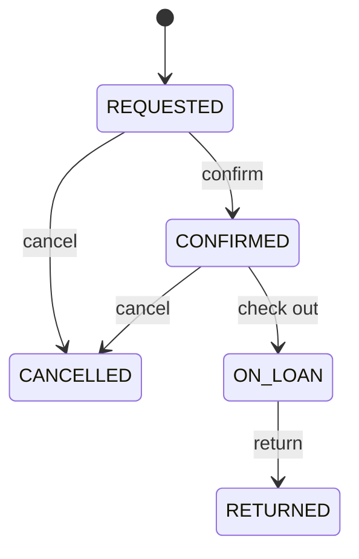
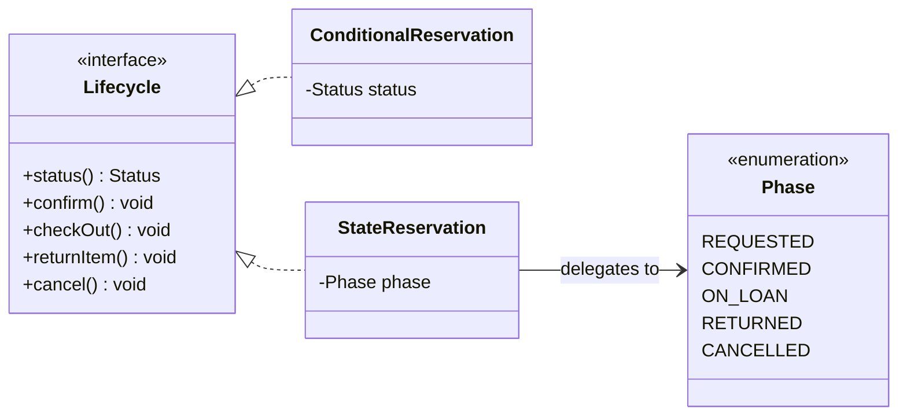
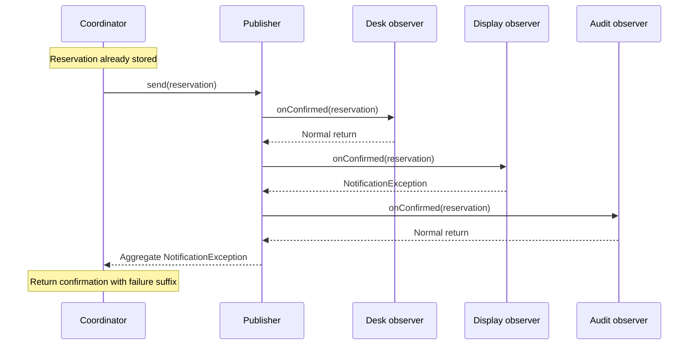

*OO Development and Agile Practices*  
*Designing, Testing and Evolving Software with AI Assistance*

## Opening scenario

The equipment team receives three requests. Borrowing limits may vary by borrower category. A proposed reservation workflow should allow cancellation before checkout but reject cancellation after the item is on loan. A successful reservation should inform several local observers, even when one expected notification attempt fails.

All three requests involve changing behaviour, but they vary for different reasons. Category selects a rule. Lifecycle history determines which action is legal. Subscribers determine who reacts to an accepted reservation. One large conditional method could combine them; one generic “behaviour pattern” would conceal their differences.

The team also wants to represent a reservation request as an object that a caller can execute later. That adds a fourth question: when is a request captured, and when do its side effects happen? This chapter separates these decisions, protects them with examples and compares each pattern with a simpler alternative.

## Learning outcomes and reading route

By the end of this chapter, you should be able to:

1. Distinguish an interchangeable policy from lifecycle-dependent behaviour.
2. Explain and test Strategy selection using the existing borrowing policies.
3. Define a transition table and implement a small State-based lifecycle.
4. Specify Observer ordering, subscription changes and failure behaviour.
5. Represent a request with Command and explain execution-time side effects.
6. Justify adopting or declining a pattern using a concrete change and evidence.

**Module connection:** Week 8; LO2 and LO4. Entry: Chapters 7–8. Strategy and State are the core reading; Observer and Command are working-knowledge topics with smaller executable examples. This chapter does not change the module descriptor or invent assessment rules. It supports the Week 8 readings: the Strategy, Command, Observer and State chapters of Martin [6] and the behavioural patterns in Gamma et al. [1].

**Core reading.** Read Sections 9.1–9.3, 9.6 and 9.7 (Strategy, State, testing and selection).

**Working-knowledge reading.** Read Sections 9.4 and 9.5 (Observer and Command). They require limited depth: understand the structure, the ordering and failure rules, and the cost, and see each pattern work in the supplied examples, but you do not implement either on your own.

**Minimum required lab.** Complete steps 1–4 and 6 of the practical activity in Section 9.10. Steps 1–2 cover State, step 3 covers Observer and Command, step 4 covers Strategy and the choice among patterns. Steps 1–4 run on the **Book project**; step 6 runs on your **Team project**.

**Optional extension.** Do the Section 9.8 AI activity (step 5), the review questions and the transfer challenge.

**Starting checkpoint:** Chapter 8's Java 17 application, directory adapter and complete Maven test suite. The code-and-solutions file supplies a complete new checkpoint. The original borrowing policies already demonstrate Strategy. A notification publisher is an optional cumulative collaborator. The proposed lifecycle is a separate exercise; it does not replace the running project's reservation or loan rules.

**Reading reminder:** the module descriptor places the individual critical book review in Week 8. Follow the module leader's approved instructions and reading list. See the [Section 9.12](#reading-checkpoint) below and [Appendix E](); evidence must come from the selected book and verified sources, not an AI summary of an unread text.

## 9.1 Variation in behaviour

### Ask what changes and what remains responsible

The existing `BorrowingPolicy` interface answers whether a count and duration are permitted. The coordinator selects a policy by category and uses its answer alongside identifier validation and conflict checking. Changing the policy does not change what a reservation is or whether a camera is already reserved.

Lifecycle behaviour asks a different question. The same cancellation request may be legal for a confirmed reservation and illegal after checkout. A completed transition changes which later actions are possible. Merely selecting another duration algorithm cannot capture that history unless transition rules are added somewhere else.

Observer concerns interested recipients. A desk display and a local audit observer can respond to the same confirmed reservation without becoming additional borrowing rules. Command concerns a request as a value-bearing action object: it captures the receiver and arguments, then invokes the receiver when executed.

These distinctions correspond to different design pressures. The classic pattern vocabulary gives them names, but the requirements determine which structure is useful [1]. Before drawing classes, write one example where the behaviour varies and one outcome that must remain unchanged.

### Four questions for one domain

| Question | Primary variation | Candidate |
|---|---|---|
| Which count/duration rule applies? | Chosen algorithm or policy | Strategy |
| Which action is legal now? | Current lifecycle position and transitions | State |
| Who reacts to this occurrence? | Registered interested recipients | Observer |
| What action should this request object execute? | Captured receiver and arguments | Command |

The same application can use all four, but it need not. A two-branch conditional may remain clearer than an abstraction if the decision is small and stable. A direct method call is often sufficient if the request never needs to be stored, passed or handled independently.

Avoid the claim that all conditionals violate good design. The question is whether decisions are duplicated, mixed with unrelated responsibilities or difficult to extend safely. Pattern-based code still contains conditions; it relocates particular decisions so their ownership is clearer.

### Keep structural and behavioural changes distinct

The State exercise compares two implementations of the same proposed transition table. That is a structural comparison within an isolated example. Integrating those transitions into the current lending application would instead introduce new lifecycle behaviour and require new decisions about counts, availability and existing loans.

The optional publisher adds several observers behind the existing notification boundary. Its ordering and failure policy are new, explicit behaviour. The coordinator still makes one call to its selected sender after storage, and the publisher makes no automatic retries. Treat each claim at the appropriate boundary rather than saying that every change is “only refactoring.”

## 9.2 Strategy

### Recognise the structure already present

Strategy supplies interchangeable implementations of a behaviour through a shared contract. The existing student and staff policies already serve that role. `ReservationRules` permits a student count below three and a duration from one through seven days. `StaffReservationRules` uses the illustrative limits below five and up to fourteen days.

The coordinator depends on `BorrowingPolicy`, not on the calculations inside those classes. Its category-to-policy map is supplied through construction. Chapter 8's directory supplies the category at the application entry point; it does not choose arbitrary policy code or rewrite duration limits.

A strategy need not be replaced while an operation is running. The supplied policy map is fixed for a coordinator instance, while each request selects an entry by category. Configuration-time selection and per-request lookup are enough to demonstrate the role.

### Compare with the conditional starting point

The teaching test includes a small conditional implementation: if student, evaluate the student limits; otherwise, for the supported enum values, evaluate the staff limits. This can be understandable for two rules in one place. The pressure for Strategy appears when algorithms acquire distinct reasons to change or repeated callers need consistent selection.

The comparison uses independently written expected results at the boundaries. It checks both the conditional and policy objects against those results. Testing only that the two implementations agree would be weaker: both could contain the same mistaken maximum.

The conditional is retained only as a teaching fixture. No duplicate policy engine is added to the cumulative application. The complete student/staff policy tests from earlier chapters continue to run.

### State the common contract

Every policy accepts the same two integers and returns a deterministic boolean without changing application state. Negative counts and nonpositive durations return false. A true answer means the count/duration rule permits a request; it says nothing about identity, physical stock or interval conflicts.

That last distinction matters. If a new strategy performs directory lookup, sends a message or stores a reservation, it no longer behaves like the current policy contract. Matching the Java method signature would not justify substituting it.

The new test supplies a temporary staff strategy permitting at most one counted reservation and at most two days. The coordinator itself is unchanged. Three days are rejected; two days are accepted; another request for that borrower is rejected; student behaviour still follows its supplied strategy. This is an isolated configuration test, not a change to the book's default staff policy.

### Trade-off and simpler alternatives

Strategy separates variation from the surrounding use case and makes the chosen behaviour easy to supply in a test. It adds a selection responsibility: someone must choose a compatible policy, and the constructor must reject an incomplete map. Those responsibilities do not disappear because the interface is small.

If the only difference is two numeric limits, one parameterised policy class may be simpler than two implementations. If rules later differ substantially, separate strategies can make their algorithms clearer. Neither form should pretend to be a reservation lifecycle.

Do not add a `setPolicy` method just to make the pattern look more dynamic. Mutable policy selection can create questions about requests in progress and reproducibility. Use the narrowest variation mechanism the requirement needs.

## 9.3 State and transitions

### Start with the proposed rules

The separate lifecycle exercise begins at REQUESTED. It may be confirmed or cancelled. A confirmed reservation may be checked out or cancelled. An on-loan reservation may be returned. RETURNED and CANCELLED are terminal for the four supported actions.

These are teaching rules for an isolated model. The cumulative system currently confirms accepted reservations immediately and tracks loans separately. It has no implemented cancellation operation. The proposed lifecycle therefore cannot be silently attached to existing records as if it were already agreed behaviour.

| Current status | Confirm | Check out | Return | Cancel |
|---|---|---|---|---|
| REQUESTED | CONFIRMED | Reject | Reject | CANCELLED |
| CONFIRMED | Reject | ON_LOAN | Reject | CANCELLED |
| ON_LOAN | Reject | Reject | RETURNED | Reject |
| RETURNED | Reject | Reject | Reject | Reject |
| CANCELLED | Reject | Reject | Reject | Reject |

Every rejection throws `IllegalStateException` and leaves the current status unchanged. Repeating cancellation is a rejection, not an idempotent success. That choice belongs in the table before it appears in Java.

Figure 9.1 draws the same rules as a **state diagram**. A state diagram shows the positions an object can be in and the events that move it between them, and nothing about how it is implemented. Each rounded box is a state. An arrow is a transition, labelled with the event that triggers it. The filled circle marked `[*]` is the start point, here REQUESTED. A state with no outgoing arrow, such as RETURNED, allows none of the four actions. A transition can also carry a guard, a condition in square brackets that must hold before it fires; this model has none.



**Figure 9.1.** The proposed reservation lifecycle. The diagram shows permitted paths only. An action with no arrow from a state is not allowed there, which is why the table remains the complete specification: it also states the absent edges, and those are essential for testing. Terminal means no supported outgoing action; it does not mean deleting a persisted record.

### Conditional implementation and change pressure

`ConditionalReservation` stores a status enum and switches on it inside four operations. The repeated selection is easy to inspect at this size. As operations and state-specific rules grow, however, understanding one state's complete behaviour requires visiting several methods.

`StateReservation` instead holds a current state object and delegates each operation to it. Each state provides its allowed successors; default implementations reject unsupported operations. The context assigns the returned successor only after the state operation completes successfully.

Figure 9.2 compares the two designs as classes. Both implement the same `Lifecycle` interface, so a caller cannot tell them apart.



**Figure 9.2.** Two implementations of one lifecycle contract. `ConditionalReservation` keeps a status value and switches on it inside each operation. `StateReservation` holds a `Phase` and delegates each operation to it, so the enum constants are the state objects. In the code `Phase` is private, so callers never see it; the diagram shows it because it explains the design. Compare this with the earlier figures in this book: the realisation arrows say both classes keep the same promise, and the association says where the State design keeps its current position.

```java
public void cancel() {
    phase = phase.cancel();
}
```

If `phase.cancel()` throws, assignment never occurs. This is the local reason the current status remains unchanged after rejection. It is not a general transaction mechanism for arbitrary side effects inside state operations.

### State objects without five public classes

The implementation uses a private enum whose constants provide state-specific method bodies. These constants act as the State objects. They share the operation contract, and the context dispatches to the current constant. An enum used only as a tag in a central switch would be the conditional design instead.

The state objects contain no reservation-specific mutable data. Two contexts can therefore refer to the same REQUESTED constant without sharing their progress. Each context owns its own current-state reference. A test advances one context while leaving another unchanged.

No caller can assign a new phase directly. A public setter would let a caller skip confirmation or resurrect a returned reservation without passing through the transition rules. Read-only status is sufficient for observation.

### Test, trade-off and integration boundary

Twenty parameter rows cover five statuses and four actions. Each row runs against both implementations and checks an independently specified outcome. There are five permitted transitions and fifteen rejected combinations. The tests also check that rejected actions preserve state.

This is comprehensive for the small status/action table, not for a real reservation process. Time windows, permissions, conflicts, cancellation effects and loan storage are outside the exercise. Chapter 7's clock-controlled checkout rules remain in the cumulative `LoanService`.

State groups behaviour by lifecycle position but introduces indirection. With this small fixed table, keeping the conditional implementation is defensible. If integration is proposed later, first decide whether completed or cancelled reservations stop counting, whether intervals become available, and how existing loan records stay consistent. Those are requirements, not consequences automatically supplied by State.

## 9.4 Observer and notification

### Problem and simple attempt

After a reservation is accepted, several local components may need to react. Hard-coding each observer inside the coordinator would couple reservation decisions to the changing recipient list. A direct call remains simpler when there is only one fixed collaborator; the existing sender interface already supports that case.

The optional `NotificationPublisher` implements `NotificationSender`. Observers register a callback receiving the immutable confirmed reservation. The coordinator can therefore use the publisher through its existing boundary. Registration and dispatch are the publisher's responsibility, not new methods on the coordinator.

Java provides listener-management examples such as `PropertyChangeSupport` [2]. (The older `java.util.Observable` class is deprecated and should not be used as a model.) This chapter implements a deliberately smaller publisher with its own documented contract. It does not inherit another library's ordering, concurrency or failure guarantees merely because both use listeners.

### Define observable behaviour before dispatching

The selected publisher is synchronous, sequential and in memory. It calls observers in registration order using a snapshot taken at the start of publication. Each observer in that snapshot is attempted once unless an unexpected exception stops dispatch. There are no retries.

| Situation | Selected outcome |
|---|---|
| No observers | Normal return; no delivery claim |
| Same observer object registered twice | Reject duplicate registration |
| Subscription closed | Remove that registration; repeated close is harmless |
| Subscribe or unsubscribe during a callback | Change subsequent publications, not the current snapshot |
| Expected `NotificationException` | Retain failure and continue to later observers |
| Unexpected exception | Propagate immediately; later observers are not attempted |
| Recursive publication through the same publisher | Reject with `IllegalStateException` |

Observer identity uses the same object reference, not custom equality. Separate callback objects can still perform equivalent work. The publisher does not deduplicate recipients or effects by business identity.

A subscription handle owns one registration. Closing an old handle again must not remove a later registration of the same observer. The implementation retains a distinct entry object per registration to make that ownership precise.

### Publication occurs after storage

The coordinator stores the accepted reservation before calling its sender. If a publisher observer fails with the expected notification exception, the publisher continues, collects failures and finally throws one aggregate `NotificationException`. The coordinator then returns its existing suffix: the notification failed and the reservation was retained.

Figure 9.3 uses the sequence-diagram notation introduced in Chapter 8: participants across the top, solid arrows for calls, dashed arrows for returns. Here a dashed arrow can also carry an exception instead of a normal result, and the notes mark what is already true or what happens next.



**Figure 9.3.** One accepted reservation published to three observers, one of which fails with the expected exception. The example shows partial success. It does not roll back earlier observer effects, and the suffix does not mean every observer failed. The aggregate retains individual exceptions as suppressed exceptions for direct inspection; Java's `Throwable` API supports that association [3]. The current coordinator returns only its established message and does not expose detailed observer diagnostics.

### Unexpected failures and subscription lifetime

An unexpected programming exception stops dispatch and escapes the coordinator, which catches only `NotificationException`. The reservation still exists because storage happened earlier. Tests explicitly demonstrate that partial outcome. A caller must not infer “nothing happened” from the fact that the operation threw.

The publisher resets its recursion guard in a `finally` block. This avoids leaving it permanently marked as publishing after a failure. The guard is not a concurrency lock or rollback system. Callbacks must respect the existing sender contract and must not mutate the coordinator or start new reservation operations from inside notification.

Keep subscription handles where their lifetime can be managed. Otherwise, a long-lived publisher can retain observers longer than intended. Snapshot iteration defines callback-time registration changes; it does not make this ArrayList-based publisher safe for concurrent calls.

### Trade-off and non-use case

Observer reduces direct knowledge of recipients but makes execution less obvious: work happens inside registered callbacks. Ordering dependencies can become hidden. If one observer must complete a business step before another begins, explicit orchestration may express that requirement better than a loosely described event.

Use the publisher only where a changing set of local observers is useful. Keep a single sender for a fixed output. The example establishes no durable delivery, broker, asynchronous execution or exactly-once guarantee. Adding those mechanisms is outside this chapter, not an automatic next step.

## 9.5 Command

### Problem: carry a request before executing it

A direct call to `DirectoryReservationService.reserve` immediately performs lookup and reservation processing. A user interface action or small invoker may instead need an object containing the request to be executed when selected. Command separates that request representation from the caller that triggers it.

The example defines `Command<R>` with `R execute()`. `ReserveEquipmentCommand` captures the service, borrower identifier, item identifier, start date and days. Construction validates required references and identifiers but does not perform lookup, allocate a reservation or notify anyone.

The receiver remains responsible for the use case. On execution, the command delegates to the directory-backed service. It neither reproduces borrowing policy nor stores its own reservation list. A method reference or lambda can be sufficient when no named request data is needed; Java's `Runnable` is a familiar no-result action interface, though using it does not itself make a whole Command architecture [4].

### Time of execution changes the outcome

Between constructing and executing a command, another request may reserve the item. The command must evaluate the current receiver state when executed. Capturing an earlier “available” result and using it as permission would bypass the actual conflict check.

A command record is immutable in its captured fields, but it holds a reference to a mutable service. It is not a snapshot of the application's state. A test constructs the command, creates a competing reservation, and verifies rejection when the command later executes.

Repeated execution also matters. In the supplied example the first execution creates a reservation and the second sees a conflict, producing a different result without another notice. That particular outcome does not mean all commands are idempotent. The implementation has no request identifier, deduplication record or replay protocol.

### Failure, undo and simpler alternatives

A directory failure propagates unchanged through the command. The command does not convert it into success, retry it or run a compensating action. The receiver's distinction between absence and outage remains intact.

Undo requires its own semantics. Deleting a record would not necessarily undo an observer's side effect, and the current project has no cancellation contract. Naming a class `Command` does not supply undo, transactions, queueing or persistence.

The test suite checks lazy construction, execution-time state, repeated execution and failure propagation. Use a direct call when there is no reason to represent the action separately. Introduce the command object when carrying the request itself makes an invoker or interaction clearer, and retain the receiver's responsibility for all meaningful validation.

## 9.6 Testing pattern-based behaviour

### Let the requirement supply the expected result

A test that checks only that an object implements `BorrowingPolicy` cannot establish correct limits. A test that constructs a state object cannot establish a valid transition. A test that counts subscribers cannot establish what happens after one throws.

For Strategy, use independent boundary examples for each supported policy. For State, use the transition table, including rejected edges. For Observer, use ordered event histories and state checks after both expected and unexpected failures. For Command, distinguish construction from execution and observe the real receiver's outcome.

These examples use manual fixtures and the existing JUnit setup. No real university data, remote delivery service or system-clock wait is needed. The unchanged earlier suite remains in the build so new demonstrations do not silently replace regression evidence.

### Compare before and after without circular proof

The lifecycle tests send the same action to the conditional and State implementations, but both are checked against a fixed table. Equality between the two alone would be insufficient. If both accidentally allowed cancellation on loan, they would agree while violating the requirement.

The table covers this exercise's complete state/action space. It still does not prove arbitrary operation sequences with time, external state or permissions that the exercise does not model. Keep the claim proportional to the model.

State identity is deliberately hidden. Tests observe `status()` and operations, not the private enum field. They can survive replacing enum-based states with separate state classes as long as the public contract remains the same.

### Test partial effects explicitly

The publisher's unexpected-exception test checks that earlier callbacks ran, later callbacks did not, and the coordinator retained its record. That is more informative than checking only the thrown exception. The expected-failure test checks that later observers still run and the recorded aggregate retains both failures in order.

Subscription tests also examine time: removal during a callback affects the next publication, while the removed observer still appears in the current snapshot. These are deterministic sequence tests, not concurrent-race tests.

The command replay test documents one concrete repeated execution. It makes no guarantee about future commands or alternate receiver states. Passing evidence should narrow uncertainty about the selected promise, not expand into an unsupported general assurance.

## 9.7 Pattern selection and limits

### Compare alternatives by their costs

| Situation | Reasonable first option | Pattern when justified |
|---|---|---|
| Two small fixed limit rules | One conditional or parameterised policy | Strategy when behaviour needs independent implementations |
| A small fixed transition table | Enum and explicit operations | State when grouping state-specific behaviour improves clarity |
| One fixed notification output | Direct injected sender | Observer for a changing set of local interested recipients |
| One immediate reservation request | Direct service call | Command when the request must be represented and passed separately |

No row says that increasing class count is progress. A useful explanation identifies where a future edit will occur, which contract stays stable and which new obligations arise. For example, Observer centralises registration but requires decisions about order and failure. State centralises each state's actions but requires consistency between the model and its tests.

### Be precise about this checkpoint

The cumulative project retains Chapter 8's directory boundary and all previous application sources. `NotificationPublisher` is an additional sender option; the existing factory still accepts whichever sender the caller supplies. The new demonstration explicitly chooses the publisher. No previous demonstration is silently rewired.

The command exercise calls the existing application service. The State model remains in the separate `behaviour` package and never updates real reservation or loan storage. The existing borrowing policies are recognised as strategies rather than rewritten for presentation.

The inherited limitations remain visible: in-memory storage, trusted internal APIs, no authenticated identity enforcement, and reservation records that still count and block intervals after loan return. Solving any of those requires a reviewed behaviour change, not another pattern label.

### A design decision must be challengeable

Record the concrete problem, selected mechanism, simpler alternative and consequences. “Several local observers need to react; a publisher owns registration and dispatch; one fixed sender remains simpler where recipients do not vary; failures can leave partial effects.” Another developer can test or challenge that statement.

“Observer decouples everything” cannot be assessed. Recipients still share an event contract and may acquire temporal dependencies. “State eliminates invalid operations” is likewise too broad unless the interface, transition rules and mutation boundary actually enforce the selected model.

A pattern is a way to organise responsibilities under a particular pressure. It is neither a substitute for requirements nor evidence that operational reliability has been solved.

## 9.8 AI in practice: Strategy or State?

Chapter 15 collects the recurring AI workflows; this activity is self-contained, and the fictional proposals below are all you need.

| Element | For this activity |
|---|---|
| Engineering objective | Decide whether each proposal fits a policy-selection problem or a lifecycle problem, and what each allows a caller to do |
| Input | The lifecycle table in Section 9.3, the existing borrowing strategies, and the failure and replay behaviour in Sections 9.4 and 9.5 |
| Permitted scope | Compare the proposals and qualify the reliability claim; do not adopt any of them without the table |
| Independent checks | The transition table, the Strategy and State tests, and the publisher and command tests |
| Accept or reject | A verdict with evidence for each claim |
| No-account route | The fixtures below are sufficient |

Use these two **author-written fictional AI-output fixtures**, constructed for offline comparison:

**Proposal A:** “Implement `RequestedPolicy`, `ConfirmedPolicy` and `ReturnedPolicy` as strategies. Expose `setPolicy` so callers can choose any policy before each operation. Calling a return method should simply select the returned policy.”

**Proposal B:** “Store the current phase inside a reservation context. Delegate confirm, checkout, return and cancel to phase-specific behaviour. Allow only transitions from the reviewed table and preserve the current phase after a rejected action.”

For the lifecycle requirement, compare what each proposal permits a caller to do. Do not select the answer because it uses more confident wording. Then ask whether the same design is appropriate for student/staff duration rules. Identify the different variation pressure.

A third fictional claim says: “Observer guarantees that all recipients receive the event once, and Command makes retries safe.” Refute or qualify it using this chapter's partial-failure and replay tests.

A live AI service is optional. If used, provide synthetic inputs, retain relevant actual output and document independent checks. Do not fabricate a transcript or use generated implementation and generated expectations as mutual proof.

## 9.9 Common mistakes

| Mistake | Consequence | Better action |
|---|---|---|
| Treat category policies as lifecycle positions | Confuses selection with permitted transitions | Identify what changes the behaviour |
| Expose an unrestricted state setter | Allows invalid jumps | Change state only through reviewed operations |
| Store context data in shared state objects | One reservation may affect another | Keep progress in each context |
| Catch all observer errors as expected failures | Hides programming defects | Specify and catch the declared failure type |
| Assume a thrown notification means no reservation exists | Misreads partial effects | Check the storage-before-publication sequence |
| Remove observers from a live iteration | Makes dispatch behaviour fragile | Define and test snapshot semantics |
| Treat a captured command as earlier permission | Bypasses current receiver state | Validate the use case at execution |
| Assume a pattern supplies retries or undo | Invents unimplemented guarantees | Define those semantics separately |

## 9.10 Practical activity

**Input:** the Chapter 8 checkpoint, the lifecycle transition table, the conditional and State examples, and the publisher contract. Steps 1–5 run on the **Book project**; step 6 runs on your **Team project**.

**Instructor demonstration:** locate the existing strategies; then trace permitted and rejected lifecycle actions before showing the two implementations. Run one expected observer failure and show the retained reservation and later callback.

**Guided practice:** choose a transition-table row and explain its expected result independently of the code. Predict the effect of unsubscribing during dispatch. Compare a direct service call with constructing and executing a command.

**Independent work:**

1. Replace the repeated conditional structure in the isolated lifecycle example with State delegation, preserving the agreed table.
2. Show both permitted and rejected actions, including unchanged status on failure and independent contexts.
3. Demonstrate the publisher's order and its expected-failure continuation rule. Then construct a `ReserveEquipmentCommand` without executing it, show that construction performs no reservation, and execute it.
4. Choose a second scenario and justify adopting or declining Strategy, Observer or Command compared with a simpler implementation.
5. Evaluate the fictional AI proposals and retain independent evidence for your conclusions.
6. On your **Team project**, find one conditional that selects behaviour by type or tracks a lifecycle. Write a test that protects its current behaviour, then decide whether Strategy, State or neither is justified. Record what you would decline to build and why.

**Expected artefacts:** before/after source; a reviewed transition table; runnable tests; a reproducible demonstration; a concise problem–solution–consequence note; and the step 6 decision for your Team project.

**Acceptance conditions:**

- no unrestricted phase setter;
- correct terminal behaviour;
- transition outcomes match independently stated expectations;
- observer failure does not imply rollback;
- command construction performs no reservation;
- the old regression suite still runs.

This exercise does not require wiring the proposed lifecycle into the cumulative application.

**Optional extension:** propose cancellation for the real project. Specify effects on reservation counts, availability, active loans, identifiers and notifications before changing any code. Keep that proposal separate from the behaviour-preserving State exercise.

## 9.11 Review and transfer

### Concept questions

1. Why is category-based borrowing policy a Strategy example while the proposed reservation lifecycle is a State example?
2. Why can stateless enum-based State objects be shared while reservation progress must remain separate?
3. What does snapshot iteration mean for an observer removed during publication?
4. What does a Command capture, and which decisions still belong to execution time?

### Applied diagnosis

5. An unexpected observer exception occurs after two callbacks succeed. The caller assumes no reservation was stored and immediately repeats the request. Explain why that assumption is unsupported and identify the observations needed before choosing a recovery action.
6. An AI-generated State implementation has `setStatus(RETURNED)` and a happy-path test. Explain the missing guarantee and design tests that reject an invalid jump or action sequence.

### Transfer challenge

A document workflow has draft, approved and published stages. Review policy differs by department, several local views react after publication, and a user interface can hold a publish request before executing it. Identify the four variation pressures, choose only the justified patterns, and specify one invalid transition, one observer failure and one stale-command outcome. State which requirements need clarification before implementation.

## 9.12 Reading checkpoint: the critical book review {#reading-checkpoint}

Your individual critical review of a book from the approved list is due in Week 8. The current assignment brief is the authority on length, sources, format and deadline, and **Appendix E** develops the review method in full (a reading record, a question for each part of the task, and prompts for checking sources). This chapter's patterns give you one concrete angle for a pattern discussion: ask whether the book's example establishes the extension benefit it claims, which simpler alternative the author considered and what cost the author acknowledges.

Read the selected book directly. Keep three things apart: what the author claims, what you infer, and what an AI tool suggested. Reading this textbook does not satisfy the assignment, and an AI summary of a book you have not read is not evidence about it.

## Summary and next chapter

Strategy selects a behaviour; State governs behaviour through transitions; Observer connects interested recipients to an occurrence; Command represents an action for later invocation. Each structure creates obligations as well as opportunities, especially around state, ordering and partial effects.

The project now has an optional tested local notification publisher and a request-action example, while the proposed lifecycle remains clearly separated. Chapter 10 examines how these responsibilities fit into application structure and dependency direction.

## Sources and further reading

Checked 12 and 13 October 2026. Code, fixtures, transition rules and publisher policies are original teaching examples. The behavioural patterns used here are treated in this chapter.

1. Gamma, E., Helm, R., Johnson, R. and Vlissides, J. *Design Patterns: Elements of Reusable Object-Oriented Software*. Addison-Wesley, 1994. [Publisher catalogue](https://www.informit.com/store/design-patterns-elements-of-reusable-object-oriented-software-9780201633610). Read the Strategy, State, Observer and Command entries in an authorised copy.
2. Oracle, [Java SE 17 PropertyChangeSupport](https://docs.oracle.com/en/java/javase/17/docs/api/java.desktop/java/beans/PropertyChangeSupport.html). A concrete listener-management API; its documented guarantees should not be assumed for the chapter's custom publisher.
3. Oracle, [Java SE 17 Throwable](https://docs.oracle.com/en/java/javase/17/docs/api/java.base/java/lang/Throwable.html). Suppressed exceptions used to retain multiple observer failures.
4. Oracle, [Java SE 17 Runnable](https://docs.oracle.com/en/java/javase/17/docs/api/java.base/java/lang/Runnable.html). A no-result action interface for comparison with the chapter's result-bearing command.
5. JUnit Team, [JUnit 5.13.4 User Guide](https://docs.junit.org/5.13.4/user-guide/). Parameterised examples and assertions in the companion code.
6. Martin, R. C. (2002), *Agile Software Development: Principles, Patterns, and Practices*, Prentice Hall. The module's required text; the Week 8 reading is its Strategy, Command, Observer and State chapters. Publication details as listed in the module descriptor.