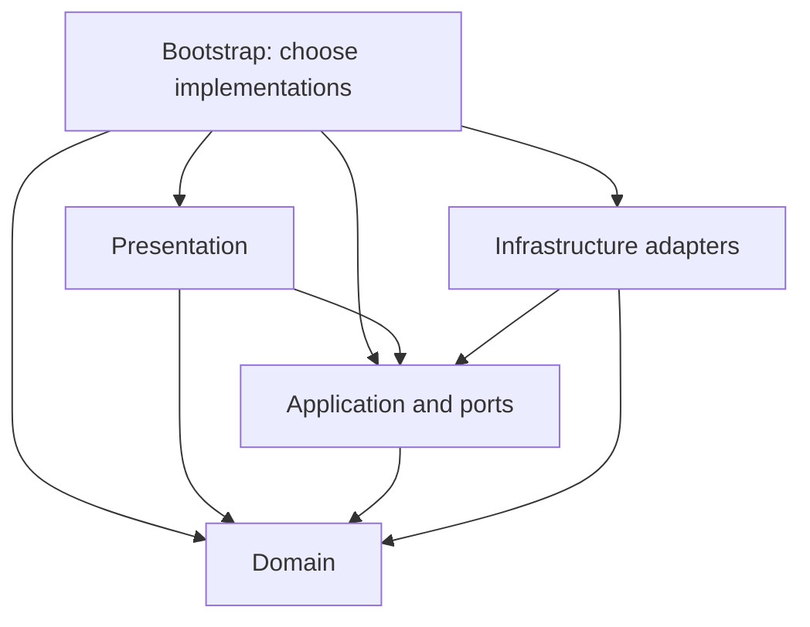
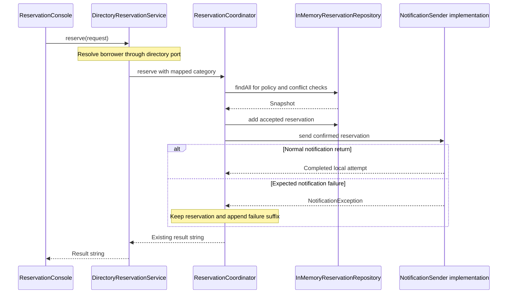

*OO Development and Agile Practices*  
*Designing, Testing and Evolving Software with AI Assistance*

The equipment application has come a long way. It has borrowing policies, a directory adapter, notification collaborators, loan operations and several demonstrations, and each class has a responsibility you can explain. Yet most of the production code still sits in Java's unnamed package, and that organisation says nothing to a newcomer. May a borrowing policy depend on a directory client? Where should a storage implementation be constructed? The code cannot tell you.

The next change request is deliberately modest: make those boundaries visible while keeping the demonstrated reservation behaviour exactly as it is. To do that the team has to decide which classes express domain rules, which coordinate operations, which talk to the outside world and which assemble the application. Moving files around will not answer those questions by itself.

This chapter reorganises the existing single-process program and shows how to check the result. It introduces a small storage contract for reservations, moves concrete storage out of the coordinator, and writes down dependency rules that a test can check against compiled code. There is no database, web framework or distributed system in sight. Along the way you will learn to assign responsibilities to presentation, application, domain and infrastructure code, and to tell runtime calls from the direction of source-code dependencies. You will see the difference between an entity's identity, its immutability and its value equality, locate a focused repository contract and its implementation, and restructure a use case while checking its observable behaviour and its compatibility limits. You will compare two package designs by cohesion, coupling and stability, reading the counts without mistaking them for a measure of quality, and you will finish by recording an architecture decision and preparing evidence for peer review and Milestone 3.

This is Week 9, supporting LO2 and LO6 and preparing Milestone 3. The weekly readings are Martin's principles of package design [7] and selected chapters of Evans's domain-driven design [8]; use the Moodle links for the exact pages. The approved module requirements remain authoritative, and the chapter creates no new deadlines, weights or marking rules.

Milestone 3 covers design patterns and layered architecture, with a demonstration and a retrospective. Do not wait until the end of the chapter: use this checklist from the start. By your demonstration you should be able to show, on your **Team project**:

1. at least one design pattern from Chapters 8–9 used where it removes a real problem, and one place where you declined to use one;
2. a compact package diagram saying which packages may depend on which;
3. one restructuring change, with moves kept separate from logic changes;
4. passing checks, including a dependency check or a documented review of imports;
5. a short architecture decision record with alternatives, consequences and a revisit trigger;
6. real peer review of that change, with the feedback addressed;
7. a demonstration and a retrospective with a next action; and
8. a statement of what the architecture does not do.

Section 10.9 explains each item. Start with items 2 and 5, which need no code. The approved Milestone 3 instructions decide what is submitted; this list is preparation, not a rubric.

You start from Chapter 9's tested Java 17 project, including the stronger assertions added when that chapter was reviewed (the companion lists them in Section 2.5). The completed checkpoint preserves its existing use-case results and earlier demonstrations, but package names, imports, launcher names and direct coordinator construction change, so no Java source or binary compatibility is claimed. The separate code-and-solutions file contains the complete checkpoint, tests, migration guidance and worked answers.

Sections 10.1 to 10.5 establish the structural model, including package design; 10.6 and 10.7 examine domain semantics and storage; and 10.8 and 10.9 connect the implementation to an architecture decision and review. Read 10.1 to 10.5, 10.7, 10.8 and 10.9 as the core, leaving the Ports and Adapters comparison at the end of 10.4 for later. Section 10.6 (entities and value objects) is working knowledge: understand the difference between identity and value meaning, and why Java equality is a separate decision. You do not implement either one. The minimum lab is steps B1 to B3 and T1 to T5 of the practical activity in Section 10.12. Steps B1 to B3 run on the **Book project** and are reading, tracing and diagnosis, because the migrated checkpoint is supplied and there is nothing to rebuild; steps T1 to T5 run on your **Team project** and produce your Milestone 3 evidence. The Ports and Adapters comparison, the Section 10.10 AI activity, steps B4 to B6 (break the dependency rules on purpose, and reproduce the migration yourself), the review questions, the transfer challenge and the optional extension in Section 10.12 are optional.

## 10.1 Why class-level design is insufficient

### Responsibilities exist at more than one scale

A well-designed `LoanPeriod` can reject an invalid interval while the surrounding application still has poor dependency organisation. A correct directory adapter can be called directly from several user interfaces, each repeating eligibility logic differently. Class-level correctness does not by itself establish a coherent application boundary.

Chapters 5–9 separated several responsibilities. Borrowing policies decide count and duration eligibility. The coordinator combines those decisions with conflict checks and accepted-record storage. The directory service resolves borrower categories before invoking the coordinator. Notification implementations handle local output. We now make those distinctions visible across packages.

Layering is one way to narrow the responsibilities a developer must consider together. Presentation, domain logic and data access are a familiar separation, with an application service boundary useful where operations need coordination [1]. The chapter's exact packages are a worked design decision, not a universal folder template.

### Recognise the architectural questions already present

The small program already has architecture: someone chooses its dependencies, owns its state and decides when effects occur. Those decisions exist even without a server or database. The question is whether they are explicit enough to review and change.

For example, the coordinator currently owns an ArrayList of reservations. That is easy to follow, but ties use-case orchestration to one storage mechanism. Extracting a narrow storage contract lets the chapter demonstrate dependency direction and storage ownership without inventing persistence requirements.

This extraction has a cost. It creates another interface and requires a contract for ordering, snapshots and duplicate identifiers. If a program will remain a tiny script with one private list, the extraction may not be worthwhile. Here it supports the growing project's structural learning goal and a concrete, independently testable boundary.

### Define what must remain unchanged

The refactoring preserves accepted and rejected reservation strings, policy limits, half-open overlap rules, directory failure distinctions, loan behaviour and notification timing. Storage still precedes notification. An expected notification failure still retains the reservation. The optional publisher still has its declared partial-failure semantics.

The Java integration surface does change. Callers import named packages. Direct `ReservationCoordinator` construction requires an additional repository argument. Command-line launchers use fully qualified names. These changes must be documented even when all user-facing demonstration transcripts remain identical.

Treat the before/after boundary precisely: behaviour is protected within the supplied sequential, in-memory checkpoint. Nothing here promises compatibility for an unseen application that reflects on class names, serialises Java objects by type name or depends on the old constructor signature.

## 10.2 Layers and separation of concerns

### Assign a reason for each boundary

The new package root is `edu.se506.lending`. Under it, domain code expresses the equipment vocabulary and rules; application code coordinates operations; infrastructure implements technical boundaries; presentation adapts an interaction to the application; bootstrap code constructs the chosen object graph.

| Package | Responsibility | Representative types |
|---|---|---|
| `domain` | Values, records and borrowing decisions | `LoanPeriod`, `Reservation`, `BorrowingPolicy` |
| `application` | Use-case coordination and existing result formatting | `ReservationCoordinator`, `DirectoryReservationService`, `LoanService` |
| `application.port` | Contracts needed by application operations | `ReservationRepository`, `BorrowerDirectory`, `NotificationSender` |
| `infrastructure.directory` | Provider-specific translation | `LegacyDirectoryAdapter`, `LegacyDirectoryClient` |
| `infrastructure.notification` | Selected local notification mechanisms | `ConsoleNotificationSender`, `NotificationPublisher` |
| `infrastructure.persistence` | Concrete reservation storage | `InMemoryReservationRepository` |
| `presentation` | Thin console interaction | `ReservationConsole` |
| `bootstrap` | Assembly and executable demonstrations | `ReservationApplication`, `Chapter10Demo` |

The persistence package name identifies a storage responsibility. Its current implementation is explicitly in memory and loses data when the process ends. Naming the package does not make it durable.

### Packages communicate boundaries; rules enforce them

A package is a namespace and organisation mechanism. Public Java types can still be imported from another package. A folder named `domain` does not prevent a developer from constructing a console sender inside it.

The chapter therefore states permitted production dependencies and adds a test that examines compiled class dependencies. Tests may cross boundaries to assemble fixtures and observe outcomes; their dependencies are not treated as production dependencies. Startup wiring also has a deliberate exception because it must choose concrete implementations.

| Source package | Permitted local targets |
|---|---|
| `domain` | `domain` |
| `application.port` | `domain` and `application.port` |
| `application` | `domain`, `application.port` and `application` |
| `infrastructure` | `domain`, `application` (including its ports) and `infrastructure` |
| `presentation` | `domain`, `application` and `presentation` |
| `bootstrap` | every application package, and explicitly demonstrated isolated examples |

Ordinary production code must not refer to the isolated `patterns`, `behaviour` or `examples` packages. Figure 10.1 in Section 10.4 draws the same rules.

The existing `patterns` and `behaviour` packages remain separate teaching examples. The new value-equality demonstration lives in `examples.structure`. Ordinary application, domain, presentation and infrastructure code must not depend on these exercises. A bootstrap demonstration may show an isolated example explicitly, as Chapter 9 already did.

### Avoid mechanical layer multiplication

A class does not need an interface merely because it crosses a package boundary. `DirectoryReservationService` remains a concrete application service. A caller can depend on that stable operation without adding a second interface that repeats every method.

Likewise, not every domain object needs a repository or a matching service. `LoanPeriod` is constructed and validated as a value-shaped object; storing it through its own repository would obscure its role as part of a reservation. The loan service's internal map remains where it was because this chapter extracts one justified boundary, not a generic storage framework.

## 10.3 Presentation, application, domain and infrastructure

### Presentation translates an interaction

`ReservationConsole` receives a directory-backed application service and a `PrintStream`. Its `reserve` method invokes the service and prints the existing result. It neither selects a borrower category nor duplicates the seven-day student rule.

The test supplies a byte buffer instead of the real console and checks exact success and rejection output. A directory exception propagates without printing a success line. This thin adapter is sufficient for the checkpoint; it is not an interactive menu, input parser or complete user interface.

The bootstrap demonstration supplies synthetic directory rows and chooses the sender. Presentation itself does not construct the adapter or storage implementation. This makes it possible to examine output behaviour without hiding construction decisions inside it.

### Application coordinates the use case

`DirectoryReservationService` performs lookup and delegates a valid borrower to `ReservationCoordinator`. The coordinator applies policy, checks reservation conflicts, creates an accepted record, stores it and invokes its sender. `LoanService` coordinates checkout and return using the supplied clock.

These are application operations because they arrange several responsibilities to complete a use case. Service Layer discussions describe this kind of application boundary and coordination [2]. The label does not require a remote service, dependency-injection framework or one service per entity.

`ConfirmationFormatter` remains in the application package because existing returned strings are part of the checkpoint's observable contract. It is also used by the console notification adapter. A future structured result could separate domain outcomes from wording, but doing that now would mix a behaviour/API redesign with this restructuring.

### Domain expresses meaning and invariants

Borrower categories, borrowing policies, reservations, loans and loan periods belong to the domain vocabulary. Policy implementations contain count/duration decisions. `LoanPeriod` validates its interval and supplies overlap behaviour. These classes do not know about console output, directory provider codes or repository implementations.

Domain code may use appropriate Java standard-library types such as `LocalDate`, collections and null checks. Independence does not mean rewriting every useful standard type. It means avoiding dependencies on application orchestration and external mechanisms that the domain rules do not require.

The model is deliberately modest. We do not introduce a full set of Domain-Driven Design concepts or declare every class an aggregate. First explain the actual identity, invariants and ownership in the existing program.

### Infrastructure implements selected mechanisms

The directory adapter translates the synthetic provider contract into `BorrowerDirectory`. The in-memory repository implements reservation storage. Notification adapters implement output or local callback dispatch. Their code depends on the application-owned contracts and domain types it handles.

Infrastructure does not own borrower eligibility simply because it sees borrower records. Moving the seven-day limit into the directory adapter would make a policy depend on the chosen provider representation. Similarly, the repository should not send a notification when a record is added: application orchestration already determines when that effect occurs.

The bootstrap package chooses and connects these pieces. Its concrete imports are intentional. Keeping construction there makes selection visible without requiring a framework or global service registry.

### Where an outside collaborator sits

The equipment directory from Chapter 8 is the book's data-backed collaborator, and it shows where any outside collaborator belongs, whether it is a data source or something that scores or predicts. Its contract, `BorrowerDirectory`, is owned by the application and lives in `application.port`. Its failure type, `DirectoryException`, sits beside it, because callers must tell an outage from an absent borrower. Its implementation, `LegacyDirectoryAdapter` with the provider-shaped `LegacyDirectoryClient`, lives in `infrastructure.directory` and translates provider codes into the domain's `Borrower`. Bootstrap constructs the adapter and passes it to `DirectoryReservationService`.

If your team's project has a model-backed collaborator instead, it would occupy the same three positions: a narrow port with bounded outcomes and a defined failure, an adapter in infrastructure, and construction in bootstrap. The application would not import the adapter, and a test could substitute the port exactly as the directory tests do.

## 10.4 Dependency direction and its check

### Read arrows as source dependencies

Figure 10.1 groups the packages. An arrow means that classes in one group may refer to classes in another. The application node includes its port contracts. Bootstrap is the explicit composition point.



**Figure 10.1.** Permitted source dependencies. Each box is a group of packages, and an arrow means that classes in the first group may refer to classes in the second. A missing arrow means the reference is not permitted: `Domain` refers to nothing else in the application, and `Presentation` and `Infrastructure` may not refer to each other or to `Bootstrap`. The figure shows source references only, not the order of calls. It draws the rows of the matrix in Section 10.2, including the two arrows into `Domain` from `Bootstrap` and `Presentation`.

The application has no arrow to infrastructure. `ReservationCoordinator` imports `ReservationRepository`, which is an application-owned contract. `InMemoryReservationRepository` imports and implements that contract. Bootstrap constructs the implementation and passes it to the coordinator.

Within application, the port package has a narrower rule: it may depend on domain types and other ports, not concrete application services. This keeps a storage contract from requiring the coordinator it exists to support.

### Runtime calls can travel towards an adapter

At runtime the coordinator calls an object that happens to be an in-memory repository. That does not require its source to import the concrete class. Interface dispatch connects the call to the implementation selected during assembly.

The sequence below focuses on an accepted reservation after borrower lookup. It omits the directory call to keep the storage and notification ordering visible.



**Figure 10.2.** One accepted reservation at run time. Each box at the top is an object, time runs down the page, solid arrows are calls and dashed arrows are returns. Chapter 8 explains this notation.

The actual coordinator may obtain more than one snapshot during a request. The diagram groups those reads; it does not claim one storage call or a transaction. The application still assumes one sequential session.

### Check what the code actually references

`DependencyRulesTest` invokes the JDK's `jdeps` analyser on compiled production classes [3]. It rejects local dependency edges that contradict the package policy, including forbidden references to isolated examples outside bootstrap. It also checks that dependencies were actually discovered, avoiding a vacuous pass on missing output. A second test in the same class builds the graph of package-to-package references from the compiled classes and searches it for a cycle (the next subsections explain why).

This test can detect a fully qualified concrete-class reference even if no import statement was added. It does not detect reflective class names in strings, runtime configuration relationships or a semantically misplaced rule that uses only permitted types. Source review and behaviour tests remain necessary.

The test requires a full Java 17 JDK with the `jdk.jdeps` module. It is part of the supplied Maven test run. Package rules are project decisions, not universal rules inferred by the analyser.

### Optional comparison: Ports and Adapters

The directory, sender and repository interfaces can also be discussed as ports, with infrastructure implementations as adapters. The console drives the application, while storage and notifications are collaborators the application calls. This inside/outside emphasis is consistent with Cockburn's discussion of isolating application behaviour from runtime mechanisms [4].

The terminology provides another view of the same small program. It does not require six adapters, a hexagonal deployment topology or a new package for every method. Use it only when it clarifies which side owns the contract and which mechanism may be replaced.

## 10.5 Package design: cohesion, coupling and stability

Section 10.4 asked which package may refer to which. This section asks whether the packages themselves are well cut. It applies three questions to the same checkpoint (what changes together, what clients depend on, and whether dependencies point towards stability) and gives counts that you can reproduce.

### Package cohesion: what should change together

Package design asks the questions of class design at a larger scale. A cohesive package holds types that change for the same reason and are used together. A package that mixes unrelated reasons to change is edited more often and by more people. Martin's principles of package design put this as two rules [7][9]. The Common Closure Principle (CCP): things that change together belong together. The Common Reuse Principle (CRP): things that are used together belong together, so a client is not forced to depend on classes it never uses. A third rule, the Reuse/Release Equivalence Principle (REP), says that the unit you reuse is the unit you release: a package that other teams adopt needs a version, release notes and a stable contract, so it should be one coherent thing. This project has no separately released package, so REP gives context here and no check [9].

Test the cuts with concrete changes, not with slogans. For each change, list the packages whose production code must change.

| Change request | Packages that change | What the answer shows |
|---|---|---|
| Staff may reserve for 21 days | `domain` (`StaffReservationRules`) | The policy change stays in one package |
| The provider renames its status code `Y` | `infrastructure.directory` | Provider vocabulary stays outside the application |
| The confirmation wording changes | `application` (`ConfirmationFormatter`) | Its users, including the console sender, see the change without being edited |
| Reservations are stored in a file | `infrastructure.persistence` (a new class) and `bootstrap` (the construction line) | The coordinator is not edited, because it names only the port |
| A third borrower category is added | `domain` (the category and its policy), `infrastructure.directory` (the code mapping) and `bootstrap` (the policy map) | One business idea touches three packages |

Most changes touch one or two packages, which is evidence that the cuts are reasonable. The last row is a legitimate cost to record, not a flaw to hide: a new category needs a policy, a way to recognise it and a place that registers it. The test is only as good as the changes you choose, so always add one you expect to be awkward.

### Package coupling: what clients depend on

Coupling between packages is the number of references that cross a package boundary. Two habits keep it manageable. First, depend on a small contract where the other side may vary. The coordinator refers to `ReservationRepository`, not to the in-memory class, so changing the storage touches one package. Second, keep the package graph free of cycles. If `application` referred to `infrastructure.notification` while that package referred back to `application`, neither could be compiled, tested or replaced without the other. Martin calls this the Acyclic Dependencies Principle (ADP) [7][9].

The layer matrix in Section 10.2 rules out cycles between layers by construction, because each pair of layers allows references in one direction only. It does not do so inside one layer: the matrix lets `infrastructure.directory` and `infrastructure.notification` refer to each other freely, so a cycle between those two would pass the direction test. That is why `DependencyRulesTest` has the separate cycle check.

The `application.port` package shows the reuse side of the same idea. Its five types are small contracts and their failure types, so a class that needs one of them is not forced to depend on a large service. If a port package grew to hold many unrelated contracts, splitting it would be worth considering: a client that uses only the sender should not be affected when the directory contract changes.

### Package stability: depend in the direction of stability

A package is **stable** when it is costly to change: many other packages depend on it, and it depends on little itself. A package is **unstable** when little depends on it, so changing it disturbs few others, and it depends on many. Both kinds are needed. The useful rule, Martin's Stable Dependencies Principle (SDP), is that dependencies should point towards stability, so that code that changes often depends on code that changes rarely [7][9].

The idea can be counted. For a package P:

- **Afferent coupling, Ca**: the number of classes outside P that depend on classes inside P (incoming references).
- **Efferent coupling, Ce**: the number of classes inside P that depend on classes outside P (outgoing references).
- **Instability, I = Ce / (Ca + Ce)**, from 0 (maximally stable) to 1 (maximally unstable) [7][9].

Counting rules matter, because tools count differently. This book counts classes, treats a nested class as part of its outer class, counts only references between this project's own packages and ignores the Java standard library. The supplied program `tools/PackageMetrics.java` applies exactly these rules to the compiled classes (the companion explains how to run it). For the checkpoint it reports the following, with package names shortened by removing the prefix `edu.se506.lending`.

| Package | Classes | Ca | Ce | I |
|---|---:|---:|---:|---:|
| `domain` | 8 | 16 | 0 | 0.00 |
| `application.port` | 5 | 14 | 3 | 0.18 |
| `infrastructure.notification` | 3 | 7 | 3 | 0.30 |
| `application` | 6 | 9 | 4 | 0.31 |
| `infrastructure.directory` | 2 | 2 | 1 | 0.33 |
| `infrastructure.persistence` | 1 | 1 | 1 | 0.50 |
| `presentation` | 1 | 1 | 1 | 0.50 |
| `bootstrap` | 7 | 0 | 7 | 1.00 |

Read the table as a set of questions. `domain` has I = 0: sixteen classes outside it depend on it and it depends on nothing else in the application. That is why it should stay small and free of mechanisms, since a change there can ripple everywhere. `bootstrap` has I = 1: nothing depends on it, so it can change freely, which suits the place where concrete choices are made. Most arrows in Figure 10.1 run from a higher I to a lower one: `application` (0.31) depends on `application.port` (0.18), which depends on `domain` (0.00), and `presentation`, `infrastructure.persistence` and `infrastructure.directory` each depend on a package with a lower I.

One arrow does not: `infrastructure.notification` (0.30) depends on `application` (0.31), because `ConsoleNotificationSender` uses the concrete `ConfirmationFormatter` (Section 10.3). The difference is one hundredth, and the counts come from a handful of classes, so it is no defect. It is the arrow to examine first in a review, because it is the one concrete dependency that runs from a mechanism to an application class.

**An isolated package has no defined instability.** The packages `patterns` and `examples.structure` have no references to or from the lending packages, so Ca + Ce = 0 and the formula would divide by zero. The tool prints *undefined*. Do not report such a package as 0, which would call it maximally stable, or as 1: it is simply isolated, as intended. (`behaviour` is referenced only by the Chapter 9 demonstration, so for it Ca = 1 and I = 0.)

Treat the numbers as questions, not grades. With one to eight classes per package, adding a single class moves a ratio by several hundredths. A package can have a good number and a muddled responsibility, and a poor number can be the right design (bootstrap). Compare numbers only when they come from the same tool and counting rules.

### Package abstractness: stable packages should be easy to extend

The Stable Abstractions Principle (SAP) adds the last question [7][9]. A package that many others depend on cannot change freely, so it should be abstract enough to be extended without being edited. Martin measures abstractness, A, as the share of a package's classes that are abstract classes or interfaces. This book does not compute A for the checkpoint: it would need a second tool, and with one to eight classes per package the ratio moves with every class added. The principle still works as a reading question.

- `application.port` is made of contracts and their failure types, so it is mostly abstract, and it is stable (I = 0.18). SAP is satisfied.
- `bootstrap` is concrete and unstable (I = 1.00). SAP is satisfied: nothing depends on it.
- `domain` deserves the question. Sixteen classes depend on it, yet it is mostly concrete records and rules. It stays safe to depend on because it changes only when the borrowing vocabulary changes, and `BorrowingPolicy` gives the part that varies an abstract seam. A package that was stable, concrete and also changed often would be the warning sign.

### A worked comparison: where should `NotificationException` live?

The notification implementations throw `NotificationException`, and the coordinator catches it. Two placements are plausible. In Option A, the checkpoint's choice, the exception sits in `application.port` with the `NotificationSender` contract. In Option B it sits in `infrastructure.notification`, beside the senders that throw it, on the argument that implementations should own their failures.

Option B was tried on a copy: the class was moved and the imports changed. The compiled direction check failed with `application.ReservationCoordinator -> infrastructure.notification.NotificationException`, because the coordinator must name the exception in order to catch it, so the application would depend on infrastructure. The cycle check also rejects Option B, because `infrastructure.notification` already depends on `application`. The instability figures would not have shown the problem (`application` stays at 0.31 and `infrastructure.notification` would fall to 0.27, which looks unremarkable). The rejection came from the direction rule and the cycle check, not from the ratios.

The rule that follows: a type that callers must catch or inspect belongs with the contract they depend on, not with one implementation. Implementations may still define failures that no caller handles, and those can stay inside an adapter.

## 10.6 Entities and value objects

### Identity is a domain decision

A reservation has an identifier such as R1. Two records with that identifier refer to the same intended reservation identity even if their other data differs. Whether such disagreement represents an update or an invalid duplicate depends on the storage contract. This checkpoint uses append-only storage and rejects duplicate identifiers.

`Reservation` remains immutable and does not override Java `equals` or `hashCode`. Consequently, two separately constructed objects with the same ID are not automatically equal through Java's inherited object equality. The repository uses the explicit identifier as its key rather than relying on object equality.

Entity identity and Java equality must therefore be explained separately. Calling a class an entity does not silently implement equality, persistence or a lifecycle. Nor does making it immutable remove its domain identity. Evans's reference describes an entity as an object distinguished by its identity rather than its attributes, and a value object as one in which you care only about attributes and logic, treated as immutable [8, pp. 11–12].

### Value meaning and Java value equality

A loan period is characterised by its start and exclusive end. Its meaning comes from those dates, not from a separate generated identifier. The existing `LoanPeriod` validates the interval and prevents mutation, making it useful for encapsulating the rule.

However, the cumulative class also retains inherited object equality. It is not a complete Java value-equality implementation: two periods containing equal dates are distinct according to `equals`. The chapter preserves that behaviour rather than silently changing it during a package move.

The separate `examples.structure.PeriodValue` record demonstrates component-based equality and hashing. Tests construct two equal-date records and observe one logical value in a set; a different end date remains distinct. Record semantics are useful here because the components are immutable dates and the constructor validates them.

Adopting that representation in the real model would be a separate, reviewed change. Replacing a class with a record can affect equality, hashing, textual representation and APIs even when its accessors look similar.

### Immutability supports snapshots but is not the whole contract

An unmodifiable list prevents the caller from adding or removing elements through that list. It does not generally make the elements immutable. The repository's snapshots are safe for this checkpoint because `Reservation` and its period are immutable as well.

A previously returned snapshot stays unchanged when another reservation is stored. The repository tests check both that independence and insertion order. Java's `List.copyOf` supplies an unmodifiable list, but the application must still reason about the values placed inside it [5].

These distinctions matter when models evolve. If a later reservation becomes mutable, a shallow list copy no longer establishes a historical snapshot of its fields. Revisit that promise before claiming that an old snapshot represents past state.

## 10.7 Repositories and services

### Extract the smallest useful storage contract

The repository interface provides only `findAll()` and `add(reservation)`. It exposes insertion-ordered, stable, unmodifiable snapshots and an append operation that rejects null or duplicate IDs without replacing existing records.

```java
public interface ReservationRepository {
    List<Reservation> findAll();
    void add(Reservation reservation);
}
```

The full contract comments and implementation appear in the code file. The in-memory adapter uses a `LinkedHashMap` keyed by reservation ID and returns `List.copyOf` snapshots. This gives the current use case collection-like access without exposing its storage fields. Repository literature provides the broader collection-oriented abstraction [6]; this is a deliberately smaller example, without a data mapper or query language.

The interface lives in `application.port` because the application use case consumes it. Domain-owned repository contracts are another possible design when the domain's needs justify that ownership. Location should follow actual responsibilities rather than a rule that all repository interfaces belong in one universal layer.

### What the extraction does not change

The coordinator still calculates counts, checks conflicts and allocates size-based identifiers. Those are not moved into storage. The factory supplies a fresh repository for each coordinator, retaining the earlier session ownership and R1 starting point.

The new constructor is an explicit injection point, not a promise to support arbitrary preloaded or shared stores. The size-based identifier scheme assumes the current append-only, sequential ownership arrangement. A persistent store, deleted records or concurrent writers would require a separate identifier and consistency design.

No `delete`, generic `save`, transaction manager or repository for every class is introduced. Adding unused operations would imply lifecycle decisions that have not been made. The real project still does not cancel reservations or release their intervals after a loan return.

### A port does not supply transactional behaviour

A test supplies a repository whose `add` throws before appending. The exception propagates, and notification is not reached. That establishes the order for this specific failure. It does not prove that a future database failure can never occur after a write succeeded.

Similarly, repository snapshots and duplicate-ID checks do not make count-check, conflict-check and append atomic across concurrent requests. The program remains sequential and in memory. Introducing a database would require reviewing those assumptions, not just replacing the constructor call.

An application service coordinates operations; a repository manages access to stored domain records; domain policies express rules. The boundaries are useful precisely because they expose what each responsibility does and does not promise.

## 10.8 A small architecture decision

### Record the concrete choice

The worked decision, ADR-010, proposes named packages, application-owned ports, one in-memory reservation adapter and explicit bootstrap wiring. Its status is **implemented teaching example; peer review pending**. That wording separates author verification from a review that has not occurred.

The decision identifies the problem: construction and storage ownership were insufficiently visible as the example grew. It compares keeping the unnamed package, introducing narrow boundaries, and adopting a larger framework or generic repository design. The selected approach keeps the build and domain behaviour small while making dependencies reviewable.

Its consequences include new imports, fully qualified launcher names, one additional coordinator constructor argument and a full-JDK dependency for the architecture test. These are real costs, not incidental details to hide under “clean architecture.”

ADR-010 is the worked model for the **Book project**. On your **Team project** your decision will differ: a different boundary, different alternatives, different costs. Write your own record in the same form, and do not copy ADR-010's decision unless it is also yours. A record whose alternatives include “do nothing” and whose revisit trigger names an event you could observe is more useful than one that only justifies what was already done.

### Preserve a reviewable change

The code file includes a migration map, complete final sources and the decision text. Older tests move into a regression package; direct constructor calls receive the new repository. Their existing expected behaviours are retained.

In a real repository, a useful review sequence separates package moves from the repository extraction and newly added checks. The supplied checkpoint is not evidence of particular Git commits or an opened pull request. Learners should record their actual sequence and review comments.

A decision record should state when to revisit the choice. Here those triggers include persistence, multiple writers, structured result objects and an agreed cancellation lifecycle. They do not automatically justify building those features now.

## 10.9 Peer review and Milestone 3

### Review one scenario across boundaries

Trace a valid staff request from presentation through directory lookup, policy evaluation, storage and notification. Then trace a missing borrower and an expected notification failure. Check that the layer diagram matches both source dependencies and the observed order of effects.

Ask who creates each concrete adapter, whether application code imports it, and whether domain code depends on application services. Inspect the repository's snapshot and duplicate-ID contract. Verify that presentation has not copied a policy rule to make the demo pass.

The dependency test and passing regression suite answer different questions. The first examines compiled relationships; the second examines selected behaviour. A semantically poor design can pass both, so a reasoned human review remains part of the evidence.

### Prepare evidence without manufacturing it

The table below applies to your **Team project**. The companion's checkpoint, ADR-010 and sample PR description are the worked model for the Book project, not evidence about your team. Each row corresponds to an item in the Milestone 3 checklist at the top of the chapter.

| Checklist item | Artefact | What it should establish |
|---|---|---|
| 1 | Pattern note | A pattern used where it removes a real problem, with the reason, and one place you declined to use one |
| 2 | Compact package diagram | Actual responsibilities and the declared dependency direction, matching your code |
| 3 | Restructuring diff or PR | What moved and what logic changed, kept apart |
| 4 | Regression result and dependency report | Existing examples still execute with preserved expectations; compiled or reviewed references follow the chosen rules, and any package cycle is reported |
| 5 | ADR | Problem, alternatives (including doing nothing), decision, consequences and revisit triggers |
| 6 | Actual review record | A reviewer examined the change and the feedback was addressed |
| 7 | Demonstration and retrospective | What worked, what did not and one next action |
| 8 | Limits statement | What the structure does not provide: for example persistence, concurrency safety or a cancellation lifecycle |

Use the approved Milestone 3 instructions to determine submission requirements. The table is preparation guidance, not a new rubric. Local author testing is not hosted CI evidence, and a sample PR description is not a completed peer review.

A useful reviewer question is not “Does it have four layers?” but “Where would this concrete change belong, and which existing tests protect its consequences?” The answer should identify files, contracts and trade-offs rather than only package names.

## 10.10 AI in practice: verify a dependency review

**Objective:** examine a proposed dependency review without treating its wording as evidence. Supply the package map, relevant Java files and the declared dependency policy. Limit the task to identifying references and responsibility concerns; do not ask the assistant to invent a database or rewrite the module requirements.

For offline use, this is an **author-written fictional AI-output fixture**:

> The coordinator calls an in-memory repository at runtime, so it must import infrastructure and violates dependency inversion. Move the repository interface into infrastructure. Every entity needs a repository and a service. Making the reservation list unmodifiable makes every future element immutable. The bootstrap imports adapters, so remove it and let services construct their dependencies. Since all tests pass, the pull request has been peer reviewed.

For each claim, inspect actual imports or compiled dependencies and separate factual observations from design advice. Draw the source dependency and runtime call separately if needed. Identify the missing evidence for claims about equality, snapshots and review status.

Record the proposed claim, the reference inspected, your conclusion and any remaining limitation. A live AI service is optional; use synthetic code and preserve only an actual transcript if one is produced. Another generated opinion is not independent verification.

## 10.11 Common mistakes

| Mistake | Consequence | Better action |
|---|---|---|
| Treat package names as enforced architecture | Public types can still form forbidden dependencies | State and check a dependency policy |
| Confuse runtime calls with source imports | Misdiagnoses interface-based dispatch | Trace both relationships separately |
| Move provider codes into the domain | Couples rules to an external representation | Keep translation in the adapter |
| Duplicate eligibility in presentation | Creates inconsistent entry points | Delegate the use case |
| Call immutable objects automatically value-equal | Misreads `equals` and collection behaviour | Inspect and test equality semantics |
| Add generic CRUD to every class | Invents unsupported lifecycle operations | Add only needed storage capabilities |
| Construct adapters inside application services | Hides concrete dependencies | Assemble them explicitly at bootstrap |
| Claim passing tests prove peer review | Substitutes one type of evidence for another | Record actual review separately |
| Grade a package by its instability number | A number from a few classes is coarse, and a muddled package can score well | Use the number to pick what to examine, then reason about responsibility |
| Report an isolated package as I = 0 or I = 1 | The formula is undefined when Ca + Ce = 0 | Report it as undefined and explain why |
| Accept a package cycle because the layers look right | Two packages inside one layer can still depend on each other | Check the package graph for cycles, not only the layer directions |

## 10.12 Practical activity

**Input:** the migrated checkpoint in the companion (Sections 3–5), the package responsibility table in Section 10.2, the package-metrics table in Section 10.5 and your Team project's repository. Steps B1–B6 use the **Book project**; steps T1–T5 use your **Team project**.

**Instructor demonstration:** trace the current coordinator's storage access, then show the port and adapter after extraction. Compare the source dependency diagram with the runtime sequence. Run `tools/PackageMetrics.java` and `DependencyRulesTest`, and show one preserved demonstration using its new fully qualified launcher name.

**Guided practice:** classify a domain policy, directory adapter, application service and bootstrap class. Explain why the same concrete import is appropriate in bootstrap but forbidden in application code.

**Minimum required lab: Book project (read, trace and diagnose; nothing to rebuild)**

- **B1. Classify.** For `StaffReservationRules`, `LegacyDirectoryAdapter`, `DirectoryReservationService`, `InMemoryReservationRepository` and `ReservationApplication`, name the package, say what it may refer to under the Section 10.2 rules, and name one thing it must not refer to.
- **B2. Check the references.** Run the build and the compiled dependency check. Find in the report one reference that Figure 10.1 permits and explain why it is permitted, then find the reference that runs from `infrastructure.notification` to `application` and say what it is for.
- **B3. Diagnose the package design.** Use the table in Section 10.5 as a model. (a) Write two change requests of your own and list the packages each would change. (b) Using the metrics table, identify the one arrow that points to a less stable package and say whether you would act on it. (c) Decide, with reasons, whether `ConfirmationFormatter` should stay in `application`, and name the test or number that would change your mind.

**Minimum required lab: Team project (your Milestone 3 evidence)**

- **T1. Diagram.** Draw a compact package diagram of your team's codebase in the style of Figure 10.1, with boxes for groups of packages and arrows for permitted references. Mark one reference you would forbid and say why. If your project has no packages yet, propose the groups.
- **T2. Decision.** Choose one architecture decision your team actually faces, such as where a boundary or port belongs, whether to extract a storage contract, or where construction happens. Write an ADR in the form of ADR-010: context, decision, alternatives including doing nothing, consequences and revisit triggers.
- **T3. Restructure.** Make one small restructuring change on a branch. Keep package moves separate from logic changes, keep your existing checks passing and say which behaviour you protected.
- **T4. Check the direction.** Run a compiled dependency check (the book's `DependencyRulesTest` or `jdeps`) if your build can. Otherwise review the imports by hand and record that this was a manual review. Look for cycles as well as for forbidden directions.
- **T5. Review.** Ask a teammate to review the change and the ADR. Record their feedback and what you changed. Then work through the Milestone 3 checklist at the top of the chapter and record which items are complete, which are gaps and who will close each one.

**Optional extension (Book project)**

- **B4. Break the rules on purpose.** In a scratch copy, construct `InMemoryReservationRepository` inside `ReservationCoordinator`. Run the dependency test, record the violation and restore the original.
- **B5. Reproduce the migration.** Starting from the Chapter 9 project, move the classes into the declared packages, extract the repository contract, supply it through construction, update imports and launchers, and preserve the earlier results.
- **B6. AI activity.** Complete the Section 10.9 activity.

**Expected artefacts:** written answers to B1–B3; for the Team project, the T1 diagram, the T2 decision record, the T3 diff or PR description, the T4 dependency result, and the T5 review record with the checklist status. A pull request is a good vehicle for T3 and T5 where your course workflow permits it.

**Acceptance conditions:**

- your diagram matches your code;
- your decision record states a real alternative and an observable revisit trigger;
- the restructuring keeps moves apart from logic changes and keeps existing checks green;
- the dependency evidence covers direction and cycles and states whether it was compiled or manual;
- the review is real;
- for the Book analysis, the classification obeys the Section 10.2 rules, each change request names the packages it touches, and the formatter conclusion cites evidence.

Do not claim review or hosted CI that has not occurred.

**Optional extension:** propose replacing size-based identifiers or adopting value equality for the cumulative period. Identify observable changes and tests before implementation. Keep that proposal separate from this structural checkpoint.

## 10.13 Review and transfer

### Concept questions

1. Why can the coordinator call an infrastructure object without depending on its concrete class?
2. What distinguishes an application service from a domain policy and a repository?
3. Why does an immutable reservation still have entity identity, and why does that not automatically define Java equality?
4. What can the `jdeps` check establish, and what does it leave for review?

### Applied diagnosis

5. A console class checks the seven-day limit before calling the service. A new API endpoint does not. Explain the responsibility problem and a test that exposes inconsistent behaviour.
6. A developer adds a database repository and announces concurrent safety because `add` rejects duplicate IDs. Identify the missing consistency question across eligibility, conflicts and insertion.
7. In the metrics table `bootstrap` has I = 1.00 and `domain` has I = 0.00. Explain why neither is a defect and what a change to each would disturb.
8. A new class in `infrastructure.directory` refers to `infrastructure.notification`, and a class there already refers back to the directory package. Which check catches this, and which check does not?

### Transfer challenge

A clinic appointment application has eligibility rules, an external patient directory, a console view and an in-memory appointment list. Propose responsibilities and dependency directions without inventing deployment services. Choose one storage port, explain which layer owns its contract and distinguish an appointment's identity from its scheduled time value. Name one behaviour that must be protected during restructuring, and one change request you would use to test whether your package cuts are cohesive.

## Summary and next chapter

Application structure makes responsibilities and dependency decisions visible beyond individual classes. The worked checkpoint introduces named packages, a narrow storage port, explicit assembly and a thin presentation adapter while preserving the tested use-case outcomes. Package design adds four questions: what changes together and is released together, what clients depend on, whether dependencies point towards stability, and whether a stable package is abstract enough to extend.

The remaining limitations are deliberate: in-memory sequential state, existing string results and unchanged lifecycle rules. Chapter 11 examines refactoring and legacy code, building on the tests and boundaries established here.

## Sources and further reading

Online sources 1–6 were checked on 12 October 2026, and sources 8 and 9 on 13 October 2026. The package policy, code and decision record are original teaching material.

1. Fowler, M., [Presentation Domain Data Layering](https://martinfowler.com/bliki/PresentationDomainDataLayering.html). Separation of responsibilities and the application-service variation.
2. Stafford, R., [Service Layer](https://martinfowler.com/eaaCatalog/serviceLayer.html), in Fowler's enterprise application architecture catalogue. Application operations and coordination.
3. Oracle, [The Java 17 jdeps Command](https://docs.oracle.com/en/java/javase/17/docs/specs/man/jdeps.html). Compiled dependency analysis.
4. Cockburn, A., [Hexagonal Architecture](https://alistair.cockburn.us/hexagonal-architecture). Original inside/outside and ports/adapters discussion.
5. Oracle, [Java SE 17 List](https://docs.oracle.com/en/java/javase/17/docs/api/java.base/java/util/List.html). Unmodifiable list factories and collection contracts.
6. Hieatt, E. and Mee, R., [Repository](https://martinfowler.com/eaaCatalog/repository.html), in Fowler's enterprise application architecture catalogue. Collection-like access to domain objects.
7. Martin, R. C., *Agile Software Development: Principles, Patterns, and Practices.* Prentice Hall, 2002. The module's required text; the Week 9 reading is its principles of package design. The definitions of afferent and efferent coupling and of instability, and the package principles, are also stated in Martin's own earlier paper [9]. This chapter treats package design in Section 10.5.
8. Evans, E., [Domain-Driven Design Reference: Definitions and Pattern Summaries](https://www.domainlanguage.com/wp-content/uploads/2016/05/DDD_Reference_2015-03.pdf). Domain Language, 2015, licensed CC BY 4.0. Layered Architecture (p. 10), Entities (p. 11) and Value Objects (p. 12), with Modules and Repositories on pp. 15 and 17. A recommended companion to the Week 9 reading, which lists selected chapters of Evans's 2004 book.
9. Martin, R. C. (2000), [Design Principles and Design Patterns](https://staff.cs.utu.fi/~jounsmed/doos_06/material/DesignPrinciplesAndPatterns.pdf). The author's own paper, hosted by the University of Turku. Its text was extracted and read on 14 October 2026: it names the reuse/release equivalence, common closure, common reuse, acyclic dependencies, stable dependencies and stable abstractions principles, and defines Ca, Ce, I and abstractness A. Its counting unit is the class, as in this chapter. It is the primary source for Section 10.5; [7] is the module's required treatment.