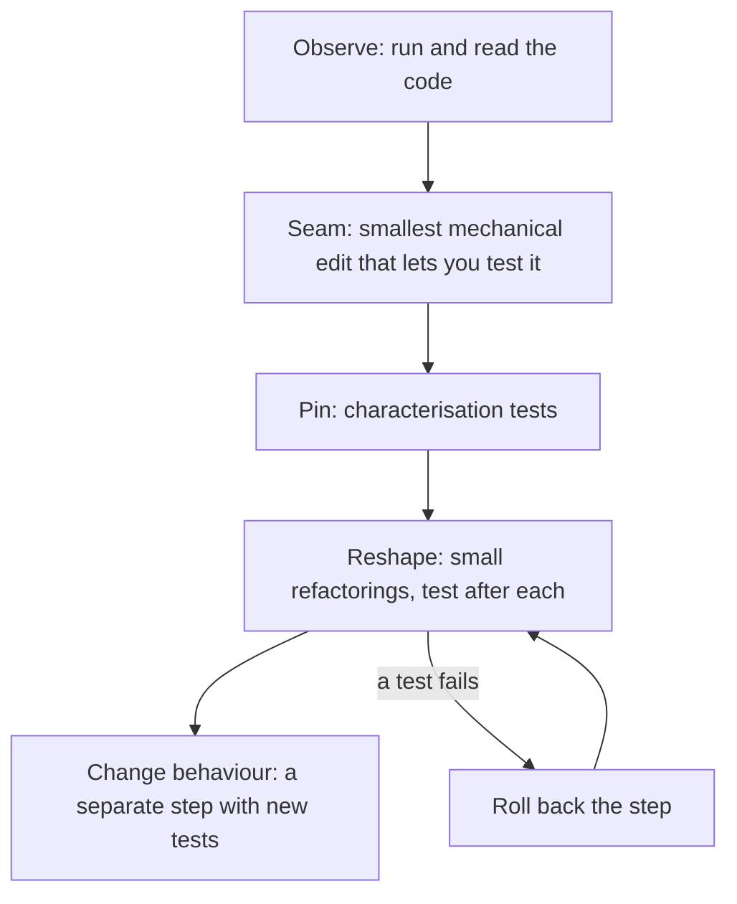
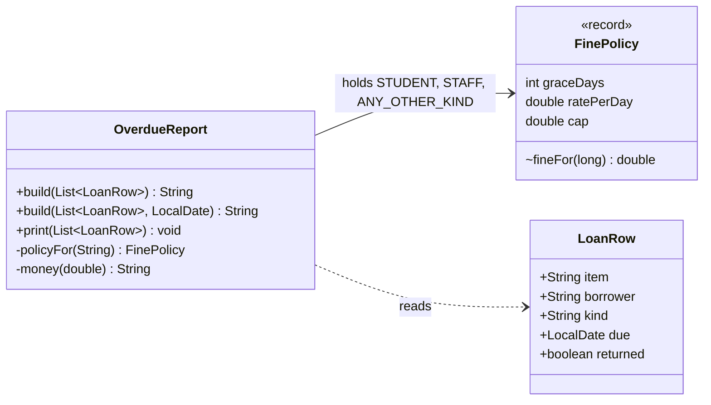
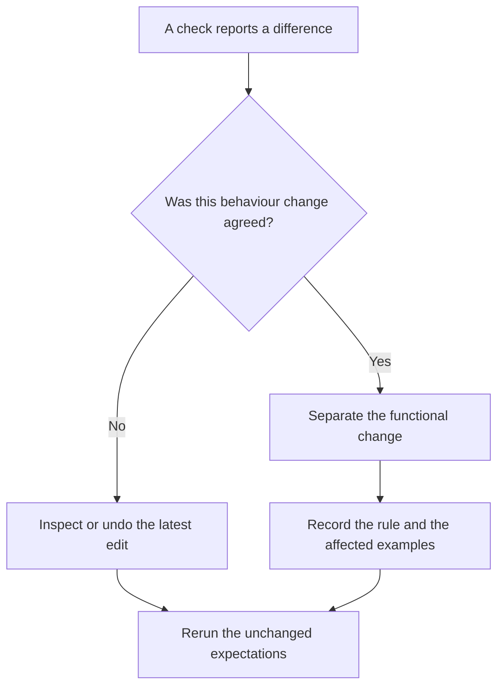

*OO Development and Agile Practices*  
*Designing, Testing and Evolving Software with AI Assistance*

## Opening scenario

The records office has an old overdue report. It lists every unreturned loan that is past its due date and adds a fine. This week two things go wrong. A student points out that a laptop two days late shows a fine of 0.00 yet still counts as overdue. A colleague on another machine sees amounts printed as `0,50` where everyone else sees `0.50`. Then the office asks for a small change: staff should get seven days of grace instead of five.

You open the code. It is one method of about forty lines. The staff rule appears in one branch, the student rule in another, and a third branch handles anyone else. The number five appears twice in the staff branch, once in a comparison and once in a subtraction, and a change to only one of them would be a bug. The method reads today's date from the system clock, so its output changes every day. Nobody wrote tests, and the author has left.

There is a second reason for care. A colleague once tidied a report like this one, and the new version was shorter. It also listed fewer loans. Nobody could say whether a defect had been repaired or a promise had been broken, because nobody had recorded what the old report promised. What do you change first? Not the staff grace period. Before changing a rule you need to know what the code does today, so that you can tell afterwards whether you changed only what you meant to change. This chapter is about that situation: **changing code you do not yet understand, without tests that protect it**. The method is to observe, to pin what you observe, to reshape the structure in small checked steps, and to keep every correction of behaviour separate from every improvement of structure.

## Learning outcomes and reading route

By the end of this chapter, you should be able to:

1. Diagnose a smell from a concrete difficulty of change, instead of treating it as a verdict.
2. Distinguish a refactoring from a behaviour change, and state what must stay the same.
3. Write characterisation tests that record current behaviour, including behaviour that looks wrong.
4. Create a seam that removes a hidden dependency, so that code can be tested.
5. Apply small refactorings (Extract Method, Extract Class, Move Method, Rename) with a check after each step and a way back.
6. Record uncertainties, suspected defects and technical debt separately, with evidence.

**Module connection:** Week 10; LO3 and LO4. The weekly reading is the refactoring chapter of Martin [13]; Feathers [14] is the recommended companion on legacy code. The Week 10 lab is refactoring untested legacy code with regression tests. This chapter creates no new deadlines, weights or marking rules. Quiz 2 is held in Week 10 and covers dependency injection, TDD and test doubles, design patterns and layered architecture (Weeks 5–9); the legacy lab in this chapter is separate from that scope, and Section 11.11 gives revision pointers for the quiz.

**Entry checkpoint:** Chapter 10's Java 17 project, and its package structure. This chapter adds one isolated package, `legacy`, which stands for the old records system's overdue report. It is not part of the lending layers: production code must not refer to it, just as it must not refer to `patterns` or `behaviour`, and the dependency test from Chapter 10 now checks that. Only bootstrap launches it or feeds it rows.

**Core reading.** Sections 11.1–11.6.

**Working-knowledge reading.** Section 11.7 (technical debt and evidence). Learn to describe debt with evidence, and to separate defects from preferences. You do not manage a debt register for a real project.

**Minimum required lab.** Steps B1–B3 and T1–T4 of the practical activity in Section 11.10. Steps B1–B3 run on the **Book project**: the legacy report and its tests are supplied, and you extend the tests and take the first refactoring steps. Steps T1–T4 run on your **Team project**, whose provided starter codebase contains intentional smells: you characterise one untested method and refactor it in small commits.

**Optional extension.** Steps B4–B7 (break the boundary on purpose, make the separate functional correction, do the AI activity, and connect the report to the live loans), the review questions, the transfer challenge and the optional extension.

The separate companion for this chapter contains the complete checkpoint, every refactoring stage, the tests, model answers and teaching notes.

## 11.1 Working with unfamiliar code

### What makes code “legacy”

Feathers gives a working definition: legacy code is code without tests [14]. The age of the code does not matter. Code written last month becomes legacy when you have to change it, you cannot tell what a change will break, and nothing will tell you. That is the sense used here. The report in this chapter is old, but the habits that produced it (global state, hidden dependencies, one long method) are not.

### The dilemma, and the way out

Refactoring is a change to the internal structure that leaves external behaviour the same [1]. To know that behaviour stayed the same you need tests. But the code is hard to test because of its structure, so you want to refactor first. The way out is a short sequence, and Feathers's own account of why existing code resists testing is worth reading beside it [7]:

1. **Observe.** Run the code and read it with a specific question in mind. You do not need to understand all of it.
2. **Make the smallest edit that lets you test it.** This is a *seam* (Section 11.4). Keep the edit mechanical, so that the compiler and a quick read can check it.
3. **Pin.** Write characterisation tests that record what the code does now (Section 11.3).
4. **Reshape.** Refactor in small steps, running the tests after each one (Sections 11.5 and 11.6).
5. **Only then change behaviour**, in a separate step with its own tests.



**Figure 11.1.** The order of work on code you do not understand. Boxes are activities and arrows mean “then”. The loop at the end is the rule for a failing test: undo the last step and redo it, instead of debugging forward.

### The code as found

Here is the report, exactly as it was found. Read it once and write down what you notice before reading on.

```java
public class OverdueReport {

    public static String build(List<LoanRow> rows) {
        String out = "";
        double total = 0;
        int count = 0;
        LocalDate today = LocalDate.now();
        out += "OVERDUE REPORT " + today + "\n";
        for (int i = 0; i < rows.size(); i++) {
            LoanRow r = rows.get(i);
            if (r.returned) {
                continue;
            }
            long late = ChronoUnit.DAYS.between(r.due, today);
            if (late > 0) {
                double fine = 0;
                if (r.kind.equals("S")) {
                    if (late > 2) {
                        fine = (late - 2) * 0.50;
                        if (fine > 10) {
                            fine = 10;
                        }
                    }
                } else if (r.kind.equals("T")) {
                    if (late > 5) {
                        fine = (late - 5) * 0.25;
                        if (fine > 5) {
                            fine = 5;
                        }
                    }
                } else {
                    fine = 1.00 * late;
                }
                out += r.item + " " + r.borrower + " " + late + " day(s) late, fine "
                        + String.format("%.2f", fine) + "\n";
                total += fine;
                count++;
            }
        }
        out += count + " overdue, total fines " + String.format("%.2f", total) + "\n";
        return out;
    }

    public static void print(List<LoanRow> rows) {
        System.out.print(build(rows));
    }
}
```

`LoanRow` is the old system's export format: an item, a borrower, a kind (`"S"` for a student, `"T"` for staff, as in the old directory), a due date and a returned flag, all public mutable fields. Other programs read it, so it stays as it is.

### Separate what you know from what you guess

Reading is evidence only when you record how sure you are. A reading note keeps the three apart.

| Observation | How you know | Status |
|---|---|---|
| Returned loans are skipped | Read: `continue` on `returned` | Known |
| Fines start after a grace period and are capped | Read: two nested comparisons per kind | Known |
| Anyone who is neither `"S"` nor `"T"` pays 1.00 a day, with no grace and no cap | Read: the final `else` | Known what, unknown whether intended |
| The output depends on the date the program runs | Read: `LocalDate.now()` | Known |
| Amounts are printed with a comma in some locales | `String.format` without a locale; the documentation says the default locale is used and `%f` localises the decimal separator [8] | Likely; confirm by running |
| A loan two days late is listed with a fine of 0.00 and still counted | Read: the count is incremented inside `late > 0` | Likely; confirm by running |

“Unknown whether intended” is an honest status. It is not your job at this stage to decide that the behaviour is wrong.

## 11.2 Smells as investigation prompts

A code smell is, in Fowler's words, a surface indication that usually corresponds to a deeper problem, and it is not always a problem [5]. Chapter 5 introduced smells and the principles behind them, so this chapter does not repeat the definitions. What matters here is the use you make of a smell: it is a prompt to investigate, and it is only worth acting on when you can name a **concrete difficulty of change** that it causes.

| Smell in the report | The difficulty it causes |
|---|---|
| Duplicated branches (the student and staff blocks have the same shape) | A change to the rule shape must be made in every branch; the grace number appears twice in each, so editing one of the two gives a wrong result |
| Long method | To change the fine you must read the loop, the formatting and the totals as well |
| Hidden dependency on the system clock | The output differs every day, so no test can compare it with a fixed answer |
| Hidden dependency on the default locale | The same data prints differently on two machines |
| Magic numbers (`2`, `0.50`, `10`, `5`, `0.25`) | A reader cannot tell which number is a grace period and which is a cap |
| A string kind compared with `equals` | An unexpected kind falls into the final branch without anyone deciding that |
| `String +=` in a loop | Not a difficulty of change here; a possible slowness for very long reports |

The last row is a deliberate counter-example. Not every smell needs repair. A smell in code that nobody changes costs very little, and the value of repairing it depends on how often the code changes and how much the difficulty costs [4]. Decide where to spend effort by asking which changes are coming. Here the office has just asked for a change to a grace period, so the duplicated branches and the magic numbers are worth fixing now. The `String +=` loop is not.

## 11.3 Characterisation and regression tests

A **regression test** protects behaviour that everyone agrees is correct. A **characterisation test** records what the code does today, whatever that is, so that you will notice if a change alters it [3]. The two look the same in the test framework, but they make different promises. A passing characterisation test means “unchanged”. It does not mean “correct”.

### How to write one

Feathers describes a short loop [3]:

1. **Isolate the code** so that it can run in a test. This is often the hardest part (Section 11.4).
2. **Write a test with a placeholder expectation**, a value you know to be wrong.
3. **Run it and read the actual result** from the failure message.
4. **Record that result** as the expectation, after you have looked at it.
5. **Rename the test** to say what you now understand the code does.
6. **Keep exploring** with further inputs, especially the boundaries and the odd cases.

Step 4 contains the discipline: do not paste the result blindly. Look at each one and classify it.

| Class | Meaning | What you do |
|---|---|---|
| Expected | It matches the rule you were told | Keep the test |
| Surprising | You did not expect it, but it may be intended | Keep the test; ask the owner |
| Suspected defect | It looks wrong | Keep the test, mark it clearly, and record the question; do **not** fix it here |
| Unknown | You cannot tell | Keep the test and record the question |

### What the report does

The observed fines for one loan, run on the supplied code with today fixed at 20 October 2026, are below. A comparison with the rule you were told is the first review.

| Kind | Days late | Fine | Comment |
|---|---:|---:|---|
| S | 1, 2 | 0.00 | Listed and counted, with no fine (grace) |
| S | 3 | 0.50 | First fine |
| S | 10 | 4.00 | |
| S | 22, 23, 100 | 10.00 | The cap is reached at 22 days and holds |
| T | 1–5 | 0.00 | Listed and counted, with no fine (grace) |
| T | 6 | 0.25 | First fine |
| T | 25, 26, 100 | 5.00 | The cap is reached at 25 days and holds |
| X (unknown) | 1 | **1.00** | Suspected defect: no grace |
| X (unknown) | 100 | **100.00** | Suspected defect: no cap |
| s (lower case) | 3 | **3.00** | Suspected defect: a typo in the data costs six times the student fine |
| blank | 2 | **2.00** | Same branch |

Four further observations belong in the suite: a loan due today or later is not listed; a returned loan is ignored; a null kind throws `NullPointerException` (and only for a loan that is actually overdue); and under a German locale the amounts print with a comma. The list shows one of each class: the grace listing and the comma are *surprising*, the unknown kinds are *suspected defects*, and the null-kind failure is *unknown*.

### One test, written in the style

```java
// SUSPECTED DEFECT, pinned on purpose: any other kind pays 1.00 a day with no grace and no cap.
@ParameterizedTest
@CsvSource({"X,1,1.00", "X,100,100.00", "s,3,3.00"})
void otherKindsPayTheFullRateWithNoGraceOrCap(String kind, int daysLate, String fine) {
    assertEquals(oneLoan(daysLate, fine), OverdueReport.build(List.of(open(kind, daysLate)), TODAY));
}
```

The comment is part of the test. In six months someone will see this test fail while making an unrelated change, and the comment tells them whether to fix their change or to ask a question.

### A second net

A table of examples covers only the inputs you thought of. A *differential* check adds a different kind of cover: keep a copy of the original code as an oracle, generate thousands of inputs with a fixed seed and compare the old and new output. The companion contains such a test. It is stronger than the examples for the kinds of input it generates, and it says nothing about inputs outside them. Neither net proves that the new code is equivalent to the old. They show that a chosen set of behaviours is unchanged, and the right amount of testing depends on how risky the change is. Add more where you are about to change more.

## 11.4 Seams and dependency isolation

A **seam**, in Feathers's term, is a place where you can change what the program does without editing the code at that place, and Fowler describes it the same way [6]. To use a seam you need an **enabling point**: somewhere you can choose the other behaviour. The report has three hidden dependencies, and each needs a different answer.

| Hidden dependency | Where it is | How to isolate it |
|---|---|---|
| The system clock | `LocalDate.now()` inside `build` | A parameter seam: add `build(rows, today)` and let the old method call it |
| The default locale | `String.format("%.2f", ...)` | Pin the locale in the test and restore it afterwards |
| Standard output | `print` writes to `System.out` | Capture `System.out` in one test and restore it afterwards |

### The clock

This is the only edit made before there are tests, so it must be as small and mechanical as possible. The method is split in two. The existing signature stays, and delegates to a new one that takes the date:

```java
public static String build(List<LoanRow> rows) {
    return build(rows, LocalDate.now());
}

public static String build(List<LoanRow> rows, LocalDate today) {
    String out = "";
    double total = 0;
    int count = 0;
    out += "OVERDUE REPORT " + today + "\n";
    // ... the rest of the method is unchanged
```

The edit moves one expression from the body to a call, and deletes one line. The compiler checks that nothing else changed, and a reader can check the rest by eye. Existing callers see no difference. Fowler's catalogue calls this move Change Function Declaration, and lists Add Parameter among its aliases [2]. This is the same idea as the injected `Clock` in Chapter 7, at the smallest possible scale: a parameter is enough here, because the report is a static method with no object to inject into.

### Check the enabling edit by running it

Compiling and reading are good checks, but this edit has no test yet, so run the evidence that is available. The companion supplies a small **probe**: it contains the original report with only its class name changed (`OriginalUnseamed`) and a program that calls the original and the seamed report through their public one-argument entry points. It compares their output for a handful of rows (a late student, a late staff member, a row due today, an unknown kind, a returned loan and an empty list) and checks one literal result. It refuses to run if the date changes while it executes.

The probe is bounded. It examines a few rows, not every input, and it cannot tell you the report is correct. What it adds to the compiler and your eyes is a direct comparison of the code as found with the code after the only untested edit. Keep it small, run it once, and then put the real protection in the characterisation tests.

### Who chooses the zone?

The report now takes a date, so the *caller* decides which calendar date “today” is. A `Clock` carries a time zone, and `LocalDate.now(clock)` converts the clock's instant into a date using it [9]. At 22:30 UTC on 21 October it is already 22 October in Baghdad. A loan due on 21 October is therefore not yet late in UTC and one day late in Baghdad. A test makes the difference concrete: it builds two dates from one instant with `Clock.fixed` and two zones, and records the two reports. The seam did not remove the question of which zone is right. It moved the question to the one place that has to answer it.

### The locale and the output stream

The other two dependencies are left alone, because changing them would be a bigger edit than the tests justify. Instead the tests deal with them. One fixture sets the default locale to `Locale.ROOT` before each test and restores it afterwards. One test sets it to `Locale.GERMANY` and records the comma. One test replaces `System.out` and restores it in a `finally` block. Both are global, process-wide state. Tests that change them cannot safely run in parallel, and a test that forgets to restore them will break an unrelated test far away, so the restoring is part of the technique.

A better seam would be a `PrintStream` parameter on `print`, and a locale argument to the formatting. They are worth adding when you have a reason to change those lines. Without a reason, the test fixture is enough.

### Other seams

Two other seams appear in legacy code and are worth knowing by name. In **subclass and override** you make a class non-final, and a test subclass replaces one method. In **extract interface** you put a dependency behind an interface, which is exactly the move of Chapter 6. Both change more code than a parameter does, so choose the smallest seam that gets the code under test.

## 11.5 Extract Method, Extract Class, Move Method and Rename

Refactorings have names so that a team can say what it did and a reviewer can check it. Fowler's catalogue calls the first one Extract Function and the second Move Function; the first edition called them Extract Method and Move Method, and the names are used interchangeably [2][15]. The companion lists the full file for every step. The steps below follow the order in which they were applied, and the characterisation tests and the differential test passed after each one.

### Stage 2: Extract Method

The fine calculation and the formatting are lifted out of the loop, unchanged, into two private methods:

```java
double fine = fineFor(r.kind, late);
out += r.item + " " + r.borrower + " " + late + " day(s) late, fine " + money(fine) + "\n";
...
private static double fineFor(String kind, long late) { /* the three branches, moved as they were */ }
private static String money(double amount) { return String.format("%.2f", amount); }
```

The behaviour is the same because the moved code is the same. The loop now reads in one glance, and the formatting rule (and its locale dependency) lives in exactly one place.

### Stage 3: Extract Class and Move Method

Look at the three branches again. They differ only in three numbers: free days, a daily rate and a cap. That is a missing concept, and it can be a small class.

```java
record FinePolicy(int graceDays, double ratePerDay, double cap) {
    double fineFor(long daysLate) {
        if (daysLate <= graceDays) {
            return 0;
        }
        return Math.min((daysLate - graceDays) * ratePerDay, cap);
    }
}
```

`fineFor` moves into the new class (Move Method), and the report keeps three named policies:

```java
private static final FinePolicy STUDENT = new FinePolicy(2, 0.50, 10.00);
private static final FinePolicy STAFF = new FinePolicy(5, 0.25, 5.00);
/** Suspected defect, preserved on purpose: any other kind pays 1.00 a day with no grace and no cap. */
private static final FinePolicy ANY_OTHER_KIND = new FinePolicy(0, 1.00, Double.MAX_VALUE);
```

The new code is not obviously equal to the old, so check it. For the student branch the old code had `if (late > 2) { fine = (late - 2) * 0.50; if (fine > 10) fine = 10; }`. The new code returns 0 when `late <= 2`, which is the same condition negated, and otherwise returns the smaller of `(late - 2) * 0.50` and 10, which is what the capped assignment computed. The staff branch is the same with 5, 0.25 and 5. For other kinds, grace 0, rate 1.00 and no cap give `1.00 * late`. The tests then confirm the algebra for the inputs they cover.



**Figure 11.2.** The report after stage 3. The solid arrow means that `OverdueReport` holds three `FinePolicy` values; the dashed arrow means that it only uses `LoanRow`, which it reads. A `+` marks a public member, a `-` a private one and a `~` a package-private one. `LoanRow` is drawn as the old system's format, with public fields, and has not changed.

Notice what the refactoring did not do. The odd third branch did not disappear, and its oddity is now visible: it has a name, a comment and a policy of its own. Hiding a suspected defect inside tidy code is the opposite of what refactoring is for. The edit also did not change `LoanRow`, and it did not change the signatures of `build` and `print`, because other programs call them.

### Stage 4: Rename and tidy

The last step renames `r` to `row` and `late` to `daysLate`, uses a for-each loop, replaces `String +=` with a `StringBuilder` and renames `count` and `total` to `overdueCount` and `totalFines`. None of this changes the output. The method after the four stages is:

```java
public static String build(List<LoanRow> rows, LocalDate today) {
    StringBuilder report = new StringBuilder("OVERDUE REPORT " + today + "\n");
    double totalFines = 0;
    int overdueCount = 0;
    for (LoanRow row : rows) {
        if (row.returned) {
            continue;
        }
        long daysLate = ChronoUnit.DAYS.between(row.due, today);
        if (daysLate > 0) {
            double fine = policyFor(row.kind).fineFor(daysLate);
            report.append(row.item).append(' ').append(row.borrower).append(' ')
                    .append(daysLate).append(" day(s) late, fine ").append(money(fine)).append('\n');
            totalFines += fine;
            overdueCount++;
        }
    }
    report.append(overdueCount).append(" overdue, total fines ").append(money(totalFines)).append('\n');
    return report.toString();
}
```

The request that started the chapter is now a one-number change: `new FinePolicy(7, 0.25, 5.00)` for staff. It is a functional change, so it waits for its own commit and its own test change.

## 11.6 Incremental changes and rollback

### One step, one check, one commit

The stages above were not applied at once. Each was a separate commit with the tests run before it was recorded. A sequence like this is easy to review and easy to undo.

| Commit | Kind | What the reviewer checks |
|---|---|---|
| 1. Add a date parameter to `build` (seam) | Mechanical edit before tests | The old method delegates and nothing else moved |
| 2. Add characterisation tests and the differential test | Tests only | Every expectation was run and reviewed; surprises are commented |
| 3. Extract `fineFor` and `money` | Refactoring | The moved code is identical; all tests pass |
| 4. Extract `FinePolicy` | Refactoring | The algebra above; all tests pass; the odd policy is visible |
| 5. Rename and tidy | Refactoring | No behavioural edits hide among the renames |

Mixing a refactoring and a behaviour change in one commit is the most common way to lose control, because a failing test no longer says which of the two caused it. Chapter 5 made the same point with its two-stage change.

### Decide what a difference means

When a check reports a difference, ask one question before touching anything: was this behaviour change agreed? The answer decides what you do next.



**Figure 11.3.** What to do when a check reports a difference. The diamond is a decision and the other boxes are actions. An agreement needs a specific rule: “clean up the report” is not one. Until the records office agrees a rule for unknown kinds or for loans inside their grace period, a difference at those boundaries is an unintended change.

### Roll back, do not debug forward

If a test fails after a step, you have a precise failing change and a green state one step behind. Undo the step (`git restore` for uncommitted work, `git revert` for a commit) and redo it more carefully. Debugging forward from a failing refactoring, with the structure half-changed, is slower and riskier. The failing test is evidence about what the step got wrong: keep its name and message in your notes.

### Separate the functional correction

When the structure is clean, the questions that were parked can be answered. Suppose the records office confirms that only the kinds `"S"` and `"T"` exist and that anything else is a data error. That is a functional change, so it gets its own branch and commit. The code change is small: `policyFor` throws `IllegalArgumentException("Unknown borrower kind: ...")` instead of returning the odd policy, and the `ANY_OTHER_KIND` constant disappears. The tests that pinned the suspected defect are **replaced deliberately**, in the same commit, with tests of the new rule, and the commit message says so. The differential test can no longer compare the unknown kinds with the original, so it is limited to the kinds that did not change. The companion contains this stage as a separate checkpoint. The rule itself is illustrative: in a real project the records office decides it, not the developer.

## 11.7 Technical debt and evidence

“Technical debt” is a metaphor, attributed to Ward Cunningham, for the accumulated cruft that makes a system harder to change [4]. The extra effort of every later change is the interest, and cleaning up is paying down the principal. The metaphor helps in conversations with people who do not read code. It misleads when it is used to excuse neglect, and Fowler also notes that the cost cannot be measured objectively, only estimated [4].

Treat a debt claim like any other claim: attach evidence. “This code is messy” is an opinion. “A change to the staff grace period needs two edits in one branch and breaks silently if one is missed, and there is no test” is a statement a colleague can check. After the refactoring the same change is one number, protected by 27 characterisation tests.

The companion contains two model records for this report: **ADR-011**, a decision record for pinning, isolating and refactoring it, and a **suspected-defect register** that lists each pinned oddity with its evidence and the question for the owner. They show the form. Your own records should describe your own code and decisions.

### A short register entry

| Field | Entry for the report |
|---|---|
| Item | Overdue report: fine rules duplicated, hidden clock and locale |
| Evidence | Grace number appears twice per branch; output varies by date and locale; no tests |
| Cost (interest) | Each fine change needs careful edits in several places and a manual check |
| Decision | Paid down: seam, tests and refactoring in five commits |
| Remaining | Three suspected defects, one unknown (Section 11.3) |

### Defects, doubts and preferences

Keep four kinds of statement apart in your notes: a **known defect** (confirmed wrong), a **suspected defect** (looks wrong, unconfirmed), **accepted behaviour** (confirmed as intended, however odd) and a **question** (unknown). Only the owner of the requirement can move an item between them. Mixing them is how a refactoring turns into an unreviewed behaviour change, and how a developer's taste turns into a defect report.

## 11.8 AI in practice: review a refactoring patch

Chapter 15 collects the recurring AI workflows; this activity is self-contained, and the fixture below is all you need.

| Element | For this activity |
|---|---|
| Engineering objective | Decide whether a proposed refactoring patch preserves behaviour, using evidence rather than the patch's own claims |
| Input | The refactored `OverdueReport` from Section 11.5, the characterisation suite and the differential test |
| Permitted scope | Evaluate and, if worthwhile, repair the patch; do not change the tests to make it pass |
| Independent checks | Trace the boundary case by hand; apply each claim to a scratch copy; run the suite; read each failing test |
| Accept or reject | A verdict on each claim, with the failing tests as evidence |
| No-account route | The fixture below is sufficient |

Use this **author-written fictional AI-output fixture**, constructed for offline comparison:

> I tidied `build`. The overdue test is now `!row.due.isAfter(today)`, which reads better and is equivalent to `daysLate > 0`. I also choose the fine policy before the check, so the loop has one path. Unknown kinds fall back to the student policy, since students are the only borrowers who should ever be fined. All formatting is unchanged, so behaviour is preserved.

The patch changes the loop to:

```java
long daysLate = ChronoUnit.DAYS.between(row.due, today);
FinePolicy policy = row.kind.equals("T") ? STAFF : STUDENT;
if (!row.due.isAfter(today)) {
    double fine = policy.fineFor(daysLate);
    // ... append the line, add to the total and the count, as before
}
```

There are three claims. **Trace the first one before running anything.** On the due date, `daysLate` is 0, so the original skips the row. What does `!row.due.isAfter(today)` do for a row due today? Then apply each claim to its own copy of the code and run the suite, so that you can see which tests belong to which claim. Finally, apply the whole patch. Answer: is “equivalent” true? What does choosing the policy first do to a loan that is returned, or not yet due, when its kind is `null`? Is treating unknown kinds as students a refactoring?

A repair is possible for the first two claims: keep the neater structure but restore the original test and the original lookup. The third is a functional change, so it needs a decision from the records office and its own commit with replaced tests. The patch's own summary was confident and wrong in all three places. Passing tests and your own trace are the evidence here. A live AI service is optional: give it synthetic data, keep its actual output, apply any patch to a scratch copy and treat its explanation as a claim to check.

## 11.9 Common mistakes

| Mistake | Consequence | Better action |
|---|---|---|
| Fix a suspected defect during a refactoring | One commit cannot be reviewed as “no behaviour change” | Pin it, record the question, fix it later in its own commit |
| Paste actual output into tests without reading it | The suite blesses bugs invisibly | Classify each result and comment the odd ones |
| Test only the happy path of a legacy method | The odd branches change unnoticed | Probe boundaries, unknown inputs, nulls and hidden dependencies |
| Make a large edit to create a seam | The seam edit is itself untested | Make the smallest mechanical edit and check it by eye |
| Leave a test changing the locale or `System.out` unrestored | Unrelated tests fail far away | Restore global state in `finally` or `@AfterEach` |
| Refactor several things per commit | Failures cannot be attributed; rollback loses good work | One refactoring per commit, tests between |
| Read “all tests pass” as “behaviour identical” | Untested behaviour was never protected | State what the tests cover and what they do not |
| Refactor everything that smells | Time spent where nothing will change | Pick smells that block a change you have to make |
| Change the shape of a public type other programs use | Hidden callers break | Keep signatures and formats that others depend on |
| Trust the seam edit because it compiled | The one untested edit could still have changed behaviour | Run the original beside the seamed version on a few rows, then pin |
| Accept “equivalent” for a boundary rewrite | `isAfter` and a day count differ exactly on the due date | Trace the equality case by hand, then run the tests |

## 11.10 Practical activity

**Input:** the Chapter 10 checkpoint plus the `legacy` package from the companion (`LoanRow`, the stage 1 `OverdueReport`, the characterisation suite, the differential test and the probe), and your Team project's repository. Steps B1–B7 use the **Book project**; steps T1–T4 use your **Team project**.

**Instructor demonstration:** run the legacy report on one day and then on the next (or with two dates through the seam) to show why the clock must be isolated. Run the probe. Pin one surprising result live, with its comment.

**Guided practice:** classify five pinned results from Section 11.3 as expected, surprising, suspected defect or unknown. Explain what you would ask the records office about each one.

**Minimum required lab: Book project**

- **B1. Observe and characterise.** Run the probe to check the enabling edit, then run the supplied suite against stage 1 (the original code with the date seam). Add three characterisation tests of your own for inputs the suite does not cover (for example, a borrower with many loans, two loans for the same item, or a due date far in the past). For each, record the actual result, classify it, and add a comment if it is surprising.
- **B2. Refactor in small steps.** Starting from stage 1, apply the Extract Method and Extract Class refactorings of Section 11.5 (stages 2 and 3), one commit each, running the suite after each. If a test fails, roll back the step and redo it.
- **B3. Report your findings.** Write a short before-and-after rationale: what changed structurally, what you checked after each step, what did not change on purpose (and why), and which questions remain for the records office. Add one entry to a suspected-defect register in the form of the companion's model.

**Minimum required lab: Team project**

- **T1. Choose.** In your team's provided starter codebase, choose one method that has a smell and no tests, and that you have a reason to change. Write down what you observed and how sure you are, in the three-column form of Section 11.1.
- **T2. Pin.** Make the smallest edit that lets you test it, if it has hidden dependencies, and run the original beside the edited version on a few inputs. Write characterisation tests for at least six inputs, including a boundary and an odd case. Classify each result.
- **T3. Refactor.** Apply at least three small refactorings from this chapter, each in its own commit, with the tests run before each commit. Keep any behaviour change out of these commits.
- **T4. Rationale.** Write the before-and-after rationale: which structural change you made and why, what you protected, and which suspected defects and questions you found but did not fix. Ask a teammate to review the commits and record their feedback.

**Optional extension (Book project)**

- **B4. Break the boundary on purpose.** In a scratch copy, change the overdue test from `daysLate > 0` to `daysLate >= 0`. Predict which tests fail before you run them, read the failure messages, and restore the original.
- **B5. A separate functional change.** Make the correction of Section 11.6 on its own branch: unknown kinds are rejected. Replace the pinned tests deliberately, restrict the differential test to known kinds, and write the commit message to say what behaviour changed and why.
- **B6. AI activity.** Complete the Section 11.8 activity.
- **B7. Connect the report to the live loans.** The companion supplies a small bridge in bootstrap: `LoanSnapshotRows` joins the loan and reservation snapshots into report rows, and `OverdueReportService` reads one date from a `Clock` and one snapshot per call. Trace why the last permitted day is the day *before* a reservation's exclusive end, why a failure to read must not become “0 overdue”, and why a loan without a matching reservation is an error. Run its tests and add one of your own.

**Expected artefacts:** B1–B3 as above, with the commits or stage files; for the Team project, the observation notes, the characterisation tests, at least three refactoring commits, the rationale and the review record. A pull request is a good vehicle where your course workflow permits it.

**Acceptance conditions:**

- every characterisation test was run before its expectation was recorded;
- surprising and suspect results are commented;
- no refactoring commit changes behaviour;
- the tests pass after every commit;
- the seam edit is mechanical and has been checked by running the original beside it;
- questions are recorded and not silently fixed;
- signatures and formats that others depend on are unchanged.

Do not claim a review or CI run that has not happened. A passing suite is evidence for the behaviours it covers, not a proof of equivalence.

**Optional extension:** extend the differential test to generate null items and borrowers, and say what a difference would mean. Keep this separate from the refactoring steps.

## 11.11 Review and transfer

### Concept questions

1. Why is a characterisation test not the same as a regression test, and what does a passing characterisation test tell you?
2. What is a seam, and why is the date parameter a better first edit than rewriting the method?
3. Why should a suspected defect be pinned rather than fixed during a refactoring?
4. What can a differential test show that a table of examples cannot, and what can it not show?

### Applied diagnosis

5. A teammate refactors the report and says “all tests pass, so nothing changed”. Name two kinds of behaviour the suite does not cover, and say what you would do about each.
6. A developer extracts `FinePolicy` and, in the same commit, changes the staff cap from 5.00 to 6.00 “because it looked low”. Explain what is wrong with the commit and what the test run would and would not show.
7. The report runs at 22:30 UTC on a server whose clock zone is Baghdad. A loan was due on 21 October. Which date does the report use, what does it print for that loan, and which one object chooses the zone?

### Transfer challenge

An analysis script in an ML model-serving tool formats prediction scores for a daily summary. It reads the current time, prints numbers in the default locale, and has three near-identical branches for different model types. It has no tests. Describe how you would find its seams, which six or seven inputs you would pin first, and which refactorings you would apply. Name one behaviour you would record as a question instead of fixing.

### Quiz 2 revision pointers

Quiz 2 is held in Week 10, and the module descriptor says that it covers **dependency injection, TDD and test doubles, design patterns and layered architecture (Weeks 5–9)**. Revise Chapters 6–10 rather than treating this chapter's legacy lab as quiz content.

| Chapter | Revision focus |
|---|---|
| 6 | Interfaces and ISP, dependency direction, constructor injection, composition root, what a container automates |
| 7 | Red–green–refactor, test anatomy, stubs, fakes, spies and mocks, controlled time, weak tests |
| 8 | Factory Method, Abstract Factory, Builder, Adapter, Decorator, and choosing the simpler alternative |
| 9 | Strategy, State, Observer and Command, partial failure, and choosing a pattern by the variation it handles |
| 10 | Layers and dependency direction, ports and adapters, repositories, entities and value objects, package cohesion, coupling and stability |

Use the module leader's confirmed quiz guidance if it provides more detail. These pointers do not add assessment rules or predict particular questions.

## Summary and next chapter

Changing code you do not understand is a sequence, not a leap: observe it, make the smallest edit that lets you test it, pin its behaviour with tests that record what it does, reshape the structure in small steps with a check and a way back after each, and keep every correction of behaviour apart from every improvement of structure. Smells say where to look, debt claims need evidence, and a green suite is evidence for the behaviours it covers.

The overdue report now has a seam that was checked against the original, a pinned suite, a small policy class and four recorded oddities waiting for the records office. Chapter 12 turns to measuring progress and flow, and introduces the visiting-researcher change request that the rest of the project must absorb.

## Sources and further reading

Online sources 1–12 were opened on 13 October 2026. The report, its tests and the stages are original teaching material.

1. Fowler, M., [Definition of Refactoring](https://martinfowler.com/bliki/DefinitionOfRefactoring.html). Refactoring as an internal change that leaves external behaviour the same.
2. Fowler, M., [Refactoring catalogue](https://refactoring.com/catalog/). Entries for Extract Function (alias Extract Method), Move Function (alias Move Method), Extract Class, Rename Variable and Change Function Declaration (alias Add Parameter); the first-edition names appear as aliases.
3. Feathers, M., [Characterization Testing](https://michaelfeathers.silvrback.com/characterization-testing). Tests that describe what the code does rather than what it should do; the write, run, record loop.
4. Fowler, M., [Technical Debt](https://martinfowler.com/bliki/TechnicalDebt.html). The metaphor attributed to Ward Cunningham, interest and principal, and the point that the cost cannot be measured objectively.
5. Fowler, M., [Code Smell](https://martinfowler.com/bliki/CodeSmell.html). A smell as a surface indication that usually corresponds to a deeper problem; smells are not always problems.
6. Fowler, M., [Legacy Seam](https://martinfowler.com/bliki/LegacySeam.html), 2024. Defines a legacy seam as a place where behaviour can be altered without editing in that place, and an enabling point as the place where the choice is made; credits Feathers.
7. Feathers, M., [Testing Effectively With Legacy Code](https://www.informit.com/articles/article.aspx?p=359417), InformIT, 2005. A chapter from *Working Effectively with Legacy Code* on why existing code is hard to test.
8. Oracle, [Formatter (Java SE 17)](https://docs.oracle.com/en/java/javase/17/docs/api/java.base/java/util/Formatter.html). The default locale when none is given and the localised decimal separator for `%f`.
9. Oracle, [Clock (Java SE 17)](https://docs.oracle.com/en/java/javase/17/docs/api/java.base/java/time/Clock.html). `Clock.fixed` and `Clock.system(zone)`: the instant-to-date conversion uses the clock's zone. `LocalDate.now(Clock)` is documented in [LocalDate](https://docs.oracle.com/en/java/javase/17/docs/api/java.base/java/time/LocalDate.html) as querying the supplied clock; the zone behaviour is also shown by the tests in this chapter.
10. Oracle, [ChronoUnit (Java SE 17)](https://docs.oracle.com/en/java/javase/17/docs/api/java.base/java/time/temporal/ChronoUnit.html). `between` returns whole days, with the end exclusive and a negative result when the end is earlier.
11. Oracle, [Period (Java SE 17)](https://docs.oracle.com/en/java/javase/17/docs/api/java.base/java/time/Period.html). `getDays` returns the days field, stored separately from years and months.
12. JUnit, [User Guide 5.13.4](https://docs.junit.org/5.13.4/user-guide/). Parameterized tests and `@CsvSource`.
13. Martin, R. C., *Agile Software Development: Principles, Patterns, and Practices.* Prentice Hall, 2002. The module's required text; the Week 10 reading is its refactoring chapter. This chapter treats refactoring in Sections 11.5 and 11.6.
14. Feathers, M., *Working Effectively with Legacy Code.* Prentice Hall, 2004. The module's recommended reading for Week 10 (selected chapters). The working definition of legacy code and of a seam are Feathers's, and the characterisation-testing description was checked against source 3. This chapter treats legacy code, characterisation tests and seams in Sections 11.1, 11.3 and 11.4.
15. Fowler, M. (2018), *Refactoring: Improving the Design of Existing Code*, 2nd ed., Addison-Wesley. A recommended text, also cited in Chapter 5; its catalogue is online at source 2. Not reopened for this chapter.