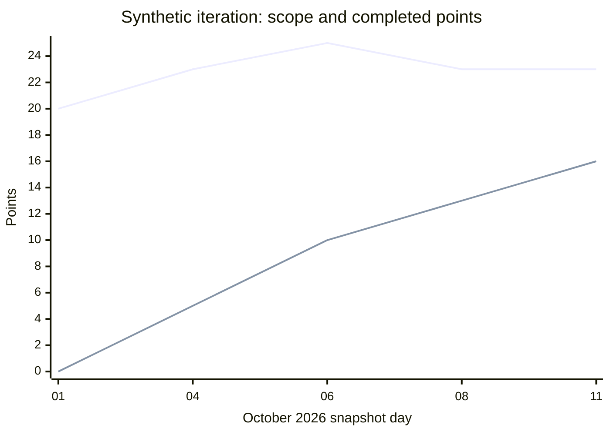

*OO Development and Agile Practices*  
*Designing, Testing and Evolving Software with AI Assistance*  
Version 1.0 • 13 October 2026

## Opening problem

The lending team has completed several changes, yet the remaining-work line has risen. One item spent two days waiting for a directory decision. Another was removed from scope. A team member says that more commits prove the team is faster; an AI summary says the blocked item proves the architecture is poor.

Now the equipment officer requests a new capability: visiting researchers should be able to reserve selected equipment after sponsor approval, with a shorter loan limit. Can the team finish it next iteration? Which existing rules will it affect? What evidence would justify starting immediately rather than resolving an uncertainty first?

A metric cannot make these decisions for us. It can make part of the situation visible, provided its unit, boundary and limitations are clear. This chapter follows a small issue history, checks its arithmetic and uses it to plan the next change. The issue history is **synthetic teaching data**, not recovered history from the preceding chapters or evidence about a real student team.

## Learning outcomes and reading route

After this chapter, you should be able to:

1. Define a measurement boundary and calculate lead time, cycle time, throughput, work in progress and work-item age.
2. Distinguish velocity from item throughput and explain why neither ranks individual contribution.
3. Reconcile burn-down and burn-up observations with additions, removals and completed work.
4. Use a small body of evidence to frame a conditional forecast and identify missing information.
5. Evaluate a technical-health or debt claim without confusing activity with quality or causation.
6. Prepare acceptance examples, an impact analysis and an ordered response to a changed requirement.

**Module connection:** Week 11; LO5 and LO6. Required reading is the descriptor's Martin (2002), planning review; recommended reading is selected chapters of *Accelerate* [7–8]. The required practical activity includes repository-metrics analysis. The requirement change is introduced this week, implemented and verified in Chapter 13 for Milestone 4, and evaluated during handover in Chapter 14. The module leader releases the team's assessed variant; the book's worked change does not replace it.

**Prerequisites:** the backlog and Definition of Done from Chapters 3–4; tested boundaries and the Chapter 10 structure; Chapter 11's distinction between refactoring, suspected defects and changed behaviour.

**Core:** Sections 12.1–12.7, with the measurement contract and the worked change specification. **Minimum lab:** reproduce the synthetic calculations, inspect actual repository evidence, challenge the AI summary, and preserve the pre-change checkpoint with a change-impact note. **Working knowledge:** the supplied Java calculator and the repository extraction method. **Optional:** richer visualisation, larger cohorts and probabilistic forecasting after obtaining suitable data.

**Checkpoint:** the cumulative application remains Chapter 11's verified Java checkpoint. Chapter 12 adds an isolated metrics exercise and planning records; it does not implement the visiting-researcher feature. The companion contains all calculator code, data, commands, worked answers and templates. There is no need to copy another full cumulative application for this process chapter.

## 12.1 What decision needs a measure?

### Begin with a question that could change an action

“Collect more metrics” is a weak objective. “Should we finish the two open items before pulling the sponsor-approval story?” points to a decision. We need to know which items remain, how long they have been open, whether they are blocked and how comparable they are with past work. A count of commits cannot answer all of that.

For each measure, state the question, population, unit, time window and intended response. Keep a note of the source and extraction date. If a number cannot influence a decision or test an assumption, consider whether collecting it is useful. For a small student project, a clear table often teaches more than a dashboard full of unexplained indicators.

The flow vocabulary below follows the Kanban Guide's emphasis on explicit started and finished points [1]. Our lead-time boundary is an additional local choice. Other teams may choose different boundaries, so compare definitions before comparing numbers.

| Contract field | Definition for the synthetic Book project history |
|---|---|
| Unit | One uniquely identified backlog item; IDs A–H |
| Accepted | Item admitted to the tracked scope |
| Started | First transition into implementation |
| Done | Accepted against the team's Definition of Done, including its required checks and review |
| Removed | Explicitly taken out of scope without completion |
| Reporting interval | `[2026-10-01T00:00:00Z, 2026-10-11T00:00:00Z)` |
| Duration | Elapsed 24-hour days; waiting and weekends remain included |
| Snapshot | State immediately after events at the stated timestamp |
| Completion cohort | Items whose Done event falls within the reporting interval |
| Exclusions | No reopened, split, merged or re-estimated items in this deliberately small fixture |

The half-open interval includes completions at the starting instant and excludes completions at the ending instant. Adjacent windows then cannot count the same completion twice. A snapshot is a different question: a completion exactly at its timestamp has already left work in progress. The companion tests both conventions. These are reporting choices, not new reservation-period rules.

### Keep data and interpretation distinct

Here is the complete issue history in day-of-month form. Every date is October 2026 at 00:00 UTC. A dash means that the event has not occurred in this fixture, not a duration of zero.

| ID | Illustrative work | Points | Accepted | Started | Done | Removed |
|---|---|---:|---:|---:|---:|---:|
| A | Reservation boundary examples | 3 | 01 | 01 | 03 | - |
| B | Directory mapping clarification | 5 | 01 | 02 | 06 | - |
| C | Confirmation wording | 2 | 01 | 03 | 04 | - |
| D | Command replay protection examples | 3 | 01 | 05 | 08 | - |
| E | Report failure investigation | 5 | 01 | 07 | - | - |
| F | Optional export format | 2 | 01 | - | - | 08 |
| G | Snapshot consistency checks | 3 | 04 | 06 | 10 | - |
| H | Review-notes improvement | 2 | 06 | 08 | - | - |

B is additionally recorded as blocked from 03 October to 05 October while a mapping question is answered. This event is supplied as synthetic context. It is not inferred from inactivity in Git. G and H are scope additions. F is a removal. The labels describe an imagined iteration; they do not assert that earlier manuscript files were actually created on these dates.

A sound observation is “B spent four elapsed days between Started and Done.” A possible explanation is “waiting for the mapping decision contributed to B's delay.” A stronger claim, such as “the directory adapter caused all delays,” needs evidence this table does not contain.

## 12.2 Estimation revisited

An estimate is a planning judgement made with incomplete knowledge. It is useful when it exposes uncertainty or supports a choice between smaller and larger slices. It becomes misleading when the team treats it as a measured physical property of the work.

The points in this fixture are a local relative scale. They are neither hours nor a universal exchange rate between teams. B's five points and C's two points express the imagined team's relative judgement before delivery. B taking four days does not establish that one point equals 0.8 days; that duration includes waiting, and another item may have different risks.

For the approval change, start with a concrete example: a recognised visitor requests CAM1 for two days with matching approval. Compare that slice with the failure case where the approval register is unavailable. They share code, but the second raises a distinct delivery risk. Splitting work by useful behaviour makes uncertainty easier to discuss than dividing it mechanically into “write classes,” “write tests” and “write documentation.”

When estimates differ, ask what each person assumed. One may expect an existing approval file; another may expect a new sponsor-facing website. The solution is to clarify scope, not average incompatible assumptions. Our worked change uses a small local approval register and excludes an approval-management interface.

Capacity also matters. A week with a midterm, review duties or an absent teammate is not interchangeable with an earlier week. Record the constraint without translating people into interchangeable point-producing units. A small time-bounded investigation can reduce uncertainty, but it should have an output: for example, a sample approval record and a checked parsing/failure contract.

Do not rewrite the old point estimates after seeing the duration merely to make the history look consistent. If a team genuinely revises an unfinished estimate, preserve the earlier value and record the event so that a chart can distinguish re-estimation from newly added scope. Our calculator intentionally omits re-estimation; that limitation is explicit rather than silently assigning new values to old dates.

## 12.3 Velocity and its limits

For a team that uses points, **velocity** here means the sum of estimates attached to items completed within a defined iteration. The five finished items A, B, C, D and G total:

`3 + 5 + 2 + 3 + 3 = 16 points`.

**Throughput** counts completed items over a stated period: five items in this ten-day interval. Sixteen points and five items describe the same completions with different units. Calling 16 “throughput” without specifying a point-based measure would confuse the comparison. The calculator therefore prints both count and completed points with explicit labels.

E and H contribute no completed points yet. Calling E “80% done” does not add four points to this velocity calculation. It may be useful to discuss progress on E, but that conversation is not a reason to redefine Done. F also contributes nothing: removing an optional item can be a sensible scope decision without becoming delivery.

Velocity can help one team inspect its own planning history when its estimation scale, Definition of Done and work mix are sufficiently consistent. It cannot fairly rank teams that estimate differently. It also cannot reveal an individual's contribution: reviewing a colleague's difficult change may increase team completion without producing a separate story or commit under the reviewer's name. Scrum allows contextual forecasting practices; it does not turn a burn chart into a substitute for inspecting actual results [2].

### Make forecasts conditional

There are two remaining items totalling seven points at the snapshot. Dividing seven by the observed 16 points gives 0.4375 iterations. That arithmetic does **not** establish a delivery date. It assumes comparable work, capacity, dependencies, scope and completion behaviour. One observed iteration offers little evidence about variation, and unfinished work may be precisely the work with unresolved risk.

A defensible planning statement is: “We have completed five items in ten elapsed days in this synthetic example. E and H remain open. We will inspect their blockers and size the approval slice before committing to a date.” If a later comparable history supports two to three items per five-day window, two remaining items might fit one such window under unchanged conditions. That is a scenario, not a calibrated probability or guarantee.

Preserve forecasts as dated predictions and compare them with later outcomes. If a forecast misses, inspect assumptions and changed scope before blaming effort. Do not fit a confident percentile or statistical model to this tiny classroom sample. Advanced forecasting is useful only when its inputs and interpretation justify the additional machinery.

## 12.4 Burn-down and burn-up

A burn-down displays remaining work. A burn-up displays completed work, normally alongside the current scope total. In this fixture, points are held fixed and removed items were never Done, so at each snapshot:

`remaining points = current scope points − completed points`.

Current scope includes completed items and accepted unfinished items; it excludes F after removal. The initial scope is 20 points. Adding G and H raises it to 25; removing F reduces it to 23. At the final snapshot, 16 points are complete and seven remain. The scope history must stay visible if we want to explain the line.

| Snapshot day | Scope points | Completed points | Remaining points | WIP items |
|---|---:|---:|---:|---:|
| 01 | 20 | 0 | 20 | 1 |
| 02 | 20 | 0 | 20 | 2 |
| 03 | 20 | 3 | 17 | 2 |
| 04 | 23 | 5 | 18 | 1 |
| 05 | 23 | 5 | 18 | 2 |
| 06 | 25 | 10 | 15 | 2 |
| 07 | 25 | 10 | 15 | 3 |
| 08 | 23 | 13 | 10 | 3 |
| 09 | 23 | 13 | 10 | 3 |
| 10 | 23 | 16 | 7 | 2 |
| 11 | 23 | 16 | 7 | 2 |

On day 04, the remaining line rises from 17 to 18 despite C's two-point completion: three points arrived as G. On day 08, the line falls by five points, but only three came from D's completion; two came from removing F. Without the scope events, both changes are easy to misread.

The burn-up below samples five dates for readability. The upper line is current scope; the lower line is cumulative completion. It is not a smoothed model of unobserved activity. The full daily values are in the table.

An ideal diagonal burn-down can be a reference for a fixed initial scope. It is not evidence that real work should finish in equal daily increments. Review, integration and acceptance can produce uneven completions. Do not move Done timestamps to make a curve attractive. Ask whether the team can explain the change and whether the remaining work still serves the goal.

## 12.5 Lead time, cycle time, throughput and WIP

For this history, lead time runs from Accepted to Done; cycle time runs from Started to Done. The difference is the recorded wait before starting. Neither measures hands-on effort. The following calculations use the completion cohort, not every row in the backlog.

| Finished item | Lead days | Cycle days | Wait before start |
|---|---:|---:|---:|
| A | 2 | 2 | 0 |
| B | 5 | 4 | 1 |
| C | 3 | 1 | 2 |
| D | 7 | 3 | 4 |
| G | 6 | 4 | 2 |
| Mean | 4.6 | 2.8 | 1.8 |

The cycle-time median is three days: sort `1, 2, 3, 4, 4` and take the middle value. B's two blocked days remain within its four-day cycle time. Subtracting them would answer a different question. Even the remaining two days would not establish two days of active coding, because other unrecorded waiting could remain.

At the final snapshot, E and H are started but unfinished, so WIP is two. Their ages are four and three elapsed days. They have no completed cycle time yet. Excluding them from the mean is correct for a completed-item statistic, but forgetting them in the interpretation would create a misleadingly favourable account. Report the completed cohort alongside open-item age.

Throughput for `[01,06)` is two items, A and C. For `[06,11)` it is three, B, D and G. These are five-day windows, not claims about official five-day Sprints. B belongs only to the second window because it completes exactly at that window's starting instant.

Equal throughput can conceal different delay. Imagine two separate five-day periods, each finishing two items. In one, both items started one day before completion; in the other, both started seven days before completion and carried in from earlier work. Both periods have throughput two, while their completed cycle times are one and seven days. Counting completions does not reveal how long the recipients waited.

### Use actual repository events carefully

The required lab supplements this fixture with real issue or pull-request history. The companion pins **Repository Metrics Method RM-12 v1.0**, using exact event timestamps and the supplied Java 17 calculator. In the PR route, Started means PR opened, Done means merged, and the unit is a PR. Call the resulting duration **PR open-to-merge elapsed time**. It is not issue cycle time, developer effort, deployment lead time or time since coding began.

Choose the population before looking for an attractive result. For throughput, enumerate every qualifying merge in the chosen repository, target branch and interval, including all result pages. A convenient sample of five PRs supports a sample-duration description, not the repository's throughput. Include PRs already open at the start, and record open PRs at the final snapshot if reporting WIP. Avoid mixing code changes with automated dependency updates without stating the chosen inclusion rule.

Keep URLs or IDs, original timestamps and the extraction date in the evidence record. Local Git can cross-check commit identity, but author and committer dates are not reliable substitutes for PR-open or server merge events. Squashing, rebasing and workflow choices change the relationship. If only Git history is available, report what it actually measures and obtain the required issue/PR timestamps from the team or an instructor-provided real export. Synthetic rehearsal alone does not complete this part of the lab.

## 12.6 Technical health and metric misuse

A useful technical-health discussion combines a concrete risk with evidence and a proposed response. “There are 136 passing tests in the Chapter 11 checkpoint” records a build result. It does not say every rule is correct, that every important boundary has a test or that more tests would automatically produce a better design.

Chapter 11 supplies stronger evidence for one narrow claim: the selected tests detect a deliberately changed equality boundary. That is relevant when deciding whether a report refactoring is protected. It says nothing about sponsor approval, which does not exist yet. Similarly, a high line-coverage percentage can identify unexecuted areas, but it cannot tell us whether assertions distinguish correct and incorrect outcomes.

For debt, name the expected future cost. The report's duplicated selection rule had a plausible maintenance cost; the refactoring removed that duplication. We have not measured hours saved or production defects avoided. The sequential snapshot join may become a problem if concurrency enters scope, but a feature deliberately excluded from a teaching application is not automatically debt. Fowler's debt discussion is useful for examining why a design decision was made rather than labelling all untidy code alike [3].

| Claim | Evidence to seek | Cautious response |
|---|---|---|
| Approval changes will touch many unrelated classes | Trace actual category, directory, wiring and reservation references | Review the boundary before estimating the implementation |
| Reports are unreliable | Reproduce a specific wrong or unavailable report | Distinguish SD-11 policy uncertainty from an implementation failure |
| Builds are slowing feedback | Timed comparable builds, environment and wait causes | Try one targeted improvement and observe later runs |
| A package is difficult to change | Dependency evidence and affected responsibilities | Refer to Chapter 10's package-design treatment; do not use instability as a quality score |

Goodhart's Law is a useful caution: pressure to maximise a proxy can encourage behaviour that weakens its connection to the goal. Here, a target for commit counts could encourage unnecessary splitting; a target for velocity could encourage inflated estimates. Neither improves the borrower's experience by itself. Research on developer productivity likewise warns against reducing it to a single activity measure [4].

Use measures for team learning and system improvement, not individual rankings. A review, a careful deletion or help given to another person may be valuable without increasing the chosen count. Pair quantitative observations with a short account of what happened. Investigate suspicious numbers without assuming misconduct, and avoid presenting a tiny correlation as a causal explanation.

## 12.7 Changed requirement and impact analysis

### CR-12: visiting-researcher reservations

The following is a **precise book exercise contract**, chosen for teaching. It is not an approved institutional borrowing policy. Teams apply their own Week 11 released requirement variant.

> A recognised visiting researcher may request CAM1 or CAM2 for one to three calendar days when a trusted sponsor-approval record matches that borrower, item and exact loan period and is still valid at request time. Missing, rejected, mismatched, expired or unavailable approval must not create a reservation or send a confirmation. Student and staff behaviour must remain unchanged.

The full contract and acceptance matrix are in the companion. For this small change, approval is supplied through a local read-only data register, not a new sponsor website. It will be a genuine file-reading boundary in Chapter 13, checked with temporary files as well as controlled test doubles. Training a model, predicting trust and calling a live approval service are outside this exercise.

This data-dependent component is distinct from asking an AI assistant to explain metrics. It gives the running project another concrete contract and failure boundary; it does not claim to repair all earlier omissions in the blueprint's wider AI/data thread.

### Trace the change through the current design

`BorrowerCategory` currently contains STUDENT and STAFF. The legacy directory recognises `S` and `T`. The coordinator requires a policy for every enum value. Adding a category therefore affects more than one enum: directory mapping, composition, exhaustive test fixtures and the new visitor path must agree.

`BorrowingPolicy.mayRequest(count, days)` deliberately answers only a count/duration question. It has no borrower identity, item, approval record or clock. Passing approval data through hidden global state to avoid changing the application boundary would defeat that contract. Keep the simple duration decision separate from obtaining and validating approval for a particular request.

The current coordinator counts every retained reservation for a borrower, despite the local variable name `activeCount`. Returning a loan does not remove its reservation. This change preserves that existing count convention; the companion records it as a separate policy question. Do not silently replace it with an active-loan count while adding visitors.

| Area | Planned impact | Evidence needed in Chapter 13 |
|---|---|---|
| Borrower and directory | Add a visitor category and explicit external mapping | Known visitor, unknown code and existing category cases |
| Request orchestration | Validate a matching approval before a visitor reservation | Success; denied, expired, mismatched and unavailable outcomes |
| Data boundary | Parse the read-only approval register | Real temporary-file parsing and failure checks |
| Policies and wiring | Add the three-day limit and all required collaborators | Boundary tests and composition that includes every category |
| Existing reservation/loan/report behaviour | Retain old results and SD-11 status | Existing regression suite plus targeted old-path examples |
| Delivery configuration | One visitor-enablement flag | Both settings, failure behaviour and removal plan |

A missing approval is an expected rejection; an unreadable or malformed register is an operational failure. Both prevent a new visitor reservation, but the response should not falsely say that a sponsor rejected something when no valid decision could be read. Keep these outcomes visible in the application contract.

### Plan the smallest checked response

First preserve the passing Chapter 11 checkpoint. Next record the requirement, accepted examples, assumptions and affected files. Then order a thin valid visitor path, the genuine register boundary and failure paths, old-path regression, and delivery/demo evidence. Each item should have an observable exit condition.

Do not copy the synthetic history's points onto these new tasks. Estimate with the team's own knowledge and capacity. Resolve the approval-record format early because it affects both orchestration and integration tests. Plan a short review after the first vertical slice; use its evidence to revise the rest of the forecast.

Chapter 12 finishes with a plan and preserved comparison point. Chapter 13 must still implement the feature, test the actual boundary and demonstrate a pipeline run. A design note is not a delivered capability, and a green pre-change build is not evidence that the new rule works.

## 12.8 AI in practice: check the explanation, not its confidence

**Book project activity.** The following is **author-written fictional AI output**, constructed for offline review. It is not a recorded service response.

**Input:** the eight-row history, blocked interval, measurement contract and chart table. **Task:** verify every arithmetic or causal claim independently. **Permitted scope:** explain the data and identify questions; do not change timestamps, estimates or requirements to fit the explanation.

> The team delivered six items and 18 points because F left the backlog. Mean cycle time is two days after subtracting B's blocked days. The rise on 4 October proves productivity declined, while the fall on 8 October proves five points were delivered. The legacy architecture caused the waiting. At 16 points per iteration, the remaining seven points will definitely finish in 0.44 iterations. Rank team members by commits to remove the bottleneck.

Mark each claim as supported, contradicted or not established. Recalculate the completed cohort and show why even subtracting two blocked days would not produce the claimed mean. Explain what additional evidence would be needed for a causal conclusion. Produce a corrected paragraph with one actionable next step and at least one limitation. The companion supplies the reasoning path; another AI opinion is not verification.

An optional live prompt may request the same bounded analysis using synthetic or appropriately authorised project data. Follow the module leader's assessment rules. A live service is unnecessary for the lab.

## 12.9 Common mistakes

| Mistake | Consequence | Correction |
|---|---|---|
| Treat removed work as Done | Inflates delivery and hides scope decisions | Retain a separate removal event |
| Divide by all accepted items when averaging completed duration | Treats unfinished cases as if their duration were known | Use the completed cohort and report open ages separately |
| Drop waiting from cycle time without saying so | Changes the question and makes delay disappear | Keep elapsed time; define any additional measure separately |
| Infer work-item completion from commits | Counts workflow artefacts as delivered value | Match the unit and event to the evidence |
| Use an incomplete PR sample as repository throughput | Understates or selectively counts completions | Enumerate the full qualifying interval or label a sample |
| Convert one velocity observation into a deadline | Hides variation, new scope and uncertainty | State conditional assumptions and revisit with new evidence |
| Add visitors by defaulting unknown categories to students | Bypasses the explicit new rule | Preserve rejection of unknown categories and test mapping |

## 12.10 Practical activity: measure, interpret and prepare the change

**Supplied input:** synthetic issue history and blocked-event note; Java calculator and checks; RM-12 v1.0 repository method; CR-12 contract and acceptance examples; backlog and impact templates; the Chapter 11 checkpoint.

**Instructor demonstration:** calculate B's lead and cycle time; explain day 08's five-point drop; trace the count/duration policy boundary in the current code. **Guided practice:** pairs reconcile the final scope and trace the interval-edge completion. **Independent work:** complete both the Book and Team project tasks below.

1. **Book project: calculate.** Reproduce the duration table, completed count/points, final WIP and ages. Run the Java exercise and explain one boundary check.
2. **Book project: interpret.** Explain the scope additions and removal. Write a cautious forecast paragraph and reject the unsupported AI claims.
3. **Team project: required repository lab.** Apply RM-12 to real PR or issue timestamps from the team's repository, or an instructor-supplied real repository export. Produce an auditable duration result and, if the population is complete, throughput for a fixed interval. State missing evidence honestly. The synthetic table is rehearsal, not a replacement.
4. **Book project: preserve and plan.** Retain the pre-change checkpoint; review CR-12's acceptance matrix; identify code/data/test boundaries; order a small backlog for Chapter 13. Do not implement the feature as part of this minimum lab.
5. **Team project: transfer.** Apply the same impact method to the released team variant. Record one dependency or policy question and how its answer would change the plan. Another domain need not copy lending classes.

**Expected artefacts:** calculations; source and measurement contract; cautious interpretation; reviewed AI claims; preserved checkpoint reference; updated backlog; change-impact note. Keep actual repository evidence separate from the synthetic sample. Obtain real peer feedback where possible and label solo review accurately.

**Completion checks:** arithmetic reconciles; event boundaries and population are explicit; open items and removals remain visible; repository results have traceable real sources; no individual ranking is made; new behaviour has acceptance examples; existing behaviour and unresolved defects have a preservation plan. These are learning checks, not new official assessment weights.

**Optional extension:** compare two complete repository intervals using the same inclusion rule, inspect the longest open item, or add support for reopened items with a clearly revised data model. Do not silently extend the supplied calculator's assumptions.

## 12.11 Review and transfer

### Concept questions

1. How do lead time and cycle time differ under this chapter's contract? Why must the boundaries travel with the reported number?
2. How can a burn-down fall without an equivalent amount of work being delivered?
3. Why can equal throughput coexist with different cycle times and different customer experiences?
4. Why does a passing regression suite support preserving old behaviour without proving the new approval requirement?

### Applied diagnosis

5. A dashboard calculates average cycle time only for items both started and finished this week, then claims it represents every item finished this week. What is wrong with the cohort, and which carried-in work could disappear?
6. A developer adds VISITOR to the enum and passes sponsor approval through a static Boolean read by `BorrowingPolicy`. Identify the contract, test isolation and request-matching risks; propose a clearer boundary without implementing it.

### Transfer challenge

An ML model-serving team receives a change: only approved model versions may be served to external callers. Its dashboard counts successful builds and reports that “all requested releases are complete.” Define a useful unit and Done event; identify the missing approval and serving evidence; plan a narrow change with an unavailable-registry case. Explain why model accuracy, build success and release approval are different observations. Use synthetic model identifiers; no model training is required.

## Summary and next chapter

A measurement becomes useful when its definition supports a concrete decision. The synthetic history shows why scope, elapsed time, unfinished work and completion counts must be read together. Repository evidence adds traceability but does not reveal every cause of delay or every valuable contribution.

The application remains at the pre-change checkpoint. CR-12 and the ordered backlog now provide a precise basis for Chapter 13's implementation, genuine boundary tests and delivery evidence.

## Sources and further reading

Sources checked 13 October 2026. Tables, numerical examples, scenarios, code, contracts and model answers are original teaching material. No student or institutional performance data is represented here.

1. Kanban Guides. [The Kanban Guide, May 2025](https://kanbanguides.org/the-kanban-guide/2025.5/). Started/finished boundaries and the four flow measures. The worked lead-time definition is local to this chapter.
2. Schwaber, K. and Sutherland, J. [The Scrum Guide, November 2020](https://scrumguides.org/scrum-guide.html). Empirical planning, Done and contextual forecasting practices.
3. Fowler, M. [Technical Debt Quadrant](https://martinfowler.com/bliki/TechnicalDebtQuadrant.html), 2009. Context for reasoning about debt and design decisions.
4. Forsgren, N., Storey, M.-A., Maddila, C., Zimmermann, T., Houck, B. and Butler, J. [The SPACE of Developer Productivity: There's more to it than you think](https://www.microsoft.com/en-us/research/publication/the-space-of-developer-productivity-theres-more-to-it-than-you-think/), *ACM Queue*, 19(1), 2021. Developer productivity cannot be reduced to one activity measure. The Goodhart caution is used here as a general interpretive warning, not a numerical law or a claim that gaming occurred.
5. Git Project. [git-log documentation, version 2.51.1](https://git-scm.com/docs/git-log/2.51.1). Commit traversal and formatting used for the optional local provenance cross-check.
6. Oracle. [Duration: Java SE 17](https://docs.oracle.com/en/java/javase/17/docs/api/java.base/java/time/Duration.html). The calculator uses elapsed seconds and nanoseconds; its day unit is 86,400 seconds, not a business-day calendar.
7. Martin, R. C. *Agile Software Development: Principles, Patterns, and Practices*. Prentice Hall, 2002. Required Week 11 planning review, as assigned by the supplied module descriptor; consult Moodle for the precise reading.
8. Forsgren, N., Humble, J. and Kim, G. *Accelerate*. IT Revolution, 2018. Descriptor-recommended selected reading. This chapter does not claim access to the full book or attribute causal findings to its small synthetic dataset.