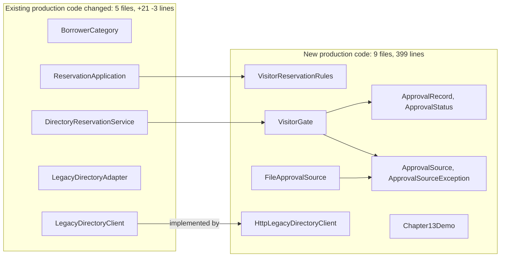
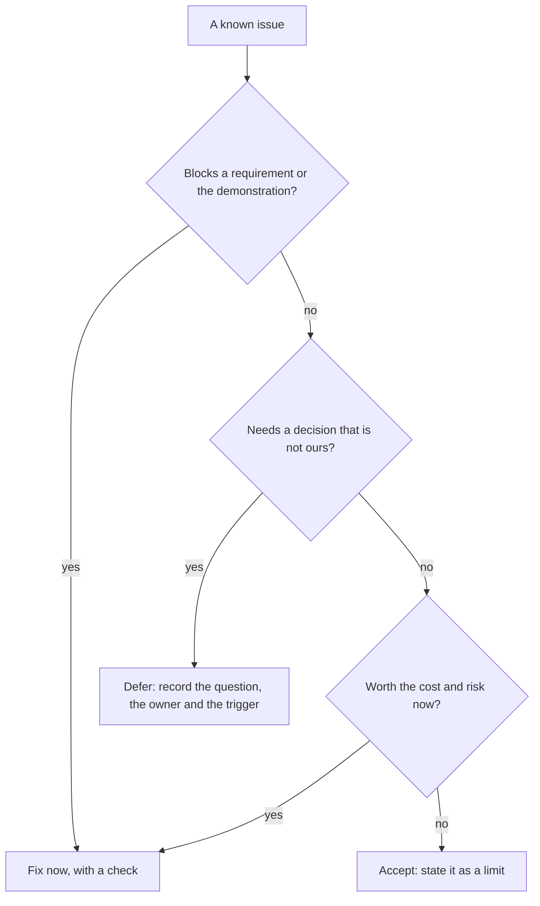
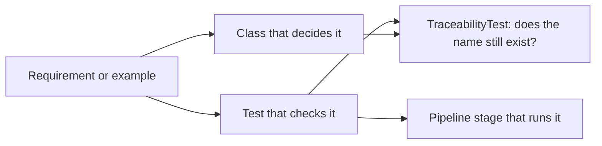

*OO Development and Agile Practices*  
*Designing, Testing and Evolving Software with AI Assistance*

It is the morning of the final presentation. A classmate who was not on your team opens your repository link to see what you built. The README says to run one command, and the command fails, because the classmate's machine has no `mvn` on its path and the error says only “command not found”. The README promises one number of passing tests; the build reports another. The requirements table points at a test that was renamed last week. A reviewer asks which of the three of you wrote the approval-file adapter, and the commit log says it was whoever has the most commits. It was not.

None of these is a defect in the software. Each is a defect in the **handover**: the material that lets someone else set the project up, trust what it says and understand who did what. This chapter finishes the project the way Chapter 13 started the change, with evidence. It is not a new feature sprint: the change began in Week 11 and was implemented in Chapter 13, so here we add no behaviour. The one fix in the worked project is to the setup and the demonstration, and everything else is a decision, a document or a check.

You will review how the design accommodated the change, using the affected responsibilities, the test failures, the revised assumptions and the review feedback, and see why a small diff is not automatically a better design. You will decide what remains to fix, defer or accept; write the documents a stranger needs and check them by following them in a fresh copy; and trace requirements to implementation and tests in a way that a check can keep true. You will support your retrospective with evidence and write an individual reflection that explains your own contribution, and you will prepare a final submission that does not claim evidence that does not exist.

This is Week 13, the final sprint and retrospective, and it touches all learning outcomes, LO1 to LO6. The required reading is Martin (2002), a review of the chapters relevant to your project [10]; the recommended reading is whatever is relevant to your own team's project. Week 13 has a final-sprint workshop with formative feedback, Week 14 has no classes and is for independent project work with optional team consultations, and the final demonstration, presentation and submission are in Weeks 15 and 16. The descriptor says teams submit a repository link, a technical report and an individual reflection, and give a demonstration and presentation, and that marks are moderated by individual contribution. This chapter creates no new deadlines, weights or marking rules: the approved final-project instructions decide what you submit.

You start from the Chapter 13 checkpoint (the visitor change, version 0.13.1) or, for your Team project, from a Milestone 4 outcome with its remaining defects named. The checkpoint you finish with is version 0.14.0, and its production code is unchanged. The companion lists only the new and changed files, with the model answers, the experiments and teaching notes.

Sections 14.1 to 14.5 and 14.7 are the core reading. Section 14.6 on contribution evidence is working knowledge: you are not asked to measure anyone, you are asked to know what each kind of evidence can and cannot show. The minimum lab is steps B1 to B4 and T1 to T5 of the practical activity in Section 14.10. Steps B1 to B4 run on the **Book project** and are running, tracing and diagnosis, since the finished checkpoint is supplied; steps T1 to T5 run on your **Team project** and produce your handover bundle, retrospective and individual reflection. Steps B5 to B8 (rehearse removing the flag, validate an AI-drafted README, read a contribution fixture, and close the gap that the one-line experiment found), the review questions, the transfer challenge and the optional extension are optional.

## 14.1 Reviewing the change outcome

### Ask four questions, in this order

“Did the design absorb the change?” is too vague to answer. Break it into four questions, each with its own evidence.

| Question | Evidence | Weakness |
|---|---|---|
| Which responsibilities were affected? | The list of files changed and added, and what each one does | Counts files and lines, not the importance of a line |
| What broke when the change started? | Test failures after the smallest edit that introduces the change | Shows what the tests cover, not everything that depends on the code |
| Which assumptions turned out to be wrong? | The assumptions written in earlier chapters, checked against the change | Only the assumptions someone wrote down |
| What did a reviewer say? | Actual review comments and the responses | Only as good as the review |

### Affected responsibilities

Between the Chapter 11 checkpoint and the Chapter 13 checkpoint, 23 files were added and 10 changed. Production code first. Nine new production files hold 399 lines: the visitor policy, the approval record and its status, the gate, the approval port and its exception, the file adapter, the HTTP client and the demonstration program. Five **existing** production files changed, by 21 added lines and 3 removed: the category enum, the directory entry point, the composition root, the directory adapter and the directory client contract. Ten new test files hold 992 lines, and three existing test files changed by 10 added lines and 4 removed. The rest is scripts, a workflow, a decision record and the README and POM.



**Figure 14.1.** The footprint of the visitor change in production code. The change is mostly new files that sit beside the existing ones. The existing files that changed did so by a few lines each. Arrows show use: an existing file using a new one, or a new file using another.

What does this show? Mostly that the existing structure took the change by extension, which is what the abstractions of Chapters 5, 6 and 10 were for. A new borrowing rule was one new class behind the policy contract. A new source of approval was one new port with an adapter. Two things do **not** show in a line count: the existing files that changed are the ones every request passes through, and nine new files are nine more things to read.

### What broke first

Start the change in the smallest possible way and see what the tests say. On the Chapter 11 checkpoint, add `VISITOR` to the category enum and change nothing else. The build fails: more than a quarter of the suite fails (one failure and a long list of errors), and nearly all of them say `Missing policy: VISITOR`. The coordinator requires a policy for every category and says so when it is constructed. The exact figures are in the companion (Section 5.2).

Now add the visitor policy to the composition root, `ReservationApplication`, as well. The failures drop to five tests, in exactly the three test files that build their own policy map: `LegacyRegressionTest.chapter06` (through `Chapter06Checks`), `BehaviourStrategyTest` and three tests in `RepositoryBoundaryTest`. Add the policy to those four maps and the whole Chapter 11 suite passes, with no assertion changed.

Is that good or bad? Both. It is the design telling you, at construction time and with a precise message, everywhere that lists every category. That is a safety net: the alternative would be a request that fails in production with a null policy. It is also a cost: every test that spells out the full policy map must be edited when a category is added. You can reproduce this in Section 14.10 (B1) by going the other way: remove the visitor policy from the composition root of the finished checkpoint, and roughly three in ten tests fail, in fourteen test classes.

### Revised assumptions

Chapters 5 to 11 made statements that the change tested. Some held and some did not.

| Assumption (where it was made) | What the change showed | Verdict |
|---|---|---|
| A policy answers a count and duration question and nothing else (Ch. 5, 6) | Approval needs the borrower, the item, the period and the time. Widening the policy would give it hidden state, so the request-specific decision went to a separate gate | Held, because the contract was not widened |
| Every borrower category has a policy in one place (Ch. 6) | True in production, but four test fixtures also spelled out the map | Held, with a cost |
| The directory is a synthetic in-process provider with a failure contract but no transport (Ch. 8) | Chapter 8 already translated a provider failure into a directory exception and told an outage from an absence. Chapter 13 added a real HTTP client and observed the failures a transport brings, including a timeout that has to cover the whole answer and not only the headers | The contract held. The behaviour behind it was extended |
| The count of retained reservations is the borrowing count (Ch. 7) | CR-12 preserved it on purpose and AC11 pins it | Still open (SD-12) |
| The overdue report knows two borrower kinds (Ch. 11) | A late visitor reaches the “any other kind” rule and is fined at a rate nobody chose | Still open (SD-11-1) |
| Notifications are one attempt, no retry (Ch. 6) | The directory client follows the same rule | Held and extended |

### A small diff is not automatically a better design

Here is the cheapest possible “implementation” of visitors. The directory adapter maps the kind code `V` to the existing staff category, in one line, and no gate, no approval register and no new policy exist. The diff is one line.

Run it against the finished suite (experiment E3 in the companion, Section 5.2). **Every unit test passes.** What fails is the tests that cross the real boundary: the three end-to-end journeys that use visitors and the integration test that serves a visitor through the real directory. In the journey with the flag off, visitor V1 is confirmed, so the flag is ignored; an unapproved visitor is rejected only because the item is already taken, not because it is unapproved; and a malformed register no longer stops anyone. It is a smaller diff, and it does not implement the requirement.

Be careful about what this shows. It shows that this suite has a **gap**: no unit test checks the adapter's mapping of the visitor code, so a one-line change to it passes the whole unit stage. A focused unit test of the adapter would catch it, and so would the integration tests that did. The lesson is not that unit tests cannot see such a change. It is that a passing unit stage is evidence only about what the unit tests cover, and that a suite with a hole in it is found by trying a change that goes through the hole. Neither the size of a diff nor a green unit stage is the measure of a design. The acceptance examples are, and the gap itself is a finding: Section 14.10 (B8) asks you to close it.

The same reasoning protects the opposite case. A change that is larger than you expected, if each added file has a purpose that the requirement needs, is not a failure. It is a failure when the added files exist to support code that nobody asked for, or when existing files change in ways the change did not require. The footprint above has no such file: the three changes to existing test files add an entry to a map, and nothing else.

### Where the design bent

A fair review also names the place that did not absorb the change cleanly. `DirectoryReservationService` now contains this:

```java
if (borrower.category() == BorrowerCategory.VISITOR) {
    Optional<String> rejection = visitorGate.rejection(borrower.id(), itemId, start, days);
    if (rejection.isPresent()) return rejection.get();
}
```

That is a category-specific branch in the entry point. For one special category it is fine and easier to read than an abstraction. At a second special category it becomes a smell, and the next step would be a per-category pre-check chosen from a map, introduced as a refactoring with its own tests. Record this as a known issue with its trigger (the second category) instead of fixing it now. The known-issues list in Section 14.2 does exactly that (KI-14).

### Review feedback

Real review feedback is evidence, and **constructed** feedback is not. If your team has review comments on its change, use those and the responses. The Book project has no team, so the companion supplies a short, author-written, fictional review of the visitor change, labelled as such, and asks you to check each comment against the code instead of accepting or rejecting it by tone. No real peer review of this book's project has taken place.

## 14.2 Defects, polish and scope control

### The temptation of the last week

In the final sprint every team sees things it could improve. Some are real defects. Some are polish. Many are new features in disguise. If you act on all of them, you finish nothing and introduce faults close to the deadline. Three questions sort them.

1. **Does it block a requirement or the demonstration?** If yes, it is a blocker: fix it first or change the plan.
2. **Does fixing it need a decision that is not ours?** If yes, it is *deferred*: record the question, the owner and what would trigger the decision.
3. **Is the cost and risk of changing it now worth the benefit?** If not, it is *accepted*: say so in writing, as a limit, not as a secret.



**Figure 14.2.** Triage of a known issue. Every path ends in something written down. “Fix now” ends with a check, so the fix is visible later.

### What the project did with its own list

The visitor project has fourteen known issues (`docs/KNOWN-ISSUES.md`). One was fixed, seven are deferred (five wait for an owner's decision, one for a JDK 17 and a hosted runner, one for the flag decision) and six are accepted limits. The fixed one is a good example of polish worth doing: the demonstration program needed a directory service that only the tests could start, so a new reader could not run it. That is a blocker for a handover, because a reader who cannot run the system cannot check anything else about it. The fix added no behaviour. It added a small launcher that starts the same test stub and runs the system twice, and a script to run it.

The deferred ones are different. SD-11-1 says that a borrower kind other than student or staff is fined at 1.00 a day with no grace and no cap. A late visitor now reaches that rule, and acceptance example AC18 pins it. It is tempting to “fix” it by giving visitors a sensible rate. But nobody on the team knows the right rate. Only the records office does. A guess would be a new rule disguised as a bug fix, and it would hide the question. So it is deferred: the question, the owner, and the test that will change when the answer arrives are all written down.

The accepted ones (a one-second directory wait that was not measured; no retry after an outage) are limits that the documents state. “Accepted” is not “ignored”. It means that the team decided, with a reason, and that a reader can find the reason.

### Resist the plausible additions

| Tempting addition | Why not now |
|---|---|
| Retry the directory call after a timeout | Changes the one-attempt contract of earlier chapters, and nobody has measured an outage |
| Replace the approval file with JSON or a database | Nothing in the requirement needs it, and it adds a new boundary to test |
| Remove the flag to “clean up” | The conditions for removal do not hold (Section 14.3) |
| Give a visitor a late-fine rate | A decision for the records office, not the team |
| Add a second category of visitor | A new requirement. Raise it as a change request, not as polish |

Fowler names four costs of building a feature before it is needed: the cost of building it, the cost of the delay it causes, the cost of carrying its complexity, and the cost of repairing it if its assumptions were wrong [5]. In the last week the delay and the repair cost are the ones that hurt.

### A release is “done” by a definition, not a feeling

The Scrum Guide defines a Definition of Done as the state an increment must reach to meet its quality measures, and says that work that does not meet it cannot be part of the increment [3]. Write yours for the handover version, as a short list that a check can confirm: the pipeline passes; the handover check passes; no test is skipped; every number in a document matches a run; every decision record has a true status; every known issue has a decision. The next section shows which of these a script can confirm.

## 14.3 Documents, decision records and release notes

### One document per question

A new reader asks different questions at different times. One long document answers none of them well. The project has six, and each is kept true in a different way. Appendix C has forms for the requirements table and the known-issues list (C.10), for decision records (C.5) and for release notes (C.11).

| Document | Question it answers | How it is kept true |
|---|---|---|
| `README.md` | What is this, and where do I start? | Short; points to the others |
| `docs/HANDOVER.md` | How do I set it up, run it and understand it in an hour? | `scripts/handover-check.sh` follows it in a fresh copy |
| `docs/REQUIREMENTS-TO-EVIDENCE.md` | Which test checks each requirement? | `TraceabilityTest` fails if a named test or class is gone |
| `docs/KNOWN-ISSUES.md` | What is wrong or missing, and what was decided? | A reviewer; every row has a decision |
| `docs/ADR-0NN-*.md` | Why is it built this way? | Never edited after acceptance except its status; a new record supersedes it |
| `docs/RELEASE-NOTES-*.md` | What changed in this version? | Written at release; one file per version |

The common failure is documentation that was true once. The cheapest document to maintain is one that a check keeps true, so wherever a statement can be checked by a script, write the script.

### Decision records

A decision record captures a decision, not a description of the code. Nygard proposes short records kept in the repository with five parts: a title, the context (the forces at play), the decision, its status (proposed, accepted, or later superseded) and its consequences, numbered in order and never reused; if a decision is reversed, the old record stays and is marked as superseded so that a reader can see what was decided and why it changed [1]. The records of this project add three more parts that earn their place: the alternatives considered, how the decision was validated, and the triggers for revisiting it.

ADR-013 recorded the visitor change and set conditions for removing the flag. ADR-014 is the handover decision about that flag, and it shows the shape of a good one. It states the three conditions from ADR-013 and checks each: the pipeline has run both settings (true); the visitor contract has not been accepted by an owner (not yet); nobody has recorded a decision to keep visitors enabled (not yet). It decides to keep the flag, default off, and **rehearses** the removal so that the change is ready and its cost is known. It does not remove it, and it does not edit ADR-013.

### Release notes

A changelog is for people, so write it for them. Keep a Changelog groups changes as Added, Changed, Deprecated, Removed, Fixed and Security, gives each version its own dated entry and puts the newest first [2]. The notes for version 0.14.0 use three of those headings and add two of their own that a handover needs: “Behaviour you should know about” and “Not verified”. The first line of the notes says that no production behaviour changed. That is a statement a reader can check, and it was checked: every file under `src/main` is byte for byte as in 0.13.1.

## 14.4 Keeping the evidence true: rehearsal and traceability

Section 14.3 described the documents. This section shows two ways to keep what they say true: rehearse a risky change before deciding it, and give the requirements table a check that fails when a name in it disappears.

### Rehearse a risky removal instead of arguing about it

The removal of a flag looks like deleting an `if`. Rehearsed in a scratch copy, it touched eleven files: three production classes, five test classes, the requirements table, the expected numbers in the handover document and the handover check, with 87 lines added and 131 removed. The reason is that the flag was not one `if`. It was a constructor parameter, a result text, a factory for the old two-argument constructor, a system property in the demonstration, the acceptance example AC12 that exists only for the flag, two other acceptance examples that mention it, a journey that tests the flag off, and two documents that explain it. After the rehearsal the full build had no failure, the pipeline passed and the handover check passed. The patch is stored in `rehearsal/` and not applied.

Notice what the rehearsal also taught. Retiring AC12 means that a requirement in the specification (a disabled flag rejects explicitly) disappears when the flag does. That is a change to the specification, and it needs a decision, not just a patch. After removal, the rollback is a redelivery of the previous release, because there is no longer a switch.

### Requirements to evidence

Traceability is the chain from a requirement to the code that decides it and the test that checks it. In a small project a table is enough:



**Figure 14.3.** The chain that `docs/REQUIREMENTS-TO-EVIDENCE.md` records. The last step is the one that stops the table rotting.

`TraceabilityTest` checks three things: every test named in the table still exists as a method, every class named as deciding still exists, and each of the eighteen acceptance examples has exactly one row and every acceptance test appears in the table. In an experiment with six faults (Companion, Section 10.2) it caught the four that make a name disappear or an example lose its row. It did **not** catch two others, and it cannot: a row that points at a test that exists but is the wrong test for that requirement, and a row that lists an extra test. A script can check that a name exists. Only a reviewer can check that a name is the right evidence. Say so in the document, as the project does.

## 14.5 Reproducible setup and demonstration

### Write for someone who is not you

Your own machine has things installed that you have forgotten about. The only way to find them is to try the instructions somewhere else. The handover document for the project begins with what you need (a full JDK 17 or later with the `jdk.jdeps` module, Maven 3.9.11, a POSIX shell, network access for the first build), then gives three commands with their expected output, then shows how to see the system working.

A script can follow the document for you. `scripts/handover-check.sh` copies the project, without build output, into a new folder, runs the pipeline and the demonstration there, and compares what they print with what the document promises: the pipeline passes with the expected number of tests in each stage, the document itself states those numbers, and the demonstration shows the expected lines. If a test is added and nobody updates the document, the script fails, and so it does if the document is edited to a number the run does not give. In an experiment, adding one test made it report that a stage had run a different number of invocations from the one promised, and renaming one word in the demonstration's output made it report the missing line.

### What the dry run found

Following the handover in a fresh folder found four things before any reader did.

| Finding | Effect on a new reader | Change |
|---|---|---|
| The setup assumed `mvn` was on the PATH. On the test machine it was not, and the failure said only `command not found` | The reader stops at step 1 | The document starts with a tool check, and the scripts print a clear message and stop if Maven or Java is missing |
| On a recent JDK, Maven 3.9.11 prints `WARNING` lines about `sun.misc.Unsafe` (these come from the JDK version, not from your code), and the mocking library prints a warning that an agent was loaded | A reader may think the build is broken | The document lists “things you may see that are not errors” and says to read the last lines |
| The demonstration program needed a directory service that only the tests could start | The reader could not see the system work | A launcher that runs the stub and the program in one process, and `scripts/demo.sh` |
| The first version of the clear message for a missing Maven was wrong: it rejected a valid Maven path on Windows (a `.cmd` file that is not executable in the shell sense) | The check meant to help would have blocked a correct setup | Found by running the handover check on a machine with a full path in `CHAPTER_MVN`; fixed by also accepting a file that exists |

The last row matters. It was a fault in a fix written during this very exercise, and it was found only because the fix was run in the setting it was meant to protect. A document you have not followed is a guess about what it says.

A folder name with spaces in it was also tried, and worked. That is a result and not a finding: say what you tried that did not break.

### The demonstration

A demonstration is a short, repeatable story with a fixed clock and fixed data. The project's is `scripts/demo.sh`: it compiles, starts the local directory stub inside one process, writes a small approval register, and runs the system twice, with visitors disabled and then enabled. A viewer sees the same requests produce different results, and an unreachable directory reported as unavailable and not as a missing borrower. The handover also suggests an outline of about ten minutes: the problem and what changed, the pipeline, the demonstration, one row of the requirements table followed to its test, and what is not shown. The timings are a suggestion. Your instructions decide the length and format of your own demonstration.

### What the dry run cannot show

It ran on one operating system with one JDK and a local Maven repository that already held the dependencies. It cannot show a first build over a slow network, a Java 17 runtime, a different shell, or a reader who misreads a sentence you thought was clear. To cover the last, ask a real person from outside your team to follow the document while you watch and say nothing. Write down every place they hesitate. That is the test.

## 14.6 Retrospective and individual reflection

### A retrospective is evidence-based or it is a mood

The Scrum Guide gives the purpose of the Sprint Retrospective as planning ways to increase quality and effectiveness: the team inspects the last sprint's individuals, interactions, processes, tools and Definition of Done, discusses what went well and what went wrong, and identifies the most helpful changes, which may be added to the next Sprint Backlog [3]. Kerth's Prime Directive asks the team to assume that everyone did the best they could, given what they knew and the resources they had [4]. Together they say: look at the work and the process, not at blame.

Make it evidence-based by bringing the sprint's artefacts: the board, the pipeline runs (passing and failing), the review comments, the defect list, the time between starting and finishing items from Chapter 12. For each thing the team wants to say, ask what artefact shows it.

| Observation | Evidence | Action | Owner and date |
|---|---|---|---|
| “Reviews were slow” | Two pull requests waited more than two days (board timestamps) | Review before starting a new item | Named person, next sprint |
| “The pipeline was flaky” | One of ten runs failed with no code change (run list) | Fix or quarantine the unstable test | Named person |
| “We rushed the end” | Seven items moved to Done on the last day | Plan a smaller scope and a freeze | Whole team |

Keep the number of actions small. Two actions with owners that are done beat ten that are not.

### The process note, revisited

Chapter 3 asked each team to say which parts of Scrum it used as defined and which it adapted for the course. Now say what the evidence shows about each adaptation. For example, the course's sprints end at milestone weeks and not at a fixed calendar interval; a student team is not a full-time team; the Product Owner is usually a teaching role. For each adaptation, say whether it helped, whether it hurt and what you would change. This is the closing of an earlier commitment, and it does not need new terms.

### Individual contribution is evidence of three kinds

The descriptor assesses individual contribution through commits, pull-request reviews and peer evaluation, and says that team marks are moderated by individual contribution. Each of these is an input. None is the answer. What each can and cannot show:

| Evidence | What it can show | What it cannot show |
|---|---|---|
| Commits | That a change was made and by which author identity, when, and what it touched | Effort, difficulty or importance. Commit size is a habit. Pair work is recorded under one author unless the other is named in a `Co-authored-by` line [7]. Formatting and regenerated files inflate counts. Squash merges turn many commits into one |
| Pull-request reviews | That someone read a change and what they said. A review can be a comment, an approval or a request for changes [8] | Whether the review was careful. An approval says the changes look ready to merge, and nothing about how thoroughly it was checked |
| Peer evaluation | How teammates experienced each other's work, including things no tool records | Objectivity. It is affected by friendship, conflict and what people happened to see |

GitHub's own account of its contribution graph shows how little a count can be trusted as a measure. A commit counts only when its author email is linked to the account, and only when it is on the default branch or reaches it through a merged pull request; commits made in a fork do not count until merged [6]. A person whose commits use the wrong email appears to have done nothing.

### A constructed example

The following is **synthetic**, constructed for this chapter. A team of three (P1, P2, P3) finished its last sprint with these counts.

| | Commits | Of which formatting only | Lines changed | PR reviews given | Reviews that requested changes |
|---|---|---|---|---|---|
| P1 | 38 | 17 | 410 | 4 | 1 |
| P2 | 9 | 0 | 1,150 | 11 | 5 |
| P3 | 24 | 3 | 620 | 7 | 0 |

Rank them by commits and you get P1, P3, P2. Rank them by lines changed, P2, P3, P1. By reviews given, P2, P3, P1. By reviews that asked for changes, P2, P1, P3. Four rankings, three different orders. P1 has 38 of the team's 71 commits, more than half, and 19% of the changed lines. Those numbers describe habits, not contributions. The underlying facts, which only the people and the artefacts can supply, might be: P1's commits include seventeen formatting-only commits and several that undo each other, and P1 built the pipeline; P2 wrote the approval-file adapter in nine substantial commits and found two defects in review; P3 wrote the demonstration and the documents and did four pair sessions with P1, only two of them recorded.

Notice that no ranking is offered, and that none could be. The honest use of counts is as a pointer to the artefact to read: “Why did P2 have so few commits?” is a question to ask, and the answer is in the diff and the review.

### Write your contribution as claims with evidence

An individual reflection that explains your contribution does not say “I did a lot”. It says what you did, where to see it, what you learned from it and what you would do differently.

| Part | Prompts |
|---|---|
| What I did | Three to five specific pieces of work, each with a link or path: a pull request, a file, a test, a review comment |
| What I decided | A design or process decision, the alternatives and why |
| What went wrong and what I did about it | A real fault or misjudgement, how it was found, the fix and what changed afterwards |
| How I used AI | Where, with what input, what you accepted or rejected and how you verified it |
| What I did not do | Honest limits: work you started and did not finish, work you relied on others for |
| What I would change | One thing about your own practice |

These are prompts for thinking, not a rubric. Your approved instructions say what the reflection must contain. Appendix C has templates for the retrospective (C.12) and for decision records (C.5), and Appendix E gives a fuller guide to contribution evidence (E.4), the final handover (E.5) and the reflection (E.6). This chapter stands on its own without them.

## 14.7 Final submission preparation

### What is submitted, and what it must show

The descriptor says that teams submit the complete system built across the sprints, together with a short technical report and an individual reflection, through a repository link, and give a demonstration and a presentation followed by questions. It also says what the submission must show: clean object-oriented design, justified use of design patterns and architecture, automated tests with continuous integration, evidence of safe refactoring, and adaptability to the injected change in requirements. You can use those five phrases as the headings of an evidence index. For the book project, one looks like this:

| The submission must show | Evidence in the project | What it does not show |
|---|---|---|
| Clean object-oriented design | Responsibilities and dependencies of Chapters 2, 5, 6 and 10; the architecture tests | That the design is the best one, or that it was reviewed by anyone else |
| Justified patterns and architecture | Chapters 9 and 10; ADR-010 | Any pattern the design does not use |
| Automated tests with CI | The project's test suite; the five-stage pipeline; the workflow file | A hosted CI run: the workflow has never run |
| Evidence of safe refactoring | Chapter 11: characterisation tests, stage-by-stage refactoring, probe | Behaviour on inputs the generator did not produce |
| Adaptability to the change | Chapter 13 footprint and tests; the requirements table; the rehearsed flag removal | Whether the visitor rule is the right policy |

### A short sequence

Do these in order. Week 13 is for finishing and for the workshop's formative feedback. Then freeze: decide a time after which only fixes to the handover and blockers are allowed. Run the handover check on the frozen version. Use Week 14, which has no classes, for independent review of the whole bundle: read it as a stranger, fix what the dry run finds, and ask someone outside the team to follow it. Then prepare the demonstration and the report from the evidence index, and write your reflection from your own artefacts.

### A preparation checklist (not a rubric)

- The repository link opens for a person who is not on the team, and the default branch is the version you mean.
- A fresh copy builds with the documented commands and prints the documented numbers.
- The pipeline has run, and you can show one passing run and one failing run you have read.
- Every number in a document matches a run. Every claim names the evidence.
- Every decision record has a true status. Every known issue has a decision.
- The limits statement says what was not run: for the Book project, a Java 17 runtime, a hosted CI run and any independent review.
- Each person can say, with links, what they did.
- The demonstration works from a fresh checkout with only the documented setup.

Do not claim a hosted run, a public deployment or a peer review that did not happen. A local run is evidence of a local run.

## 14.8 AI in practice: validate a README that an assistant drafted

Chapter 15 collects the recurring AI workflows; this activity is self-contained, and the fixture below is all you need.

| Element | For this activity |
|---|---|
| Engineering objective | Decide which statements in an AI-drafted README are supported by the submitted version, and correct the rest |
| Input | The README draft below and the project at version 0.14.0 |
| Permitted scope | Verify every command, every feature claim and every limitation; edit only the draft |
| Independent checks | Run each command; read the code, tests and decision records that each claim depends on |
| Accept or reject | A verdict on each statement, and a corrected README |
| No-account route | The fixture below is sufficient |

Use this **author-written fictional AI-output fixture**, constructed for offline comparison. An assistant was asked to “write a README for the project”, and produced:

```markdown
# Campus Equipment Lending System

A Java 11 application for reserving campus equipment, with support for students, staff and visiting researchers.

## Quick start

1. Build: `mvn package`
2. Run: `java -jar target/equipment-lending.jar`
3. Check everything: `mvn verify` runs all 230 tests, which pass in under 30 seconds.

## Features

- Visiting researchers are enabled by default. Set `-Dlending.visitors=false` to turn them off.
- Visitors may reserve CAM1 or CAM2 for one to three days when a sponsor approval matches.
- Sponsor approvals are read from a CSV file. The file is cached in memory for speed.
- If the borrower directory does not answer within one second, the system retries three times and then treats the borrower as a student.
- `scripts/pipeline.sh` runs five stages and deploys the application to the staging server.
- Architecture rules are enforced by `DependencyRulesTest`.
- The system is production-ready and safe for concurrent use.

## Demonstration

Run `bash scripts/demo.sh` to see visitors rejected and then approved.
```

Split it into separate statements, and for each decide: **supported** (name the evidence), **contradicted** (name the evidence and write the correct statement) or **not established** (say what would be needed). Run every command; do not decide from the text. Notice which errors are easy to spot by reading, and which only a run reveals. A statement that is plausible is not a statement that is true. A README that is partly right is more dangerous than one that is obviously wrong, because the reader stops checking.

A secondary activity: write what the README should say about limitations. The draft says none, and your handover should say them plainly.

A live AI service is optional. If you use one, give it synthetic data or only project files you may share, keep its actual output, and treat its description of your project as a claim to check.

## 14.9 Common mistakes

| Mistake | Consequence | Better action |
|---|---|---|
| Treating the last week as a chance to add one more feature | Late faults, and a handover that describes a system that no longer exists | Triage every item as fix, defer or accept, and freeze |
| “Fixing” a suspected defect that needs an owner's answer | A guess becomes a rule and the question is lost | Defer it with the question, the owner and the test that will change |
| Judging a change by the size of its diff | A tiny diff that fails the requirement looks like a good one | Judge it against the acceptance examples and across all test stages |
| A README written from memory | Counts, commands and defaults that were once true | Follow it in a fresh copy and let a script check what it can |
| Documents that nobody checks | They rot, and a reader trusts them anyway | Give each document a check or a reviewer, and say which |
| Editing an old decision record to match what happened | The reasons for the decision are lost | Write a new record that supersedes or applies it |
| Removing a flag as tidy-up | The specification changes silently, and the rollback changes with it | Rehearse the removal, decide it and update the examples that mention the flag |
| Ranking teammates by commit counts | Habits are mistaken for contribution | Use counts as a pointer to the artefact, and read the artefact |
| A reflection that says “I contributed a lot” | Nothing can be checked | Claims with links, and honest limits |
| Claiming a hosted run, a review or a Java 17 run that did not happen | The submission loses credibility, and so do the true claims | Say what was not run |

## 14.10 Practical activity

**Input:** the Chapter 14 checkpoint (version 0.14.0) with the files of the companion, the Chapter 13 material, and your Team project's repository. Steps B1–B7 use the **Book project**; steps T1–T5 use your **Team project**.

**Instructor demonstration:** run `scripts/handover-check.sh` and read its output. Break one thing (add a test, or rename a word in the demonstration output) and run it again. Run `TraceabilityTest` after renaming a test the table names. Show the one-line adapter change that passes the unit stage and fails the integration stage.

**Guided practice:** classify four known issues of your choice as blocker, deferred or accepted, and say what evidence each decision rests on. Read the requirements table and find the row you trust least.

**Minimum required lab: Book project (run, trace and diagnose; nothing to rebuild)**

- **B1. Predict and measure what breaks.** In a scratch copy of the finished checkpoint, remove the visitor policy from the map in `ReservationApplication.create`. Predict how many invocations fail and in how many test classes, and what the message will say. Run the full build, compare, and say what the result shows about the design. Restore the original.
- **B2. Triage.** Take five items from `docs/KNOWN-ISSUES.md`. For each, check the decision against the three questions of Section 14.2 and say whether you agree. Add one item that you find yourself, with a decision.
- **B3. Follow the handover.** Run `scripts/handover-check.sh`. Then follow `docs/HANDOVER.md` by hand from a new folder on your machine, and list every place where you had to guess or where the text was wrong for your setup.
- **B4. Trace and break a row.** Choose one contract clause, one acceptance example and one known gap in the requirements table. For each, open the named test and say whether it checks what the row claims. Rename one named test in a scratch copy, run `TraceabilityTest`, and read the failure. Then name something the check cannot catch.

**Minimum required lab: Team project (your handover bundle, retrospective and reflection)**

- **T1. Review your change.** Fill in the four questions of Section 14.1 for your own change, with real evidence: the files and responsibilities affected, what failed when you started the change, the assumptions it overturned and the review comments you actually received. Say where the design did not absorb the change cleanly.
- **T2. Triage your open items.** Make a known-issues list with a decision for each item (fix, defer, accept), a reason, and an owner for the deferred ones. Fix only blockers. Freeze.
- **T3. Build the handover bundle.** Setup instructions, a usage example, the known limitations, test instructions, a requirements-to-evidence table and a demonstration outline. Run a dry run in a fresh copy, then have someone outside your team follow it while you watch. Record what they struggled with and fix it.
- **T4. Decide and record.** Write at least two decision records: one about your flag or your change (keep, remove or replace, with the conditions), and one other. Give each a true status.
- **T5. Retrospective, reflection and checklist.** Hold an evidence-based retrospective with at most three actions. Write your own individual reflection using claims with links. Complete the preparation checklist of Section 14.7, marking each item as complete or a gap.

**Optional extension (Book project)**

- **B5. Rehearse the removal.** In a scratch copy apply `rehearsal/remove-visitor-flag.patch`, run the build and the handover check, and list the documents whose prose the patch does not edit and still needs changing.
- **B6. AI activity.** Complete the Section 14.8 activity.
- **B7. Read a contribution fixture.** Use the synthetic table of Section 14.6. Write two questions you would ask each team member, and what artefact you would read to answer each. Say what you would **not** conclude from the counts.
- **B8. Close the gap that E3 found.** Write the focused unit test of `LegacyDirectoryAdapter` that fails when kind `V` is mapped to staff: a visitor row maps to the visitor category, an inactive visitor is absent, and an unknown code is a failure and is never defaulted. Run the one-line change of Section 14.1 against your test.

**Expected artefacts:** B1–B4 as above; for the Team project, the change review, the triage list, the handover bundle with its dry-run record, the decision records, the retrospective with its actions, the individual reflection and the completed checklist.

**Acceptance conditions:**

- every number in a document matches a run;
- the handover has been followed by someone other than its author in a fresh copy;
- every known issue has a decision;
- no feature was added in the final sprint to fix a known issue that needs an owner;
- every decision record has a true status;
- contribution is described with claims and links and not ranked by counts;
- the limits statement says what was not run.

Do not claim a hosted run, a public deployment or a review that did not happen.

**Optional extension:** write a second handover for a different reader, such as the person who will operate the system. Say how its content differs from the first and why.

## 14.11 Review and transfer

### Concept questions

1. Name the four questions of a change review and what each one's evidence cannot show.
2. A one-line change passes every unit test and fails four integration and end-to-end tests. What does that tell you about the change, and what does it tell you about the unit tests?
3. What is the difference between deferring an issue and accepting it? Give an example of each from the project.
4. What can a requirements-to-evidence check confirm, and what can it not?

### Applied diagnosis

5. A teammate has 40 commits and another has 8. Name three questions you would ask before saying anything about their contributions, and an artefact you would read for each.
6. Your handover says “run `mvn verify`; expect a stated number of tests” and a colleague adds a test. List two things that could have noticed and the cost of each.

### Transfer challenge

A small team has built an ML model-serving service. Its final sprint ends in a week. Plan its handover: a README for a stranger, the tool check and what the first run prints, a demonstration with a fixed model and fixed data, a requirements-to-evidence table, a known-issues list that includes what the team did not evaluate about the model, and a decision record for the one flag that gates a model version. Say what you would put in the limits statement. Use synthetic model identifiers: no model needs to be trained.

## Summary and next chapter

A change is finished when someone else can see what it did, trust what the documents say, and run it. Review the change with evidence, not feelings: the responsibilities affected, the failures it caused, the assumptions it overturned, the feedback it received. Sort what remains into fix, defer and accept, and leave the deferred questions with their owners. Write the few documents a stranger needs, and give each a check or a reviewer. Follow your own instructions in a fresh copy and let someone else follow them too. Describe each person's work as claims with links, and never rank people by counts. Say what you did not run.

The visitor project is handed over at version 0.14.0 with its flag decided, its removal rehearsed, fourteen known issues with decisions and two unresolved questions for an owner: SD-11-1, the late-fine rate, and SD-12, the count rule. Chapter 15 collects the assistance workflows that recur through the book and the verification records that make them reviewable.

## Sources and further reading

Online sources 1–9 were opened on 13 October 2026. The code, the scripts, the documents, the experiments and the fixtures are original teaching material.

1. Nygard, M., [Documenting Architecture Decisions](https://www.cognitect.com/blog/2011/11/15/documenting-architecture-decisions), 15 November 2011. Short records in the repository: title, context, decision, status, consequences; numbered; superseded and not deleted.
2. [Keep a Changelog 1.1.0](https://keepachangelog.com/en/1.1.0/). Changelogs for humans; the change types Added, Changed, Deprecated, Removed, Fixed and Security; a dated entry for each version.
3. Schwaber, K. and Sutherland, J., [The Scrum Guide](https://scrumguides.org/scrum-guide.html), November 2020. The purpose of the Sprint Retrospective and the Definition of Done.
4. Kerth, N., The Retrospective Prime Directive, in *Project Retrospectives: A Handbook for Team Review*; read as summarised on [Retrospective Wiki](https://retrospectivewiki.org/index.php?title=The_Prime_Directive). This chapter treats retrospectives in Section 14.6.
5. Fowler, M., [Yagni](https://martinfowler.com/bliki/Yagni.html). The costs of building a presumptive feature: build, delay, carry and repair.
6. GitHub, [Why are my contributions not showing up on my profile?](https://docs.github.com/en/account-and-profile/how-tos/contribution-settings/troubleshooting-missing-contributions). The author email, the default branch and the fork conditions for a commit to count. The page does not say how squashed, rebased or co-authored commits are counted.
7. GitHub, [Creating a commit with multiple authors](https://docs.github.com/en/pull-requests/how-tos/commit-changes/creating-a-commit-with-multiple-authors). The `Co-authored-by` trailer.
8. GitHub, [About pull request reviews](https://docs.github.com/en/pull-requests/reference/pull-request-reviews). Reviews as comment, approve or request changes. The page says an approval signals that the changes are ready to merge, and not what it guarantees beyond that.
9. Hodgson, P., [Feature Toggles (aka Feature Flags)](https://martinfowler.com/articles/feature-toggles.html). Release toggles are short-lived, and toggles are inventory with a carrying cost; also used in Chapter 13.
10. Martin, R. C., *Agile Software Development: Principles, Patterns, and Practices.* Prentice Hall, 2002. The module's required text; the descriptor lists the Week 13 reading as a review of the relevant chapters. Chapters 2 to 13 of this book cover the material to review, and this chapter shows how to evidence it.