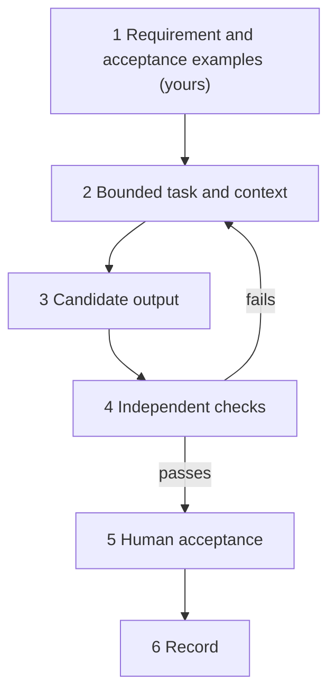
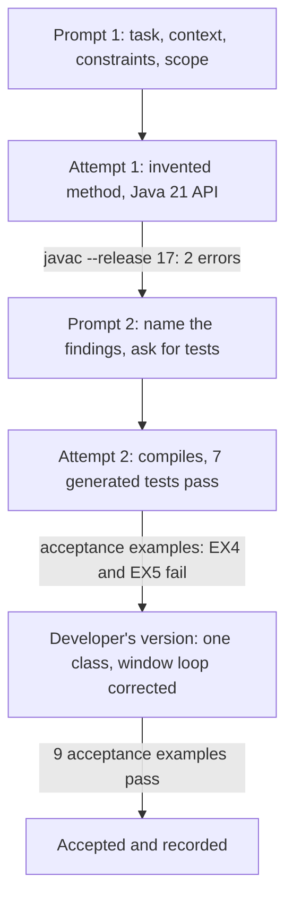

*OO Development and Agile Practices*  
*Designing, Testing and Evolving Software with AI Assistance*

## Opening scenario

It is late. You ask an assistant for a small method, and it returns tidy code with a confident note: “I tested this with Java 17 and it works.” It compiles on your laptop. You also ask it for tests, and they pass. You commit. The next morning the pipeline fails to compile, because one call exists only from Java 21. A reviewer asks why the tests agree with the code when your teammate's examples do not. Another reviewer asks where a dependency named in a `pom.xml` snippet came from, because nobody can find it.

None of these needs a bad assistant. Each needs only an ordinary one and a missing habit: the habit of treating the output as a **candidate** that someone else's evidence must accept or reject. This chapter collects that habit into a few workflows you have already practised in Chapters 1 to 14, shows them end to end on one small task, and says what to write down so that the work can be reviewed.

The chapter is vendor-neutral. It does not teach prompt tricks, model internals, retrieval or agents. It is about AI-**assisted** development, where an assistant helps you build software. Software that contains an AI or data component, such as the borrower directory of Chapters 6 to 8 and 13, is a different topic and is treated where it arises and, for a model, in Appendix F.

## Before you start: five rules

Read these with Chapter 1. They are the short version of everything below.

1. **You are accountable.** The assistant proposes. You decide, and you answer for what you commit.
2. **The requirement is yours.** An assistant can ask good questions about it. It cannot decide what the equipment office wants.
3. **Keep the evidence independent.** Check the output against something the assistant did not write: the requirement, examples you wrote first, the compiler, a trace by hand. Another assistant's opinion is not independent evidence.
4. **Share the minimum.** No secrets and no personal data. Use synthetic data.
5. **Follow the current rules.** Whether a given tool may be used on coursework or in an assessment is decided by the module leader's current rules, not by this book.

## Learning outcomes and reading route

By the end of this chapter, you should be able to:

1. Provide bounded context for an AI-assisted task: what it is, what it may use, what it must not do, and what counts as done.
2. Evaluate candidate explanations, code and tests against evidence, claim by claim.
3. Recognise unsupported APIs, invented methods, unnecessary abstractions and tests that repeat the code's mistakes.
4. Record useful provenance and verification evidence.
5. Complete an equivalent exercise without live AI access.

**Module connection:** this is a reference chapter that belongs to no teaching week. It supports the module's outcomes wherever an assistant is used and adds no separate assessed AI outcome. It creates no new deadlines, weights or marking rules. Whether, and how, AI tools may be used in an assessment follows the module leader's current rules.

**Entry checkpoint:** none is required. The worked example is a small separate project (the **lab**) that stands alone, compiles for Java 17 and needs only the pinned Maven toolchain of the earlier chapters. The lending project is not changed: its handover version 0.14.0 stays as Chapter 14 left it.

**Core reading.** Sections 15.1, 15.2, 15.4, 15.6 and 15.8.

**Working-knowledge reading.** Sections 15.3, 15.5 and 15.7. Learn the method. You do not need to memorise tools.

**Minimum required lab.** Steps B1–B4 and T1–T3 of the practical activity in Section 15.11. Steps B1–B4 run on the **Book project** (the lab) and are running, tracing and diagnosis: everything is supplied. Steps T1–T3 apply the method to your **Team project**. This chapter has no teaching week, so these steps are not a separate weekly task. They consolidate what the “AI in practice” activities of Chapters 1 to 14 already ask. Do B1–B4 once, at the point where you first need them: alongside the first AI activity you do, or before your final handover (Chapter 14). Satisfy T1–T3 with the AI-assisted work your team actually does, recorded as described here. They create no additional submission and no new assessed item unless your approved instructions say otherwise.

**Optional extension.** Steps B5–B7 and T4, the review questions and the transfer challenge. Section 15.9 explains how to do every AI activity in this book without a live service. Nothing required depends on a paid account.

The separate companion for this chapter contains the lab, the constructed outputs, the experiments, the model answers and teaching notes.

## 15.1 Assistance and accountability

### What an assistant gives you

An assistant can explain code, suggest an implementation, propose tests, point out risks in a change and draft documents. Each of these is a **candidate contribution**. It is plausible text or code that may or may not be right. GitHub's documentation for one such tool says that suggestions can look valid and still be incorrect, and that the user must review and validate them before accepting them [1]. The same page says users assume the risks of generated code, including bugs, security flaws and intellectual-property questions. That is one vendor's statement about one tool, and not a property of every assistant. The discipline it describes is general.

### Where the decisions stay

| Question | Who answers it |
|---|---|
| What should the system do? | The requirement owner, with your questions. Not the assistant |
| Is this output correct? | Evidence: the compiler, examples you wrote first, tests, a trace. Not the assistant's own claim |
| Is this the simplest design that works? | You, in review |
| May this tool be used for this work? | The module leader's rules and your institution's, not this book |
| What was accepted, and why? | You, in a record |

The assistant's statement about itself is a claim like any other. “I tested it with Java 17” is a sentence, not a test. Treat every such statement as something to check.

### A workflow in six steps



**Figure 15.1.** The shape of every AI activity in this book. The first box is yours: it is derived from the requirement, before any candidate exists, and it is the authority the checks refer to. The loop from the checks back to the task is where most of the work happens. A candidate that fails is information. Keep it.

### The activities you have already done

The book's AI activities were all instances of this workflow. They are the recurring workflows this chapter refers to.

| Chapter | What the candidate was | The independent check |
|---|---|---|
| 1 | An explanation of a small method | The code and a hand trace |
| 2 | An explanation of the coordinator | A trace and the supplied checks |
| 3 | Suggested story assumptions and criteria | The stated rules and scope |
| 4 | An iteration plan | Capacity arithmetic and the gate output |
| 5 | A “make this SOLID” proposal | Compilation and exact-output checks |
| 6 | A refactoring that claimed to decouple | The source: which classes are named? |
| 7 | A query and its tests | The reviewed examples and a wrong-boundary mutation |
| 8 | Suggested structures | The source and tests for unknown codes, outage and order |
| 9 | Strategy or State | The transition table and tests |
| 10 | A dependency review | Actual imports and compiled dependencies |
| 11 | A refactoring patch | A hand trace, a scratch copy and the characterisation suite |
| 12 | An explanation of metrics | Recalculation |
| 13 | An integration test | Faults applied to the parser |
| 14 | A README | Running every command |

Read the right-hand column. The checks vary, and none of them is “ask another assistant”.

## 15.2 Defining task and context

### A prompt is a work order, not a requirement

A work order says what to do, with what, within what limits and in what form. It is useful and it is not a substitute for the requirement. If the requirement is unclear, the assistant will fill the gap with a guess, and a fluent guess looks like an answer.

| Part | What to say | Example from the lab |
|---|---|---|
| Task | One sentence about what is wanted | Add `earliestStart(from, days, searchDays)` that returns the earliest start date the item could be reserved |
| Context | Only the code and facts the task needs | The source of `LoanPeriod`; the bookings arrive as a `List<LoanPeriod>` |
| Constraints | The baseline and what is forbidden | Java 17; standard library only; no new dependencies |
| Output | The form of the answer | The complete `AvailabilityFinder.java` and nothing else |
| Scope | What it may touch, and what it may not | Do not change `LoanPeriod`; do not reserve anything |

Keep the context small. More text is not more help, and every extra file is something the assistant may use and something you may have shared that you should not have.

### Derive the examples from the requirement, before any candidate exists

Before you prompt, write down concrete examples of the behaviour you expect, with their inputs and results. Derive them from the requirement and not from any code. In the lab they are nine tests written before anything was requested. What makes them independent evidence is **how they were derived**, not whether the assistant saw them.

Whether to put them in the prompt is a choice with a cost either way. Sharing reviewed examples clarifies the task and often improves the output, and they remain useful acceptance checks. But a pass on examples the assistant has seen shows that it satisfied those examples. It does not show behaviour beyond them. A workable practice has three parts:

1. State the **requirement** precisely in the prompt. Share reviewed examples if they help.
2. Add boundary cases or properties that you derived independently, and keep some of them undisclosed when you want to judge whether the code generalises.
3. Never derive the expected results and the implementation from the same unexamined assumption. That is what happens when an assistant writes the code and then its tests from that code.

In the lab the examples were not shared, so they could be used both ways. The point of the lab is not that hiding examples is the rule. It is that the examples came first, from the requirement.

### Ambiguity is yours to remove

The lab's first prompt says the search is “within `searchDays` days”. That sentence can mean “up to and including `from + searchDays`” or “`searchDays` candidate start dates, starting with `from`”. The developer meant the second. The assistant chose the first, and its tests chose the same, so the code and the tests agreed with each other and disagreed with the developer. The acceptance examples were the only thing that did not share the misreading, and the record shows that the requirement sentence was rewritten afterwards. When an assistant guesses wrong, ask what in your requirement allowed the guess.

## 15.3 Requirements and code explanation

### Explanations: ask for claims, then check them

An assistant is often asked to explain code. Its explanation is a list of claims, some about what the code shows and some about things the code does not show. Break it into single claims and classify each:

- **Supported:** the code, a test or a document shows it. Name the evidence.
- **Contradicted:** the code shows the opposite. Name the evidence and write the correct statement.
- **Not established:** the code does not say. Say what would be needed.

A useful prompt asks for exactly that separation, and it still needs checking. A careful prompt does not guarantee a correct answer.

### An example on real code

The lab supplies a constructed explanation of `VisitorGate.rejection` from the lending project (Companion, Section 6.3):

> `rejection` first checks the feature flag and returns the “not enabled” text if visitors are off. It then checks that the item is CAM1 or CAM2. If the number of days is below one it returns an empty result without asking anyone, because the count and duration policy will reject it. Otherwise it reads the clock once, asks the approval source for the exact request, and rejects unless the record found matches the request and is valid at that instant. The gate caches the record for later requests and writes each rejection to the audit log. If the approval source throws, the gate returns the “no valid sponsor approval” rejection.

Eight statements, and they are mixed. Most are right, and three are not: there is no cache, no audit log, and an exception from the source is **not** caught. The incorrect ones are the most believable, because they describe things a gate like this might well do. Reading the code, a test (`anOperationalFailureOfTheSourceIsNotCaught`) and the class itself settles each in a minute. Without that, the explanation would have taught you three things about your own system that are false. Keep the accurate parts and correct the rest: do not throw away an explanation because one sentence is wrong.

### Requirements work

An assistant can help you find gaps in a requirement: what happens at the boundary, what is not said, which cases conflict. Use it to produce questions, and take the questions to whoever owns the requirement. Do not let it supply the rules. Chapter 3's exercise on a story and Chapter 11's suspected defects had the same shape: the right output of an assistant there was a question for an owner, and not an answer.

## 15.4 Candidate code and test generation

### The worked task

The task is small on purpose. Given the periods for which an item is already booked, return the earliest start date on or after `from`, within a search window, on which it could be reserved for `days` days. Periods are half-open: a booking that ends on a date does not block a new one that starts on that date. The developer's nine acceptance examples (EX1 to EX9), written before prompting, include these:

| Example | Bookings | Request | Result |
|---|---|---|---|
| EX1 | 20–22 and 24–26 October | from 20, two days, window 10 | 22 October (the end is exclusive) |
| EX2 | the same | from 20, three days, window 10 | 26 October (it does not fit before the 24th) |
| EX4 | the same | from 20, two days, window 2 | none (the candidates are 20 and 21) |
| EX5 | the same | from 20, two days, window 3 | 22 October (the third candidate is included) |

### Attempt 1: rejected by the compiler

The first work order is in the companion. The constructed response claims “I tested it with Java 17 and it works” and contains:

```java
List<LocalDate> free = from.datesUntil(from.plusDays(searchDays))
        .filter(start -> booked.stream()
                .noneMatch(b -> b.intersects(new LoanPeriod(start, start.plusDays(days)))))
        .toList();
return free.isEmpty() ? Optional.empty() : Optional.of(free.getFirst());
```

Compiled with the project's baseline (`--release 17`), it fails with two errors:

```text
AvailabilityFinder.java:18: error: cannot find symbol
  symbol:   method intersects(LoanPeriod)
  location: variable b of type LoanPeriod
AvailabilityFinder.java:20: error: cannot find symbol
  symbol:   method getFirst()
  location: variable free of type List<LocalDate>
```

The first is an **invented method**: `LoanPeriod` has `overlaps`, and `intersects` is what a similar class elsewhere might have. The second is more instructive. `List.getFirst()` exists in Java 21 and not in Java 17 [2][3]. Compiled with plain `javac` on a JDK of version 21 or later and no `--release` option, it compiles. The `--release` option restricts the **API** as well as the language level to the named release [4], and the project's POM sets it to 17 through the compiler plugin's `release` parameter [5]. So the code “works on my machine” and breaks on the baseline: in the experiment, plain `javac` on a JDK of version 21 or later reported only the first error, and `javac --release 17` reported both. If your only JDK is 17, both commands report both errors and the contrast does not appear. That is not a problem, since the project's command is the one that matters, and it fails as it should. The rule is: compile and test with the project's own commands, never with the assistant's assurance or your own default settings.

Note also the approach. The code builds a list of every free date to take the first one. It is correct in spirit and does more work than needed. That is a style point, not a defect, and it is the reason to read candidate code and not just run it.

### Attempt 2: compiles, passes its own tests, and is still wrong

The second work order names the two compiler findings and asks the assistant to keep the solution small and to write tests. The constructed response says: “The finder now delegates to an `AvailabilityRule`, so new rules can be added without changing it (open/closed principle). I added seven JUnit 5 tests and all of them pass. The behaviour matches your description.”

It compiles. Its seven tests pass. Run the developer's acceptance examples and two fail:

```text
ex4_theWindowCountsCandidateStartDatesAndNotDaysAfterFrom: expected: <Optional.empty> but was: <Optional[2026-10-22]>
ex5_theLastCandidateInTheWindowIsIncluded: expected: <Optional.empty> but was: <Optional[2026-10-22]>
```

The loop is `for (int offset = 0; offset <= searchDays; offset++)`, one step too far, so the window examines `searchDays + 1` candidates. One of the assistant's own tests is called `theSearchWindowIsInclusiveOfTheLastDay` and asserts exactly that. Run it against the **correct** implementation and it fails. The generated tests were written from the generated code, so they confirm what the code does and say nothing about what it should do. “All tests pass” was true, and it was evidence about the wrong thing.

Two further observations, both real. First, the extra constructor that takes an `AvailabilityRule` made `new AvailabilityFinder(null)` **ambiguous**: the developer's own test for a null argument no longer compiled. An abstraction that serves nobody still has a price. Second, the abstraction itself. The interface has one implementation, created in one place, behind a factory used once. The task had one rule. The assistant described it as the open/closed principle. Chapter 5 said when that principle earns its cost, and here nothing needs to be extended. The accepted version has one type of 38 lines, six of them documentation. Attempt 2 has three types in 49 lines and no documentation.

### Revision and acceptance

The developer wrote the final version by hand, using attempt 2 only as a reminder of the loop shape, and rewrote the requirement sentence that had allowed the misreading. The final class validates its arguments, copies the bookings so that the caller's list cannot change it, and calls `LoanPeriod.overlaps`. It passes the nine acceptance examples. It does not reserve anything and does not touch the lending system.



**Figure 15.2.** The worked example. Both rejected attempts are kept in the record, with the reason for each.

### Do the tests detect faults?

Ten single faults were applied to the accepted finder, and each was run against the developer's acceptance examples and, separately, against the assistant's generated tests (Companion, Section 10.2).

| | Caught | Survived |
|---|---|---|
| Acceptance examples (9 tests) | 8 of 10 | 2, both **equivalent** |
| Generated tests (6 that pass on correct code) | 4 of 10 | 6 |

The two faults that survive the acceptance examples let an invalid argument slip past the finder's own check, but the same exception type is then thrown one line later by `LoanPeriod` or `LocalDate`, which is all the example asserts. They cannot be told apart from correct code by any test of the exception type. The generated tests miss more: they miss the very fault the assistant made, a window one step too long, because they were built to agree with it. These counts come from ten faults chosen by the author on one small class. They say nothing about assistants in general.

## 15.5 Refactoring and review

### Ask for a review as questions, not as a verdict

Assistants are good at producing a list of things worth looking at. They are poor at telling you which of them matters here, and a review that ends “looks good” settles nothing. Ask for questions and risks, and decide for yourself:

> List the behaviours of this method that a caller could depend on, and the inputs for which the behaviour is not obvious from the code. Do not suggest changes.

### A refactoring must say what must not change

Chapter 11 defined refactoring as a change that preserves intended observable behaviour. A prompt for a refactoring should say so, name the boundaries that matter and keep the tests out of its reach: *do not change the tests; if a test fails, report it and do not edit it*. When a refactoring patch arrives, apply its claims **one at a time** in a scratch copy and run the suite after each. A patch that makes three claims and fails one test does not tell you which claim was wrong. A patch applied piece by piece does. The patch in Chapter 11 changed a boundary, a lookup order and a default at once, and each change was visible only when it was applied alone.

### What a review can check

A reviewer can check that a dependency points the right way (the compiled dependencies of Chapter 10), that a boundary is covered (Chapter 13), that a number in a document matches a run (Chapter 14), or that an explanation is consistent with the code. These are checks that someone can repeat. “The assistant reviewed it and found no issues” is not one of them.

## 15.6 Failure modes

These are the failures this book has met, with where. Recognising the pattern is quicker than diagnosing each instance.

| Failure mode | What it looks like | Seen in | A check that exposes it |
|---|---|---|---|
| Invented method or class | A call to something that does not exist, named plausibly | Lab attempt 1 | The compiler |
| API newer than the baseline | Compiles on your default JDK, fails on the project's | Lab attempt 1 | Compile with the project's `--release` |
| Invented or wrong dependency | A coordinate that does not exist, or a real library you did not need | 15.7 | Look it up; read the build |
| Plausible but wrong boundary | A comparison one step off | Chapters 7, 11, 13; lab attempt 2 | Examples that sit on the boundary |
| Tests that repeat the code | Tests derived from the implementation agree with its mistakes | Chapters 7, 13; lab attempt 2 | Examples written beforehand; fault experiments |
| Unnecessary abstraction | An interface with one implementation, patterns for their own sake | Chapters 5, 6, 8, 10; lab attempt 2 | Ask what change it makes easier |
| Silent policy change | A requirement decided inside a “tidy-up” | Chapters 3, 11 | Diff the behaviour, not the text |
| Unsupported causal claim | “Proves”, “caused”, “will definitely” | Chapter 12 | Ask what evidence would show it |
| Confident description of unseen code | Behaviour that the code does not have | Chapters 1, 2; 15.3 | Read the code; trace |
| Self-reported verification | “I tested it and it works” | Lab attempts 1 and 2 | Run it yourself, under the project's settings |
| Stale knowledge | A deprecated or removed API; an old configuration | Anywhere | Official documentation for your version |

Two of these are worth a sentence more. **Silent policy change** is dangerous because the code can be better, and the commit is no longer a refactoring: reviewers cannot tell which failures were intended. **Self-reported verification** is a special case of confident wrongness. An assistant that cannot run your build cannot have tested it under your settings, and one that can run something still ran what it chose.

## 15.7 Privacy, dependencies and provenance

### What not to send

With a remotely hosted tool, a prompt leaves your machine. Whether and how that service keeps or uses what it receives is described in its own terms, which differ and change, and which you should read and not assume. A tool that runs locally may keep everything on your machine, but check how it is actually deployed and what your policy says, because a local front end may still call a remote service. A rule that works everywhere: send the **minimum**. Do not send passwords, keys, tokens, personal data, real student or borrower records, or other people's confidential material. Replace identifiers with invented ones and strip the rest. Whether a particular tool may be used with course or institutional material is for the module leader's rules and your institution's policy, and not for this book. OWASP's list of risks for applications built on language models includes disclosure of sensitive information as a named risk [6].

The lab supplies a constructed example of a prompt that should not be sent, with invented names and an obviously fake credential, beside the same task with the minimum context. Compare them. The second is smaller, safer and more useful, because it names what is wrong and nothing else.

### Verify every dependency

An assistant may suggest a library that does not exist. A Maven coordinate (group ID, artifact ID and version) names a library, and Appendix B.4 explains how the book uses Maven. Researchers who tested sixteen code-generating models on 576,000 samples found that hallucinated package names averaged at least 5.2% for the commercial models and 21.7% for the open-source models they tested, and they point out that an attacker could register such a name with malicious code [7]. The percentages describe that study and its models, not yours. The habit is what matters.

| Check | How, for the book's toolchain | What it does not show |
|---|---|---|
| The coordinate exists | Ask Maven Central for the artifact's page and read the status | That it is the library you meant, or safe |
| It is the project you think it is | The group ID belongs to the project's own site; compare with its documentation | That the version has no defects |
| The version exists and is pinned | The exact version's POM returns 200; the project pins versions | Compatibility with your other dependencies |
| You need it | Can the standard library or an existing dependency do the job? | |
| It is allowed | Its licence, and your team's rules | Anything about legal certainty |

A constructed suggestion in the lab proposes two dependencies for a trivial helper: `org.mockito:mockito-fluent:5.20.0` and `com.google.guava:guava:33.0.0-jre`. Asking Maven Central, `mockito-core` and `mockito-junit-jupiter` return status 200 and `mockito-fluent` returns 404. Guava exists, and the question is whether a test helper that checks the first element of a list needs it. It does not. One suggestion was invented, and one was real and unnecessary. Both are failures, of different kinds. Note that a status of 200 shows only that something is published under that name.

### Provenance and disclosure

Provenance is where a piece of work came from. For AI-assisted work it means: that an assistant was used, what for, what you gave it, what you took from it and what you changed. It matters because a reviewer or a successor needs it to judge the work, and because your institution may require it. Say so plainly and follow the module leader's rules and your team agreement. Whatever the rules, keep a record (Section 15.8) of tasks that mattered. Questions of licence and ownership of generated code are unsettled and depend on the tool, the jurisdiction and the terms. This book gives no legal advice: if it matters, ask the module leader or your institution.

## 15.8 Verification records

### What evidence can show, and what it cannot

| Evidence | What it can show | What it cannot |
|---|---|---|
| The requirement and examples written beforehand | What was intended | That your reading of the requirement is right |
| Hand trace on selected inputs | That the code behaves as you think on those inputs | Behaviour elsewhere |
| Compiler and type checker, under the project's settings | Syntax, types, the API available at the baseline | Meaning |
| Tests | Behaviour on the cases tested | Behaviour on cases not tested, or that the tests are good |
| Fault experiments on the tests | That the tests notice those faults | That they notice others; and equivalent faults cannot be noticed |
| Traced dependencies (`jdeps`, the build's own listing) | What the code actually references | Whether those references are wise |
| Human review | Judgement that tools lack | Thoroughness, unless it is recorded |

Do not use one assistant to approve another's work and call the result verification. It is a second candidate opinion with the same weaknesses.

### A compact record

A record has eight parts. The lab holds a template and a filled example, and a script that checks that every heading is present and not empty. The script cannot tell whether what is written is true, and a reviewer must. Appendix C (C.13) has the blank record and a worked example, and its checker accepts the lab's filled record.

| Part | Contents |
|---|---|
| Task | What was asked and who owns the requirement |
| Tool and model | The tool and model, or “none: constructed fixture”, and the date |
| Context given | What the assistant saw, and what was left out and why |
| Output received | Each candidate in order, with accepted or rejected. Keep the rejected ones |
| Decision | What was accepted or rejected, and why |
| Changes made | What you changed by hand |
| Verification | The checks, the commands, the results and the date; which checks are independent of the assistant |
| Limits | What the checks do not show and what was not run |

A useful record is short and honest. The ritual version says “reviewed and verified” and nothing else. The useful one says that attempt 1 failed to compile under `--release 17` with two errors, that attempt 2's seven generated tests passed while two acceptance examples failed, and that ten faults were applied. Write the record while you remember, and write it for someone who was not there.

## 15.9 Offline alternatives

Every AI activity in this book can be done without a live service, and the book supplies what you need.

- **The supplied candidate.** Each activity includes a constructed candidate output, labelled as such. Do the critique on that. The lab's two attempts, the explanation of `VisitorGate`, the privacy example and the dependency suggestion are all supplied.
- **Swap with a classmate.** Each of you writes a plausible candidate for the same small task, deliberately including one or two flaws of the kinds in Section 15.6, and keeps a private list of them. Swap, find the flaws, and compare lists. A flaw you did not find is as instructive as one you did.
- **Write both sides.** Write the acceptance examples first, then write a quick, careless implementation as if you were the assistant. Run the examples. This shows how an implementation that looks right can fail on a boundary.
- **Use a live assistant if you may and can.** Use only synthetic data and files you may share. Keep the actual output, including the attempts you reject. Treat its account of itself as a claim. Follow the module leader's rules on assessments.

Constructed output is **not** a recording of a real model. It is written to illustrate a failure mode, and it should be labelled that way each time it is used. Where a real transcript is captured, record the tool, the model and the date.

## 15.10 Common mistakes

| Mistake | Consequence | Better action |
|---|---|---|
| Writing the requirement in the prompt and nowhere else | The prompt becomes the only record, and the assistant's reading becomes the requirement | Write requirement and acceptance examples first, separately |
| Asking the assistant for code and tests together | The tests agree with the code's mistakes | Examples first; tests from the requirement; fault experiments |
| Accepting “I tested it” | A claim stands in for a run | Run it under the project's settings |
| Compiling with your default settings | A newer API slips through | Use the project's `--release` and build commands |
| Adding a suggested dependency without looking | Invented, unnecessary or hostile libraries | Look it up, ask whether you need it, pin it |
| Pasting real data or secrets | They may leave your machine (with a hosted tool), and they stay in your history either way | Synthetic data; the minimum context |
| Using another assistant to check the first | The same weaknesses twice | Independent evidence |
| Throwing away a whole explanation for one wrong sentence | The correct parts are lost | Classify claim by claim and correct |
| Keeping only the accepted answer | A reviewer cannot see what was rejected, or why | Keep rejected attempts in the record |
| Writing “AI-assisted” and no more | Nobody can judge the work | A record: what, with what, what changed, what was checked |

## 15.11 Practical activity

**Input:** the lab (Companion, Section 3), with its prompts, two constructed attempts, acceptance tests and record. Steps B1–B7 use the **Book project** (the lab); steps T1–T4 use your **Team project**.

**Instructor demonstration:** compile attempt 1 with `javac --release 17` and, if a JDK of version 21 or later is available, once more with plain `javac`, and ask the class why the results differ. Then run attempt 2 against its own tests, and against the acceptance examples.

**Guided practice:** take one claim from the constructed explanation of `VisitorGate` and classify it, naming the evidence. Take one statement an assistant has made about itself and say how you would check it.

**Minimum required lab: Book project (run, trace and diagnose; nothing to build)**

- **B1. Reject attempt 1.** Run `bash scripts/try-attempt.sh 1`. Then compile it by hand with `javac --release 17` and read both errors. If you also have a JDK of version 21 or later, compile it once more without `--release` and compare. List each defect and its category from Section 15.6, and say what the assistant's claim “I tested it with Java 17” can and cannot mean.
- **B2. Diagnose attempt 2.** Run its own tests (`try-attempt.sh 2 generated`), then the acceptance examples (`try-attempt.sh 2 adapted`). Find the failing line, name the shared misunderstanding between the code and its tests, and explain why the acceptance examples were independent evidence (what made them so: how they were derived). Run the generated tests against the accepted finder and say what the one failure shows.
- **B3. Make the tests bite.** Apply three faults of your choice to the accepted finder in a scratch copy. Predict which acceptance examples fail, run them, and compare. Find one fault that survives and say why.
- **B4. Fill in a record.** Complete a record for a different, very small task of your own (a method you ask an assistant, or a constructed candidate from a classmate), using the template, and run the record checker on it.

**Minimum required lab: Team project**

- **T1. Define one AI-assisted task before you prompt.** Pick a small, real task in your project. Write the requirement, the acceptance examples (derived from the requirement, before any candidate), the constraints and the scope. Decide which examples you will share and which you will keep undisclosed, and why.
- **T2. Run it and keep everything.** Use a live assistant if the rules allow, or an offline route (Section 15.9). Keep each attempt, including the ones you reject. Compile and test with the project's own commands.
- **T3. Record it.** Fill in the record, including the independent checks and the limits, and put it with the change. Run the record checker.

**Optional extension (Book project and Team project)**

- **B5. Repeat the lab task with a live assistant**, if you may. Compare its output with the two constructed attempts: which failure modes did it show?
- **B6. Verify two dependencies.** Look up the coordinates of the constructed suggestion, report the status of each and decide what to do about each.
- **B7. Swap and find.** Do the classmate exercise of Section 15.9 on a task of your choice.
- **T4. Agree your team's practice.** Write down, in a short note, what your team will do about: which tools may be used (following the module leader's rules), what may be shared with them, how work is disclosed and recorded, and who reviews AI-assisted changes.

**Expected artefacts:** B1–B4 as above; for the Team project, one defined task with its acceptance examples, the attempts, a record and, if you did T4, a team note.

**Acceptance conditions:**

- the acceptance examples were written before the candidate was requested;
- every claim the assistant made about itself was checked or marked unchecked;
- the check used the project's own compiler settings;
- a rejected attempt is in the record with its reason;
- the record's limits say what was not run;
- no secrets or personal data were shared;
- no live tool was used where the rules forbid it.

**Optional extension:** do the same task twice, once with the acceptance examples in the prompt and once without, and compare the outputs and what each tells you.

## 15.12 Review and transfer

### Concept questions

1. Why is “I tested it with Java 17” not evidence? Name two checks that would be.
2. An assistant writes a function and its tests, and they pass. Why does that not establish that the function is right, and what would?
3. What does the `--release` option change that `--source` and `--target` alone do not?
4. A dependency suggested by an assistant exists on Maven Central. What have you learned and what have you not?

### Applied diagnosis

5. An explanation of a method says “the method caches the result.” The code has no field. What are your options for settling it, and what would you write down?
6. A refactoring patch makes four claims and one test fails. How do you find which claim caused it, and why is the patch's own summary not the way?

### Transfer challenge

A team building an ML model-serving service wants to use an assistant to write a data-validation function and its tests. Plan the task: the requirement and acceptance examples (with synthetic records), the context to share and not to share, what the independent checks are, how you would check any suggested dependency, and what the record would say about what the checks do not show about the model. Say what is different about AI **in** the product, such as the model itself, and why this chapter does not cover it.

## Summary and where to go next

An assistant gives you candidates. Your job is to define the task, keep the requirement and the examples yours, check the output against evidence the assistant did not write, and record what you accepted and why. The failures are familiar: invented methods, APIs newer than the baseline, dependencies that do not exist, boundaries one step off, tests that repeat the code, abstractions nobody needs, policy changed in passing, claims of testing that nobody ran. Each has an inexpensive check. None of them requires a live service to practise.

This is the last chapter of the book's main sequence. The appendices that follow collect material the chapters point to: notation and a programming refresher, tools and reproducible setup, engineering templates, project checkpoints and a glossary, and a guide to critical reading and project evidence.

## Sources and further reading

Online sources 1–8 were opened on 13 October 2026. Tool and service behaviour changes quickly, so each source is dated by that opening. The lab, the constructed outputs, the experiments and the fixtures are original teaching material.

1. GitHub Docs, [Application card: GitHub Copilot inline suggestions](https://docs.github.com/en/copilot/responsible-use/inline-suggestions). One vendor's account of one tool: suggestions can look valid and be incorrect; the user must review and validate them; users assume the risks of generated code, including security, bugs and intellectual property. Used as an example of tool-specific guidance, not as an endorsement.
2. Oracle, [`List` (Java SE 21)](https://docs.oracle.com/en/java/javase/21/docs/api/java.base/java/util/List.html). `getFirst()` and `getLast()`, since 21.
3. Oracle, [`List` (Java SE 17)](https://docs.oracle.com/en/java/javase/17/docs/api/java.base/java/util/List.html). No `getFirst()`.
4. Oracle, [javac (Java SE 17)](https://docs.oracle.com/en/java/javase/17/docs/specs/man/javac.html). `--release` restricts the API as well as the language level to the given release.
5. Apache Maven, [maven-compiler-plugin: compile mojo](https://maven.apache.org/plugins/maven-compiler-plugin/compile-mojo.html). The `release` parameter (`maven.compiler.release`) passes `-release` to the compiler; available since plugin version 3.6.
6. OWASP, [Top 10 for LLM Applications](https://genai.owasp.org/llm-top-10/), 2025 edition: lists sensitive information disclosure, supply chain and misinformation among its entries. About applications built on language models; used here for the named risk categories only.
7. Spracklen, J., Wijewickrama, R., Sakib, A. H. M. N., Maiti, A., Viswanath, B. and Jadliwala, M., [We Have a Package for You! A Comprehensive Analysis of Package Hallucinations by Code Generating LLMs](https://arxiv.org/abs/2406.10279), arXiv 2406.10279 (version 3, 2 March 2025). Sixteen models and 576,000 code samples; hallucinated packages averaged at least 5.2% for commercial and 21.7% for open-source models in that study. This chapter treats dependencies in Section 15.7.
8. Maven Central, [`org/mockito/`](https://repo1.maven.org/maven2/org/mockito/). The coordinates used in the dependency example were checked by status code on 13 October 2026. A name's absence then does not show that it can never be published.