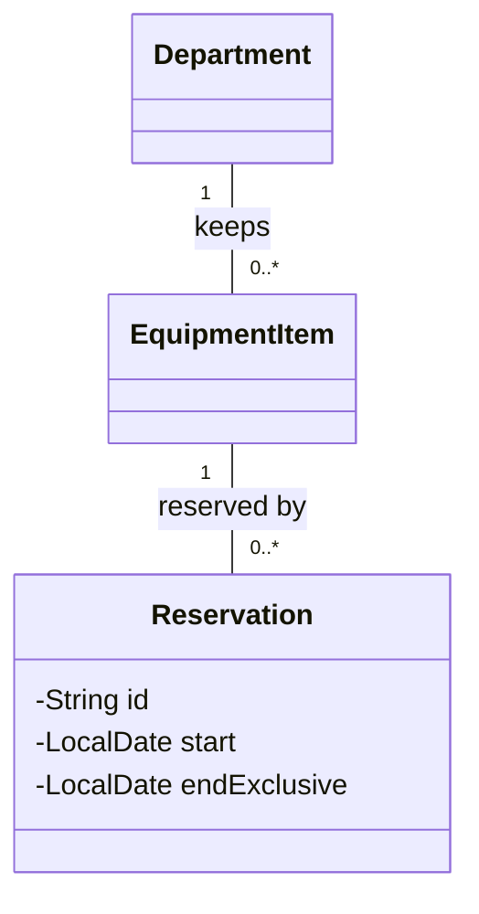

*Programming Readiness and Notation*  
*OO Development and Agile Practices*

## 1. Scope and execution

This file accompanies Appendix A, Programming Readiness and Notation. It supplies a small standalone Java 17 lab, explanations, the D1–D10 answers and the offline activity solution. Attempt the diagnostic before reading Section 4.

The lab is an **isolated Book example**, not a replacement for any lending-project version. `StudentRules` repeats the initial student numeric rule to demonstrate interface calls. It deliberately does not add staff or visitor policy, reservation storage or a directory.

Save the four complete listings in Section 2 into one new directory. They use the unnamed package to keep this syntax exercise small; the running application uses named packages. No Maven, JUnit or external dependency is needed.

From that directory, using a full Java 17 JDK:

```bash
javac --release 17 -Xlint:all -d out BorrowingPolicy.java StudentRules.java LoanPeriod.java ReadinessLab.java
java -cp out ReadinessLab
```

These commands work in a terminal on Windows, macOS or Linux when the JDK tools are on the path. The compiler creates `out` if needed. `--release 17` restricts the language/API target; it does not switch a newer installed runtime to Java 17. Check `java -version` separately [1].

Expected output:

```text
Policy boundary: true, false
Identity/value: false, true
Alias contents: [CAM1]
Snapshot/source: [CAM1] / [CAM1, CAM2]
Adjacent periods overlap: false
READINESS CHECKS PASSED: 27
```

The lab creates a temporary UTF-8 file, reads it and removes it. It also exercises a deliberately missing file in the same temporary directory. It does not access a network service. A failed check throws `AssertionError` and stops execution; the checks do not depend on enabling Java's `assert` keyword.

## 2. Complete source files

### 2.1 `BorrowingPolicy.java`

```java
public interface BorrowingPolicy {
    boolean mayRequest(int count, int days);
}
```

### 2.2 `StudentRules.java`

```java
public final class StudentRules implements BorrowingPolicy {
    @Override
    public boolean mayRequest(int count, int days) {
        return count >= 0 && count < 3 && days >= 1 && days <= 7;
    }
}
```

### 2.3 `LoanPeriod.java`

```java
import java.time.LocalDate;
import java.util.Objects;

public final class LoanPeriod {
    private final LocalDate start;
    private final LocalDate endExclusive;

    public LoanPeriod(LocalDate start, LocalDate endExclusive) {
        this.start = Objects.requireNonNull(start, "start");
        this.endExclusive = Objects.requireNonNull(endExclusive, "endExclusive");
        if (!start.isBefore(endExclusive)) {
            throw new IllegalArgumentException("End must be after start.");
        }
    }

    public LocalDate start() {
        return start;
    }

    public LocalDate endExclusive() {
        return endExclusive;
    }

    public boolean overlaps(LoanPeriod other) {
        Objects.requireNonNull(other, "other");
        return start.isBefore(other.endExclusive)
                && other.start.isBefore(endExclusive);
    }
}
```

### 2.4 `ReadinessLab.java`

```java
import java.io.IOException;
import java.nio.charset.StandardCharsets;
import java.nio.file.Files;
import java.nio.file.Path;
import java.time.LocalDate;
import java.util.ArrayList;
import java.util.List;
import java.util.Objects;
import java.util.Optional;

public final class ReadinessLab {
    private static int checks;

    // These nested types keep the isolated demonstration in four source files.
    enum ItemKind { CAMERA, MICROPHONE }

    record Request(String borrowerId, int days) {
        Request {
            Objects.requireNonNull(borrowerId, "borrowerId");
            if (borrowerId.isBlank() || days < 1) {
                throw new IllegalArgumentException("A request needs an id and positive days.");
            }
        }
    }

    public static void main(String[] args) throws IOException {
        BorrowingPolicy policy = new StudentRules();
        check(policy.mayRequest(2, 7), "third reservation allowed");
        check(!policy.mayRequest(3, 7), "fourth reservation rejected");
        check(!policy.mayRequest(0, 0), "zero days rejected");
        check(!policy.mayRequest(-1, 2), "negative count rejected");
        check(policy.mayRequest(0, 1), "minimum duration allowed");
        check(!policy.mayRequest(0, 8), "overlong duration rejected");
        System.out.println("Policy boundary: " + policy.mayRequest(2, 7)
                + ", " + policy.mayRequest(3, 7));

        String left = new String("CAM1");
        String right = new String("CAM1");
        check(left != right, "distinct string objects");
        check(left.equals(right), "equal string values");
        System.out.println("Identity/value: " + (left == right) + ", " + left.equals(right));

        List<String> first = new ArrayList<>();
        List<String> second = first;
        second.add("CAM1");
        second = new ArrayList<>();
        check(first.equals(List.of("CAM1")), "alias mutation reaches first");
        check(second.isEmpty(), "reassignment selects another list");
        final List<String> mutable = new ArrayList<>();
        mutable.add("CAM1");
        check(mutable.size() == 1, "final reference permits object mutation");
        System.out.println("Alias contents: " + first);

        List<String> source = new ArrayList<>(List.of("CAM1"));
        List<String> snapshot = List.copyOf(source);
        source.add("CAM2");
        check(snapshot.equals(List.of("CAM1")), "snapshot does not grow");
        check(source.size() == 2, "source grows");
        expect(UnsupportedOperationException.class, snapshot::clear, "snapshot is unmodifiable");
        System.out.println("Snapshot/source: " + snapshot + " / " + source);

        StringBuilder name = new StringBuilder("CAM1");
        List<StringBuilder> shallow = List.copyOf(List.of(name));
        name.append("-serviced");
        check(shallow.get(0).toString().equals("CAM1-serviced"), "elements are not deep-copied");

        LocalDate start = LocalDate.of(2026, 10, 20);
        LoanPeriod period = new LoanPeriod(start, start.plusDays(2));
        LoanPeriod adjacent = new LoanPeriod(start.plusDays(2), start.plusDays(4));
        LoanPeriod crossing = new LoanPeriod(start.plusDays(1), start.plusDays(3));
        check(!period.overlaps(adjacent), "adjacent periods do not overlap");
        check(period.overlaps(crossing), "crossing periods overlap");
        check(period.overlaps(new LoanPeriod(start, start.plusDays(2))), "identical bounds overlap");
        expect(IllegalArgumentException.class, () -> new LoanPeriod(start, start), "empty period rejected");
        expect(NullPointerException.class, () -> new LoanPeriod(null, start), "missing date rejected");
        check(!period.equals(new LoanPeriod(start, start.plusDays(2))), "ordinary class has identity equality here");
        System.out.println("Adjacent periods overlap: " + period.overlaps(adjacent));

        long cameras = source.stream().filter(id -> id.startsWith("CAM")).count();
        check(cameras == 2, "stream counts selected elements");
        Optional<String> missing = Optional.empty();
        check(missing.orElse("No item").equals("No item"), "explicit absence has an alternative");
        check(new Request("B1", 2).equals(new Request("B1", 2)), "record has component equality");
        String label = switch (ItemKind.CAMERA) {
            case CAMERA -> "Camera";
            case MICROPHONE -> "Microphone";
        };
        check(label.equals("Camera"), "switch expression selects a result");

        Path directory = Files.createTempDirectory("se506-readiness-");
        Path file = directory.resolve("sample.txt");
        try {
            Files.writeString(file, "CAM1\nCAM2\n", StandardCharsets.UTF_8);
            check("CAM1".equals(readFirstLine(file)), "resource read returns first line");
            try {
                readFirstLine(directory.resolve("absent.txt"));
                throw new AssertionError("missing file must fail");
            } catch (IOException expected) {
                check(true, "checked file failure propagated");
            }
        } finally {
            Files.deleteIfExists(file);
            Files.deleteIfExists(directory);
        }
        System.out.println("READINESS CHECKS PASSED: " + checks);
    }

    static String readFirstLine(Path path) throws IOException {
        try (var reader = Files.newBufferedReader(path, StandardCharsets.UTF_8)) {
            return reader.readLine();
        }
    }

    private static void check(boolean condition, String description) {
        if (!condition) {
            throw new AssertionError(description);
        }
        checks++;
    }

    private static void expect(Class<? extends RuntimeException> type,
                               Runnable operation, String description) {
        try {
            operation.run();
        } catch (RuntimeException exception) {
            if (!type.isInstance(exception)) {
                throw new AssertionError(description + ": wrong exception", exception);
            }
            checks++;
            return;
        }
        throw new AssertionError(description + ": no exception");
    }
}
```

## 3. Worked explanation

The lab keeps each observation small. `check` reports a mismatch immediately. `expect` runs an operation that should throw a particular run-time exception, verifies the type, and fails if no exception occurs. The `Runnable` parameter and method reference are small functional examples; Chapter 7 introduces the testing framework used by the running project.

The missing-file check catches `IOException` specifically because its purpose is to observe a declared file-reading failure. It does not convert an outage into a successful domain lookup. The `finally` block cleans up this example's temporary files. The `try`-with-resources statement inside `readFirstLine` closes the reader before that cleanup.

Two equality checks deliberately differ. The ordinary `LoanPeriod` class inherits identity-based `equals`, whereas `Request` is a record with generated component-based equality. The lab does not recommend one representation for every domain concept; it makes the actual behaviour visible.

The `StringBuilder` example is also intentional: it demonstrates why an unmodifiable collection and deeply immutable contents are separate properties. Do not copy that mutable element choice into the lending domain merely because it appears in a diagnostic.

### A small fault experiment

In a separate copy of the four files, change `count < 3` in `StudentRules` to `count <= 3`. Compile and run again. The check named `fourth reservation rejected` must fail. Restore the original comparison afterwards.

This experiment checks whether a specific boundary assertion detects its targeted fault. It does not establish complete correctness or a mutation score for the whole book.

## 4. Diagnostic answers

| Item | Answer and explanation |
|---|---|
| D1 | `true`, `false`, `false`, `false`. Using `<= 3` allows a request when three already exist. The method checks two numbers; it does not check availability or store a reservation. |
| D2 | `first` contains `CAM1`. `second.add` mutates the shared list. Reassigning `second` then points that variable at a different, empty list; it does not undo the first mutation. |
| D3 | `false`, then `true`: two explicitly created objects, equal string contents. Matching text does not require reference identity. |
| D4 | Adding compiles; reassigning the final variable does not. The list object remains mutable. |
| D5 | Source: `CAM1`, `CAM2`; snapshot: `CAM1`. Clearing the snapshot throws `UnsupportedOperationException`. Mutable element state can still change through shared references. |
| D6 | Reject either missing date and an end equal to or before the start. The adjacent periods do not overlap; the 22nd belongs to the second period only. |
| D7 | Declared type: `BorrowingPolicy`; implementation: `StudentRules`. Interface syntax establishes callable operations, not proof of the policy's correctness. |
| D8 | Missing declared method: compile-time error. Null receiver: run-time `NullPointerException`. Wrong comparison: a logical defect that can compile and execute normally. |
| D9 | No match is a completed search result; unavailable means the search could not establish an answer. A checked `IOException` must be handled or propagated according to Java's rules. |
| D10 | Department-to-item: one department for each item, zero or more items for each department. Item-to-reservation: one item for each reservation, zero or more reservations for each item. The scenario specifies links and counts, not composite ownership/deletion semantics. |

### D10: one acceptable diagram

This is a **scenario model**, not a listing of the appendix lab or the current application's implemented classes.



Both lines are ordinary associations. Navigation is unspecified because the scenario does not say which object stores a reference. The three attributes stand for a reservation identifier and the period bounds; a solution that models `LoanPeriod` explicitly is also reasonable if it explains the additional class.

A list of items in a department's Java implementation would not prove that each item belongs to only one department. That inverse constraint needs a domain rule and enforcement. Likewise, deleting an item need not delete its reservation history. A filled diamond would add a lifecycle claim the scenario did not provide.

### Relationship-reading practice

To practise the remaining symbols without enlarging D10, interpret these independent **Mermaid relationship fragments**. They are notation exercises, not complete diagrams or new project designs.

| Fragment | Interpretation |
|---|---|
| `Pack *-- Page` | Pack is the composite whole; Page is the part. The model must justify exclusive composite ownership and the intended lifecycle. |
| `Pack o-- Article` | Pack groups articles; explain what shared aggregation means in that model. A plain association may be sufficient. |
| `Article <\|-- ResearchArticle` | ResearchArticle specialises Article; the triangle points to Article. |
| `Printer <\|.. PdfPrinter` | PdfPrinter implements Printer; the triangle points to the interface. |
| `Pack ..> Printer` | Pack depends on Printer; for example, it calls a printer supplied to an operation. |

### Reading practice: sequence, state and flowchart fragments

Interpret these independent **Mermaid fragments**. They are notation exercises, not complete diagrams or project designs.

| Fragment | Interpretation |
|---|---|
| `U->>R: mayRequest(2, 7)` followed by `R-->>U: true` | `U` calls `R`, and `R` returns `true`. Nothing in the fragment says that a reservation was stored. |
| `alt Count below the limit` ... `else Count at the limit` ... `end` | Two alternatives. Exactly one happens in a given run. |
| `AVAILABLE --> RESERVED: reserve` | When the event `reserve` happens in the state `AVAILABLE`, the object moves to `RESERVED`. |
| `AVAILABLE --> RETIRED: retire [no open reservation]` | The same kind of transition, with a guard. It fires only if the condition holds. |
| `RETIRED --> [*]` | `RETIRED` is an end state. No further event moves the object out of it. |
| `B{"Count below the limit?"}` with one exit labelled `yes` and one labelled `no` | A decision with two labelled exits. Each path continues from the exit that matches the answer. |
| `I --> A` in a dependency view | Code in `I` may refer to code in `A`. It says nothing about which of them calls the other at run time. |

Two further questions. In Figure A.3, what does the absence of an arrow from `ON_LOAN` to `RETIRED` mean? The model does not allow `retire` in that state; the diagram does not say what the program does if the event arrives anyway. Why does the arrow in Figure A.5 point from the storage adapter to the application although the application calls the adapter at run time? Because the arrow shows which code refers to which code in the source, and the adapter's source refers to the contract that the application owns.

## 5. Offline AI-activity solution

The candidate in A.9 is constructed for teaching; it is not a captured model response.

| Candidate claim | Verdict | Correction and evidence |
|---|---|---|
| “The list is final, so callers cannot clear it.” | Incorrect | A final reference cannot be reassigned, but the referenced `ArrayList` supports mutation. Whether a caller can reach it is a separate encapsulation question. |
| “Copying a list makes all its elements immutable.” | Incorrect | A structural copy retains element references. The executable `StringBuilder` example changes what the snapshot's element contains. |
| “Every object created in a constructor should have a composition diamond.” | Incorrect | Construction location does not establish the UML ownership and lifecycle semantics. Use the domain contract, not the presence of `new`, to choose the relationship. |

An adequate record names the claim and the actual check. “The assistant was wrong” is less useful than identifying the reassignment/mutation confusion and the counterexample.

## 6. Teaching and revision notes

Ask learners to predict a result before running it. When a prediction differs from the output, have them trace the references or the comparison boundary rather than memorise the printed answer. Learners new to Java may need A.2–A.3 before the Chapter 1 orientation; experienced Java programmers can use the diagnostic to identify only the sections they need.

D10 consolidates Chapter 2's notation lesson. It should not become a requirement to study all UML before starting the book. Generalisation, realisation, association, aggregation, composition and multiplicity are reference topics here; the approved assessment material determines examination scope.

Do not add these checks to the running project's test totals. Keep setup-tool details in Appendix B and version reconciliation in Appendix D. The lab's fixed dates are example inputs, not a reading of the machine's current date.

## References

1. Oracle, [The javac Command, Java SE 17](https://docs.oracle.com/en/java/javase/17/docs/specs/man/javac.html), checked 13 October 2026. Compilation target and command options.
The Java, UML and Mermaid references that support the syntax explanations are listed in the main appendix.
