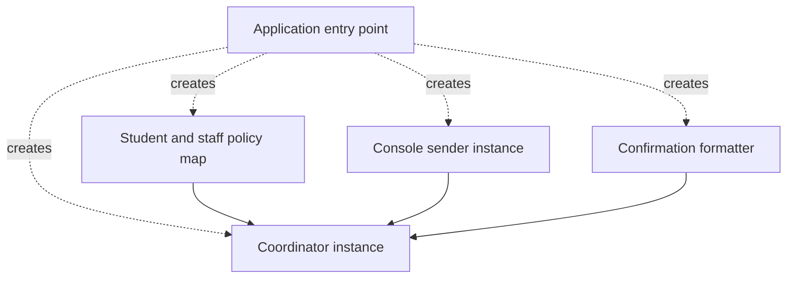

*Interfaces, Dependencies and Composition*  
*OO Development and Agile Practices*

## 1. Checkpoints and reconstruction

This file accompanies Chapter 6, Interfaces, Dependencies, and Composition. It supplies a complete cumulative Java checkpoint, the starting and deliberately coupled coordinator versions, a small educational container and model solutions.

| Stage | Purpose | How to use it |
|---|---|---|
| Chapter 5 baseline | Policies and formatter, no notification output | Use the complete Chapter 5 `after` checkpoint |
| Coupled teaching version | Add local notification with direct provider construction | In a copy of Chapter 5, replace the coordinator with Section 2.2 and add the three indicated sender files |
| Chapter 6 result | Supply notification, formatting and policy mapping from outside | Reconstruct the complete `after` directory from Sections 3–5 |

Adding notification is a feature change. The next structural step separates construction from the request workflow. Removing the no-argument coordinator constructor is an explicit source API migration, not transparent compatibility.

### 1.1 Reconstruct the complete result

Every listing beginning with `after/` belongs in one directory named `after`. Create its intermediate directories and copy only the content of each fence. Do not add the two Section 2 coordinator alternatives to that directory. Their paths beginning with `before/` and `coupled/` identify different teaching checkpoints.

Section 3 contains every application source file. Section 4 contains all four check runners. Section 5 contains the build script, ignore file and README. Section 6 contains the optional container program, which is excluded from the normal application gate.

The result uses Java 17, Bash and the standard library. It has no external dependencies, Maven configuration or JUnit dependency at this checkpoint. The existing unnamed-package layout remains. A framework container is not required.

### 1.2 Commands and expected results

From inside `after`:

```bash
bash scripts/check.sh
java -cp build/classes ReservationApplication
java -cp build/classes Chapter04Demo
java -cp build/classes Chapter05Demo
```

The gate should report the original 34 checks, five acceptance groups, 44 Chapter 5 checks and:

```text
All 28 Chapter 6 checks passed.
BUILD AND CHECKS PASSED
```

The new application prints:

```text
Notice: Confirmed: R1 for B1 on CAM1 [2026-10-20, 2026-10-22).
Result: Confirmed: R1 for B1 on CAM1 [2026-10-20, 2026-10-22).
```

The two lines have different roles. The sender prints a local notice; the application's main method prints the returned reservation result. This does not mean the sender was invoked twice.

The Chapter 4 and Chapter 5 demonstrations retain their earlier output because they now use a recorder for notification. Their construction expressions have changed, but their request sequences and expected reservation results have not. No remote service is contacted by any supplied example.

## 2. Starting and deliberately coupled coordinator versions

These two listings are alternatives to the completed coordinator. For either one, use the complete Chapter 5 checkpoint's other files and gate. Do not mix the Chapter 6 composition root or migrated check runners into these older-constructor checkpoints.

### 2.1 Starting coordinator

This is exactly the Chapter 5 coordinator. It formats a return value and does not call a notification sender.

### 2.1.1 `before/src/main/java/ReservationCoordinator.java`

```java
import java.time.LocalDate;
import java.util.ArrayList;
import java.util.List;
import java.util.Objects;

public final class ReservationCoordinator {
    private final List<Reservation> reservations = new ArrayList<>();
    private final BorrowingPolicy studentPolicy = new ReservationRules();
    private final BorrowingPolicy staffPolicy = new StaffReservationRules();
    private final ConfirmationFormatter formatter = new ConfirmationFormatter();

    public String reserve(String borrowerId, String itemId,
                          LocalDate start, int requestedDays) {
        return reserve(borrowerId, itemId, start, requestedDays, BorrowerCategory.STUDENT);
    }

    public String reserve(String borrowerId, String itemId, LocalDate start,
                          int requestedDays, BorrowerCategory category) {
        Objects.requireNonNull(category, "category");
        if (borrowerId == null || borrowerId.isBlank()
                || itemId == null || itemId.isBlank()) {
            throw new IllegalArgumentException("Identifiers must not be blank.");
        }
        Objects.requireNonNull(start, "start");

        int activeCount = 0;
        for (Reservation existing : reservations) {
            if (existing.borrowerId().equals(borrowerId)) {
                activeCount++;
            }
        }
        if (!policyFor(category).mayRequest(activeCount, requestedDays)) {
            return "Rejected: borrower limit or duration.";
        }

        LoanPeriod requested = new LoanPeriod(
                start, start.plusDays(requestedDays));
        for (Reservation existing : reservations) {
            if (existing.itemId().equals(itemId)
                    && existing.period().overlaps(requested)) {
                return "Rejected: item unavailable.";
            }
        }

        Reservation reservation = new Reservation(
                "R" + (reservations.size() + 1), borrowerId, itemId, requested);
        reservations.add(reservation);
        return formatter.format(reservation);
    }

    private BorrowingPolicy policyFor(BorrowerCategory category) {
        return switch (category) {
            case STUDENT -> studentPolicy;
            case STAFF -> staffPolicy;
        };
    }

    public List<Reservation> reservations() {
        return List.copyOf(reservations);
    }
}
```

### 2.2 Coupled notification feature

In a separate copy of Chapter 5, use this coordinator and add `NotificationSender.java`, `NotificationException.java` and `ConsoleNotificationSender.java` from Section 3. Its original no-argument construction remains. It chooses console output directly, so accepted requests now print notices while the old checking assertions still examine reservation results.

### 2.2.1 `coupled/src/main/java/ReservationCoordinator.java`

```java
import java.time.LocalDate;
import java.util.ArrayList;
import java.util.List;
import java.util.Objects;

public final class ReservationCoordinator {
    private final List<Reservation> reservations = new ArrayList<>();
    private final BorrowingPolicy studentPolicy = new ReservationRules();
    private final BorrowingPolicy staffPolicy = new StaffReservationRules();
    private final ConfirmationFormatter formatter = new ConfirmationFormatter();

    private final NotificationSender notifications = new ConsoleNotificationSender(
            System.out, new ConfirmationFormatter());

    public String reserve(String borrowerId, String itemId,
                          LocalDate start, int requestedDays) {
        return reserve(borrowerId, itemId, start, requestedDays, BorrowerCategory.STUDENT);
    }

    public String reserve(String borrowerId, String itemId, LocalDate start,
                          int requestedDays, BorrowerCategory category) {
        Objects.requireNonNull(category, "category");
        if (borrowerId == null || borrowerId.isBlank()
                || itemId == null || itemId.isBlank()) {
            throw new IllegalArgumentException("Identifiers must not be blank.");
        }
        Objects.requireNonNull(start, "start");

        int activeCount = 0;
        for (Reservation existing : reservations) {
            if (existing.borrowerId().equals(borrowerId)) {
                activeCount++;
            }
        }
        if (!policyFor(category).mayRequest(activeCount, requestedDays)) {
            return "Rejected: borrower limit or duration.";
        }

        LoanPeriod requested = new LoanPeriod(
                start, start.plusDays(requestedDays));
        for (Reservation existing : reservations) {
            if (existing.itemId().equals(itemId)
                    && existing.period().overlaps(requested)) {
                return "Rejected: item unavailable.";
            }
        }

        Reservation reservation = new Reservation(
                "R" + (reservations.size() + 1), borrowerId, itemId, requested);
        reservations.add(reservation);
        String confirmation = formatter.format(reservation);
        try {
            notifications.send(reservation);
        } catch (NotificationException failure) {
            return confirmation + " Notification failed; reservation retained.";
        }
        return confirmation;
    }

    private BorrowingPolicy policyFor(BorrowerCategory category) {
        return switch (category) {
            case STUDENT -> studentPolicy;
            case STAFF -> staffPolicy;
        };
    }

    public List<Reservation> reservations() {
        return List.copyOf(reservations);
    }
}
```

The field is typed as `NotificationSender`, but the initializer names `ConsoleNotificationSender`, `System.out` and a concrete formatter. The workflow therefore still selects its own output environment. This newly introduced teaching defect is not a claim about the previous chapter.

The coupled version already uses the explicit retain-and-report rule for expected notification failure. The final structural step preserves that feature policy while changing how collaborators arrive. A recording configuration intentionally changes the output destination; it does not change the acceptance algorithm.

## 3. Complete application source for after

The first seven files retain Chapter 5's domain and formatting behaviour. The remaining files establish notification and explicit composition. Paths in this section are the actual files to create.

### 3.1 `after/src/main/java/BorrowerCategory.java`

```java
public enum BorrowerCategory {
    STUDENT, STAFF
}
```

### 3.2 `after/src/main/java/BorrowingPolicy.java`

```java
/**
 * A deterministic, side-effect-free borrowing decision for every pair of ints.
 * Return false for negative counts or nonpositive durations; do not throw for them.
 * Return false for requests outside this implementation's documented limits.
 * A true result concerns count/duration only, not item availability or identity.
 */
public interface BorrowingPolicy {
    boolean mayRequest(int activeReservations, int requestedDays);
}
```

### 3.3 `after/src/main/java/ReservationRules.java`

```java
public final class ReservationRules implements BorrowingPolicy {
    @Override
    public boolean mayRequest(int activeReservations, int requestedDays) {
        return activeReservations >= 0
                && activeReservations < 3
                && requestedDays >= 1
                && requestedDays <= 7;
    }
}
```

### 3.4 `after/src/main/java/StaffReservationRules.java`

```java
/** Illustrative teaching policy, not an approved institutional rule. */
public final class StaffReservationRules implements BorrowingPolicy {
    @Override
    public boolean mayRequest(int activeReservations, int requestedDays) {
        return activeReservations >= 0
                && activeReservations < 5
                && requestedDays >= 1
                && requestedDays <= 14;
    }
}
```

### 3.5 `after/src/main/java/LoanPeriod.java`

```java
import java.time.LocalDate;
import java.util.Objects;

public final class LoanPeriod {
    private final LocalDate start;
    private final LocalDate endExclusive;

    public LoanPeriod(LocalDate start, LocalDate endExclusive) {
        this.start = Objects.requireNonNull(start, "start");
        this.endExclusive = Objects.requireNonNull(endExclusive, "endExclusive");
        if (!start.isBefore(endExclusive)) {
            throw new IllegalArgumentException("End must be after start.");
        }
    }

    public LocalDate start() {
        return start;
    }

    public LocalDate endExclusive() {
        return endExclusive;
    }

    public boolean overlaps(LoanPeriod other) {
        Objects.requireNonNull(other, "other");
        return start.isBefore(other.endExclusive)
                && other.start.isBefore(endExclusive);
    }
}
```

### 3.6 `after/src/main/java/Reservation.java`

```java
import java.util.Objects;

public final class Reservation {
    private final String id;
    private final String borrowerId;
    private final String itemId;
    private final LoanPeriod period;

    public Reservation(String id, String borrowerId, String itemId,
                       LoanPeriod period) {
        this.id = requireText(id);
        this.borrowerId = requireText(borrowerId);
        this.itemId = requireText(itemId);
        this.period = Objects.requireNonNull(period, "period");
    }

    private static String requireText(String value) {
        if (value == null || value.isBlank()) {
            throw new IllegalArgumentException("Identifiers must not be blank.");
        }
        return value;
    }

    public String id() { return id; }
    public String borrowerId() { return borrowerId; }
    public String itemId() { return itemId; }
    public LoanPeriod period() { return period; }
}
```

### 3.7 `after/src/main/java/ConfirmationFormatter.java`

```java
import java.util.Objects;

public final class ConfirmationFormatter {
    public String format(Reservation reservation) {
        Objects.requireNonNull(reservation, "reservation");
        return "Confirmed: " + reservation.id()
                + " for " + reservation.borrowerId()
                + " on " + reservation.itemId()
                + " [" + reservation.period().start()
                + ", " + reservation.period().endExclusive() + ").";
    }
}
```

### 3.8 `after/src/main/java/NotificationSender.java`

```java
/**
 * Accept one non-null confirmed reservation for this implementation's local output.
 * Do not modify the reservation or coordinator. Report expected output failure with
 * NotificationException. Normal return is not a promise of email delivery.
 */
@FunctionalInterface
public interface NotificationSender {
    void send(Reservation reservation);
}
```

### 3.9 `after/src/main/java/NotificationException.java`

```java
public final class NotificationException extends RuntimeException {
    private static final long serialVersionUID = 1L;

    public NotificationException(String message) { super(message); }
}
```

### 3.10 `after/src/main/java/RecordingNotificationSender.java`

```java
import java.util.ArrayList;
import java.util.List;
import java.util.Objects;

public final class RecordingNotificationSender implements NotificationSender {
    private final List<Reservation> received = new ArrayList<>();

    @Override
    public void send(Reservation reservation) {
        received.add(Objects.requireNonNull(reservation, "reservation"));
    }

    public List<Reservation> received() { return List.copyOf(received); }
}
```

### 3.11 `after/src/main/java/ConsoleNotificationSender.java`

```java
import java.io.PrintStream;
import java.util.Objects;

public final class ConsoleNotificationSender implements NotificationSender {
    private final PrintStream output;
    private final ConfirmationFormatter formatter;

    public ConsoleNotificationSender(PrintStream output, ConfirmationFormatter formatter) {
        this.output = Objects.requireNonNull(output, "output");
        this.formatter = Objects.requireNonNull(formatter, "formatter");
    }

    @Override
    public void send(Reservation reservation) {
        output.println("Notice: " + formatter.format(reservation));
        if (output.checkError()) {
            throw new NotificationException("Console output failed.");
        }
    }
}
```

### 3.12 `after/src/main/java/ReservationCoordinator.java`

```java
import java.time.LocalDate;
import java.util.ArrayList;
import java.util.List;
import java.util.Objects;
import java.util.Map;

public final class ReservationCoordinator {
    private final List<Reservation> reservations = new ArrayList<>();
    private final Map<BorrowerCategory, BorrowingPolicy> policies;
    private final ConfirmationFormatter formatter;
    private final NotificationSender notifications;

    public ReservationCoordinator(Map<BorrowerCategory, BorrowingPolicy> policies,
                                  ConfirmationFormatter formatter,
                                  NotificationSender notifications) {
        this.policies = Map.copyOf(Objects.requireNonNull(policies, "policies"));
        for (BorrowerCategory category : BorrowerCategory.values()) {
            if (!this.policies.containsKey(category)) {
                throw new IllegalArgumentException("Missing policy: " + category);
            }
        }
        this.formatter = Objects.requireNonNull(formatter, "formatter");
        this.notifications = Objects.requireNonNull(notifications, "notifications");
    }

    public String reserve(String borrowerId, String itemId,
                          LocalDate start, int requestedDays) {
        return reserve(borrowerId, itemId, start, requestedDays, BorrowerCategory.STUDENT);
    }

    public String reserve(String borrowerId, String itemId, LocalDate start,
                          int requestedDays, BorrowerCategory category) {
        Objects.requireNonNull(category, "category");
        if (borrowerId == null || borrowerId.isBlank()
                || itemId == null || itemId.isBlank()) {
            throw new IllegalArgumentException("Identifiers must not be blank.");
        }
        Objects.requireNonNull(start, "start");

        int activeCount = 0;
        for (Reservation existing : reservations) {
            if (existing.borrowerId().equals(borrowerId)) {
                activeCount++;
            }
        }
        if (!policies.get(category).mayRequest(activeCount, requestedDays)) {
            return "Rejected: borrower limit or duration.";
        }

        LoanPeriod requested = new LoanPeriod(
                start, start.plusDays(requestedDays));
        for (Reservation existing : reservations) {
            if (existing.itemId().equals(itemId)
                    && existing.period().overlaps(requested)) {
                return "Rejected: item unavailable.";
            }
        }

        Reservation reservation = new Reservation(
                "R" + (reservations.size() + 1), borrowerId, itemId, requested);
        reservations.add(reservation);
        String confirmation = formatter.format(reservation);
        try {
            notifications.send(reservation);
        } catch (NotificationException failure) {
            return confirmation + " Notification failed; reservation retained.";
        }
        return confirmation;
    }

    public List<Reservation> reservations() {
        return List.copyOf(reservations);
    }
}
```

### 3.13 `after/src/main/java/ReservationApplication.java`

```java
import java.time.LocalDate;
import java.util.Map;

public final class ReservationApplication {
    private ReservationApplication() { }

    public static ReservationCoordinator create(NotificationSender sender) {
        return new ReservationCoordinator(
                Map.of(BorrowerCategory.STUDENT, new ReservationRules(),
                       BorrowerCategory.STAFF, new StaffReservationRules()),
                new ConfirmationFormatter(), sender);
    }

    public static void main(String[] args) {
        ConfirmationFormatter noticeFormat = new ConfirmationFormatter();
        NotificationSender sender = new ConsoleNotificationSender(System.out, noticeFormat);
        ReservationCoordinator coordinator = create(sender);
        String result = coordinator.reserve("B1", "CAM1", LocalDate.of(2026, 10, 20), 2);
        System.out.println("Result: " + result);
    }
}
```

### 3.14 `after/src/main/java/Chapter04Demo.java`

```java
import java.time.LocalDate;

public final class Chapter04Demo {
    public static void main(String[] args) {
        ReservationCoordinator coordinator = ReservationApplication.create(new RecordingNotificationSender());
        LocalDate start = LocalDate.of(2026, 10, 20);
        System.out.println(coordinator.reserve("B1", "CAM1", start, 2));
        System.out.println(coordinator.reserve("B2", "CAM1", start.plusDays(1), 1));
        System.out.println(coordinator.reserve("B2", "CAM1", start.plusDays(2), 1));
        System.out.println("Stored reservations: " + coordinator.reservations().size());
    }
}
```

### 3.15 `after/src/main/java/Chapter05Demo.java`

```java
import java.time.LocalDate;

public final class Chapter05Demo {
    public static void main(String[] args) {
        ReservationCoordinator coordinator = ReservationApplication.create(new RecordingNotificationSender());
        LocalDate day = LocalDate.of(2026, 10, 20);
        System.out.println(coordinator.reserve("S1", "CAM1", day, 14,
                BorrowerCategory.STAFF));
        System.out.println(coordinator.reserve("B1", "MIC1", day, 14));
        System.out.println(coordinator.reserve("B1", "CAM1", day.plusDays(1), 1));
        System.out.println(coordinator.reserve("B1", "CAM1", day.plusDays(14), 1));
        System.out.println("Stored reservations: " + coordinator.reservations().size());
    }
}
```

### 3.16 Reading the object graph

`ReservationApplication` is the assembly boundary. Its `create` method supplies a map containing student and staff policies, a concrete formatter and the sender selected by its caller. Its main method chooses a console sender and stream. The coordinator knows the sender contract and policy map, not those provider choices.

The coordinator's constructor rejects missing dependencies and incomplete category mappings. `Map.copyOf` stops later changes to the caller's map from changing this mapping. It does not deep-copy the policy instances; their existing stateless contract still matters.

The original `reserve` overload continues to delegate with `STUDENT`. The explicit-category overload still trusts its supplied category, and all records for the borrower contribute to the active count. No identity verification has been added.

After acceptance the coordinator stores the record, formats its return value and makes one sender call. Expected notification failure adds the explicit suffix while retaining the record. There is no retry, rollback or queued work. An unexpected runtime failure is not swallowed; it can propagate after storage. Do not describe the operation as atomic across output and state.

`RecordingNotificationSender` holds immutable reservation objects in its own local list and exposes an unmodifiable snapshot. `ConsoleNotificationSender` writes to the supplied `PrintStream` and checks its error flag. It does not close the stream because ownership remains with the caller. Checking the stream can detect a local error, but cannot promise that no characters were written before failure.

## 4. Complete checking programs

The first three runners have exactly the previous assertions and request sequences. Their only source changes replace `new ReservationCoordinator()` with `ReservationApplication.create(new RecordingNotificationSender())`. That setup migration is necessary because the no-argument constructor no longer exists.

The fourth runner exercises notification and assembly behaviour. The hand-written failing sender is a controlled collaborator for this exercise; the full test-double taxonomy belongs in Chapter 7.

### 4.1 `after/src/test/java/Chapter02Checks.java`

```java
import java.time.DateTimeException;
import java.time.LocalDate;
import java.util.List;

public class Chapter02Checks {
    private static int checks;

    public static void main(String[] args) {
        LocalDate day = LocalDate.of(2026, 10, 20);
        LoanPeriod first = new LoanPeriod(day, day.plusDays(2));
        LoanPeriod overlapping = new LoanPeriod(day.plusDays(1), day.plusDays(3));
        LoanPeriod adjacent = new LoanPeriod(day.plusDays(2), day.plusDays(3));
        check(first.overlaps(overlapping), "overlap detected");
        check(overlapping.overlaps(first), "overlap is symmetric");
        check(!first.overlaps(adjacent), "adjacent periods allowed");
        check(!adjacent.overlaps(first), "adjacency symmetric");
        check(first.overlaps(new LoanPeriod(day, day.plusDays(2))), "equal periods overlap");
        check(first.overlaps(new LoanPeriod(day.minusDays(1), day.plusDays(4))),
                "containment overlaps");
        expect(IllegalArgumentException.class, () -> new LoanPeriod(day, day),
                "zero-length period");
        expect(IllegalArgumentException.class, () -> new LoanPeriod(day, day.minusDays(1)),
                "reversed period");
        expect(NullPointerException.class, () -> new LoanPeriod(null, day), "null start");
        expect(NullPointerException.class, () -> new LoanPeriod(day, null), "null end");

        ReservationCoordinator c = ReservationApplication.create(new RecordingNotificationSender());
        check(c.reserve("B1", "CAM1", day, 2).equals(
                "Confirmed: R1 for B1 on CAM1 [2026-10-20, 2026-10-22)."),
                "exact first confirmation");
        check(c.reservations().size() == 1, "one success stored");
        check(c.reserve("B2", "CAM1", day.plusDays(1), 1).equals(
                "Rejected: item unavailable."), "overlapping same item rejected");
        check(c.reservations().size() == 1, "conflict stores nothing");
        check(c.reserve("B2", "CAM1", day.plusDays(2), 1).equals(
                "Confirmed: R2 for B2 on CAM1 [2026-10-22, 2026-10-23)."),
                "adjacent request and identifier after rejection");
        check(c.reserve("B1", "MIC1", day, 7).equals(
                "Confirmed: R3 for B1 on MIC1 [2026-10-20, 2026-10-27)."),
                "different item and seven-day limit allowed");
        check(c.reserve("B1", "TRI1", day, 1).startsWith("Confirmed:"),
                "third active reservation allowed");
        check(c.reserve("B1", "CAM2", day, 1).equals(
                "Rejected: borrower limit or duration."), "fourth rejected");
        check(c.reservations().size() == 4, "borrower-limit rejection stores nothing");

        List<Reservation> snapshot = c.reservations();
        expect(UnsupportedOperationException.class, snapshot::clear, "snapshot unmodifiable");
        check(c.reservations().size() == 4, "failed clear preserves coordinator state");
        check(c.reserve("B3", "CAM2", day, 1).startsWith("Confirmed:"),
                "another borrower unaffected by B1 limit");
        check(snapshot.size() == 4 && c.reservations().size() == 5,
                "old snapshot does not track later additions");
        check(snapshot.get(0).period().start().equals(day), "stored period preserved");

        ReservationCoordinator invalid = ReservationApplication.create(new RecordingNotificationSender());
        check(invalid.reserve("B1", "CAM1", day, 0).equals(
                "Rejected: borrower limit or duration."), "zero duration rejected");
        check(invalid.reserve("B1", "CAM1", day, -1).equals(
                "Rejected: borrower limit or duration."), "negative duration rejected");
        check(invalid.reserve("B1", "CAM1", day, 8).equals(
                "Rejected: borrower limit or duration."), "eight-day duration rejected");
        expect(IllegalArgumentException.class, () -> invalid.reserve(" ", "CAM1", day, 1),
                "blank borrower");
        expect(IllegalArgumentException.class, () -> invalid.reserve("B1", null, day, 1),
                "null item");
        expect(NullPointerException.class, () -> invalid.reserve("B1", "CAM1", null, 1),
                "null request date");
        expect(DateTimeException.class, () -> invalid.reserve("B1", "CAM1", LocalDate.MAX, 1),
                "unrepresentable end date");
        check(invalid.reservations().isEmpty(), "invalid requests store nothing");
        expect(IllegalArgumentException.class,
                () -> new Reservation("", "B1", "CAM1", first), "blank reservation identifier");
        expect(NullPointerException.class,
                () -> new Reservation("R1", "B1", "CAM1", null), "null reservation period");
        System.out.println("All " + checks + " chapter checks passed.");
    }

    private static void check(boolean condition, String label) {
        if (!condition) {
            throw new AssertionError(label);
        }
        checks++;
    }

    private static void expect(Class<? extends Throwable> type, Runnable action,
                               String label) {
        try {
            action.run();
        } catch (Throwable error) {
            check(type.isInstance(error), label + ": wrong exception " + error);
            return;
        }
        throw new AssertionError(label + ": expected " + type.getSimpleName());
    }
}
```

### 4.2 `after/src/test/java/Chapter03AcceptanceExamples.java`

```java
import java.time.LocalDate;

public class Chapter03AcceptanceExamples {
    public static void main(String[] args) {
        LocalDate day = LocalDate.of(2026, 10, 20);
        ReservationCoordinator coordinator = ReservationApplication.create(new RecordingNotificationSender());

        // AC-01: an eligible request is stored once and confirmed.
        String accepted = coordinator.reserve("B1", "CAM1", day, 2);
        require(accepted.equals(
                "Confirmed: R1 for B1 on CAM1 [2026-10-20, 2026-10-22)."),
                "AC-01 confirmation");
        require(coordinator.reservations().size() == 1, "AC-01 one record");
        System.out.println("AC-01 passed");

        // AC-02: an overlapping request for the same item changes no records.
        String conflict = coordinator.reserve("B2", "CAM1", day.plusDays(1), 1);
        require(conflict.equals("Rejected: item unavailable."), "AC-02 rejection");
        require(coordinator.reservations().size() == 1, "AC-02 unchanged count");
        require(coordinator.reservations().get(0).borrowerId().equals("B1"),
                "AC-02 original borrower preserved");
        System.out.println("AC-02 passed");

        // AC-03: a booking may start at an existing exclusive end,
        // or end exactly where an existing booking starts.
        String adjacent = coordinator.reserve("B2", "CAM1", day.plusDays(2), 1);
        require(adjacent.equals(
                "Confirmed: R2 for B2 on CAM1 [2026-10-22, 2026-10-23)."),
                "AC-03 adjacent confirmation");
        require(coordinator.reservations().size() == 2, "AC-03 second record");
        String before = coordinator.reserve("B3", "CAM1", day.minusDays(1), 1);
        require(before.equals(
                "Confirmed: R3 for B3 on CAM1 [2026-10-19, 2026-10-20)."),
                "AC-03 request ending at an existing start");
        require(coordinator.reservations().size() == 3, "AC-03 third record");
        System.out.println("AC-03 passed");

        // AC-04: count limits span items, not just one equipment item.
        ReservationCoordinator limits = ReservationApplication.create(new RecordingNotificationSender());
        for (String item : new String[] {"CAM1", "MIC1", "TRI1"}) {
            require(limits.reserve("B1", item, day, 1).startsWith("Confirmed:"),
                    "AC-04 establish three valid reservations");
        }
        require(limits.reserve("B1", "CAM2", day, 1).equals(
                "Rejected: borrower limit or duration."), "AC-04 fourth rejected");
        require(limits.reservations().size() == 3, "AC-04 unchanged count");
        System.out.println("AC-04 passed");

        // AC-05: one and seven days are allowed; zero, negative and eight are not.
        ReservationCoordinator durations = ReservationApplication.create(new RecordingNotificationSender());
        require(durations.reserve("B1", "CAM1", day, 1).startsWith("Confirmed:"),
                "AC-05 one day");
        require(durations.reserve("B1", "MIC1", day, 7).startsWith("Confirmed:"),
                "AC-05 seven days");
        for (int days : new int[] {0, -1, 8}) {
            require(durations.reserve("B1", "TRI1", day, days).equals(
                    "Rejected: borrower limit or duration."), "AC-05 invalid duration");
            require(durations.reservations().size() == 2, "AC-05 unchanged count");
        }
        System.out.println("AC-05 passed");
        System.out.println("All 5 acceptance examples passed.");
    }

    private static void require(boolean condition, String description) {
        if (!condition) {
            throw new AssertionError(description);
        }
    }
}
```

### 4.3 `after/src/test/java/Chapter05Checks.java`

```java
import java.time.LocalDate;
import java.util.List;

public final class Chapter05Checks {
    private static int checks;

    public static void main(String[] args) {
        BorrowingPolicy student = new ReservationRules();
        BorrowingPolicy staff = new StaffReservationRules();
        sharedPolicyContract(student);
        sharedPolicyContract(staff);
        check(student.mayRequest(2, 7), "student upper accepted boundaries");
        check(!student.mayRequest(3, 7), "student fourth rejected");
        check(!student.mayRequest(0, 8), "student eight days rejected");
        check(staff.mayRequest(4, 14), "staff upper accepted boundaries");
        check(!staff.mayRequest(5, 14), "staff sixth rejected");
        check(!staff.mayRequest(0, 15), "staff fifteen days rejected");

        LocalDate day = LocalDate.of(2026, 10, 20);
        ReservationCoordinator c = ReservationApplication.create(new RecordingNotificationSender());
        check(c.reserve("S1", "CAM1", day, 14, BorrowerCategory.STAFF).equals(
                "Confirmed: R1 for S1 on CAM1 [2026-10-20, 2026-11-03)."),
                "staff confirmation with new limit");
        List<Reservation> snapshot = c.reservations();
        check(c.reserve("B1", "CAM1", day.plusDays(1), 1).equals(
                "Rejected: item unavailable."), "student conflicts with staff booking");
        check(c.reservations().equals(snapshot), "conflict preserves exact records");
        check(c.reserve("B1", "CAM1", day.plusDays(14), 1).equals(
                "Confirmed: R2 for B1 on CAM1 [2026-11-03, 2026-11-04)."),
                "cross-category adjacency and next identifier");
        List<Reservation> beforeInvalid = c.reservations();
        check(c.reserve("S1", "MIC1", day, 15, BorrowerCategory.STAFF).equals(
                "Rejected: borrower limit or duration."), "staff invalid duration result");
        check(c.reservations().equals(beforeInvalid), "invalid staff request preserves records");
        expect(NullPointerException.class,
                () -> c.reserve("S1", "MIC1", day, 1, null), "null category");
        check(c.reservations().equals(beforeInvalid), "null category preserves records");

        ReservationCoordinator limits = ReservationApplication.create(new RecordingNotificationSender());
        for (int i = 1; i <= 5; i++) {
            check(limits.reserve("S2", "ITEM" + i, day, 1, BorrowerCategory.STAFF)
                    .startsWith("Confirmed:"), "staff reservation " + i);
        }
        List<Reservation> five = limits.reservations();
        check(limits.reserve("S2", "ITEM6", day, 1, BorrowerCategory.STAFF).equals(
                "Rejected: borrower limit or duration."), "staff sixth rejected in coordinator");
        check(limits.reservations().equals(five), "staff limit preserves records");

        ReservationCoordinator defaultStudent = ReservationApplication.create(new RecordingNotificationSender());
        ReservationCoordinator explicitStudent = ReservationApplication.create(new RecordingNotificationSender());
        check(defaultStudent.reserve("B1", "MIC1", day, 7).equals(
                explicitStudent.reserve("B1", "MIC1", day, 7, BorrowerCategory.STUDENT)),
                "default and explicit student results agree");
        check(defaultStudent.reserve("B2", "TRI1", day, 8).equals(
                "Rejected: borrower limit or duration."), "default remains student");

        // Counts belong to a borrower ID across all records, not separate category buckets.
        ReservationCoordinator mixedFixture = ReservationApplication.create(new RecordingNotificationSender());
        for (int i = 1; i <= 3; i++) {
            mixedFixture.reserve("X1", "ITEM" + i, day, 1);
        }
        check(mixedFixture.reserve("X1", "ITEM4", day, 1, BorrowerCategory.STAFF)
                .startsWith("Confirmed:"), "supplied staff policy uses existing count three");
        check(mixedFixture.reserve("X1", "ITEM5", day, 1, BorrowerCategory.STAFF)
                .startsWith("Confirmed:"), "supplied staff policy uses existing count four");
        check(mixedFixture.reserve("X1", "ITEM6", day, 1, BorrowerCategory.STAFF).equals(
                "Rejected: borrower limit or duration."), "counts not reset by category selection");
        System.out.println("All " + checks + " Chapter 5 checks passed.");
    }

    private static void sharedPolicyContract(BorrowingPolicy policy) {
        check(!policy.mayRequest(-1, 1), "negative count returns false");
        check(!policy.mayRequest(Integer.MIN_VALUE, 1), "minimum count returns false");
        check(!policy.mayRequest(0, 0), "zero duration returns false");
        check(!policy.mayRequest(0, -1), "negative duration returns false");
        check(!policy.mayRequest(0, Integer.MIN_VALUE), "minimum duration returns false");
        check(policy.mayRequest(0, 1), "documented one-day request allowed");
        check(!policy.mayRequest(Integer.MAX_VALUE, 1), "above documented count limits");
        check(!policy.mayRequest(0, Integer.MAX_VALUE), "above documented duration limits");
        boolean first = policy.mayRequest(1, 2);
        policy.mayRequest(0, 1);
        check(policy.mayRequest(1, 2) == first, "repeat decision unchanged by intervening call");
    }

    private static void check(boolean condition, String label) {
        if (!condition) throw new AssertionError(label);
        checks++;
    }

    private static void expect(Class<? extends Throwable> type, Runnable action,
                               String label) {
        try {
            action.run();
        } catch (Throwable error) {
            check(type.isInstance(error), label + ": wrong exception " + error);
            return;
        }
        throw new AssertionError(label + ": expected " + type.getSimpleName());
    }
}
```

### 4.4 `after/src/test/java/Chapter06Checks.java`

```java
import java.io.ByteArrayOutputStream;
import java.io.OutputStream;
import java.io.PrintStream;
import java.io.IOException;
import java.nio.charset.StandardCharsets;
import java.time.LocalDate;
import java.util.EnumMap;
import java.util.List;
import java.util.Map;

public final class Chapter06Checks {
    private static int checks;

    public static void main(String[] args) {
        LocalDate day = LocalDate.of(2026, 10, 20);
        RecordingNotificationSender inbox = new RecordingNotificationSender();
        ReservationCoordinator c = ReservationApplication.create(inbox);
        String first = c.reserve("B1", "CAM1", day, 2);
        check(first.equals("Confirmed: R1 for B1 on CAM1 [2026-10-20, 2026-10-22)."),
                "accepted return unchanged");
        check(inbox.received().size() == 1, "one notification per accepted request");
        check(inbox.received().get(0) == c.reservations().get(0), "accepted record supplied");
        List<Reservation> oldInbox = inbox.received();
        expect(UnsupportedOperationException.class, oldInbox::clear, "inbox snapshot unmodifiable");
        check(c.reserve("B2", "CAM1", day.plusDays(1), 1).equals(
                "Rejected: item unavailable."), "conflict result preserved");
        check(inbox.received().size() == 1, "conflict sends nothing");
        c.reserve("B1", "MIC1", day, 8);
        check(inbox.received().size() == 1, "duration rejection sends nothing");
        expect(IllegalArgumentException.class, () -> c.reserve("", "CAM1", day, 1), "bad ID");
        check(inbox.received().size() == 1, "invalid argument sends nothing");
        c.reserve("B2", "CAM1", day.plusDays(2), 1);
        check(inbox.received().size() == 2, "adjacent acceptance sends once");
        check(oldInbox.size() == 1, "earlier inbox snapshot stable");

        FailingSender failure = new FailingSender();
        ReservationCoordinator failed = ReservationApplication.create(failure);
        String failureResult = failed.reserve("B1", "CAM1", day, 2);
        check(failureResult.equals(first + " Notification failed; reservation retained."),
                "explicit partial-success result");
        check(failed.reservations().size() == 1, "notification failure retains accepted record");
        check(failure.calls == 1, "one attempt and no automatic retry");
        check(failed.reserve("B1", "CAM1", day, 2).equals("Rejected: item unavailable."),
                "retrying reservation is still a conflict");
        check(failure.calls == 1, "conflicting repeat does not attempt notification");

        ReservationCoordinator unexpected = ReservationApplication.create(new BrokenSender());
        expect(IllegalStateException.class, () -> unexpected.reserve("B1", "CAM1", day, 2),
                "unexpected sender failure is not swallowed");
        check(unexpected.reservations().size() == 1, "record is stored before the unexpected failure");

        Map<BorrowerCategory, BorrowingPolicy> configured = policies();
        expect(NullPointerException.class, () -> new ReservationCoordinator(
                null, new ConfirmationFormatter(), inbox), "null policy map");
        expect(IllegalArgumentException.class, () -> new ReservationCoordinator(
                Map.of(BorrowerCategory.STUDENT, new ReservationRules()),
                new ConfirmationFormatter(), inbox), "missing staff policy");
        expect(NullPointerException.class, () -> new ReservationCoordinator(
                configured, null, inbox), "null formatter");
        expect(NullPointerException.class, () -> new ReservationCoordinator(
                configured, new ConfirmationFormatter(), null), "null sender");
        Map<BorrowerCategory, BorrowingPolicy> mutable = new EnumMap<>(configured);
        ReservationCoordinator copied = new ReservationCoordinator(mutable,
                new ConfirmationFormatter(), new RecordingNotificationSender());
        mutable.put(BorrowerCategory.STUDENT, (count, days) -> false);
        check(copied.reserve("B1", "CAM1", day, 1).startsWith("Confirmed:"),
                "caller map mutation cannot rewire coordinator");
        Map<BorrowerCategory, BorrowingPolicy> restrictive = new EnumMap<>(configured);
        restrictive.put(BorrowerCategory.STUDENT, (count, days) -> false);
        RecordingNotificationSender restrictedInbox = new RecordingNotificationSender();
        ReservationCoordinator restricted = new ReservationCoordinator(restrictive,
                new ConfirmationFormatter(), restrictedInbox);
        check(restricted.reserve("B1", "CAM1", day, 1).equals(
                "Rejected: borrower limit or duration."), "injected policy is used");
        check(restrictedInbox.received().isEmpty(), "injected rejection sends nothing");

        ByteArrayOutputStream bytes = new ByteArrayOutputStream();
        ConsoleNotificationSender console = new ConsoleNotificationSender(
                new PrintStream(bytes, true, StandardCharsets.UTF_8), new ConfirmationFormatter());
        console.send(c.reservations().get(0));
        check(bytes.toString(StandardCharsets.UTF_8).equals("Notice: " + first + System.lineSeparator()),
                "console implementation uses supplied stream");
        PrintStream brokenOutput = new PrintStream(new OutputStream() {
            @Override public void write(int value) throws IOException {
                throw new IOException("Expected output failure");
            }
        });
        ConsoleNotificationSender brokenConsole = new ConsoleNotificationSender(
                brokenOutput, new ConfirmationFormatter());
        expect(NotificationException.class, () -> brokenConsole.send(c.reservations().get(0)),
                "console reports expected output failure");
        expect(NullPointerException.class, () -> inbox.send(null), "null notice rejected");
        System.out.println("All " + checks + " Chapter 6 checks passed.");
    }

    private static Map<BorrowerCategory, BorrowingPolicy> policies() {
        return Map.of(BorrowerCategory.STUDENT, new ReservationRules(),
                      BorrowerCategory.STAFF, new StaffReservationRules());
    }

    private static final class FailingSender implements NotificationSender {
        private int calls;
        @Override public void send(Reservation reservation) {
            calls++;
            throw new NotificationException("Expected teaching failure");
        }
    }

    // A programming defect, not an expected output failure: it must not be swallowed.
    private static final class BrokenSender implements NotificationSender {
        @Override public void send(Reservation reservation) {
            throw new IllegalStateException("Unexpected programming failure");
        }
    }

    private static void check(boolean condition, String label) {
        if (!condition) throw new AssertionError(label);
        checks++;
    }

    private static void expect(Class<? extends Throwable> type, Runnable action, String label) {
        try { action.run(); }
        catch (Throwable error) {
            check(type.isInstance(error), label + ": wrong exception " + error);
            return;
        }
        throw new AssertionError(label + ": expected " + type.getSimpleName());
    }
}
```

### 4.5 What the 28 new checks establish

The runner checks the accepted result, one recorded notification, the exact accepted record supplied to it, recorder snapshot properties and no notification on conflict, duration rejection or invalid identifiers. It then observes a controlled expected failure after storage, the explicit suffix, record retention and absence of automatic retry. Repeating the conflicting reservation does not trigger another sender call.

Two further checks cover the claim that unexpected programming failures are not swallowed. A sender that throws `IllegalStateException` makes the reservation call propagate that exception, and the record is already stored when it does. Without them, replacing `catch (NotificationException ...)` with `catch (RuntimeException ...)` would pass every check.

Constructor checks exercise null dependencies and missing category configuration. A mutable input map is changed after construction to show that the coordinator's mapping is insulated from that change. A deliberately restrictive injected student policy shows that the supplied policy is actually used. This is a legal broader-interface policy for the test, not the production student mapping.

The console output is captured in a local byte stream, so it can be compared without contacting any external service. A deliberately broken stream demonstrates translation into `NotificationException`. Java `PrintStream` normally stores I/O errors internally; checking only for a thrown `IOException` around `println` would miss that mechanism.

The checks do not prove thread safety, durable output or remote delivery. The old assertions preserve evidence for existing reservation rules; the new observations cover the new output feature. Passing counts are evidence about these executed cases, not a measure of design quality.

## 5. Build and repository files

### 5.1 `after/scripts/check.sh`

```bash
#!/usr/bin/env bash
set -euo pipefail

cd "$(dirname "${BASH_SOURCE[0]}")/.."
mkdir -p build/classes
# Remove only generated files from this starter's output directory.
find build/classes -type f -name '*.class' -delete

java -version
"${CHAPTER_JAVAC:-javac}" --release 17 -encoding UTF-8 -d build/classes \
  src/main/java/*.java src/test/java/*.java
java -cp build/classes Chapter02Checks
java -cp build/classes Chapter03AcceptanceExamples
java -cp build/classes Chapter05Checks
java -cp build/classes Chapter06Checks
echo "BUILD AND CHECKS PASSED"
```

### 5.2 `after/.gitignore`

```gitignore
/build/
*.class
```

### 5.2a `after/.gitattributes`

```gitattributes
*.sh text eol=lf
```

This is the Chapter 4 file that keeps shell scripts in LF form when Git on Windows converts line endings. Without it, a CRLF copy of `scripts/check.sh` fails under WSL or Linux bash.

### 5.3 `after/README.md`

````markdown
# Campus Equipment Lending: Chapter 6

Use a Java 17 JDK and Bash. From this directory:

```bash
bash scripts/check.sh
java -cp build/classes ReservationApplication
```

The gate runs 34 Chapter 2 checks, five Chapter 3 acceptance groups,
44 Chapter 5 checks and 28 Chapter 6 checks. It must return nonzero on failure.
The application prints one local console notice and its reservation result.
It sends no email and makes no network calls.

The no-argument ReservationCoordinator constructor has been removed.
Use ReservationApplication.create(sender), or supply the policy map,
formatter and sender directly. Existing reserve overloads keep their
student/default and explicit-category meanings.

Expected notification failure retains the accepted reservation and appends
" Notification failed; reservation retained." to the confirmation.
No retry queue, remote delivery guarantee or transaction is implemented.
All records remain active, in memory and sequentially accessed.
Category comes from a trusted fixture, not an authoritative directory.
Availability enquiry, cancellation and loan returns remain unimplemented.

Optional educational container, after a successful gate:

```bash
javac --release 17 -cp build/classes -d build/classes examples/container/ContainerWalkthrough.java
java -cp build/classes ContainerWalkthrough
```

The next gate clears generated class files; compile the optional example
again if needed. The container is for teaching, not production use.

The Chapter 4 hosted workflow can still call bash scripts/check.sh when
this checkpoint is the repository root. A local pass is not a hosted run.
````

The Chapter 4 hosted workflow can keep invoking `bash scripts/check.sh` when the completed checkpoint is the repository root. If the team stores `after` as a subdirectory, change the invoked path deliberately. The workflow template's presence is not evidence of hosted execution.

The gate deletes generated class files, compiles all direct `.java` children in the application/check source directories and runs four checking programs. Its final success marker is only reached if each command succeeds. Optional examples are compiled separately because they are teaching programmes outside the cumulative application.

## 6. Educational container walkthrough

This is a small isolated illustration, not a recommended framework. It uses typed provider functions, caches one instance per registered type, and identifies missing bindings and cycles. It does not implement concurrent access, scopes, resource cleanup, reflection or annotations. Only the configuration code sees the container; the coordinator still receives ordinary constructor arguments.

### 6.1 `after/examples/container/ContainerWalkthrough.java`

```java
import java.time.LocalDate;
import java.util.HashMap;
import java.util.HashSet;
import java.util.Map;
import java.util.Objects;
import java.util.Set;
import java.util.function.Supplier;

public final class ContainerWalkthrough {
    // Educational, single-threaded container: one lazy instance per registered type.
    // No reflection, annotations, scopes, resource cleanup or production guarantees.
    static final class DemoContainer {
        private final Map<Class<?>, Supplier<?>> providers = new HashMap<>();
        private final Map<Class<?>, Object> instances = new HashMap<>();
        private final Set<Class<?>> constructing = new HashSet<>();

        public <T> void bind(Class<T> type, Supplier<? extends T> provider) {
            Objects.requireNonNull(type, "type");
            Objects.requireNonNull(provider, "provider");
            if (providers.containsKey(type)) {
                throw new IllegalArgumentException("Duplicate binding: " + type.getSimpleName());
            }
            providers.put(type, provider);
        }

        public <T> T get(Class<T> type) {
            if (instances.containsKey(type)) return type.cast(instances.get(type));
            Supplier<?> provider = providers.get(type);
            if (provider == null) throw new IllegalArgumentException("Missing binding: " + type.getSimpleName());
            if (!constructing.add(type)) throw new IllegalStateException("Dependency cycle: " + type.getSimpleName());
            try {
                T instance = type.cast(Objects.requireNonNull(provider.get(), "provider result"));
                instances.put(type, instance);
                return instance;
            } finally {
                constructing.remove(type);
            }
        }
    }

    public static void main(String[] args) {
        DemoContainer container = new DemoContainer();
        container.bind(ConfirmationFormatter.class, ConfirmationFormatter::new);
        container.bind(NotificationSender.class, RecordingNotificationSender::new);
        container.bind(ReservationCoordinator.class, () -> new ReservationCoordinator(
                Map.of(BorrowerCategory.STUDENT, new ReservationRules(),
                       BorrowerCategory.STAFF, new StaffReservationRules()),
                container.get(ConfirmationFormatter.class),
                container.get(NotificationSender.class)));

        ReservationCoordinator first = container.get(ReservationCoordinator.class);
        ReservationCoordinator again = container.get(ReservationCoordinator.class);
        if (first != again) throw new AssertionError("Expected one coordinator instance.");
        System.out.println(first.reserve("B1", "CAM1", LocalDate.of(2026, 10, 20), 2));
        if (again.reservations().size() != 1) throw new AssertionError("Expected shared state.");
        System.out.println("Repeated resolution shares the same coordinator and one reservation.");

        DemoContainer missing = new DemoContainer();
        try {
            missing.get(NotificationSender.class);
            throw new AssertionError("Expected missing-binding failure.");
        } catch (IllegalArgumentException expected) {
            System.out.println(expected.getMessage());
        }
        DemoContainer cyclic = new DemoContainer();
        cyclic.bind(NotificationSender.class, () -> cyclic.get(NotificationSender.class));
        try {
            cyclic.get(NotificationSender.class);
            throw new AssertionError("Expected cycle failure.");
        } catch (IllegalStateException expected) {
            System.out.println(expected.getMessage());
        }
    }
}
```

### 6.2 Run and trace it

From inside `after`, first run the normal gate, then:

```bash
javac --release 17 -cp build/classes -d build/classes examples/container/ContainerWalkthrough.java
java -cp build/classes ContainerWalkthrough
```

Expected output:

```text
Confirmed: R1 for B1 on CAM1 [2026-10-20, 2026-10-22).
Repeated resolution shares the same coordinator and one reservation.
Missing binding: NotificationSender
Dependency cycle: NotificationSender
```

Registration stores a provider without running it. The first coordinator resolution runs its provider, resolves its formatter and sender, constructs the coordinator and caches it. The second resolution returns the same coordinator. Both references therefore observe the same reservation list.

A new `DemoContainer` with no sender registration produces the missing-binding example. A separate container whose sender provider resolves itself produces the cycle example. These expected failures are caught in the demonstration so it can print their meaning. A zero exit status means the walkthrough observed the intended cases, not that missing or cyclic configuration is valid.

The application gate clears generated class files. Recompile the optional example after another gate run. Compiling it into `build/classes` avoids a platform-specific multi-directory classpath for this small exercise.

### 6.3 Compare with a framework container

A framework container similarly needs configuration, resolution rules and lifetime decisions. Spring's official introduction describes its role in creating, configuring and assembling application objects. A framework adds substantial facilities beyond this example; it does not remove the need to decide what is shared and which contracts the application uses.

No Spring dependencies, annotations or framework-run claims are included in this checkpoint. In an instructor-led framework lab, map each registration to the manual constructor graph first. Find the actual policy mapping and sender choice, then determine whether the coordinator is reused or recreated. If business methods look up services through the container, discuss that service-location choice explicitly.

## 7. Model design rationale

### 7.1 Client needs and contract boundaries

| Client | Needed role | Deliberately excluded capability |
|---|---|---|
| Reservation coordinator | Notify an accepted reservation through configured output | Provider administration, output history inspection, identity management |
| Demonstration/check code | Inspect recorded notices | No need to add that operation to the coordinator's role |
| Application entry point | Select implementations and supply configuration | No reservation acceptance decisions duplicated here |
| Console sender | Write to its supplied stream and format a notice | No borrowing-policy selection or reservation storage |

`NotificationSender` serves an actual variation: console output and in-memory recording. Both implementations accept the same domain record under the same expected-failure convention. The recorder may expose additional operations on its concrete type without burdening the coordinator's interface.

A proposed administration interface should only be created when an administration client exists. The exercise asks students to identify excluded operations, not to implement every hypothetical role they can imagine.

### 7.2 DIP, injection and composition

**DIP:** the coordinator depends on a small application role rather than console configuration or a provider SDK. Output implementations adapt to that role. The interface's ownership and vocabulary matter, not merely its declaration.

**Constructor injection:** the coordinator receives the role implementation and other collaborators from its caller. This is ordinary Java object construction. Passing a concrete console sender through a concrete-typed parameter would still be injection, but would provide less provider independence.

**Composition root:** `ReservationApplication` selects the implementation and builds the object graph. It is allowed to reference concrete classes. Its factory does not fetch services on behalf of the coordinator during reservation processing; it supplies them before use.

**Container:** the optional walkthrough automates registered construction and reuse. It is kept outside the business object. The coordinator has no `DemoContainer` field or lookup and remains usable with manual assembly.

### 7.3 Assembly and runtime collaboration are different views

This object-assembly view shows the actual objects selected in the console demonstration. It differs from the source-dependency diagram in the student chapter.



Dotted arrows labelled “creates” start at the application entry point. Solid arrows into the coordinator mean collaborators supplied at construction. The sender also receives its own formatter and stream in the actual code; those details are omitted from this focused view to keep the central assembly relationship readable. The code supplies all of them explicitly.

A runtime trace has a different order: the coordinator evaluates eligibility and conflicts, stores a record, formats its result and invokes the already supplied sender. Do not infer event order from a dependency or construction diagram.

### 7.4 Why the constructor changed

Removing the no-argument constructor prevents the coordinator from hiding default provider choices. The price is source migration for callers. Existing setup expressions now use the application factory with a recorder, while the old reservation assertions remain unchanged.

An alternative compatibility constructor could delegate to a fixed default graph. That would preserve source compatibility but retain a default assembly decision inside or reachable from the coordinator. It may be justified in a published API with real callers; this teaching checkpoint has known source callers, so the migration is explicit and manageable.

Do not call the entire chapter a behaviour-preserving refactoring. Notification is new observable behaviour, expected notification failure has a new result, and constructor compatibility changes. The subsequent separation of construction preserves the agreed feature semantics under equivalent output configuration.

### 7.5 Failure policy and its limits

The chosen rule is: an accepted reservation remains accepted if the configured sender reports an expected output failure. The returned text distinguishes that situation. A failed sender does not convert acceptance into rejection, consume another identifier, trigger an automatic retry or create a background task.

This policy is small and observable. It is not reliable messaging. A future requirement for durable delivery might need persistent pending work, retry identity and an explicit result model. Those additions should follow an actual requirement and belong in later integration work, not be smuggled into a lesson on constructor injection.

Unexpected programming failures can still propagate after storage. The coordinator does not catch every runtime exception or erase evidence of bugs. The supplied formatter is deterministic and receives a valid immutable record, but the application is not a general transaction manager for arbitrary collaborators.

## 8. AI activity: model critique

The fixture is author-written fictional AI output. A useful response evaluates concrete dependencies and observable behaviour instead of judging the number of interface declarations.

| Fixture claim or change | Verdict | Reason |
|---|---|---|
| Type the field as `NotificationSender` | Useful but insufficient alone | It expresses a role, but concrete construction can remain in the coordinator |
| Read provider settings inside the coordinator | Reject for this boundary | Environmental configuration still changes the reservation workflow's source |
| Construct the console sender inside the coordinator | Reject for the final design | The caller cannot select a recorder without editing the client |
| Add configure/export/delete operations to the sender role | Reject without a client need | They couple this client to unrelated capabilities |
| Catch every runtime exception and return ordinary confirmation | Reject | It hides programming defects and makes expected output failure indistinguishable from ordinary success |
| Inject a global container for future lookups | Reject for this example | Real required collaborators become hidden behind a registry dependency |
| Declare DIP and DI complete because an interface exists | Reject | Contract ownership, provider knowledge and actual assembly must be inspected |

A corrected answer supplies the three explicit constructor parameters, the application-owned sender contract, two implementations and external assembly. It preserves the stated notification timing and failure outcome. It also names the constructor migration and the still-limited in-memory model.

Independent verification includes inspecting concrete constructor calls, searching the coordinator for provider and container references, running with the recorder, and observing the failure case. A second model agreeing with the first is not a substitute for those observations.

## 9. Review-question solutions

### 9.1 Concept questions

**1. Why omit `received()`?** The coordinator's job is to submit an accepted record, not inspect output history. The recorder's concrete inspection API serves a different client, such as the check code. Adding it to the sender role would force a console implementation to invent a history it does not otherwise need.

**2. Injection without the intended DIP boundary.** A constructor taking `ConsoleNotificationSender` receives its collaborator from outside, so it uses DI. Its source still depends on that concrete provider. A contract copied directly from a provider SDK can also retain provider coupling despite having an interface name. Define the application role and inject a conforming implementation.

**3. Knowledge in the root.** The root knows which category maps to each concrete policy, which sender implementation is selected, which stream it uses and how formatter instances are constructed. The coordinator knows the collaborators' roles and when to invoke them, not how their environment was chosen.

**4. Sharing changes state lifetime.** Two resolutions of one cached coordinator observe the same in-memory reservations. Two fresh coordinators have separate empty lists and can each accept what appears to be the first reservation. The method source can be identical while the assembled object graph changes the system's behaviour. Neither caching nor fresh construction provides concurrency protection by itself.

### 9.2 Applied diagnosis

**5. Delete after notification failure.** The output may already have occurred, so deleting the reservation cannot undo it. The user could receive a notice for a record that no longer exists. Returning rejection also hides the earlier acceptance and may encourage another request. This chapter instead retains the record and reports the output failure explicitly; it does not imply the notice was never partially produced. Another policy requires an explicit consistency design, not a catch block pretending to reverse external effects.

**6. What copying the map protects.** The unmodifiable copy fixes associations between enum categories and policy object references. Changes to the original map cannot replace those references. The copy is shallow: an externally held policy object could still change internally if its implementation permitted it. The supplied stateless policy contract and implementations provide the additional stability. A collection wrapper cannot enforce arbitrary collaborator behaviour.

## 10. Practical activity: model reasoning and feedback

A satisfactory result identifies a genuine client role, supplies it from outside and explains failure semantics. It is not enough to replace a field type while leaving provider construction or settings lookup in a business method.

The work should keep three observations separate: existing reservation rules still behave as expected; the new notification feature has the stated effects; and collaborator assembly has moved to a visible boundary. Old tests alone address only the first. The 28 new checks and source inspection address selected risks in the other two.

For a peer walkthrough, ask the reviewer to substitute the recorder without editing the coordinator and explain where the notification goes. Next, ask them to identify the state after the controlled sender failure. Finally, ask which object owns the sender's output stream. Retain actual findings; these prompts are not evidence that a review occurred.

| Review concern | Evidence worth inspecting |
|---|---|
| Role is client-specific | Coordinator uses only the sender operation and application-domain record |
| Provider choice is external | Concrete output construction appears in assembly code, not the coordinator |
| Valid configuration | Null and missing-policy construction failures occur before request processing |
| Mapping is stable | Editing the caller's original map does not rewire an existing coordinator |
| Existing behaviour | Migrated setup with unchanged reservation assertions passes |
| Feature effects | Accepted record supplied once; rejection causes no send; expected failure retains state |
| Lifetime | Repeated container resolution shares the same coordinator in the demonstration |
| Claims are bounded | No claim of email delivery, atomic messaging, thread safety or a hosted run |

The optional resolver alternative is reasonable if resolving policy becomes a genuine client role (for example, if selection has its own stable contract beyond a fixed enum map. for the current two-entry mapping), another interface may add indirection without a new benefit. Either argument should be tied to the actual changes expected.

No numerical rubric is introduced here. Use the module leader's approved criteria. The chapter's completion conditions are learning checks, not new assessment weights or deadlines.

## 11. Transfer challenge: one possible solution

For the document converter, define a `CompletionNotifier` role that accepts an immutable successful-conversion result containing synthetic input/output names and the information needed for the notice. It should not validate conversion requests, perform conversion or administer user accounts.

The conversion workflow decides when conversion has succeeded. A desktop notifier can display the result, while an in-memory notifier records it. The application root selects one and supplies it through the converter's constructor. The root also owns environment-specific objects such as the window or output destination.

A possible failure rule is: retain the successfully converted file and return a result distinguishing conversion success from notification failure. Do not delete the output simply because display failed, and do not claim background retry without implementing it. Whether that rule fits a real product must be agreed with its stakeholders.

| Acceptance example | Conversion state | Notification state |
|---|---|---|
| Valid synthetic input converts successfully | One expected output produced | One completion result submitted |
| Conversion itself fails before output completion | No successful completion reported | No completion notice submitted |
| Conversion succeeds but notifier reports expected failure | Successful output retained | Failure reported separately; no automatic retry implied |

A source dependency diagram can show the conversion workflow depending on its application-defined notifier role and both concrete outputs implementing it. Assembly code knows the desktop or recording implementation. No provider-specific window handle should leak into the conversion operation's core contract.

The lesson transfers because it separates client need, provider detail, assembly and partial success. It does not require copying the equipment class names, using a map of policies, or choosing the same textual result representation.

## 12. Quiz 1 and teaching notes

Quiz 1's stated coverage remains Weeks 1–4, corresponding to Chapters 2–5. Refer students to responsibilities and encapsulation, Agile artefacts and criteria, credible iteration planning and CI evidence, and SRP/OCP/LSP reasoning. Do not infer that holding the quiz in Week 5 adds ISP, DIP or containers to its assessed scope. Follow the module leader's confirmed guidance.

For this week's lab, begin with manual assembly. Ask learners to trace references before introducing the optional container. The container's provider registrations should be recognisable as another representation of the same constructor graph. If a framework is used in class, identify its scopes and ownership rules rather than treating annotations as explanations.

Keep the hand-written recorder and failing sender vocabulary modest. They preview controlled collaborators, but Chapter 7 owns the full comparison of test-double roles and the introduction of a mocking framework. This chapter's checks are supplied evidence, not a claim that a complete TDD cycle has been demonstrated.

The source remains a sequential in-memory checkpoint. Authoritative category lookup, loans and returns, cancellation and availability enquiry remain visible future work. Notification here is a local output port; later chapters can extend integration behaviour when there is a reason.

## 13. Fault experiment and container notes

### 13.1 Do the checks detect faults?

Fourteen faults were introduced one at a time into a copy of `after`, and the full gate was run on each. All fourteen are caught.

| Fault | Result |
|---|---|
| Notification sent before the record is stored | Caught: `notification failure retains accepted record` |
| `catch (NotificationException)` widened to `catch (RuntimeException)` | Caught: `unexpected sender failure is not swallowed` |
| Failure suffix text changed | Caught: `explicit partial-success result` |
| One retry added after a failed send | Caught: `one attempt and no automatic retry` |
| Sender called twice on success | Caught: `one notification per accepted request` |
| `Map.copyOf` removed | Caught: `caller map mutation cannot rewire coordinator` |
| Missing-category check removed | Caught: `missing staff policy` |
| Null sender check removed | Caught: `null sender` |
| Null formatter check removed | Caught: `null formatter` |
| Policy lookup always uses the student policy | Caught: `staff confirmation with new limit` |
| Console sender's `checkError()` test removed | Caught: `console reports expected output failure` |
| Console prefix `Notice:` changed | Caught: `console implementation uses supplied stream` |
| Recorder returns its mutable list | Caught: `inbox snapshot unmodifiable` |
| Factory ignores the supplied sender | Caught: `one notification per accepted request` |

### 13.2 Container lab

The student chapter's required container lab (practical step 7) uses the educational container `DemoContainer`, listed in Section 6.1 of this file and runnable with plain `javac`. The module descriptor mentions a real library container; the book records that as a known difference and does not pin one. A team that wants to try a library container may do so on its own, with the dependency management that the plain-`javac` gate does not provide.

The supplied application gate stops on a nonzero check result. The container's expected errors are caught inside its demonstration to verify those teaching cases; this is distinct from suppressing unexpected application test failures.

## References

The companion uses the sources listed in the student chapter. Source checked date: 12 October 2026. The implementations, acceptance examples and model answers are original teaching material.

1. Martin, R. C. (2000), [Design Principles and Design Patterns](https://staff.cs.utu.fi/~jounsmed/doos_06/material/DesignPrinciplesAndPatterns.pdf).
2. Martin, R. C. (2016), [A Little Architecture](https://blog.cleancoder.com/uncle-bob/2016/01/04/ALittleArchitecture.html).
3. Fowler, M. (2004), [Inversion of Control Containers and the Dependency Injection Pattern](https://martinfowler.com/articles/injection.html).
4. Fowler, M. (2005), [Inversion of Control](https://martinfowler.com/bliki/InversionOfControl.html).
5. Oracle, [Java SE 17 `Map`](https://docs.oracle.com/en/java/javase/17/docs/api/java.base/java/util/Map.html).
6. Oracle, [Java SE 17 `PrintStream`](https://docs.oracle.com/en/java/javase/17/docs/api/java.base/java/io/PrintStream.html).
7. Spring, [Introduction to the Spring IoC Container and Beans](https://docs.spring.io/spring-framework/reference/core/beans/introduction.html).