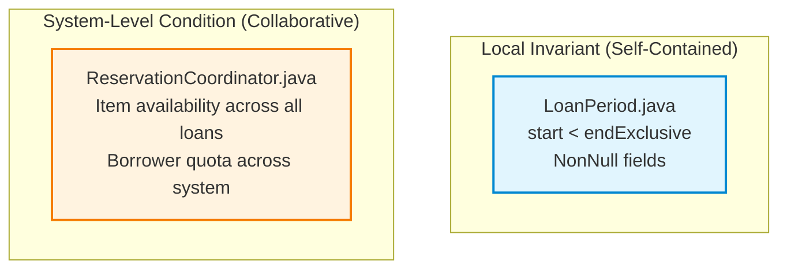
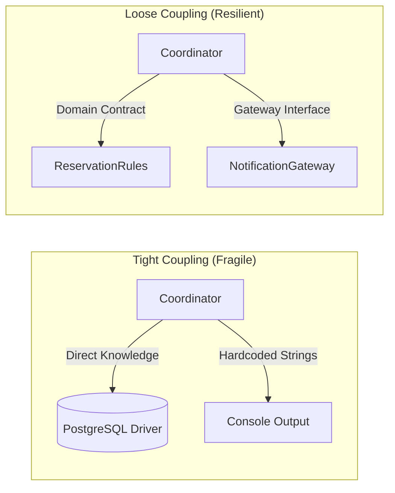
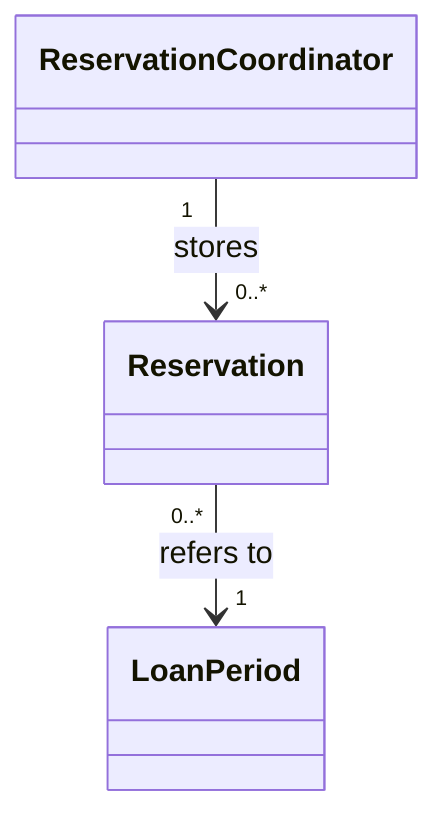
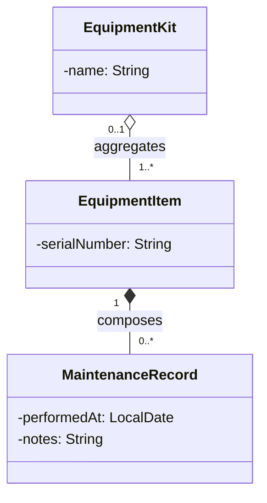
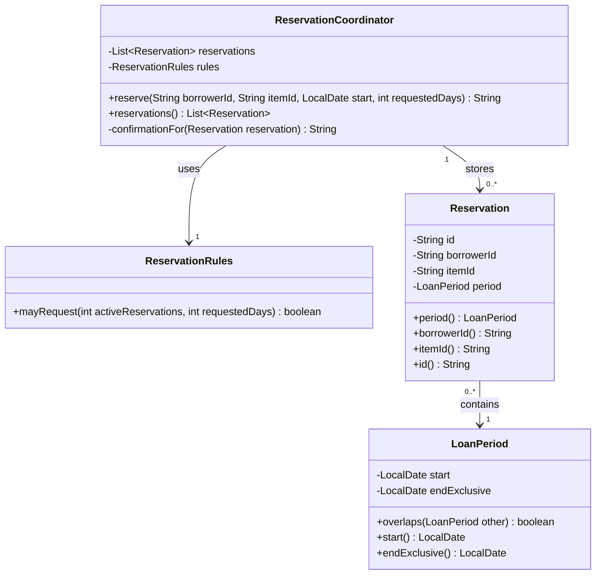
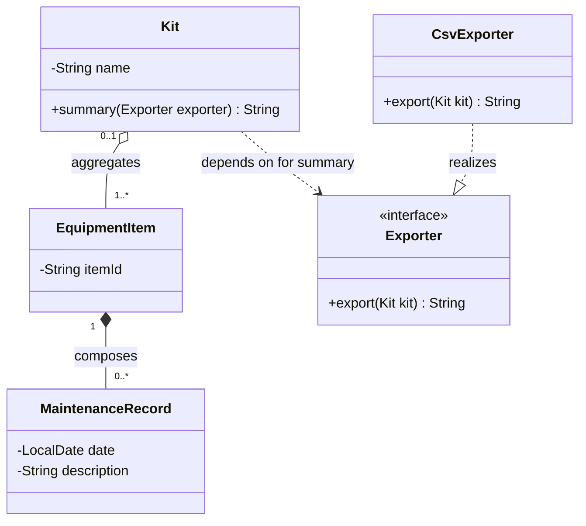
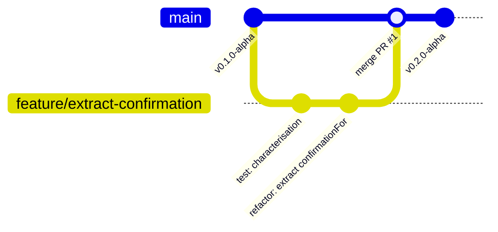

# Week 1: Foundations: Software That Can Change & OO Beyond Syntax
### SE506: Object Oriented Development and Agile Practices
**Dr. Polla Abdulhamid Fattah**  
*Department of Computer Science & Artificial Intelligence*  
*University of Kurdistan Hewlêr (UKH)*

---

## 3-Hour Lecture Roadmap

* **Part 1: Orientation, Software Change & The Domain Dilemma (0:00 - 0:30)**
  * Course expectations, the MSc in AI context, and why software change is our primary unit of design.
* **Part 2: Invariants, Encapsulation & Defensive State (0:30 - 1:05)**
  * Local vs. system invariants, half-open date intervals, and the myth of private fields.
* **Part 3: Cohesion, Coupling & Safe Refactoring (1:05 - 1:40)**
  * Diagnosing methods with multiple reasons to change; modest claims; composition vs. inheritance.
* **BREAK (1:40 - 1:55)**
* **Part 4: Visual Modeling with UML for Engineering & Exams (1:55 - 2:25)**
  * Classes, associations, multiplicities, aggregation vs. composition, and the 4-step checking routine.
* **Part 5: Testing, Deliberate Faults & AI Accountability (2:25 - 2:45)**
  * Characterisation testing, defensive mutation experiments, and classifying plausible AI hallucinations.
* **Part 6: Workshop Lab Tasks, Team Setup & Wrap-Up (2:45 - 3:00)**
  * Book project lab tasks, team domain selection, and issue board governance.

---

## The Postgraduate Context: Software Engineering for AI

* As MSc in AI students, you write complex models, data transformation pipelines, and evaluation scripts.
* **The Industry Dilemma:** In production, machine learning algorithms account for roughly **5%** of the total codebase.
* The remaining **95%** consists of:
  * Ingestion pipelines, validation boundaries, and configuration gates.
  * Operational coordinators, security layers, and integration contracts.
* **The Core Premise of SE506:** 
  * A brilliant algorithm wrapped in fragile, tangled software cannot be maintained, tested, or safely evolved.
  * We study how to engineer robust, long-lived, change-tolerant systems around our logic.

---

## The Running Domain: Campus Equipment Lending System

* Throughout this semester, we ground our design reasoning in a concrete, non-trivial domain:
  **The University Campus Equipment Lending System**.
* **Core Responsibilities:**
  * Students and academic staff inspect available equipment (oscilloscopes, cameras, GPU rigs).
  * Borrowers request reservations for specified temporal intervals.
  * Coordinators enforce borrowing quotas, duration limits, and maintenance windows.
  * Overdue fees, notifications, and status transitions occur over time.
* **Pedagogical Rule:** 
  * We use real business rules, realistic edge cases, and deterministic time fixtures.
  * No toy shapes (Circles/Rectangles) or artificial animal hierarchies.

---

## The Opening Dilemma: Naive Procedural Coordination

* Here is how an inexperienced developer often implements an equipment reservation request:

```java
// Naive Procedural Coordinator (A common real-world anti-pattern)
public class NaiveCoordinator {
    public List<String> bookings = new ArrayList<>();

    public boolean book(String user, String item, String start, int days) {
        if (days > 14) return false; // Hardcoded student rule!
        String record = user + "|" + item + "|" + start + "|" + days;
        bookings.add(record);
        System.out.println("Reserved: " + record);
        return true;
    }
}
```

* **Questions for the Class:**
  * Where are the date invariants verified? What if `days` is negative?
  * What prevents an external caller from wiping out `bookings` directly?
  * What happens when the university introduces a new 30-day staff borrowing policy?

---

## Diagnosing the Vulnerabilities

Let us analyze the technical liabilities in the naive coordinator:

| Engineering Flaw | Immediate Consequence | Long-Term Architectural Risk |
|---|---|---|
| **Piped String Data (`user + "\|" + ...`)** | String concatenation obscures structured domain state. | Callers must parse strings to query dates; zero compile-time type safety. |
| **Public Mutable List (`public List<String>`)** | Any external class can call `bookings.clear()` or append malformed records. | Internal state cannot be protected; class invariants are completely destroyed. |
| **Hardcoded Policy (`if (days > 14)`)** | Calculation logic is tightly coupled to request coordination. | Changing borrowing limits requires modifying and re-testing the coordinator. |
| **Void Side Effects (`System.out.println`)** | Output is hardcoded to standard out. | Impossible to test in automated CI suites or redirect to messaging gateways. |

---

## The Reality of Software: Change Is the Only Constant

* Software is not written once and set in stone. It is read, modified, extended, and debugged continuously.
* **Typical Evolution Requests in Equipment Lending:**
  1. *Change policy:* Allow Faculty Staff to borrow items for 30 days, while keeping Students at 7 days.
  2. *Change availability:* Require a 1-day cleaning and inspection gap between consecutive loans.
  3. *Change storage:* Move from in-memory lists to a transactional database.
  4. *Change presentation:* Localize confirmation text into Kurdish, Arabic, and English.
* **The Central Question:**
  * Will each of these changes require rewriting the entire coordinator, or does our design isolate the reasons to change?

---

## Week 1 Module Learning Outcomes

By the end of this 3-hour session, you will be able to:

* **LO1 (OO Principles & SOLID):**
  * Contrast raw syntax mechanics with true object-oriented responsibility boundaries.
  * Enforce local domain invariants using Java 17 records, constructors, and defensive copies.
  * Diagnose class cohesion and coupling, and execute behaviour-preserving refactorings.
* **LO6 (Professional Workflows & Modeling):**
  * Read, draw, and critically verify UML Class Diagrams against production code.
  * Correctly differentiate between Association, Aggregation (`o--`), Composition (`*--`), and Inheritance.
  * Construct characterisation tests and evaluate AI-generated code with independent verification records.

---

## Syntax Mechanics vs. Design Responsibilities

* In undergraduate courses, success meant satisfying the compiler:
  > *"It compiles with zero errors, and when I run main() it prints true. My job is done."*
* In postgraduate engineering, compiler success is merely the entry ticket. We evaluate:
  * **Encapsulation:** Are class invariants defended against external corruption?
  * **Cohesion:** Does each class have exactly one clear reason to change?
  * **Coupling:** Are dependencies explicit, minimal, and bound to stable contracts?
  * **Testability:** Can we assert behavior automatically without starting a web server or database?

---

# Part 2: Invariants, Encapsulation & Defensive State
### Defending Domain Integrity at the Class Boundary

---

## What Is an Invariant?

* **Definition:** An **invariant** is a business predicate or logical condition that must remain true throughout the entire lifetime of a valid domain object.
* An invariant can be temporarily violated *inside* the execution of a private mutating method, but:
  * It must be established before the constructor returns.
  * It must be preserved when any public method completes.
* **Examples in Equipment Lending:**
  * An equipment item identifier cannot be blank or null.
  * A borrowing period must have a start date that strictly precedes its end date.
  * A returned reservation snapshot must never be externally mutable.

---

## Local Invariants vs. System-Level Conditions

Do not confuse invariants that belong inside a single object with business rules that require coordinating multiple objects:



* **Local Invariant:** Can be verified using *only the private state of that object* (e.g., `LoanPeriod` checking its own start and end dates).
* **System-Level Condition:** Requires inspecting *multiple objects across time* (e.g., checking if another borrower has already reserved `ITEM-101` for that week).

---

## Time in Software: The Half-Open Interval Principle

* A notorious source of production bugs in scheduling systems is how date intervals are represented.
* **The Convention:** This textbook and system strictly enforce **start-inclusive, end-exclusive** half-open intervals:
  $$\text{Period} = [\text{start}, \text{endExclusive})$$
* **Why Half-Open Intervals?**
  1. *Duration calculation is simple subtraction:* $\text{Days} = \text{endExclusive} - \text{start}$.
  2. *Adjacent intervals do not overlap:*
     * Reservation A: `[2026-11-01, 2026-11-05)` (Runs Nov 1, 2, 3, 4; returned morning of Nov 5).
     * Reservation B: `[2026-11-05, 2026-11-10)` (Starts morning of Nov 5).
  3. No need to subtract 1 millisecond or deal with $23:59:59.999$ clock skew.

---

## Enforcing Invariants in Java 17: Compact Records

Java 17 records are ideal for immutable domain value objects. Use the **compact constructor** to defend invariants:

```java
package edu.se506.lending.domain;

import java.time.LocalDate;
import java.util.Objects;

public record LoanPeriod(LocalDate start, LocalDate endExclusive) {
    // Compact constructor: validates invariants before field assignment
    public LoanPeriod {
        Objects.requireNonNull(start, "Start date cannot be null");
        Objects.requireNonNull(endExclusive, "End date cannot be null");
        
        if (!start.isBefore(endExclusive)) {
            throw new IllegalArgumentException(String.format(
                "Start date (%s) must strictly precede end date (%s)", 
                start, endExclusive));
        }
    }

    public boolean overlaps(LoanPeriod other) {
        Objects.requireNonNull(other, "Other loan period cannot be null");
        return this.start.isBefore(other.endExclusive) 
            && other.start.isBefore(this.endExclusive);
    }
}
```

---

## The Encapsulation Myth: "My Fields Are Private!"

* **Junior Developer Assumption:** 
  > *"I marked my list private and generated a getter and setter. My object is fully encapsulated!"*
* Consider this starting coordinator excerpt from Chapter 2:

```java
public class LeakyReservationCoordinator {
    private final List<Reservation> reservations = new ArrayList<>();

    // The vulnerability:
    public List<Reservation> getReservations() {
        return reservations;
    }
}
```

* **The Attack Vector:** What can an external caller do with this getter?
  ```java
  LeakyReservationCoordinator coordinator = new LeakyReservationCoordinator();
  // ... system operates, reservations are made ...
  
  // A rogue caller or buggy UI component executes:
  coordinator.getReservations().clear(); // DESTRUCTION OF DOMAIN STATE!
  ```

---

## The Reference Trap: `final` vs. Immutable

* Many developers believe marking a collection `final` protects it:
  ```java
  private final List<Reservation> reservations = new ArrayList<>();
  ```
* **Language Mechanics Reality Check:**
  * The keyword `final` on an object reference means **the variable cannot be reassigned** to point to another list object.
  * It does **NOT** make the referenced `ArrayList` immutable!
  * Callers holding a reference to that list can freely call `.add()`, `.remove()`, and `.clear()`.
* **The Golden Rule:**
  `final` protects the reference pointer; it provides zero protection for internal contents.

---

## Structural Protection: `List.copyOf` Snapshots

To prevent callers from modifying internal state, return an **unmodifiable structural snapshot**:

```java
public class ReservationCoordinator {
    private final List<Reservation> reservations = new ArrayList<>();

    public List<Reservation> reservations() {
        // Returns an unmodifiable snapshot of the list at this instant:
        return List.copyOf(reservations);
    }
}
```

* **What `List.copyOf` does:**
  * Returns an unmodifiable list instance containing the elements currently in `reservations`.
  * If a caller invokes `.add()` or `.clear()`, the JVM throws `UnsupportedOperationException`.
  * Subsequent mutations to the coordinator's internal list do not retroactively alter previously returned snapshots.
* **Important Limit:** It does *not* deep-copy the elements themselves. If `Reservation` were mutable, its fields could still be modified. Because `Reservation` and `LoanPeriod` are immutable, our encapsulation is airtight.

---

## Live Prediction Exercise: Spot the Leak

Examine this proposed code snippet. Will it protect internal state?

```java
public class BorrowerAccount {
    private final String id;
    private final List<String> activeLoanIds;

    public BorrowerAccount(String id, List<String> initialLoans) {
        this.id = Objects.requireNonNull(id);
        this.activeLoanIds = initialLoans; // Point A
    }

    public List<String> getActiveLoanIds() {
        return Collections.unmodifiableList(activeLoanIds); // Point B
    }
}
```

* **Classroom Challenge:**
  1. Can an external caller modify the borrower's loans after construction?
  2. If so, how? Point A or Point B?

---

## Prediction Analysis: The Backdoor Mutator

* **Answer:** Yes! The class has a severe security leak at **Point A**.
* **The Exploit:**
  ```java
  List<String> callerList = new ArrayList<>();
  callerList.add("L-001");

  BorrowerAccount account = new BorrowerAccount("B-100", callerList);

  // The caller still holds the original reference:
  callerList.clear(); // Bypasses account! account.activeLoanIds is now EMPTY!
  ```
* **The Fix:** Defensive copying is required on both **ingress (constructors)** and **egress (accessors)**:
  ```java
  public BorrowerAccount(String id, List<String> initialLoans) {
      this.id = Objects.requireNonNull(id);
      this.activeLoanIds = new ArrayList<>(Objects.requireNonNull(initialLoans));
  }
  ```

---

# Part 3: Cohesion, Coupling & Safe Refactoring
### Managing the Forces that Drive Software Design

---

## Cohesion: Why Do Classes Grow Bloated?

* **Cohesion** measures how closely related the responsibilities within a single class or module are.
* **High Cohesion:** 
  * A class has a single, tightly focused purpose.
  * Every method operates on the class's core fields.
  * Example: `LoanPeriod` handles only dates and overlap math.
* **Low Cohesion (God Class Anti-Pattern):**
  * A single class coordinates bookings, formats email text, calculates late fines, validates credit cards, and connects to SQL databases.
  * Developers constantly edit the same file for completely unrelated business reasons.

---

## Coupling: The Good, the Bad, and the Tangled

* **Coupling** measures the degree of dependency between collaborating components.
* **The Reality:** Software cannot function with zero coupling; components *must* collaborate to achieve business value.
* **The Engineering Objective:**
  * Eliminate **accidental / unneeded coupling** (e.g., domain coordinator knowing SQL queries or console formatting).
  * Promote **loose, explicit coupling** through stable contracts and interfaces.



---

## Dissecting the Starting `reserve` Method

Look at this excerpt from the starter's `ReservationCoordinator`:

```java
public String reserve(String borrowerId, String itemId, LocalDate start, int requestedDays) {
    if (borrowerId == null || borrowerId.isBlank()) return "Rejected: invalid borrower.";
    if (itemId == null || itemId.isBlank()) return "Rejected: invalid item.";
    if (requestedDays <= 0) return "Rejected: invalid loan duration.";

    int borrowerActiveCount = countActiveFor(borrowerId);
    if (!rules.mayRequest(borrowerActiveCount, requestedDays)) {
        return "Rejected: borrowing limit exceeded.";
    }

    LoanPeriod requestedPeriod = new LoanPeriod(start, start.plusDays(requestedDays));
    for (Reservation existing : reservations) {
        if (existing.itemId().equals(itemId) && existing.period().overlaps(requestedPeriod)) {
            return "Rejected: item not available.";
        }
    }

    Reservation reservation = new Reservation("R" + (reservations.size() + 1), 
                                              borrowerId, itemId, requestedPeriod);
    reservations.add(reservation);
    return "Confirmed: " + reservation.id() + " for " + reservation.borrowerId()
            + " on " + reservation.itemId() + " [" + reservation.period().start()
            + ", " + reservation.period().endExclusive() + ").";
}
```

---

## Responsibility Inventory: Reasons to Change

Do not criticize code merely because "the method is long." Instead, perform a **Responsibility Inventory** identifying independent axes of change:

| Possible Change Request | Architectural Decision Affected | Current Location in Code |
|---|---|---|
| **Change borrowing limits** | Numeric quota rules | Delegated to `ReservationRules` (Good!) |
| **Add maintenance buffer** | Period overlap logic | Inline loop in coordinator (Needs attention) |
| **Persist records to disk** | Storage mechanism | Inline `reservations.add()` (Coupled to in-memory) |
| **Translate confirmation text** | Presentation wording | Inline string concatenation at end of method |

> **Key Takeaway:** The method contains at least three distinct reasons to change. Editing German translation strings shouldn't risk breaking reservation allocation logic!

---

## A Modest Refactoring: Extracting `confirmationFor`

We perform an **Extract Method** refactoring, isolating confirmation formatting into a named helper:

```java
// Step 1: Extract private helper
private String confirmationFor(Reservation reservation) {
    return "Confirmed: " + reservation.id() 
            + " for " + reservation.borrowerId()
            + " on " + reservation.itemId() 
            + " [" + reservation.period().start()
            + ", " + reservation.period().endExclusive() + ").";
}

// Step 2: Main method delegates to helper
reservations.add(reservation);
return confirmationFor(reservation);
```

* **What this refactoring achieves:**
  * Gives the formatting logic an intention-revealing name.
  * Allows a reader to follow high-level orchestration without deciphering string concatenations.

---

## Intellectual Honesty: What We Claim vs. What Remains

As professional engineers, we must state our claims with precision:

* **What this refactoring DID achieve:**
  * Improved readability within the class.
  * Reduced cognitive load when scanning the `reserve` control flow.
* **What this refactoring DID NOT achieve:**
  * It did **not** eliminate coupling to presentation (the coordinator still produces English text).
  * It did **not** make the coordinator thread-safe under concurrent requests.
  * It did **not** create an independent presenter or localization service.

> **Rule of Engineering Humility:** Never claim a minor refactoring solved your system architecture. Distinguish internal method extractions from true component boundaries.

---

## Composition vs. Inheritance

* **Composition:** Building functionality by giving an object collaborator components ("has-a" relationship).
* **Inheritance:** Defining a derived class that inherits state and behavior from a base class ("is-a" relationship).

| Question | Composition Can Help When | Inheritance Deserves Consideration When |
|---|---|---|
| **What is the relationship?** | One object uses, coordinates, or contains another. | One type is a genuine, substitutable subtype of another. |
| **What varies?** | Collaborators can be swapped dynamically at runtime. | Shared behavior is reused across a fixed family of types. |
| **What is the cost?** | Additional forwarding methods and collaborator calls. | Tight coupling; derived classes inherit superclass fragility. |

---

## The Inheritance Trap: Premature Subclassing

* A junior engineer proposes creating `StaffReservation`:
  ```java
  // Anti-pattern: subclassing to accommodate a policy rule
  public class StaffReservation extends Reservation {
      public StaffReservation(String id, String staffId, String itemId, LoanPeriod p) {
          super(id, staffId, itemId, p);
      }
      // Overrides nothing! Exists only because staff get 30 days instead of 7!
  }
  ```
* **Why this is poor design:**
  * Is a staff reservation a fundamentally different kind of reservation, or just a reservation created under a different policy?
  * What happens if a graduate student becomes a teaching assistant halfway through the semester? Does their existing reservation mutate its Java class type?
* **Solution:** Keep `Reservation` simple. Let `ReservationRules` govern policy differences via composition.

---

# Part 4: Visual Modeling with UML
### Communicating Design Clearly for Code Reviews & Examinations

---

## Why We Model with UML

* **A UML Diagram is a selective explanation, not a copy of your source code.**
* A diagram that dumps every private variable, getter, and setter is unreadable and answers no question well.
* **Primary Purposes:**
  1. *Communication:* Explain collaborator relationships to peers in pull requests.
  2. *Design Reasoning:* Spot cyclic dependencies before writing hundreds of lines of code.
  3. *Examination Preparation:* 20% of your SE506 Midterm examination assesses scenario-to-class-diagram modeling!
* In this course, we author diagrams using **Mermaid text syntax**, keeping our models version-controlled right beside our Java source code.

---

## Anatomy of a UML Class Box

A class is represented by a three-compartment rectangle:

```text
+-------------------------------------------------------------+
|                      Reservation                            |  <-- Compartment 1: Name
+-------------------------------------------------------------+
| - id: String                                                |  <-- Compartment 2: Attributes
| - borrowerId: String                                        |      (Visibility Name: Type)
| - itemId: String                                            |
+-------------------------------------------------------------+
| + period(): LoanPeriod                                      |  <-- Compartment 3: Operations
| + hasIdentifier(targetId: String): boolean                  |      (Visibility Name(params): Return)
+-------------------------------------------------------------+
```

### UML Visibility Symbols:
* `+` **Public:** Accessible by any class.
* `-` **Private:** Accessible only within this class.
* `#` **Protected:** Accessible within package and derived subclasses.
* `~` **Package-private:** Accessible only within the declaring package (Java default).

---

## UML Relationships: The Definitive Notation Guide

| Relationship | Symbol | Mermaid Syntax | Domain Meaning | Example in Lending System |
|---|:---:|:---:|---|---|
| **Association** | $\longrightarrow$ | `A --> B` | A holds a reference to B. | `Coordinator` stores `Reservation`. |
| **Aggregation** | $\diamond$-- | `A o-- B` | "Has-a" part-whole; part outlives container. | `EquipmentKit` aggregates `EquipmentItem`. |
| **Composition** | $\blacklozenge$-- | `A *-- B` | Strict ownership; part destroyed with owner. | `EquipmentItem` composes `MaintenanceRecord`. |
| **Inheritance** | $\longrightarrow\mkern-14mu\triangle$ | `A --\|> B` | Subtype / Generalization ("is-a"). | `StudentRules` extends `AbstractRules`. |
| **Realization** | $---\mkern-14mu\triangle$ | `A ..\|> B` | Class implements an interface contract. | `Coordinator` implements `LendingService`. |
| **Dependency** | $-->$ | `A ..> B` | Temporary usage (parameter or local var). | `Coordinator` depends on `LoanPeriod`. |

---

## Multiplicity: Quantifying Relationships

Multiplicity annotations define how many instances of class B can be linked to a single instance of class A:

* `1` : Exactly one instance (mandatory).
* `0..1` : Optional; zero or one instance (e.g., nullable field or `Optional`).
* `*` or `0..*` : Zero or more instances (e.g., a collection or list).
* `1..*` : At least one instance (non-empty collection).



* **Reading aloud in both directions:**
  * *"One ReservationCoordinator stores zero to many Reservations."*
  * *"Many Reservations refer to exactly one LoanPeriod."*

---

## Aggregation (`o--`) vs. Composition (`*--`)

This distinction appears frequently in system modeling and midterm exams:



* **Aggregation (Open Diamond):**
  * Removing an `EquipmentKit` from the laboratory does **NOT** delete the physical `EquipmentItem` cameras inside it. Items have independent existence.
* **Composition (Filled Diamond):**
  * If an `EquipmentItem` is permanently destroyed or deleted, its internal `MaintenanceRecord` history has no independent meaning and is destroyed with it.

---

## Complete Class Diagram: Week 1 Starter Checkpoint

Here is the authoritative Mermaid diagram for our Week 1 companion codebase:



---

## The 4-Step Diagram Verification Routine

Whenever you draw a UML diagram from code, or review a peer's model, execute these four steps:

1. **Verify Box Compartments:**
   * Do class names match real source files? Are visibilities (`+`, `-`) accurate?
2. **Read Lines Bidirectionally Against the Domain:**
   * Trace the line from A to B, then from B to A. Does the sentence make business sense?
   * *"Can a Reservation exist without a LoanPeriod?"* (Multiplicity `1` says no; verify constructor requires it).
3. **Check Diamond Fillings:**
   * Ask: *"If I delete the parent object from memory, must the child object be deleted too?"*
   * If yes $\rightarrow$ filled diamond (composition). If no $\rightarrow$ open diamond (aggregation).
4. **Prune Visual Noise:**
   * Remove trivial getters/setters. Keep only methods that participate in the collaboration being explained.

---

## Modeling Challenge: Laboratory Equipment Kits

* **Scenario Brief:**
  > The equipment office groups laboratory equipment into kits. A kit has a name and holds one or more equipment items. Removing a kit does not delete its items, and an item belongs to at most one kit. Each item keeps any number of maintenance records; a maintenance record belongs to exactly one item and has no meaning without it. A kit summary is produced through an exporter. The office needs CSV output now and expects other formats later.

* **Classroom Task (5-minute exercise):**
  * Identify the classes.
  * Decide which relationship connects `Kit` to `Item`.
  * Decide which relationship connects `Item` to `MaintenanceRecord`.
  * How should the CSV exporter be modeled?

---

## Solution: The Equipment Kit Model



* Notice: `Exporter` is an interface realized by `CsvExporter`. `Kit` depends on (`..>`) the abstraction, not the concrete CSV class!

---

# Part 5: Testing, Deliberate Faults & AI Accountability
### Validating Behavior with Evidence over Claims

---

## Testing as an Active Design Probe

* In traditional testing, developers write tests only to verify that code "works."
* **In SE506, testing is a design diagnostic tool:**
  * If a method is difficult to test in isolation, its coupling is too high.
  * If a test requires setting up 15 unrelated objects, class responsibilities are tangled.
  * If tests pass even when domain logic is corrupted, assertions are hollow.
* **The Rule of Test Evidence:**
  Passing tests demonstrate that code behaves as expected *only under the specific conditions evaluated by those tests*.

---

## Characterisation Testing: The Safety Net

* **What is a Characterisation Test?**
  * An automated test written to lock down the *actual, current behavior* of existing code before attempting refactoring.
  * It does not ask: *"What should the code do according to the business requirements?"*
  * It asks: *"What does the code currently do right now on inputs A, B, and C?"*
* **Why this matters:**
  * When you extract `confirmationFor`, how do you prove you did not alter capitalization, omit punctuation, or skip adding the reservation to storage?
  * Characterisation tests provide the safety net that lets you refactor with confidence.

---

## The Deliberate Fault Experiment: Breaching Encapsulation

* Never trust a test suite until you have seen it fail!
* **The Experiment:**
  1. In `ReservationCoordinator.java`, temporarily modify the accessor:
     ```diff
     - return List.copyOf(reservations);
     + return reservations; // Deliberate fault: exposing raw mutable list!
     ```
  2. Run your automated test suite.
  3. **The Acid Test:** Did any test fail?
* **If all tests still pass:** Your test suite is blind to encapsulation breaches!
* **The Required Test:**
  ```java
  @Test
  void returnedReservationsSnapshotMustBeUnmodifiable() {
      ReservationCoordinator coordinator = new ReservationCoordinator();
      coordinator.reserve("B-101", "ITEM-01", LocalDate.now(), 3);
      
      List<Reservation> snapshot = coordinator.reservations();
      assertThrows(UnsupportedOperationException.class, () -> snapshot.clear());
  }
  ```

---

## AI in Practice: The Danger of Plausible Hallucinations

* Generative AI coding assistants (ChatGPT, Claude, Gemini, Copilot) are increasingly used by software engineers.
* **The Danger:** LLMs generate syntactically fluent, highly convincing code and explanations that contain **subtle, catastrophic domain errors**.
* **Common AI Failure Modes in Software Engineering:**
  1. *Inventing Infrastructure:* Claiming code connects to databases or sends emails when it does neither.
  2. *Hallucinating Language Capabilities:* Claiming a `final` field makes collections "deeply immutable."
  3. *Distorting Boundaries:* Changing half-open interval `<` checks into inclusive `<=` checks.

---

## Critical Review Exercise: The AI Teaching Fixture

Here is a plausible explanation constructed by an AI tool when asked to explain our starter coordinator:

> *"The coordinator validates identifiers, counts the borrower's stored reservations and checks the numeric rule. It tests availability using existing reservations for the same item. On success, it adds a reservation before returning a confirmation. It sends that confirmation by email and persists the reservation to a database. Because the list field is final, callers receive a deeply immutable copy and booking is safe under concurrent requests."*

* **Classroom Task:**
  * Classify every claim in this paragraph as:
    1. **Supported by code**
    2. **Contradicted by code**
    3. **Not established / Hallucinated**

---

## Claim Classification Table

| AI Claim | Verdict | Evidence in Codebase |
|---|:---:|---|
| Validates identifiers & counts active reservations | **SUPPORTED** | Lines 1–4 explicitly check `null`/blank and call `countActiveFor`. |
| Tests availability using existing reservations | **SUPPORTED** | Loop checks `overlaps(requestedPeriod)` against existing items. |
| Sends confirmation by email | **CONTRADICTED** | No mail client, SMTP host, or network call exists; only returns a String. |
| Persists reservation to database | **CONTRADICTED** | Stores only in memory (`reservations.add`); state disappears when JVM exits. |
| `final` list field makes copy deeply immutable | **CONTRADICTED** | `final` reference does not prevent mutation; `List.copyOf` provides structural protection. |
| Booking is safe under concurrent requests | **NOT ESTABLISHED** | No `synchronized` blocks, concurrent collections, or atomic locks exist. |

---

## The AI Verification Record (Course Standard)

Whenever you use AI assistance in SE506, you must compile an audit record with these 8 elements:

```text
================================================================================
AI VERIFICATION RECORD (Chapter 15 Standard)
================================================================================
1. Task: What specific method or test was requested?
2. Tool & Model: Which model version was consulted (or constructed fixture)?
3. Context Provided: Exactly what code, interfaces, and constraints were shared?
4. Output Received: The raw candidate code or explanation (including rejected attempts).
5. Decision: Which claims were accepted, and which were rejected?
6. Changes Made: Exact manual corrections applied by the human engineer.
7. Verification Executed: What compiler flags (--release 17) and tests were run?
8. Limitations: What do the checks still NOT prove (e.g., concurrency, persistence)?
================================================================================
```

---

# Part 6: Workshop, Teams & Wrap-Up
### Putting Principles into Practice

---

## Common Engineering Mistakes to Avoid

| Mistake | Why It Fails in Practice | Better Engineering Habit |
|---|---|---|
| **Private fields = safe** | Returning mutable lists leaks internal modification paths. | Ask: What can callers mutate through returned references? |
| **`final` field = immutable** | A final reference to an ArrayList can still have items added or cleared. | Distinguish the reference pointer from the object's internal state. |
| **Every noun = a new class** | Creating classes for concepts with zero state or behavior creates indirection bloat. | Ask: What concrete responsibility does this class own right now? |
| **More interfaces = better** | Interfaces that replicate unstable concrete methods add maintenance overhead without benefit. | Introduce interfaces only at genuine boundaries or test seams. |
| **Formatting refactoring fixed the design** | Extracting a private helper leaves storage coupling and validation untouched. | Be honest about the modest scope and limits of each refactoring. |

---

## Practical Lab 1: Your Workshop Deliverables

In this week's laboratory session, you will complete three parts on the **Book Project**:

* **Part A: Trace and Understand the Baseline:**
  * Compile and run `Chapter02Demo.java`.
  * Record the returned confirmation text and count of stored reservations after each call.
  * Identify the exact line of code that rejects overlapping bookings.
* **Part B: Model the Starter:**
  * Draw the UML class diagram of the starter following the 4-step verification routine.
  * Complete the *Laboratory Equipment Kits* scenario diagram.
* **Part C: Safe Extraction & Fault Experiment:**
  * On a short-lived Git branch, extract `confirmationFor(Reservation)`.
  * Run the 34 automated checks. Verify that output and stored records remain identical.
  * Perform the deliberate fault experiment on `List.copyOf`.

---

## Team Project Kickoff: Choosing Your Domain

* In SE506, you work in self-managed teams of 3 to 4 engineers across the entire semester.
* **Step 1: Choose Your Starter Domain (Ground Rules G2 & G3):**
  * **Option A: Campus Equipment Lending System** (The textbook baseline: loans, kits, maintenance, overdue fines).
  * **Option B: ML Model Serving & Experiment Tracking** (Inference jobs, GPU allocations, compute leases, retraining schedules).
  * **Option C: Academic Facility & Room Scheduling** (Laboratories, lecture halls, time slots, sanitization windows).
* Teams selecting Option B or C will follow the **Domain Transfer Maps** provided in Appendix D.

---

## Agile Workflow: Issue Boards and Branching Policy

Professional engineering teams collaborate through structured version control:



* **Setup Your GitHub Issue Board:**
  * Columns: `To Do`, `In Progress`, `In Review`, `Done`.
  * Every card must have a concrete **Definition of Done**.
* **Agree on Branch Policies:**
  * Prohibit direct commits to `main`.
  * Work on short-lived feature branches (`feat/...` or `fix/...`).
  * Require at least one peer pull-request review before merging.

---

## Evidence to Retain for Milestone 1

Do not throw away your workshop work! Under the module descriptor, you must retain audit evidence:

* **Artifacts to save in your team repository:**
  1. Annotated UML Class Diagram matching your verified codebase.
  2. Git commit SHA of your reviewed `confirmationFor` extraction.
  3. Before-and-after check runner output proving 34 passing checks.
  4. Deliberate fault experiment notes documenting test failure on mutable lists.
  5. The filled AI Assistance Verification Record.
  6. Screenshot/link to your team issue board and agreed branching policy document.

---

## Summary & What Comes Next

* **Core Takeaways Today:**
  1. Software design is about managing the ripple effects of change.
  2. Encapsulation protects domain invariants at the constructor and collection boundary.
  3. UML class diagrams are selective explanations; multiplicity and diamond symbols carry exact semantics.
  4. Never trust code or AI claims without executable test evidence.
* **Next Week (Week 2):**
  * **Agile Development and the Nature of Change (Chapter 3)**
  * Transforming vague user requirements into an ordered backlog.
  * Writing testable User Stories with *Given-When-Then* acceptance criteria.
  * Defining team quality standards with the *Definition of Done (DoD)*.
