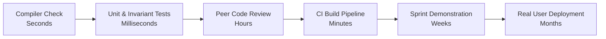
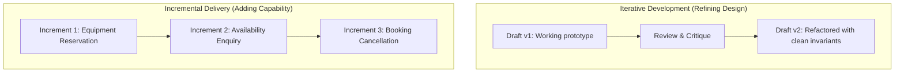
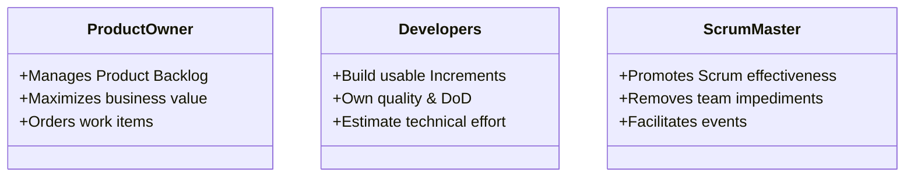
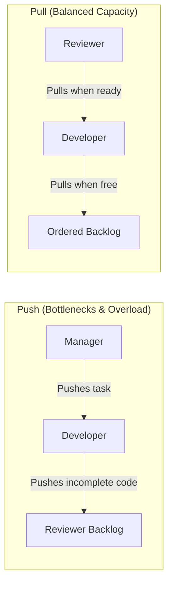
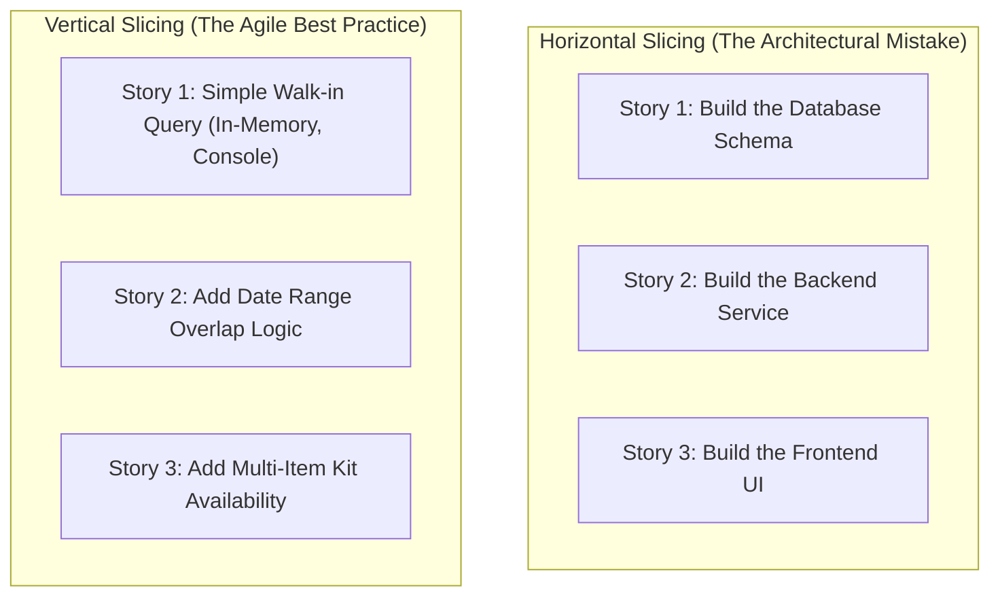
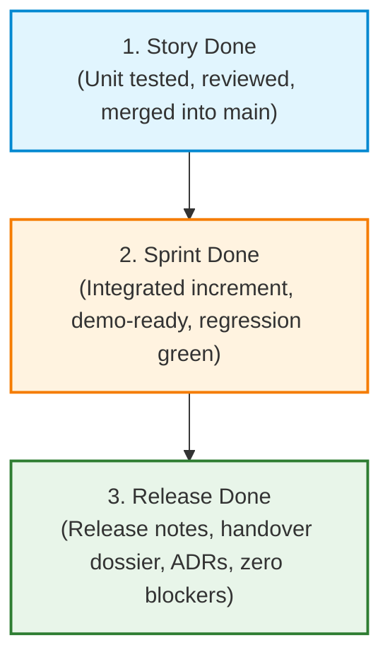

# Week 2: Agile Development, Backlogs & Acceptance Criteria
### SE506: Object Oriented Development and Agile Practices
**Dr. Polla Abdulhamid Fattah**  
*Department of Computer Science & Artificial Intelligence*  
*University of Kurdistan Hewlêr (UKH)*

---

## 3-Hour Lecture Roadmap

* **Part 1: Uncertainty, Feedback & Agile Values (0:00 - 0:30)**
  * Deconstructing uncertainty, feedback cycle speeds, and genuine Agile preferences.
* **Part 2: Scrum Framework vs. Kanban Flow (0:30 - 1:05)**
  * Accountabilities, events, artefacts, work-in-progress (WIP) limits, and pull systems.
* **Part 3: Writing Effective User Stories & INVEST (1:05 - 1:40)**
  * User value templates, vertical vs. horizontal slicing, and the INVEST criteria.
* **BREAK (1:40 - 1:55)**
* **Part 4: Acceptance Criteria & The Definition of Done (1:55 - 2:25)**
  * Given-When-Then scenario design, story contracts vs. system-wide engineering DoD.
* **Part 5: Estimation, Relative Sizing & AI Assistance (2:25 - 2:45)**
  * Relative story points, Planning Poker as a dialogue, and critiquing AI-drafted stories.
* **Part 6: Workshop Lab, Team Backlog Setup & Wrap-Up (2:45 - 3:00)**
  * Building your GitHub issue board, card definitions, and Milestone 1 preparation.

---

## The Postgraduate Engineering Context

* Last week, we established that **software change** is the primary unit of design reasoning.
* But before we can write clean code, we face a fundamental question:
  > **How does an engineering team know what to build next, why it matters, and when it is actually finished?**
* **The Reality in Industry:**
  * More software projects fail due to misunderstood requirements, bloated scope, and broken feedback loops than due to compiler syntax errors.
  * In this session, we establish the process tools: **backlogs, stories, acceptance criteria, and boards**: that keep engineering teams aligned.

---

## Opening Scenario: The Equipment Officer's Unmet Needs

* At the end of Week 1, our team proudly demonstrated `ReservationCoordinator`:
  * A student request succeeded and returned a confirmation string.
  * Overlapping requests were safely rejected.
  * Adjacent dates `[2026-11-01, 2026-11-05)` and `[2026-11-05, 2026-11-10)` worked without conflict.
* The system behaved exactly as its developers expected.
* **Then the Equipment Officer asked:**
  > *"Can I check whether a camera is available next Thursday BEFORE I create a reservation?"*
* **The Sudden Realization:**
  * The team could inspect the in-memory list, but had no dedicated availability query.
  * Checking an invariant during a booking request is fundamentally different from supporting an officer's interactive workflow!

---

## The Flood of Unfiltered Requests

* The demonstration opened a floodgate of stakeholder requests:
  * *"Can borrowers cancel a reservation if their lab session is rescheduled?"*
  * *"Can we view all equipment currently reserved by Borrower B-101?"*
  * *"What happens if someone enters an equipment serial number that does not exist?"*
  * *"Can we charge a fine if equipment is returned after 5:00 PM?"*
* **The Engineering Trap:**
  * If the team attempts to code all of these immediately, the codebase becomes a tangled mess of half-finished features.
  * If the team refuses to listen, the software becomes irrelevant to the university.
* **The Solution:** An ordered backlog, transparent sizing, and testable acceptance criteria.

---

## Deconstructing Uncertainty in Software Projects

At the start of an iteration, uncertainty appears in several distinct forms. Treating them all as generic "requirements problems" prevents effective action:

| Form of Uncertainty | Concrete Example in Equipment Lending | A Useful Immediate Action |
|---|---|---|
| **User Need** | Does the officer need an availability query without reserving? | Discuss the workflow and demonstrate a quick UI spike. |
| **Domain Policy** | Can a borrower cancel a booking after equipment is collected? | Interview the responsible stakeholder and record an explicit decision. |
| **Technical Feasibility** | Can we query the university LDAP directory via REST? | Conduct a time-boxed technical spike with concrete network tests. |
| **Team Delivery** | Can the team finish the query workflow in the next sprint? | Examine remaining backlog items, capacity, and assumptions. |

> **Key Rule:** Different uncertainties require different evidence. Sizing a story larger will not settle a domain cancellation policy; more conversation will not prove network connectivity.

---

## Feedback Loops: Speed Determines Agility

Agile software engineering is fundamentally about **shortening the feedback loop**:



* **Fast Loops (Compiler, Tests):** Tell you if the program is logically valid and preserves existing invariants.
* **Medium Loops (Reviews, CI):** Tell you if the design is maintainable and adheres to team standards.
* **Slow Loops (Demos, Releases):** Tell you if you built the right capability for the actual users.
* A team that only gets feedback after three months has abandoned agility, regardless of whether they hold daily standup meetings.

---

## The Agile Manifesto: Genuine Preferences vs. Misinterpretations

The 2001 Agile Manifesto expresses deliberate preferences. It does NOT state that the items on the right have zero value:

| Agile Preference | Thoughtful Engineering Application | Dangerous Misinterpretation |
|---|---|---|
| **Individuals & interactions** over processes and tools | Choose simple tools (like Git boards) that facilitate peer collaboration. | Assume installing Jira creates teamwork; eliminate coding standards. |
| **Working software** over comprehensive documentation | Write executable characterisation tests and short Architecture Decision Records. | Discard documentation entirely because "the code is self-documenting." |
| **Customer collaboration** over contract negotiation | Engage the equipment officer weekly to clarify cancellation and quota rules. | Let developers invent business policies privately in isolation. |
| **Responding to change** over following a plan | Update backlog priorities when new university loan policies emerge. | Stop planning entirely because "requirements change anyway." |

---

## Iterative Development vs. Incremental Delivery

These two terms describe related but fundamentally distinct aspects of software engineering:



* **Iterative Development:** Reworking, refining, and refactoring existing functionality based on feedback to improve quality.
* **Incremental Delivery:** Adding new, fully finished, usable vertical slices of functionality to the system.
* **The Trap:** Iterating forever on one screen without ever delivering an integrated increment, or accumulating unfinished half-features.

---

# Part 2: Scrum Framework vs. Kanban Flow
### Choosing the Right Process Harness for Engineering Teams

---

## Scrum: The Three Accountabilities

The formal reference is the November 2020 Scrum Guide. Scrum replaces traditional hierarchical management with three distinct accountabilities:



* **Product Owner:** Accountable for *what* gets built and *why*. Owns the Product Goal and backlog ordering.
* **Developers:** Accountable for *how* it gets built and *how well*. Own the technical estimates and Definition of Done.
* **Scrum Master:** Accountable for *team effectiveness* and removing structural blockers.

---

## Scrum: The Five Events

Scrum structures time into predictable, time-boxed events:

1. **The Sprint (The Container):** A fixed-duration cycle (typically 1 to 2 weeks in this course) during which an increment is created.
2. **Sprint Planning:** 
   * *Why is this sprint valuable?* (Formulate the Sprint Goal).
   * *What can be done?* (Select backlog items based on capacity).
   * *How will the work get done?* (Decompose stories into engineering tasks).
3. **Daily Scrum (Standup):** A 15-minute daily check-in for developers to inspect progress toward the Sprint Goal and adapt the sprint backlog.
4. **Sprint Review:** Demonstration of the working increment to stakeholders; gathering immediate feedback.
5. **Sprint Retrospective:** The team inspects its own process, relationships, and tools, creating actionable improvements for the next sprint.

---

## Scrum: The Three Artifacts and Commitments

Each Scrum artifact contains an explicit, binding commitment to ensure transparency:

| Artifact | Purpose | Formal Commitment |
|---|---|---|
| **Product Backlog** | An emergent, ordered list of everything that might be needed in the system. | **Product Goal:** The long-term target the team is striving toward. |
| **Sprint Backlog** | The subset of product backlog items selected for the sprint, plus the delivery plan. | **Sprint Goal:** The single, unifying business objective of the sprint. |
| **The Increment** | The integrated, usable sum of all completed backlog items. | **Definition of Done (DoD):** The formal quality standard the work must satisfy. |

> **Critical Rule:** If an item does not meet the Definition of Done, it can **never** be demonstrated or counted toward the increment!

---

## Kanban: Visualizing Work and Managing Flow

* While Scrum organizes work around fixed time boxes (Sprints), **Kanban** organizes work around continuous, smooth flow.
* **The Core Principles of Kanban:**
  1. *Visualize the Workflow:* Make all work visible on a shared board with clear columns.
  2. *Limit Work in Progress (WIP):* Place hard numerical caps on active items.
  3. *Manage Flow:* Monitor lead time and eliminate bottlenecks.
  4. *Make Process Policies Explicit:* Define clear entrance and exit criteria for every column.

```text
+-------------------+-------------------+-------------------+-------------------+
|    To Do [8]      |  In Progress [2]  |   In Review [2]   |     Done [inf]    |
+-------------------+-------------------+-------------------+-------------------+
| [US-04] Notify    | [US-02] Enquire   | [US-01] Reserve   | [INIT] Repo setup |
| [US-05] Cancel    | [US-03] Quota     |                   | [INIT] CI pipeline|
+-------------------+-------------------+-------------------+-------------------+
```

---

## The Power of Work-in-Progress (WIP) Limits

* **The Most Common Engineering Team Failure:**
  * Every developer picks up their own story.
  * At sprint end, 4 stories are "90% done", and 0 stories are actually integrated, tested, and releasable!
* **Little's Law in Software Engineering:**
  $$\text{Cycle Time} = \frac{\text{Work in Progress (WIP)}}{\text{Throughput}}$$
* **The Law of Flow:** 
  * If you increase WIP without increasing team capacity, **cycle time increases** and delivery slows down.
  * To finish work faster: **Stop starting, start finishing!**
* If the `In Review` column is full, developers cannot pick up new work; they must help review pending PRs!

---

## Pull Systems vs. Push Systems

* **Push System (Traditional Project Management):**
  * A project manager assigns 5 tasks to each developer at the start of the week.
  * Developers rush through tasks to look busy, pushing unverified code downstream into QA.
* **Pull System (Agile & Kanban):**
  * Work sits in an ordered queue.
  * A developer pulls a new card only when they have completely finished and merged their current card.
  * Downstream capacity dictates upstream throughput.



---

## Comparing Scrum and Kanban for Student Teams

| Dimension | Scrum Framework | Kanban Flow |
|---|---|---|
| **Cadence** | Regular fixed time-boxes (1–2 week sprints). | Continuous flow; releases can happen anytime. |
| **Commitment** | Team commits to a Sprint Goal during planning. | Team commits to honoring WIP limits and flow. |
| **Roles** | Strict roles: Product Owner, Scrum Master, Developers. | No formal roles required; uses existing team structure. |
| **Changes** | No changes allowed that endanger the Sprint Goal. | Backlog can be reprioritized at any moment. |
| **Measurement** | Velocity (story points completed per sprint). | Cycle time (elapsed time from start to finish). |

> **Course Recommendation (Scrumban):** For SE506 team projects, use a 2-week Sprint cadence for milestone deadlines, combined with a Kanban board with strict WIP limits for daily development.

---

# Part 3: Writing Effective User Stories & The INVEST Framework
### Expressing Requirements as Units of Value

---

## What Is a User Story?

* A User Story is **not** a formal contract, nor is it a comprehensive specification document.
* Ron Jeffries summarized a user story as the **3 Cs**:
  1. **Card:** A brief physical or digital card representing a requirement, written in human language.
  2. **Conversation:** A dialogue between developers, stakeholders, and testers to explore details and edge cases.
  3. **Confirmation:** The explicit acceptance criteria that prove the story is completed correctly.
* A story is an invitation to a conversation, not a set of marching orders!

---

## The Standard User Story Template

Every user story should follow the canonical value template:

```text
As a [specific user persona / role],
I want to [execute a capability or operation],
So that [achieve a tangible, measurable business benefit].
```

* **Example from Equipment Lending:**
  ```text
  As an Equipment Office Administrator,
  I want to query equipment availability for a specific date range without creating a reservation,
  So that I can answer student walk-in enquiries without polluting the system with dummy records.
  ```

---

## Deconstructing the "So That" Clause

* Why is the "So That" clause mandatory?
* **Common Junior Developer Mistake:**
  ```text
  As a User, I want a drop-down menu, so that I have a drop-down menu.
  ```
* **Why this is useless:**
  * It dictates a UI implementation (a drop-down) instead of explaining the underlying need.
  * The justification is circular.
* **The Power of Real Business Justification:**
  * When the developer understands *why* the user needs something, they can often propose a simpler, cheaper, or more elegant architectural solution that the user didn't think of!

---

## The INVEST Criteria for Quality User Stories

Coined by Bill Wake, the **INVEST** acronym defines the quality attributes of well-crafted user stories:

| Letter | Principle | What It Means in Practice |
|:---:|---|---|
| **I** | **Independent** | Stories should be decoupled; completing one story should not strictly block starting another. |
| **N** | **Negotiable** | Details are flexible; the story is an invitation to explore solutions, not a fixed contractual clause. |
| **V** | **Valuable** | Delivers identifiable value to an end-user or customer, not just to the database administrator. |
| **E** | **Estimable** | The team understands the scope and domain rules well enough to estimate relative effort. |
| **S** | **Small** | Sized to fit comfortably within a single sprint (typically 2 to 4 engineering days). |
| **T** | **Testable** | Possesses clear pass/fail conditions that can be validated by automated assertions. |

---

## Slicing Stories: Horizontal vs. Vertical

How you break large requirements into small stories determines your team's agility:



* **Horizontal Slicing:** Slices along architectural layers (UI, Logic, Database). 
  * *Result:* Zero working software until all three stories are merged. A classic waterfall trap!
* **Vertical Slicing:** Slices across all layers to deliver a tiny, end-to-end usable capability.
  * *Result:* Working software at every single step.

---

## Case Study: Slicing the Availability Enquiry

* Suppose the equipment office requests: *"Full Equipment Availability System with Real-Time Calendars."*
* That is an **Epic** (too large for a single sprint).
* **How to slice it vertically into INVEST stories:**
  * **Story 1 (Walking Skeleton):** Check availability of a single item for today's date against in-memory records.
  * **Story 2 (Interval Logic):** Support arbitrary future date intervals using $[start, endExclusive)$ math.
  * **Story 3 (Kit Expansion):** Check availability for an entire kit (all items must be simultaneously available).
  * **Story 4 (Alternative Suggestions):** If requested item is booked, suggest the nearest available date.
* Each story is small, testable, and delivers immediate incremental value!

---

## Good vs. Bad User Stories: Concrete Lending Examples

| Flawed Story | What Is Wrong With It? | Refactored INVEST Story |
|---|---|---|
| *"Implement PostgreSQL schema for loans."* | Purely technical; horizontal slice; delivers zero observable user value. | *"As an Admin, I want loans saved permanently, so that data survives a server reboot."* |
| *"As a user, I want equipment management."* | Far too large (Epic); ambiguous persona; impossible to test. | *"As a Student, I want to reserve a camera for 3 days, so that I can film my coursework."* |
| *"As an Officer, I want to reserve, inspect, cancel, and calculate late fines."* | Violates "Small" (contains 4 distinct features); violates "Independent". | Split into 4 separate, focused stories: Reserve, Enquire, Cancel, Calculate Fine. |

---

## Live Interactive Exercise: Critique This Story

Examine this story drafted by a junior developer:

```text
Story: Equipment Cancellation
As a developer,
I want to add a delete method to ReservationCoordinator,
So that records are removed from the ArrayList.
```

* **Classroom Challenge (3-minute discussion):**
  1. Which user persona is named? Is a developer an end-user?
  2. Does it describe a business capability or an internal implementation detail?
  3. Does the "So that" clause explain real business value?
  4. How would you refactor this using INVEST?

---

## Exercise Resolution: Refactoring to INVEST

* **Critique:**
  * The persona is "developer" (violates Valuable to user).
  * Mentions `ArrayList` (violates Negotiable; dictates internal data structures).
  * Missing business justification and policy constraints.
* **The Refactored Story:**
  ```text
  Story: US-07 Cancel Confirmed Equipment Reservation
  
  As a Registered Borrower,
  I want to cancel my future equipment reservation before its start date,
  So that the item is released back into the pool for other students to use.
  ```
* Notice how this immediately surfaces business rules: *Can you cancel after the start date? No!*

---

# Part 4: Acceptance Criteria & The Definition of Done
### Establishing the Objective Test of Completion

---

## Acceptance Criteria: The Story Contract

* While the user story describes the goal, the **Acceptance Criteria (AC)** define the boundary conditions of satisfaction.
* **Purpose of Acceptance Criteria:**
  1. Define the exact boundaries of the requirement.
  2. Provide unambiguous pass/fail criteria.
  3. Serve as the direct basis for automated acceptance tests!
* In modern software engineering, we express criteria using the **Given-When-Then** structure (derived from Behaviour-Driven Development).

---

## The Given-When-Then Structure

```text
Scenario: [Title of specific behavior or edge case]

GIVEN [a specific precondition or initial system state]
  AND [additional contextual facts]
 WHEN [the caller triggers an action or invokes an operation]
 THEN [the expected observable outcome or state transition occurs]
  AND [specific assertions about return values or side effects hold true]
```

* **Given:** Sets up the test fixture (Arrange).
* **When:** The single operation under test (Act).
* **Then:** The verifiable postconditions and state assertions (Assert).

---

## Acceptance Scenarios: US-01 Equipment Enquiry

```text
Scenario 1: Item is completely available for requested period
  Given camera "ITEM-CAM-01" has no existing reservations
   When the officer checks availability for [2026-11-01, 2026-11-05)
   Then the system reports "AVAILABLE"
    And zero reservations are created in storage.

Scenario 2: Item has an overlapping reservation
  Given camera "ITEM-CAM-01" is booked for [2026-11-01, 2026-11-05)
   When the officer checks availability for [2026-11-03, 2026-11-07)
   Then the system reports "UNAVAILABLE"
    And the conflicting reservation ID "R-101" is identified.

Scenario 3: Item has an adjacent reservation (Half-open compatibility)
  Given camera "ITEM-CAM-01" is booked for [2026-11-01, 2026-11-05)
   When the officer checks availability for [2026-11-05, 2026-11-10)
   Then the system reports "AVAILABLE".
```

---

## Acceptance Scenarios: US-07 Booking Cancellation

```text
Scenario 1: Successful advance cancellation
  Given borrower "B-101" holds reservation "R-501" starting on 2026-11-10
    And today's date is 2026-11-05 (prior to start)
   When "B-101" requests cancellation of "R-501"
   Then the reservation status becomes "CANCELLED"
    And the coordinator removes "R-501" from active conflict checks
    And a confirmation message "Reservation R-501 cancelled" is returned.

Scenario 2: Rejection of retroactive cancellation
  Given borrower "B-101" holds reservation "R-501" that started on 2026-11-01
    And today's date is 2026-11-03 (loan already in progress)
   When "B-101" requests cancellation of "R-501"
   Then the cancellation is rejected with "Policy violation: active loan cannot be cancelled"
    And the reservation status remains unchanged.
```

---

## The Critical Distinction: AC vs. Definition of Done

Many engineering teams confuse Acceptance Criteria with the Definition of Done. They operate at completely different scopes:

| Attribute | Acceptance Criteria (AC) | Definition of Done (DoD) |
|---|---|---|
| **Scope** | Unique to a **single user story**. | Applies uniformly to **every story in the project**. |
| **Ownership** | Negotiated between Product Owner, Devs, Stakeholders. | Agreed upon by the Engineering Team. |
| **Focus** | Business behavior, policy rules, edge cases. | Technical health, quality standards, build gates. |
| **Example** | *"Adjacent dates [1,5) and [5,10) report available."* | *"Zero PMD warnings; unit tests pass under --release 17."* |

> **Metaphor:** Acceptance criteria tell you if you baked the specific cake the customer ordered (chocolate vs. vanilla); the Definition of Done tells you that your kitchen is clean and passed the health inspection!

---

## Anatomy of a Professional Engineering DoD

Every pull request in your SE506 team project must satisfy this Definition of Done:

```text
+-------------------------------------------------------------------------------+
|                      TEAM DEFINITION OF DONE (DoD)                            |
+-------------------------------------------------------------------------------+
| 1. Code Standards:                                                            |
|    [ ] Adheres to package architecture (no cyclic dependencies).              |
|    [ ] No raw compiler warnings under javac -Xlint:all.                       |
|    [ ] Clean static analysis audit (PMD 7.28.0 report: 0 high-severity smells).|
|                                                                               |
| 2. Automated Verification:                                                    |
|    [ ] All Given-When-Then scenarios implemented as automated AAA tests.      |
|    [ ] All regression tests pass locally via clean 'mvn verify'.              |
|    [ ] Deliberate single-fault experiment fails at least one test.            |
|                                                                               |
| 3. Version Control & Review:                                                  |
|    [ ] Developed on a short-lived feature branch.                             |
|    [ ] Reviewed and approved by at least one teammate via Pull Request.       |
|    [ ] Merged into main branch with atomic, descriptive commits.              |
+-------------------------------------------------------------------------------+
```

---

## The Three Levels of Done

In mature Agile delivery, "Done" exists at three distinct milestones:



* **Story Done:** The individual card is finished and merged.
* **Sprint Done:** All completed stories collaborate cleanly without regressions; demonstrated to stakeholders.
* **Release Done:** Tagged in Git (`v0.14.0`), full documentation dossier updated (`docs/HANDOVER.md`), deployment script verified.

---

# Part 5: Estimation, Relative Sizing & AI Assistance
### Sizing Work as a Dialogue and Auditing Generated Requirements

---

## The Cone of Uncertainty in Software Estimation

* Why are software estimates almost always wrong?
* **Steve McConnell's Cone of Uncertainty:**
  * At project inception, initial estimates vary by up to a factor of **$4\times$** (from $0.25\times$ to $4.0\times$ actual effort).
  * As requirements are clarified and code is tested, variance narrows.

```text
4.0x +  \                                           /
     |   \                                         /
2.0x |    \                                       /
1.0x | ----*-------------------------------------*--- (Actual Cost)
0.5x |      \                                   /
     |       \                                 /
0.25x+        \                               /
     +-----------------------------------------------+
     Initial Idea    Backlog Grooming   Sprint Plan   Release
```

* **Engineering Takeaway:** Do not treat estimates as binding legal contracts. Treat them as tools to expose hidden assumptions.

---

## Absolute Hours vs. Relative Sizing

* **The Problem with Hours:**
  * Estimating in hours creates endless friction: *"Alice says 4 hours, Bob says 12 hours."*
  * (Alice is a senior developer; Bob is learning the codebase).
* **Relative Sizing (Story Points):**
  * Sizing compares tasks against each other, not against the clock.
  * *"Is building the Availability Query twice as complex as extracting `confirmationFor`?"*
* **The Modified Fibonacci Scale:**
  $$1, \quad 2, \quad 3, \quad 5, \quad 8, \quad 13, \quad 21$$
* Exponential gaps reflect reality: as complexity grows, precision naturally declines!

---

## Planning Poker: Estimation as a Calibrating Dialogue

* **The Planning Poker Routine:**
  1. Product Owner reads the story card and acceptance criteria.
  2. Developers discuss technical considerations, dependencies, and risks.
  3. Every developer privately selects a card (e.g., 2, 5, 8).
  4. All cards are revealed simultaneously.
* **The Golden Moment of Planning Poker:**
  * If Developer A votes **2** and Developer B votes **13**:
  * **Do NOT split the difference and call it 7!**
  * Ask Developer B: *"What dangerous hidden complexity do you see that Developer A missed?"*
  * Ask Developer A: *"What simple design trick do you know that Developer B overlooked?"*
* The value is in the **conversation**, not the final number!

---

## AI in Practice: Drafting Requirements with LLMs

* Generative AI tools are frequently used to draft initial user stories and acceptance criteria from meeting transcripts or notes.
* **The Opportunity:** Fast generation of boilerplate user stories and test scenarios.
* **The Threat:** 
  * AI tools invent imaginary business policies.
  * AI tools introduce untestable, subjective criteria (*"The system should be fast and intuitive"*).
  * AI tools hallucinate external infrastructure.
* Let us examine a realistic candidate generated by an AI assistant for our equipment lending system.

---

## Critical Review: The AI Teaching Fixture

An AI assistant was asked: *"Write a user story and acceptance criteria for student equipment loan extensions."* Here is its candidate output:

> **Story:** Loan Extension  
> **As a student, I want to extend my loan, so that I can keep equipment longer.**  
> **Acceptance Criteria:**  
> 1. The student clicks the extend button.  
> 2. The system checks if the student is a good borrower with high credit rating.  
> 3. If approved, the loan is extended by 14 days and an email notification is sent via AWS SES.  
> 4. The extension process should be user-friendly and load within 200ms.

* **Classroom Critique (3-minute discussion):**
  * Identify at least four severe engineering flaws in this AI output!

---

## Flaw Analysis: Auditing the AI Candidate

| Line in AI Output | Architectural Flaw | Correction Required |
|---|---|---|
| *"Clicks the extend button"* | Dictates a UI mechanism before business logic exists. | Frame as domain operation: `requestExtension(loanId, days)`. |
| *"Checks high credit rating"* | **Hallucinated Policy:** University lending uses academic status and overdue counts, not commercial credit scores! | Replace with explicit domain rule: `borrower has 0 overdue loans`. |
| *"Email sent via AWS SES"* | **Premature Coupling:** Couples domain logic to a specific cloud infrastructure vendor. | Introduce an abstract `NotificationGateway` interface. |
| *"User-friendly and within 200ms"* | **Untestable Criteria:** "User-friendly" is subjective; 200ms is an unmeasured, arbitrary performance assertion. | Define objective invariant: new loan period must not overlap confirmed reservations. |

---

## Corrected Story & Verification Record

```markdown
# User Story: US-09 Request Loan Extension
As a Registered Student Borrower,
I want to extend my active equipment loan by up to 7 additional days,
So that I can complete unexpected laboratory measurements without returning the item.

### Acceptance Criteria:
Scenario 1: Extension granted when item is unreserved
  Given borrower "B-101" holds active loan for camera "ITEM-CAM-01" due on 2026-11-05
    And camera has no conflicting reservations for [2026-11-05, 2026-11-12)
    And borrower has zero overdue loans
   When borrower requests a 7-day extension
   Then the loan due date becomes 2026-11-12
    And coordinator returns confirmation with updated end date.

Scenario 2: Extension rejected due to existing reservation conflict
  Given borrower "B-101" holds active loan due on 2026-11-05
    And camera has a confirmed reservation starting on 2026-11-06
   When borrower requests extension past 2026-11-06
   Then extension is rejected: "Item reserved by another borrower"
    And original due date remains 2026-11-05.
```

---

# Part 6: Workshop Lab, Team Backlog Setup & Wrap-Up
### Setting Up Your Team Engineering Workflow

---

## Common Mistakes in Agile Requirements

| Mistake | Why It Breaks Development | Better Engineering Practice |
|---|---|---|
| **Vague Acceptance Criteria** | Developers and testers interpret rules differently; disputes arise at sprint demo. | Write explicit Given-When-Then scenarios with concrete test values. |
| **Confusing AC with DoD** | Stories get bogged down repeating standard linting, CI, and test rules. | Keep AC focused on business rules; let DoD govern engineering health. |
| **Horizontal Architecture Slices** | Database tables sit idle for weeks before logic connects to them. | Slice vertically: deliver an end-to-end working slice through all layers. |
| **Treating Estimates as Contracts** | Developers cut corners on testing to meet arbitrary hour targets. | Use story points for calibration and capacity planning, not punishment. |
| **Skipping the "So That"** | Developers build the wrong feature because business intent was hidden. | Always explain the underlying user motivation and value. |

---

## Practical Lab 2 Tasks

In today's workshop session, you will complete two parts:

* **Part A (Book Project - Synthetic Backlog Inspection):**
  * Open Chapter 3's synthetic backlog in the companion (`Chapter_03_Code_Explanations_and_Solutions.md`).
  * Review the five user stories for the Campus Equipment Lending System.
  * Evaluate Story 3 against the INVEST criteria and identify its dependency on Story 1.
* **Part B (Team Project - Kickoff & Backlog Creation):**
  * Convene your team of 3 to 4 engineers.
  * Based on your chosen domain (Equipment Lending, ML Serving, or Facility Scheduling), draft **five initial user stories**.
  * Write at least two Given-When-Then acceptance scenarios for each story (one happy path, one rejection/boundary condition).
  * Draft your team's formal **Definition of Done**.

---

## Setting Up Your Team GitHub Issue Board

* Every team must set up a GitHub Project Board in their repository before Sprint 1 begins:

```text
+-------------------+-------------------+-------------------+-------------------+
|     Backlog       |   Ready / To Do   |  In Progress [2]  |       Done        |
+-------------------+-------------------+-------------------+-------------------+
| Raw ideas & epics | Stories with:     | Active story      | Closed PRs with:  |
| awaiting grooming | - INVEST validated| being coded       | - Green CI build  |
|                   | - Given-When-Then |                   | - Peer approved   |
|                   | - Sized in points |                   | - Satisfies DoD   |
+-------------------+-------------------+-------------------+-------------------+
```

* **Board Ground Rules:**
  * No card enters `Ready` without complete Given-When-Then acceptance criteria.
  * Enforce a Work-In-Progress limit of **at most 2 active cards per team**.
  * Rotating Roles: Rotate the Sprint Facilitator / Scrum Master role each sprint.

---

## Milestone 1 Alignment (Due in Week 3)

* **Warning on Timing:** Milestone 1 (Sprint 0 Artifacts & CI Baseline) is due next week!
* **What you must produce from this week's work:**
  1. A GitHub repository with an active Issue Board containing your drafted stories.
  2. A documented **Definition of Done** committed under `docs/DEFINITION-OF-DONE.md`.
  3. A short Team Working Agreement defining your branch naming and pull request policies.
* **Next Week's Lab (Chapter 4):**
  * We will perform **Capacity Planning** (calculating velocity and load factors).
  * We will connect our first automated Arrange-Act-Assert (AAA) test runner to GitHub Actions CI.

---

## Weekly Retrospective Prompt & Takeaways

* **Core Takeaways Today:**
  1. Agility is about managing uncertainty through rapid, evidence-based feedback loops.
  2. User stories express *what* and *why* from a user perspective; acceptance criteria provide the testable contract.
  3. The Definition of Done is your shared quality gate; work is never "Done" until it passes every technical check.
  4. Work-In-Progress limits prevent multitasking and accelerate delivery flow.
* **Team Retrospective Question to Discuss Before You Leave:**
  > *"What is the single biggest technical or organizational risk facing our team for Milestone 1, and what action can we take today to reduce that uncertainty?"*
