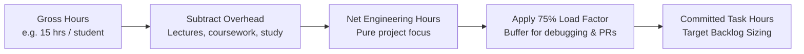
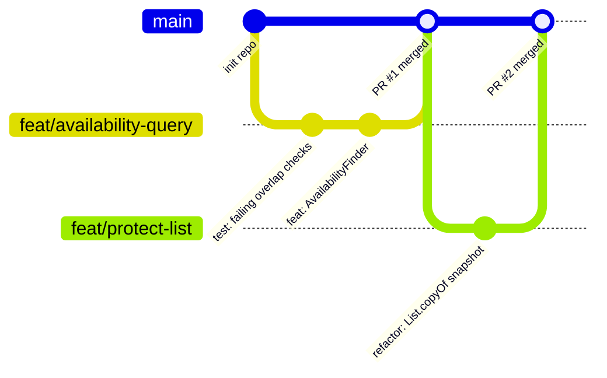
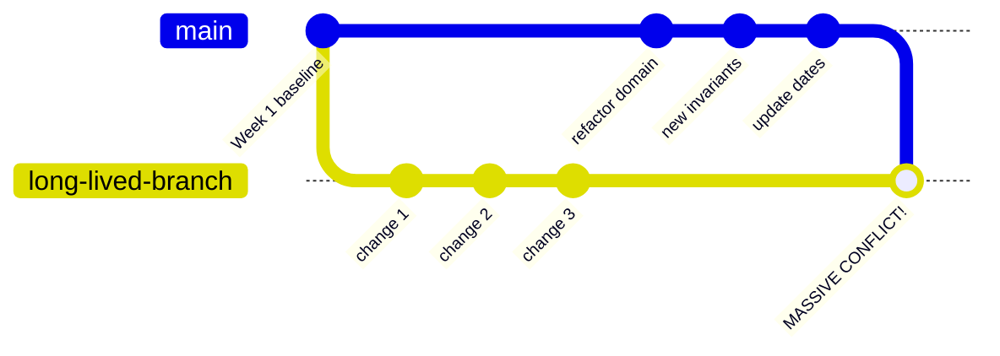
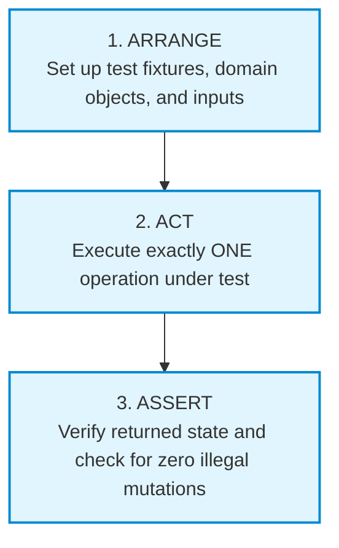

# Week 3: From Requirements to an Iteration: Planning & CI
### SE506: Object Oriented Development and Agile Practices
**Dr. Polla Abdulhamid Fattah**  
*Department of Computer Science & Artificial Intelligence*  
*University of Kurdistan Hewlêr (UKH)*

---

## 3-Hour Lecture Roadmap

* **Part 1: Vision, Boundaries & The Sprint 0 Kickoff (0:00 - 0:30)**
  * Defining bounded outcomes, distinguishing scope from assumptions, and lightweight wireframes.
* **Part 2: Capacity Planning & Work Breakdown (0:30 - 1:05)**
  * Gross vs. net hours, load factors, the 75% rule, and decomposing stories into 2-6 hour tasks.
* **Part 3: Repository Hygiene, Branching & Pull Requests (1:05 - 1:40)**
  * Short-lived branches, substantive PR reviews, Conventional Commits, and line-ending traps.
* **BREAK (1:40 - 1:55)**
* **Part 4: The First Automated Test Runner & AAA (1:55 - 2:25)**
  * Moving beyond `main()`, Arrange-Act-Assert discipline, and deliberate fault validation.
* **Part 5: Continuous Integration (CI) & Pipeline Automation (2:25 - 2:45)**
  * GitHub Actions, workflow triggers, pinning Java 17, and auditing AI-generated pipelines.
* **Part 6: Milestone 1 Deliverables & Workshop (2:45 - 3:00)**
  * Milestone 1 checklist, repository audit criteria, and Team Project tasks.

---

## Milestone 1 Alert: Delivering the Sprint 0 Baseline

* **Context:** In SE506, Week 3 culminates in **Milestone 1 (Sprint 0 Baseline)**.
* Many student teams mistake "Sprint 0" for a holiday or an informal chat.
* **In Professional Engineering, Sprint 0 Delivers Foundation Infrastructure:**
  1. A shared, version-controlled repository with branch protection rules.
  2. An active GitHub Project Board populated with INVEST-validated user stories.
  3. A published, team-agreed **Definition of Done**.
  4. An automated Continuous Integration (CI) build passing on every push.
  5. A verified **Capacity Plan** for Sprint 1.
* Today's session provides the exact techniques needed to secure full marks for Milestone 1.

---

## The Opening Dilemma: Busy Developers, Zero Delivery

* Picture a typical student engineering team meeting in Week 3:
  * Developer A wants to build a React Native mobile application.
  * Developer B wants to install PostgreSQL and write complex Docker files.
  * Developer C wants to implement every single story before writing any tests.
* **The Symptom:**
  * Everyone is exhausted and typing feverishly.
  * Yet nobody can describe what an equipment officer will actually be able to inspect, test, or demonstrate at the end of the iteration!
* **The Root Cause:**
  * A backlog tells you what *might* be valuable.
  * An **Iteration Plan** must explain what the team can *reasonably finish* and *how another person will verify it works*.

---

## The Project Vision: Start with a Bounded Outcome

* A vague vision invites infinite scope creep:
  > *"Build a comprehensive, modern campus equipment platform."*
  (Under this vision, a student can justify building an AI chatbot or a payment gateway!)
* **Our Working Teaching Vision (Grounded & Measurable):**
  > *"Help an equipment office administrator demonstrate clear reservation decisions for a small, controlled set of student borrowers and equipment, so that accepted requests can be inspected and conflicting requests do not create overlapping records within one running coordinator."*
* Notice what this vision does:
  * Identifies a single actor (equipment administrator).
  * Defines a single observable capability (inspectable, non-conflicting reservations).
  * Binds the operational environment (one running coordinator; controlled fixtures).

---

## Bounding the Scope: Current State vs. Planned Increment

Before planning work, map your codebase into three explicit categories:

| Architectural Area | At the Chapter 4 Checkpoint | Planning Consequence |
|---|---|---|
| **Reservation Request** | Existing Java coordinator accepts valid requests | **Demonstrate & verify it; do not re-code it!** |
| **Availability Enquiry** | Proposed User Story (US-02); no method exists | **Target for Sprint 1 implementation slice.** |
| **Storage Mechanism** | In-memory `ArrayList` in one JVM process | Data is lost on restart; demonstrate in one run. |
| **Identifier Authority** | Non-blank string check; synthetic fixtures | No external database or directory validation. |
| **Loan Period** | Whole calendar days; $[start, endExclusive)$ | Enforce half-open logic in all new checks. |
| **User Interface** | Scripted console check runner | No web frontend required for Milestone 1. |

> **Critical Rule:** Never claim credit for implementing features that already existed in the starter! Document the baseline honestly.

---

## Technical Constraints vs. Temporary Assumptions

Do not label every design decision as a generic "requirement." Separate them clearly:

* **Technical Constraint (Imposed Boundary):**
  * *"Must compile and run under Java 17 LTS without preview features."*
  * *"Must run offline via Maven without unpinned external dependencies."*
* **Temporary Assumption (Deliberate Simplification):**
  * *"We assume synthetic equipment IDs (CAM1, MIC1) from a static list."*
  * Every assumption must have an explicit **review trigger**:
    > *"Revisit when the system connects to the central institutional asset database."*
* **Open Policy Question (Needs Stakeholder Input):**
  * *"Can an administrator override a reservation for an emergency maintenance check?"*

---

## Wireframes as Conceptual Questions, Not Visual Polish

* A wireframe in Agile engineering is **a question made visible**.
* Its value lies in exposing domain edge cases before writing code, not in graphical beauty.
* **Proposed Interface Sketch (Text Wireframe):**
  ```text
  +-------------------------------------------------------------+
  |              REQUEST EQUIPMENT RESERVATION                  |
  +-------------------------------------------------------------+
  | Borrower ID:       [ B101       ]                           |
  | Equipment ID:      [ ITEM-CAM-01]                           |
  | Start Date:        [ 2026-11-01 ]                           |
  | Duration (Days):   [ 3          ]                           |
  |                                                             |
  | Note: Reservation covers Nov 1, 2, and 3.                   |
  |       Item must be returned before morning of Nov 4.        |
  |                                                             |
  | [ SUBMIT RESERVATION ]                [ CANCEL ]            |
  +-------------------------------------------------------------+
  ```
* **Immediate Questions Exposed:**
  * Does entering duration `3` mean end date is `Nov 3` or `Nov 4`?
  * The wireframe clarifies the half-open interval for the user!

---

## Week 3 Module Learning Outcomes

* **LO5 (Agile Planning & Capacity):**
  * Formulate a realistic iteration plan based on empirical capacity calculations.
  * Decompose user stories into bounded 2-to-6 hour engineering tasks.
  * Differentiate velocity from capacity; enforce the 75% load factor.
* **LO6 (Professional Workflows & Verification):**
  * Establish a professional Git branching, review, and pull-request workflow.
  * Author automated unit assertions following the Arrange-Act-Assert (AAA) pattern.
  * Configure and verify a continuous integration (CI) pipeline using GitHub Actions.

---

# Part 2: Capacity Planning & Work Breakdown
### Ground Rule G1: Engineering with Mathematical Honesty

---

## The Fallacy of the 40-Hour Week

* **The Most Common Student Planning Disaster:**
  * Team of 4 students $\times$ 2-week sprint = *"We have 160 hours of coding time!"*
  * The team pulls 15 massive user stories into the sprint.
  * Result at sprint end: 2 stories finished, 13 broken, panic ensues.
* **Why this happens:**
  * You are full-time students with lectures, assignments, travel, and sleep.
  * In industry, a full-time engineer averages only **5 to 6 hours** of focused coding per day (meetings, code reviews, and communication consume the rest).
* In SE506, self-study is calibrated at **7.5 hours per student per week**.

---

## Gross Hours vs. Net Available Engineering Hours

To compute realistic team capacity, apply this step-by-step formula:



1. **Gross Available Hours:** Total nominal time per student across a 2-week sprint ($15\text{ hrs}$).
2. **Overhead / Friction:** Subtract exams, other coursework, and team coordination ($5\text{ hrs}$).
3. **Net Available Hours:** Actual time sitting at the keyboard ($10\text{ hrs / student}$).
4. **Team Net Capacity:** 3 students $\times 10\text{ hrs} = \mathbf{30\text{ net engineering hours}}$.

---

## Team Capacity Worksheet (Descriptor Standard)

Every team must compile this capacity table during Sprint Planning:

| Team Member | Gross Hours (2-wk sprint) | Non-Project Overhead | Net Available Hours | Primary Focus Area |
|---|:---:|:---:|:---:|---|
| **Alice (Lead)** | 18 hrs | 6 hrs | **12 hrs** | Domain Coordinator & Rules |
| **Bob (Dev/Test)** | 16 hrs | 6 hrs | **10 hrs** | Availability Query & Test Fixtures |
| **Charlie (Dev/CI)** | 16 hrs | 6 hrs | **10 hrs** | Build Script & GitHub Actions |
| **TOTALS** | **50 hrs** | **18 hrs** | **32 net hrs** | **Team Sprint Capacity** |

* If your total net capacity is **32 hours**, committing to 60 hours of backlog tasks is not ambitious: **it is professional malpractice**.

---

## Velocity vs. Capacity: What Is the Difference?

Do not confuse these two Agile metrics:

| Metric | What It Measures | When It Is Used |
|---|---|---|
| **Capacity** | The total **available engineering hours** the team actually has *for this specific upcoming sprint*. | Calculated *before* the sprint during planning. Adjusts for holidays, sickness, and exams. |
| **Velocity** | The **number of story points** the team historically completed *in past sprints*. | Looked at historically to guide future long-term roadmap projections. |

* **Key Takeaway:** 
  * Velocity is backward-looking and assumes stable conditions.
  * Capacity is forward-looking and reflects the reality of the next two weeks.
  * If a team member has midterms next week, your velocity drops because your capacity dropped!

---

## The Work Breakdown Structure (WBS)

* You cannot schedule a raw user story directly onto a calendar.
* A user story must be decomposed into **engineering tasks**:
  * Write failing test.
  * Implement domain method.
  * Refactor coordinator.
  * Update documentation.
* **The 2-to-6 Hour Task Rule:**
  * Any task smaller than 1 hour creates administrative overhead.
  * Any task larger than 6 hours hides unknown complexity and cannot be tracked on a daily board!
  * If a task is estimated at 14 hours, **break it down immediately**.

---

## Worked Example: Decomposing Story US-02

Let us decompose **US-02 (Equipment Availability Query)** into concrete WBS tasks:

```text
Story: US-02 Equipment Availability Query (Estimated: 8 Story Points)
--------------------------------------------------------------------------------
Task 1: Write parameterised AAA unit tests for half-open overlap queries.
        Owner: Bob | Estimate: 3 hours
Task 2: Implement AvailabilityFinder helper class in domain layer.
        Owner: Bob | Estimate: 4 hours
Task 3: Expose isAvailable(itemId, period) method on ReservationCoordinator.
        Owner: Alice | Estimate: 2 hours
Task 4: Add deliberate fault experiment verifying test failure on overlap bug.
        Owner: Bob | Estimate: 2 hours
Task 5: Peer review and verify clean build under scripts/check.sh.
        Owner: Charlie | Estimate: 1 hour
--------------------------------------------------------------------------------
Total Story Engineering Task Hours: 12 hours
```

---

## The 75% Rule and the Contingency Buffer

* **The Law of Murphy in Software Development:**
  * Build tools break. Git branches diverge. A test fails intermittently. An API changes.
* **The 75% Load Factor Rule:**
  $$\text{Committed Task Hours} \le \mathbf{0.75} \times \text{Total Net Capacity}$$
* If your team has **32 net engineering hours**:
  $$\text{Maximum Commitment} = 32 \times 0.75 = \mathbf{24\text{ hours of tasks}}$$
* **Where does the remaining 25% (8 hours) go?**
  * It is your **Contingency Buffer**.
  * Used for: PR review discussions, debugging build errors, fixing merge conflicts, and holding the retrospective.
  * A team running at 100% capacity has zero resilience.

---

## Interactive Diagnostic: Spot the Planning Flaw

Review this capacity plan submitted by a student team:

```text
Team Size: 3 students
Sprint Length: 2 weeks
Gross Available: 60 hours
Overhead: 0 hours ("We will work every spare minute")
Net Capacity: 60 hours
Committed Tasks:
- Build mobile frontend in Flutter: 25 hours
- Setup AWS Lambda and DynamoDB: 20 hours
- Write reservation algorithm: 15 hours
Total Committed: 60 hours
Buffer: 0 hours
```

* **Classroom Critique:**
  1. What is the overhead assumption? Realistic?
  2. What is the buffer allocation?
  3. Are the tasks vertically sliced or horizontal technical bloat?

---

# Part 3: Repository Hygiene, Branching & Pull Requests
### Establishing a Professional Team Git Workflow

---

## Version Control as a Communication Channel

* Version control is not just a backup storage drive; it is a **communication medium**.
* A stranger reading your Git commit history should be able to understand:
  1. *What* changed.
  2. *Why* the change was necessary.
  3. *What evidence* proves the change works.
* **Anti-Patterns in Student Git Repositories:**
  * Commit messages like: `"update"`, `"fix"`, `"stuff"`, `"wip"`, `"asdf"`.
  * Committing `.class` files, compiled binaries, or operating system thumbnails (`.DS_Store`).
  * Pushing 1,000 lines of un-reviewed code directly to `main` at 11:59 PM.

---

## The Short-Lived Feature Branch Workflow

In SE506, we practice **Trunk-Based Development with Short-Lived Topic Branches**:



* **Rules:**
  * `main` is always stable, passes all tests, and is ready for demonstration.
  * Never commit directly to `main`.
  * Branches live for **at most 2 to 3 days**.

---

## The Disaster of Long-Lived Branches: "Merge Hell"

* What happens when Developer A works on `feature-mobile` for 4 weeks in isolation?



* When they finally attempt to merge, hundreds of lines conflict.
* The team spends 3 days resolving merge conflicts, accidentally reverting bugs and deleting tests.
* **Solution:** Integrate small, vertical slices into `main` continuously!

---

## Anatomy of a High-Signal Git Commit

Follow the **Conventional Commits** standard:

```text
feat(reservation): add staff loan duration rule

Implement 30-day borrowing limit for academic staff members.
Enforce invariant that requested days must reside in range [1, 30].

Closes #24
```

* **Structure:**
  * **Type:** `feat` (new feature), `fix` (bug fix), `refactor` (code cleanup), `test` (test changes), `docs` (documentation).
  * **Scope:** The affected domain component (e.g., `(reservation)`, `(period)`).
  * **Summary:** Imperative, present tense (`"add"`, not `"added"` or `"adds"`).
  * **Body:** Explains the *why* and the *invariants enforced*.
  * **Footer:** References issue board card (`Closes #24`).

---

## What Makes a Substantive Code Review?

* In SE506, every pull request requires a peer review before merging.
* **A Weak / Superficial Code Review (Zero Evidence):**
  > *"Looks good to me! Merged."*
* **A High-Signal Engineering Code Review:**
  * *"I verified that `AvailabilityFinder` correctly handles start dates equal to end dates."*
  * *"On line 42, returning `reservations` directly allows callers to mutate the list; please wrap in `List.copyOf`."*
  * *"I pulled the branch locally, ran `scripts/check.sh`, and confirmed all 18 checks pass."*
  * *"Have we considered what happens if the item ID contains whitespace?"*

---

## Branch Protection Rules on GitHub

Configure your team repository to enforce quality gates automatically:

```text
+-------------------------------------------------------------------------------+
|                      GITHUB BRANCH PROTECTION: main                           |
+-------------------------------------------------------------------------------+
| [x] Require a pull request before merging                                     |
|     [x] Require approvals: 1 approval minimum                                 |
|     [x] Dismiss stale pull request approvals when new commits are pushed      |
|                                                                               |
| [x] Require status checks to pass before merging                              |
|     [x] Require branches to be up to date before merging                      |
|     Status check: 'build-and-test' (GitHub Actions)                           |
|                                                                               |
| [x] Do not allow bypassing the above settings                                 |
+-------------------------------------------------------------------------------+
```

* This guarantees that broken code *cannot physically be merged* into `main`!

---

## Windows Git Trap: Line Endings and Shell Scripts

* **The Problem:**
  * Windows uses `CRLF` (`\r\n`) line endings.
  * Linux, macOS, and GitHub Actions CI use `LF` (`\n`).
  * If Git on Windows checks out a shell script (`check.sh`) and converts it to `CRLF`, Linux Bash crashes:
    ```text
    /bin/bash: ./scripts/check.sh: /bin/bash^M: bad interpreter: No such file
    ```
* **The Permanent Fix:**
  Add a `.gitattributes` file in your repository root:
  ```text
  # Ensure shell scripts always retain Unix LF endings
  *.sh text eol=lf
  *.java text diff=java
  ```

---

# Part 4: The First Automated Test Runner & AAA
### Building Automated Feedback into the Codebase

---

## Moving Beyond `main()` Print Statements

* In introductory programming, students test by running `main()` and reading console output:
  ```java
  System.out.println(coordinator.reserve("B1", "CAM1", LocalDate.now(), 3));
  // Developer stares at console: "Yep, looks right to me."
  ```
* **Why this fails in teams:**
  * Manual visual inspection is slow, boring, and error-prone.
  * When a teammate makes a change 2 weeks later, they will not re-read 50 lines of console text.
* **The Automated Assertion Principle:**
  * A test must inspect the result programmatically and return a binary verdict: **PASS** or **FAIL**.
  * If all checks pass $\rightarrow$ exit code 0.
  * If any check fails $\rightarrow$ non-zero exit code, stopping the pipeline immediately!

---

## The Arrange-Act-Assert (AAA) Discipline

Every automated test method must be partitioned into three distinct phases:



* **Arrange:** Create the coordinator, mock rules, define loan periods.
* **Act:** Invoke the single method being evaluated (`coordinator.reserve(...)`).
* **Assert:** Check return strings, inspect unmodifiable lists, confirm zero side effects.
* **The Golden Rule:** Exactly **ONE** action per test! Do not chain 5 actions together in a single test method.

---

## Code Walkthrough: First Automated Reservation Check

Here is how our Chapter 4 starter check runner implements clean AAA in plain Java:

```java
// Excerpt from Chapter 4 Starter Test Runner
static void testValidReservationIsAcceptedAndStored() {
    // 1. ARRANGE
    ReservationCoordinator coordinator = new ReservationCoordinator();
    LocalDate start = LocalDate.of(2026, 11, 1);
    int days = 4;

    // 2. ACT
    String result = coordinator.reserve("B101", "ITEM-CAM-01", start, days);

    // 3. ASSERT
    assertTrue(result.startsWith("Confirmed:"), "Expected confirmation message");
    List<Reservation> stored = coordinator.reservations();
    assertEquals(1, stored.size(), "Coordinator should store exactly 1 reservation");
    assertEquals("B101", stored.get(0).borrowerId(), "Stored borrower ID mismatch");
}
```

* If an assertion fails, `assertTrue` prints the descriptive message and throws an exception, stopping the build.

---

## Parameterised Assertions: Testing Half-Open Intervals

We must verify that our interval logic handles boundary cases without duplicate code:

```java
// Testing adjacent vs overlapping intervals
static void testIntervalBoundaries() {
    LoanPeriod base = new LoanPeriod(LocalDate.of(2026, 11, 1), LocalDate.of(2026, 11, 5));

    // Overlapping case: Nov 4 to Nov 8 overlaps Nov 1 to Nov 5
    LoanPeriod overlap = new LoanPeriod(LocalDate.of(2026, 11, 4), LocalDate.of(2026, 11, 8));
    assertTrue(base.overlaps(overlap), "Period [1, 5) must overlap [4, 8)");

    // Adjacent case: Nov 5 to Nov 10 does NOT overlap Nov 1 to Nov 5!
    LoanPeriod adjacent = new LoanPeriod(LocalDate.of(2026, 11, 5), LocalDate.of(2026, 11, 10));
    assertFalse(base.overlaps(adjacent), "Period [1, 5) must NOT overlap [5, 10)");
}
```

* This single test mathematically proves the correctness of our half-open interval rule!

---

## The Deliberate Fault Experiment

* **Never trust a test suite until you have witnessed it catch a real bug.**
* **The Exercise:**
  1. Open `LoanPeriod.java`.
  2. Change the overlap condition:
     ```diff
     - return this.start.isBefore(other.endExclusive) && other.start.isBefore(this.endExclusive);
     + return this.start.isBefore(other.endExclusive); // Fault: omitted second half of check!
     ```
  3. Run `bash scripts/check.sh`.
  4. **The Observation:** The check runner reports:
     ```text
     FAIL: Period [1, 5) must NOT overlap [5, 10)
     17 passed, 1 FAILED.
     ```
  5. Revert the fault. The suite passes.
* You have now proven that your test suite has **defect sensitivity**.

---

# Part 5: Continuous Integration (CI) & Pipeline Automation
### Automating Quality Gates with GitHub Actions

---

## What Is Continuous Integration?

* **Continuous Integration (CI)** is a software engineering practice where developers merge their working code into a shared mainline branch multiple times a day.
* Every merge triggers an automated, headless build and verification run.
* **The Core Objective:**
  * Detect integration errors as early as possible.
  * Eliminate the phrase: *"Well, it works on my machine!"*
* If code does not build on a clean, headless Linux server in the cloud, **it does not work**.

---

## Deconstructing `.github/workflows/check.yml`

Here is our course standard GitHub Actions pipeline file:

```yaml
name: CI Verification Build

on:
  push:
    branches: [ main ]
  pull_request:
    branches: [ main ]

jobs:
  verify:
    runs-on: ubuntu-latest
    steps:
      - name: Checkout Repository
        uses: actions/checkout@v4

      - name: Set up Temurin JDK 17
        uses: actions/setup-java@v4
        with:
          distribution: 'temurin'
          java-version: '17'

      - name: Run Build and Automated Checks
        run: bash scripts/check.sh
```

---

## Why We Pin `--release 17` in the Build Script

* Inside `scripts/check.sh`, notice the compiler flag:
  ```bash
  javac --release 17 -Xlint:all -encoding UTF-8 -d build/classes ...
  ```
* **Why `--release 17` matters:**
  * If a developer runs JDK 21 locally and calls a new method like `List#getFirst()`, standard `javac` succeeds without error.
  * But when pushed to a Java 17 server or evaluated by an examiner, the code crashes with `NoSuchMethodError`!
  * The `--release 17` flag forces the compiler to check against the Java 17 standard library signature, regardless of which JDK is installed on the machine.

---

## What a Passing CI Run Proves vs. What It Does NOT

Maintain strict intellectual honesty about your CI pipeline:

* **What a Green CI Build PROVES:**
  1. The code compiles without errors or warnings under Java 17.
  2. The specific inputs tested in `check.sh` produced expected outputs.
  3. No uncommitted local files or missing paths broke the build.
* **What a Green CI Build DOES NOT PROVE:**
  1. It does not prove the system is free of bugs on untested inputs.
  2. It does not prove the application is safe under concurrent multi-user load.
  3. It does not prove you built the features the equipment officer actually needs!

---

## AI in Practice: Auditing an AI-Generated CI Workflow

An AI tool was asked: *"Create a GitHub Actions CI pipeline for my Java project."* Here is its candidate output:

```yaml
name: Java CI
on: [push]
jobs:
  build:
    runs-on: ubuntu-latest
    steps:
      - uses: actions/checkout@v2
      - name: Setup Java
        uses: actions/setup-java@v1
        with:
          java-version: 'latest'
      - name: Deploy to Production
        run: curl -X POST https://api.my-server.com/deploy -d "secret=12345"
```

* **Classroom Critique (3-minute discussion):**
  * Identify at least three severe engineering and security vulnerabilities in this pipeline!

---

## Flaw Analysis: Auditing the AI Pipeline

| Vulnerability in AI Script | Severity | Consequence in Production |
|---|:---:|---|
| `java-version: 'latest'` | **High** | Uses moving target (e.g., JDK 23); code calling deprecated APIs will break randomly. |
| `actions/setup-java@v1` | **Medium** | Uses obsolete, deprecated GitHub Action with known Node.js runtime vulnerabilities. |
| Missing test execution step | **Critical** | Builds code and deploys without ever running `check.sh` or verifying tests! |
| Hardcoded secret in curl command | **Critical** | Exposes private API credentials in plaintext in the public Git history. |

* **Lesson:** Never copy-paste generated DevOps scripts without understanding every line.

---

# Part 6: Milestone 1 Deliverables & Workshop
### Assembling Your Kickoff Audit Evidence

---

## Common Mistakes in Sprint 0 and Planning

| Mistake | Why It Breaks the Project | Better Engineering Practice |
|---|---|---|
| **Zero Buffer Allocation** | The first minor bug derails the entire sprint schedule. | Enforce the 75% load factor; reserve 25% for friction. |
| **Monolithic 20-Hour Tasks** | Cards sit in `In Progress` for 8 days; nobody knows if progress is real. | Break tasks into 2-to-6 hour verifiable increments. |
| **"Works on My Machine"** | Local code diverges from team standard; CI fails constantly. | Run `scripts/check.sh` with clean `--release 17` locally. |
| **Unprotected Main Branch** | Developers push broken commits directly, blocking teammates. | Enable branch protection; require 1 PR approval. |
| **Testing Only the Happy Path** | System crashes immediately when a user passes null or bad dates. | Write rejection scenarios for every acceptance criterion. |

---

## Milestone 1 Submission Checklist (Sprint 0 Audit)

Before submitting your repository link for Milestone 1, verify these five requirements:

* [ ] **1. Active GitHub Issue Board:**
  * Contains an initial backlog of user stories written in INVEST format.
  * Columns: `Backlog`, `Ready`, `In Progress`, `Done`.
  * Explicit WIP limit configured (max 2 in progress).
* [ ] **2. Published Definition of Done:**
  * Committed in the repository under `docs/DEFINITION-OF-DONE.md`.
* [ ] **3. Passing CI Pipeline:**
  * `.github/workflows/check.yml` configured and green.
  * Readme displays passing build badge.
* [ ] **4. Team Capacity Plan:**
  * Net engineering hours and load factor computed for Sprint 1.
* [ ] **5. Branch Protection Active:**
  * Pull requests required; direct pushes to `main` disabled.

---

## Practical Lab 3: Today's Workshop Tasks

Complete these exercises with your project team:

* **Book Project (Individual Practice):**
  1. Clone or pull the Chapter 4 companion files into your workspace.
  2. Run `bash scripts/check.sh` and verify all 18 checks pass.
  3. Execute the deliberate fault experiment on `LoanPeriod.java`. Verify that `check.sh` exits with a non-zero error code.
  4. Restore the file and verify the build passes.
* **Team Project (Milestone 1 Setup):**
  1. Convene your team; compute your net available hours for Sprint 1.
  2. Select your first two user stories (e.g., Availability Query).
  3. Decompose stories into 2-to-6 hour WBS tasks.
  4. Initialize your GitHub repository, add `.gitattributes`, configure GitHub Actions, and verify the first green build!

---

## Qualitative Contribution Evidence (G7 Reminder)

* **Reminder on Individual Assessment:**
  * Under Ground Rule G7 and the course descriptor, individual contributions are evaluated qualitatively.
  * We do **NOT** rank team members by raw commit counts or lines of code!
* **High-Value Evidence to Build Starting Today:**
  * Meaningful, constructive code reviews on teammates' pull requests.
  * Documenting deliberate fault experiments and bug diagnoses.
  * Authoring clear Given-When-Then acceptance criteria.
  * Writing Architecture Decision Records (ADRs).
* A developer who writes 5 thoughtful code reviews delivers more engineering value than one who pushes 40 formatting commits!

---

## Summary & What Comes Next

* **Core Takeaways Today:**
  1. A project vision must be bounded, observable, and grounded in concrete constraints.
  2. Capacity planning requires mathematical honesty: calculate net hours and reserve a 25% buffer.
  3. Continuous Integration is an automated safety net; never merge code without clean, headless verification.
  4. Tests must follow the Arrange-Act-Assert structure and demonstrate defect sensitivity.
* **Next Week (Week 4):**
  * **SOLID Principles Part I (Chapter 5)**
  * Single Responsibility Principle (SRP), Open-Closed Principle (OCP), and Liskov Substitution (LSP).
  * Automated Code Smell Analysis with **PMD 7.28.0**.
