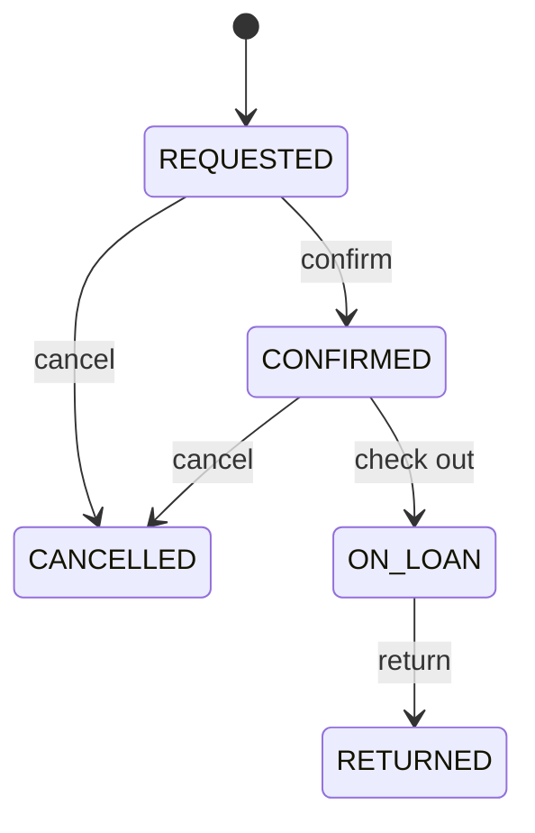
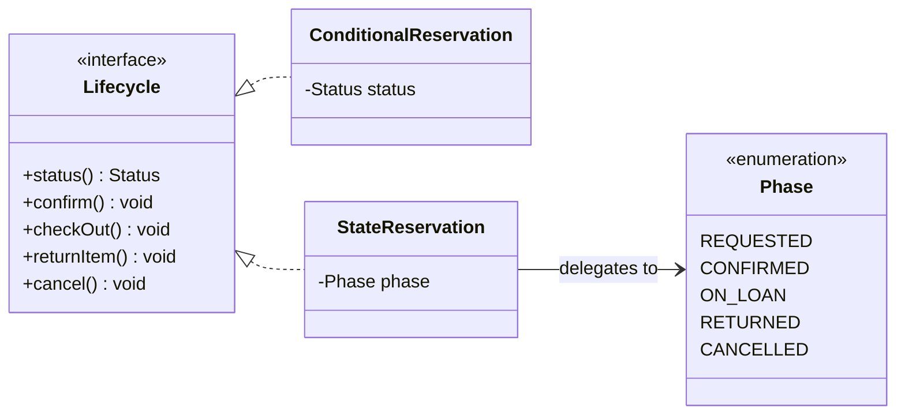
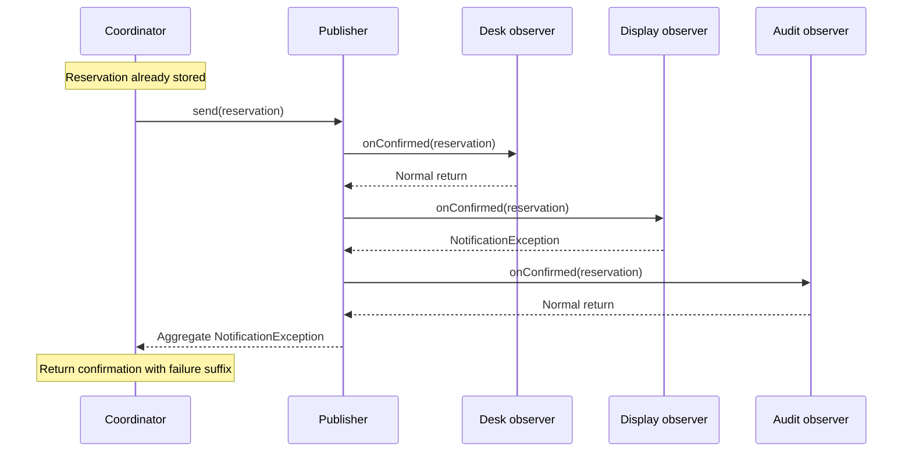

# Week 8: Designing Changing Behaviour: Core Patterns
### SE506: Object Oriented Development and Agile Practices
**Dr. Polla Abdulhamid Fattah**  
*Department of Computer Science & Artificial Intelligence*  
*University of Kurdistan Hewlêr (UKH)*

---

## 3-Hour Lecture Roadmap

* **Part 1: Orientation & The 4 Behavioural Questions (0:00 - 0:30)**
  * When behaviour changes: Policy variation vs. Lifecycle history vs. Interested recipients vs. Deferred execution; The 4 Questions Matrix.
* **Part 2: Strategy Pattern: Interchangeable Policies (0:30 - 1:00)**
  * Recognizing existing strategy architecture in `BorrowingPolicy`; Conditionals vs. Strategies; Side-effect-free contracts; Why `setPolicy()` is dangerous.
* **Part 3: State Pattern & Lifecycle Transitions (1:00 - 1:40)**
  * The reservation lifecycle; Transition tables (5 states x 4 actions); `ConditionalReservation` vs. `StateReservation`; Private enum state objects; Safe assignment idiom.
* **BREAK (1:40 - 1:55)**
* **Part 4: Observer Pattern & Notification Publishing (1:55 - 2:20)**
  * In-process subscriber dispatch; Sequential snapshot semantics; Storage-before-publication ordering; Partial failure aggregation with suppressed exceptions.
* **Part 5: Command Pattern & Execution-Time State (2:20 - 2:40)**
  * Capturing requests as objects (`Command<R>`); Lazy construction vs. Execution-time evaluation; Stale permission trap; Why Command does not imply Undo.
* **Part 6: AI Audits, Book Review Checkpoint & Workshop (2:40 - 3:00)**
  * Critical evaluation of AI pattern proposals; Appendix E Critical Book Review submission instructions; Lab steps 1-6; Preview of Week 9.

---

## Pedagogical Alignment & Module Context

* **Module Learning Outcomes:**
  * **LO2:** Analyze, select, and implement appropriate software design patterns (creational, structural, and behavioral) to address architectural challenges.
  * **LO4:** Evaluate software architectures and design decisions using empirical criteria, testing strategies, and refactoring techniques.
* **Textbook & Foundational References:**
  * Robert C. Martin (2002): *Agile Software Development: Principles, Patterns, and Practices* (Chapters on Strategy, State, Observer, and Command).
  * Erich Gamma, Richard Helm, Ralph Johnson, John Vlissides (1994): *Design Patterns: Elements of Reusable Object-Oriented Software* (GoF).
* **Major Milestone Alert:**
  * **Individual Critical Book Review is Due This Week (Week 8)!**
  * Appendix E defines the rigorous review method: verified primary sources, concrete counterexamples, and strict academic integrity.

---

# Part 1: Orientation & The 4 Behavioural Questions

---

## Why Behaviour Changes: Three Common Requests

* Consider three seemingly simple feature requests received by the equipment lending team:
  1. **Borrowing Limits:** Undergraduate students are limited to 3 items and 7 days; faculty staff are allowed up to 5 items and 14 days.
  2. **Reservation Cancellation:** A reservation may be cancelled while requested or confirmed, but cancelling an item that is currently on loan must be strictly rejected.
  3. **Notification Broadcasting:** When a reservation is confirmed, the front desk display, inventory monitor, and audit log must all receive notices, even if one monitor is offline.
* **The Naive Temptation:**
  * Merge all three into a sprawling, multi-branch conditional inside `ReservationCoordinator`.
  * Or worse: invent an abstract, generic "BehaviourHandler" that obscures their completely different design pressures!

---

## Four Fundamental Behavioural Questions

* Each behavioural variation stems from a fundamentally distinct engineering pressure:

| Question to Ask | Primary Reason for Variation | GoF Pattern Candidate |
|---|---|---|
| **Which calculation or rule applies?** | Selected algorithm or interchange policy | **Strategy** |
| **Which action is legal right now?** | Current lifecycle position & transition history | **State** |
| **Who needs to react to this event?** | Dynamically registered interested recipients | **Observer** |
| **What request should run later?** | Captured receiver, arguments, and execution point | **Command** |

* Notice: An application may use all four, some, or none!
* A clean two-branch conditional is vastly superior to an unnecessary pattern abstraction.

---

## Structural vs. Behavioural Changes

* Keep architectural scope and intent strictly differentiated:
  * **Structural Refactoring (e.g., Chapter 8 Adapter):**
    * Adapts incompatible interfaces or formats without changing system behaviour or invariants.
  * **Behavioural Reorganisation (e.g., State or Strategy):**
    * Reorganizes how decisions and state transitions are dispatched internally.
  * **Adding New Behaviour (e.g., Observer or Real Cancellation):**
    * Introduces new execution semantics, error handling policies, and caller obligations.
* **Crucial Rule:**
  * Do not label a change that introduces new failure modes or side effects as "just refactoring."
  * Always identify what changes, what remains invariant, and who owns the decision!

---

# Part 2: Strategy Pattern: Interchangeable Policies

---

## Recognizing the Structure Already Present

* You have already been using the Strategy Pattern since Chapter 4!
* The `BorrowingPolicy` interface establishes the common behavioural contract:

```java
public interface BorrowingPolicy {
    /**
     * Deterministic, side-effect-free boolean check for every pair of ints.
     * Returns false for negative counts or nonpositive durations.
     * Evaluates limits only: does NOT verify item stock or borrower ID!
     */
    boolean mayRequest(int activeReservations, int requestedDays);
}
```

* Concrete Strategies:
  * `ReservationRules`: Students (< 3 active reservations, 1 to 7 days).
  * `StaffReservationRules`: Staff (< 5 active reservations, 1 to 14 days).

---

## Strategy Wiring in `ReservationCoordinator`

* The coordinator does NOT know how student or staff limits are calculated:
* It depends purely on the `BorrowingPolicy` abstraction:

```java
public final class ReservationCoordinator {
    private final Map<BorrowerCategory, BorrowingPolicy> policies;
    // ...
    public ReservationCoordinator(Map<BorrowerCategory, BorrowingPolicy> policies,
                                  ConfirmationFormatter formatter,
                                  NotificationSender notifications) {
        this.policies = Map.copyOf(Objects.requireNonNull(policies, "policies"));
        for (BorrowerCategory category : BorrowerCategory.values()) {
            if (!this.policies.containsKey(category)) {
                throw new IllegalArgumentException("Missing policy: " + category);
            }
        }
        // ...
    }
}
```

* Configuration-time composition: The map is validated at startup and defensively copied.

---

## Strategy vs. Conditionals: An Honest Comparison

* Could we have implemented borrowing rules with a simple conditional?

```java
// Conditional implementation inside a coordinator:
boolean mayRequest(BorrowerCategory category, int count, int days) {
    if (category == BorrowerCategory.STUDENT) {
        return count >= 0 && count < 3 && days >= 1 && days <= 7;
    } else if (category == BorrowerCategory.STAFF) {
        return count >= 0 && count < 5 && days >= 1 && days <= 14;
    }
    return false;
}
```

* **When the conditional is better:**
  * Two fixed categories that never change, localized in a single class.
* **When Strategy is required:**
  * When algorithms evolve independently, require independent testing, or new policies (e.g., Guest, Researcher) are introduced without editing existing code (Open/Closed Principle).

---

## The Strict Strategy Contract

* A Strategy implementation must honour the semantics of its contract, not just its method signature:
  1. **Deterministic & Pure:** Given the same inputs, it returns the exact same boolean result.
  2. **Side-Effect-Free:** It never modifies database records, never mutates arguments, and never prints to console.
  3. **Narrow Scope:** It checks count and duration limits ONLY.
* **Violation Example:**
  * If a `SpecialStaffPolicy` performs a remote LDAP lookup or sends an email alert, it violates the contract!
  * Matching the Java signature `(int, int) -> boolean` does NOT make it a valid substitute!

---

## Testing Strategy Selection with Custom Test Doubles

* Because policies are injected via an interface, tests can substitute temporary policies with surgical precision:

```java
@Test
void customPolicyCanBeSuppliedForSpecificCategory() {
    // Custom restrictive staff strategy: at most 1 item, max 2 days
    BorrowingPolicy strictStaff = (count, days) -> count < 1 && days <= 2 && days >= 1;
    
    var policies = Map.of(
        BorrowerCategory.STUDENT, new ReservationRules(),
        BorrowerCategory.STAFF, strictStaff
    );
    var coordinator = new ReservationCoordinator(policies, formatter, notices);
    
    // 3 days rejected for staff under strict policy
    assertEquals("Rejected: borrower limit or duration.",
        coordinator.reserve("S1", "CAM1", date, 3, BorrowerCategory.STAFF));
}
```

* Notice: The coordinator logic remains 100% unchanged!

---

## Why `setPolicy()` is an Anti-Pattern

* Junior developers often think: *"Strategy means I should add a `setPolicy(...)` setter method so I can change algorithms dynamically at runtime!"*
* **Why this is dangerous:**
  * **Race Conditions:** In a multi-threaded system, switching a policy on a live coordinator instance while requests are in-flight causes non-deterministic evaluations.
  * **Audit & Reproducibility:** You cannot guarantee why request X was accepted while request Y was rejected if the policy was silently mutated between calls.
  * **Temporal Coupling:** Incomplete or partial state updates.
* **Best Practice:**
  * Supply immutable policies via constructor injection.
  * Select the policy per-request by passing a context key (e.g., `BorrowerCategory`).

---

# Part 3: State Pattern & Lifecycle Transitions

---

## The Problem: Lifecycle-Dependent Behaviour

* Consider the lifecycle of an equipment reservation:
  * A reservation is created in status **REQUESTED**.
  * From REQUESTED, it can be **CONFIRMED** or **CANCELLED**.
  * From CONFIRMED, the borrower can **CHECK OUT** the equipment (moving to **ON_LOAN**) or **CANCEL**.
  * Once **ON_LOAN**, the borrower can **RETURN** it (moving to **RETURNED**).
  * Once RETURNED or CANCELLED, no further operations are permitted!
* **The Engineering Challenge:**
  * Calling `cancel()` on a confirmed reservation is completely legal.
  * Calling `cancel()` on an item already on loan is an illegal operation and must be rejected!
  * How do we design this so illegal operations are impossible or strictly rejected?

---

## The Complete Transition Table (Specification First!)

* Never write state code without a reviewed transition table!
* 5 Statuses x 4 Operations = 20 distinct combinations:

| Current Status | `confirm()` | `checkOut()` | `returnItem()` | `cancel()` |
|---|---|---|---|---|
| **REQUESTED** | CONFIRMED | *Reject* | *Reject* | CANCELLED |
| **CONFIRMED** | *Reject* | ON_LOAN | *Reject* | CANCELLED |
| **ON_LOAN** | *Reject* | *Reject* | RETURNED | *Reject* |
| **RETURNED** | *Reject* | *Reject* | *Reject* | *Reject* |
| **CANCELLED** | *Reject* | *Reject* | *Reject* | *Reject* |

* **Invariant Rules:**
  * Exactly **5 permitted transitions**; exactly **15 rejected combinations**.
  * All rejections throw `IllegalStateException` and **leave current status unchanged**!

---

## The State Diagram (Figure 9.1)



* **Reading the State Diagram:**
  * Rounded boxes denote States; arrows denote Transitions triggered by events.
  * `[*]` is the initial state (REQUESTED).
  * States with no outgoing arrows (RETURNED, CANCELLED) are **terminal**.
  * Missing arrows are illegal operations that must be rejected!

---

## Starting Point: `ConditionalReservation`

```java
public static final class ConditionalReservation implements Lifecycle {
    private Status status = Status.REQUESTED;
    public Status status() { return status; }
    
    public void confirm() {
        switch (status) {
            case REQUESTED -> status = Status.CONFIRMED;
            default -> throw rejected("confirm", status);
        }
    }
    public void cancel() {
        switch (status) {
            case REQUESTED, CONFIRMED -> status = Status.CANCELLED;
            default -> throw rejected("cancel", status);
        }
    }
    // checkOut() and returnItem() contain similar switches...
}
```

* **Smell:** Every operation repeats a `switch (status)` statement. Adding a new state requires modifying every single operation method!

---

## The State Pattern Solution: `StateReservation`



* Both classes implement the exact same `Lifecycle` contract!
* Callers cannot tell them apart; the internal dispatch architecture is completely different.

---

## The Delegating Context (`StateReservation`)

* The context delegates every lifecycle action to its current `phase` object:

```java
public static final class StateReservation implements Lifecycle {
    private Phase phase = Phase.REQUESTED;
    
    public Status status() { return phase.status; }
    public void confirm()    { phase = phase.confirm(); }
    public void checkOut()   { phase = phase.checkOut(); }
    public void returnItem() { phase = phase.returnItem(); }
    public void cancel()     { phase = phase.cancel(); }
}
```

* **The Atomic Assignment Idiom:**
  * `phase = phase.cancel();`
  * If `phase.cancel()` throws `IllegalStateException`, the assignment never happens!
  * The context automatically preserves its existing status without rollback logic!

---

## Private Enum Constants as State Objects

* How to implement State objects cleanly in modern Java without creating 5 public classes:

```java
private enum Phase {
    REQUESTED(Status.REQUESTED) {
        @Override Phase confirm() { return CONFIRMED; }
        @Override Phase cancel()  { return CANCELLED; }
    },
    CONFIRMED(Status.CONFIRMED) {
        @Override Phase checkOut() { return ON_LOAN; }
        @Override Phase cancel()   { return CANCELLED; }
    },
    ON_LOAN(Status.ON_LOAN) {
        @Override Phase returnItem() { return RETURNED; }
    },
    RETURNED(Status.RETURNED),
    CANCELLED(Status.CANCELLED);

    final Status status;
    Phase(Status status) { this.status = status; }
    // Default implementations reject illegal operations:
    Phase confirm()    { throw rejected("confirm", status); }
    Phase checkOut()   { throw rejected("check out", status); }
    Phase returnItem() { throw rejected("return", status); }
    Phase cancel()     { throw rejected("cancel", status); }
}
```

---

## Why Stateless Enum Constants are Safe to Share

* **Crucial Architectural Concept:**
  * The enum constants (`REQUESTED`, `CONFIRMED`, etc.) are immutable singletons.
  * They contain **no mutable reservation data** (no IDs, no borrower names, no timestamps).
  * All mutable state resides in the `StateReservation` instance (`private Phase phase`).
* **Independence Verification:**
  * Two separate reservation instances can both reference `Phase.REQUESTED` simultaneously.
  * Advancing Reservation A to `CONFIRMED` does not alter Reservation B!

```java
var res1 = new StateReservation();
var res2 = new StateReservation();
res1.confirm();
assertEquals(Status.CONFIRMED, res1.status());
assertEquals(Status.REQUESTED, res2.status()); // Perfectly isolated!
```

---

## Testing All 20 State Transitions Comprehensively

* Using JUnit 5 `@ParameterizedTest` with `@CsvSource` to enforce the transition table:

```java
@ParameterizedTest
@CsvSource({
    "REQUESTED,CONFIRM,CONFIRMED,true",  "REQUESTED,CHECK_OUT,REQUESTED,false",
    "REQUESTED,RETURN,REQUESTED,false",   "REQUESTED,CANCEL,CANCELLED,true",
    "CONFIRMED,CONFIRM,CONFIRMED,false", "CONFIRMED,CHECK_OUT,ON_LOAN,true",
    "CONFIRMED,RETURN,CONFIRMED,false",  "CONFIRMED,CANCEL,CANCELLED,true",
    "ON_LOAN,CONFIRM,ON_LOAN,false",     "ON_LOAN,CHECK_OUT,ON_LOAN,false",
    "ON_LOAN,RETURN,RETURNED,true",      "ON_LOAN,CANCEL,ON_LOAN,false",
    "RETURNED,CONFIRM,RETURNED,false",   "RETURNED,CHECK_OUT,RETURNED,false",
    "RETURNED,RETURN,RETURNED,false",    "RETURNED,CANCEL,RETURNED,false",
    "CANCELLED,CONFIRM,CANCELLED,false", "CANCELLED,CHECK_OUT,CANCELLED,false",
    "CANCELLED,RETURN,CANCELLED,false",  "CANCELLED,CANCEL,CANCELLED,false"
})
void bothImplementationsMatchTransitionTable(Status from, Action action, 
                                             Status expected, boolean allowed) {
    for (Lifecycle lifecycle : List.of(new ConditionalReservation(), new StateReservation())) {
        reach(lifecycle, from);
        if (allowed) act(lifecycle, action);
        else assertThrows(IllegalStateException.class, () -> act(lifecycle, action));
        assertEquals(expected, lifecycle.status());
    }
}
```

---

## Never Add an Unrestricted `setStatus` Setter!

* An AI assistant or careless developer might propose:
  ```java
  public void setStatus(Status status) { this.status = status; }
  ```
* **Why this completely destroys the State Pattern:**
  * It completely bypasses all transition guards and business invariants!
  * Any caller can jump directly from `CANCELLED` to `ON_LOAN` or resurrect a completed loan.
  * It turns an enforced state machine into a passive, untrusted data bag.
* **Golden Rule:**
  * State transitions must ONLY occur as side effects of explicit business methods (`confirm()`, `cancel()`, etc.).
  * Status access must be read-only (`public Status status()`).

---

## Architectural Boundary: Keeping the Teaching Exercise Isolated

* Notice where the lifecycle model lives in the repository:
  * Package: `behaviour.LifecycleExamples`
  * It is an isolated teaching model to explore State pattern mechanics.
* **Why it was NOT wired into `ReservationCoordinator`:**
  * Real cancellation requires solving business questions:
    * Do cancelled reservations free up active count limits?
    * Does cancellation release the calendar interval for competing bookings?
    * How does cancellation interact with physical loans already checked out?
  * Implementing State does NOT magically answer these requirements!
  * Never couple a pattern exercise to production storage without reviewing business domain rules!

---

# BREAK (15 Minutes)

* Grab a coffee or tea.
* Think about:
  * In the State pattern, state objects govern **what transitions are legal next**.
  * When we return: What happens when an event occurs, and **several independent observers** need to react?

---

# Part 4: Observer Pattern & Notification Publishing

---

## The Problem: Broadcasting Without Coupling

* Once a reservation is accepted, multiple components need to know:
  * Front Desk Display: Updates the queue for desk attendants.
  * Inventory Monitor: Updates real-time stock dashboards.
  * Audit Logger: Logs the event for campus compliance.
* **Coupled Approach (Violates Open/Closed Principle):**
  * `ReservationCoordinator` directly references `DeskDisplay`, `InventoryMonitor`, and `AuditLogger`.
  * Every time a new listener is added, the coordinator must be edited and re-tested!
* **Observer Solution:**
  * Coordinator depends on `NotificationSender`.
  * An optional `NotificationPublisher` implements `NotificationSender` and broadcasts events to registered `Observer` subscribers.

---

## The `NotificationPublisher` Contract

```java
public final class NotificationPublisher implements NotificationSender {
    @FunctionalInterface
    public interface Observer { void onConfirmed(Reservation reservation); }
    
    @FunctionalInterface
    public interface Subscription extends AutoCloseable { @Override void close(); }
    
    private static final class Entry {
        private final Observer observer;
        private Entry(Observer observer) { this.observer = observer; }
    }
    
    private final List<Entry> entries = new ArrayList<>();
    private boolean publishing;
    // ...
}
```

* Minimal, clean, and modern Java design:
  * `Observer` is a functional interface (can use lambdas or method references).
  * `Subscription` extends `AutoCloseable` for clean resource management.

---

## Defining Dispatch Semantics Before Writing Code!

* A professional design defines exact failure and dispatch rules up front:

| Scenario | Defined Behaviour in `NotificationPublisher` |
|---|---|
| **Zero Subscribers** | Returns normally; no delivery claim or failure. |
| **Duplicate Registration** | Reject with `IllegalArgumentException` if same reference is added twice. |
| **Subscription Closed** | Remove that entry; repeated closing is completely harmless. |
| **Subscribe/Unsubscribe during Callback** | Affects subsequent publications, NEVER the active dispatch snapshot! |
| **Expected `NotificationException`** | Collect failure, continue dispatching to remaining observers! |
| **Unexpected Runtime Exception** | Stop dispatch immediately and propagate; do not catch. |
| **Nested / Reentrant Publication** | Reject with `IllegalStateException` via reentrancy guard. |

---

## Snapshot Iteration & Reentrancy Guard

* How `NotificationPublisher` implements deterministic dispatch:

```java
@Override
public void send(Reservation reservation) {
    Objects.requireNonNull(reservation, "reservation");
    if (publishing) throw new IllegalStateException("Reentrant publication is not supported");
    publishing = true;
    try {
        NotificationException aggregate = null;
        for (Entry entry : List.copyOf(entries)) { // SNAPSHOT COPY!
            try {
                entry.observer.onConfirmed(reservation);
            } catch (NotificationException failure) {
                if (aggregate == null) aggregate = new NotificationException("One or more observers failed");
                aggregate.addSuppressed(failure);
            }
        }
        if (aggregate != null) throw aggregate;
    } finally {
        publishing = false; // Guard always resets!
    }
}
```

---

## The Sequence: Storage Happens Before Notification!



* **Figure 9.3:** Crucial architectural reality!
  * The reservation is saved in memory **before** `send()` is invoked.
  * When Display observer fails, Audit observer **still runs**!
  * The coordinator catches `NotificationException` and appends: *"Notification failed; reservation retained."*

---

## Partial Success vs. Rollback: A Critical Distinction

* **The Fallacy:** *"The operation threw a NotificationException, so nothing happened."*
* **The Reality in `ReservationCoordinator`:**
  * The reservation record is **permanently stored**!
  * The desk observer **already processed** the reservation!
  * The audit observer **already logged** the reservation!
* **Design Lesson:**
  * An in-process Observer pattern does not provide distributed two-phase commit transactions.
  * Never assume an error means rollback unless you explicitly engineered transactional compensation.
  * Suppressed exceptions (`addSuppressed`) allow callers to inspect every individual failure.

---

## Managing Subscription Lifetimes

* Why `Subscription` returns a handle instead of taking an unregister method:

```java
public Subscription subscribe(Observer observer) {
    Objects.requireNonNull(observer, "observer");
    if (entries.stream().anyMatch(entry -> entry.observer == observer)) {
        throw new IllegalArgumentException("Observer already subscribed");
    }
    Entry entry = new Entry(observer);
    entries.add(entry);
    return () -> entries.remove(entry); // Handle closes its specific registration!
}
```

* **Preventing Memory Leaks:**
  * If a long-lived publisher holds references to short-lived observers, those observers cannot be garbage collected!
  * Call `subscription.close()` when an observer's lifecycle ends.
  * Unique `Entry` wrapping ensures closing an old handle never cancels a re-subscription of the same observer.

---

# Part 5: Command Pattern & Execution-Time State

---

## The Problem: Carrying a Request Before Executing It

* In direct method invocation:
  ```java
  service.reserve("B1", "CAM1", date, 2);
  ```
  * Lookup, validation, availability checking, and notification occur immediately.
* **When we need Command:**
  * What if a GUI queue, batch worker, or scheduler needs to capture the request now and trigger execution later?
  * The Command Pattern encapsulates a request as a standalone object, decoupling the invoker from the receiver!
* The minimal Command contract:

```java
@FunctionalInterface
public interface Command<R> {
    /** Executes synchronously on the caller's thread; no queue or retry is implied. */
    R execute();
}
```

---

## `ReserveEquipmentCommand` Implementation

* Implemented as an immutable Java record:

```java
public record ReserveEquipmentCommand(
        DirectoryReservationService receiver,
        String borrowerId, 
        String itemId, 
        LocalDate start, 
        int days
) implements Command<String> {

    public ReserveEquipmentCommand {
        Objects.requireNonNull(receiver, "receiver");
        if (borrowerId == null || borrowerId.isBlank() 
                || itemId == null || itemId.isBlank()) {
            throw new IllegalArgumentException("Identifiers must not be blank.");
        }
        Objects.requireNonNull(start, "start");
    }

    @Override 
    public String execute() {
        return receiver.reserve(borrowerId, itemId, start, days);
    }
}
```

---

## Lazy Construction vs. Execution-Time Evaluation

* **What happens at Construction Time:**
  * Validates non-null receiver, non-blank strings, non-null date.
  * **Zero side effects!** No directory lookups, no reservation creation, no notification sent!
* **What happens at Execution Time:**
  * The command delegates directly to `receiver.reserve(...)`.
  * **The Stale Permission Trap:**
    * The command does NOT capture an availability snapshot at construction!
    * Between construction and execution, another borrower might reserve the item.
    * The receiver evaluates current availability **at execution time**.

---

## Verifying Lazy Construction & State Sensitivity

```java
@Test
void receiverStateAtExecutionDeterminesTheResult() {
    var coordinator = ReservationApplication.create(new RecordingNotificationSender());
    var service = new DirectoryReservationService(
        id -> Optional.of(new Borrower(id, BorrowerCategory.STUDENT)), coordinator);
    
    // Construct command: item is currently available
    var command = new ReserveEquipmentCommand(service, "B1", "CAM1", start, 2);
    
    // Competing booking occurs before command executes!
    coordinator.reserve("COMPETITOR", "CAM1", start, 2);
    
    // Command executes: correctly rejected because receiver evaluates live state!
    assertEquals("Rejected: item unavailable.", command.execute());
    assertEquals(1, coordinator.reservations().size());
}
```

* Proves that the Command is a request carrier, not an authorization token!

---

## What Command Is NOT: Common Misconceptions

* **Myth 1: "Command automatically gives you Undo."**
  * FALSE. To support undo, the command or receiver must track reversible state (memento, inverse operations).
  * In our lending system, cancelling a reservation requires business rules not yet implemented.
* **Myth 2: "Command automatically provides asynchronous queues and retries."**
  * FALSE. `command.execute()` is a synchronous method call on the caller's thread.
  * Message queues, serialization, and retries require separate infrastructure.
* **Myth 3: "Replaying a Command always succeeds."**
  * Replaying `ReserveEquipmentCommand` twice causes the second execution to fail with *"Rejected: item unavailable."*

---

# Part 6: AI Audits, Book Review Checkpoint & Workshop

---

## Auditing AI-Generated Pattern Proposals

* Compare two fictional AI proposals for reservation lifecycle modeling:
* **Proposal A (Flawed):**
  > *"Implement `RequestedPolicy`, `ConfirmedPolicy` and `ReturnedPolicy` as strategies. Expose `setPolicy` so callers can choose any policy before each operation. Calling a return method should simply select the returned policy."*
* **Proposal B (Robust):**
  > *"Store the current phase inside a reservation context. Delegate confirm, checkout, return and cancel to phase-specific behaviour. Allow only transitions from the reviewed table and preserve the current phase after a rejected action."*
* **The Engineering Critique:**
  * Proposal A confuses **Strategy** (interchangeable algorithm) with **State** (lifecycle progression).
  * Exposing `setPolicy` destroys invariants, allowing callers to jump illegally to any state!
  * Proposal B correctly implements the State pattern with atomic failure preservation.

---

## Debunking Dangerous AI Assumptions

* **AI Claim:**
  > *"Observer guarantees that all recipients receive the event once, and Command makes retries safe."*
* **Evidence-Based Refutation:**
  * **Observer Reality:** An unexpected exception halts dispatch midway, leaving earlier observers notified and later observers skipped. There is no distributed transaction or delivery guarantee!
  * **Command Reality:** Executing a reservation command twice results in conflict rejection on the second attempt. Without an idempotency key or deduplication engine, replaying commands is not safe!
* **Rule:** Never accept AI claims about reliability or delivery without verifying the concrete code!

---

## Pattern Selection Decision Matrix

* When should you actually use each pattern?

| Design Situation | Reasonable First Option | Adopt Pattern When: |
|---|---|---|
| **Two small fixed limit rules** | Single conditional or parameterised class | Rules vary independently across multiple consumers (**Strategy**) |
| **Small fixed lifecycle** | Enum with switch in operations | Complex per-state actions justify grouping behaviour by state (**State**) |
| **One fixed notification output** | Direct injected interface (`NotificationSender`) | Dynamically changing list of local in-memory listeners (**Observer**) |
| **Immediate request execution** | Direct method call (`service.reserve(...)`) | Request must be queued, scheduled, or passed across boundaries (**Command**) |

---

## Appendix E: Critical Book Review Checkpoint

* **Reminder:** Your Individual Critical Book Review is **due in Week 8**!
* **Key Requirements from Appendix E:**
  * Select an approved classic software engineering text (e.g., Martin 2002, Gamma et al. 1994, Evans 2003).
  * **Direct Evidence Only:** Cite specific chapters, sections, and concrete code examples from the actual text.
  * **Critique vs. Summary:** Do not merely summarize the book. Evaluate:
    * Where does the author's advice break down or show its age?
    * What simpler alternatives exist in modern Java 17 / AI-assisted workflows?
    * How does the guidance apply to AI-enabled software systems?
  * **Strict Academic Warning:** Submitting an unverified AI summary of a book you have not read will result in severe penalties.

---

## Workshop & Lab Activity (Steps 1 to 6)

* **Book Project (Steps 1 - 4):**
  1. Inspect `ConditionalReservation` and replace it with `StateReservation` in `LifecycleExamples.java`.
  2. Run `LifecycleExamplesTest`: verify all 20 transitions, rejection exceptions, and independent contexts.
  3. Execute `NotificationPublisherTest` and `ReserveEquipmentCommandTest`: observe partial failures and lazy command execution.
  4. Compare Strategy vs. State trade-offs in a written 1-page design note.
* **AI Evaluation (Step 5):**
  * Audit Proposal A vs. Proposal B using your test suite as evidence.
* **Team Project (Step 6):**
  * Identify one conditional in your Team Project that selects behaviour or models a lifecycle.
  * Write a test that protects its existing behaviour.
  * Justify whether Strategy or State is warranted, or explicitly record why you decline to refactor it!

---

## Common Pitfalls to Avoid in the Lab

* **Pitfall 1: Leaking mutable context state into shared State objects.**
  * Keep enum constants stateless. All context variables belong in the enclosing instance!
* **Pitfall 2: Adding an unrestricted `setStatus` setter.**
  * State must only change via validated operations (`confirm()`, `cancel()`, etc.).
* **Pitfall 3: Assuming notification failure means the reservation was rolled back.**
  * Remember: Storage happens before publication. The record was retained!
* **Pitfall 4: Constructing a Command and assuming it executed.**
  * Construction validates format only; execution invokes the receiver.
* **Pitfall 5: Catching `Exception` instead of `NotificationException`.**
  * Never swallow unexpected bugs or null pointers in observer dispatch loops.

---

## Week 8 Summary & Looking Ahead to Week 9

* **Key Takeaways Today:**
  * **Strategy:** Decouples algorithms and policies from the client using a deterministic contract.
  * **State:** Enforces lifecycle transitions through delegating state objects without fragile switch ladders.
  * **Observer:** Decouples event dispatch to local listeners; requires careful partial-failure semantics.
  * **Command:** Encapsulates requests as objects, evaluating receiver availability at execution time.
* **Looking Ahead to Week 9:**
  * **Chapter 10: Layered Architecture & Package Principles.**
  * Organizing classes into clean packages, managing dependency direction, and preparing **Milestone 3**!

---

# Questions & Discussion
### SE506: Object Oriented Development and Agile Practices
**University of Kurdistan Hewlêr (UKH)**  
*Dr. Polla Abdulhamid Fattah*
