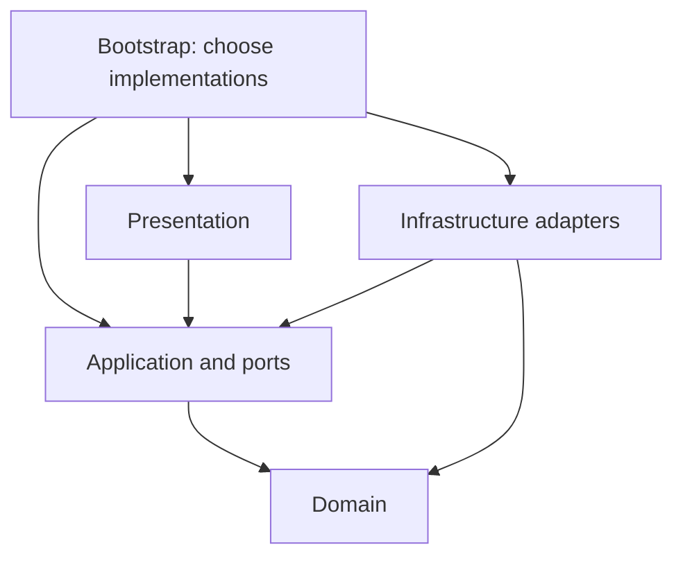
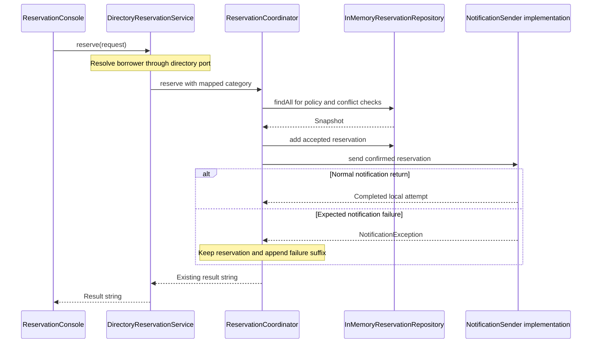

# Week 9: Layered Architecture & Package Principles
### SE506: Object Oriented Development and Agile Practices
**Dr. Polla Abdulhamid Fattah**  
*Department of Computer Science & Artificial Intelligence*  
*University of Kurdistan Hewlêr (UKH)*

---

## 3-Hour Lecture Roadmap

* **Part 1: Why Class-Level Design is Insufficient (0:00 - 0:30)**
  * The limits of individual classes; The unnamed-package problem; Defining boundaries without framework bloat; Preserving observable behaviour across restructuring.
* **Part 2: Layers and Separation of Concerns (0:30 - 1:05)**
  * The 5 layers under `edu.se506.lending`: Domain, Application & Ports, Infrastructure, Presentation, Bootstrap; Permitted source dependency rules (Figure 10.1).
* **Part 3: Dependency Inversion, Ports & Runtime Sequence (1:05 - 1:40)**
  * Runtime calls vs. compile-time dependencies; Extracting `ReservationRepository`; Outside collaborators; The placement of `NotificationException` (Option A vs. B).
* **BREAK (1:40 - 1:55)**
* **Part 4: Package Principles & Software Stability Metrics (1:55 - 2:25)**
  * Package cohesion (REP, CCP, CRP); Package coupling (ADP); Afferent ($C_a$) & Efferent ($C_e$) coupling; Instability metric ($I$); The `tools/PackageMetrics.java` report.
* **Part 5: Domain Semantics: Entities, Values & Repositories (2:25 - 2:45)**
  * Entities vs. Value Objects (Evans DDD); Identity vs. Java `equals()`; Immutable snapshots (`List.copyOf`); Minimal repositories vs. generic CRUD traps.
* **Part 6: Milestone 3 Checklist, ADR-010 & Workshop (2:45 - 3:00)**
  * Architecture Decision Records (ADRs); Auditing AI dependency reviews; Milestone 3 preparation (8-point checklist); Lab steps B1-B3 & T1-T5.

---

## Pedagogical Alignment & Module Context

* **Module Learning Outcomes:**
  * **LO2:** Analyze, select, and implement appropriate software design patterns (creational, structural, and behavioral) to address architectural challenges.
  * **LO6:** Manage and structure modular software components, ensuring low coupling, high cohesion, and adherence to clean architectural boundaries.
* **Foundational Literature & Engineering Canon:**
  * Robert C. Martin (2002): *Agile Software Development: Principles, Patterns, and Practices* (Granularity & Stability Metrics).
  * Eric Evans (2004): *Domain-Driven Design: Tackling Complexity in the Heart of Software* (Layers, Entities, and Value Objects).
  * Martin Fowler (2002): *Patterns of Enterprise Application Architecture* (Service Layer, Repository, Layering).
* **Major Milestone Alert: Milestone 3 is Due This Week!**
  * Focus: Pattern implementation, layered package restructuring, ADR documentation, peer review, and automated architectural checks.

---

# Part 1: Why Class-Level Design is Insufficient

---

## The Limits of Class-Level Correctness

* In Chapters 1 to 9, we built high-quality individual classes:
  * `LoanPeriod` encapsulates interval math and rejects invalid half-open dates.
  * `BorrowingPolicy` strategies cleanly separate student and staff duration limits.
  * `LegacyDirectoryAdapter` isolates third-party vendor status codes.
  * `NotificationPublisher` provides sequential snapshot observer broadcasting.
* **The Architectural Dilemma:**
  * Even if every individual class is cohesive and well-tested, the system can still be an architectural mess!
  * If all classes reside in the root or unnamed package, nothing tells a new engineer:
    * Can a domain entity import a presentation console?
    * Where should database storage be instantiated?
    * Can an infrastructure adapter call the UI?
* **Core Insight:** Class-level cohesion does not automatically produce architectural integrity!

---

## The Problem of the Unnamed Package

* Up to Chapter 9, our cumulative production code lived in Java's unnamed package.
* **Why this becomes dangerous as codebases grow:**
  1. **Invisible Boundaries:** Any class can instantiate or call any other public class.
  2. **Accidental Coupling:** A domain calculation can quietly construct a network client or console logger.
  3. **Lack of Architectural Enforceability:** Compilers cannot prevent circular dependencies between high-level policy and low-level detail without explicit package boundaries.
* **The Goal of Chapter 10:**
  * Introduce explicit, named packages under `edu.se506.lending`.
  * Establish strict dependency direction rules enforced by automated compiler tools (`jdeps`).
  * Preserve 100% of the demonstrated reservation and lending behaviour!

---

## Defining What Must Remain Invariant

* When restructuring architecture, we must define what is protected:
  * **Observable Business Invariants (Unchanged):**
    * Accepted and rejected reservation strings match character-for-character.
    * Duration limits: 1 to 7 days (students), 1 to 14 days (staff).
    * Equipment interval overlap logic: `[start, endExclusive)`.
    * Directory lookup semantics: empty `Optional` for absent; `DirectoryException` for outage.
    * Loan checkout and return lifecycle via `LoanService`.
    * Storage happens before notification; partial failure retains accepted reservation.
  * **Deliberate Integration Changes (Changed):**
    * Package names and import statements.
    * `ReservationCoordinator` constructor takes an explicit repository argument.
    * Fully qualified names for demo launchers (`edu.se506.lending.bootstrap.Chapter10Demo`).

---

# Part 2: Layers and Separation of Concerns

---

## Assigning a Purpose to Every Boundary

* Under `edu.se506.lending`, we partition responsibilities into 5 distinct architectural layers:

| Layer Package | Architectural Responsibility | Representative Types |
|---|---|---|
| `domain` | Business vocabulary, invariants, and pure policies | `LoanPeriod`, `Reservation`, `Borrower`, `BorrowingPolicy` |
| `application` | Use-case orchestration and output formatting | `ReservationCoordinator`, `DirectoryReservationService`, `LoanService` |
| `application.port` | Contracts required by application operations | `ReservationRepository`, `BorrowerDirectory`, `NotificationSender` |
| `infrastructure.*` | Technical adapters for external mechanisms | `LegacyDirectoryAdapter`, `ConsoleNotificationSender`, `InMemoryReservationRepository` |
| `presentation` | Delivery mechanisms and user interaction | `ReservationConsole` |
| `bootstrap` | Composition root, object graph assembly & demos | `ReservationApplication`, `Chapter10Demo` |

---

## Permitted Source Dependencies (Figure 10.1)



* **How to Read Figure 10.1:**
  * Arrows represent **source-code compile-time dependencies** (imports and references).
  * Missing arrows mean references are **strictly forbidden**!
  * `domain` has zero outgoing arrows: it depends on nothing else in the project!
  * `application` has NO arrow to `infrastructure`: it depends only on its own ports and domain!

---

## The Permitted Dependency Matrix

* The architectural contract enforced across all production packages:

| Source Package | Permitted Local Target Packages | Strictly Forbidden References |
|---|---|---|
| `domain` | `domain` only | `application`, `infrastructure`, `presentation`, `bootstrap` |
| `application.port` | `domain`, `application.port` | Concrete `application` services, `infrastructure` |
| `application` | `domain`, `application.port`, `application` | Any `infrastructure`, `presentation`, `bootstrap` |
| `infrastructure.*` | `domain`, `application` (ports & types), `infrastructure` | `presentation`, `bootstrap` |
| `presentation` | `domain`, `application` (services & types), `presentation` | `infrastructure` adapters, `bootstrap` |
| `bootstrap` | All packages (authorized composition root) | Unrestricted within project boundaries |

* Isolated teaching packages (`patterns`, `behaviour`, `examples.structure`) must never be imported by production code!

---

## Presentation: Adapting User Interaction

* `ReservationConsole` adapts user interaction to the application service:

```java
package edu.se506.lending.presentation;

import edu.se506.lending.application.DirectoryReservationService;
import java.io.PrintStream;
import java.time.LocalDate;
import java.util.Objects;

public final class ReservationConsole {
    private final DirectoryReservationService service;
    private final PrintStream output;

    public ReservationConsole(DirectoryReservationService service, PrintStream output) {
        this.service = Objects.requireNonNull(service, "service");
        this.output = Objects.requireNonNull(output, "output");
    }

    public void reserve(String borrowerId, String itemId, LocalDate start, int days) {
        output.println(service.reserve(borrowerId, itemId, start, days));
    }
}
```

* Thin and focused: does NOT check durations, does NOT touch databases, does NOT parse directory codes!

---

## Application: Orchestrating the Use Case

* Application services coordinate domain logic, storage, and external collaborators:
  * `DirectoryReservationService`: Resolves borrower identity and category from `BorrowerDirectory`, then delegates to `ReservationCoordinator`.
  * `ReservationCoordinator`:
    * Evaluates active reservation count against `BorrowingPolicy`.
    * Checks calendar interval availability via `ReservationRepository`.
    * Generates reservation identifier (`R1`, `R2`).
    * Appends accepted record to repository.
    * Dispatches notification via `NotificationSender`.
  * `LoanService`: Orchestrates equipment checkout and return using `Clock`.
* Application code expresses **what happens during a use case**, not how storage or UI works.

---

## Domain: Invariants Without Technical Mechanisms

* Classes in `edu.se506.lending.domain` represent pure domain vocabulary:
  * `Borrower`, `BorrowerCategory`: Identity and classification.
  * `BorrowingPolicy`, `ReservationRules`, `StaffReservationRules`: Business limit logic.
  * `LoanPeriod`: Interval validation and half-open overlap calculations.
  * `Reservation`, `Loan`: Core entities representing reservations and active loans.
* **Domain Purity:**
  * No imports of Spring, SQL, HTTP, Console, or JSON libraries.
  * Standard Java types (`LocalDate`, `Objects`, `List`) are perfectly acceptable.
  * Domain logic is testable in nanoseconds with zero mocks!

---

## Infrastructure: Adapters for External Mechanisms

* Infrastructure packages implement technical contracts:
  * `infrastructure.directory`:
    * `LegacyDirectoryClient`: Simulates legacy university mainframe.
    * `LegacyDirectoryAdapter`: Translates legacy `S`, `T`, `Y`, `N` codes into domain `Borrower`.
  * `infrastructure.notification`:
    * `ConsoleNotificationSender`: Formats and writes output to `PrintStream`.
    * `NotificationPublisher`: In-process sequential snapshot observer broadcaster.
  * `infrastructure.persistence`:
    * `InMemoryReservationRepository`: In-memory storage backed by `LinkedHashMap`.
* Infrastructure depends on application ports and domain types; the reverse is NEVER allowed!

---

## Avoiding Mechanical Layer Multiplication

* **Warning against Architecture Astronautics:**
  * Do NOT create an interface for every single class just because it is in a layer!
  * `DirectoryReservationService` is a concrete application class: it does not need a redundant `IDirectoryReservationService` interface with identical methods.
  * Not every domain class needs a repository!
    * `LoanPeriod` is a value component of a `Reservation`; creating a `LoanPeriodRepository` would be absurd.
  * Not every entity needs a matching CRUD service.
* **Engineering Rule:** Extract an interface only when:
  1. A boundary must be decoupled from external variation (e.g., storage, directory).
  2. Multiple interchangeable implementations exist or are required for testing.

---

# Part 3: Dependency Inversion, Ports & Runtime Sequence

---

## Runtime Calls vs. Compile-Time Dependencies

* One of the most critical concepts in software architecture:
  * **At Runtime:** Execution flows forward from presentation to application, and from application into infrastructure.
  * **At Compile Time:** Source-code dependencies point inwards towards application ports!

```text
Compile Time:  [Application] ---> [ReservationRepository (Port)] <--- [InMemoryReservationRepository]
                                      (owned by Application)                (Infrastructure)

Runtime Calls: [Application] =======================================> [InMemoryReservationRepository]
                                    (via interface dispatch)
```

* Dependency Inversion Principle (DIP) in practice:
  * High-level policy (`ReservationCoordinator`) does not depend on low-level detail (`InMemoryReservationRepository`).
  * Both depend on the abstraction (`ReservationRepository`).

---

## The Runtime Sequence (Figure 10.2)



---

## Extracting the Storage Boundary

* The minimal, focused repository contract in `application.port`:

```java
package edu.se506.lending.application.port;

import edu.se506.lending.domain.Reservation;
import java.util.List;

public interface ReservationRepository {
    /** Insertion-ordered, unmodifiable snapshot of all stored reservations. */
    List<Reservation> findAll();

    /**
     * Appends a reservation. Rejects null or duplicate identifier.
     * Throws IllegalArgumentException on invalid or duplicate input.
     */
    void add(Reservation reservation);
}
```

* Notice what is NOT here: No `delete()`, no `update()`, no `saveAll()`, no transactions!
* We only introduce operations demanded by current requirements.

---

## In-Memory Repository Implementation

* Located in `infrastructure.persistence`:

```java
package edu.se506.lending.infrastructure.persistence;

import edu.se506.lending.application.port.ReservationRepository;
import edu.se506.lending.domain.Reservation;
import java.util.*;

public final class InMemoryReservationRepository implements ReservationRepository {
    private final Map<String, Reservation> storage = new LinkedHashMap<>();

    @Override
    public List<Reservation> findAll() {
        return List.copyOf(storage.values()); // Unmodifiable snapshot
    }

    @Override
    public void add(Reservation reservation) {
        Objects.requireNonNull(reservation, "reservation");
        if (storage.containsKey(reservation.id())) {
            throw new IllegalArgumentException("Duplicate reservation id: " + reservation.id());
        }
        storage.put(reservation.id(), reservation);
    }
}
```

---

## Where Outside Collaborators Belong

* Where do external services, databases, hardware, or AI models sit?
* Every outside collaborator spans three architectural locations:
  1. **Application Port (`application.port`):**
     * An application-owned interface (`BorrowerDirectory`, `ModelInferencePort`) and its declared failure type (`DirectoryException`).
  2. **Infrastructure Adapter (`infrastructure.*`):**
     * Translates external vendor payloads, network protocols, or database rows into clean domain types (`LegacyDirectoryAdapter`).
  3. **Bootstrap Assembly (`bootstrap`):**
     * The composition root instantiates the adapter and injects it into the application service.
* Application services never import adapters directly!

---

## Case Study: Where Should `NotificationException` Live?

* Consider an architectural placement dilemma:
  * Senders in `infrastructure.notification` throw `NotificationException`.
  * `ReservationCoordinator` in `application` catches it to handle partial failure.
  * **Option A:** Place `NotificationException` in `application.port`.
  * **Option B:** Place `NotificationException` in `infrastructure.notification` (implementation package).
* **What happens if you choose Option B?**
  * `ReservationCoordinator` must import `infrastructure.notification.NotificationException` to catch it!
  * `application` now depends on `infrastructure` (violating layer rules).
  * `infrastructure.notification` already depends on `application` (via formatter).
  * **A circular dependency cycle is born!**
* **The Architectural Rule:** Any exception caught by application code belongs with the port contract, NOT with the adapter!

---

## Automated Enforcement: `DependencyRulesTest`

* How do we guarantee nobody violates these boundaries in pull requests?
* We use the JDK's built-in `jdeps` static analysis engine inside JUnit 5:

```java
@Test
void productionClassesObeyLayeredDependencyPolicy() {
    // Invokes jdeps on target/classes to inspect every bytecode reference
    Set<DependencyEdge> edges = analyzeProductionBytecode();
    
    for (DependencyEdge edge : edges) {
        assertFalse(edge.isForbidden(POLICY_MATRIX), 
            "Forbidden dependency: " + edge.from() + " -> " + edge.to());
    }
}

@Test
void packageGraphContainsNoCycles() {
    PackageGraph graph = buildPackageGraph();
    List<Cycle> cycles = graph.findCycles();
    assertTrue(cycles.isEmpty(), "Package cycles detected: " + cycles);
}
```

* Verifies compiled bytecode directly: catches hidden references even without explicit imports!

---

# BREAK (15 Minutes)

* Grab a coffee or tea.
* Reflect on:
  * We split the codebase into packages and inverted dependencies via ports.
  * When we return: How do we **mathematically measure** the stability and coupling of these packages?

---

# Part 4: Package Principles & Software Stability Metrics

---

## Principles of Package Architecture (Robert C. Martin)

* Robert C. Martin ("Uncle Bob") defined six principles of package design:
* **Package Cohesion Principles (What belongs together):**
  1. **REP (Release-Reuse Equivalency Principle):** The granule of reuse is the granule of release.
  2. **CCP (Common Closure Principle):** Classes that change together belong together. Minimize packages touched per change request.
  3. **CRP (Common Reuse Principle):** Classes that are used together belong together. Don't force clients to depend on classes they don't use.
* **Package Coupling Principles (How packages relate):**
  1. **ADP (Acyclic Dependencies Principle):** The dependency graph of packages must have no cycles!
  2. **SDP (Stable Dependencies Principle):** Depend in the direction of stability!
  3. **SAP (Stable Abstractions Principle):** A package should be as abstract as it is stable.

---

## Testing Package Cohesion with Concrete Scenarios

* Don't argue about cohesion using opinions: test it against realistic change requests!

| Realistic Change Request | Packages That Change | Evaluation of Cohesion |
|---|---|---|
| Staff borrowing duration extended to 21 days | `domain` (`StaffReservationRules`) | **High Cohesion:** 1 package touched; 0 ripple effects. |
| University LDAP changes status flag from `Y` to `ACTIVE` | `infrastructure.directory` | **High Cohesion:** Vendor detail isolated from application. |
| Output confirmation wording adjusted | `application` (`ConfirmationFormatter`) | **High Cohesion:** Console sender unaffected. |
| Storage changed from in-memory to JSON file | `infrastructure.persistence` + `bootstrap` | **High Cohesion:** Coordinator unchanged; names port only. |
| Third borrower category (Guest) introduced | `domain`, `infrastructure.directory`, `bootstrap` | **Expected Cross-Cutting Cost:** Requires policy, mapping, and wiring. |

---

## The Mathematics of Package Stability

* Robert C. Martin formulated stability as a quantifiable metric:
* For any package $P$:
  * **$C_a$ (Afferent Coupling):** Number of classes *outside* $P$ that depend upon classes *inside* $P$ (Incoming dependencies).
  * **$C_e$ (Efferent Coupling):** Number of classes *inside* $P$ that depend upon classes *outside* $P$ (Outgoing dependencies).
* **Instability Index ($I$):**
  $$I = \frac{C_e}{C_a + C_e}$$
  * $I = 0.00$ : **Maximally Stable** (Heavily depended on; depends on nothing; hard to change).
  * $I = 1.00$ : **Maximally Instable** (Depends on many; depended on by none; easy to change).

---

## Verified Package Metrics in SE506 (`PackageMetrics.java`)

* Running `java tools/PackageMetrics.java target/classes` produces:

| Package | Classes | $C_a$ | $C_e$ | Instability ($I$) | Architectural Interpretation |
|---|---:|---:|---:|---:|---|
| `domain` | 8 | 16 | 0 | **0.00** | Maximally stable: pure core; changes ripple everywhere. |
| `application.port` | 5 | 14 | 3 | **0.18** | Highly stable: abstract contracts and failure types. |
| `infrastructure.notification` | 3 | 7 | 3 | **0.30** | Stable adapter: consumed by bootstrap. |
| `application` | 6 | 9 | 4 | **0.31** | Moderately stable: use-case coordination. |
| `infrastructure.directory` | 2 | 2 | 1 | **0.33** | Adapter: consumed by bootstrap. |
| `infrastructure.persistence` | 1 | 1 | 1 | **0.50** | Storage adapter: consumed by bootstrap. |
| `presentation` | 1 | 1 | 1 | **0.50** | User entry point: consumed by bootstrap. |
| `bootstrap` | 7 | 0 | 7 | **1.00** | Maximally instable: wiring root; changes disturb nobody! |

---

## Depend in the Direction of Stability (SDP)

* The Stable Dependencies Principle requires:
  * **Dependencies must point towards stability!**
  * Arrows should generally flow from higher $I$ to lower $I$.
* Tracing the SE506 dependency chain:
  $$\text{Bootstrap } (I=1.00) \longrightarrow \text{Presentation } (I=0.50) \longrightarrow \text{Application } (I=0.31) \longrightarrow \text{Ports } (I=0.18) \longrightarrow \text{Domain } (I=0.00)$$
* Notice: Every layer depends on something more stable than itself!
* If a package with $I=0.00$ depends on an unstable package with $I=0.90$, any volatile change will break the core domain!

---

## Special Cases in Stability Metrics

* **Case 1: The Single Cross-Layer Arrow:**
  * `infrastructure.notification` ($I=0.30$) depends on `application` ($I=0.31$) because `ConsoleNotificationSender` uses `ConfirmationFormatter`.
  * The difference is $0.01$: a minor trade-off to avoid duplicating formatting logic.
  * In architecture reviews, this is the first arrow to scrutinize!
* **Case 2: Isolated Packages (`patterns`, `examples.structure`):**
  * When $C_a = 0$ and $C_e = 0$, the formula $I = \frac{0}{0 + 0}$ divides by zero!
  * **The metric is mathematically undefined!**
  * Never report an isolated package as $I=0.00$ (which implies maximum stability) or $I=1.00$. Report it as *undefined*.
* **Warning:** Never use stability metrics as academic "grades"! A high $I$ is perfect for `bootstrap`.

---

# Part 5: Domain Semantics: Entities, Values & Repositories

---

## Entities vs. Value Objects (Eric Evans DDD)

* In Domain-Driven Design (DDD), domain types are divided into two fundamental concepts:

| Dimension | Entity | Value Object |
|---|---|---|
| **Distinguishing Factor** | Unique Identity (thread of continuity) | Value of Attributes & Logic |
| **Identity Lifetime** | Retains identity across attribute changes | Has no separate identity |
| **Immutability** | Often mutable; can be immutable in functional styles | Must always be treated as immutable |
| **Equality Check** | ID equality (`res1.id().equals(res2.id())`) | Component-based equality (`val1.equals(val2)`) |
| **Domain Examples** | `Reservation` (keyed by `R1`), `Borrower` (`B1`), `Loan` | `LoanPeriod` (start, endExclusive), Money, Quantity |

---

## Identity is Distinct from Java `equals()`

* **A Common Misconception:**
  * *"If an object is an Entity, it must implement Java `equals()` using its ID."*
* **The Reality in `Reservation`:**
  * `Reservation` has domain entity identity (its `id()` field, e.g., `R1`).
  * However, `Reservation` retains inherited `Object.equals()` (identity by memory address).
  * Two separate instances with ID `R1` are distinct according to Java's `==` and `equals()`.
* **Why this was preserved:**
  * Repositories index and deduplicate using the explicit identifier `reservation.id()`.
  * Silently overriding `equals()` in existing classes during an architectural refactoring can break collections, hashing, and legacy assertions!

---

## Value Objects & Modern Java Records

* `LoanPeriod` encapsulates interval validation:
  ```java
  public final class LoanPeriod {
      private final LocalDate start;
      private final LocalDate endExclusive;
      // Validates start before endExclusive, half-open logic...
  }
  ```
* In `examples.structure.PeriodValue`, we demonstrate complete value equality using Java records:
  ```java
  public record PeriodValue(LocalDate start, LocalDate endExclusive) {
      public PeriodValue {
          if (!start.isBefore(endExclusive)) {
              throw new IllegalArgumentException("start must be before endExclusive");
          }
      }
  }
  ```
* Java records automatically generate component-based `equals()`, `hashCode()`, and `toString()`.

---

## What Repositories Are (and What They Are NOT)

* **What `ReservationRepository` Provides:**
  * Collection-oriented abstraction (`findAll()`, `add()`).
  * Insertion-order preservation (`LinkedHashMap`).
  * Defensive snapshots via `List.copyOf`.
  * Duplicate identifier rejection.
* **What a Repository Boundary Does NOT Automatically Supply:**
  * **No Distributed Transactions:** An in-memory repository cannot rollback an external network call.
  * **No Concurrency Safety:** Multi-threaded writers require synchronized stores or ACID databases.
  * **No Arbitrary CRUD:** Do not implement `delete()`, `patch()`, or `saveOrUpdate()` until the business domain explicitly defines those lifecycles!

---

# Part 6: Milestone 3 Checklist, ADR-010 & Workshop

---

## Architecture Decision Records (ADR-010)

* Every major architectural restructuring must be documented in an ADR:
* **The Structure of ADR-010 in `meta/adr/ADR-010-layered-package-structure.md`:**
  1. **Status:** Implemented teaching example; peer review pending.
  2. **Context:** Production code in unnamed package; storage tied directly to coordinator; lack of visible boundaries.
  3. **Decision:** 5 named packages under `edu.se506.lending`; application-owned ports; in-memory repository; bootstrap composition root; `jdeps` test enforcement.
  4. **Alternatives Considered:**
     * *Alternative 1:* Do nothing (remain in unnamed package).
     * *Alternative 2:* Introduce Spring Boot / JPA (unwarranted complexity and overhead).
  5. **Consequences:** Fully qualified imports, extra constructor argument, full JDK required for `jdeps`.
  6. **Revisit Triggers:** Persistent SQL storage, concurrent writers, structured result objects.

---

## Auditing AI-Generated Architectural Advice

* Critique this fictional AI assistant review of the Chapter 10 restructuring:
* **AI Claim 1:** *"The coordinator calls an in-memory repository at runtime, so it must import infrastructure and violates dependency inversion."*
  * **Refutation:** False! The coordinator imports `ReservationRepository` (a port). It invokes the adapter via polymorphic interface dispatch.
* **AI Claim 2:** *"Every domain entity must have a repository and an application service."*
  * **Refutation:** False! Repositories are reserved for aggregate roots with independent storage lifecycles.
* **AI Claim 3:** *"Since all unit tests pass, the pull request has been peer reviewed."*
  * **Refutation:** False! Automated test execution is proof of regression safety, NOT human peer review!

---

## Milestone 3 Delivery Checklist (Team Project)

* For your Milestone 3 submission this week, prepare these **8 essential items**:

| # | Checklist Item | Required Engineering Evidence |
|---|---|---|
| **1** | Design Pattern Note | One pattern from Ch 8-9 applied to solve a real problem; one place you declined a pattern. |
| **2** | Package Diagram | Compact package diagram (in style of Fig 10.1) showing permitted dependency directions. |
| **3** | Restructuring Diff / PR | A clean pull request: package moves separated from logic changes. |
| **4** | Architectural Checks | Automated `jdeps` test or documented manual import review proving zero forbidden edges or cycles. |
| **5** | Architecture Decision Record | Complete ADR with context, decision, alternatives (including doing nothing), and revisit triggers. |
| **6** | Peer Review Evidence | Documented review comments from a teammate and evidence of feedback addressed. |
| **7** | Demo & Retrospective | Working demonstration transcript and retrospective action item. |
| **8** | Architectural Limits Statement | Clear declaration of what the architecture does NOT do (e.g., concurrency, SQL persistence). |

---

## Workshop & Practical Activity

* **Book Project (Steps B1 to B3 - Reading & Diagnosis):**
  * **B1 (Classify):** Name the layer and permitted dependencies for 5 core classes.
  * **B2 (Check References):** Run `mvn test` to verify `DependencyRulesTest`; locate the cross-layer edge from notification to application.
  * **B3 (Diagnose):** Propose two new change requests and trace which packages they touch; run `PackageMetrics.java`.
* **Team Project (Steps T1 to T5 - Milestone 3 Evidence):**
  * **T1:** Draw your team's package architecture diagram.
  * **T2:** Write an ADR for your team's architectural choice.
  * **T3:** Execute a small, clean restructuring on a branch with passing tests.
  * **T4:** Run dependency and cycle checks.
  * **T5:** Conduct peer review and audit the Milestone 3 checklist.

---

## Common Architectural Smells to Avoid

* **Smell 1: Leaking Infrastructure Exceptions into Domain or Application.**
  * Catch database or HTTP exceptions inside adapters; throw declared port exceptions.
* **Smell 2: Bypassing Application Ports in Presentation.**
  * Never let UI controllers call repositories or directory clients directly.
* **Smell 3: The "Generic Entity Repository" Trap.**
  * Avoid building generic CRUD repositories with unimplemented methods.
* **Smell 4: Premature Framework Adoption.**
  * Do not introduce heavy DI containers or ORMs before your domain model warrants them.
* **Smell 5: Confusing Compilation with Architectural Correctness.**
  * A codebase can compile cleanly while containing massive dependency cycles!

---

## Week 9 Summary & Looking Ahead to Week 10

* **Key Takeaways Today:**
  * **Layering:** Separates domain invariants, use-case coordination, technical adapters, and composition.
  * **Dependency Inversion:** High-level policies depend on ports; adapters implement ports.
  * **Package Metrics:** Quantifiable stability ($I = C_e / (C_a + C_e)$) ensures dependencies point towards stability.
  * **ADRs & Peer Review:** Architectural decisions must be recorded with trade-offs and verified by humans.
* **Looking Ahead to Week 10:**
  * **Chapter 11: Refactoring & Working Safely with Legacy Code.**
  * Characterisation testing, finding seams, breaking dependencies, and handling messy legacy code safely!

---

# Questions & Discussion
### SE506: Object Oriented Development and Agile Practices
**University of Kurdistan Hewlêr (UKH)**  
*Dr. Polla Abdulhamid Fattah*
