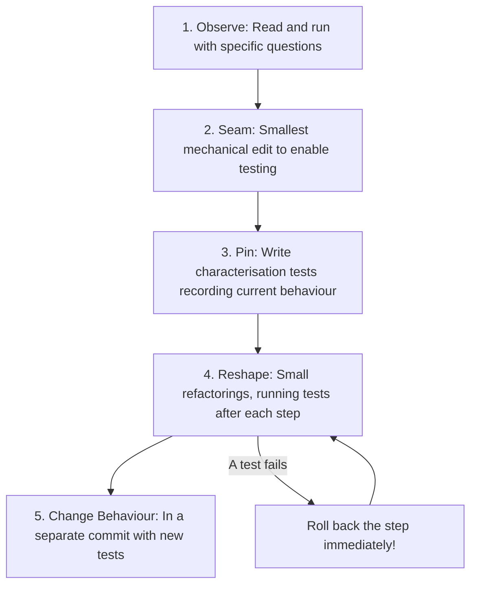
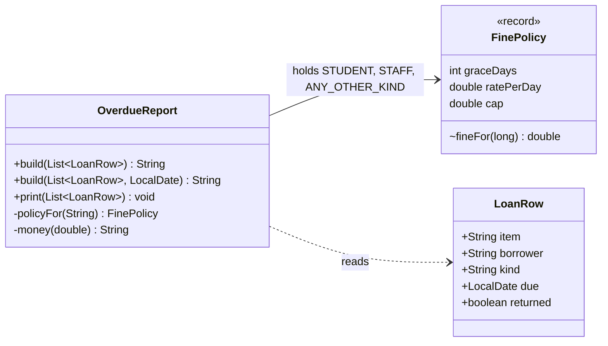
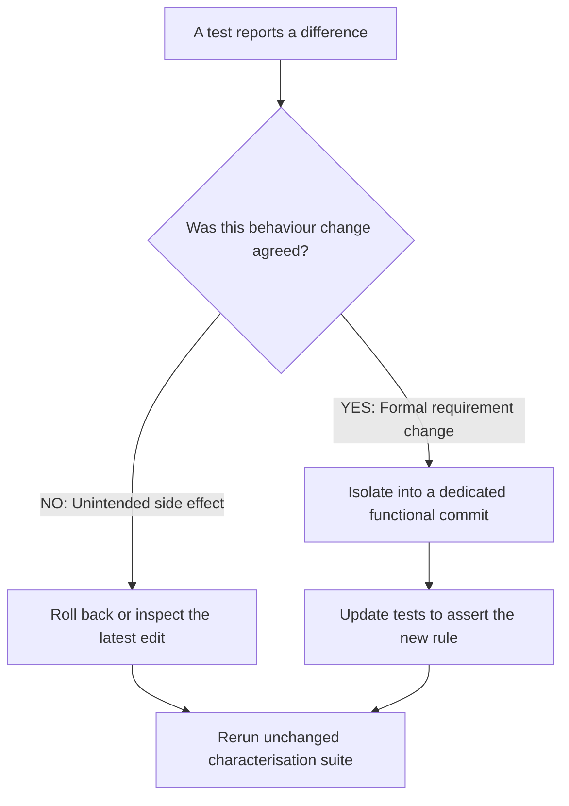

# Week 10: Refactoring & Working Safely with Legacy Code
### SE506: Object Oriented Development and Agile Practices
**Dr. Polla Abdulhamid Fattah**  
*Department of Computer Science & Artificial Intelligence*  
*University of Kurdistan Hewlêr (UKH)*

---

## 3-Hour Lecture Roadmap

* **Part 1: Working with Unfamiliar & Legacy Code (0:00 - 0:30)**
  * Michael Feathers's definition: "Legacy code is code without tests"; The legacy dilemma; The 5-stage escape route (Observe, Seam, Pin, Reshape, Change); Reading notes.
* **Part 2: Code Smells & Seams: Finding Enabling Points (0:30 - 1:05)**
  * Fowler on smells: Smells as prompts, not death sentences; Smells with concrete change costs; What is a Seam?; The Parameter Seam (`build(rows, today)`); Probe testing.
* **Part 3: Characterisation Tests & Pinned Semantics (1:05 - 1:40)**
  * Regression vs. Characterisation tests; The write-run-record loop; Classifying observations (Expected, Surprising, Suspected Defect, Unknown); Pinning the oddities.
* **BREAK (1:40 - 1:55)**
* **Part 4: Incremental Refactoring Mechanics: Fowler's Steps (1:55 - 2:25)**
  * One step, one check, one commit; Extract Method (`fineFor`, `money`); Extract Class (`FinePolicy` record); Figure 11.2 class diagram; Rollback discipline.
* **Part 5: Behaviour Changes, Defect Fixing & Technical Debt (2:25 - 2:45)**
  * Decision tree for differences; The 7-day staff grace change; Correcting unknown kinds on a separate branch; Technical debt metaphor & debt registers.
* **Part 6: AI Audits, Quiz 2 Revision & Workshop (2:45 - 3:00)**
  * Auditing AI refactoring patches (the `isAfter` boundary trap); Quiz 2 comprehensive revision pointers (Weeks 5-9); Lab steps B1-B3 & T1-T4.

---

## Pedagogical Alignment & Module Context

* **Module Learning Outcomes:**
  * **LO3:** Apply Test-Driven Development (TDD), regression testing, and characterisation testing to maintain system stability during refactoring.
  * **LO4:** Evaluate software architectures and design decisions using empirical criteria, testing strategies, and refactoring techniques.
* **Foundational Literature & Engineering Canon:**
  * Michael Feathers (2004): *Working Effectively with Legacy Code* (Seams, Characterisation Tests, Enabling Points).
  * Martin Fowler (1999/2018): *Refactoring: Improving the Design of Existing Code* (Code Smells, Mechanics, Extract Method/Class).
  * Robert C. Martin (2002): *Agile Software Development: Principles, Patterns, and Practices* (Refactoring Chapter).
* **Assessment Alert: Quiz 2 Takes Place This Week!**
  * Scope covers strictly **Weeks 5 to 9 (Chapters 6 to 10)**: DI, TDD & Doubles, GoF Patterns, and Layered Architecture.
  * Today's deck concludes with a dedicated Quiz 2 revision clinic!

---

# Part 1: Working with Unfamiliar & Legacy Code

---

## What Makes Code "Legacy"?

* Ask typical programmers for a definition of legacy code:
  * *"Code written in COBOL, FORTRAN, or Java 1.4."*
  * *"Code written by someone who left the company ten years ago."*
  * *"Code that looks messy and unformatted."*
* **Michael Feathers's Revolutionary Definition:**
  > *"To me, legacy code is simply code without tests."* (Feathers, 2004)
* **Why this definition is profound:**
  * The calendar age or programming language does not matter!
  * Beautiful code written last week in Java 21 is **legacy code** if you cannot change it without fear of silently breaking unseen behaviour.
  * Without tests, you cannot tell whether an edit preserved promises or introduced defects!

---

## The Legacy Dilemma & The Escape Route

* **The Dilemma:**
  1. To change code safely, we need automated tests.
  2. But legacy code is usually tightly coupled, untestable, and hostile to testing!
  3. So developers try to refactor first to make it testable...
  4. ...which breaks unseen behaviour because there are no tests to protect the refactoring!
* **The 5-Stage Escape Route:**



---

## The Scenario: The Records Office Overdue Report

* You are handed `OverdueReport.java` from the legacy university records system:
  * A 40-line static method `build(List<LoanRow> rows)`.
  * Generates a text report listing all unreturned overdue loans with fines.
* **The Immediate Complaints:**
  1. A student with a laptop 2 days late has a fine of 0.00, but is still listed as overdue and added to the count.
  2. On a German server, fines print as `0,50` instead of `0.50` due to locale formatting.
  3. Management wants a business rule change: **Staff grace period should increase from 5 days to 7 days.**
* **What do you do first?**
  * DO NOT jump in and change the staff grace period!
  * DO NOT rewrite the class from scratch!
  * You must first observe and pin existing behaviour.

---

## Inspecting the Legacy Code As Found

```java
public class OverdueReport {
    public static String build(List<LoanRow> rows) {
        String out = "";
        double total = 0;
        int count = 0;
        LocalDate today = LocalDate.now(); // HIDDEN DEPENDENCY!
        out += "OVERDUE REPORT " + today + "\n";
        for (int i = 0; i < rows.size(); i++) {
            LoanRow r = rows.get(i);
            if (r.returned) continue;
            long late = ChronoUnit.DAYS.between(r.due, today);
            if (late > 0) {
                double fine = 0;
                if (r.kind.equals("S")) {
                    if (late > 2) {
                        fine = (late - 2) * 0.50;
                        if (fine > 10) fine = 10;
                    }
                } else if (r.kind.equals("T")) {
                    if (late > 5) {
                        fine = (late - 5) * 0.25;
                        if (fine > 5) fine = 5;
                    }
                } else {
                    fine = 1.00 * late;
                }
                out += r.item + " " + r.borrower + " " + late + " day(s) late, fine "
                        + String.format("%.2f", fine) + "\n"; // LOCALE DEPENDENCY!
                total += fine;
                count++;
            }
        }
        out += count + " overdue, total fines " + String.format("%.2f", total) + "\n";
        return out;
    }
}
```

---

## The Discipline of Reading Notes

* Separate what you **know** from what you **guess** before touching code:

| Observation in Legacy Code | How You Know | Engineering Status |
|---|---|---|
| Returned loans are skipped | Read: `if (r.returned) continue;` | **Known** |
| Fines start after grace period and are capped | Read: nested comparisons per kind | **Known** |
| Unknown borrower kinds pay 1.00/day, no grace, no cap | Read: catch-all `else` branch | **Known what; unknown whether intended!** |
| Output changes every single day | Read: `LocalDate.now()` | **Known** |
| Numbers format with commas in European locales | Read: `String.format("%.2f", ...)` without locale | **Likely; confirm with test** |
| Loans 2 days late show 0.00 fine but count as overdue | Read: `count++` inside `late > 0` | **Likely; confirm with test** |

* "Unknown whether intended" is an honest scientific status. Never assume odd behaviour is a bug you should silently fix!

---

# Part 2: Code Smells & Seams: Finding Enabling Points

---

## Smells as Investigation Prompts

* Fowler defines a code smell as a surface indication that usually corresponds to a deeper problem (Fowler, 1999).
* **The Professional Rule:**
  * A smell is an invitation to investigate, NOT an automatic mandate to refactor!
  * Only refactor when a smell causes a **concrete difficulty of change** for an upcoming requirement.

| Smell in `OverdueReport` | The Concrete Difficulty of Change | Should We Fix It Now? |
|---|---|---|
| **Duplicated Branch Structure** | Grace numbers appear twice in staff branch; editing one creates a bug | **YES:** Staff grace change is requested! |
| **Magic Numbers (`2`, `0.50`, `5`, `0.25`)** | Unclear which is grace and which is cap | **YES:** Blocks safe configuration |
| **Hidden Clock (`LocalDate.now()`)** | Cannot write repeatable assertions | **YES:** Essential to test at all! |
| **Hidden Locale (`String.format`)** | Report prints differently across machines | **YES:** Pin with explicit locale |
| **`String +=` in a Loop** | Performance slowdown for 100k rows | **NO:** Report only processes 20 rows! |

---

## What is a Seam?

* **Definition (Feathers, 2004):**
  > *"A seam is a place where you can alter behavior in a program without editing in that place."*
* Every seam has an associated **Enabling Point**:
  * The place where you can choose which behaviour to execute (e.g., in a test fixture).
* **Seam Types in Object-Oriented Code:**
  1. **Parameter Seam:** Passing dependencies via method parameters (simplest and cleanest!).
  2. **Object / Interface Seam:** Injecting an interface implementation into a constructor.
  3. **Subclass & Override Seam:** Overriding a protected method in a test-specific subclass.
  4. **Link / Classpath Seam:** Swapping a compiled class or library at link time.

---

## The Parameter Seam: Taming the Clock

* To test `OverdueReport`, we must control the date.
* We apply the **smallest, most mechanical edit possible**:

```java
// Keep original method for backwards compatibility:
public static String build(List<LoanRow> rows) {
    return build(rows, LocalDate.now());
}

// THE PARAMETER SEAM: Overloaded method accepting 'today'
public static String build(List<LoanRow> rows, LocalDate today) {
    String out = "";
    double total = 0;
    int count = 0;
    out += "OVERDUE REPORT " + today + "\n";
    // ... rest of method completely untouched!
```

* **Why this is safe:**
  * Zero logic changed. Existing callers see zero difference.
  * The compiler checks method signatures. A quick code review confirms safety.

---

## Checking the Seam with a Probe

* Before writing extensive tests, how do we verify our one untested seam edit didn't break anything?
* We use a temporary, bounded **Probe**:
  * Run the unseamed original (`OriginalUnseamed.build`) beside the seamed method (`OverdueReport.build`) on synthetic rows.

```java
// A simple probe comparing old vs. new:
List<LoanRow> sample = List.of(
    new LoanRow("CAM1", "S1", "S", LocalDate.now().minusDays(3), false),
    new LoanRow("MIC1", "T1", "T", LocalDate.now().minusDays(1), false)
);

String originalOutput = OriginalUnseamed.build(sample);
String seamedOutput   = OverdueReport.build(sample);

assertEquals(originalOutput, seamedOutput, "Seam must produce identical output!");
```

* Run once, confirm exact character-for-character equivalence, then proceed to characterisation tests!

---

## Who Chooses the Time Zone?

* When a caller passes a `LocalDate today`, a subtle question emerges:
  * At 22:30 UTC on 21 October, it is already **01:30 on 22 October in Baghdad**!
  * A loan due on 21 October is on-time in London, but **one day late in Baghdad**!
* **The Power of the Seam:**
  * The seam did not magically eliminate the time-zone question.
  * It shifted the responsibility to the **caller**, where it belongs:

```java
Instant cutoff = Instant.parse("2026-10-21T22:30:00Z");
LocalDate utcDate     = LocalDate.ofInstant(cutoff, ZoneOffset.UTC);            // 2026-10-21
LocalDate baghdadDate = LocalDate.ofInstant(cutoff, ZoneId.of("Asia/Baghdad")); // 2026-10-22

// Tests can now explicitly verify multi-timezone behaviour!
```

---

# Part 3: Characterisation Tests & Pinned Semantics

---

## Regression Tests vs. Characterisation Tests

* What is the difference between these two testing philosophies?

| Dimension | Regression Test | Characterisation Test |
|---|---|---|
| **Underlying Premise** | Asserts behaviour agreed to be **correct**. | Records behaviour as it exists **today**. |
| **Author Intent** | Specifies system requirements and contracts. | Creates a safety net to detect unintended change. |
| **When a Test Fails** | Indicates a bug or regression. | Indicates an alteration in existing behaviour. |
| **Handling Weird Logic** | Assert what the specification demands. | **Pin the weird logic exactly as it executes!** |

* A passing characterisation test means: *"Behaviour has not changed."*
* It does NOT mean: *"The program is bug-free."*

---

## The Write-Run-Record Loop (Michael Feathers)

* How to write a characterisation test without guessing output:
  1. **Write a test with a deliberately wrong assertion:**
     ```java
     assertEquals("PLACEHOLDER", OverdueReport.build(sample, TODAY));
     ```
  2. **Run the test and read the failure message:**
     * The test runner shows the exact string produced by the legacy system.
  3. **Inspect the actual output:**
     * Does it make mathematical sense? Is it expected, surprising, or suspect?
  4. **Paste the actual result into the assertion:**
     * Lock the output down.
  5. **Add an explicit classification comment:**
     * Document your engineering findings directly in the code!

---

## Classifying Observed Legacy Behaviour

* When pinning legacy behaviour, classify every observation into one of four categories:

| Classification | Definition | Testing Action |
|---|---|---|
| **Expected** | Matches the documented business rule. | Keep test; standard assertion. |
| **Surprising** | Unexpected, but may be intentional business logic. | Keep test; document in comment; query owner. |
| **Suspected Defect** | Looks unequivocally wrong or dangerous. | **Pin it anyway!** Mark with `// SUSPECTED DEFECT`. Do NOT fix yet! |
| **Unknown** | Incomplete context; cannot evaluate intent. | Keep test; log question in debt register. |

* **Golden Rule:** Never fix a suspected defect during characterisation! Pinning preserves your baseline.

---

## What the Legacy Report Actually Does

* Pinned characterisation results for `OverdueReport` at `TODAY = 2026-10-20`:

| Borrower Kind | Days Late | Calculated Fine | Classification & Diagnostic Observation |
|---|---:|---:|---|
| **Student (`S`)** | 1, 2 | **0.00** | **Surprising:** Counted as overdue, listed, but fine is 0.00! |
| **Student (`S`)** | 3 | **0.50** | **Expected:** First fine charged: `(3 - 2) * 0.50`. |
| **Student (`S`)** | 22+ | **10.00** | **Expected:** Cap of 10.00 reached at 22 days and holds. |
| **Staff (`T`)** | 1 to 5 | **0.00** | **Surprising:** Grace period: listed with 0.00 fine. |
| **Staff (`T`)** | 6 | **0.25** | **Expected:** First fine charged: `(6 - 5) * 0.25`. |
| **Staff (`T`)** | 25+ | **5.00** | **Expected:** Cap of 5.00 reached at 25 days and holds. |
| **Unknown (`X`)** | 1 | **1.00** | **Suspected Defect:** No grace period whatsoever! |
| **Unknown (`X`)** | 100 | **100.00** | **Suspected Defect:** No cap whatsoever! |
| **Typo (`s`)** | 3 | **3.00** | **Suspected Defect:** Lowercase `"s"` falls into `else`; costs 6x! |

---

## Pinning a Suspected Defect in Code

```java
// SUSPECTED DEFECT, pinned on purpose:
// Any other kind (including lowercase 's' or 'X') pays 1.00 a day with no grace and no cap.
// Do NOT fix this test until the records office officially approves a replacement policy!
@ParameterizedTest
@CsvSource({
    "X, 1, 1.00",
    "X, 100, 100.00",
    "s, 3, 3.00"
})
void otherKindsPayTheFullRateWithNoGraceOrCap(String kind, int daysLate, String expectedFine) {
    LoanRow row = new LoanRow("CAM1", "B1", kind, TODAY.minusDays(daysLate), false);
    String report = OverdueReport.build(List.of(row), TODAY);
    assertTrue(report.contains("fine " + expectedFine), 
        "Pinned legacy behaviour: unknown kinds pay uncapped daily fine");
}
```

* The comment is an architectural artifact: it protects future developers from accidentally breaking or "fixing" legacy behaviour without authorization!

---

## Golden Master / Differential Testing

* Example-based tests cover only the scenarios you thought to write.
* **Differential Testing (The Golden Master Net):**
  * Keep a compiled copy of `OriginalUnseamed` as an **oracle**.
  * Write a test that generates **5,000 randomized synthetic loan rows** using a fixed PRNG seed.
  * Execute both versions and assert byte-for-byte equality:

```java
@Test
void differentialFuzzTestingAgainstLegacyOracle() {
    Random rng = new Random(42); // Deterministic seed
    for (int i = 0; i < 5000; i++) {
        List<LoanRow> rows = generateRandomLoans(rng);
        LocalDate date = TODAY.plusDays(rng.nextInt(60) - 30);
        
        String oracleOutput  = OriginalUnseamed.build(rows, date);
        String currentOutput = OverdueReport.build(rows, date);
        
        assertEquals(oracleOutput, currentOutput, "Mismatch on iteration " + i);
    }
}
```

---

# BREAK (15 Minutes)

* Grab a coffee or tea.
* Reflect on:
  * We observed the code, opened a parameter seam, and pinned all 27 edge cases.
  * When we return: How do we **refactor the procedural code into clean OO** without breaking a single character of output?

---

# Part 4: Incremental Refactoring Mechanics: Fowler's Steps

---

## The Rule of Refactoring: Small Steps & Commits

* **Martin Fowler's Golden Rule:**
  * Refactoring is a series of tiny, behaviour-preserving transformations.
  * Run the test suite after **every single edit**.
  * Commit after **every single passing refactoring**.
* **Why Batch Refactoring Fails:**
  * If you extract three methods, rename five variables, create two classes, and THEN run tests...
  * ...and a test fails: Which change broke it?
  * You are forced into painful, slow, speculative debugging.
* **Commit Rhythm for Legacy Refactoring:**
  1. Commit 1: Seam edit (mechanical parameter overload).
  2. Commit 2: Characterisation suite + Differential test.
  3. Commit 3: Extract Method (`fineFor`, `money`).
  4. Commit 4: Extract Class (`FinePolicy`).
  5. Commit 5: Rename and Tidy (`StringBuilder`).

---

## Stage 2: Extract Method

* Extract fine calculation and monetary formatting out of the loop:

```java
// Inside build loop:
double fine = fineFor(r.kind, late);
out += r.item + " " + r.borrower + " " + late + " day(s) late, fine " + money(fine) + "\n";

// Extracted private methods:
private static double fineFor(String kind, long late) {
    if (kind.equals("S")) {
        if (late > 2) {
            double fine = (late - 2) * 0.50;
            return fine > 10 ? 10 : fine;
        }
        return 0;
    } else if (kind.equals("T")) {
        if (late > 5) {
            double fine = (late - 5) * 0.25;
            return fine > 5 ? 5 : fine;
        }
        return 0;
    }
    return 1.00 * late;
}

private static String money(double amount) {
    return String.format(Locale.ROOT, "%.2f", amount);
}
```

* Run tests $\rightarrow$ 100% Green $\rightarrow$ Commit!

---

## Stage 3: Extract Class (`FinePolicy`)

* Examine the branches in `fineFor`:
  * Student: grace = 2, rate = 0.50, cap = 10.00
  * Staff: grace = 5, rate = 0.25, cap = 5.00
  * Unknown: grace = 0, rate = 1.00, cap = $\infty$
* **They all share the exact same mathematical formula!**
* Extract the concept as an immutable Java record:

```java
record FinePolicy(int graceDays, double ratePerDay, double cap) {
    double fineFor(long daysLate) {
        if (daysLate <= graceDays) {
            return 0.0;
        }
        return Math.min((daysLate - graceDays) * ratePerDay, cap);
    }
}
```

* **Algebraic Equivalence:**
  * Old: `if (late > 2) fine = (late - 2) * 0.50; if (fine > 10) fine = 10;`
  * New: `daysLate <= 2 ? 0 : Math.min((daysLate - 2) * 0.50, 10.0)`
  * Completely identical!

---

## The Refactored Class Structure (Figure 11.2)



* Notice what was preserved:
  * Public signatures of `build()` and `print()` are completely unchanged.
  * Legacy `LoanRow` public mutable struct was not modified.

---

## Stage 4: Rename and Tidy

* Modernize the loop and variable names:

```java
public static String build(List<LoanRow> rows, LocalDate today) {
    StringBuilder report = new StringBuilder("OVERDUE REPORT " + today + "\n");
    double totalFines = 0;
    int overdueCount = 0;
    
    for (LoanRow row : rows) {
        if (row.returned) continue;
        
        long daysLate = ChronoUnit.DAYS.between(row.due, today);
        if (daysLate > 0) {
            double fine = policyFor(row.kind).fineFor(daysLate);
            report.append(row.item).append(' ').append(row.borrower).append(' ')
                  .append(daysLate).append(" day(s) late, fine ")
                  .append(money(fine)).append('\n');
            totalFines += fine;
            overdueCount++;
        }
    }
    report.append(overdueCount).append(" overdue, total fines ")
          .append(money(totalFines)).append('\n');
    return report.toString();
}
```

---

## The Rollback Discipline: Do Not Debug Forward!

* What if you make a refactoring edit and 3 characterisation tests fail?
* **Junior Reflex (Debugging Forward):**
  * Start tweaking lines in the refactored code.
  * Change an operator. Add a null check. Change an off-by-one index.
  * Soon the codebase is in a confused, half-refactored state where nothing makes sense!
* **Senior Engineering Rule (Rollback):**
  * Discard the uncommitted edit immediately:
    ```bash
    git restore .
    ```
  * You are instantly back to a clean, 100% green state.
  * Re-read the step. Break it down into two even smaller steps. Apply again.
  * **Rolling back takes 5 seconds; debugging forward takes 2 hours!**

---

# Part 5: Behaviour Changes, Defect Fixing & Technical Debt

---

## When a Test Reports a Difference (Figure 11.3)



* Never mix structural refactoring and behavioural modifications in the same Git commit!
* If a commit claims *"Refactored report"*, its diff must NOT contain a change to fine amounts.

---

## Executing the Requested Behaviour Change

* Remember the office's request from the start of lecture?
  * *"Staff should receive 7 days of grace instead of 5 days."*
* In the legacy code, this required editing magic numbers in 2 places inside a nested branch.
* In our refactored code, it is a **one-number change**:

```diff
- private static final FinePolicy STAFF = new FinePolicy(5, 0.25, 5.00);
+ private static final FinePolicy STAFF = new FinePolicy(7, 0.25, 5.00);
```

* In this dedicated functional commit:
  * Update characterisation tests: staff at 6 days now pays 0.00; staff at 8 days pays 0.25.
  * Commit message: *"feat: extend staff overdue grace period from 5 to 7 days"*.
  * Clean, auditable, and isolated!

---

## Correcting the Suspected Defect

* Later, the records office confirms:
  * *"Only 'S' and 'T' are valid borrower kinds. Any other kind is a corrupted record and should be rejected with an exception."*
* Now - and ONLY now - do we fix the suspected defect:

```java
private static FinePolicy policyFor(String kind) {
    if ("S".equals(kind)) return STUDENT;
    if ("T".equals(kind)) return STAFF;
    throw new IllegalArgumentException("Unknown borrower kind: " + kind);
}
```

* In the same commit:
  * Remove `ANY_OTHER_KIND`.
  * Replace the pinned tests with:
    ```java
    assertThrows(IllegalArgumentException.class, () -> OverdueReport.build(unknownKind, TODAY));
    ```

---

## Understanding Technical Debt (Ward Cunningham)

* **Ward Cunningham's Metaphor:**
  * Shipping quick, unpolished code is like taking out a financial loan.
  * It accelerates short-term delivery.
  * But you must pay **interest**: the ongoing extra effort, friction, and bugs every time that code is touched.
  * Refactoring is **paying down the principal**.
* **Debt Claim Hygiene:**
  * "This code is garbage" is an unhelpful opinion.
  * "Duplicated grace constants in `build()` require 2 coordinated edits per change and lack automated tests" is verifiable engineering evidence!

---

## Maintaining a Suspected-Defect Register

* When refactoring legacy code, keep an explicit register of oddities you discover:

| Field | Register Entry for `OverdueReport` |
|---|---|
| **Identified Item** | Overdue report duplicated calculation & hidden dependencies |
| **Concrete Evidence** | Grace numbers duplicated; `LocalDate.now()` prevents deterministic tests; German locale prints commas |
| **Interest Cost** | Each fine modification takes 2 hours of manual testing and risks silent calculation regressions |
| **Engineering Action** | Paid down: Parameter seam, characterisation suite, and `FinePolicy` extraction across 5 commits |
| **Remaining Questions** | Should loans within grace period be omitted from overdue count? Should unknown kinds throw or flag? |

---

# Part 6: AI Audits, Quiz 2 Revision & Workshop

---

## Auditing AI Refactoring Patches

* An AI coding assistant proposes this "cleanup" of `OverdueReport`:
  > *"I tidied `build`. The overdue check is now `!row.due.isAfter(today)`, which reads better and is equivalent to `daysLate > 0`. I also choose the fine policy before the check, so the loop has one path. Unknown kinds fall back to student policy. Formatting is unchanged, so behaviour is preserved."*

```java
// AI-Generated Proposed Loop:
long daysLate = ChronoUnit.DAYS.between(row.due, today);
FinePolicy policy = row.kind.equals("T") ? STAFF : STUDENT; // TRAP 1
if (!row.due.isAfter(today)) {                               // TRAP 2
    double fine = policy.fineFor(daysLate);
    // ... append line ...
}
```

---

## Why the AI Patch Breaks the System

* **Critical Trace 1 (The Boundary Trap):**
  * What if a loan is due **today** (`row.due.equals(today)`)?
  * Original: `daysLate = 0`. `daysLate > 0` is `false` $\rightarrow$ Loan is **skipped**!
  * AI Patch: `!row.due.isAfter(today)` is `!false` = `true` $\rightarrow$ **Loan due today is listed as overdue!**
  * Fatal regression!
* **Critical Trace 2 (The Null Pointer Trap):**
  * `row.kind.equals("T")` evaluates before checking if the loan is returned or overdue.
  * If an unreturned loan has `kind = null`, it throws `NullPointerException` immediately!
* **Critical Trace 3 (Unauthorized Behaviour Change):**
  * Mapping unknown kinds to `STUDENT` without records office approval changes financial billing!

---

## Quiz 2 Revision Clinic (Weeks 5 to 9)

* **Quiz 2 takes place in Week 10!**
* High-yield review topics from Chapters 6 to 10:

| Week & Topic | High-Yield Revision Focus |
|---|---|
| **Week 5: SOLID II (Ch 6)** | Role interfaces (ISP), DIP, Constructor injection, Composition root, Pure DI vs. Reflection containers. |
| **Week 6: Testing & TDD (Ch 7)** | Red-Green-Refactor, Meszaros Double Taxonomy (Dummy vs Stub vs Fake vs Spy vs Mock), Controlled `Clock`. |
| **Week 7: Creational (Ch 8)** | Factory Method (subclass hook) vs Simple Factory, Builder invariant enforcement, Adapter code mapping. |
| **Week 8: Behavioural (Ch 9)** | Strategy contracts, State 20-cell transition table, Observer snapshot dispatch, Command execution-time state. |
| **Week 9: Architecture (Ch 10)** | 5 layers, Permitted dependency matrix, `ReservationRepository` port, Instability metric ($I = \frac{C_e}{C_a + C_e}$). |

---

## Practical Activity & Workshop (Steps B1-B3 & T1-T4)

* **Book Project (Steps B1 - B3):**
  * **B1 (Observe & Characterise):** Run `OriginalUnseamed` probe; execute characterisation suite; add 3 new boundary tests (e.g., loan 100 days late).
  * **B2 (Refactor):** Apply Extract Method and Extract Class in small commits, running tests after each step.
  * **B3 (Report):** Document structural changes and update the suspected-defect register.
* **Team Project (Steps T1 - T4):**
  * **T1:** Select one untested, smelly method in your team's codebase.
  * **T2:** Open the smallest mechanical seam and write characterisation tests for at least 6 boundary cases.
  * **T3:** Apply at least 3 incremental refactorings, committing after each passing step.
  * **T4:** Write a before/after rationale and conduct a peer review with your teammate.

---

## Common Pitfalls in Legacy Code Work

* **Pitfall 1: Fixing suspected defects during a refactoring.**
  * Separate structural improvements from functional changes!
* **Pitfall 2: Blindly pasting test failures into assertions.**
  * Understand and classify every output before accepting it.
* **Pitfall 3: Modifying global state without restoring it.**
  * If a test overrides `Locale.getDefault()` or `System.out`, always restore it in `@AfterEach` or `finally`!
* **Pitfall 4: Making a huge rewrite instead of a seam.**
  * Keep the initial seam edit so small that it can be verified by inspection.
* **Pitfall 5: Debugging forward when a test breaks.**
  * Roll back to the previous green commit immediately!

---

## Week 10 Summary & Looking Ahead to Week 11

* **Key Takeaways Today:**
  * **Legacy Code:** Code without tests; work via Observe $\rightarrow$ Seam $\rightarrow$ Pin $\rightarrow$ Reshape $\rightarrow$ Change.
  * **Seams:** Enabling points that allow dependency isolation without broad rewriting.
  * **Characterisation Tests:** Protect current behaviour, warts and all, without confusing "unchanged" with "correct".
  * **Fowler's Mechanics:** Small steps, algebra proofs, and strict rollback discipline.
* **Looking Ahead to Week 11:**
  * **Chapter 12: Measuring Progress, Flow & Technical Health.**
  * Lead Time, Cycle Time, Throughput, Work-in-Progress (WIP), and introducing the Visiting Researcher change request!

---

# Questions & Discussion
### SE506: Object Oriented Development and Agile Practices
**University of Kurdistan Hewlêr (UKH)**  
*Dr. Polla Abdulhamid Fattah*
