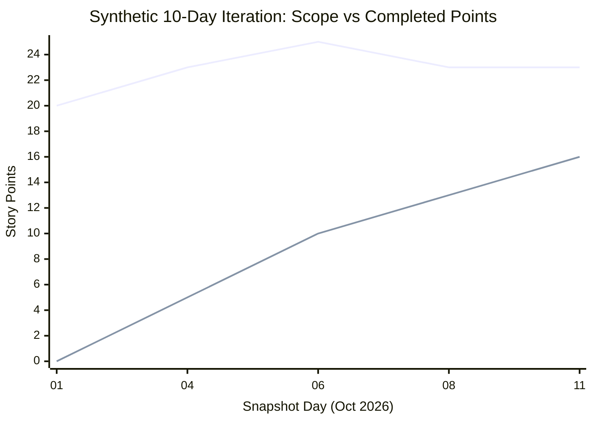

# Week 11: Measuring Progress, Flow & Technical Health
### SE506: Object Oriented Development and Agile Practices
**Dr. Polla Abdulhamid Fattah**  
*Department of Computer Science & Artificial Intelligence*  
*University of Kurdistan Hewlêr (UKH)*

---

## 3-Hour Lecture Roadmap

* **Part 1: What Decision Needs a Measure? (0:00 - 0:30)**
  * The anti-pattern of vanity metrics; The Measurement Contract; Synthetic history of Items A-H; Separating observable facts from speculative interpretations.
* **Part 2: Estimation, Velocity & Burn Charts (0:30 - 1:05)**
  * Points as relative sizing vs. hours; Velocity (16 points) vs. Item Throughput (5 items); Conditional forecasting; Burn-down vs. Burn-up with scope changes.
* **Part 3: Flow Metrics: Lead Time, Cycle Time, WIP & Age (1:05 - 1:40)**
  * Kanban flow metrics; Completed cohort calculations (Mean lead 4.6d, Mean cycle 2.8d, Median cycle 3.0d); Active WIP & Work-Item Age; Little's Law insights.
* **BREAK (1:40 - 1:55)**
* **Part 4: Repository Metrics & Technical Health (1:55 - 2:25)**
  * Repository Method RM-12 v1.0; PR Open-to-Merge duration; Goodhart's Law & Git commit misuse; DORA / Accelerate metrics; Technical health evidence.
* **Part 5: Change Management: CR-12 Visiting Researchers (2:25 - 2:45)**
  * The CR-12 requirement; Impact analysis across layers; Preserving `BorrowingPolicy` contracts; The Approval Register boundary; The AC1-AC18 matrix.
* **Part 6: AI Audits, Lab Activity & Wrap-Up (2:45 - 3:00)**
  * Critical audit of AI metrics summaries; Practical lab: `FlowMetrics.java` & RM-12 repository extraction; Preview of Week 12 (Milestone 4).

---

## Pedagogical Alignment & Module Context

* **Module Learning Outcomes:**
  * **LO5:** Apply Agile estimation, tracking, and empirical delivery metrics (velocity, lead time, cycle time, WIP) to plan iterations and forecast delivery.
  * **LO6:** Manage and structure modular software components, ensuring architectural health and empirical traceability during change.
* **Foundational Literature & Engineering Canon:**
  * Robert C. Martin (2002): *Agile Software Development: Principles, Patterns, and Practices* (Planning and Estimation).
  * Nicole Forsgren, Jez Humble, Gene Kim (2018): *Accelerate: The Science of Lean Software and DevOps* (DORA Delivery Metrics).
  * Kanban Guides (2025): *The Kanban Guide* (Flow Measures: WIP, Cycle Time, Throughput, Work-Item Age).
  * Nicole Forsgren et al. (2021): *The SPACE of Developer Productivity* (ACM Queue).

---

# Part 1: What Decision Needs a Measure?

---

## The Danger of Measuring Without a Decision

* In software engineering, teams often drown in vanity metrics:
  * *"Our team made 142 commits this week!"* (Does that mean high productivity, or messy Git hygiene?)
  * *"Our velocity jumped to 45 story points!"* (Did we ship more value, or inflate our estimates?)
  * *"An item was blocked for two days: our architecture must be broken!"*
* **The Engineering Principle:**
  * A metric cannot make decisions for you.
  * It exists solely to illuminate a specific decision or test a concrete hypothesis.
  * Before collecting any number, define:
    1. What concrete action will change based on this number?
    2. What is the unit of measure?
    3. What are the explicit boundary events?

---

## The Measurement Contract (Specification First!)

* You cannot compare numbers without agreeing on definitions:

| Contract Dimension | Specification for SE506 History Analysis |
|---|---|
| **Work Unit** | One uniquely identified backlog item (IDs A through H) |
| **Accepted Event** | Instant an item is admitted to the active iteration scope |
| **Started Event** | First transition into active implementation |
| **Done Event** | Satisfies Definition of Done (code, unit tests, review, CI green) |
| **Removed Event** | Explicitly deleted from scope without completion |
| **Reporting Interval** | Half-open window: `[2026-10-01T00:00:00Z, 2026-10-11T00:00:00Z)` |
| **Duration Metric** | Elapsed 24-hour days (86,400 seconds; includes nights & weekends) |
| **Completion Cohort** | Items whose Done event falls strictly within the reporting window |

* Half-open intervals `[start, end)` ensure adjacent periods never double-count!

---

## The Raw Data: A Synthetic 10-Day Iteration

* All timestamps in October 2026 at 00:00 UTC:

| ID | Backlog Item Summary | Points | Accepted | Started | Done | Removed | Notes |
|---|---|---:|---:|---:|---:|---:|---|
| **A** | Reservation boundary examples | 3 | 01 | 01 | 03 | - | Completed |
| **B** | Directory mapping clarification | 5 | 01 | 02 | 06 | - | Blocked Oct 03 to 05 |
| **C** | Confirmation formatting wording | 2 | 01 | 03 | 04 | - | Completed |
| **D** | Command replay protection | 3 | 01 | 05 | 08 | - | Completed |
| **E** | Report failure investigation | 5 | 01 | 07 | - | - | In Progress (Open) |
| **F** | Optional export format | 2 | 01 | - | - | **08** | **Removed from scope** |
| **G** | Snapshot consistency checks | 3 | **04** | 06 | 10 | - | Added Oct 04; Done |
| **H** | Review notes improvement | 2 | **06** | 08 | - | - | Added Oct 06; Open |

---

## Separating Facts from Speculation

* Look closely at the data for Item B:
  * Fact: Started on Oct 02, finished on Oct 06.
  * Fact: Recorded as blocked from Oct 03 to Oct 05 waiting for a directory mapping decision.
  * Fact: Elapsed cycle time = $6 - 2 = 4$ calendar days.
* **Speculative Claims to Avoid:**
  * Speculation: *"Item B proves the Directory Adapter is poorly designed."* (Unsupported: the delay was an organizational question about vendor codes, not a code defect!)
  * Speculation: *"If we subtract the 2 blocked days, developer coding time was exactly 2 days."* (Unsupported: unrecorded waiting or interruptions could still have occurred!)
* **Rule:** Report what the timestamp boundary records; do not fabricate unmeasured active time.

---

## Deep Dive: Tracing Backlog Item B's Blocked State

* Item B (Directory mapping clarification) is a classic case study in delivery flow:
  * Accepted into scope: Oct 01 at 00:00 UTC.
  * Work started: Oct 02 at 00:00 UTC.
  * External dependency block: Oct 03 to Oct 05 (waiting for IT department on LDAP codes).
  * Work resumed and completed: Oct 06 at 00:00 UTC.
* **Why Keep Waiting in Elapsed Cycle Time?**
  * From the developer's perspective: *"I only coded for 2 days!"*
  * From the user / customer perspective: *"I waited 5 days from when you accepted it!"*
  * If you subtract blocked days from cycle time, organizational bottlenecks become invisible!
  * Keeping elapsed calendar time forces teams to confront external dependencies in retrospectives.

---

# Part 2: Estimation, Velocity & Burn Charts

---

## Estimation Revisited: Sizing vs. Physical Reality

* In Chapter 3, we estimated user stories in relative story points:
  * Item B = 5 points; Item C = 2 points.
* **What Story Points Are:**
  * Relative sizing based on complexity, uncertainty, and effort.
  * A planning heuristic for capacity allocation within a single team.
* **What Story Points Are NOT:**
  * They are NOT hours, person-days, or monetary currency.
  * Because Item B took 4 days for 5 points, does 1 point = 0.8 days?
  * **NO!** That duration included 2 days of waiting for a decision.
  * Point estimates must never be rewritten after the fact to make velocity look "accurate"!

---

## Velocity vs. Throughput: Different Units

* Consider the 5 completed items in our 10-day window (A, B, C, D, G):

$$\text{Completed Items} = \{ A(3), B(5), C(2), D(3), G(3) \}$$

* **Velocity (Points Delivered):**
  $$\text{Velocity} = 3 + 5 + 2 + 3 + 3 = \mathbf{16\text{ points}}$$
* **Throughput (Items Delivered):**
  $$\text{Throughput} = \mathbf{5\text{ completed work items}}$$
* **Critical Clarifications:**
  * Unfinished work (Item E at 5 pts, Item H at 2 pts) contributes **0 points** to velocity. (There is no "80% Done"!).
  * Removed work (Item F at 2 pts) contributes **0 points** to velocity.
  * Velocity is specific to one team; you cannot compare velocity across different teams!

---

## Why Velocity Cannot Rank Individual Engineers

* A manager asks: *"Who contributed the most points to our 16-point velocity?"*
* **Why this question destroys agile teams (The SPACE Framework):**
  * Sizing belongs to the story, not an individual person.
  * An experienced senior engineer might spend 3 days pairing with a junior, reviewing pull requests, or unblocking CI pipelines.
  * Under individual point accounting, that senior engineer gets 0 points!
  * **Goodhart's Law:** *"When a measure becomes a target, it ceases to be a good measure."*
  * If points or commits become individual KPIs, developers inflate estimates and hoard easy tasks!

---

## The Illusion of Naive Forecasting

* At the end of Day 10, two items remain open (E and H), totaling 7 points:
* **The Naive Calculation:**
  $$\frac{7\text{ remaining points}}{16\text{ points per iteration}} = 0.4375\text{ iterations} \approx 4.4\text{ days}$$
* *"Therefore, we will definitely finish everything by noon on October 15!"*
* **Why this forecast is dangerous:**
  * Assumes remaining work has the exact same risk profile as finished work.
  * In reality, unfinished items (like Item E: *Report failure investigation*) are often the ones with unresolved technical blockers!
  * **Professional Forecast:** State the assumptions: *"Based on 5 items delivered in 10 days, we anticipate 2 items will fit into the next 5-day window, provided Item E's investigation is unblocked."*

---

## Burn-Down vs. Burn-Up Charts

* How do we track iteration progress visually?
* **Burn-Down Chart:** Shows **Remaining Work** over time.
  $$\text{Remaining Points} = \text{Current Scope Points} - \text{Completed Points}$$
* **Burn-Up Chart:** Shows **Total Scope** and **Cumulative Completed Work** on separate lines.
* **Why Burn-Down Lines Can Deceive:**
  * On Day 04, remaining work **rose** from 17 to 18 points, even though Item C (2 pts) was completed! (Because Item G at 3 pts was added to scope).
  * On Day 08, remaining work **dropped by 5 points**, but only 3 points were completed! (Because Item F at 2 pts was removed from scope).
  * Burn-Up charts keep scope changes visible so progress is not misinterpreted!

---

## The 10-Day Burn-Up Trajectory



* **Upper Line (Total Scope):**
  * Starts at 20 pts $\rightarrow$ Rises to 23 (G added) $\rightarrow$ Rises to 25 (H added) $\rightarrow$ Drops to 23 (F removed).
* **Lower Line (Completed Points):**
  * Climbs steadily: 0 pts $\rightarrow$ 5 pts $\rightarrow$ 10 pts $\rightarrow$ 13 pts $\rightarrow$ 16 pts.
* The gap between lines represents the remaining 7 points.

---

## Common Burn-Down Anti-Patterns in Real Projects

* When inspecting burn-down charts, watch for these three diagnostic shapes:
  1. **The Cliff (The Waterfall Sprint):**
     * Remaining work stays flat at 20 points for 9 days, then plummets to 0 on the final day.
     * Diagnosis: Team is testing and integrating everything at the very end. High risk of failure!
  2. **The Upward Mountain:**
     * The remaining work line climbs continuously throughout the iteration.
     * Diagnosis: Uncontrolled scope creep; stories were poorly refined and unpacked during sprint.
  3. **The Flatline:**
     * Remaining work does not move.
     * Diagnosis: Work in progress (WIP) is too high; developers are juggling 8 tasks without finishing any.
* Healthy teams produce steady, stair-step completions throughout the iteration!

---

# Part 3: Flow Metrics: Lead Time, Cycle Time, WIP & Age

---

## Core Flow Metrics (Kanban Guide)

* Flow metrics track work items moving through a delivery pipeline:
  1. **Work In Progress (WIP):** The count of items that have been Started but not yet Finished.
  2. **Cycle Time:** Elapsed calendar time from **Started** to **Done**.
  3. **Lead Time:** Elapsed calendar time from **Accepted into Backlog** to **Done**.
  4. **Work-Item Age:** Elapsed time since an unfinished item was Started.
  5. **Throughput:** Count of work items completed per unit of time.
* **The Relationship:**
  $$\text{Lead Time} = \text{Wait Time in Backlog} + \text{Cycle Time}$$

---

## Calculating the Completed Cohort (A, B, C, D, G)

* Calculating elapsed calendar days for completed items:

| Item | Accepted | Started | Done | Lead Days | Cycle Days | Wait in Backlog |
|---|---|---|---|---:|---:|---:|
| **A** | Oct 01 | Oct 01 | Oct 03 | $3 - 1 = \mathbf{2}$ | $3 - 1 = \mathbf{2}$ | 0 days |
| **B** | Oct 01 | Oct 02 | Oct 06 | $6 - 1 = \mathbf{5}$ | $6 - 2 = \mathbf{4}$ | 1 day |
| **C** | Oct 01 | Oct 03 | Oct 04 | $4 - 1 = \mathbf{3}$ | $4 - 3 = \mathbf{1}$ | 2 days |
| **D** | Oct 01 | Oct 05 | Oct 08 | $8 - 1 = \mathbf{7}$ | $8 - 5 = \mathbf{3}$ | 4 days |
| **G** | Oct 04 | Oct 06 | Oct 10 | $10 - 4 = \mathbf{6}$ | $10 - 6 = \mathbf{4}$ | 2 days |
| **Sum** | | | | **23 days** | **14 days** | **9 days** |
| **Mean** | | | | **4.6 days** | **2.8 days** | **1.8 days** |

* **Cycle Time Median:** Sort values $\{1, 2, 3, 4, 4\} \rightarrow \mathbf{3.0\text{ days}}$.

---

## Active WIP & Work-Item Age at Snapshot (Oct 11)

* Unfinished items at the Oct 11 snapshot:
  * **Item E:** Started on Oct 07. $\text{Age} = 11 - 7 = \mathbf{4.0\text{ days}}$.
  * **Item H:** Started on Oct 08. $\text{Age} = 11 - 8 = \mathbf{3.0\text{ days}}$.
  * **Active WIP at Snapshot:** $\mathbf{2\text{ items}}$.
* **The Statistical Trap:**
  * Average cycle time (2.8 days) includes ONLY completed items!
  * If a team ignores open items, aging work hidden in progress is overlooked!
  * **Professional Rule:** Always report completed cycle times alongside **current WIP and work-item age**.

---

## Throughput across Half-Open Windows

* Breaking our 10-day reporting window into two 5-day intervals:
  * **Interval 1: `[2026-10-01, 2026-10-06)`**
    * Completed: A (Oct 03), C (Oct 04).
    * Throughput = **2 items**.
  * **Interval 2: `[2026-10-06, 2026-10-11)`**
    * Completed: B (Oct 06), D (Oct 08), G (Oct 10).
    * Throughput = **3 items**.
* **Boundary Precision:**
  * Item B finished exactly at `2026-10-06T00:00:00Z`.
  * Because Interval 1 is half-open `[01, 06)`, B belongs strictly to Interval 2!
  * Zero double-counting.

---

## Equal Throughput Can Conceal Massive Delays

* Consider two software teams, both delivering 2 items per week:
  * **Team Alpha:** Both items were started on Tuesday and merged on Thursday. (Cycle Time = 2 days).
  * **Team Beta:** Both items were started 3 weeks ago, languished in code review, and finally merged on Friday. (Cycle Time = 21 days).
* **The Takeaway:**
  * Both teams have an identical throughput of 2 items/week.
  * But Team Alpha has rapid feedback, low WIP, and delighted users.
  * Team Beta has high inventory, stale branches, and painful merge conflicts.
  * Never look at throughput in isolation without cycle time!

---

## Little's Law & Limiting Work in Progress

* **Little's Law (Operations Research):**
  $$\text{Average WIP} = \text{Average Throughput} \times \text{Average Cycle Time}$$
* **The Direct Implication for Engineering Teams:**
  $$\text{Average Cycle Time} = \frac{\text{Average WIP}}{\text{Average Throughput}}$$
* **How to Speed Up Delivery:**
  * Trying to increase throughput by starting more items simultaneously **explodes WIP**!
  * When WIP increases, multitasking and context switching cause cycle time to soar!
  * **The Counter-Intuitive Agile Truth:** To finish work faster, **stop starting and start finishing!** Lowering WIP limits directly reduces cycle time!

---

## Little's Law Assumptions & Mathematical Boundaries

* Little's Law ($\text{WIP} = \text{Throughput} \times \text{Cycle Time}$) is mathematically sound, but only when operating assumptions hold:
  1. **Conservation of Flow:** Arrival rate must roughly equal departure rate (work entering the system equals work exiting).
  2. **Stable System:** Average WIP and average Cycle Time must remain relatively constant over the observation window.
  3. **Consistent Units:** If throughput is measured in items/day, WIP must be items, and cycle time must be days.
* **When Little's Law Breaks Down in Software:**
  * If a team opens 15 new user stories while finishing only 2, the system is in an unstable transient state.
  * You cannot predict cycle time accurately during a backlog explosion!
  * This is why controlling WIP at the entry boundary is mandatory.

---

# BREAK (15 Minutes)

* Grab a coffee or tea.
* Reflect on:
  * We measured synthetic backlog flow metrics and tracked WIP.
  * When we return: How do we extract **real Git/GitHub repository metrics**, and how do we prepare for **Requirement CR-12**?

---

# Part 4: Repository Metrics & Technical Health

---

## Repository Metrics Method RM-12 v1.0

* How do we measure flow in real student and industry codebases?
* We use **Method RM-12 v1.0** via `FlowMetrics.java`:
  * Evaluates real pull request (PR) and issue timestamps.
  * Does not require expensive third-party SaaS analytics.
* **The PR Lifecycle Mapping:**
  * **Accepted / Started:** Instant the pull request is opened.
  * **Done:** Instant the pull request is merged to the main trunk.
  * **Resulting Metric:** **PR Open-to-Merge Elapsed Time**.
* **Important Caveat:**
  * PR open-to-merge time does NOT measure total coding effort (coding happened on branches before PR opening).
  * It measures **review and integration latency**.

---

## Two Analysis Routes under RM-12

* **Route A: Bounded PR Duration Sample (Minimum Lab)**
  * Select the first 5 qualifying merged PRs in a fixed time window.
  * Record exact ISO-8601 timestamps: opened instant and merged instant.
  * Calculate sample mean, median, and range.
  * Manually verify the longest duration to prove data provenance!
* **Route B: Complete-Window Throughput and WIP**
  * Enumerate **every single qualifying merged PR** in the reporting window.
  * Account for PRs open at the end boundary to calculate actual WIP.
  * Distinguish closed PRs (mapped to `removed`) from merged PRs (mapped to `done`).
  * Only Route B supports mathematical throughput claims!

---

## The Four DORA Metrics (Accelerate)

* Forsgren, Humble, and Kim (*Accelerate*, 2018) established four empirical metrics that predict high-performing software organizations:

| DORA Metric | Definition | Focus Area |
|---|---|---|
| **Deployment Frequency** | How often code is successfully released to production | Throughput |
| **Lead Time for Changes** | Time from commit creation to running in production | Velocity & Flow |
| **Change Failure Rate** | Percentage of deployments causing a degradation or outage | Quality & Stability |
| **Failed Deployment Recovery Time** | Time required to restore service after an incident (MTTR) | Resilience |

* Notice the balance: Two throughput metrics paired with two stability metrics! You cannot sacrifice quality for speed.

---

## The Science of Accelerate: Elite vs. Low Performers

* The research behind Accelerate (Forsgren, Humble, Kim) surveyed over 30,000 engineers globally:
  * Proved statistically that **software delivery performance drives organizational success** (market share, profitability, employee satisfaction).
  * **The False Dichotomy Debunked:**
    * Low-performing teams believe: *"To improve stability, we must slow down and release less often."*
    * Research proved the exact opposite: **Elite performers deploy multiple times per day AND have 3x lower change failure rates!**
  * **Why Fast Teams Are Safer:**
    * Small batches mean small diffs.
    * Small diffs mean easy code reviews and trivial rollbacks when a defect occurs.

---

## Goodhart's Law & The Misuse of Git Commits

* **Common Anti-Pattern:** Using raw Git commit counts to evaluate technical health.
* **Why Git Commits Are a False Proxy:**
  * 1 commit containing a clean, well-tested refactoring of 200 lines.
  * VS. 20 micro-commits fixing typos, broken whitespace, and syntax errors.
  * The second developer has 20x more commits, but delivered less value!
* **The Commit Hygiene Rule:**
  * Use Git commits as an audit trail of coherent, passing steps.
  * Never use commit volume to reward or penalize developers.

---

## What 136 Passing Tests Actually Prove

* In Chapter 11, the build executes 136 passing JUnit tests.
* **What that number establishes:**
  * Zero regressions in known, specified test cases.
  * The existing suite runs repeatably on Java 17.
* **What that number does NOT establish:**
  * It does NOT prove the architecture is bug-free.
  * It does NOT prove untested edge cases are correct.
  * It does NOT prove the upcoming Visiting Researcher feature will be easy to build.
* **Rule:** High test count is an indicator of regression safety, not an excuse to skip risk analysis!

---

# Part 5: Change Management: CR-12 Visiting Researchers

---

## The New Requirement: CR-12 Specification

* The campus equipment team receives Change Request 12:
  > *"A recognized visiting researcher may request CAM1 or CAM2 for one to three calendar days when a trusted sponsor-approval record matches that borrower, item, and exact loan period and is still valid at request time. Missing, rejected, mismatched, expired, or unavailable approval must not create a reservation or send a confirmation. Student and staff behaviour must remain unchanged."*
* **Core Architectural Questions:**
  * Where does the new `VISITOR` category live?
  * How do we validate sponsor approval without polluting existing borrowing policies?
  * How do we ensure zero regressions for student and staff workflows?

---

## Architectural Impact Analysis

* Tracing CR-12 through our Chapter 10 layered architecture:

| Architectural Area | Planned Modification | Boundary Protection |
|---|---|---|
| **Domain Enums** | Add `VISITOR` to `BorrowerCategory` | Exhaustive category maps in coordinator must be updated |
| **Directory Adapter** | Map legacy vendor code `'V'` to `VISITOR` | Unknown codes must still throw/reject; never default to student! |
| **Borrowing Policy** | Duration limit: 1 to 3 days; max 3 items | Retain pure boolean `(count, days)` policy contract |
| **Approval Port** | New application-owned approval port contract | Validates matching sponsor record against file/data register |
| **Coordinator Orchestration** | Validate approval before storing reservation | If approval missing, reject before storage and before notification |
| **Delivery Flag** | Feature flag `visitingResearchersEnabled` | Default `false`: allows safe trunk deployment before activation |

---

## Preserving the Purity of `BorrowingPolicy`

* A junior engineer proposes:
  ```java
  // BAD ARCHITECTURE: Polluting BorrowingPolicy with global state
  public class VisitorPolicy implements BorrowingPolicy {
      public boolean mayRequest(int count, int days) {
          return count < 3 && days <= 3 && GlobalApprovalContext.isApproved();
      }
  }
  ```
* **Why this is an architectural disaster:**
  * `BorrowingPolicy` is a deterministic, side-effect-free limit calculator.
  * It does not know borrower IDs, item IDs, dates, or sponsors!
  * Passing approval via static state creates concurrency race conditions and destroys test isolation.
* **Clean Architecture:**
  * `BorrowingPolicy` checks the 3-day duration limit.
  * Application coordination queries the Approval Port for the specific request tuple `(borrower, item, period)`.

---

## The Approval Register Data Boundary

* Sponsor approvals are supplied via a local UTF-8 TSV register:
  ```tsv
  borrowerId	itemId	start	endExclusive	sponsorId	status	validFrom	validUntil
  V1	CAM1	2026-10-20	2026-10-22	S1	APPROVED	2026-10-18T00:00:00Z	2026-10-20T00:00:00Z
  ```
* **Strict Evaluation Rules:**
  1. **Exact Tuple Matching:** Must match `(borrowerId, itemId, start, endExclusive)`.
  2. **Approval Window:** Request instant $t$ must satisfy:
     $$\text{validFrom} \le t < \text{validUntil}$$
  3. **Operational Failures vs. Business Rejections:**
     * Status `DENIED` or expired $\rightarrow$ Expected rejection.
     * Corrupted TSV file or unreadable disk $\rightarrow$ Operational exception.
     * Never report a system disk error as *"Sponsor denied your request"*!

---

## Acceptance Criteria Matrix (AC1 to AC18)

* 18 concrete scenarios specified before writing production code in Chapter 13:
  * **AC1-AC2 (Happy Path):** CAM1/CAM2 for 1 to 3 days with matching valid approval $\rightarrow$ Confirmed reservation!
  * **AC3-AC4 (Duration Limits):** 4 days or negative days $\rightarrow$ Rejected by borrowing policy.
  * **AC5 (Item Allowlist):** MIC1 requested $\rightarrow$ Rejected (visitors restricted to CAM1/CAM2).
  * **AC6-AC7 (Approval Mismatches):** Missing approval, DENIED, or mismatched dates $\rightarrow$ Rejected!
  * **AC8-AC9 (Time Windows):** Request exactly at `validFrom` (valid); request at `validUntil` (expired).
  * **AC10 (Data Outage):** Malformed TSV file $\rightarrow$ Operational failure; no state change.
  * **AC11 (Limit Rules):** 3 existing reservations $\rightarrow$ Rejected.
  * **AC12-AC13 (Feature Flag & Regression):** Flag `false` rejects visitors; student/staff completely unaffected!

---

## Feature Flags: Decoupling Deployment from Release

* How does the `visitingResearchersEnabled` flag protect the system?
* **Deployment vs. Release:**
  * **Deployment:** Installing compiled software artifacts into an execution environment.
  * **Release:** Making a feature active and visible to real end users.
* **The Power of Feature Flags:**
  * Allows developers to merge incomplete or new features to `main` trunk continuously without fear.
  * In Chapter 13, visiting researcher code will be deployed to production with flag = `false`.
  * The code is live and running tests, but zero visitors can execute it.
  * Eliminates long-lived feature branches, avoiding "merge hell"!

---

# Part 6: AI Audits, Lab Activity & Wrap-Up

---

## Auditing AI Metrics Explanations

* An AI coding assistant generates this analysis of our synthetic 10-day history:
  > *"The team delivered 6 items and 18 points because F left the backlog. Mean cycle time was 2.0 days after subtracting B's blocked days. The rise on Oct 04 proves productivity dropped, while the drop on Oct 08 proves 5 points were delivered. At 16 points/iteration, the remaining 7 points will definitely finish in 0.44 iterations. Team members should be ranked by commit volume to eliminate bottlenecks."*
* **The Engineering Critique:**
  1. **Item F was REMOVED, not delivered!** Removing an item does not add 2 points to velocity! Delivered was 5 items / 16 points.
  2. **Cycle time was 2.8 days, not 2.0 days!** (Even subtracting 2 days yields $12 / 5 = 2.4$ days).
  3. **Oct 04 rise was a scope addition (+3 pts for G)**, not a productivity collapse!
  4. **Ranking by commits** violates Goodhart's Law and destroys team collaboration.

---

## Practical Lab Activity (Steps 1 to 5)

* **Step 1: Reproduce Synthetic Calculations (`FlowMetrics.java`)**
  * Compile and run `FlowMetricsChecks.java` (all 17 checks pass).
  * Execute `FlowMetrics` on `issues.tsv`: verify Lead 4.6d, Cycle 2.8d, Median 3.0d, WIP 2, Ages 4d & 3d.
* **Step 2: Interpretation & Forecasting**
  * Write a cautious forecast paragraph stating conditional assumptions.
  * Reject the 5 invalid AI summary claims with arithmetic proof.
* **Step 3: Real Repository Analysis (Method RM-12)**
  * Extract 5 real merged PR timestamps from your team's Git repository.
  * Format into `repository.tsv` and run `FlowMetrics` to calculate PR open-to-merge latency.
* **Step 4: Change Impact Plan (CR-12)**
  * Review the AC1-AC18 matrix; trace affected layered packages; preserve pre-change checkpoint.
* **Step 5: Team Project Transfer**
  * Apply impact analysis to your team's released assessed requirement variant.

---

## Common Metrics Pitfalls to Avoid

* **Pitfall 1: Treating scope removals as completed delivery.**
  * Cancelling a feature is not shipping value!
* **Pitfall 2: Computing cycle time across unstarted or open work.**
  * Cycle time belongs only to completed cohorts; open work is measured by WIP and age.
  * **Pitfall 3: Dropping waiting or blocked days without disclosure.**
  * Calendar elapsed time is what the customer experiences.
* **Pitfall 4: Extrapolating a single velocity number into a binding contract.**
  * High uncertainty requires conditional forecasting.
* **Pitfall 5: Silently defaulting unknown borrower categories to Student.**
  * Bypasses security and business limits; explicit mapping is mandatory.

---

## Week 11 Summary & Looking Ahead to Week 12

* **Key Takeaways Today:**
  * **Flow Metrics:** Lead time, cycle time, WIP, and throughput illuminate process flow.
  * **Scope Visibility:** Burn-up charts make scope expansions and removals explicit.
  * **Repository Mining:** Method RM-12 provides empirical PR merge latency without vanity vanity metrics.
  * **Impact Analysis:** Pre-specifying AC1-AC18 ensures clean architectural evolution for CR-12.
* **Looking Ahead to Week 12:**
  * **Chapter 13: Continuous Delivery, Feature Flags & Contract Tests.**
  * Implementing CR-12, file parsing boundaries, contract tests, and shipping **Milestone 4**!

---

# Questions & Discussion
### SE506: Object Oriented Development and Agile Practices
**University of Kurdistan Hewlêr (UKH)**  
*Dr. Polla Abdulhamid Fattah*
