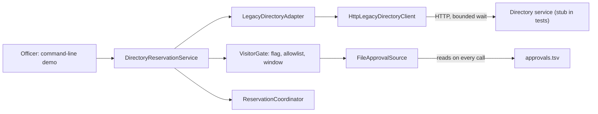
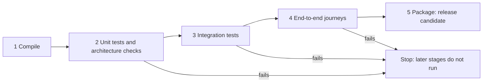
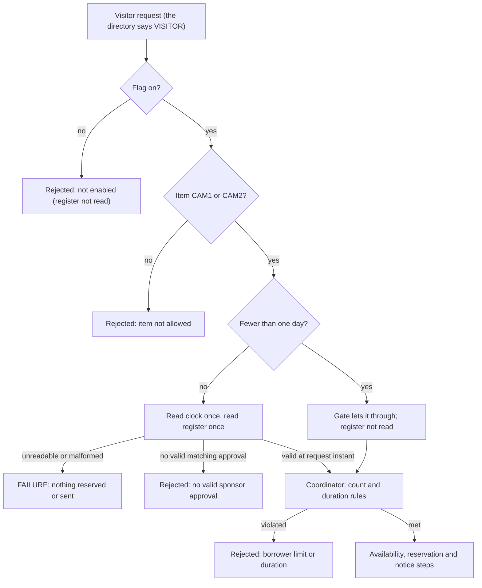

# Week 12: Continuous Delivery, Feature Flags & Contract Tests
### SE506: Object Oriented Development and Agile Practices
**Dr. Polla Abdulhamid Fattah**  
*Department of Computer Science & Artificial Intelligence*  
*University of Kurdistan Hewlêr (UKH)*

---

## 3-Hour Lecture Roadmap

* **Part 1: Boundary Risks and Test Scopes (0:00 - 0:30)**
  * The morning of Milestone 4; Defining boundaries where code meets the uncontrollable; Unit vs. Integration vs. End-to-End checks; Figure 13.1 boundaries.
* **Part 2: Real Integration & Contract Tests (0:30 - 1:05)**
  * Real file testing with `@TempDir`; Real HTTP testing with embedded stubs; The directory failure policy; The header-timeout trap & overall deadline fix; Contract tests.
* **Part 3: Deployment Pipelines & Quality Gates (1:05 - 1:40)**
  * The deployment pipeline concept (Humble & Farley); 5 sequential stages (Compile, Unit, Integration, E2E, Package); Quality gates; Reading pipeline failures.
* **BREAK (1:40 - 1:55)**
* **Part 4: Continuous Delivery & Feature Flags (1:55 - 2:25)**
  * Continuous Delivery vs. Continuous Deployment; Simulated release & smoke tests; Release toggles (`visitingResearchersEnabled`); Rollback realities (what is NOT undone).
* **Part 5: Verifying the Change: CR-12 in Action (2:25 - 2:45)**
  * The visitor evaluation order (Figure 13.3 flowchart); Mapping AC1-AC18 to tests; Regression suite safety; Preserving unresolved items (SD-11-1 & SD-12).
* **Part 6: AI Audits, Milestone 4 Delivery & Workshop (2:45 - 3:00)**
  * Auditing AI integration tests (the mock-at-the-boundary flaw); Milestone 4 8-point checklist; Lab steps B1-B4 & T1-T5; Preview of Week 13.

---

## Pedagogical Alignment & Module Context

* **Module Learning Outcomes:**
  * **LO3:** Apply Test-Driven Development (TDD), regression testing, and integration testing to maintain system stability during release.
  * **LO6:** Manage and structure modular software components, ensuring automated quality gates and dependable delivery pipelines.
* **Foundational Literature & Engineering Canon:**
  * Jez Humble & David Farley (2010): *Continuous Delivery: Reliable Software Releases through Build, Test, and Deployment Automation*.
  * Martin Fowler (1999/2013): *Integration Test*, *Contract Test*, *Deployment Pipeline*, *Feature Toggles*.
  * Pete Hodgson (2016): *Feature Toggles (aka Feature Flags)* (MartinFowler.com).
  * Robert C. Martin (2002): *Agile Software Development: Principles, Patterns, and Practices* (Testing Review).
* **Major Milestone Alert: Milestone 4 is Due This Week!**
  * Focus: Full absorption of CR-12, multi-stage automated pipeline, real boundary tests, and feature-flagged delivery.

---

# Part 1: Boundary Risks and Test Scopes

---

## The Morning of Milestone 4: When Laptop Demos Fail

* The developer implemented the visiting researcher feature:
  * Every in-memory unit test passed with flying colours.
  * The mock objects responded in nanoseconds.
* **On the morning of the demonstration, three disasters occur:**
  1. The sponsor file exported by the records office has a stray tab column: the parser crashes with an unhandled exception.
  2. The university LDAP directory server hangs: the officer's screen freezes for 40 seconds.
  3. The feature flag was toggled in code on the developer's laptop, but left off in the deployment config: the demonstration prints *"Rejected: not enabled"*.
* **The Lesson:**
  * None of these was a flaw in the borrowing policy math!
  * Every defect lived at a **boundary** where our code meets something it does not control.

---

## Defining an Architectural Boundary

* **What is a Boundary?**
  * A boundary is an interface where our software interacts with external mechanisms, resources, or environments:
    * A physical file on disk (permissions, formatting, locking).
    * A network socket (latency, packet loss, DNS failure, slow bodies).
    * Operating system properties and environment variables.
* **Why Unit Tests Cannot Protect Boundaries:**
  * In a unit test, you replace external collaborators with mocks, stubs, or in-memory collections.
  * By definition, **the unit test replaces the very boundary you need to verify!**
  * Unit tests prove internal logic; they cannot prove that the file parser handles disk errors.

---

## Choosing the Right Test Scope for the Risk

* Never write tests at random: match the check to the specific risk!

| Specific Failure Risk | Architectural Location | Cheapest Check That Detects It | What That Check Cannot Show |
|---|---|---|---|
| Validity window is off by one second | `ApprovalRecord` | **Unit test** with controlled instant | That real disk files are read correctly |
| Visitor served without approval | `VisitorGate` | **Acceptance test** with double | That exported TSV format matches assumptions |
| Sponsor file has stray column or bad date | `FileApprovalSource` | **Integration test** with real temporary file | That office exports look like test files |
| Directory service is slow or down | `HttpDirectoryClient` | **Integration test** with local HTTP stub | That production network has zero latency |
| Flag setting ignored at startup | Whole application | **End-to-End journey** in separate JVM | High-concurrency performance |
| Existing student rules broken | Cumulative core | **Regression suite** | Risks the old suite never covered |

---

## The CR-12 Architecture and Its Boundaries (Figure 13.1)



* **Three Distinct Levels of Verification:**
  1. **Unit Tests:** Stop at adapters using in-memory doubles.
  2. **Integration Tests:** Cross labelled boundaries using real file I/O and real loopback HTTP sockets.
  3. **End-to-End Journeys:** Execute the whole program in a separate JVM process.

---

## Narrow vs. Broad Integration Tests (Martin Fowler)

* Martin Fowler distinguishes two integration testing strategies:
* **Broad Integration Tests:**
  * Boot the entire application stack: real databases, external cloud APIs, messaging queues.
  * *Disadvantages:* Extremely slow, fragile, expensive to maintain, and brittle to network blips.
* **Narrow Integration Tests (Our Standard in SE506):**
  * Test ONLY the adapter code that communicates with the external boundary.
  * Exercise real filesystem I/O using JUnit `@TempDir`.
  * Exercise real HTTP networking using an embedded JDK `HttpServer` stub on `127.0.0.1`.
* **Result:** Millisecond execution speeds, 100% repeatability, zero external cloud dependencies!

---

# Part 2: Real Integration & Contract Tests

---

## The File Boundary: Testing with Real Files

* `FileApprovalSource` parses the sponsor TSV file from disk:
  * Reads the register afresh on every reservation call.
  * Validates the 8-column header and rejects malformed rows.
  * Rejects duplicate request keys within the register.
* **Testing without Mocks:**

```java
@Test 
void oneBadRowRejectsTheWholeRegisterEvenWhenTheRequestMatchesAGoodRow(
        @TempDir Path tempDir) throws IOException {
    Path file = tempDir.resolve("approvals.tsv");
    Files.writeString(file, HEADER + "\n" + GOOD_ROW + "\n" + MALFORMED_ROW);
    
    FileApprovalSource source = new FileApprovalSource(file);
    
    // An unreadable/corrupted file throws an operational exception!
    assertThrows(ApprovalSourceException.class, 
        () -> source.find("V1", "CAM1", START, END));
}
```

* Tests real disk reads, real UTF-8 decoding, and real tab splitting!

---

## Expected Rejections vs. Operational Failures

* A crucial architectural distinction in file boundary design:

| Scenario | What Happened | System Response | Observable Result |
|---|---|---|---|
| **No Matching Approval** | File is valid, but sponsor denied request or record is missing. | **Expected Rejection** (returns `Optional.empty()`) | User politely informed: *"Rejected: no valid sponsor approval."* |
| **Corrupted Register File** | File missing, syntax error on line 4, bad date format, disk unreadable. | **Operational Failure** (throws `ApprovalSourceException`) | Operation halts: *"Unavailable: approval register unreadable."* |

* **Golden Rule:** Never report a corrupted disk file as *"Your sponsor denied your request!"*
* An operational error means the system could not find out the truth!

---

## The Network Boundary: Embedded HTTP Stubs

* `HttpLegacyDirectoryClient` sends HTTP requests to resolve borrower categories:
  * Calls `GET /borrowers/{id}` on an HTTP server.
  * Expects a 200 OK with `kind\tstatus` (e.g., `V\tY`).
* **Why We Use an Embedded JDK Stub:**
  * Real corporate directories have unpredictable latency, downtime, and rate limits.
  * Java 17 includes `com.sun.net.httpserver.HttpServer`.
  * In integration tests, we spin up a local stub on an ephemeral port in 5 milliseconds!

```java
HttpServer stub = HttpServer.create(new InetSocketAddress("127.0.0.1", 0), 0);
stub.createContext("/borrowers/V1", exchange -> {
    byte[] response = "V\tY".getBytes(StandardCharsets.UTF_8);
    exchange.sendResponseHeaders(200, response.length);
    exchange.getResponseBody().write(response);
    exchange.close();
});
stub.start();
```

---

## Explicit Directory Failure Policies

* A resilient client must define its exact behaviour for every HTTP failure:

| Server Response | Client Failure Condition | Client Policy Action |
|---|---|---|
| **200 OK (`V\tY`)** | Normal response | Returns borrower kind & status |
| **404 Not Found** | Borrower absent from directory | Returns empty: borrower unknown |
| **500 Internal Error** | Remote server failure | Throws `DirectoryException`: outage |
| **Connection Refused** | Server is down or unreachable | Throws `DirectoryException`: outage |
| **Malformed Body** | Missing tab or extra fields | Throws `DirectoryException`: refuse to guess |
| **Timeout Exceeded** | Response takes too long | Throws `DirectoryException`: bounded wait |

* **The Policy:** Exactly **one attempt**, a **bounded wait**, **no retry**, and **no fallback default**!
* An outage must never look like an absent borrower.

---

## The Header-Timeout Trap

* The standard Java 17 HTTP Client allows a request timeout:
  ```java
  HttpRequest.newBuilder().timeout(Duration.ofMillis(300)).build();
  ```
* **The Fatal Trap:**
  * The Java specification states that `HttpRequest.timeout` covers the time until **response headers** are received!
  * What if a malicious or buggy server sends headers in 50ms, and then trickles the body one byte every 5 seconds?
  * The request timeout **never triggers**!
  * The client hangs for 40 seconds, freezing the application!
* **The Architectural Solution:**
  * Combine `HttpRequest.timeout` with an **asynchronous overall deadline**:
  ```java
  CompletableFuture<HttpResponse<String>> future = client.sendAsync(req, ...);
  try {
      return future.get(totalTimeoutMs, TimeUnit.MILLISECONDS);
  } catch (TimeoutException e) {
      future.cancel(true);
      throw new DirectoryException("Overall lookup deadline exceeded");
  }
  ```

---

## Asynchronous Deadlines & Slow-Loris Resiliency

* **The Slow-Loris Problem in Modern Microservices:**
  * When upstream legacy systems fail, they rarely crash cleanly with immediate TCP `RST`.
  * They degrade: accepting TCP connections, sending headers promptly, and then stalling on the payload.
  * In synchronous thread-per-request servers, stalled sockets consume worker threads, rapidly causing cascading system starvation.
* **Why `future.cancel(true)` is Crucial:**
  * Simply catching `TimeoutException` in the caller leaves the background I/O thread reading from the stalled socket!
  * Calling `cancel(true)` sends an interrupt signal to the underlying HTTP client engine, actively aborting the HTTP/1.1 exchange and closing the raw TCP connection.
* **Testing the Slow Server with JDK `HttpServer`:**
  * In `HttpLegacyDirectoryClientTest`, we configure our embedded test server handler to sleep for 500ms before sending response bytes.
  * The client's configured 150ms total deadline fires, throwing `DirectoryException` and asserting clean cancellation without thread leaks!

---

## Contract Tests: Interface vs. Provider Contracts

* What is a Contract Test?
* **1. Interface Contract Tests (Within Our Codebase):**
  * One abstract test suite `DirectoryClientContractTest` specifying required behaviour.
  * Run against BOTH `InMemoryDirectoryClient` AND `HttpLegacyDirectoryClient`.
  * Guarantees that the in-memory double behaves identically to the real HTTP client!
* **2. Provider Contract Tests (Consumer-Driven Contracts / Pact):**
  * A test suite run periodically against the real university LDAP server.
  * Verifies that the external vendor's payload format has not changed behind our backs.
  * In SE506, we document our assumptions about the real provider in ADR-013.

---

# Part 3: Deployment Pipelines & Quality Gates

---

## The Deployment Pipeline (Jez Humble & David Farley)

* In *Continuous Delivery* (2010), Humble and Farley defined the deployment pipeline:
  > *"At the most basic level, a deployment pipeline is an automated manifestation of your process for taking software from version control into the hands of your users."*
* **Core Architectural Principles of a Pipeline:**
  1. **Fail Fast:** Run cheap, fast checks first (compilation, unit tests). Run slow, expensive checks later (integration, E2E).
  2. **Every Build is a Release Candidate:** Any commit that passes the pipeline is theoretically releasable.
  3. **Stop the Line:** If any stage fails, the entire pipeline halts immediately. Never proceed to package or deploy a broken build!

---

## The 5 Pipeline Stages of SE506 (Figure 13.2)



* **Stage 1 (Compile):** `mvn compile` (fastest check).
* **Stage 2 (Unit & Architecture):** 203 fast in-memory tests + `jdeps` checks (~13s).
* **Stage 3 (Integration):** 26 tests against real files and HTTP stubs (~6s).
* **Stage 4 (E2E Journeys):** 3 full-process journeys in separate JVMs (~6s).
* **Stage 5 (Package):** `mvn package` producing the immutable `.jar` artifact (~4s).

---

## Pipeline Architecture: Runtime Budgets & Blast Radius

* **Designing Fast vs. Slow Feedback Loops:**
  * If a compile error or typo in domain logic takes 20 minutes to report, developers switch context and productivity plummets.
  * We budget our pipeline so Stage 1 and Stage 2 finish in under 20 seconds!

| Stage | Scope & Tooling | Target Runtime | Failure Blast Radius |
|---|---|---|---|
| **1. Compile** | `mvn compile` | $< 5$ seconds | Syntax, missing types, wrong imports |
| **2. Unit & Arch** | Fast JUnit 5, ArchUnit, `jdeps` | $< 15$ seconds | Domain logic regressions, layering violations |
| **3. Integration** | Real files (`@TempDir`), JDK HTTP stubs | $< 10$ seconds | File I/O parsing, socket timeouts, wire formats |
| **4. E2E Journeys** | Forked JVM CLI executions | $< 10$ seconds | Command parsing, process exit codes, output formatting |
| **5. Packaging** | `mvn package` (JAR assembly) | $< 5$ seconds | Manifest issues, missing runtime resources |

* **Total Pipeline Wall Clock:** $\approx 45$ seconds. Rapid, predictable, and local!

---

## Orchestrating Stages via Maven and JUnit 5 Tags

* How `scripts/pipeline.sh` selects specific test scopes:
  * In code: Annotate test classes with `@Tag("integration")` and `@Tag("e2e")`.
  * Stage 2 command:
    ```bash
    mvn test -DexcludedGroups=integration,e2e
    ```
  * Stage 3 command:
    ```bash
    mvn test -Dgroups=integration
    ```
  * Stage 4 command:
    ```bash
    mvn test -Dgroups=e2e
    ```
* **Surefire Quality Gate:**
  * In `pom.xml`, configure `<failIfNoTests>true</failIfNoTests>`.
  * If a typo occurs (e.g., `-Dgroups=integraiton`), the stage **fails immediately** rather than passing silently!

---

## How to Read a Pipeline Failure

* When a CI pipeline turns red, follow this 3-step senior engineering habit:
  1. **Identify the First Failing Stage:**
     * Ignore subsequent stages: they didn't run anyway.
     * Did it fail in Stage 2 (Unit), Stage 3 (Integration), or Stage 4 (E2E)?
  2. **Read the First Failing Test Name:**
     * The test name tells you what contract broke (e.g., `oneBadRowRejectsTheWholeRegister`).
  3. **Ask Why Earlier Stages Didn't Catch It:**
     * If an integration test failed on a stray tab in a file, why didn't Stage 2 catch it?
     * Because Stage 2 used in-memory mocks that never parsed real disk bytes!
     * This proves that Stage 3 is doing its job!

---

# BREAK (15 Minutes)

* Grab a coffee or tea.
* Reflect on:
  * Our pipeline runs unit, integration, and E2E checks in order.
  * When we return: How do we safely release features to production using **Feature Flags** and **Automated Rollback**?

---

# Part 4: Continuous Delivery & Feature Flags

---

## Continuous Delivery vs. Continuous Deployment

* These terms are often confused, but have a critical distinction:

| Delivery Practice | Definition | Release Mechanism |
|---|---|---|
| **Continuous Delivery (CD)** | Code is built, tested, and kept in a permanently deployable state. | **Manual / Business Decision:** Product owner decides when to release. |
| **Continuous Deployment** | Every commit that passes the automated pipeline is deployed to production. | **Fully Automated:** Direct release with zero human intervention. |

* In SE506, our pipeline ends with a tested, packaged Release Candidate JAR.
* We practice **Continuous Delivery**.
* We use a simulated deployment script (`scripts/simulate-release.sh`) to verify packaging and staging.

---

## Feature Flags (Pete Hodgson & Martin Fowler)

* **What is a Feature Flag?**
  * A software mechanism that modifies system behaviour without changing or redeploying code.
* **Our Release Toggle:** `lending.visitors` (default: `false`).
  * When `false`: All visitor requests are rejected explicitly; the approval file is never touched.
  * When `true`: The new visitor validation and approval path is active.
  * Student and staff paths are **completely identical under both settings**!

```java
public final class VisitorGate {
    private final boolean enabled;
    // ...
    public Optional<String> rejection(String borrowerId, String itemId, LocalDate start, int days) {
        if (!enabled) {
            return Optional.of("Rejected: visitor reservations are not enabled.");
        }
        // ... evaluate allowlist and sponsor approval ...
    }
}
```

---

## Testing Both Flag States: The Permutation Rule

* **The Anti-Pattern:** Only testing the feature flag with flag = `true`.
* **The Reality:**
  * When you ship to production, the flag will initially be `false`!
  * If the disabled path crashes or throws a null pointer, your release is broken on day one!
* **The Rule:**
  * Acceptance tests must verify behaviour under **BOTH flag settings**:
    * Test with flag = `false`: Assert explicit rejection without reading the register.
    * Test with flag = `true`: Assert full visitor workflow.
  * Student and staff tests run under both settings to prove zero regressions.

---

## Combinatorial Explosion: The Feature Toggle Tax

* **Martin Fowler's Feature Toggle Taxonomy:**
  * **Release Toggles:** Short-lived (days/weeks) to ship incomplete features to trunk safely.
  * **Experiment Toggles:** Medium-lived (A/B testing user conversions).
  * **Ops Toggles:** Long-lived circuit breakers to shed load during peak server strain.
  * **Permissioning Toggles:** Permanent feature tiers (e.g., Free vs. Enterprise).
* **The $2^N$ Test Explosion:**
  * In SE506, `visitingResearchersEnabled` is strictly a **Release Toggle**.
  * 1 flag = 2 states ($2^1$). 5 flags = 32 states ($2^5$). 10 flags = 1,024 test combinations!
  * If release toggles are not ruthlessly purged, test suites slow down and untestable state combinations cause unexpected production outages.
* **Best Practice:** Keep toggles at the perimeter (e.g. `VisitorGate`), not scattered across internal business logic methods.

---

## The Removal Plan: Flags as Technical Debt

* Every feature flag is temporary inventory with a carrying cost:
  * It adds conditional branches, extra test configurations, and cognitive overhead.
* **The Flag Lifecycle in ADR-013:**
  1. **Phase 1 (Creation):** Flag introduced, default `false`.
  2. **Phase 2 (Milestone 4 Delivery):** Flag enabled in production after successful smoke test.
  3. **Phase 3 (Stabilization):** Production operates with flag = `true` for 2 weeks with zero defects.
  4. **Phase 4 (Removal):** The flag, the `false` branch, and disabled tests are deleted in a dedicated cleanup commit!
* A feature flag without a removal plan is permanent technical debt.

---

## Rollback Realities: What Rollback Does NOT Undo

* In `scripts/simulate-release.sh`, we test automated rollback:
  * Reverting the current release to the previous known-good JAR.
* **The Engineering Truth about Rollback:**
  * Toggling a flag to `false` or rolling back a JAR stops *future* requests.
  * **Rollback does NOT undo state already committed to databases!**
  * It does not cancel confirmed reservations created while the flag was on.
  * It does not un-send email notifications already delivered to borrowers.
  * It does not un-print receipts.
* Acceptance Criteria **AC16** explicitly tests this: A visitor reservation created while the flag was on can still be checked out and returned even after the flag is turned off!

---

# Part 5: Verifying the Change: CR-12 in Action

---

## The Visitor Decision Precedence (Figure 13.3)



---

## Understanding Precedence: Which Error Triggers First?

* Look closely at the decision tree:
  * What if a visitor requests **MIC1 for 5 days**?
    * Item check fails first $\rightarrow$ *"Rejected: item not allowed"* (register is never read!).
  * What if a visitor requests **CAM1 for 4 days**, but the **approval register is corrupt**?
    * Register is read before coordinator duration check $\rightarrow$ Operation crashes with `ApprovalSourceException`!
  * What if a visitor requests **CAM1 for 0 days**?
    * Gate passes zero-day request to coordinator $\rightarrow$ Coordinator rejects with *"Rejected: borrower limit or duration"*.
* Order of evaluation is part of the observable contract and is protected by tests!

---

## Mapping AC1 to AC18 to Verified Tests

* In `VisitorAcceptanceTest`, all 18 criteria from Chapter 12 are automated:

| AC Group | Specific Acceptance Scenarios | Concrete Test Assertion |
|---|---|---|
| **Happy Path** | AC1, AC2 | CAM1/CAM2 for 1-3 days with valid approval confirms reservation & sends notice |
| **Duration & Item** | AC3, AC4, AC5 | 4 days rejected; 0 days rejected; MIC1 rejected (not on allowlist) |
| **Approval Match** | AC6, AC7 | Missing record, DENIED status, or mismatched item/dates rejected |
| **Time Windows** | AC8, AC9 | $t = \text{validFrom}$ accepted; $t = \text{validUntil}$ rejected (half-open window) |
| **Operational Error** | AC10 | Stray tab or bad header throws operational exception; zero state change |
| **Limit Rules** | AC11 | 3 existing reservations rejects booking even if loans returned |
| **Feature Flag** | AC12 | Flag `false` returns *"Rejected: not enabled"*; register never read |
| **Regression Safety**| AC13-AC18 | Students/staff unaffected; conflict rules preserved; notification failure retains record |

---

## Temporal Semantics: The Half-Open Interval Pattern (AC8 & AC9)

* **Why Time Windows Cause Subtle Production Bugs:**
  * When an approval states "valid from 2026-10-10 to 2026-10-15", what happens at midnight on the 15th?
  * If both endpoints are inclusive ($[start, end]$), two adjacent intervals $[10, 15]$ and $[15, 20]$ overlap on day 15!
  * If endpoints are open ($(start, end)$), day 10 is excluded.
* **The Domain Standard: Half-Open Interval $[validFrom, validUntil)$:**
  * **Start is inclusive:** $t \ge validFrom$.
  * **End is exclusive:** $t < validUntil$.
* **Pinned by Concrete Acceptance Tests:**
  * **AC8 (Exact Start Instant):** Request submitted at instant $t = validFrom$ is **ACCEPTED**.
  * **AC9 (Exact End Instant):** Request submitted at instant $t = validUntil$ is **REJECTED** ("approval expired").
  * This mathematical precision completely eliminates off-by-one errors and midnight boundary disputes!

---

## Regression Suite Safety Across Enum Expansion

* Adding `VISITOR` to `BorrowerCategory` had an architectural side effect:
  * The coordinator enforces that its constructor policy map must contain every category:
    ```java
    for (BorrowerCategory category : BorrowerCategory.values()) {
        if (!policies.containsKey(category)) throw new IllegalArgumentException(...);
    }
    ```
  * Adding `VISITOR` broke coordinator construction in 4 existing test fixtures!
* **How We Repaired It Without Changing Assertions:**
  * Updated those 4 fixtures to include `new VisitorReservationRules()` in their policy map.
  * **Not a single test assertion was modified!**
  * All 159 inherited tests passed cleanly.

---

## Keeping Unresolved Smells Honest

* What happens when a visitor returns a camera late?
  * The legacy overdue report receives a row with `kind = "V"`.
  * The overdue report only knows `"S"` and `"T"`!
  * The visitor falls into the "any other kind" branch and is charged **1.00/day with no grace and no cap**! (Suspected Defect SD-11-1).
* **The Senior Engineering Decision:**
  * We DO NOT silently patch the report to give visitors a 3-day grace period!
  * Only the university records office can set fine policies.
  * We write test **AC18** to document and pin this exact behaviour.
  * We record SD-11-1 and SD-12 in our Known Issues Register.

---

# Part 6: AI Audits, Milestone 4 Delivery & Workshop

---

## Auditing AI-Generated Integration Tests

* An AI assistant is asked to write an integration test for `FileApprovalSource`:
  ```java
  @Tag("integration")
  class ProposedRegisterIntegrationTest {
      @Test void anApprovedVisitorIsAcceptedFromTheRegister() {
          ApprovalSource register = mock(ApprovalSource.class); // MOCK!
          ApprovalRecord record = new ApprovalRecord(...);
          when(register.find("V1", "CAM1", start, end)).thenReturn(Optional.of(record));

          VisitorGate gate = new VisitorGate(register, clock, true);
          assertEquals(Optional.empty(), gate.rejection("V1", "CAM1", start, 2));
      }
  }
  ```
* **The Fatal Flaw:**
  * The test mocks `ApprovalSource`!
  * There is **no file on disk, no TSV parser, and no I/O** anywhere in this test!
  * If someone deletes the file parser entirely, this test **still passes 100%**!
  * It is a unit test masquerading under an integration test tag!

---

## Repairing the AI Integration Test

* To make it a true integration test, use the real adapter and real files:

```java
@Tag("integration")
class RepairedRegisterIntegrationTest {
    @Test void realFileRegisterParsesAndRejectsCorruptedRows(
            @TempDir Path tempDir) throws IOException {
        Path file = tempDir.resolve("approvals.tsv");
        // Write real TSV file to disk:
        Files.writeString(file, VALID_HEADER + "\n" + VALID_ROW + "\nCORRUPTED_ROW");
        
        // Instantiate the REAL file adapter:
        ApprovalSource realSource = new FileApprovalSource(file);
        VisitorGate gate = new VisitorGate(realSource, clock, true);
        
        // Assert that the real parser crashes on the corrupted disk row:
        assertThrows(ApprovalSourceException.class, 
            () -> gate.rejection("V1", "CAM1", start, 2));
    }
}
```

---

## Milestone 4 Delivery Checklist (Team Project)

* For your Milestone 4 submission this week, prepare these **8 essential deliverables**:

| # | Checklist Item | Required Engineering Evidence |
|---|---|---|
| **1** | Requirement Implementation | CR-12 absorbed behind feature flag; AC1-AC18 verified by tests. |
| **2** | Regression Safety | All inherited tests pass; disclosed fixture updates. |
| **3** | Real Boundary Tests | Real filesystem (`@TempDir`) or HTTP stub tested; failure modes covered. |
| **4** | Multi-Stage Pipeline | Passing CI pipeline; documented trace of reading a failing run. |
| **5** | Delivery & Rollback Record | Release candidate packaged; simulated rollback executed. |
| **6** | Feature Flag Evidence | Flag tested ON and OFF; documented removal conditions. |
| **7** | Demonstration & Retrospective | Working demo transcript; retrospective action item recorded. |
| **8** | Limits Statement | Explicit disclosure of unmodeled areas (e.g., concurrency, cloud CI). |

---

## Practical Lab Activity (Steps B1-B4 & T1-T5)

* **Book Project (Steps B1 - B4 - Run, Trace & Diagnose):**
  * **B1 (Run Pipeline):** Execute `bash scripts/pipeline.sh`; record test counts and stage times.
  * **B2 (Trace ACs):** Trace AC8/AC9 (window edges), AC10 (outage), and AC12 (flag) through the codebase.
  * **B3 (Break a Test):** Break `FileApprovalSource` header validation in a scratch copy; observe Stage 3 failure.
  * **B4 (Evidence Table):** Map risks to tests in a risk-vs-check matrix.
* **Team Project (Steps T1 - T5 - Milestone 4 Submission):**
  * **T1:** Implement your team's released change behind a feature flag (default `false`).
  * **T2:** Write narrow integration tests for your real file, database, or network boundary.
  * **T3:** Protect regression suite and test both flag states.
  * **T4:** Build and demonstrate an automated deployment pipeline.
  * **T5:** Execute rollback simulation and compile the Milestone 4 dossier.

---

## Common Pitfalls to Avoid in Milestone 4

* **Pitfall 1: Mocking boundaries in integration tests.**
  * Integration tests must touch real disk files or local sockets!
* **Pitfall 2: Confusing expected rejections with operational failures.**
  * A denied request returns a message; a corrupted file throws an exception.
* **Pitfall 3: Silently defaulting unknown categories.**
  * Never map an unrecognized directory code to Student.
* **Pitfall 4: Relying on `HttpRequest.timeout` alone.**
  * Combine header timeouts with asynchronous overall deadlines to prevent slow-body hangs.
* **Pitfall 5: Assuming rollback undoes historical data.**
  * Document that committed reservations and external notices persist after rollback!

---

## Week 12 Summary & Looking Ahead to Week 13

* **Key Takeaways Today:**
  * **Boundaries:** Where our code meets the uncontrollable; test without replacing them.
  * **Pipelines:** Order checks from cheapest (compile) to broadest (E2E journeys).
  * **Feature Flags:** Decouple deployment from release; test both paths and plan removal.
  * **Resilience:** Differentiate expected business rejections from operational system failures.
* **Looking Ahead to Week 13:**
  * **Chapter 14: Responding to Change, Handover & Engineering Reflection.**
  * Final system handover dossier (`docs/`), requirement-to-evidence matrix, technical reflection, and completing the module!

---

# Questions & Discussion
### SE506: Object Oriented Development and Agile Practices
**University of Kurdistan Hewlêr (UKH)**  
*Dr. Polla Abdulhamid Fattah*
