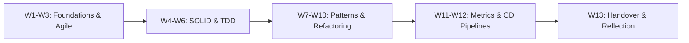
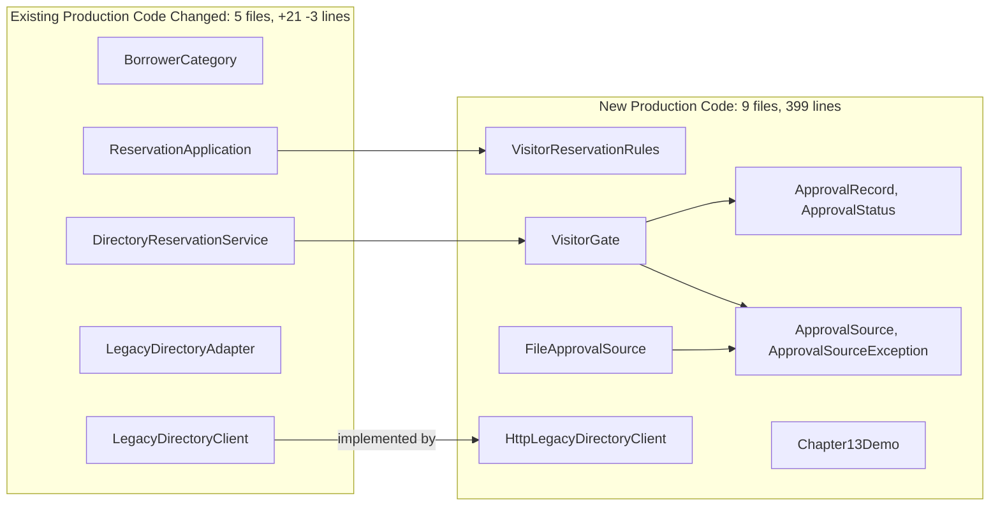
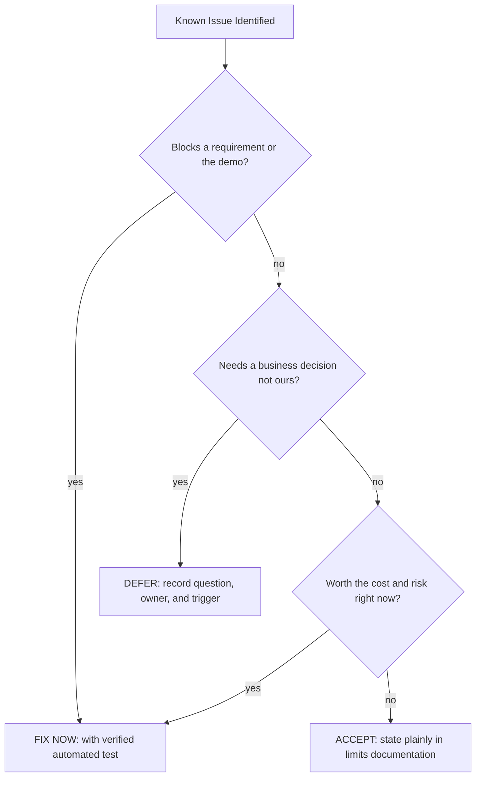
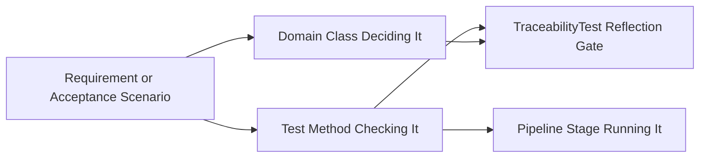
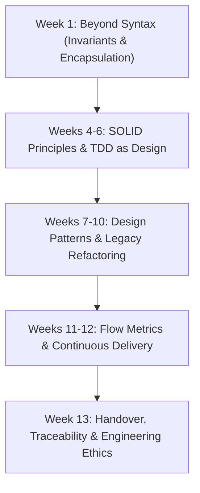

# SE506: Object Oriented Development and Agile Practices
### Week 13: Responding to Change, Handover & Engineering Reflection
**Dr. Polla Abdulhamid Fattah**  
*Department of Computer Science, University of Kurdistan Hewlêr*

---

## The Culmination of SE506



* **The Final Milestone:**
  * Software engineering is not judged solely by whether code compiles on the author's laptop.
  * It is judged by whether a stranger can set it up, verify its claims, understand who built what, and maintain it when requirements change.
* Today we complete the journey across **all learning outcomes (LO1 to LO6)**.

---

## Weekly Roadmap (Week 13)

* **Part 1: Reviewing the Change Outcome**
  * The 4 questions of change absorption, footprint analysis, and why a small diff is not automatically a better design.
* **Part 2: Defects, Polish & Scope Control**
  * The final-sprint triage rule (Fix, Defer, Accept), avoiding speculative polish, and Definition of Done.
* **Part 3: The Handover Dossier & Traceability**
  * One document per question, decision records (ADR-014), rehearsing flag removal, and automated traceability.
* **Part 4: Reproducible Setup & The Demonstration**
  * Dry-run findings in fresh checkouts, launcher scripts, and structuring the 10-minute technical demonstration.
* **Part 5: Retrospective & Qualitative Contribution Evidence**
  * Evidence-based retrospectives, why commit counts lie, and writing individual reflections with claims and links.
* **Part 6: AI Audits, Submission Preparation & Module Farewell**
  * Auditing AI-generated READMEs, the submission checklist, and final retrospective synthesis.

---

# Part 1: Reviewing the Change Outcome

---

## The Morning of the Final Presentation

* **A Familiar Software Engineering Nightmare:**
  * A reviewer clones your team repository from Git.
  * The README states: *"Run `mvn test`"*, but the reviewer's terminal reports `command not found: mvn`.
  * The README claims 200 passing tests; the build reports 232.
  * The requirements matrix links to a test method that was renamed last Friday.
  * The commit log credits 80% of lines to the student who committed the re-indented libraries!
* **The Lesson:**
  * None of these is a defect in your code.
  * Every single one is a defect in your **handover**: the evidence that allows a stranger to trust and operate your system.

---

## Evaluating Change Absorption: 4 Questions

* Saying *"Our design absorbed the change easily"* is an unverified feeling.
* In senior engineering, we answer **four specific questions**, backed by concrete evidence:

| Question | Concrete Evidence | Observable Blind Spot |
|---|---|---|
| **1. Which responsibilities changed?** | File diffs, additions, class responsibilities | Counts lines, not the architectural weight of a line |
| **2. What broke first?** | Failures after the smallest initial edit | Shows what tests cover, not unexercised assumptions |
| **3. Which assumptions failed?** | Pre-existing ADRs and documentation | Only reveals assumptions that were actually written down |
| **4. What did reviewers say?** | Pull request comments and author responses | Only as thorough as the reviewers' vigilance |

---

## The Production Code Footprint (Figure 14.1)



* The visitor change added **9 new classes** and modified only **5 existing classes**.
* Existing classes changed by an average of just **4 lines** each!

---

## Architectural Meaning of the Footprint

* **Evidence of the Open-Closed Principle (OCP):**
  * A new borrower rule required one new class (`VisitorReservationRules`) implementing the existing `BorrowingPolicy` interface.
  * A new approval source required one new port (`ApprovalSource`) and adapter (`FileApprovalSource`).
  * A new directory client implemented the existing `LegacyDirectoryClient` interface.
* **What Line Counts Hide:**
  * The 5 existing files that changed are the critical spine through which every request flows!
  * 9 new files mean 9 new mental models for maintainers to comprehend.
  * Design quality is measured by clean decoupling, not raw LOC.

---

## What Broke First? (The Coordinator Invariant)

* **The Experiment:**
  * Take the clean Chapter 11 checkpoint.
  * Make the smallest conceivable change: add `VISITOR` to the `BorrowerCategory` enum.
  * Touch nothing else. Run the test suite.
* **The Result:**
  * Over 25% of the test suite fails immediately!
  * The error is identical everywhere: `Missing policy: VISITOR`.
* **Why This is an Architectural Feature, Not a Bug:**
  * The `ReservationCoordinator` constructor asserts that every enum constant has an explicit policy in its map.
  * It fails fast at instantiation time rather than throwing a `NullPointerException` during a midnight production checkout!
  * The architectural safety net demanded an explicit decision for the new category.

---

## The Cost of the Invariant

* When `VisitorReservationRules` was wired into `ReservationApplication`, failures dropped from 50+ to 5 tests.
* The remaining 5 failures were in test fixtures that built their own custom policy maps:
  * `LegacyRegressionTest`
  * `BehaviourStrategyTest`
  * `RepositoryBoundaryTest`
* **The Engineering Trade-off:**
  * **Safety Benefit:** Impossible to deploy a category without an assigned policy.
  * **Maintenance Cost:** Every test fixture spelling out full maps must be updated when an enum expands.
  * **Verdict:** The safety net is worth the test fixture update cost.

---

## Why a Small Diff is Not a Better Design

* **The "One-Line Shortcut" Anti-Pattern:**
  * Suppose a developer implements visitors by editing `LegacyDirectoryAdapter`:
  ```java
  // Map visitor kind code 'V' directly to Staff!
  if ("V".equals(code)) return BorrowerCategory.STAFF;
  ```
  * The entire diff is exactly **one line of code**!
* **What Happens When We Run the Suite?**
  * **Every single unit test passes!**
* **What Fails?**
  * The **End-to-End journeys** and the **real directory integration tests**!
  * Journey 1: Visitors are confirmed even when the feature flag is `false`!
  * Journey 2: Unapproved visitors are admitted if items are free!
  * Journey 3: Corrupt approval registers are ignored!
* A small diff that violates domain requirements is technical debt, not elegance.

---

## Where the Design Bent: The `VisitorGate` Branch

* Does our finished system absorb visitors with 100% purity? No.
* In `DirectoryReservationService`, notice this conditional branch:
  ```java
  if (borrower.category() == BorrowerCategory.VISITOR) {
      Optional<String> rejection = visitorGate.rejection(
          borrower.id(), itemId, start, days);
      if (rejection.isPresent()) return rejection.get();
  }
  ```
* **Architectural Critique:**
  * This is an explicit `if (category == VISITOR)` branch inside a domain service.
  * For **one** special category, this pragmatic branch is readable and safe.
  * If a second category appears (e.g. `EXCHANGE_STUDENT`), this becomes a smell.
  * **Action:** We do not over-engineer a generic interception pipeline today. We document it as known issue **KI-14** with an explicit refactoring trigger!

---

# Part 2: Defects, Polish & Scope Control

---

## The Temptation of the Final Sprint

* In the final week before submission, teams often panic and try to fix everything:
  * *"Let's add an SQLite database so it looks more professional!"*
  * *"Let's add email notifications with real SMTP!"*
  * *"Let's clean up the code by deleting the feature flag!"*
* **The Danger:**
  * Late-breaking changes introduce untested failure modes hours before release.
  * Incomplete features invalidate the documentation and break passing pipelines.
* **The Senior Rule:**
  * The final sprint adds **zero new business features**.
  * It is dedicated to verification, triage, and handover evidence!

---

## The 3-Way Triage Rule (Figure 14.2)



* Every open issue must reach one of three documented terminal states:
  * **Fix:** Blocker addressed with regression test.
  * **Defer:** Documented question waiting on external owner.
  * **Accept:** Explicitly stated architectural limit.

---

## Triage in Action: The SE506 Experience

* In our worked system, we triaged **14 known issues** (`docs/KNOWN-ISSUES.md`):

| Issue ID | Description | Triage Decision | Rationale |
|---|---|---|---|
| **Demo Launch** | Demo required mock server only tests could boot | **FIXED** | Blocked the examiner from running the demo |
| **SD-11-1** | Visitor overdue fines default to 1.00/day uncapped | **DEFERRED** | Only University Records Office can set fines |
| **SD-12** | Cancelled reservations still count toward limit | **DEFERRED** | Requires domain policy owner decision |
| **KI-07** | Directory timeout is 1000ms uncalibrated | **ACCEPTED** | Production network latency unmeasured |
| **KI-14** | Hardcoded `if (VISITOR)` in reservation service | **ACCEPTED** | Premature to abstract before category #2 |

---

## Deliberate Fault Case Study: The SD-11-1 Dilemma

* **The Scenario:**
  * When a visitor returns equipment late, the legacy overdue report inspects `BorrowerCategory`.
  * The report only knows `"S"` (Student) and `"T"` (Staff).
  * Visitors fall into the fallback clause: fined **1.00 per day with zero grace period and no cap**!
* **The Temptation:**
  * A student developer wants to "fix" it by writing:
  ```java
  if (category == BorrowerCategory.VISITOR) fine = 0.50; // Guess!
  ```
* **Why This is an Academic and Professional Defect:**
  * The developer has invented university financial policy out of thin air!
  * You have hidden a business defect behind an unauthorized assumption.
  * **The Professional Action:** Keep the fallback, write test **AC18** pinning the exact behaviour, and defer the issue to the Records Office.

---

## Fowler's Four Costs of Premature Features (YAGNI)

* Martin Fowler articulates the four compounding costs of adding unrequested features:
  1. **Cost of Build:** Time spent coding and testing code nobody asked for.
  2. **Cost of Delay:** Time taken away from polishing handover, documentation, and verification.
  3. **Cost of Carry:** Every additional class must be read, compiled, and maintained forever.
  4. **Cost of Repair:** When the real requirement arrives, fixing incorrect speculative assumptions costs twice as much!
* In the final sprint, **Delay** and **Repair** will destroy your submission.

---

## The Definition of Done for a Release

* In Scrum, an increment is either **Done** or **Not Done**. There is no "95% Done".
* For SE506, the release candidate is **Done** when this objective checklist is satisfied:
  * [x] The 5-stage pipeline (`scripts/pipeline.sh`) passes locally.
  * [x] Zero tests are skipped or disabled.
  * [x] Handover verification script (`scripts/handover-check.sh`) passes in a clean directory.
  * [x] Every number in documentation matches actual test runs.
  * [x] Every decision record has an accepted or superseded status.
  * [x] Every known issue has a recorded triage outcome.
  * [x] Limits statement discloses all unmodeled environmental constraints.

---

# Part 3: The Handover Dossier & Traceability

---

## The Handover Dossier: One Document per Question

* A single 50-page monolithic document fails because different stakeholders ask different questions at different times:

| Document | Question Answered | How It Is Kept True |
|---|---|---|
| `README.md` | What is this, and where do I start? | Short; checked against clean clone |
| `docs/HANDOVER.md` | How do I build, test, and run this in 30 minutes? | `scripts/handover-check.sh` executes it |
| `docs/REQUIREMENTS-TO-EVIDENCE.md` | Which test checks each requirement? | `TraceabilityTest` enforces reflection match |
| `docs/KNOWN-ISSUES.md` | What is broken, missing, or deferred? | Reviewed by team; every item triaged |
| `docs/ADR-0NN-*.md` | Why is the architecture structured this way? | Immutable record; superseded, never edited |
| `docs/RELEASE-NOTES-*.md` | What changed between releases? | Keep a Changelog standard format |

---

## Architecture Decision Records: ADR-014

* An Architecture Decision Record captures **decisions**, not code descriptions.
* **The Nygard Structure (Extended for SE506):**
  1. **Title:** Numbered, descriptive (e.g. `ADR-014-visitor-flag-retention`).
  2. **Context:** Forces at play, trade-offs, and environmental constraints.
  3. **Decision:** Explicit statement of the chosen architecture.
  4. **Status:** Proposed, Accepted, or Superseded (never deleted!).
  5. **Consequences:** Positive benefits and negative carrying costs.
  6. **Alternatives Considered:** What other designs were rejected and why.
  7. **Validation:** Concrete tests proving the decision functions.
  8. **Revisit Triggers:** Explicit conditions under which this decision must be reconsidered.

---

## Rehearsing a Risky Removal: The Flag Experiment

* ADR-014 evaluated removing the `visitingResearchersEnabled` feature flag.
* **The Naive Assumption:** *"Removing a flag is just deleting one `if` statement!"*
* **The Reality (Rehearsed in a Scratch Branch):**
  * Removing the flag touched **11 files** (+87, -131 lines):
    * 3 production classes (constructor signatures, system property wiring).
    * 5 test classes (removing flag parameterizations).
    * Retiring acceptance test **AC12** (which explicitly tested flag=off rejection).
    * Updating the requirements traceability table and handover documentation!
* **The Senior Outcome:**
  * Because stakeholders had not yet formally approved the visitor feature, the team decided to **keep the flag default off**.
  * The removal patch was archived in `rehearsal/remove-visitor-flag.patch` ready for day-one activation!

---

## Requirements Traceability (Figure 14.3)



* **Traceability is an unbroken chain of evidence:**
  * Requirement: `AC8 (Instant of validity start is accepted)`.
  * Deciding Class: `VisitorGate.java`.
  * Verification Test: `VisitorAcceptanceTest.validityStartInstantIsAccepted()`.
  * Pipeline Stage: `Stage 3 (Integration)`.

---

## Keeping Traceability Honest: `TraceabilityTest`

* Documentation rots the moment a developer renames a test method.
* In SE506, we automate documentation verification with `TraceabilityTest`:
  ```java
  @Test void allDocumentedTestsMustActuallyExist() {
      List<TraceabilityRow> rows = TraceabilityParser.parse(
          Path.of("docs/REQUIREMENTS-TO-EVIDENCE.md"));
      for (TraceabilityRow row : rows) {
          Class<?> testClass = Class.forName(row.testClassName());
          assertNotNull(testClass.getMethod(row.testMethodName()),
              "Documented test method missing: " + row.testMethodName());
      }
  }
  ```
* If a student renames a test without updating the matrix, the build fails!

---

## The Limits of Automated Traceability Checks

* In our deliberate fault experiments, `TraceabilityTest` was tested against 6 faults:
  * **Fault 1:** Test method deleted $\rightarrow$ **CAUGHT** (Reflection failure).
  * **Fault 2:** Class renamed $\rightarrow$ **CAUGHT** (`ClassNotFoundException`).
  * **Fault 3:** Acceptance scenario omitted from table $\rightarrow$ **CAUGHT** (Row count check).
  * **Fault 4:** Pointing to an existing test that asserts the **WRONG** requirement $\rightarrow$ **NOT CAUGHT!**
* **The Lesson:**
  * Scripts can prove that a name exists.
  * Only a rigorous human engineer can verify that the test provides valid evidence!

---

## Release Notes: Keep a Changelog Standard

* Changelogs are written for humans, not git parsers.
* Follow the **Keep a Changelog 1.1.0** standard with standard categories:
  * **Added:** New capabilities (e.g. `FileApprovalSource` TSV reader).
  * **Changed:** Altered behavior in existing features.
  * **Deprecated:** Features slated for removal in future versions.
  * **Removed:** Deprecated code now deleted.
  * **Fixed:** Bug repairs made during this release.
  * **Security:** Vulnerability mitigations.
* **SE506 Specific Additions:**
  * **Behaviour you should know about:** (e.g. visitor fine fallback SD-11-1).
  * **Not verified:** (e.g. concurrency under multi-threaded load).

---

# Part 4: Reproducible Setup & The Demonstration

---

## Writing Setup Instructions for Someone Who is Not You

* On your development machine:
  * JDK 17, Maven 3.9, and Git are permanently installed on your PATH.
  * Local `.m2` repository contains all downloaded JARs.
  * Environment variables like `JAVA_HOME` are pre-configured.
* On the examiner's clean machine:
  * None of these assumptions can be taken for granted!
* **The Dry Run Test:**
  * We automate verification of our own setup documentation using `scripts/handover-check.sh`.
  * The script clones the repo into a clean directory, runs the build, and compares console output with documentation claims.

---

## Real Dry-Run Discoveries: What We Found

* When running `scripts/handover-check.sh` on a clean environment, four real defects were uncovered:

| Discovery | Impact on Reviewer | Engineering Resolution |
|---|---|---|
| **Missing `mvn` on PATH** | Script aborted with cryptic `command not found` | Added prerequisite check script reporting clear remedy |
| **Java 17 Unsafe Warnings** | Reviewer assumed build was failing due to ByteBuddy warnings | Added section: *"Console warnings that are safe to ignore"* |
| **Standalone Demo Failure** | Demo required directory server that only JUnit could start | Built `Chapter13Demo` launcher containing embedded stub |
| **Windows `.cmd` Path Issue** | Wrapper script checked executable bit, failing on Windows `.cmd` | Updated script to test file existence rather than POSIX permissions |

---

## The 10-Minute Technical Demonstration

* A demonstration is a structured, reproducible narrative, not random clicking.
* **Recommended 10-Minute Structure:**
  1. **Minutes 1-2 (The Context):** Problem domain, architecture overview, and the CR-12 change requirement.
  2. **Minutes 3-4 (The Pipeline):** Execute `bash scripts/pipeline.sh`; show 5 automated quality gates passing.
  3. **Minutes 5-7 (Live Feature Demo):** Run `bash scripts/demo.sh`; demonstrate visitor rejection with flag off, approval with valid token, and outage behavior.
  4. **Minutes 8-9 (Traceability Audit):** Pick one acceptance criterion (e.g. AC8) and follow the trace from table to code to test assertion.
  5. **Minute 10 (Limits & Handover):** Disclose unmodeled areas, open ADRs, and conclude.

---

## What a Dry Run Cannot Show

* Running a script in a local VM proves syntax and file layout.
* **It cannot prove:**
  * Behavior under real campus network firewalls.
  * A human reader misinterpreting ambiguous prose.
  * Cognitive friction during repository navigation.
* **The Human Verification Protocol:**
  * Have a classmate from a different team sit at your computer.
  * Hand them `docs/HANDOVER.md`.
  * **Sit on your hands and say nothing!**
  * Note every step where they pause, re-read, or express confusion. That is your bug report.

---

# Part 5: Retrospective & Qualitative Contribution Evidence

---

## The Sprint Retrospective: Evidence vs Mood

* **The Anti-Pattern Retrospective:**
  * *"Sprint 4 felt stressful, but everyone worked hard and we are happy."*
  * Zero metrics, zero root-cause analysis, zero accountability.
* **The Scrum Guide Contract (Schwaber & Sutherland):**
  * Inspect individuals, interactions, processes, tools, and Definition of Done.
  * Identify what went well and what went poorly.
  * Commit to actionable process improvements for the next iteration.
* **Kerth's Prime Directive:**
  * *"Regardless of what we discover, we understand and truly believe that everyone did the best job they could, given what they knew at the time."*

---

## Grounding Retrospectives in Concrete Artefacts

* Ground every retrospective discussion in observable team artefacts:

| Subjective Feeling | Concrete Engineering Artefact | Actionable Process Remedy |
|---|---|---|
| *"Code reviews took too long"* | PR #14 waited 74 hours before first comment | Implement 24-hour review SLA; review before coding |
| *"The test build was flaky"* | CI run logs show 2 socket timeout failures | Isolate integration tests; use fixed ports |
| *"We panicked on Sunday night"* | Git log shows 18 commits merged between 22:00 and 02:00 | Establish code freeze 48 hours prior to milestone |

* Commit to **at most two or three** high-impact actions. Ten unassigned actions guarantee zero progress.

---

## The Contribution Myth: Why Commit Counts Lie

* Assessment in SE506 is moderated by individual contribution.
* **The Naive Measurement:** Ranking students by raw commit counts or lines of code.
* **A Synthetic Case Study (3-Person Team):**

| Team Member | Commits | Formatting Commits | Lines Changed | PR Reviews Given | Reviews Requesting Changes |
|---|---|---|---|---|---|
| **P1** | 38 | 17 | 410 | 4 | 1 |
| **P2** | 9 | 0 | 1,150 | 11 | 5 |
| **P3** | 24 | 3 | 620 | 7 | 0 |

---

## Deconstructing the Numbers

* Look at what happens when you rank the teammates:
  * By **Commit Count:** P1 (38) $\rightarrow$ P3 (24) $\rightarrow$ P2 (9).
  * By **Lines of Code:** P2 (1,150) $\rightarrow$ P3 (620) $\rightarrow$ P1 (410).
  * By **PR Reviews:** P2 (11) $\rightarrow$ P3 (7) $\rightarrow$ P1 (4).
  * By **Defects Caught:** P2 (5) $\rightarrow$ P1 (1) $\rightarrow$ P3 (0).
* **The Reality Behind the Numbers:**
  * P1 made 17 formatting commits and several commits undoing prior work.
  * P2 designed the core approval-file parser in 9 focused commits and conducted thorough code reviews.
  * P3 authored the handover documentation and paired with P1 on the pipeline.
* Counts reflect git habits, not software engineering contribution!

---

## Writing Individual Reflections: Claims with Evidence

* Do not write: *"I was responsible for backend development and contributed significantly."*
* Write **verifiable claims supported by repository links**:

| Reflection Dimension | Concrete Verification Evidence |
|---|---|
| **What I Built** | *"Implemented `FileApprovalSource` ([commit `a81f3c`](#)) and wrote 14 boundary unit tests ([`FileApprovalSourceTest.java`](#))."* |
| **What I Decided** | *"Authored ADR-014 ([`docs/ADR-014.md`](#)); chose to retain feature flag rather than delete it prematurely."* |
| **What Failed & How I Fixed It** | *"My TSV parser crashed on Windows `\r\n` linebreaks (Issue #12); repaired with universal regex splitter."* |
| **How I Used AI** | *"Prompted LLM for regex; rejected initial suggestion because it failed whitespace preservation; wrote manual test."* |
| **Honest Limits** | *"Did not implement concurrent file locking; documented as limitation in `KNOWN-ISSUES.md`."* |

---

# Part 6: AI Audits, Submission Preparation & Module Farewell

---

## Auditing AI-Generated README Documents

* In modern practice, developers often ask an AI: *"Write a README for my repository."*
* An assistant generated this draft for our lending project:
  ```markdown
  # Campus Equipment Lending System
  A Java 11 application for equipment lending.
  Quick start:
  1. Build: mvn package
  2. Run: java -jar target/equipment-lending.jar
  Features:
  - Visiting researchers are enabled by default. Set -Dlending.visitors=false to turn off.
  - Directory retries 3 times on timeout and defaults to Student.
  - Production-ready and thread-safe.
  ```
* **The Audit Challenge:** Which statements are **supported**, **contradicted**, or **unverified**?

---

## Deconstructing the AI Hallucinations

* **Claim 1: "Java 11 application"**
  * $\rightarrow$ **CONTRADICTED:** Project uses Java 17 records and pattern matching!
* **Claim 2: "Visiting researchers enabled by default"**
  * $\rightarrow$ **CONTRADICTED:** ADR-014 mandates flag defaults to `false`!
* **Claim 3: "Retries 3 times and defaults to Student"**
  * $\rightarrow$ **DANGEROUSLY CONTRADICTED:** Chapter 8 & 13 explicitly ban retries and silent defaults; an outage throws `DirectoryException`!
* **Claim 4: "Production-ready and thread-safe"**
  * $\rightarrow$ **UNESTABLISHED:** System was never tested under concurrent multi-threaded load!
* **Lesson:** A plausible README is more dangerous than an empty one because reviewers stop checking facts.

---

## The 5 Pillars of the Final Submission Report

* Your technical submission report must be structured around **five core pillars of evidence**:
  1. **Clean Object-Oriented Design:** Clear encapsulation, invariants, and package decoupling.
  2. **Justified Patterns & Architecture:** Explicit ADR justification for Strategy, State, Observer, and Layering.
  3. **Automated Testing & CI Pipeline:** 5-stage pipeline, unit/integration/E2E test split, zero skipped tests.
  4. **Safe Refactoring Under Legacy Code:** Feathers seams, characterisation tests, and defect pinning.
  5. **Adaptability to Requirements Change:** Clean absorption of CR-12 behind feature gates without regression.

---

## Practical Lab Activity (Steps B1-B4 & T1-T5)

* **Book Project (Steps B1 - B4 - Run, Trace & Diagnose):**
  * **B1 (Measure What Breaks):** Remove visitor policy from composition root; record test failure cascade.
  * **B2 (Triage Exercise):** Select 5 items from `KNOWN-ISSUES.md`; evaluate triage rationale.
  * **B3 (Dry-Run Verification):** Run `bash scripts/handover-check.sh` in clean directory.
  * **B4 (Break Traceability):** Rename a test method; observe `TraceabilityTest` failure report.
* **Team Project (Steps T1 - T5 - Final Handover Submission):**
  * **T1:** Complete the 4 change absorption questions with team evidence.
  * **T2:** Triage all open bugs into Fix, Defer, or Accept. Freeze code!
  * **T3:** Compile the Handover Dossier (`README`, `HANDOVER`, `REQUIREMENTS`).
  * **T4:** Author ADRs for feature flag and architectural decisions.
  * **T5:** Hold evidence-based retrospective and draft individual reflections.

---

## Summary of the Module: From Syntax to Mastery



* You began this course writing object-oriented syntax.
* You finish this course as professional software engineers:
  * Designing systems that embrace change.
  * Guarding domain logic with automated evidence.
  * Delivering robust software that strangers can operate with confidence.

---

# Questions & Discussion
### SE506: Object Oriented Development and Agile Practices
**University of Kurdistan Hewlêr (UKH)**  
*Dr. Polla Abdulhamid Fattah*
