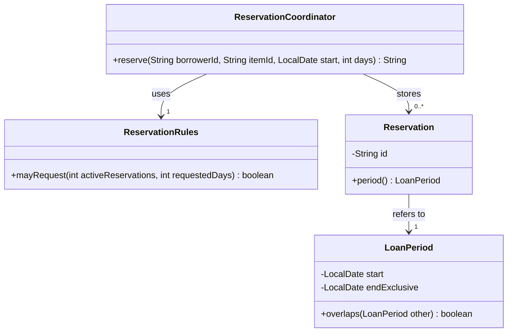

# Appendix A
# Programming Readiness and Notation

*OO Development and Agile Practices*  
*Designing, Testing and Evolving Software with AI Assistance*  
Version 1.0 • 13 October 2026

## How to use this appendix

You can understand a design decision only if you can follow the code that expresses it. This appendix supplies a short diagnostic and a reference for the Java and diagram notation used in the book. It assumes previous programming experience; it is not a first programming course.

Start with A.1. Revise the sections that address your gaps, then return to the chapter. Use A.8 beside Chapter 2's longer class-diagram exercises. Records, streams and `Optional` can wait until a chapter uses them.

The language and API baseline is **Java 17 without preview features**. The syntax here describes the book's examples, not permissions for an examination. Your approved assessment instructions decide what tools and notation you may use. Appendix B covers installation and the wider toolchain; Appendix D covers project checkpoints and domain terminology.

`Appendix_A_Code_Explanations_and_Solutions.md` contains complete runnable files, diagnostic answers and a diagram solution. Its small lab is separate from the cumulative lending project. It neither changes the project nor depends on a particular Chapter 11 baseline.

## A.1 Readiness diagnostic

Try these before opening the answers. Explain your reasoning as well as giving a result. Java fragments in this diagnostic are reading exercises; the companion supplies their executable context.

### D1. Trace a boundary

```java
boolean mayRequest(int count, int days) {
    return count >= 0 && count < 3 && days >= 1 && days <= 7;
}
```

What does it return for `(2, 7)`, `(3, 7)`, `(0, 0)` and `(-1, 2)`? What changes if `< 3` becomes `<= 3`? Does a result of `true` mean a camera has been reserved?

### D2. Follow two references

```java
List<String> first = new ArrayList<>();
List<String> second = first;
second.add("CAM1");
second = new ArrayList<>();
```

What does `first` contain at the end? Which statement changes an object and which changes a variable?

### D3. Distinguish identity from value

```java
String left = new String("CAM1");
String right = new String("CAM1");
```

Predict `left == right` and `left.equals(right)`. Why would two equal borrower identifiers not necessarily mean two variables refer to the same object?

### D4. Read `final` precisely

```java
final List<String> items = new ArrayList<>();
items.add("CAM1");
```

Does this compile? Would `items = new ArrayList<>();` compile afterwards? Does `final` make the list immutable?

### D5. Trace a snapshot

```java
List<String> source = new ArrayList<>(List.of("CAM1"));
List<String> snapshot = List.copyOf(source);
source.add("CAM2");
```

What does each list contain? What happens if you call `snapshot.clear()`? Would the copy protect fields inside a mutable element?

### D6. Protect an invariant

A loan period has a start date and an exclusive end date. Which inputs should its constructor reject? Do `[20 October, 22 October)` and `[22 October, 24 October)` overlap?

### D7. Identify the method that runs

```java
BorrowingPolicy policy = new StudentRules();
boolean allowed = policy.mayRequest(2, 7);
```

Which type describes the variable? Which class supplies the implementation? Does declaring an interface automatically establish that the implementation obeys the borrowing rule?

### D8. Classify three failures

Classify each as a compile-time problem, a run-time failure or a wrong result:

- Calling `period.intersects(other)` when `LoanPeriod` declares only `overlaps`.
- Calling a method through a null reference.
- Changing the reservation limit comparison from `< 3` to `<= 3`.

### D9. Preserve the meaning of failure

A directory lookup can find no borrower or fail because the service is unavailable. Why is catching every exception and returning “borrower not found” misleading? What does `throws IOException` require a caller to consider?

### D10. Review a diagram after Chapter 2

A department keeps zero or more equipment items. Each item belongs to exactly one department at a time. One item may have several reservations; each reservation concerns exactly one item. Reservations have identifiers and periods. Draw those three classes and their multiplicities. Does this description justify a filled composition diamond?

### Choose a revision route

| If you struggled with… | Revisit | Evidence that the gap is closing |
|---|---|---|
| D1 | A.2 | Trace both sides of a boundary and state what the method does not do. |
| D2–D5 | A.3–A.4 | Explain the difference between changing a reference and changing its object. |
| D6 | A.3 and A.6 | Reject invalid periods and explain adjacency. |
| D7 | A.5 | Follow a call through an interface to an implementation. |
| D8–D9 | A.7 | Separate an ordinary result from invalid input and operational failure. |
| D10 | A.8 and Chapter 2 §2.6 | Read each multiplicity in both directions and justify the relationship. |

There is no pass mark. Record the topic to revisit and the example you can now explain. D10 is revision after the notation lesson, not a prerequisite for opening Chapter 1.

## A.2 Reading a small Java method

In `public boolean mayRequest(int count, int days)`, `public` describes access, `boolean` is the result type, `mayRequest` is the name, and the two named `int` parameters receive the supplied values. `return` ends the method and supplies its result. A `void` method supplies no result value.

| Syntax | Meaning here | Common mistake |
|---|---|---|
| `int count = 2;` | Declare and initialise an integer variable. | Confusing assignment `=` with comparison `==`. |
| `count < 3` | Compare two numbers. | Using the limit after addition when the input count is before addition. |
| `a && b` | Require both; evaluate `b` only if `a` is true. | Treating `&` as an interchangeable spelling. |
| `a || b` | Require at least one; evaluate `b` only if `a` is false. | Assuming both expressions always run. |
| `!allowed` | Negate a Boolean value. | Negating the wrong part of a longer condition. |
| `if (...) { ... } else { ... }` | Select a branch. | Believing indentation controls Java's blocks. |
| `for (String id : ids)` | Visit each element of the iterable in its encounter order. | Assuming every collection has the same ordering guarantee. |

Use parentheses when grouping is difficult to read. For example, `id != null && !id.isBlank()` avoids invoking `isBlank()` when `id` is null because `&&` short-circuits. This is a specific guard, not a general solution to missing values. Java's evaluation and operator rules are defined in [1].

A variable declared within a method is local to its scope. A field belongs to a class or an object and may outlive one call. When tracing code, write down both the local values and the object state that a later call can observe.

## A.3 Classes, constructors and references

An instance method operates on a particular object. `this` refers to that object. A constructor establishes its initial state and has the class's name with no return type. A `static` method belongs to the class and has no instance `this`. These mechanisms say how code runs; they do not decide whether a responsibility belongs in that class [2].

The companion's `LoanPeriod` checks its invariant in the constructor. This is a **constructor excerpt**, with fields and accessors supplied in the complete file:

```java
public LoanPeriod(LocalDate start, LocalDate endExclusive) {
    this.start = Objects.requireNonNull(start, "start");
    this.endExclusive = Objects.requireNonNull(endExclusive, "endExclusive");
    if (!start.isBefore(endExclusive)) {
        throw new IllegalArgumentException("End must be after start.");
    }
}
```

Passing a reference copies the reference value; Java does not pass the caller's variable itself. A method can use that reference to mutate a mutable object. Reassigning the method's parameter does not reassign the caller's variable. D2 is the same distinction within one method.

For references, `==` compares identity. `equals` follows the class's equality implementation. The companion's ordinary `LoanPeriod` does not override `equals`; two separate periods with identical dates therefore do not become equal automatically. Compare their values deliberately, or design an equality contract when the domain needs one. Never assume a domain identifier and Java object identity are the same concept.

### Reading access and modifiers

| Form | Reading |
|---|---|
| `public` | Accessible where the enclosing type and module rules permit. |
| `private` | Restricted to the declaring top-level class and its nested classes. |
| No access modifier | Package access. It does not mean public. |
| `protected` | Package access plus subclass access, subject to Java's subclass rules. |
| `final` variable | May be assigned only once; a referenced object can still be mutable. |
| `final` class | Cannot be subclassed. |
| `final` method | Cannot be overridden. |
| `abstract` class | Cannot be instantiated directly; may supply both implemented and abstract operations. |

Chapter 2 develops encapsulation and information hiding. Keep those design ideas separate from memorising keywords.

## A.4 Collections, copying and small functional expressions

`List<Reservation>` describes a list whose element type is `Reservation`; angle brackets express a generic type argument. `new ArrayList<>()` supplies a mutable list implementation. Declaring against `List` gives callers a different commitment from exposing `ArrayList` specifically.

| Expression | Useful interpretation |
|---|---|
| `List.of("CAM1", "CAM2")` | An unmodifiable list containing those values. |
| `new ArrayList<>(items)` | A mutable copy of the list structure. |
| `List.copyOf(items)` | An unmodifiable snapshot of the element references. |
| `items.size()` | Number of elements, not a count of completed loans or eligible borrowers. |
| `items.get(0)` | First element; fails if the list is empty. |

`List.of` and `List.copyOf` reject null elements. A snapshot does not follow later structural changes to its source. It also does not deep-copy elements. These distinctions matter when a class returns a collection to its callers [3].

Later chapters use lambdas and streams. Read the following **equivalent counting excerpts** before deciding which is clearer for the task:

```java
long cameras = 0;
for (String id : ids) {
    if (id.startsWith("CAM")) {
        cameras++;
    }
}
```

```java
long cameras = ids.stream()
        .filter(id -> id.startsWith("CAM"))
        .count();
```

`id -> ...` supplies a small function. Here, `filter` selects matching elements and `count` performs the terminal operation. This expression does not remove nonmatching entries from `ids`. A method reference such as `wanted::overlaps` supplies a compatible operation on an existing object. Prefer a loop when it makes a state change or failure path easier to follow.

## A.5 Interfaces, overriding and the later Java idioms

The companion defines `BorrowingPolicy` and a `StudentRules` implementation. The declaration `BorrowingPolicy policy = new StudentRules();` lets the caller use the interface's operation while the object's class supplies its implementation. `@Override` asks the compiler to check that a declaration overrides or implements an inherited operation. It does not test the operation's meaning [4].

**Overloading** provides methods with the same name and different parameter lists. **Overriding** supplies an implementation of an inherited instance method. A call's declared types help select an overload; the receiving object's run-time class matters for an overridden instance method. Chapter 5 examines the behavioural obligations that syntax cannot enforce.

The following is the appendix's reading scope, not an examination rule:

| Idiom | Depth | What to recognise |
|---|---|---|
| Classes, interfaces, constructors, enums and generics | Core | Read declarations and follow ordinary calls. |
| Lambdas, method references and simple streams | Working knowledge | Explain a short expression; expand it to ordinary steps. |
| Records | Working knowledge when encountered | A compact data-carrier class with component accessors and generated value methods. |
| `Optional<T>` | Working knowledge when encountered | A result explicitly containing a value or no value. |
| `var` | Reading knowledge | Local type inference; the type remains fixed at compile time. |
| Arrow-form `switch` expressions | Reading knowledge | Select a result without the traditional case fall-through. |
| Sealed types and advanced type patterns | Awareness only here | No dependency on them in this appendix. |
| Preview syntax and APIs newer than Java 17 | Outside this appendix | Do not introduce them into its runnable files. |

A record such as `record Request(String borrowerId, int days) {}` receives accessors named `borrowerId()` and `days()`, together with generated `equals`, `hashCode` and `toString`. Records are final; their component fields are final. A component can still refer to a mutable object, so a record is not automatically deeply immutable. A compact constructor can validate its arguments [5].

`Optional.empty()` should mean the absence specified by the operation's contract. Calling `get()` on an empty optional throws. Inspect it, transform it or provide an appropriate alternative; do not use “empty” to conceal a failed lookup. For a present value, `Optional.of` requires non-null; `ofNullable` can convert a nullable value into present or empty [6].

`var` is useful where the initializer makes the type clear; it is not a dynamically typed variable. The companion demonstrates an enum, a switch expression and a record in executable context. You need not rewrite earlier ordinary classes into records to follow the book.

## A.6 Dates and the interval convention

`LocalDate` represents a date without a time or time zone and is immutable. `start.plusDays(2)` returns a date; it does not modify `start` [7]. The book's reservation periods are **start inclusive, end exclusive**, written `[start, end)`.

| First period | Second period | Overlap? |
|---|---|---|
| `[20 Oct, 22 Oct)` | `[21 Oct, 23 Oct)` | Yes |
| `[20 Oct, 22 Oct)` | `[22 Oct, 24 Oct)` | No |
| `[20 Oct, 22 Oct)` | `[20 Oct, 22 Oct)` | Yes |

For valid nonempty periods, overlap is expressed by both strict comparisons:

```java
// Method-body excerpt from LoanPeriod.overlaps.
return start.isBefore(other.endExclusive)
        && other.start.isBefore(endExclusive);
```

Use `Instant` for a point on the time line and an injected `Clock` when tests need a controlled “now”, as later chapters do. A date and an instant answer different questions. Do not turn a calendar-day loan into an assumed fixed number of elapsed hours without an explicit time-zone policy.

## A.7 Exceptions and evidence of a failure

An exception transfers control away from the ordinary return path. `throw` raises one; `throws` declares possible propagation from a method. Checked exceptions must be caught or declared where Java's rules require it. `RuntimeException` subclasses and `Error` subclasses are unchecked [8].

| Situation | Example | What the caller needs to know |
|---|---|---|
| Ordinary negative result | No matching borrower found | The lookup completed and found no match. |
| Invalid argument | End date is not after start | The caller supplied an invalid period. |
| Operational failure | Approval file could not be read | The decision could not be completed. |
| Assertion failure | A check expected rejection but saw approval | The observed result disagrees with the check. |

The choice between a result and an exception belongs to the operation's contract. Chapter 1 deliberately returns `false` for a negative count; the period constructor rejects invalid dates. Read the particular contract instead of assuming every invalid input has the same treatment.

The companion includes this **complete method**, with its imports and containing class provided there:

```java
static String readFirstLine(Path path) throws IOException {
    try (var reader = Files.newBufferedReader(path, StandardCharsets.UTF_8)) {
        return reader.readLine();
    }
}
```

The resource closes when the block exits, including exceptional exit. A file-reading failure propagates as an `IOException`; this method does not substitute “no borrower”. An empty file returns null because that is `readLine`'s contract. Interpret that result at the appropriate boundary.

Read an error in context: identify the operation, the exception type, the first relevant frame in your code and any cause. Catch an exception where you can handle it meaningfully or translate it into the declared boundary contract. Catching everything simply to make the program continue can destroy the information needed to diagnose it.

## A.8 UML and Mermaid notation reference

UML describes modelling concepts; Mermaid is the text notation used to render diagrams in this book. Mermaid supports a useful subset and does not enforce every UML semantic rule. A successfully rendered diagram can still describe the wrong design [9, 10].

### Class compartments and member notation

| Meaning | Conventional UML form | Book's Mermaid form |
|---|---|---|
| Private attribute | `- start : LocalDate` | `-LocalDate start` |
| Public operation | `+ overlaps(other : LoanPeriod) : Boolean` | `+overlaps(LoanPeriod other) boolean` |
| Interface | Interface annotation | `<<interface>>` inside the class declaration |
| Generic type | A parameterised type | `List~Reservation~` in a member label |
| Visibility | Public, private, protected, package | `+`, `-`, `#`, `~`, respectively |

Keep one convention within a diagram. Omit implementation details that are irrelevant to its question. Missing members in a selective diagram are not evidence that the members do not exist.

### Relationships and arrow direction

The strings in the following table are **Mermaid source syntax**, not diagrams made from text characters. The renderer supplies the actual symbols.

| Relationship | Mermaid declaration | Meaning and review question |
|---|---|---|
| Association | `A --> B : holds` | A structural link, navigable from A to B. Does the design retain that link? |
| Association with navigation unspecified | `A -- B` | A link without a stated navigation direction; do not infer that both Java classes have fields. |
| Dependency | `A ..> B : uses` | A uses B. A method-only use often needs no stronger relation. |
| Shared aggregation | `Whole o-- Part` | A grouping claim, with a hollow diamond at the whole. Its precise meaning needs the model's explanation. |
| Composite aggregation | `Whole *-- Part` | Strong whole/part ownership, with a filled diamond at the whole. Is exclusive composite ownership and lifecycle intent actually specified? |
| Generalisation / inheritance | `Base <\|-- Derived` | The hollow triangle points to the general type. Does Derived meet Base's behavioural obligations? |
| Interface realisation | `Contract <\|.. Implementation` | The hollow triangle points to the interface; the line is dashed. Does the class implement that contract? |

A dependency need not mean “no field exists”: an association also implies reliance on another type. The diagram normally shows the more informative structural relationship rather than duplicating it with a second line. Navigation expresses a modelling decision and can be implemented in more than one way.

Neither `private`, `final` nor construction with `new` proves UML composition. Garbage collection is not a domain lifecycle rule. A shared immutable period needs no filled diamond merely because a reservation refers to it. Use plain association when the stronger claim is unsupported.

### Multiplicity: look at the far end

| Label at an end | Number of objects at that end for one object at the other end |
|---|---|
| `1` | Exactly one |
| `0..1` | None or one |
| `0..*` or `*` | Zero or more |
| `1..*` | One or more |

A Java `List<T>` does not by itself enforce a minimum size, uniqueness or exclusive ownership. A reference type does not by itself exclude null. The constructor, operations and domain rules supply those obligations.

Figure A.1 is a selective reading of Chapter 2's reservation structure. It specifies the multiplicities needed in the indicated direction; omitted opposite-end numbers are not claims about exclusive ownership.



**Figure A.1.** One coordinator uses one rules object and stores zero or more reservations; each reservation refers to one period. This is a diagram reference to Chapter 2, not another cumulative source-code checkpoint. The appendix lab uses `StudentRules` to demonstrate an interface separately.

### Read different diagram kinds differently

| Diagram | What its edges mean in this book | What not to infer |
|---|---|---|
| Class diagram | Structural relationships or type dependencies | Execution order. |
| Sequence diagram | Messages in a scenario, read down the page; `alt` separates alternatives | Every possible path or real network traffic unless stated. |
| State diagram | Permitted transitions between states | A Java subclass for every state. |
| Flowchart | Steps and decisions in a process | Automatically enforced source-code dependencies. |
| Package/dependency view | Which part depends on which other part, as defined by the caption | The opposite direction merely because a callback returns control. |

Mermaid sequence syntax includes `participant`, messages such as `Caller->>Service: request`, return messages such as `Service-->>Caller: result`, and blocks closed with `end` [11]. Treat each diagram's caption as part of its meaning.

To check a diagram: name its question, read every relationship aloud, justify each multiplicity, compare shown operations with their source, and trace any claimed order. Use top-down layouts for wider structures. A diagram is finished when it explains the intended relationship clearly, not when it contains every class.

## A.9 A short verification activity

Complete D1–D9, then run the companion lab or trace it on paper. Select one mistaken assumption from your answers and explain which check exposes it. After Chapter 2, attempt D10 and compare your diagram with the solution.

**Optional AI activity, with an identical offline route.** The following is an author-constructed candidate explanation:

> “The list is final, so callers cannot clear it. Copying a list makes all its elements immutable. Every object created in a constructor should have a composition diamond.”

Classify its three claims and correct each using the code or the stated modelling rule. A live assistant may produce a different candidate if permitted, but is not required. Record the claim, your check and your conclusion. Do not use another unsupported explanation as the final evidence.

The exit artefact is a short personal readiness note: topics checked, one corrected explanation and any remaining revision. This is formative study guidance and adds no assessment requirement.

## Sources and further reading

Official references checked on 13 October 2026. The explanations and exercises above are original; source examples have not been reproduced.

1. Oracle, [Java Language Specification, Java SE 17, Chapter 15: Expressions](https://docs.oracle.com/javase/specs/jls/se17/html/jls-15.html). Evaluation, reference equality, lambdas and switch expressions.
2. Oracle, [JLS 17, Chapter 8: Classes](https://docs.oracle.com/javase/specs/jls/se17/html/jls-8.html). Fields, constructors, modifiers and methods.
3. Oracle, [Java SE 17: List](https://docs.oracle.com/en/java/javase/17/docs/api/java.base/java/util/List.html). List operations and unmodifiable copies.
4. Oracle, [JLS 17, Chapter 9: Interfaces](https://docs.oracle.com/javase/specs/jls/se17/html/jls-9.html). Interface declarations and implementation contracts at the language level.
5. Oracle, [Java SE 17: Record Classes](https://docs.oracle.com/en/java/javase/17/language/records.html). Generated members and compact constructors.
6. Oracle, [Java SE 17: Optional](https://docs.oracle.com/en/java/javase/17/docs/api/java.base/java/util/Optional.html).
7. Oracle, [Java SE 17: LocalDate](https://docs.oracle.com/en/java/javase/17/docs/api/java.base/java/time/LocalDate.html).
8. Oracle, [JLS 17, Chapter 11: Exceptions](https://docs.oracle.com/javase/specs/jls/se17/html/jls-11.html).
9. Object Management Group, [Unified Modeling Language 2.5.1](https://www.omg.org/spec/UML/2.5.1). Standard terminology and semantics.
10. Mermaid, [Class diagrams](https://mermaid.js.org/syntax/classDiagram.html). Renderer syntax, members, relationships and multiplicities.
11. Mermaid, [Sequence diagrams](https://mermaid.js.org/syntax/sequenceDiagram.html). Message and alternative-block syntax.

