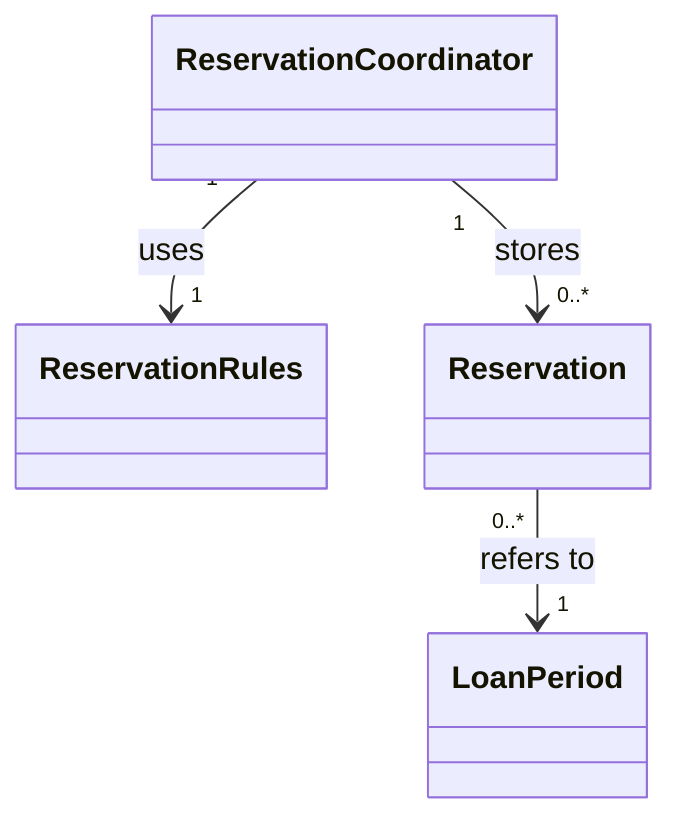
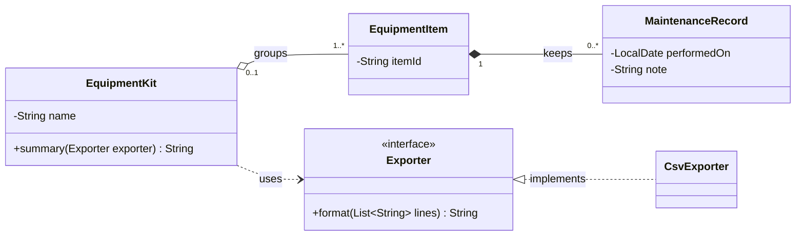

# Chapter 2 Code Explanations and Solutions

*Companion to Chapter 2: Object-Oriented Development Beyond Syntax*  
*OO Development and Agile Practices*  
Version 1.2 • 13 October 2026 • reviewed against Blueprint v0.3; UML section expanded

This file contains the complete Java examples, instructions, explanations, suggested solutions and instructor notes. Read Sections 1–3 to assemble and run the starting version. Attempt the student chapter's activity before reading Section 4 onwards.

All source code is included below. Copy each complete listing into the stated filename. The two coordinator listings are alternatives: keep only one `ReservationCoordinator.java` in a given working directory. The deliberate fault fragments are labelled and are not additional source files.

## 1 Starting point and execution

Create a new working directory and save these six files in it:

| File | Role |
|---|---|
| `ReservationRules.java` | The unchanged numeric policy from Chapter 1 |
| `LoanPeriod.java` | Valid dates and exclusive-end overlap semantics |
| `Reservation.java` | Immutable reservation details |
| `ReservationCoordinator.java` | The starting request workflow from Section 2.4 |
| `Chapter02Demo.java` | Three requests illustrating success, overlap and adjacency |
| `Chapter02Checks.java` | Supplied behavioural checks used before and after the edit |

Use a JDK 17 or newer capable of compiling the Java 17 language/API baseline. No preview feature, external library or build-tool installation is required here. Use plain text filenames with the exact capitalisation shown.

For this small checkpoint, the files use Java's unnamed package so they can be compiled together in one directory. This is a teaching setup, not the proposed organisation of the complete application. Later application-structure work will introduce named packages and a standard project layout.

Compile in that directory:

```sh
javac --release 17 -d out ReservationRules.java LoanPeriod.java Reservation.java ReservationCoordinator.java Chapter02Demo.java Chapter02Checks.java
java -cp out Chapter02Demo
java -cp out Chapter02Checks
```

The demonstration should print:

```text
Confirmed: R1 for B1 on CAM1 [2026-10-20, 2026-10-22).
Rejected: item unavailable.
Confirmed: R2 for B2 on CAM1 [2026-10-22, 2026-10-23).
Stored: 2
```

The checks should print:

```text
All 34 chapter checks passed.
```

After changing the source, compile again before rerunning. Otherwise, the JVM may execute old class files and give misleading evidence about the new source. For a fresh output directory, choose a new directory name with `-d` and use that same name with `-cp`.

This is an orientation toolchain, not a complete release process. The later build and CI chapters will establish automated project-wide commands. The code here uses no database, network access, AI account or real university data.

## 2 Complete starting source

### 2.1 ReservationRules.java

This is exactly the class used in Chapter 1. It has no mutable instance state. Its inputs are the existing active count and requested number of days. The coordinator supplies the count; the rule does not retrieve it.

The staff-policy variation is not implemented in this checkpoint. Applying the same rule to every supplied borrower identifier is intentional and must remain clear when demonstrating the program.

```java
public final class ReservationRules {
    public boolean mayRequest(int activeReservations, int requestedDays) {
        return activeReservations >= 0
                && activeReservations < 3
                && requestedDays >= 1
                && requestedDays <= 7;
    }
}
```

### 2.2 LoanPeriod.java

The constructor establishes a local invariant: both dates exist and the end is strictly after the start. `Objects.requireNonNull` throws `NullPointerException` on missing dates; a zero-length or reversed interval throws `IllegalArgumentException`.

The two comparisons in `overlaps` implement the stated half-open interval convention. Both must hold. Returning the dates is safe because `LocalDate` is immutable. A general getter returning a mutable object would require a different analysis.

```java
import java.time.LocalDate;
import java.util.Objects;

public final class LoanPeriod {
    private final LocalDate start;
    private final LocalDate endExclusive;

    public LoanPeriod(LocalDate start, LocalDate endExclusive) {
        this.start = Objects.requireNonNull(start, "start");
        this.endExclusive = Objects.requireNonNull(endExclusive, "endExclusive");
        if (!start.isBefore(endExclusive)) {
            throw new IllegalArgumentException("End must be after start.");
        }
    }

    public LocalDate start() {
        return start;
    }

    public LocalDate endExclusive() {
        return endExclusive;
    }

    public boolean overlaps(LoanPeriod other) {
        Objects.requireNonNull(other, "other");
        return start.isBefore(other.endExclusive)
                && other.start.isBefore(endExclusive);
    }
}
```

### 2.3 Reservation.java

The identifiers must be non-null and non-blank, and the period must be non-null. The class does not verify that an identifier exists in a university catalogue. It preserves identifier text exactly, including case and any non-blank surrounding whitespace.

All fields are final, and their reachable values are immutable in this example. There are no setters. `final` on the class prevents subclassing but does not, by itself, create immutability. Equality by reservation identifier has not been implemented; inherited `equals` still uses object identity.

```java
import java.util.Objects;

public final class Reservation {
    private final String id;
    private final String borrowerId;
    private final String itemId;
    private final LoanPeriod period;

    public Reservation(String id, String borrowerId, String itemId,
                       LoanPeriod period) {
        this.id = requireText(id);
        this.borrowerId = requireText(borrowerId);
        this.itemId = requireText(itemId);
        this.period = Objects.requireNonNull(period, "period");
    }

    private static String requireText(String value) {
        if (value == null || value.isBlank()) {
            throw new IllegalArgumentException("Identifiers must not be blank.");
        }
        return value;
    }

    public String id() { return id; }
    public String borrowerId() { return borrowerId; }
    public String itemId() { return itemId; }
    public LoanPeriod period() { return period; }
}
```

### 2.4 ReservationCoordinator.java starting version

The public method validates its arguments, counts this borrower's records, applies the numeric policy, checks conflicts for the requested item and finally stores a successful reservation. It constructs a confirmation message; it does not send it.

Every stored record is considered active. The class has no cancellation, completion or expiry operation. `R1`, `R2` and later identifiers are unique only within this coordinator while its append-only list is retained. A new coordinator starts again at `R1`; this is not a globally unique identifier strategy.

A policy rejection is returned before an availability rejection when both conditions would fail. The refactoring must preserve that order. Validation exceptions and rejections occur before adding a record. An unrepresentable end date, such as one day after `LocalDate.MAX`, also fails before storage. Date exceptions should be handled appropriately if a later user interface accepts arbitrary dates.

```java
import java.time.LocalDate;
import java.util.ArrayList;
import java.util.List;
import java.util.Objects;

public final class ReservationCoordinator {
    private final List<Reservation> reservations = new ArrayList<>();
    private final ReservationRules rules = new ReservationRules();

    public String reserve(String borrowerId, String itemId,
                          LocalDate start, int requestedDays) {
        if (borrowerId == null || borrowerId.isBlank()
                || itemId == null || itemId.isBlank()) {
            throw new IllegalArgumentException("Identifiers must not be blank.");
        }
        Objects.requireNonNull(start, "start");

        int activeCount = 0;
        for (Reservation existing : reservations) {
            if (existing.borrowerId().equals(borrowerId)) {
                activeCount++;
            }
        }
        if (!rules.mayRequest(activeCount, requestedDays)) {
            return "Rejected: borrower limit or duration.";
        }

        LoanPeriod requested = new LoanPeriod(
                start, start.plusDays(requestedDays));
        for (Reservation existing : reservations) {
            if (existing.itemId().equals(itemId)
                    && existing.period().overlaps(requested)) {
                return "Rejected: item unavailable.";
            }
        }

        Reservation reservation = new Reservation(
                "R" + (reservations.size() + 1), borrowerId, itemId, requested);
        reservations.add(reservation);
        return "Confirmed: " + reservation.id()
                + " for " + reservation.borrowerId()
                + " on " + reservation.itemId()
                + " [" + reservation.period().start()
                + ", " + reservation.period().endExclusive() + ").";
    }

    public List<Reservation> reservations() {
        return List.copyOf(reservations);
    }
}
```

### 2.5 Chapter02Demo.java

The first request occupies CAM1 on 20 and 21 October. The second intersects that period and is rejected. The third begins on the exclusive end date and is accepted. The different borrower identifiers ensure that this demonstration examines equipment availability rather than reaching one borrower's reservation limit.

```java
import java.time.LocalDate;

public class Chapter02Demo {
    public static void main(String[] args) {
        ReservationCoordinator coordinator = new ReservationCoordinator();
        LocalDate start = LocalDate.of(2026, 10, 20);
        System.out.println(coordinator.reserve("B1", "CAM1", start, 2));
        System.out.println(coordinator.reserve("B2", "CAM1", start.plusDays(1), 1));
        System.out.println(coordinator.reserve("B2", "CAM1", start.plusDays(2), 1));
        System.out.println("Stored: " + coordinator.reservations().size());
    }
}
```

## 3 Supplied checks

This runner makes expectations explicit without introducing a test framework before Chapter 7. You may use it without understanding every helper immediately. The `check` helper throws on a false condition. The `expect` helper verifies that an operation throws the expected exception type or a subtype. It uses explicit `AssertionError` instances rather than Java's optional `assert` statements.

The checks cover interval relationships, constructor validity, exact confirmations, failed requests, counts, snapshots and selected exceptional inputs. Inspect the expected values against the requirements; the mere existence of a runner does not establish that its expectations are correct.

### 3.1 Chapter02Checks.java

The counter measures successful checks for this supplied example. It is not a design-quality score, a coverage percentage or a measure of a student's contribution.

```java
import java.time.DateTimeException;
import java.time.LocalDate;
import java.util.List;

public class Chapter02Checks {
    private static int checks;

    public static void main(String[] args) {
        LocalDate day = LocalDate.of(2026, 10, 20);
        LoanPeriod first = new LoanPeriod(day, day.plusDays(2));
        LoanPeriod overlapping = new LoanPeriod(day.plusDays(1), day.plusDays(3));
        LoanPeriod adjacent = new LoanPeriod(day.plusDays(2), day.plusDays(3));
        check(first.overlaps(overlapping), "overlap detected");
        check(overlapping.overlaps(first), "overlap is symmetric");
        check(!first.overlaps(adjacent), "adjacent periods allowed");
        check(!adjacent.overlaps(first), "adjacency symmetric");
        check(first.overlaps(new LoanPeriod(day, day.plusDays(2))), "equal periods overlap");
        check(first.overlaps(new LoanPeriod(day.minusDays(1), day.plusDays(4))),
                "containment overlaps");
        expect(IllegalArgumentException.class, () -> new LoanPeriod(day, day),
                "zero-length period");
        expect(IllegalArgumentException.class, () -> new LoanPeriod(day, day.minusDays(1)),
                "reversed period");
        expect(NullPointerException.class, () -> new LoanPeriod(null, day), "null start");
        expect(NullPointerException.class, () -> new LoanPeriod(day, null), "null end");

        ReservationCoordinator c = new ReservationCoordinator();
        check(c.reserve("B1", "CAM1", day, 2).equals(
                "Confirmed: R1 for B1 on CAM1 [2026-10-20, 2026-10-22)."),
                "exact first confirmation");
        check(c.reservations().size() == 1, "one success stored");
        check(c.reserve("B2", "CAM1", day.plusDays(1), 1).equals(
                "Rejected: item unavailable."), "overlapping same item rejected");
        check(c.reservations().size() == 1, "conflict stores nothing");
        check(c.reserve("B2", "CAM1", day.plusDays(2), 1).equals(
                "Confirmed: R2 for B2 on CAM1 [2026-10-22, 2026-10-23)."),
                "adjacent request and identifier after rejection");
        check(c.reserve("B1", "MIC1", day, 7).equals(
                "Confirmed: R3 for B1 on MIC1 [2026-10-20, 2026-10-27)."),
                "different item and seven-day limit allowed");
        check(c.reserve("B1", "TRI1", day, 1).startsWith("Confirmed:"),
                "third active reservation allowed");
        check(c.reserve("B1", "CAM2", day, 1).equals(
                "Rejected: borrower limit or duration."), "fourth rejected");
        check(c.reservations().size() == 4, "borrower-limit rejection stores nothing");

        List<Reservation> snapshot = c.reservations();
        expect(UnsupportedOperationException.class, snapshot::clear, "snapshot unmodifiable");
        check(c.reservations().size() == 4, "failed clear preserves coordinator state");
        check(c.reserve("B3", "CAM2", day, 1).startsWith("Confirmed:"),
                "another borrower unaffected by B1 limit");
        check(snapshot.size() == 4 && c.reservations().size() == 5,
                "old snapshot does not track later additions");
        check(snapshot.get(0).period().start().equals(day), "stored period preserved");

        ReservationCoordinator invalid = new ReservationCoordinator();
        check(invalid.reserve("B1", "CAM1", day, 0).equals(
                "Rejected: borrower limit or duration."), "zero duration rejected");
        check(invalid.reserve("B1", "CAM1", day, -1).equals(
                "Rejected: borrower limit or duration."), "negative duration rejected");
        check(invalid.reserve("B1", "CAM1", day, 8).equals(
                "Rejected: borrower limit or duration."), "eight-day duration rejected");
        expect(IllegalArgumentException.class, () -> invalid.reserve(" ", "CAM1", day, 1),
                "blank borrower");
        expect(IllegalArgumentException.class, () -> invalid.reserve("B1", null, day, 1),
                "null item");
        expect(NullPointerException.class, () -> invalid.reserve("B1", "CAM1", null, 1),
                "null request date");
        expect(DateTimeException.class, () -> invalid.reserve("B1", "CAM1", LocalDate.MAX, 1),
                "unrepresentable end date");
        check(invalid.reservations().isEmpty(), "invalid requests store nothing");
        expect(IllegalArgumentException.class,
                () -> new Reservation("", "B1", "CAM1", first), "blank reservation identifier");
        expect(NullPointerException.class,
                () -> new Reservation("R1", "B1", "CAM1", null), "null reservation period");
        System.out.println("All " + checks + " chapter checks passed.");
    }

    private static void check(boolean condition, String label) {
        if (!condition) {
            throw new AssertionError(label);
        }
        checks++;
    }

    private static void expect(Class<? extends Throwable> type, Runnable action,
                               String label) {
        try {
            action.run();
        } catch (Throwable error) {
            check(type.isInstance(error), label + ": wrong exception " + error);
            return;
        }
        throw new AssertionError(label + ": expected " + type.getSimpleName());
    }
}
```

## 4 Worked refactoring solution

### 4.1 The intended change

Extract the successful confirmation-string assembly into a private method. Pass the already-created reservation to that helper. Keep the storage statement before the call. Do not change the text, public API, policy, conflict calculation, validation order or identifier allocation.

This improves the readability of the request method by naming one step. It does not separate presentation into another component or eliminate the coordinator's storage responsibility. A separate formatter class is possible future work, but it adds a collaborator and is unnecessary for the stated exercise.

Replace only `ReservationCoordinator.java` with the version below, then compile and run both programs again. All common files remain unchanged.

### 4.2 ReservationCoordinator.java completed version

This is the complete replacement file, not an additional class to place alongside the starting version.

```java
import java.time.LocalDate;
import java.util.ArrayList;
import java.util.List;
import java.util.Objects;

public final class ReservationCoordinator {
    private final List<Reservation> reservations = new ArrayList<>();
    private final ReservationRules rules = new ReservationRules();

    public String reserve(String borrowerId, String itemId,
                          LocalDate start, int requestedDays) {
        if (borrowerId == null || borrowerId.isBlank()
                || itemId == null || itemId.isBlank()) {
            throw new IllegalArgumentException("Identifiers must not be blank.");
        }
        Objects.requireNonNull(start, "start");

        int activeCount = 0;
        for (Reservation existing : reservations) {
            if (existing.borrowerId().equals(borrowerId)) {
                activeCount++;
            }
        }
        if (!rules.mayRequest(activeCount, requestedDays)) {
            return "Rejected: borrower limit or duration.";
        }

        LoanPeriod requested = new LoanPeriod(
                start, start.plusDays(requestedDays));
        for (Reservation existing : reservations) {
            if (existing.itemId().equals(itemId)
                    && existing.period().overlaps(requested)) {
                return "Rejected: item unavailable.";
            }
        }

        Reservation reservation = new Reservation(
                "R" + (reservations.size() + 1), borrowerId, itemId, requested);
        reservations.add(reservation);
        return confirmationFor(reservation);
    }

    private String confirmationFor(Reservation reservation) {
        return "Confirmed: " + reservation.id()
                + " for " + reservation.borrowerId()
                + " on " + reservation.itemId()
                + " [" + reservation.period().start()
                + ", " + reservation.period().endExclusive() + ").";
    }

    public List<Reservation> reservations() {
        return List.copyOf(reservations);
    }
}
```

### 4.3 What the reviewer should inspect

The structural change is one call plus one private method. `reservations.add(reservation)` remains in the successful path. The helper only reads the already-created immutable record. Both rejection strings and their positions are unchanged. The confirmation still uses the same identifiers, dates, spaces and punctuation.

In Git, the extraction appears as four added lines and no removed lines, because the existing `return "Confirmed: "...` expression is kept and now sits inside the new method. Point this out to reviewers: a diff showing only additions still moves behaviour, so the reviewer must read where the retained lines ended up.

The expected output is identical to Section 1. The same 34 checks should pass. This evidence is stronger than inspecting only the helper's text, because it also examines the stored state and rejection paths. It remains limited to the supplied cases and operating assumptions.

## 5 Git exercise and review record

### 5.1 Establish a baseline

Use a new local directory containing the starting six source files. Do not run `git init` inside an unrelated existing project. If working in an instructor-provided repository, use its established baseline instead of initialising another repository.

Create a file called `.gitignore` containing:

```text
out/
*.class
```

This prevents generated files from being selected as new tracked files. It does not remove files that have already been committed. Compile the starter, run the checks, then initialise and record it:

```sh
git init -b main
git status
git add .gitignore ReservationRules.java LoanPeriod.java Reservation.java ReservationCoordinator.java Chapter02Demo.java Chapter02Checks.java
git diff --staged
git commit -m "Add chapter 2 reservation starter"
git switch -c refactor/confirmation-text
```

Git needs a configured author identity to create commits. If none is configured, use your own appropriate name and email according to your course workflow. Do not copy another person's identity. No remote repository or network operation is required here.

### 5.2 Make and inspect the edit

Perform the extraction, then rerun the compilation and both Java programs from Section 1. Inspect the working change before staging:

```sh
git status
git diff
```

Ask a peer to inspect the change and evidence. Address any relevant concern, then stage the exact file and inspect again:

```sh
git add ReservationCoordinator.java
git diff --staged
git commit -m "Extract reservation confirmation formatting"
git log --oneline -2
git status
```

An empty ordinary `git diff` after staging is expected when all tracked modifications have been staged. `git diff --staged` shows the proposed commit content. After the commit, a clean status means the working directory matches the recorded state; it does not prove that the code is correct.

A useful review record contains the change or commit identifier, reviewer, evidence inspected, findings and response. If you worked alone, label the review as a self-review. Creating a commit does not create a hosted pull request or establish that another person reviewed it.

### 5.3 Example review description

**Problem:** the request method contains message formatting alongside the request workflow.

**Change:** move only the confirmation-string construction into `confirmationFor`, retaining the existing record creation and storage order.

**Evidence:** original and revised demonstrations print identical output; the supplied 34 checks pass for both versions; the diff changes only the coordinator's internal organisation.

**Limits:** persistence, concurrent booking, lifecycle operations and message delivery remain outside this checkpoint.

This is an example of what a review description can contain. Students must record their own observed results and actual review, not copy a claim that they did not verify.

## 6 Practical activity solutions

### 6.1 Part A Request trace

| Call | Outcome | Stored count afterwards | Important step |
|---|---|---:|---|
| B1 requests CAM1 from 20 October for two days | Confirmed as R1 | 1 | Empty history has no conflict |
| B2 requests CAM1 from 21 October for one day | Rejected as unavailable | 1 | The period overlaps R1 for the same item |
| B2 requests CAM1 from 22 October for one day | Confirmed as R2 | 2 | Equality with R1's exclusive end is permitted |

The rejection occurs before reservation creation and before `add`. Identifiers derive from the number of stored records, so the rejected request consumes no identifier. Do not infer that this allocation strategy is suitable once deletion, persistence or multiple coordinators are introduced.

### 6.2 Diagram and invariants

One suitable compact diagram is:



A local invariant is that a period's end follows its start. The `LoanPeriod` constructor enforces it. The condition that confirmed reservations for the same item do not overlap requires comparing a requested period with existing records; the coordinator performs that check in this sequential checkpoint.

The links are associations, not inheritance. A caller can share an immutable `LoanPeriod` between reservations, so the diagram need not assert exclusive ownership through a composition diamond. Other diagrams are acceptable if their labels, direction and multiplicities are explained and agree with the code.

### 6.2a Scenario-modelling exercise (equipment kits)

One suitable model:



What a strong answer shows:

| Requirement in the scenario | Model decision |
|---|---|
| A kit holds one or more items; removing it does not delete them | Aggregation, with `1..*` at the items end |
| An item belongs to at most one kit | `0..1` at the kit end |
| A record belongs to exactly one item and has no meaning without it | Composition from item to record, with `1` at the item end and `0..*` at the records end |
| A summary is produced through an exporter; other formats expected later | `Exporter` as an interface, realised by `CsvExporter`; the kit depends on the interface, not on `CsvExporter` |

Accept diagrams that add a separate export service class if the dependency and the interface realisation are still drawn correctly. Common errors are: drawing the interface realisation as inheritance with a solid line, reversing the diamond, putting `1..*` at the wrong end, and making the kit depend directly on `CsvExporter`. The assumption can be anything stated and consistent, for example that an item with no kit is allowed, or that a record's date is required. Do not credit extra classes for their own sake.

### 6.2b Answers to the “Try it” tasks in Section 2.6

**Try it 1: reading Figure 2.1 from both ends.**

| Line | Reading from each end | Where the code enforces it | What is only assumed |
|---|---|---|---|
| `ReservationCoordinator "1" --> "1" ReservationRules` | Each coordinator uses exactly one rules object. Each rules object is used by one coordinator. | The `private final ReservationRules rules = new ReservationRules();` field gives exactly one per coordinator. | That a rules object is never shared. Each coordinator creates its own, but nothing in the types forbids a future constructor from sharing one. |
| `ReservationCoordinator "1" --> "0..*" Reservation` | Each coordinator stores zero or more reservations. Each reservation is stored by exactly one coordinator. | The list starts empty and has no upper limit, which matches `0..*`. | That a reservation is held by only one coordinator. `Reservation`'s constructor is public, and snapshot lists also hold references to the same objects. |
| `Reservation "0..*" --> "1" LoanPeriod` | Each reservation refers to exactly one period. A period can be referred to by any number of reservations. | `Objects.requireNonNull(period, "period")` in the constructor and the `final` field give exactly one. | The `0..*`: nothing prevents sharing a period, although the coordinator currently gives each reservation its own. |

A strong answer separates “enforced by the code” from “true of how the code happens to be used”.

**Try it 2: details in the Java but absent from Figure 2.1.** Any two of these, with a reason:

- The constructors of all four classes, including the validation in `LoanPeriod` and `Reservation`. The figure is about which classes collaborate, not how they are built.
- The accessors `id()`, `borrowerId()`, `itemId()`, `start()` and `endExclusive()`. They expose data and add nothing to the collaboration.
- `Reservation`'s `period` field. The association line to `LoanPeriod` already states it, and showing both would say the same thing twice.
- The coordinator's private fields `reservations` and `rules`, and the private `confirmationFor` method in the completed version. The two fields appear as lines, and a private helper is not part of what other classes can see.
- The order of the checks and the exceptions thrown. A class diagram does not show sequence or behaviour.

**Try it 3: mistakes in Figure 2.4.**

| # | Mistake in the flawed diagram | Why it is wrong | Correct notation |
|---|---|---|---|
| 1 | `-Locker locker` attribute in `Technician` | It repeats the association line, and it implies one locker per technician | Delete the attribute and keep one line |
| 2 | `Technician "0..*" *-- "1" Locker`: reversed multiplicities | As drawn, each locker has any number of technicians and each technician looks after exactly one locker | `1` at the `Technician` end and `0..*` at the `Locker` end |
| 3 | The same line has a filled diamond at `Technician` | It claims lockers are discarded with their technician, but the scenario says a locker can be reassigned | A plain association with no diamond |
| 4 | `Locker <|-- InspectionEntry` | Inheritance says an entry is a kind of locker, but the scenario says an entry belongs to a locker | Composition: filled diamond at `Locker`, `1` at `Locker`, `0..*` at the entries |
| 5 | `Locker ..> PlainTextPrinter` and `report(PlainTextPrinter printer)` | The locker depends on the concrete class, so it cannot accept another format | Depend on `ReportPrinter` and type the parameter as `ReportPrinter` |
| 6 | `ReportPrinter <|-- PlainTextPrinter` | A solid line with a triangle means inheritance; implementing an interface is realisation | A dashed line with a hollow triangle at `ReportPrinter` |

The corrected diagram is Figure 2.3 in the student chapter. Mistakes 2 and 3 sit on the same line, and some students will list them as one; count them as two ideas if both are explained. Minor omissions, such as missing attributes on `Tool` or `InspectionEntry`, are not errors, because the scenario does not require them.

**Marking and feedback for diagram answers.** Use the module leader's assessment criteria and decide tolerances before marking. For the workshop scenario, the technician's name, the tool's name and the single `print` operation on the printer are design assumptions, not facts stated in the description; accept other justified attributes or operations, and judge the relationships and multiplicities, which the description does determine.

| Accept | Do not accept without a justification |
|---|---|
| Hand-drawn or Mermaid diagrams, since the notation matters, not the tool | Multiplicities at the wrong end |
| A plain association with or without arrowheads where the description does not say who holds the reference | An arrowhead that implies navigation the description or code does not support |
| Alternative class names and sensible extra attributes | A composition diamond with no lifetime argument |
| Different but defensible choices, such as `Tool` as an attribute | Inheritance used for “has” or “uses” |
| Omitting classes the description does not need | A solid line for interface realisation |
| | A dependency on a concrete class when the description expects the format to vary |

Ask students for the decision behind each relationship, not only the symbol. “I chose composition because an entry cannot exist without its locker” earns more than a correct diamond with no reason.

### 6.3 Part B Responsibility diagnosis

The coordinator validates request inputs, counts stored records, invokes policy, checks item availability, allocates an identifier, stores a record and formats a message. Two distinct reasons it could change are a new storage mechanism and changed confirmation wording.

`LoanPeriod` is cohesive because construction rules and overlap concern one period concept. The coordinator depends on both reservation representation and message wording; changing wording requires editing a class that also mutates storage. Simply counting lines does not explain that consequence.

### 6.4 Part C Refactoring acceptance

Use the complete solution in Section 4 as one model. Accept alternative private-method names with a clear purpose if the requested behaviour is preserved. A new interface or formatter class is not needed for this lab. If a student chooses one, ask for evidence that its additional boundary addresses a current need rather than awarding credit for extra structure.

Review returned text and stored records, not merely whether the program compiles. There should be one focused source change in the final commit. Do not require an exact commit hash, which depends on the local history.

### 6.5 Part D Team arrangement

There is no unique answer. The team should contain three or four members as directed, name one of the module's provided starter domains, and make the next author, reviewer and demo responsibilities explicit. A useful issue-board item has a concrete completion condition, such as “extract confirmation formatting with unchanged output and checks,” rather than “improve OO.” Look for three such cards, columns that the team can explain, and a written branch policy with a reason. Either a short-lived-branch or a feature-branch policy is acceptable; the reason matters more than the choice. Rotate roles and preserve evidence of review and reasoning.

## 7 AI activity solution

The supplied response is a teaching fixture constructed for this exercise. It is not evidence about the observed performance of a real AI model. The student chapter deliberately does not name the three faulty areas (email delivery, durable storage and concurrency or immutability claims); students should find them by tracing control flow, state changes and side effects.

| Claim | Judgement | Evidence or qualification |
|---|---|---|
| Validates identifiers | Supported within scope | Rejects null or blank borrower/item identifiers; does not validate them against a catalogue |
| Counts a borrower's stored reservations | Supported | Loops over stored records and compares borrower identifiers |
| Applies the numeric rule | Supported | Calls the unchanged `ReservationRules.mayRequest` |
| Checks conflicts for the same item | Supported | Requires matching item identifiers and an overlapping period |
| Adds before returning a confirmation | Supported | Successful path calls `add` before constructing or returning the message |
| Sends email | Contradicted as a description of this code | There is no sender or delivery call; the method returns a string |
| Persists to a database | Contradicted as a description of this code | Storage is an in-memory `ArrayList`; no database operation occurs |
| Final list means callers receive a deeply immutable copy | Incorrect explanation | `final` prevents field reassignment; `List.copyOf` protects the returned list structure and is shallow; the element types separately provide immutability |
| Concurrent booking is safe | Not established and not provided by this implementation | Checking and adding are not one synchronised operation; concurrent use is outside the contract |

An acceptable corrected four-sentence explanation is:

> The coordinator rejects missing or blank identifiers and requires a start date, then counts the borrower's stored records and applies the numeric rule. It checks overlapping periods for the same item before recording a successful reservation and returning confirmation text. Policy and availability rejections do not add a record, and the returned reservation list is an unmodifiable snapshot containing immutable elements. The implementation has in-memory storage only, sends no email, and is intended for sequential use rather than concurrent booking.

A student may mention the date-range exception or missing lifecycle support as further qualifications. They should not invent an external application's behaviour from this isolated code.

## 8 Review-question solutions

1. **Identity:** a reference identifies a Java object instance; `id` represents domain identity in the teaching model. Two separately constructed reservations can contain the same identifier text yet remain distinct objects under the inherited `equals`. Identifier-based equality would require an explicit contract and implementation.
2. **Invariants:** `LoanPeriod` protects its own valid date relationship. Conflict prevention needs other reservations and the requested item, so it belongs at a boundary with that information. Local validation cannot ensure consistency across independent coordinators.
3. **Cohesion and coupling:** changed message wording affects presentation but currently requires editing the coordinator. A private helper makes that purpose easier to locate; it does not remove the class-level dependency. Zero dependencies would prevent meaningful collaboration, while extra classes can add indirection without solving a problem.
4. **Composition and inheritance:** a reservation has or refers to a period. It is not a period subtype. Inheriting from a period would conflate reservation identity and borrower/item details with an interval, and suggest inappropriate substitutability. The actual final `LoanPeriod` class also prohibits subclassing.
5. **Leaking state:** returning the mutable internal list allows `clear` or `add` outside the coordinator's validation. `List.copyOf` blocks structural mutation and isolates later additions to the source list. It does not deep-copy mutable elements. This starter's element types are separately immutable.
6. **Missing storage:** a success string is now returned for a reservation that the coordinator does not retain. The next request can incorrectly find no conflict, and the stored count does not increase. The `one success stored` check exposes the fault immediately, before relying on a second request.

## 9 Transfer-challenge solution

One reasonable model uses `RoomBookingCoordinator`, `RoomBooking`, `BookingPeriod` and `BookingRules`. The coordinator holds records and uses rules; a booking refers to a period. A diagram may omit a separate rules class if no relevant policy behaviour exists yet.

State an explicit convention, for example start-inclusive/end-exclusive periods in local building time with a stated time granularity. If using times rather than dates, specify how time zones or daylight-saving transitions are handled or excluded from the exercise. The four-class suggestion is not an instruction to implement a production scheduling system.

Protect the stored booking collection from callers. A formatting-method extraction can be sufficient for a wording-related area of code, but distinguish the extraction from the wording change itself: first preserve the old output while extracting, then make the requested text change as a separate behaviour change with updated expectations.

Two observations for the extraction are identical confirmation text and identical stored records for the same successful input. Also checking that a conflicting request still adds nothing strengthens the evidence. A remaining limitation might be that a single process's list cannot coordinate bookings from multiple application instances.

A review description should identify which commit merely extracts formatting and which later change intentionally alters wording. This distinction is an important part of a strong answer to a scenario whose eventual goal changes visible text.

## 10 Additional fault demonstrations

Use disposable copies and never retain the faulty version as your next project checkpoint.

### 10.1 Exposing the mutable collection

Replace only the getter body with the following fragment:

```java
// Deliberately unsafe method replacement.
public List<Reservation> reservations() {
    return reservations;
}
```

Recompile and rerun the checks. `snapshot::clear` now succeeds instead of throwing. The runner reports that `snapshot unmodifiable` expected an `UnsupportedOperationException`. Records have become externally mutable even though the original field remains private and final.

### 10.2 Omitting the storage operation

In another disposable copy, remove this line from the successful request path:

```java
// Line to remove only for the deliberate fault exercise.
reservations.add(reservation);
```

The first confirmation can still look correct, but the checks fail with `one success stored`. A demonstration that inspects only printed text would miss the changed state.

Both faults were actually introduced in separate temporary copies during verification. Neither is present in the complete starting or completed listings above.

## 11 Instructor guidance and checkpoint record

For the UML work, spend class time on reading before drawing. A useful warm-up is to put Figure 2.1 on screen and have students read one line aloud in both directions, then ask where the code enforces each number. Next let them hand-draw the workshop scenario using the six steps, and compare their drawings with Figure 2.3 by asking why each line differs, not whether it matches. Finish with the flawed Figure 2.4 as a pair exercise. Hand drawing is worth the class time because it makes students decide each relationship deliberately; the module leader has not stated how diagrams are produced in the midterm, so do not tell students that hand drawing, or any particular tool, will be required.

Ask students to trace one request before discussing any principle names. Have one learner identify the successful path and another inspect what a failed path leaves behind. Use the adjacency example to expose hidden date assumptions before drawing the diagram.

Do not require full understanding of every line in the check runner this week. Its role is to supply behavioural protection while students learn a small refactoring. Teach the relevant `check` invocation if a learner needs to understand a failure; the full testing discipline comes later.

Keep the code change small. Review can reveal further design opportunities, but adding lifecycle states, repositories, factories and notification infrastructure would obscure this chapter's learning goal. Ask students to record those opportunities rather than implement all of them.

The starting state is **Chapter 2 before extraction**. The completed state is **Chapter 2 after confirmation extraction**. They use the same five common files and alternative coordinator versions. Later chapters should continue from the completed version. The isolated faults are teaching experiments, not cumulative project changes.

The original Chapter 1 rule is reused without alteration. The date convention is now explicit. The early system still lacks staff policies, borrower/item catalogues, authentication, cancellation/completion, durable storage, notification delivery and concurrency control. These are scope facts, not hidden promises that the program already meets.

Blueprint v0.3 continuity: the chapter labels Parts A–C as Book project and Part D as Team project, covers the class-diagram notation the midterm assesses (Section 2.6 and the kit exercise), includes issue-board setup and a branch-policy decision (the Week 1 lab), and gives Core reading, Minimum required lab and Optional extension entries. The Java 17 baseline and plain `javac` workflow are working choices. The sequence is deliberate: Chapter 2 uses flat files compiled by `javac`; Chapter 4 moves them into conventional source folders with a plain-Java Bash gate; Chapter 7 introduces Maven and JUnit. Chapter 4 explains the migration. Permitted Java idioms for assessments remain a module-leader decision (Blueprint D2).

## 12 Verification record

**Re-verified on 13 October 2026 (review of version 1.0).** All Java listings were extracted programmatically from this file, so the code that ran is the code printed here. Both coordinator variants were compiled with `javac --release 17` from JDK 24.0.2, which enforces the Java 17 language and API baseline the chapter states. Version 1.0 recorded a run on OpenJDK 17.0.20 invoked through `java com.sun.tools.javac.Main`; that run was not repeated.

| Check | Observed result |
|---|---|
| Starting variant: demo and checks | Demo printed the four expected lines; `All 34 chapter checks passed.` |
| Completed variant: demo and checks | Identical demo output; `All 34 chapter checks passed.` |
| Difference between variants | Four added lines (`return confirmationFor(reservation);`, a closing brace, a blank line and the helper's signature); nothing removed |
| Fault 10.1: `return reservations;` | Demo ran; checks failed with `snapshot unmodifiable: expected UnsupportedOperationException` |
| Fault 10.2: `reservations.add(reservation);` removed | Second request printed `Confirmed: R1` instead of being rejected; checks failed with `one success stored` |
| Git sequence in Section 5 | Replayed in an unpublished scratch repository with Git 2.54.0: baseline commit, `git switch -c`, extraction, `git diff`, staging, `git diff --staged`, commit and clean status. A plain `git diff` after staging printed nothing. The second commit changed only `ReservationCoordinator.java` (1 file, 4 insertions) |
| Mermaid diagrams | All six diagrams rendered without error with Mermaid 10.9.1: Figures 2.1–2.4 in the student chapter, and the compact diagram in 6.2 and the kit solution in 6.2a in this file. The interface stereotype displayed in Figures 2.2, 2.3, 2.4 and 6.2a. In a screenshot of the rendered diagrams, the filled diamond, hollow diamond, hollow triangle and dashed lines appeared as the chapter describes |
| `LoanPeriod` excerpt in Section 2.6 | Every signature in the excerpt was matched against the real `LoanPeriod.java` |

The Java excerpts in the student chapter match this file, except the deliberately unsafe getter in Section 2.3, which appears here as the fault in Section 10.1. No push, hosted pull request or actual peer approval is claimed. The checks establish selected behaviour under the stated sequential, in-memory assumptions, not production readiness.

The nine web sources in the student chapter (sources 1–9) were opened on 12 and 13 October 2026. Source 10, the Martin textbook, is a printed book whose pages were not checked; its Week 1 reading is described as the descriptor words it, with no page numbers. Each page exists and supports the claim the chapter makes about it. The Java 17 baseline is the working choice until the toolchain decision (Blueprint D2) is closed.

Technical source references are in the student chapter. The examples and suggested solutions here are original teaching material.
