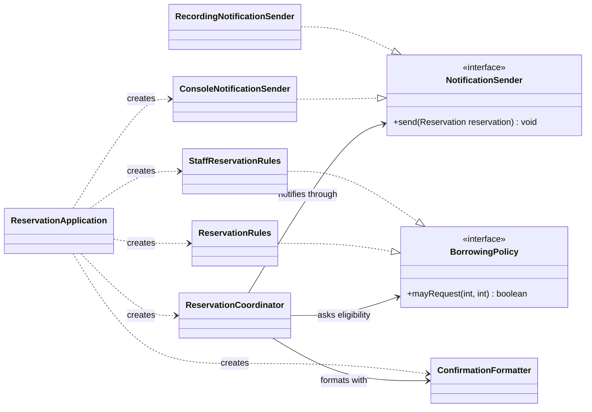
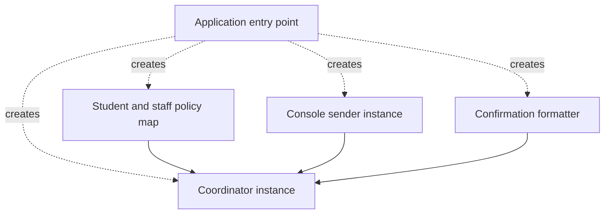

# Chapter 6
# Interfaces, Dependencies and Composition

*OO Development and Agile Practices*  
*Designing, Testing and Evolving Software with AI Assistance*

## Opening scenario

The reservation coordinator now uses separate borrowing policies and a confirmation formatter. A new demonstration requirement asks it to pass each accepted reservation to a notification output. One team member creates a console sender inside the coordinator. It works, but another member cannot inspect notifications without watching console output. Replacing the output also requires editing the reservation workflow.

An AI assistant proposes an interface. The coordinator's field becomes `NotificationSender`, but its constructor still creates a particular sender and reads provider settings. The diagram looks different. The code still chooses its own environment.

This chapter examines the difference between naming an abstraction, depending on a useful contract and supplying a collaborator from outside. It introduces the **Interface Segregation Principle (ISP)** and **Dependency Inversion Principle (DIP)**, then uses constructor injection and a composition root to assemble the running application. A small container walkthrough makes object lifetime visible without requiring a framework installation.

## Learning outcomes and reading route

By the end of this chapter, you should be able to:

1. Design an interface around what a particular client needs.
2. Explain ISP through a concrete dependency that is unnecessarily broad.
3. Distinguish DIP, dependency injection and inversion of control.
4. Construct a small object graph using constructor injection and an explicit composition root.
5. Explain the benefits and costs of an interface, including the limits of what it guarantees.

**Module connection:** Week 5; LO1 and LO4. Quiz 1 revision points appear later and refer to Chapters 2–5, matching its stated Weeks 1–4 coverage. This week's new material is not silently added to that coverage.

**Entry checkpoint:** Chapter 5's Java 17 code, student and illustrative staff policies, extracted formatter, original 34 checks, five acceptance example groups and 44 Chapter 5 checks. Formatting a string has never meant sending email. Notification output is a new, explicitly bounded teaching feature in this chapter.

**Core reading.** Read Sections 6.1–6.6. Section 6.6 compares manual assembly with a small educational container.

**Minimum required lab.** Complete steps 1–9 of the practical activity in Section 6.10, including step 7 (the container walkthrough). Steps 1–8 run on the **Book project**; step 9 applies the same analysis to your **Team project**.

**Optional extension.** Do the Section 6.8 AI activity, the optional extension in Section 6.10, the review questions and the transfer challenge.

This chapter supports the Week 5 readings: the DIP and ISP chapters of Martin [8] and, for dependency injection, the articles listed on Moodle, of which Fowler's [3] is one standard source. The companion `Chapter_06_Code_Explanations_and_Solutions.md` supplies complete code, the deliberately coupled intermediate version, checks, solutions and verification evidence. Testing terminology and frameworks receive fuller treatment in Chapter 7.

## 6.1 Dependencies that make change difficult

### Begin with a real boundary

A dependency exists when one part of the program needs knowledge or behaviour from another. Dependencies are necessary: the coordinator needs dates, reservations and borrowing decisions. The design problem is choosing which knowledge should remain stable and where changing details should live.

Chapter 5 left two visible decisions inside the coordinator: construction of concrete policies and selection of a policy by category. The formatter was also constructed there. This was a deliberate intermediate checkpoint. We now move assembly out of the request workflow while introducing a notification boundary.

The new demonstration requirement is:

> After storing an accepted reservation, attempt one notification through the configured output. Rejected or invalid requests produce no notification. The configured output may record the accepted reservation in memory or print a notice to a supplied stream.

These are local teaching outputs. Neither is an email service, durable queue or proof that a borrower received anything. An output's normal return means it completed its own local operation. It does not establish remote delivery.

### Inspect the coupled version

The companion first adds a deliberately coupled version containing a field initialiser like this:

```java
private final NotificationSender notifications =
        new ConsoleNotificationSender(System.out, new ConfirmationFormatter());
```

The field has an interface type, but the coordinator still names the console implementation, chooses the global output stream and constructs its formatting dependency. A change to those choices requires changing the coordinator's source. The interface alone has not separated configuration from use.

This intermediate version is newly introduced teaching code, not a description of Chapter 5. Adding notification is a feature change. Replacing direct construction with an injected collaborator is a subsequent structural change, accompanied by an explicit constructor migration.

The strongest reason to change the design is concrete: one caller wants console output while another wants to inspect the accepted records in memory. The same reservation algorithm should support both. There is no need to invent a remote provider, credential store or messaging platform to demonstrate that pressure.

### Identify the decisions that should remain

The coordinator should still decide when a reservation has been accepted and therefore when notification is eligible. Moving that decision into the sender would duplicate policy and conflict handling. The sender should decide how its local output handles the accepted record, without granting or rejecting the reservation itself.

The coordinator also needs an application-level answer to output failure. Object injection does not settle that question. The chapter adopts an explicit rule: retain the accepted reservation and return its normal confirmation with a failure suffix. No automatic retry occurs. Section 6.3 explores why that rule matters.

A useful dependency diagnosis lists both the unwanted choice and the decision that belongs in the client. “Remove all dependencies” is not a useful goal. “Remove the coordinator's knowledge of which notification provider to construct, while keeping its acceptance sequencing” is reviewable.

## 6.2 Client-specific contracts and ISP

### Design for the caller's role

ISP directs attention to clients that are forced to depend on operations they do not need [1]. For the reservation workflow, the needed role is small: accept an already confirmed reservation for notification output.

The contract is:

```java
public interface NotificationSender {
    void send(Reservation reservation);
}
```

Compare it with a proposed all-purpose `EquipmentPlatform` interface containing `send`, `registerBorrower`, `exportInventory`, `deleteAccount`, `configureMailServer` and `rotateCredentials`. The coordinator uses only the first operation. The larger interface exposes unrelated responsibilities and encourages implementations to supply meaningless methods or throw unsupported-operation exceptions.

A smaller client-facing role lets a console output and an in-memory recorder implement what they genuinely support. It does not require every capability of a future provider to be copied into the coordinator's interface. An administration tool may need a different contract if that requirement actually exists.

### Small is not the same as one method

The notification contract happens to have one method. ISP does not prescribe one-method interfaces. A client that genuinely needs several cohesive operations may benefit from a role containing all of them. Splitting them mechanically can make construction and state coordination harder.

For example, a future document-writing client might need both writing and closing a session. Whether those belong together depends on who owns the resource and what the client must guarantee. Separating them only to minimise method count could allow a write without the required lifecycle management.

For our recorder, `received()` is an inspection operation exposed by the concrete implementation. The coordinator does not need it, so it is not placed on `NotificationSender`. A check can keep a reference to the recorder while supplying the same object through the narrow sender role. That is a deliberate use of two views of one object.

### Specify outcomes and state effects

A signature cannot say everything. The chapter's sender contract specifies a non-null accepted reservation; it must not modify that record or the coordinator; expected output failures use `NotificationException`. The recorder appends the immutable record to its own local list. The console implementation prints a notice to its supplied stream.

Both implementations have output effects, so this is not a pure policy operation. Chapter 5's `BorrowingPolicy` remains deterministic and side-effect-free under its contract. Do not apply one collaborator's restrictions blindly to another. The common idea is that callers need accurate promises, not that every interface should forbid mutation.

The sender receives a `Reservation` rather than raw borrower identifiers and dates assembled afresh. This keeps the notification tied to the accepted record. It also means the boundary deliberately knows that small domain type. If an external transport later needs a different representation, an adapter can translate it; that future need does not require a transport-specific payload now.

### Keep unused capabilities out of the application contract

A provider SDK might expose account management, diagnostics and bulk operations. A client-specific interface should express the application's needs, not mirror the SDK. Otherwise a provider change can still force application changes even though every reference is labelled as an interface.

The book does not implement those external operations here. The important review question is whether the coordinator's contract can be explained without referring to a vendor or transport setting. “Send this accepted reservation to the configured output” can. “Send this vendor request with the provider's retry token” would pull provider details into the workflow.

## 6.3 Policy and implementation dependencies

### Separate three decisions

There are three different kinds of decision in the worked example:

| Decision | Owner in this checkpoint | Reason |
|---|---|---|
| Whether the request is acceptable | Coordinator and selected borrowing policy | Depends on reservation rules and current records |
| How notification is represented locally | Sender implementation and formatter | Depends on the chosen output |
| Which concrete objects are used | Application composition root | Depends on the demonstration environment |

The first decision should not depend on console configuration. The last decision must exist somewhere: a running program eventually needs concrete objects. Moving assembly to the boundary makes it explicit rather than pretending it disappears.

Likewise, “policy” can mean different levels of decision. A numeric borrowing policy decides limits. The coordinator implements the broader application policy about storing before notifying and handling expected notification failure. Both are distinct from how a console stream writes bytes.

### Make the partial-success case explicit

The completed operation stores the reservation, formats the confirmation and calls the sender. On an expected `NotificationException`, it returns the confirmation followed by:

```text
 Notification failed; reservation retained.
```

The leading space joins the suffix to the existing confirmation. The record remains stored and counts as active. The method does not delete it, claim that the reservation was rejected or attempt notification again.

That is an author-chosen teaching rule. Another application might choose a different outcome, but it would need to make the storage and communication consequences explicit. A result that simply says “failed” can encourage callers to repeat the reservation request even though it already succeeded.

Repeating the same request here normally produces an overlap rejection. It is not a notification retry operation. Nor does the suffix mean that a background worker will retry later: there is no queue or worker in this checkpoint. Do not describe failed notification as “pending” unless the system actually retains and processes such work.

### Distinguish invocation from delivery guarantees

The coordinator attempts the sender once per successful reservation call. This is a local control-flow fact, not an exactly-once delivery guarantee. A future remote sender might deliver a message and then fail before confirming it. Retrying could duplicate the delivery.

Even the console may partially write before reporting an error. Its implementation uses `PrintStream.checkError()` because `PrintStream` normally records I/O errors rather than throwing `IOException` to the caller [6]. The sender translates that expected local error into the application's notification exception.

One limitation follows from how `PrintStream` works: its error state is sticky. Once the stream has reported an error, `checkError()` keeps returning `true` even if a later write succeeds, so every later notice through the same console sender would be reported as failed. For a console demonstration that is acceptable, and the companion shows it with a short experiment. A long-lived sender would need a fresh stream or a different way to detect failure.

The coordinator catches that specific exception. Unexpected programming failures are not converted into apparent success. Such failures may still occur after storage; the example does not claim transactional atomicity across formatting, storage and output. A richer result model and reliable delivery design belong to later integration work.

### Record the acceptance examples before refactoring

| Example | Expected reservation result | Notification observation |
|---|---|---|
| Eligible available request | Existing exact confirmation; one record stored | One accepted record supplied to sender |
| Same-item overlap | Existing rejection; records unchanged | No call |
| Invalid duration | Existing rejection; records unchanged | No call |
| Invalid identifier | Existing exception; records unchanged | No call |
| Expected output failure after acceptance | Confirmation plus explicit failure suffix; record retained | One attempt; no automatic retry |
| Repeat of the already accepted request | Overlap rejection | No second attempt from that rejected request |

These examples constrain the feature independently of whether assembly is manual or container-based. They also explain what the new checks need to observe beyond old return strings.

## 6.4 DIP

### Inspect source dependency direction

DIP separates higher-level policy from changing implementation details through abstractions [1, 2]. In the worked example, the coordinator names `NotificationSender`, an application-owned role. Concrete outputs implement that role. The application's contract does not import a provider's SDK type or inherit its configuration vocabulary.

At runtime, the coordinator still calls a concrete object's method. Dependency inversion does not reverse that call. It changes what the coordinator's source needs to know and which side defines the abstraction.

Figure 6.1 draws the finished design as a class diagram, using the notation from Chapter 2 and the style of Figure 5.1.



**Figure 6.1.** Source-level dependencies after the refactoring. Solid arrows are associations: the coordinator holds a `NotificationSender`, a `ConfirmationFormatter` and a `Map<BorrowerCategory, BorrowingPolicy>`. The map is drawn as one association to `BorrowingPolicy` to keep the figure simple: it means the coordinator asks whichever policy the map holds for the borrower's category. Dashed lines ending in a hollow triangle are realisations. The dashed arrows labelled “creates” show which class's source names which concrete class.

Compare it with Figure 5.1. There, two dashed “creates” arrows ran from the coordinator to the concrete policy classes. Here, every “creates” arrow starts at `ReservationApplication`. The coordinator's outgoing arrows now end at roles, apart from the concrete `ConfirmationFormatter`, which stays concrete on purpose (see below). That change in arrow direction is the visible evidence that its source no longer chooses its environment.

The arrows show **source-level knowledge**, not time order. The composition root knows the concrete console implementation because choosing it is the root's job. The recorder is an alternative implementation, not an additional mandatory destination for every notification, so the application creates only the console sender. Figure 6.2 in Section 6.5 shows a different view, the objects assembled at run time.

The files still use the unnamed Java package for the teaching checkpoint. Contract ownership is a design decision here, not a claim that module boundaries are enforced by the build. Chapter 10 will organise larger application boundaries more explicitly.

### DI can exist without DIP

Suppose the coordinator receives `ConsoleNotificationSender` through its constructor. That is dependency injection: somebody else supplies the collaborator. The coordinator still depends on the concrete provider type. Some construction coupling has been removed, but the intended provider boundary has not yet been inverted.

Conversely, a field typed as `NotificationSender` that is assigned `new ConsoleNotificationSender(...)` inside the coordinator uses an abstraction while retaining concrete construction knowledge. This is precisely the intermediate defect we are examining.

For the final design, use the small application contract and pass the selected implementation from the application root. The two decisions support each other, but they answer different questions: what type of behaviour the client requires, and who supplies the object.

### A preview: an outside data source behind a contract

The same reasoning applies when a collaborator brings data from outside the application. Chapter 8 adds the book's data-backed collaborator, an equipment directory that answers “who is this borrower?”. The reservation code should not know how that directory is implemented, only what it promises. Its contract, which Chapter 8 builds and tests, is one method:

```java
/** Empty means absent or inactive, never a provider outage. */
@FunctionalInterface
public interface BorrowerDirectory {
    Optional<Borrower> find(String borrowerId);
}
```

This listing is a preview and is not part of this chapter's checkpoint; `Borrower` is a small type that Chapter 8 introduces. Notice three promises in it. An empty answer means “no such active borrower”, which is an ordinary result. An outage is a different outcome, and Chapter 8 expresses it as an exception, so that “not found” and “could not ask” can never be confused. And the contract speaks in the application's own types, so the provider's codes stay behind it. The application owns this interface, in the same way that it owns `NotificationSender` here. That is dependency inversion applied to data.

### Not every concrete dependency is harmful

The coordinator still constructs accepted `Reservation` values and `LoanPeriod` values. It uses an in-memory list. The chapter does not inject a factory for every `new` expression. Creating a small domain value as part of an operation differs from selecting an environmental output provider.

The concrete `ConfirmationFormatter` is supplied in the constructor, but no interface is introduced for it. Its separate responsibility was justified in Chapter 5; a substitutable formatting role has not been required here. A concrete dependency can be acceptable when its stability and role fit the client.

Likewise, using Java's `Map` interface does not by itself demonstrate DIP. The useful design decision is that policy mappings are assembled outside the coordinator. The collection interface is an existing representation that makes this small mapping explicit.

## 6.5 Constructor injection and composition roots

### Make required collaborators visible

The completed constructor requires a policy map, a formatter and a sender:

```java
public ReservationCoordinator(
        Map<BorrowerCategory, BorrowingPolicy> policies,
        ConfirmationFormatter formatter,
        NotificationSender notifications)
```

The constructor checks for null values and requires an entry for every current borrower category. It copies the map with `Map.copyOf`, which produces an unmodifiable map and rejects null keys or values [5]. A caller cannot change the coordinator's category mapping by editing its original map later.

This is a shallow copy. It does not clone the policy objects. The supplied policies are stateless, satisfying their existing contract; putting a mutable or dishonest policy into an unmodifiable map would not make that policy safe. Construction checks validate assembly, not every collaborator's behaviour.

The coordinator then uses `policies.get(category)` instead of its former category switch. The category-to-implementation mapping moves to the application root. Adding a future enum category still requires a corresponding mapping; missing configuration fails at construction rather than halfway through a request.

### Assemble once at the application boundary

`ReservationApplication.create(sender)` builds the student and staff policies, places them in the map, creates the formatter and passes all three collaborators to the coordinator. The main method chooses a console sender with a supplied stream and starts the demonstration.

A check chooses a recorder instead:

```java
RecordingNotificationSender inbox = new RecordingNotificationSender();
ReservationCoordinator coordinator = ReservationApplication.create(inbox);
```

The check can later inspect `inbox.received()` because it retained the concrete reference. The coordinator only sees the sender role. This arrangement demonstrates replaceability without a mocking library; Chapter 7 will develop the vocabulary and uses of test doubles.

### Two views of the same design

Figure 6.1 showed classes and which source files know about which. Figure 6.2 shows the objects that `ReservationApplication.main` actually builds when the program runs.



**Figure 6.2.** An object-assembly view. The boxes are objects created at run time, not classes. A dotted arrow labelled “creates” means the application entry point constructs that object. A solid arrow means “is passed to the constructor of”. The sender also receives its own formatter and output stream, which are left out to keep the central relationship readable.

Keep the two views apart. Figure 6.1 says which classes know about which; Figure 6.2 says which objects were wired to which. Neither shows the order of calls during a request: the coordinator checks eligibility and conflicts, stores a record, formats the result and calls the sender that was already supplied. Do not read event order from either diagram.

A **composition root** is the small application-entry area where concrete collaborators are assembled. It may call helper factory methods. Those helpers do not become a service locator merely because they are static; the important point is that the coordinator is passed its dependencies and does not call back into a global registry to find them.

### State the constructor migration honestly

The chapter removes the no-argument coordinator constructor. Callers must now supply dependencies, normally through `ReservationApplication.create`. Therefore the completed source is not a drop-in constructor-compatible replacement for Chapter 5.

Existing checks and demonstrations are migrated only at their construction expressions. Their reservation assertions remain the same. This preserves the old operation's tested domain behaviour under a recording sender while making setup explicit. Claiming that every old source line is unchanged would be inaccurate.

The four-argument `reserve` method still means student borrowing. The explicit category overload still uses the trusted category supplied by the caller. Student/staff limits, date boundaries, count behaviour and existing rejection messages remain as before on their ordinary paths. The new notification side effect and documented failure suffix are separate feature behaviour.

### Constructor injection versus later setters

Required dependencies fit constructor injection because an object cannot be used before those dependencies are supplied. With later setters, the program may temporarily contain an unusable coordinator, and every operation may need to ask whether configuration has happened yet.

That does not make setters universally wrong. Optional or intentionally replaceable runtime collaborators can have a different lifecycle. This coordinator has no requirement to swap its sender while reservations are being processed, so construction is the simpler place to establish the dependency.

A very long constructor can expose a class that has too many responsibilities, but parameter count alone does not prove it. Do not hide ten unrelated services inside a generic context object solely to shorten the signature. The dependencies would still exist, with less visibility.

## 6.6 IoC and DI containers

### Distinguish the terms

Dependency injection is a way of supplying collaborators from outside an object. Inversion of control is a broader idea: another component controls some aspect of execution or assembly that the object would otherwise control itself [3, 4]. A dependency-injection container is a tool that uses registration or configuration to assemble and often manage objects.

The manually assembled coordinator already uses DI. It does not need annotations or a framework to qualify. A container can automate repeated assembly, but it cannot decide whether the contract is well chosen or whether the failure policy is correct.

| Term | Question answered in this example |
|---|---|
| DIP | Does the coordinator depend on the application's notification role rather than a provider detail? |
| DI | Who supplies the sender, formatter and policy mapping? |
| IoC | Which component controls assembly or later calls into application code? |
| DI container | What mechanism resolves registrations and manages selected object lifetimes? |
| Service locator | Does application code fetch collaborators from a registry rather than receive them explicitly? |

### Walk through a small container

The companion includes an **educational single-threaded container**, `DemoContainer` in the file `ContainerWalkthrough.java` (version 1.1 of the companion, 13 October 2026), isolated from the cumulative application. It is the container this book's Week 5 lab uses. It registers a provider function for a type and lazily creates one instance of each registered type. It caches those instances, reports a missing binding and detects a construction cycle.

The walkthrough registers a formatter, a notification role backed by the recorder, and a coordinator provider. That provider resolves the formatter and sender and passes them to the same ordinary constructor. Only configuration code uses the container. `ReservationCoordinator` has no container import, field or lookup call.

Trace the first resolution of the coordinator. The container calls its provider, which requests the formatter and sender. Those providers run, and their instances are passed to the coordinator. A second resolution returns the cached coordinator. The reservation stored through the first reference is visible through the second because both references identify the same object.

This makes lifetime a design decision. Sharing the coordinator means sharing its in-memory reservation list. A container does not make that list thread-safe. Creating a fresh coordinator for every request would instead discard earlier reservations unless storage were shared elsewhere. Neither lifetime is automatically correct for a future server application.

### Learn from configuration failures

A missing sender registration should fail with an identifiable configuration error. A cycle in which a provider tries to resolve itself should also fail. The educational program demonstrates both outcomes without pretending that they are business-rule rejections.

Its limitations are deliberate: no reflection, annotation scanning, concurrent resolution, scopes beyond one cached instance per registered type, or resource cleanup. Do not extend it into a home-grown production framework as part of this chapter. Its purpose is to expose registration, resolution and lifetime in ordinary Java.

Real frameworks supply much more machinery. Spring's reference documentation describes a bean as an object that its IoC container instantiates, assembles and manages, with the dependencies among beans reflected in configuration metadata [7]. The manual graph in this chapter gives you a basis for reading such configuration. A framework container also arrives as libraries with their own dependencies, which the plain `javac` gate used so far does not manage. The executable code in this chapter uses no framework. The Week 5 lab uses the educational container above, not a library container, so everything the lab needs is in this chapter and its companion. A library container does the same three jobs (registration, resolution and lifetime) with much more machinery and with libraries of its own to manage. Treat the educational container as a way to see those three jobs in plain Java, and the manual graph and the container's configuration as the map you will use when you meet a library container in a project.

Whichever container you use, identify its registrations, supplied constructor arguments and instance lifetimes before adding annotations. The library or framework name should not replace an explanation of the object graph.

## 6.7 Costs of abstraction

### Give each boundary a job

The new notification interface earns its place because the same client needs two outputs and a predictable failure boundary. The borrowing-policy interface already expresses a genuine variation. The formatter remains concrete. No interface is added to immutable `Reservation` or `LoanPeriod` values.

The root is allowed to know concrete classes. If every assembly choice is hidden behind another factory, the program can become difficult to trace without protecting any additional change. Good separation makes the changing decisions easier to locate; it should not make it impossible to find which object is actually used.

The policy map removes a category switch from the coordinator but adds a configuration invariant: every category must have a non-null policy. Constructor validation makes that cost visible. A design explanation should include it, rather than presenting fewer conditionals as an unconditional improvement.

### Recognise a disguised dependency

An injected `ApplicationContext` that offers arbitrary lookups can hide all the coordinator's real needs. A method that calls `context.get("mail")` is still locating its own collaborator. The constructor may be shorter, but reviewers must inspect the entire class to discover what is required.

Similarly, an interface whose `send` method requires server addresses, passwords and transport-specific objects transfers provider setup into every caller. The interface exists syntactically while the application remains coupled to implementation details.

Use concrete review questions: can I choose the recorder without editing reservation logic? Can I see the required dependencies at construction? Can a provider-specific change remain at the boundary? Can I explain the state after expected output failure? Those questions reveal more than counting interface declarations.

### Know what the chapter has not solved

The checkpoint is still an in-memory, sequential teaching application. It has no authoritative borrower categories, persistent notification history, retry queue, remote delivery, cancellation or read-only availability enquiry. It also does not implement the whole MVP reservation-and-loan flow.

The new structure makes selected changes and tests easier. It does not manufacture those features. Keep backlog claims aligned with actual behaviour, and carry explicit limitations into the next iteration. Chapter 7 will use these replaceable collaborators to examine test design and evidence more deeply.

## 6.8 AI in practice: an interface that hides little

Chapter 15 will later collect the recurring AI workflows; this activity is self-contained, and its fixture is all you need.

| Element | For this activity |
|---|---|
| Engineering objective | Judge whether a generated refactoring really separates configuration and policy from the reservation workflow |
| Input | The coupled coordinator from Section 6.1, the notification requirement and Figure 6.1 |
| Permitted scope | Evaluate the proposal and draw a corrected object graph; do not apply it wholesale |
| Independent checks | The coordinator's source (which concrete classes does it name?), the recorder-based checks, and the failure case |
| Accept or reject | A verdict with a concrete reason for each proposal, then a corrected constructor |
| No-account route | The fixture below is sufficient |

The following is **author-written fictional AI output**, constructed for an offline exercise:

> Add `NotificationSender` and type the coordinator field with it. Inside the coordinator constructor, read the provider settings and create `ConsoleNotificationSender`. Add `configure`, `exportHistory` and `deleteBorrower` to the same interface so it can support future features. Catch every runtime exception and still return the ordinary confirmation. Pass a global container into the coordinator so future dependencies can be found when needed. The new interface means DIP and DI are both complete.

Evaluate each proposal. Identify where configuration still occurs, which operations the client actually needs, and what a caller would learn about notification failure. Explain the difference between receiving a sender and receiving a registry from which the coordinator finds a sender.

Produce a corrected object graph and a small constructor. If using a live AI service, supply only synthetic code and requirements, retain the output you evaluated and record independent verification. The fixture supports the same activity without an account.

## 6.9 Common mistakes

| Mistake | Why it is misleading | Better action |
|---|---|---|
| An interface-typed field proves DIP | Concrete construction or provider-specific types may remain | Inspect the actual source dependencies |
| DI means a framework | Ordinary constructors can receive dependencies | Explain assembly before adding tooling |
| Every class needs an interface | Many stable values have no relevant implementation variation | Name the client need and change pressure |
| A sender must expose provider administration | The coordinator does not need those operations | Keep the application role narrow |
| A container singleton is thread-safe | Lifetime and concurrent access are separate questions | Inspect mutable state and execution model |
| Notification failure means reservation failure | Storage may already have succeeded | State the partial-success outcome explicitly |
| One call means exactly-once delivery | Output may fail after partial or remote effects | Describe only the guarantee actually implemented |
| Old checks passed, so all compatibility is preserved | Construction changed and notification adds effects | Separate API migration from retained domain behaviour |

## 6.10 Practical activity: assemble a replaceable output

**Input:** Chapter 5's exit code, this chapter's notification requirement and companion listings. Continue using Java 17 and the existing plain-Java gate. The container walkthrough is separate from the application. Steps 1–8 run on the **Book project**; step 9 runs on your **Team project**.

**Instructor demonstration:** compare the Chapter 5 baseline, the deliberately coupled notification version and the injected version. Ask students to point to every concrete provider choice and explain which one belongs at the application entry point.

**Guided practice:** inject a recorder, accept one reservation, reject an overlapping request and inspect both stored reservations and recorded notifications. Then use an output that throws the documented notification exception and explain the result.

**Independent work:**

1. Define the sender role and identify at least two operations it should not contain.
2. Move output construction and category-to-policy mapping to the composition root. Require valid collaborators in the constructor.
3. Migrate existing caller construction while preserving existing reservation assertions.
4. Demonstrate both console and recording outputs using the same coordinator implementation.
5. Verify no notification on rejection, one attempt after acceptance, and the chosen failure outcome without automatic retry.
6. Draw separate source-dependency and object-assembly views for your solution, in the style of Figures 6.1 and 6.2, labelling what each arrow means. In the source-dependency view, check that every “creates” arrow starts at the application class.
7. Run the educational container walkthrough and explain shared state, missing registration and cycle detection.
8. Review the change and write a rationale for every new boundary. Retain real review findings rather than a fictional approval.
9. On your **Team project**, find one environment or provider choice that a class constructs for itself, such as an output, a storage mechanism, an external service or configuration. Sketch where it would be assembled instead, using both views.

**Expected output:** injected notification contract; two implementations; explicit assembly code; migrated and additional checks; source-dependency and object-assembly diagrams; failure-policy explanation; a short design rationale; and the step 9 sketch for your Team project.

**Completion conditions:** provider substitution requires no edit to the reservation algorithm; setup failures are distinguishable from reservation rejections; old rule expectations remain valid; expected notification failure preserves the record and reports its outcome accurately. Use the module leader's assessment requirements for any formal submission.

**Optional extension:** compare the supplied map with a dedicated policy-resolver object in a separate design sketch. Explain the client benefit before adding another interface. Do not implement a general rule registry without a requirement.

## 6.11 Review questions

### Short concept questions

1. Why does `NotificationSender` omit the recorder's `received()` method?
2. How can constructor injection be present while the intended DIP boundary is still missing?
3. What does the composition root know that the coordinator should not know?
4. Why can sharing a coordinator through a container change application behaviour even when its methods are unchanged?

### Applied diagnosis

5. A coordinator catches a sender failure, deletes the accepted reservation, and returns “Rejected”. The sender may already have printed or delivered a notice. Diagnose the inconsistent outcome and compare it with this chapter's explicit failure rule.
6. A constructor copies a map of policies. A reviewer says this proves that policy behaviour can never change. Explain what the copy protects and what still depends on the policy objects' contracts.

## 6.12 Transfer challenge

A document conversion service validates a request, converts a file and sends a completion notice. A desktop demonstration displays notices in a window; an automated run records them in memory.

Define a client-specific notification role, identify the assembly boundary and describe what remains in the conversion workflow. Decide what callers should observe if conversion succeeds but notification fails. Draw a dependency diagram and give two acceptance examples that distinguish conversion state from notification state.

Use synthetic filenames and local demonstrations. Do not assume a background retry queue or reliable remote delivery unless you explicitly include and justify that additional requirement.

## 6.13 Quiz 1 revision pointers

Quiz 1 is held in Week 5 according to the module descriptor, but its stated coverage is **Weeks 1–4**: OO foundations, Agile practices and user stories, Git workflows, and the first SOLID principles. Revise Chapters 2–5 rather than treating all of Chapter 6 as newly included quiz content.

| Chapter | Revision focus |
|---|---|
| 2 | Encapsulation, object responsibilities, cohesion/coupling, composition and inheritance, UML class diagrams, Git history, branches and small reviewed changes |
| 3 | Agile values in decisions, iterative/incremental delivery, Scrum/Kanban distinctions, stories, acceptance criteria and Definition of Done |
| 4 | Vision and scope, vertical slicing, capacity-aware planning, review workflow and meaningful CI evidence |
| 5 | SRP, OCP, behavioural contracts, LSP counterexamples and protected refactoring |

Use the module leader's confirmed quiz guidance if it provides further detail. These pointers do not add assessment rules or predict particular questions.

## Summary and next chapter

A useful interface describes a client's needed role. DIP concerns the direction and ownership of dependencies; DI supplies collaborators from outside; a container is one possible assembly mechanism. The running example now makes provider and policy choices explicit at its entry boundary and defines the observable result of expected notification failure.

The cumulative checkpoint includes local console and recording outputs, explicit construction and 28 new checks. Existing reservation rules remain covered by their previous expectations, with caller setup migrated. Chapter 7 develops test design, controlled substitutes and a complete red–green–refactor cycle.

## Sources and further reading

Sources checked 12 and 13 October 2026. The notification contract, failure rule, source examples and educational container are author-created teaching material.

1. Martin, R. C. (2000), [Design Principles and Design Patterns](https://staff.cs.utu.fi/~jounsmed/doos_06/material/DesignPrinciplesAndPatterns.pdf). The author's own discussion of ISP and DIP, hosted by the University of Turku. The link is a scanned PDF; its existence and authorship are bibliographically confirmed, but its text could not be machine-checked, so read it directly and rely on [8] for the module's required treatment.
2. Martin, R. C. (2016), [A Little Architecture](https://blog.cleancoder.com/uncle-bob/2016/01/04/ALittleArchitecture.html). Policy, details and dependency direction.
3. Fowler, M. (2004), [Inversion of Control Containers and the Dependency Injection Pattern](https://martinfowler.com/articles/injection.html). Separating configuration from use and distinguishing injection from service location.
4. Fowler, M. (2005), [Inversion of Control](https://martinfowler.com/bliki/InversionOfControl.html). Broader IoC terminology.
5. Oracle, [Java SE 17 `Map`](https://docs.oracle.com/en/java/javase/17/docs/api/java.base/java/util/Map.html). `Map.copyOf` behaviour and its unmodifiable, shallow nature.
6. Oracle, [Java SE 17 `PrintStream`](https://docs.oracle.com/en/java/javase/17/docs/api/java.base/java/io/PrintStream.html). Error-state reporting and `checkError()`.
7. Spring, [Introduction to the Spring IoC Container and Beans](https://docs.spring.io/spring-framework/reference/core/beans/introduction.html). Framework-container context; no Spring installation is required for this chapter's executable walkthrough.
8. Martin, R. C. (2002), *Agile Software Development: Principles, Patterns, and Practices*, Prentice Hall. The module's required text; the Week 5 reading is its DIP and ISP chapters. Publication details as listed in the module descriptor.
