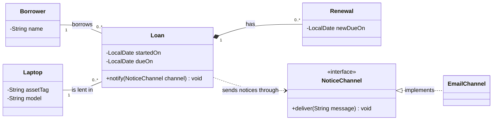

# Chapter 7: Code, Explanations and Solutions

*Testing as a Design Practice*  
*OO Development and Agile Practices*  
Version 1.1 • 13 October 2026 • reviewed against Blueprint v0.3

## 1. Read this before reconstructing the examples

This file accompanies `Chapter_07_Testing_as_a_Design_Practice.md`. It contains the complete cumulative project, JUnit tests, a Maven build, two deliberately staged coordinator alternatives, model solutions and observed verification evidence.

**New behaviour:** US-02 reservation availability enquiry and a bounded in-memory checkout/return flow. **Retained behaviour:** student/staff rules, reservation results, rejection state effects and Chapter 6's local notification contract. **Explicit limitation:** a returned loan does not cancel its reservation, release its reserved interval or remove it from the inherited reservation count.

The TDD record covers the first availability test, its green implementation and extraction of a shared conflict helper. Other query tests, the loan increment and Mockito examples extend the verified result. They are not all claimed to have been developed through recorded test-first cycles.

### 1.1 Versions and commands

| Tool | Tested selection | Role |
|---|---|---|
| Java | Java 17 language/API target; author runtime OpenJDK 17.0.20 | Application and test execution |
| Maven | 3.9.11 | Build and dependency resolution |
| Compiler Plugin | 3.14.1 | Java compilation |
| Surefire Plugin | 3.5.4 | JUnit Platform execution |
| JUnit Jupiter | 5.13.4 | Assertions, test discovery and parameterised cases |
| Mockito | 5.20.0 | Interface mock, stubbing and call verification |

These are fixed chapter choices, not a newest-release recommendation. Install a normal Java 17 JDK and Maven 3.9.11. Confirm `java -version` and `mvn -version`. The first build needs access to the configured Maven repository. A dependency-resolution failure is an environment failure, not a TDD assertion failure.

### 1.2 Reconstruct the cumulative project

Create a directory named `after`. Save every listing whose path begins with `after/` in the indicated location, preserving case and creating intermediate directories. Copy only code-fence contents. Sections 2–4 contain all application, test and configuration files.

The code still uses Java's unnamed package. Maven recognises the source roles through `src/main/java` and `src/test/java`; named packages are a later structural step. The test-resource file must be placed under `src/test/resources`, not beside a Java source file.

From inside `after`:

```bash
mvn --batch-mode verify
java -cp target/classes Chapter07Demo
```

The Bash wrapper remains available:

```bash
bash scripts/check.sh
```

This replaces the earlier direct `javac` gate. New test sources import JUnit and Mockito, so compiling the entire test directory without their dependencies is no longer the intended workflow. Maven supplies the test classpath; these libraries are not runtime dependencies of the application demonstration.

The observed full build reports:

```text
Tests run: 35, Failures: 0, Errors: 0, Skipped: 0
BUILD SUCCESS
```

Four of those cases bridge to the older runners. Their internal counts remain distinct: 34 Chapter 2 checks, five Chapter 3 example groups, 44 Chapter 5 checks and 28 Chapter 6 checks. A JUnit invocation is not necessarily one assertion.

The MVP demonstration prints:

```text
Available before reservation: true
Confirmed: R1 for B1 on CAM1 [2026-10-20, 2026-10-22).
Available after reservation: false
Loan active after checkout: true
Loan active after return: false
Accepted-reservation notices: 1
```

The demo uses a fixed clock and one coordinator/loan-service pair. It records one reservation notice; checkout and return do not send new notices. There is no remote delivery, database or hosted execution involved.

## 2. Complete application source

The existing value objects, policy implementations, notification collaborators and application factory retain their Chapter 6 definitions. The coordinator adds the query and shares conflict detection. `Loan`, `LoanService` and `Chapter07Demo` supply the bounded lending flow.

### 2.1 `after/src/main/java/BorrowerCategory.java`

```java
public enum BorrowerCategory {
    STUDENT, STAFF
}
```

### 2.2 `after/src/main/java/BorrowingPolicy.java`

```java
/**
 * A deterministic, side-effect-free borrowing decision for every pair of ints.
 * Return false for negative counts or nonpositive durations; do not throw for them.
 * Return false for requests outside this implementation's documented limits.
 * A true result concerns count/duration only, not item availability or identity.
 */
public interface BorrowingPolicy {
    boolean mayRequest(int activeReservations, int requestedDays);
}
```

### 2.3 `after/src/main/java/ReservationRules.java`

```java
public final class ReservationRules implements BorrowingPolicy {
    @Override
    public boolean mayRequest(int activeReservations, int requestedDays) {
        return activeReservations >= 0
                && activeReservations < 3
                && requestedDays >= 1
                && requestedDays <= 7;
    }
}
```

### 2.4 `after/src/main/java/StaffReservationRules.java`

```java
/** Illustrative teaching policy, not an approved institutional rule. */
public final class StaffReservationRules implements BorrowingPolicy {
    @Override
    public boolean mayRequest(int activeReservations, int requestedDays) {
        return activeReservations >= 0
                && activeReservations < 5
                && requestedDays >= 1
                && requestedDays <= 14;
    }
}
```

### 2.5 `after/src/main/java/LoanPeriod.java`

```java
import java.time.LocalDate;
import java.util.Objects;

public final class LoanPeriod {
    private final LocalDate start;
    private final LocalDate endExclusive;

    public LoanPeriod(LocalDate start, LocalDate endExclusive) {
        this.start = Objects.requireNonNull(start, "start");
        this.endExclusive = Objects.requireNonNull(endExclusive, "endExclusive");
        if (!start.isBefore(endExclusive)) {
            throw new IllegalArgumentException("End must be after start.");
        }
    }

    public LocalDate start() {
        return start;
    }

    public LocalDate endExclusive() {
        return endExclusive;
    }

    public boolean overlaps(LoanPeriod other) {
        Objects.requireNonNull(other, "other");
        return start.isBefore(other.endExclusive)
                && other.start.isBefore(endExclusive);
    }
}
```

### 2.6 `after/src/main/java/Reservation.java`

```java
import java.util.Objects;

public final class Reservation {
    private final String id;
    private final String borrowerId;
    private final String itemId;
    private final LoanPeriod period;

    public Reservation(String id, String borrowerId, String itemId,
                       LoanPeriod period) {
        this.id = requireText(id);
        this.borrowerId = requireText(borrowerId);
        this.itemId = requireText(itemId);
        this.period = Objects.requireNonNull(period, "period");
    }

    private static String requireText(String value) {
        if (value == null || value.isBlank()) {
            throw new IllegalArgumentException("Identifiers must not be blank.");
        }
        return value;
    }

    public String id() { return id; }
    public String borrowerId() { return borrowerId; }
    public String itemId() { return itemId; }
    public LoanPeriod period() { return period; }
}
```

### 2.7 `after/src/main/java/ConfirmationFormatter.java`

```java
import java.util.Objects;

public final class ConfirmationFormatter {
    public String format(Reservation reservation) {
        Objects.requireNonNull(reservation, "reservation");
        return "Confirmed: " + reservation.id()
                + " for " + reservation.borrowerId()
                + " on " + reservation.itemId()
                + " [" + reservation.period().start()
                + ", " + reservation.period().endExclusive() + ").";
    }
}
```

### 2.8 `after/src/main/java/NotificationSender.java`

```java
/**
 * Accept one non-null confirmed reservation for this implementation's local output.
 * Do not modify the reservation or coordinator. Report expected output failure with
 * NotificationException. Normal return is not a promise of email delivery.
 */
@FunctionalInterface
public interface NotificationSender {
    void send(Reservation reservation);
}
```

### 2.9 `after/src/main/java/NotificationException.java`

```java
public final class NotificationException extends RuntimeException {
    private static final long serialVersionUID = 1L;

    public NotificationException(String message) { super(message); }
}
```

### 2.10 `after/src/main/java/RecordingNotificationSender.java`

```java
import java.util.ArrayList;
import java.util.List;
import java.util.Objects;

public final class RecordingNotificationSender implements NotificationSender {
    private final List<Reservation> received = new ArrayList<>();

    @Override
    public void send(Reservation reservation) {
        received.add(Objects.requireNonNull(reservation, "reservation"));
    }

    public List<Reservation> received() { return List.copyOf(received); }
}
```

### 2.11 `after/src/main/java/ConsoleNotificationSender.java`

```java
import java.io.PrintStream;
import java.util.Objects;

public final class ConsoleNotificationSender implements NotificationSender {
    private final PrintStream output;
    private final ConfirmationFormatter formatter;

    public ConsoleNotificationSender(PrintStream output, ConfirmationFormatter formatter) {
        this.output = Objects.requireNonNull(output, "output");
        this.formatter = Objects.requireNonNull(formatter, "formatter");
    }

    @Override
    public void send(Reservation reservation) {
        output.println("Notice: " + formatter.format(reservation));
        if (output.checkError()) {
            throw new NotificationException("Console output failed.");
        }
    }
}
```

### 2.12 `after/src/main/java/ReservationCoordinator.java`

```java
import java.time.LocalDate;
import java.util.ArrayList;
import java.util.List;
import java.util.Objects;
import java.util.Map;

public final class ReservationCoordinator {
    private final List<Reservation> reservations = new ArrayList<>();
    private final Map<BorrowerCategory, BorrowingPolicy> policies;
    private final ConfirmationFormatter formatter;
    private final NotificationSender notifications;

    public ReservationCoordinator(Map<BorrowerCategory, BorrowingPolicy> policies,
                                  ConfirmationFormatter formatter,
                                  NotificationSender notifications) {
        this.policies = Map.copyOf(Objects.requireNonNull(policies, "policies"));
        for (BorrowerCategory category : BorrowerCategory.values()) {
            if (!this.policies.containsKey(category)) {
                throw new IllegalArgumentException("Missing policy: " + category);
            }
        }
        this.formatter = Objects.requireNonNull(formatter, "formatter");
        this.notifications = Objects.requireNonNull(notifications, "notifications");
    }

    public String reserve(String borrowerId, String itemId,
                          LocalDate start, int requestedDays) {
        return reserve(borrowerId, itemId, start, requestedDays, BorrowerCategory.STUDENT);
    }

    public String reserve(String borrowerId, String itemId, LocalDate start,
                          int requestedDays, BorrowerCategory category) {
        Objects.requireNonNull(category, "category");
        if (borrowerId == null || borrowerId.isBlank()
                || itemId == null || itemId.isBlank()) {
            throw new IllegalArgumentException("Identifiers must not be blank.");
        }
        Objects.requireNonNull(start, "start");

        int activeCount = 0;
        for (Reservation existing : reservations) {
            if (existing.borrowerId().equals(borrowerId)) {
                activeCount++;
            }
        }
        if (!policies.get(category).mayRequest(activeCount, requestedDays)) {
            return "Rejected: borrower limit or duration.";
        }

        LoanPeriod requested = new LoanPeriod(
                start, start.plusDays(requestedDays));
        if (hasConflict(itemId, requested)) {
            return "Rejected: item unavailable.";
        }

        Reservation reservation = new Reservation(
                "R" + (reservations.size() + 1), borrowerId, itemId, requested);
        reservations.add(reservation);
        String confirmation = formatter.format(reservation);
        try {
            notifications.send(reservation);
        } catch (NotificationException failure) {
            return confirmation + " Notification failed; reservation retained.";
        }
        return confirmation;
    }

    public boolean isAvailable(String itemId, LocalDate start, LocalDate endExclusive) {
        if (itemId == null || itemId.isBlank()) {
            throw new IllegalArgumentException("Item identifier must not be blank.");
        }
        LoanPeriod requested = new LoanPeriod(start, endExclusive);
        return !hasConflict(itemId, requested);
    }

    private boolean hasConflict(String itemId, LoanPeriod requested) {
        for (Reservation existing : reservations) {
            if (existing.itemId().equals(itemId) && existing.period().overlaps(requested)) {
                return true;
            }
        }
        return false;
    }

    public List<Reservation> reservations() {
        return List.copyOf(reservations);
    }
}
```

### 2.13 `after/src/main/java/ReservationApplication.java`

```java
import java.time.LocalDate;
import java.util.Map;

public final class ReservationApplication {
    private ReservationApplication() { }

    public static ReservationCoordinator create(NotificationSender sender) {
        return new ReservationCoordinator(
                Map.of(BorrowerCategory.STUDENT, new ReservationRules(),
                       BorrowerCategory.STAFF, new StaffReservationRules()),
                new ConfirmationFormatter(), sender);
    }

    public static void main(String[] args) {
        ConfirmationFormatter noticeFormat = new ConfirmationFormatter();
        NotificationSender sender = new ConsoleNotificationSender(System.out, noticeFormat);
        ReservationCoordinator coordinator = create(sender);
        String result = coordinator.reserve("B1", "CAM1", LocalDate.of(2026, 10, 20), 2);
        System.out.println("Result: " + result);
    }
}
```

### 2.14 `after/src/main/java/Loan.java`

```java
import java.time.LocalDate;
import java.util.Objects;

/** Immutable loan state. A null returnedOn means this loan is active. */
public record Loan(String reservationId, String borrowerId, String itemId,
                   LocalDate borrowedOn, LocalDate returnedOn) {
    public Loan {
        if (reservationId == null || reservationId.isBlank()
                || borrowerId == null || borrowerId.isBlank()
                || itemId == null || itemId.isBlank()) {
            throw new IllegalArgumentException("Loan identifiers must not be blank.");
        }
        Objects.requireNonNull(borrowedOn, "borrowedOn");
        if (returnedOn != null && returnedOn.isBefore(borrowedOn)) {
            throw new IllegalArgumentException("Return cannot precede checkout.");
        }
    }
    public boolean active() { return returnedOn == null; }
}
```

### 2.15 `after/src/main/java/LoanService.java`

```java
import java.time.Clock;
import java.time.LocalDate;
import java.util.LinkedHashMap;
import java.util.List;
import java.util.Map;
import java.util.Objects;

/** One service per coordinator/session; sequential, in-memory teaching flow. */
public final class LoanService {
    private final ReservationCoordinator reservations;
    private final Clock clock;
    private final Map<String, Loan> loans = new LinkedHashMap<>();

    public LoanService(ReservationCoordinator reservations, Clock clock) {
        this.reservations = Objects.requireNonNull(reservations, "reservations");
        this.clock = Objects.requireNonNull(clock, "clock");
    }

    public Loan checkOut(String reservationId) {
        Reservation reservation = reservations.reservations().stream()
                .filter(r -> r.id().equals(reservationId))
                .findFirst().orElseThrow(() -> new IllegalArgumentException("Unknown reservation."));
        if (loans.containsKey(reservationId)) {
            throw new IllegalStateException("Reservation already used for a loan.");
        }
        LocalDate today = LocalDate.now(clock);
        if (today.isBefore(reservation.period().start())
                || !today.isBefore(reservation.period().endExclusive())) {
            throw new IllegalStateException("Checkout must be within the reservation period.");
        }
        boolean itemAlreadyOut = loans.values().stream()
                .anyMatch(loan -> loan.active() && loan.itemId().equals(reservation.itemId()));
        if (itemAlreadyOut) throw new IllegalStateException("Item is already on loan.");
        Loan loan = new Loan(reservation.id(), reservation.borrowerId(),
                reservation.itemId(), today, null);
        loans.put(reservationId, loan);
        return loan;
    }

    public Loan returnLoan(String reservationId) {
        Loan current = loans.get(reservationId);
        if (current == null || !current.active()) {
            throw new IllegalStateException("No active loan for this reservation.");
        }
        Loan returned = new Loan(current.reservationId(), current.borrowerId(),
                current.itemId(), current.borrowedOn(), LocalDate.now(clock));
        loans.put(reservationId, returned);
        return returned;
    }

    public List<Loan> loans() { return List.copyOf(loans.values()); }
}
```

### 2.16 `after/src/main/java/Chapter04Demo.java`

```java
import java.time.LocalDate;

public final class Chapter04Demo {
    public static void main(String[] args) {
        ReservationCoordinator coordinator = ReservationApplication.create(new RecordingNotificationSender());
        LocalDate start = LocalDate.of(2026, 10, 20);
        System.out.println(coordinator.reserve("B1", "CAM1", start, 2));
        System.out.println(coordinator.reserve("B2", "CAM1", start.plusDays(1), 1));
        System.out.println(coordinator.reserve("B2", "CAM1", start.plusDays(2), 1));
        System.out.println("Stored reservations: " + coordinator.reservations().size());
    }
}
```

### 2.17 `after/src/main/java/Chapter05Demo.java`

```java
import java.time.LocalDate;

public final class Chapter05Demo {
    public static void main(String[] args) {
        ReservationCoordinator coordinator = ReservationApplication.create(new RecordingNotificationSender());
        LocalDate day = LocalDate.of(2026, 10, 20);
        System.out.println(coordinator.reserve("S1", "CAM1", day, 14,
                BorrowerCategory.STAFF));
        System.out.println(coordinator.reserve("B1", "MIC1", day, 14));
        System.out.println(coordinator.reserve("B1", "CAM1", day.plusDays(1), 1));
        System.out.println(coordinator.reserve("B1", "CAM1", day.plusDays(14), 1));
        System.out.println("Stored reservations: " + coordinator.reservations().size());
    }
}
```

### 2.18 `after/src/main/java/Chapter07Demo.java`

```java
import java.time.Clock;
import java.time.Instant;
import java.time.LocalDate;
import java.time.ZoneOffset;

public final class Chapter07Demo {
    public static void main(String[] args) {
        RecordingNotificationSender inbox = new RecordingNotificationSender();
        ReservationCoordinator reservations = ReservationApplication.create(inbox);
        LocalDate day = LocalDate.of(2026, 10, 20);
        System.out.println("Available before reservation: " + reservations.isAvailable("CAM1", day, day.plusDays(2)));
        System.out.println(reservations.reserve("B1", "CAM1", day, 2));
        System.out.println("Available after reservation: " + reservations.isAvailable("CAM1", day, day.plusDays(2)));
        LoanService loans = new LoanService(reservations,
                Clock.fixed(Instant.parse("2026-10-20T12:00:00Z"), ZoneOffset.UTC));
        System.out.println("Loan active after checkout: " + loans.checkOut("R1").active());
        System.out.println("Loan active after return: " + loans.returnLoan("R1").active());
        System.out.println("Accepted-reservation notices: " + inbox.received().size());
    }
}
```

### 2.19 Reading the new behaviour

`isAvailable` validates the item and constructs a valid half-open period before inspecting conflicts. It has no borrower argument, no count limit and no call to `reserve`. The shared helper is private; tests observe public behaviour rather than require a particular helper name or invocation count.

`LoanService` looks up confirmed reservations from its associated coordinator. Checkout requires a date inside the reserved period, rejects an already-used reservation and prevents two active loans for the same item within this service. Return requires an active loan. A backward date cannot create a return before checkout because the new immutable `Loan` value validates that invariant before the map is updated.

The `Loan` record's `returnedOn` component is null only while active. A return creates a replacement record; earlier snapshots retain the previous value. Identifiers and checkout dates are validated. The record syntax supplies component accessors, value equality and a data-oriented representation; it does not provide validation automatically.

The service has its own loan map. Construct one service per coordinator/session. Two independent services would have independent loan state, and none of this code is thread-safe. Reservation counts and availability are unchanged by returning a loan: this deliberately preserves the earlier reservation contract while exposing the unresolved completion policy.

## 3. Complete tests

The four legacy runners below are unchanged from Chapter 6. The JUnit bridge invokes them explicitly. New test classes then examine the query, policy boundaries, loan state and notification interactions.

### 3.1 `after/src/test/java/Chapter02Checks.java`

```java
import java.time.DateTimeException;
import java.time.LocalDate;
import java.util.List;

public class Chapter02Checks {
    private static int checks;

    public static void main(String[] args) {
        LocalDate day = LocalDate.of(2026, 10, 20);
        LoanPeriod first = new LoanPeriod(day, day.plusDays(2));
        LoanPeriod overlapping = new LoanPeriod(day.plusDays(1), day.plusDays(3));
        LoanPeriod adjacent = new LoanPeriod(day.plusDays(2), day.plusDays(3));
        check(first.overlaps(overlapping), "overlap detected");
        check(overlapping.overlaps(first), "overlap is symmetric");
        check(!first.overlaps(adjacent), "adjacent periods allowed");
        check(!adjacent.overlaps(first), "adjacency symmetric");
        check(first.overlaps(new LoanPeriod(day, day.plusDays(2))), "equal periods overlap");
        check(first.overlaps(new LoanPeriod(day.minusDays(1), day.plusDays(4))),
                "containment overlaps");
        expect(IllegalArgumentException.class, () -> new LoanPeriod(day, day),
                "zero-length period");
        expect(IllegalArgumentException.class, () -> new LoanPeriod(day, day.minusDays(1)),
                "reversed period");
        expect(NullPointerException.class, () -> new LoanPeriod(null, day), "null start");
        expect(NullPointerException.class, () -> new LoanPeriod(day, null), "null end");

        ReservationCoordinator c = ReservationApplication.create(new RecordingNotificationSender());
        check(c.reserve("B1", "CAM1", day, 2).equals(
                "Confirmed: R1 for B1 on CAM1 [2026-10-20, 2026-10-22)."),
                "exact first confirmation");
        check(c.reservations().size() == 1, "one success stored");
        check(c.reserve("B2", "CAM1", day.plusDays(1), 1).equals(
                "Rejected: item unavailable."), "overlapping same item rejected");
        check(c.reservations().size() == 1, "conflict stores nothing");
        check(c.reserve("B2", "CAM1", day.plusDays(2), 1).equals(
                "Confirmed: R2 for B2 on CAM1 [2026-10-22, 2026-10-23)."),
                "adjacent request and identifier after rejection");
        check(c.reserve("B1", "MIC1", day, 7).equals(
                "Confirmed: R3 for B1 on MIC1 [2026-10-20, 2026-10-27)."),
                "different item and seven-day limit allowed");
        check(c.reserve("B1", "TRI1", day, 1).startsWith("Confirmed:"),
                "third active reservation allowed");
        check(c.reserve("B1", "CAM2", day, 1).equals(
                "Rejected: borrower limit or duration."), "fourth rejected");
        check(c.reservations().size() == 4, "borrower-limit rejection stores nothing");

        List<Reservation> snapshot = c.reservations();
        expect(UnsupportedOperationException.class, snapshot::clear, "snapshot unmodifiable");
        check(c.reservations().size() == 4, "failed clear preserves coordinator state");
        check(c.reserve("B3", "CAM2", day, 1).startsWith("Confirmed:"),
                "another borrower unaffected by B1 limit");
        check(snapshot.size() == 4 && c.reservations().size() == 5,
                "old snapshot does not track later additions");
        check(snapshot.get(0).period().start().equals(day), "stored period preserved");

        ReservationCoordinator invalid = ReservationApplication.create(new RecordingNotificationSender());
        check(invalid.reserve("B1", "CAM1", day, 0).equals(
                "Rejected: borrower limit or duration."), "zero duration rejected");
        check(invalid.reserve("B1", "CAM1", day, -1).equals(
                "Rejected: borrower limit or duration."), "negative duration rejected");
        check(invalid.reserve("B1", "CAM1", day, 8).equals(
                "Rejected: borrower limit or duration."), "eight-day duration rejected");
        expect(IllegalArgumentException.class, () -> invalid.reserve(" ", "CAM1", day, 1),
                "blank borrower");
        expect(IllegalArgumentException.class, () -> invalid.reserve("B1", null, day, 1),
                "null item");
        expect(NullPointerException.class, () -> invalid.reserve("B1", "CAM1", null, 1),
                "null request date");
        expect(DateTimeException.class, () -> invalid.reserve("B1", "CAM1", LocalDate.MAX, 1),
                "unrepresentable end date");
        check(invalid.reservations().isEmpty(), "invalid requests store nothing");
        expect(IllegalArgumentException.class,
                () -> new Reservation("", "B1", "CAM1", first), "blank reservation identifier");
        expect(NullPointerException.class,
                () -> new Reservation("R1", "B1", "CAM1", null), "null reservation period");
        System.out.println("All " + checks + " chapter checks passed.");
    }

    private static void check(boolean condition, String label) {
        if (!condition) {
            throw new AssertionError(label);
        }
        checks++;
    }

    private static void expect(Class<? extends Throwable> type, Runnable action,
                               String label) {
        try {
            action.run();
        } catch (Throwable error) {
            check(type.isInstance(error), label + ": wrong exception " + error);
            return;
        }
        throw new AssertionError(label + ": expected " + type.getSimpleName());
    }
}
```

### 3.2 `after/src/test/java/Chapter03AcceptanceExamples.java`

```java
import java.time.LocalDate;

public class Chapter03AcceptanceExamples {
    public static void main(String[] args) {
        LocalDate day = LocalDate.of(2026, 10, 20);
        ReservationCoordinator coordinator = ReservationApplication.create(new RecordingNotificationSender());

        // AC-01: an eligible request is stored once and confirmed.
        String accepted = coordinator.reserve("B1", "CAM1", day, 2);
        require(accepted.equals(
                "Confirmed: R1 for B1 on CAM1 [2026-10-20, 2026-10-22)."),
                "AC-01 confirmation");
        require(coordinator.reservations().size() == 1, "AC-01 one record");
        System.out.println("AC-01 passed");

        // AC-02: an overlapping request for the same item changes no records.
        String conflict = coordinator.reserve("B2", "CAM1", day.plusDays(1), 1);
        require(conflict.equals("Rejected: item unavailable."), "AC-02 rejection");
        require(coordinator.reservations().size() == 1, "AC-02 unchanged count");
        require(coordinator.reservations().get(0).borrowerId().equals("B1"),
                "AC-02 original borrower preserved");
        System.out.println("AC-02 passed");

        // AC-03: a booking may start at an existing exclusive end,
        // or end exactly where an existing booking starts.
        String adjacent = coordinator.reserve("B2", "CAM1", day.plusDays(2), 1);
        require(adjacent.equals(
                "Confirmed: R2 for B2 on CAM1 [2026-10-22, 2026-10-23)."),
                "AC-03 adjacent confirmation");
        require(coordinator.reservations().size() == 2, "AC-03 second record");
        String before = coordinator.reserve("B3", "CAM1", day.minusDays(1), 1);
        require(before.equals(
                "Confirmed: R3 for B3 on CAM1 [2026-10-19, 2026-10-20)."),
                "AC-03 request ending at an existing start");
        require(coordinator.reservations().size() == 3, "AC-03 third record");
        System.out.println("AC-03 passed");

        // AC-04: count limits span items, not just one equipment item.
        ReservationCoordinator limits = ReservationApplication.create(new RecordingNotificationSender());
        for (String item : new String[] {"CAM1", "MIC1", "TRI1"}) {
            require(limits.reserve("B1", item, day, 1).startsWith("Confirmed:"),
                    "AC-04 establish three valid reservations");
        }
        require(limits.reserve("B1", "CAM2", day, 1).equals(
                "Rejected: borrower limit or duration."), "AC-04 fourth rejected");
        require(limits.reservations().size() == 3, "AC-04 unchanged count");
        System.out.println("AC-04 passed");

        // AC-05: one and seven days are allowed; zero, negative and eight are not.
        ReservationCoordinator durations = ReservationApplication.create(new RecordingNotificationSender());
        require(durations.reserve("B1", "CAM1", day, 1).startsWith("Confirmed:"),
                "AC-05 one day");
        require(durations.reserve("B1", "MIC1", day, 7).startsWith("Confirmed:"),
                "AC-05 seven days");
        for (int days : new int[] {0, -1, 8}) {
            require(durations.reserve("B1", "TRI1", day, days).equals(
                    "Rejected: borrower limit or duration."), "AC-05 invalid duration");
            require(durations.reservations().size() == 2, "AC-05 unchanged count");
        }
        System.out.println("AC-05 passed");
        System.out.println("All 5 acceptance examples passed.");
    }

    private static void require(boolean condition, String description) {
        if (!condition) {
            throw new AssertionError(description);
        }
    }
}
```

### 3.3 `after/src/test/java/Chapter05Checks.java`

```java
import java.time.LocalDate;
import java.util.List;

public final class Chapter05Checks {
    private static int checks;

    public static void main(String[] args) {
        BorrowingPolicy student = new ReservationRules();
        BorrowingPolicy staff = new StaffReservationRules();
        sharedPolicyContract(student);
        sharedPolicyContract(staff);
        check(student.mayRequest(2, 7), "student upper accepted boundaries");
        check(!student.mayRequest(3, 7), "student fourth rejected");
        check(!student.mayRequest(0, 8), "student eight days rejected");
        check(staff.mayRequest(4, 14), "staff upper accepted boundaries");
        check(!staff.mayRequest(5, 14), "staff sixth rejected");
        check(!staff.mayRequest(0, 15), "staff fifteen days rejected");

        LocalDate day = LocalDate.of(2026, 10, 20);
        ReservationCoordinator c = ReservationApplication.create(new RecordingNotificationSender());
        check(c.reserve("S1", "CAM1", day, 14, BorrowerCategory.STAFF).equals(
                "Confirmed: R1 for S1 on CAM1 [2026-10-20, 2026-11-03)."),
                "staff confirmation with new limit");
        List<Reservation> snapshot = c.reservations();
        check(c.reserve("B1", "CAM1", day.plusDays(1), 1).equals(
                "Rejected: item unavailable."), "student conflicts with staff booking");
        check(c.reservations().equals(snapshot), "conflict preserves exact records");
        check(c.reserve("B1", "CAM1", day.plusDays(14), 1).equals(
                "Confirmed: R2 for B1 on CAM1 [2026-11-03, 2026-11-04)."),
                "cross-category adjacency and next identifier");
        List<Reservation> beforeInvalid = c.reservations();
        check(c.reserve("S1", "MIC1", day, 15, BorrowerCategory.STAFF).equals(
                "Rejected: borrower limit or duration."), "staff invalid duration result");
        check(c.reservations().equals(beforeInvalid), "invalid staff request preserves records");
        expect(NullPointerException.class,
                () -> c.reserve("S1", "MIC1", day, 1, null), "null category");
        check(c.reservations().equals(beforeInvalid), "null category preserves records");

        ReservationCoordinator limits = ReservationApplication.create(new RecordingNotificationSender());
        for (int i = 1; i <= 5; i++) {
            check(limits.reserve("S2", "ITEM" + i, day, 1, BorrowerCategory.STAFF)
                    .startsWith("Confirmed:"), "staff reservation " + i);
        }
        List<Reservation> five = limits.reservations();
        check(limits.reserve("S2", "ITEM6", day, 1, BorrowerCategory.STAFF).equals(
                "Rejected: borrower limit or duration."), "staff sixth rejected in coordinator");
        check(limits.reservations().equals(five), "staff limit preserves records");

        ReservationCoordinator defaultStudent = ReservationApplication.create(new RecordingNotificationSender());
        ReservationCoordinator explicitStudent = ReservationApplication.create(new RecordingNotificationSender());
        check(defaultStudent.reserve("B1", "MIC1", day, 7).equals(
                explicitStudent.reserve("B1", "MIC1", day, 7, BorrowerCategory.STUDENT)),
                "default and explicit student results agree");
        check(defaultStudent.reserve("B2", "TRI1", day, 8).equals(
                "Rejected: borrower limit or duration."), "default remains student");

        // Counts belong to a borrower ID across all records, not separate category buckets.
        ReservationCoordinator mixedFixture = ReservationApplication.create(new RecordingNotificationSender());
        for (int i = 1; i <= 3; i++) {
            mixedFixture.reserve("X1", "ITEM" + i, day, 1);
        }
        check(mixedFixture.reserve("X1", "ITEM4", day, 1, BorrowerCategory.STAFF)
                .startsWith("Confirmed:"), "supplied staff policy uses existing count three");
        check(mixedFixture.reserve("X1", "ITEM5", day, 1, BorrowerCategory.STAFF)
                .startsWith("Confirmed:"), "supplied staff policy uses existing count four");
        check(mixedFixture.reserve("X1", "ITEM6", day, 1, BorrowerCategory.STAFF).equals(
                "Rejected: borrower limit or duration."), "counts not reset by category selection");
        System.out.println("All " + checks + " Chapter 5 checks passed.");
    }

    private static void sharedPolicyContract(BorrowingPolicy policy) {
        check(!policy.mayRequest(-1, 1), "negative count returns false");
        check(!policy.mayRequest(Integer.MIN_VALUE, 1), "minimum count returns false");
        check(!policy.mayRequest(0, 0), "zero duration returns false");
        check(!policy.mayRequest(0, -1), "negative duration returns false");
        check(!policy.mayRequest(0, Integer.MIN_VALUE), "minimum duration returns false");
        check(policy.mayRequest(0, 1), "documented one-day request allowed");
        check(!policy.mayRequest(Integer.MAX_VALUE, 1), "above documented count limits");
        check(!policy.mayRequest(0, Integer.MAX_VALUE), "above documented duration limits");
        boolean first = policy.mayRequest(1, 2);
        policy.mayRequest(0, 1);
        check(policy.mayRequest(1, 2) == first, "repeat decision unchanged by intervening call");
    }

    private static void check(boolean condition, String label) {
        if (!condition) throw new AssertionError(label);
        checks++;
    }

    private static void expect(Class<? extends Throwable> type, Runnable action,
                               String label) {
        try {
            action.run();
        } catch (Throwable error) {
            check(type.isInstance(error), label + ": wrong exception " + error);
            return;
        }
        throw new AssertionError(label + ": expected " + type.getSimpleName());
    }
}
```

### 3.4 `after/src/test/java/Chapter06Checks.java`

```java
import java.io.ByteArrayOutputStream;
import java.io.OutputStream;
import java.io.PrintStream;
import java.io.IOException;
import java.nio.charset.StandardCharsets;
import java.time.LocalDate;
import java.util.EnumMap;
import java.util.List;
import java.util.Map;

public final class Chapter06Checks {
    private static int checks;

    public static void main(String[] args) {
        LocalDate day = LocalDate.of(2026, 10, 20);
        RecordingNotificationSender inbox = new RecordingNotificationSender();
        ReservationCoordinator c = ReservationApplication.create(inbox);
        String first = c.reserve("B1", "CAM1", day, 2);
        check(first.equals("Confirmed: R1 for B1 on CAM1 [2026-10-20, 2026-10-22)."),
                "accepted return unchanged");
        check(inbox.received().size() == 1, "one notification per accepted request");
        check(inbox.received().get(0) == c.reservations().get(0), "accepted record supplied");
        List<Reservation> oldInbox = inbox.received();
        expect(UnsupportedOperationException.class, oldInbox::clear, "inbox snapshot unmodifiable");
        check(c.reserve("B2", "CAM1", day.plusDays(1), 1).equals(
                "Rejected: item unavailable."), "conflict result preserved");
        check(inbox.received().size() == 1, "conflict sends nothing");
        c.reserve("B1", "MIC1", day, 8);
        check(inbox.received().size() == 1, "duration rejection sends nothing");
        expect(IllegalArgumentException.class, () -> c.reserve("", "CAM1", day, 1), "bad ID");
        check(inbox.received().size() == 1, "invalid argument sends nothing");
        c.reserve("B2", "CAM1", day.plusDays(2), 1);
        check(inbox.received().size() == 2, "adjacent acceptance sends once");
        check(oldInbox.size() == 1, "earlier inbox snapshot stable");

        FailingSender failure = new FailingSender();
        ReservationCoordinator failed = ReservationApplication.create(failure);
        String failureResult = failed.reserve("B1", "CAM1", day, 2);
        check(failureResult.equals(first + " Notification failed; reservation retained."),
                "explicit partial-success result");
        check(failed.reservations().size() == 1, "notification failure retains accepted record");
        check(failure.calls == 1, "one attempt and no automatic retry");
        check(failed.reserve("B1", "CAM1", day, 2).equals("Rejected: item unavailable."),
                "retrying reservation is still a conflict");
        check(failure.calls == 1, "conflicting repeat does not attempt notification");

        ReservationCoordinator unexpected = ReservationApplication.create(new BrokenSender());
        expect(IllegalStateException.class, () -> unexpected.reserve("B1", "CAM1", day, 2),
                "unexpected sender failure is not swallowed");
        check(unexpected.reservations().size() == 1, "record is stored before the unexpected failure");

        Map<BorrowerCategory, BorrowingPolicy> configured = policies();
        expect(NullPointerException.class, () -> new ReservationCoordinator(
                null, new ConfirmationFormatter(), inbox), "null policy map");
        expect(IllegalArgumentException.class, () -> new ReservationCoordinator(
                Map.of(BorrowerCategory.STUDENT, new ReservationRules()),
                new ConfirmationFormatter(), inbox), "missing staff policy");
        expect(NullPointerException.class, () -> new ReservationCoordinator(
                configured, null, inbox), "null formatter");
        expect(NullPointerException.class, () -> new ReservationCoordinator(
                configured, new ConfirmationFormatter(), null), "null sender");
        Map<BorrowerCategory, BorrowingPolicy> mutable = new EnumMap<>(configured);
        ReservationCoordinator copied = new ReservationCoordinator(mutable,
                new ConfirmationFormatter(), new RecordingNotificationSender());
        mutable.put(BorrowerCategory.STUDENT, (count, days) -> false);
        check(copied.reserve("B1", "CAM1", day, 1).startsWith("Confirmed:"),
                "caller map mutation cannot rewire coordinator");
        Map<BorrowerCategory, BorrowingPolicy> restrictive = new EnumMap<>(configured);
        restrictive.put(BorrowerCategory.STUDENT, (count, days) -> false);
        RecordingNotificationSender restrictedInbox = new RecordingNotificationSender();
        ReservationCoordinator restricted = new ReservationCoordinator(restrictive,
                new ConfirmationFormatter(), restrictedInbox);
        check(restricted.reserve("B1", "CAM1", day, 1).equals(
                "Rejected: borrower limit or duration."), "injected policy is used");
        check(restrictedInbox.received().isEmpty(), "injected rejection sends nothing");

        ByteArrayOutputStream bytes = new ByteArrayOutputStream();
        ConsoleNotificationSender console = new ConsoleNotificationSender(
                new PrintStream(bytes, true, StandardCharsets.UTF_8), new ConfirmationFormatter());
        console.send(c.reservations().get(0));
        check(bytes.toString(StandardCharsets.UTF_8).equals("Notice: " + first + System.lineSeparator()),
                "console implementation uses supplied stream");
        PrintStream brokenOutput = new PrintStream(new OutputStream() {
            @Override public void write(int value) throws IOException {
                throw new IOException("Expected output failure");
            }
        });
        ConsoleNotificationSender brokenConsole = new ConsoleNotificationSender(
                brokenOutput, new ConfirmationFormatter());
        expect(NotificationException.class, () -> brokenConsole.send(c.reservations().get(0)),
                "console reports expected output failure");
        expect(NullPointerException.class, () -> inbox.send(null), "null notice rejected");
        System.out.println("All " + checks + " Chapter 6 checks passed.");
    }

    private static Map<BorrowerCategory, BorrowingPolicy> policies() {
        return Map.of(BorrowerCategory.STUDENT, new ReservationRules(),
                      BorrowerCategory.STAFF, new StaffReservationRules());
    }

    private static final class FailingSender implements NotificationSender {
        private int calls;
        @Override public void send(Reservation reservation) {
            calls++;
            throw new NotificationException("Expected teaching failure");
        }
    }

    // A programming defect, not an expected output failure: it must not be swallowed.
    private static final class BrokenSender implements NotificationSender {
        @Override public void send(Reservation reservation) {
            throw new IllegalStateException("Unexpected programming failure");
        }
    }

    private static void check(boolean condition, String label) {
        if (!condition) throw new AssertionError(label);
        checks++;
    }

    private static void expect(Class<? extends Throwable> type, Runnable action, String label) {
        try { action.run(); }
        catch (Throwable error) {
            check(type.isInstance(error), label + ": wrong exception " + error);
            return;
        }
        throw new AssertionError(label + ": expected " + type.getSimpleName());
    }
}
```

### 3.5 `after/src/test/java/LegacyRegressionTest.java`

```java
import org.junit.jupiter.api.Test;

class LegacyRegressionTest {
    @Test void chapter02() { Chapter02Checks.main(new String[0]); }
    @Test void chapter03() { Chapter03AcceptanceExamples.main(new String[0]); }
    @Test void chapter05() { Chapter05Checks.main(new String[0]); }
    @Test void chapter06() { Chapter06Checks.main(new String[0]); }
}
```

### 3.6 `after/src/test/java/AvailabilityTddTest.java`

```java
import java.time.LocalDate;
import java.util.List;
import org.junit.jupiter.api.Test;
import static org.junit.jupiter.api.Assertions.*;

class AvailabilityTddTest {
    @Test
    void overlappingEnquiryIsUnavailableWithoutChangingRecordsOrNotifying() {
        // Arrange: one confirmed CAM1 reservation, ending exclusively on 22 October.
        RecordingNotificationSender inbox = new RecordingNotificationSender();
        ReservationCoordinator coordinator = ReservationApplication.create(inbox);
        LocalDate start = LocalDate.of(2026, 10, 20);
        coordinator.reserve("B1", "CAM1", start, 2);
        List<Reservation> recordsBefore = coordinator.reservations();
        List<Reservation> noticesBefore = inbox.received();

        // Act: inspect the overlapping interval without requesting a reservation.
        boolean available = coordinator.isAvailable("CAM1", start.plusDays(1), start.plusDays(3));

        // Assert: the answer and both kinds of state matter.
        assertAll(
                () -> assertFalse(available, "An overlapping item must be unavailable"),
                () -> assertEquals(recordsBefore, coordinator.reservations()),
                () -> assertEquals(noticesBefore, inbox.received()));
    }
}
```

### 3.7 `after/src/test/java/AvailabilityTest.java`

```java
import java.time.LocalDate;
import java.util.List;
import org.junit.jupiter.api.Test;
import org.junit.jupiter.params.ParameterizedTest;
import org.junit.jupiter.params.provider.ValueSource;
import static org.junit.jupiter.api.Assertions.*;

class AvailabilityTest {
    private final LocalDate day = LocalDate.of(2026, 10, 20);
    private final RecordingNotificationSender inbox = new RecordingNotificationSender();
    private final ReservationCoordinator c = ReservationApplication.create(inbox);

    @Test void emptyScheduleIsAvailableWithoutAnySideEffect() {
        assertTrue(c.isAvailable("CAM1", day, day.plusDays(2)));
        assertTrue(c.reservations().isEmpty());
        assertTrue(inbox.received().isEmpty());
    }

    @Test void adjacentPeriodAndDifferentItemAreAvailable() {
        c.reserve("B1", "CAM1", day, 2);
        List<Reservation> records = c.reservations();
        List<Reservation> notices = inbox.received();
        assertTrue(c.isAvailable("CAM1", day.plusDays(2), day.plusDays(3)));
        assertTrue(c.isAvailable("MIC1", day, day.plusDays(2)));
        assertEquals(records, c.reservations());
        assertEquals(notices, inbox.received());
    }

    @ParameterizedTest @ValueSource(ints = {0, -1})
    void invalidPeriodFailsWithoutChangingState(int endOffset) {
        c.reserve("B1", "CAM1", day, 2);
        List<Reservation> records = c.reservations();
        List<Reservation> notices = inbox.received();
        assertThrows(IllegalArgumentException.class,
                () -> c.isAvailable("CAM1", day, day.plusDays(endOffset)));
        assertEquals(records, c.reservations());
        assertEquals(notices, inbox.received());
    }

    @Test void malformedIdentifiersAndNullDatesAreRejected() {
        assertThrows(IllegalArgumentException.class, () -> c.isAvailable(" ", day, day.plusDays(1)));
        assertThrows(IllegalArgumentException.class, () -> c.isAvailable(null, day, day.plusDays(1)));
        assertThrows(NullPointerException.class, () -> c.isAvailable("CAM1", null, day.plusDays(1)));
        assertThrows(NullPointerException.class, () -> c.isAvailable("CAM1", day, null));
        assertTrue(c.reservations().isEmpty());
        assertTrue(inbox.received().isEmpty());
    }

    @Test void queryDoesNotAllocateAnIdentifier() {
        c.isAvailable("CAM1", day, day.plusDays(1));
        assertEquals("Confirmed: R1 for B1 on CAM1 [2026-10-20, 2026-10-21).",
                c.reserve("B1", "CAM1", day, 1));
    }

    @Test void availabilityDoesNotMeanBorrowerEligibility() {
        for (String item : List.of("CAM1", "MIC1", "TRI1")) c.reserve("B1", item, day, 1);
        assertTrue(c.isAvailable("CAM2", day, day.plusDays(1)));
        assertEquals("Rejected: borrower limit or duration.", c.reserve("B1", "CAM2", day, 1));
        assertEquals(3, inbox.received().size());
    }

    @Test void queryCanSpanMoreDaysThanAStudentMayReserve() {
        assertTrue(c.isAvailable("CAM1", day, day.plusDays(30)));
        assertEquals("Rejected: borrower limit or duration.", c.reserve("B1", "CAM1", day, 30));
    }
}
```

### 3.8 `after/src/test/java/BorrowingPolicyTest.java`

```java
import org.junit.jupiter.params.ParameterizedTest;
import org.junit.jupiter.params.provider.CsvSource;
import static org.junit.jupiter.api.Assertions.assertEquals;

class BorrowingPolicyTest {
    @ParameterizedTest(name = "{0}: count={1}, days={2} -> {3}")
    @CsvSource({
        "STUDENT, 0, 1, true", "STUDENT, 2, 7, true",
        "STUDENT, 3, 1, false", "STUDENT, 0, 8, false",
        "STAFF, 4, 14, true", "STAFF, 5, 1, false",
        "STAFF, 0, 15, false", "STUDENT, -1, 1, false",
        "STAFF, 0, 0, false", "STAFF, 0, -1, false"
    })
    void documentedBoundaries(BorrowerCategory category, int count, int days, boolean expected) {
        BorrowingPolicy policy = category == BorrowerCategory.STUDENT
                ? new ReservationRules() : new StaffReservationRules();
        assertEquals(expected, policy.mayRequest(count, days));
    }
}
```

### 3.9 `after/src/test/java/LoanServiceTest.java`

```java
import java.time.Clock;
import java.time.Instant;
import java.time.LocalDate;
import java.time.ZoneId;
import java.time.ZoneOffset;
import java.util.List;
import java.util.concurrent.atomic.AtomicReference;
import org.junit.jupiter.api.Test;
import org.junit.jupiter.params.ParameterizedTest;
import org.junit.jupiter.params.provider.ValueSource;
import static org.junit.jupiter.api.Assertions.*;

class LoanServiceTest {
    private final LocalDate start = LocalDate.of(2026, 10, 20);

    private ReservationCoordinator reserved() {
        ReservationCoordinator c = ReservationApplication.create(new RecordingNotificationSender());
        c.reserve("B1", "CAM1", start, 2);
        return c;
    }

    @Test void checkoutAndReturnUseTheSuppliedClock() {
        AdjustableClock clock = new AdjustableClock(Instant.parse("2026-10-20T09:00:00Z"));
        LoanService service = new LoanService(reserved(), clock);
        Loan active = service.checkOut("R1");
        List<Loan> snapshot = service.loans();
        assertThrows(UnsupportedOperationException.class, snapshot::clear);
        assertEquals(start, active.borrowedOn());
        assertTrue(active.active());
        clock.set(Instant.parse("2026-10-21T09:00:00Z"));
        Loan returned = service.returnLoan("R1");
        assertAll(() -> assertFalse(returned.active()),
                () -> assertEquals(start.plusDays(1), returned.returnedOn()),
                () -> assertTrue(snapshot.get(0).active(), "Old immutable snapshot stays active"),
                () -> assertEquals(List.of(returned), service.loans()));
        assertThrows(IllegalStateException.class, () -> service.returnLoan("R1"));
        assertEquals(List.of(returned), service.loans());
    }

    @ParameterizedTest
    @ValueSource(strings = {"2026-10-19T12:00:00Z", "2026-10-22T00:00:00Z"})
    void checkoutOutsideHalfOpenPeriodIsRejected(String instant) {
        LoanService service = new LoanService(reserved(), Clock.fixed(Instant.parse(instant), ZoneOffset.UTC));
        assertThrows(IllegalStateException.class, () -> service.checkOut("R1"));
        assertTrue(service.loans().isEmpty());
    }

    @Test void unknownReservationAndInactiveReturnChangeNothing() {
        LoanService service = new LoanService(reserved(), Clock.fixed(
                Instant.parse("2026-10-20T12:00:00Z"), ZoneOffset.UTC));
        assertThrows(IllegalArgumentException.class, () -> service.checkOut("R99"));
        assertThrows(IllegalStateException.class, () -> service.returnLoan("R1"));
        assertTrue(service.loans().isEmpty());
    }

    @Test void aReservationCannotBeCheckedOutTwiceEvenAfterReturn() {
        LoanService service = new LoanService(reserved(), Clock.fixed(
                Instant.parse("2026-10-20T12:00:00Z"), ZoneOffset.UTC));
        service.checkOut("R1");
        assertThrows(IllegalStateException.class, () -> service.checkOut("R1"));
        service.returnLoan("R1");
        List<Loan> before = service.loans();
        assertThrows(IllegalStateException.class, () -> service.checkOut("R1"));
        assertEquals(before, service.loans());
    }

    @Test void unreturnedItemBlocksTheNextAdjacentReservationUntilReturned() {
        ReservationCoordinator c = reserved();
        c.reserve("B2", "CAM1", start.plusDays(2), 1);
        AdjustableClock clock = new AdjustableClock(Instant.parse("2026-10-20T09:00:00Z"));
        LoanService service = new LoanService(c, clock);
        service.checkOut("R1");
        clock.set(Instant.parse("2026-10-22T09:00:00Z"));
        assertThrows(IllegalStateException.class, () -> service.checkOut("R2"));
        assertEquals(1, service.loans().size());
        service.returnLoan("R1");
        assertTrue(service.checkOut("R2").active());
    }

    @Test void clockZoneDeterminesTheCheckoutDate() {
        Clock local = Clock.fixed(Instant.parse("2026-10-19T22:30:00Z"), ZoneId.of("Asia/Baghdad"));
        LoanService service = new LoanService(reserved(), local);
        assertEquals(start, service.checkOut("R1").borrowedOn());
    }

    @Test void backwardClockCannotRecordReturnBeforeCheckout() {
        AdjustableClock clock = new AdjustableClock(Instant.parse("2026-10-20T09:00:00Z"));
        LoanService service = new LoanService(reserved(), clock);
        service.checkOut("R1");
        List<Loan> before = service.loans();
        clock.set(Instant.parse("2026-10-19T09:00:00Z"));
        assertThrows(IllegalArgumentException.class, () -> service.returnLoan("R1"));
        assertEquals(before, service.loans());
    }

    @Test void returningLoanDoesNotRewriteHistoricalReservationsOrTheirCount() {
        ReservationCoordinator c = reserved();
        LoanService service = new LoanService(c, Clock.fixed(
                Instant.parse("2026-10-20T12:00:00Z"), ZoneOffset.UTC));
        List<Reservation> before = c.reservations();
        service.checkOut("R1");
        service.returnLoan("R1");
        assertEquals(before, c.reservations());
        assertFalse(c.isAvailable("CAM1", start, start.plusDays(1)));
    }

    static final class AdjustableClock extends Clock {
        private final AtomicReference<Instant> now;
        private final ZoneId zone;
        AdjustableClock(Instant instant) { this(new AtomicReference<>(instant), ZoneOffset.UTC); }
        private AdjustableClock(AtomicReference<Instant> now, ZoneId zone) {
            this.now = now; this.zone = zone;
        }
        void set(Instant instant) { now.set(instant); }
        @Override public ZoneId getZone() { return zone; }
        @Override public Clock withZone(ZoneId zone) { return new AdjustableClock(now, zone); }
        @Override public Instant instant() { return now.get(); }
    }
}
```

### 3.10 `after/src/test/java/NotificationMockitoTest.java`

```java
import java.time.LocalDate;
import org.junit.jupiter.api.Test;
import org.mockito.ArgumentCaptor;
import static org.junit.jupiter.api.Assertions.*;
import static org.mockito.Mockito.*;

class NotificationMockitoTest {
    private final LocalDate day = LocalDate.of(2026, 10, 20);

    @Test void acceptedReservationIsSentOnceWithItsDomainDetails() {
        NotificationSender sender = mock(NotificationSender.class);
        ReservationCoordinator c = ReservationApplication.create(sender);
        c.reserve("B1", "CAM1", day, 2);
        ArgumentCaptor<Reservation> captured = ArgumentCaptor.forClass(Reservation.class);
        verify(sender).send(captured.capture());
        Reservation sent = captured.getValue();
        assertAll(() -> assertEquals("R1", sent.id()),
                () -> assertEquals("B1", sent.borrowerId()),
                () -> assertEquals("CAM1", sent.itemId()),
                () -> assertEquals(day, sent.period().start()),
                () -> assertEquals(day.plusDays(2), sent.period().endExclusive()));
    }

    @Test void rejectedDurationDoesNotNotify() {
        NotificationSender sender = mock(NotificationSender.class);
        ReservationCoordinator c = ReservationApplication.create(sender);
        assertEquals("Rejected: borrower limit or duration.", c.reserve("B1", "CAM1", day, 8));
        assertTrue(c.reservations().isEmpty());
        verifyNoInteractions(sender);
    }

    @Test void expectedNotificationFailureRetainsReservationWithoutRetry() {
        NotificationSender sender = mock(NotificationSender.class);
        doThrow(new NotificationException("Expected test failure")).when(sender).send(any(Reservation.class));
        ReservationCoordinator c = ReservationApplication.create(sender);
        assertEquals("Confirmed: R1 for B1 on CAM1 [2026-10-20, 2026-10-22)."
                + " Notification failed; reservation retained.", c.reserve("B1", "CAM1", day, 2));
        assertEquals(1, c.reservations().size());
        verify(sender, times(1)).send(any(Reservation.class));
    }
}
```

### 3.11 How to read the suite

`AvailabilityTddTest` is the first test used in the recorded cycle. Its expected false result distinguishes the initially optimistic query from the required overlap rule. The other availability cases distinguish empty state, adjacency, another item, invalid input, identifier preservation and the difference between availability and eligibility.

`BorrowingPolicyTest` has ten independently stated table rows. Parameterised invocation names show category and inputs when one row fails. The expected booleans come from the published student/staff rule table, not from calling another copy of the predicate.

`LoanServiceTest` has nine invocations, including two dates in the out-of-window parameterised case. Fixed clocks make simple scenarios deterministic. Its small adjustable clock is used only when one service must retain state as the test advances time. An atomic reference backs its instant, and views created with a different zone share that controlled instant. This does not make the loan service thread-safe.

`NotificationMockitoTest` follows the already-understood hand-written recorder/failing-sender examples. It mocks only the output role. The real coordinator performs eligibility, storage and formatting. Captured arguments are checked against stated domain details, and expected failure is examined through the returned text and retained state.

Mockito's `verify(sender)` checks one invocation by default; `times(1)` makes that intent explicit in the failure scenario. `verifyNoInteractions` is appropriate where the selected rule forbids notification altogether. These tests do not assert private loops or helper-call counts.

The legacy bridge is intentionally coarse. Each wrapper method can execute many assertions, and an early failure can stop the rest of that runner. It preserves existing evidence during migration; future conversion into smaller JUnit methods can improve diagnosis without changing expectations.

## 4. Build and execution files

### 4.1 `after/pom.xml`

```xml
<project xmlns="http://maven.apache.org/POM/4.0.0"
         xmlns:xsi="http://www.w3.org/2001/XMLSchema-instance"
         xsi:schemaLocation="http://maven.apache.org/POM/4.0.0 https://maven.apache.org/xsd/maven-4.0.0.xsd">
  <modelVersion>4.0.0</modelVersion>
  <groupId>edu.se506</groupId>
  <artifactId>equipment-lending</artifactId>
  <version>0.7.0</version>
  <properties>
    <maven.compiler.release>17</maven.compiler.release>
    <project.build.sourceEncoding>UTF-8</project.build.sourceEncoding>
  </properties>
  <dependencies>
    <dependency>
      <groupId>org.junit.jupiter</groupId>
      <artifactId>junit-jupiter</artifactId>
      <version>5.13.4</version>
      <scope>test</scope>
    </dependency>
    <dependency>
      <groupId>org.mockito</groupId>
      <artifactId>mockito-core</artifactId>
      <version>5.20.0</version>
      <scope>test</scope>
    </dependency>
  </dependencies>
  <build>
    <plugins>
      <plugin>
        <groupId>org.apache.maven.plugins</groupId>
        <artifactId>maven-compiler-plugin</artifactId>
        <version>3.14.1</version>
      </plugin>
      <plugin>
        <groupId>org.apache.maven.plugins</groupId>
        <artifactId>maven-surefire-plugin</artifactId>
        <version>3.5.4</version>
        <configuration><failIfNoTests>true</failIfNoTests></configuration>
      </plugin>
    </plugins>
  </build>
</project>
```

### 4.2 `after/src/test/resources/mockito-extensions/org.mockito.plugins.MockMaker`

```text
mock-maker-proxy
```

### 4.3 `after/scripts/check.sh`

```bash
#!/usr/bin/env bash
set -euo pipefail
cd "$(dirname "${BASH_SOURCE[0]}")/.."
"${CHAPTER_MVN:-mvn}" --batch-mode verify
```

### 4.4 `after/.gitignore`

```gitignore
/target/
/build/
*.class
```

### 4.4a `after/.gitattributes`

```gitattributes
*.sh text eol=lf
```

This is the Chapter 4 file that keeps `scripts/check.sh` in LF form when Git on Windows converts line endings. Without it, a CRLF copy of the script fails under WSL or Linux bash.

### 4.5 `after/README.md`

````markdown
# Campus Equipment Lending: Chapter 7

Use a Java 17 JDK and Maven 3.9.11. The POM pins JUnit Jupiter 5.13.4,
Mockito 5.20.0, Compiler Plugin 3.14.1 and Surefire 3.5.4.
The first build needs access to Maven Central; offline mode needs a warm cache.

```bash
mvn --batch-mode verify
java -cp target/classes Chapter07Demo
```

The Bash wrapper scripts/check.sh runs the same verify command. JUnit cases
are in *Test.java classes. LegacyRegressionTest explicitly invokes the four
older main-based check runners. They are not discovered as tests by themselves.
Surefire's XML/text reports are under target/surefire-reports.

The observed complete suite has 35 JUnit invocations, including four legacy
wrappers. Legacy output separately reports 34 checks, five acceptance groups,
44 Chapter 5 checks and 28 Chapter 6 checks. Do not add these as equivalent units.

The query inspects reservation conflicts and changes no records or notices.
It does not check a borrower's eligibility, real inventory or outstanding loans.
The loan service supports one checkout per confirmed reservation, within its
period, and return of an active loan. Use one coordinator and one loan service
per sequential session. The clock is explicit. No remote service is contacted.

Returning a loan does not cancel or remove its reservation. All stored
reservations still count toward the inherited borrowing limit, and their
periods still block reservation enquiries. Persistence, cancellation,
authoritative identity, concurrent access and retry delivery remain outside scope.

Mockito is configured with its interface-only proxy mock maker, selected by the
resource under src/test/resources/mockito-extensions. The examples mock
NotificationSender, not final classes, clocks or domain values, and the mocks are
Java dynamic proxies. On newer JDKs Mockito may still attach its ByteBuddy agent
when it starts, and the JVM then prints a "Java agent has been loaded dynamically"
warning; the tests still pass. To silence it, pass -XX:+EnableDynamicAgentLoading
to the test JVM, for example with -DargLine=-XX:+EnableDynamicAgentLoading.

For the TDD reconstruction, use the red/green listings from the Chapter 7 code
file as src/main/java/ReservationCoordinator.java in a separate working copy.
Run mvn --batch-mode -Dtest=AvailabilityTddTest test, then restore the final
coordinator and run the complete gate. Never merge deliberate red/mutant code.

A local build does not establish a hosted CI run. The Chapter 4 workflow can
still invoke scripts/check.sh on a runner with the documented Maven/JDK setup.
Review and record the actual installed Maven version and executed revision.
````

### 4.6 Configuration decisions

Both test libraries have `test` scope. Surefire discovers the `*Test` classes and uses JUnit Platform. `failIfNoTests` prevents an entirely empty test discovery from reporting success; it does not guarantee that every intended test was included. Check the report and class list.

The `mock-maker-proxy` resource chooses Mockito's interface-only mock maker. That suits `NotificationSender`: in a probe run, the mock's class was a JDK dynamic proxy (`jdk.proxy2.$Proxy43`), not a generated subclass. Do not try to mock final domain classes or `Clock` with this configuration; the tests use real values and explicit clock implementations instead.

The resource does not stop Mockito from loading its ByteBuddy agent. On JDK 24 with Mockito 5.23.0, the log showed `WARNING: A Java agent has been loaded dynamically`, with and without the resource, and the tests passed. Passing `-XX:+EnableDynamicAgentLoading` to the test JVM (Surefire's `argLine`) removed the warning. The JVM states that dynamic agent loading will be disallowed by default in a future release, so check the Mockito documentation for the setup recommended for the JDK you use. This behaviour was not observed on JDK 17, which was not available for this review, or with the pinned Mockito 5.20.0, which was not downloaded.

Maven stores compiled application classes in `target/classes`, tests in `target/test-classes` and Surefire reports in `target/surefire-reports`. The JAR is not configured as a self-launching executable, so use the documented `java -cp target/classes Chapter07Demo` command rather than assume `java -jar` will work.

The Chapter 4 workflow can still run `bash scripts/check.sh` on a runner with the documented tools. Confirm the actual Maven version in the hosted environment. This chapter verifies local execution, not the configuration or results of a team's remote repository.

## 5. Reproducing the recorded TDD cycle

Use a disposable copy of the complete project. The following two files are **alternative coordinator snapshots**, not additional classes to compile. Copy a snapshot's contents into `src/main/java/ReservationCoordinator.java` when instructed. Keep the original final file available for restoration. Do not save `.red.java` or `.green.java` alternatives inside the active Maven source directory.

The original Chapter 6 coordinator had no query. The red snapshot below adds the signature and input checks with an intentionally incomplete true result. It is a compiling teaching starting point for the behavioural test.

### 5.1 `stages/ReservationCoordinator.red.java`

```java
import java.time.LocalDate;
import java.util.ArrayList;
import java.util.List;
import java.util.Objects;
import java.util.Map;

public final class ReservationCoordinator {
    private final List<Reservation> reservations = new ArrayList<>();
    private final Map<BorrowerCategory, BorrowingPolicy> policies;
    private final ConfirmationFormatter formatter;
    private final NotificationSender notifications;

    public ReservationCoordinator(Map<BorrowerCategory, BorrowingPolicy> policies,
                                  ConfirmationFormatter formatter,
                                  NotificationSender notifications) {
        this.policies = Map.copyOf(Objects.requireNonNull(policies, "policies"));
        for (BorrowerCategory category : BorrowerCategory.values()) {
            if (!this.policies.containsKey(category)) {
                throw new IllegalArgumentException("Missing policy: " + category);
            }
        }
        this.formatter = Objects.requireNonNull(formatter, "formatter");
        this.notifications = Objects.requireNonNull(notifications, "notifications");
    }

    public String reserve(String borrowerId, String itemId,
                          LocalDate start, int requestedDays) {
        return reserve(borrowerId, itemId, start, requestedDays, BorrowerCategory.STUDENT);
    }

    public String reserve(String borrowerId, String itemId, LocalDate start,
                          int requestedDays, BorrowerCategory category) {
        Objects.requireNonNull(category, "category");
        if (borrowerId == null || borrowerId.isBlank()
                || itemId == null || itemId.isBlank()) {
            throw new IllegalArgumentException("Identifiers must not be blank.");
        }
        Objects.requireNonNull(start, "start");

        int activeCount = 0;
        for (Reservation existing : reservations) {
            if (existing.borrowerId().equals(borrowerId)) {
                activeCount++;
            }
        }
        if (!policies.get(category).mayRequest(activeCount, requestedDays)) {
            return "Rejected: borrower limit or duration.";
        }

        LoanPeriod requested = new LoanPeriod(
                start, start.plusDays(requestedDays));
        for (Reservation existing : reservations) {
            if (existing.itemId().equals(itemId)
                    && existing.period().overlaps(requested)) {
                return "Rejected: item unavailable.";
            }
        }

        Reservation reservation = new Reservation(
                "R" + (reservations.size() + 1), borrowerId, itemId, requested);
        reservations.add(reservation);
        String confirmation = formatter.format(reservation);
        try {
            notifications.send(reservation);
        } catch (NotificationException failure) {
            return confirmation + " Notification failed; reservation retained.";
        }
        return confirmation;
    }

    public boolean isAvailable(String itemId, LocalDate start, LocalDate endExclusive) {
        if (itemId == null || itemId.isBlank()) {
            throw new IllegalArgumentException("Item identifier must not be blank.");
        }
        new LoanPeriod(start, endExclusive);
        return true; // INTENTIONALLY INCOMPLETE: red-stage teaching implementation.
    }

    public List<Reservation> reservations() {
        return List.copyOf(reservations);
    }
}
```

After selecting the red source, run:

```bash
mvn --batch-mode -Dtest=AvailabilityTddTest test
```

Observed: one test, one failure, zero errors, and the message `An overlapping item must be unavailable ==> expected: <false> but was: <true>`. The build exits nonzero. This is the intended missing-behaviour failure. A dependency or compilation failure must be resolved before claiming that observation.

The next source adds the direct conflict scan. The assertions are unchanged.

### 5.2 `stages/ReservationCoordinator.green.java`

```java
import java.time.LocalDate;
import java.util.ArrayList;
import java.util.List;
import java.util.Objects;
import java.util.Map;

public final class ReservationCoordinator {
    private final List<Reservation> reservations = new ArrayList<>();
    private final Map<BorrowerCategory, BorrowingPolicy> policies;
    private final ConfirmationFormatter formatter;
    private final NotificationSender notifications;

    public ReservationCoordinator(Map<BorrowerCategory, BorrowingPolicy> policies,
                                  ConfirmationFormatter formatter,
                                  NotificationSender notifications) {
        this.policies = Map.copyOf(Objects.requireNonNull(policies, "policies"));
        for (BorrowerCategory category : BorrowerCategory.values()) {
            if (!this.policies.containsKey(category)) {
                throw new IllegalArgumentException("Missing policy: " + category);
            }
        }
        this.formatter = Objects.requireNonNull(formatter, "formatter");
        this.notifications = Objects.requireNonNull(notifications, "notifications");
    }

    public String reserve(String borrowerId, String itemId,
                          LocalDate start, int requestedDays) {
        return reserve(borrowerId, itemId, start, requestedDays, BorrowerCategory.STUDENT);
    }

    public String reserve(String borrowerId, String itemId, LocalDate start,
                          int requestedDays, BorrowerCategory category) {
        Objects.requireNonNull(category, "category");
        if (borrowerId == null || borrowerId.isBlank()
                || itemId == null || itemId.isBlank()) {
            throw new IllegalArgumentException("Identifiers must not be blank.");
        }
        Objects.requireNonNull(start, "start");

        int activeCount = 0;
        for (Reservation existing : reservations) {
            if (existing.borrowerId().equals(borrowerId)) {
                activeCount++;
            }
        }
        if (!policies.get(category).mayRequest(activeCount, requestedDays)) {
            return "Rejected: borrower limit or duration.";
        }

        LoanPeriod requested = new LoanPeriod(
                start, start.plusDays(requestedDays));
        for (Reservation existing : reservations) {
            if (existing.itemId().equals(itemId)
                    && existing.period().overlaps(requested)) {
                return "Rejected: item unavailable.";
            }
        }

        Reservation reservation = new Reservation(
                "R" + (reservations.size() + 1), borrowerId, itemId, requested);
        reservations.add(reservation);
        String confirmation = formatter.format(reservation);
        try {
            notifications.send(reservation);
        } catch (NotificationException failure) {
            return confirmation + " Notification failed; reservation retained.";
        }
        return confirmation;
    }

    public boolean isAvailable(String itemId, LocalDate start, LocalDate endExclusive) {
        if (itemId == null || itemId.isBlank()) {
            throw new IllegalArgumentException("Item identifier must not be blank.");
        }
        LoanPeriod requested = new LoanPeriod(start, endExclusive);
        for (Reservation existing : reservations) {
            if (existing.itemId().equals(itemId) && existing.period().overlaps(requested)) {
                return false;
            }
        }
        return true;
    }

    public List<Reservation> reservations() {
        return List.copyOf(reservations);
    }
}
```

Run the same selected test. Observed: one test, zero failures, zero errors and a successful build. At this point the query's scan duplicates the reservation scan.

### 5.3 Refactor using the final coordinator

Replace the coordinator with the complete final listing in Section 2.12. It introduces `hasConflict` and calls it from reservation and enquiry. Then run:

```bash
mvn --batch-mode -Dtest=AvailabilityTddTest,LegacyRegressionTest test
mvn --batch-mode verify
```

The first author run after refactoring passed five JUnit cases: the new overlap test and four legacy bridges. The full completed suite, after supplementary examples and the loan-flow work were added, passed 35 invocations. These are different stages and report counts.

The refactoring preserves reservation validation and policy order. It does not implement enquiry by reserving and undoing. It also does not apply borrower eligibility limits to the read-only query.

### 5.4 What this sequence establishes

The recorded sequence demonstrates one real red–green–refactor cycle. The red failure was inspected before applying the green implementation, and the subsequent extraction ran the new test plus regression bridge. Source snapshots make it reproducible; they are not a claim about a team's Git history or independent review.

Only one test passing at green is insufficient coverage for the whole query contract. The final suite adds the complementary cases. Do not describe all supplementary development as test-first merely because the final files contain tests.

## 6. Targeted wrong-boundary experiment

Make a separate copy of the completed project. In that copy only, change the second comparison in `LoanPeriod.overlaps` from:

```java
other.start.isBefore(endExclusive)
```

to the intentionally wrong inclusive comparison:

```java
!other.start.isAfter(endExclusive)
```

This admits equality at the existing period's end and incorrectly makes the selected adjacent interval overlap. Run:

```bash
mvn --batch-mode -Dtest=AvailabilityTest#adjacentPeriodAndDifferentItemAreAvailable test
```

The observed result is one failure, zero errors and nonzero build exit. The assertion expects true but receives false. This is a behavioural failure in the adjacency example, not a missing tool or compilation issue.

Restore the original `LoanPeriod` and rerun the same selected test. The observed restored run passes. The correct cumulative project is kept separate from the experiment throughout.

This is one manual mutation experiment. It supports the claim that the adjacency test detects this particular defect. It does not measure a mutation score or establish that every possible error would be rejected. Never change the correct expected value to accommodate the mutant.

### 6.1 A wider fault experiment, and a mutant that survives

Sixteen single faults were introduced one at a time into copies of the completed project, and each copy was run through `mvn test`. Fourteen were rejected by at least one named test, and the table below lists exactly those fourteen. The two that were not rejected follow it. (Version 1.1 of this file said fifteen and thirteen; the table has always held fourteen caught rows plus two survivors, so the earlier totals were a counting error.)

| Fault | Caught by |
|---|---|
| `isAvailable` always returns true | `AvailabilityTddTest.overlappingEnquiry…` |
| `isAvailable` always returns false | `AvailabilityTest` empty-schedule, adjacency and eligibility examples |
| Conflict check ignores the item identifier | `AvailabilityTest` adjacency/different-item example, and the Chapter 2 bridge |
| Inclusive end boundary in `LoanPeriod` (Section 6) | `AvailabilityTest.adjacentPeriodAndDifferentItemAreAvailable`, and both older bridges |
| Checkout allowed on the exclusive end day | `LoanServiceTest.checkoutOutsideHalfOpenPeriodIsRejected` |
| Checkout allowed before the start | the same test |
| One reservation checked out twice | `aReservationCannotBeCheckedOutTwiceEvenAfterReturn` |
| Item-already-on-loan check removed | `unreturnedItemBlocksTheNextAdjacentReservationUntilReturned` |
| Return of an inactive loan allowed | `checkoutAndReturnUseTheSuppliedClock` |
| Real system clock used instead of the supplied one | three `LoanServiceTest` methods |
| Clock zone ignored | `clockZoneDeterminesTheCheckoutDate` |
| Return date recorded as the checkout date | `checkoutAndReturnUseTheSuppliedClock` and the backward-clock test |
| `Loan` no longer rejects a return before checkout | `backwardClockCannotRecordReturnBeforeCheckout` |
| Sender called twice on success | `NotificationMockitoTest`, `Chapter06Checks` and an availability test |

Two faults survived the version 1.0 tests.

**The `loans()` snapshot could be modified.** Replacing `List.copyOf(loans.values())` with a plain `ArrayList` passed everything, although the chapter's rule table says loan snapshots are unmodifiable. Version 1.1 adds one assertion to `checkoutAndReturnUseTheSuppliedClock`, and the fault is now caught. The invocation count stays at 35.

**An enquiry that adds a temporary record and removes it again.** This one still survives, and it is a good teaching case. With identifiers derived from the list size, a record added and then removed leaves no trace: the records, notices and next identifier all end up exactly as before. In a sequential program, no test can tell this implementation from the correct one. It would matter only if something could observe the list between the add and the remove, such as a concurrent caller. The right response is to reject the design by reading it, as the AI activity does, and to avoid claiming that a test can catch it. The identifier example is still worth keeping, because it protects the promise if identifiers ever come from a separate counter.

## 7. Acceptance mapping and bounded MVP scope

### 7.1 Evidence map

| Requirement or risk | Executable evidence |
|---|---|
| AQ-01: empty schedule available | `AvailabilityTest.emptyScheduleIsAvailableWithoutAnySideEffect` |
| AQ-02: overlap unavailable, no side effects | `AvailabilityTddTest.overlappingEnquiryIsUnavailableWithoutChangingRecordsOrNotifying` |
| AQ-03: adjacent periods allowed | `AvailabilityTest.adjacentPeriodAndDifferentItemAreAvailable` |
| AQ-04: different item does not conflict | The same named adjacency/different-item test checks MIC1 separately |
| AQ-05: equal/reversed interval invalid | Parameterised `AvailabilityTest.invalidPeriodFailsWithoutChangingState` |
| Enquiry does not allocate a reservation ID | `AvailabilityTest.queryDoesNotAllocateAnIdentifier` |
| Availability differs from eligibility | Two explicit tests for count limit and a thirty-day enquiry |
| Existing student/staff boundaries | Legacy checks and ten rows in `BorrowingPolicyTest` |
| Checkout/return, stable historical snapshot and unmodifiable `loans()` snapshot | `LoanServiceTest.checkoutAndReturnUseTheSuppliedClock` |
| Checkout window excludes its end | Two invocations of `checkoutOutsideHalfOpenPeriodIsRejected` |
| No second checkout or inactive return | Loan-service duplicate and unknown/inactive scenarios |
| Active physical loan blocks adjacent booking checkout | `unreturnedItemBlocksTheNextAdjacentReservationUntilReturned` |
| Local date depends on clock zone | `clockZoneDeterminesTheCheckoutDate` |
| Backward time cannot predate checkout | `backwardClockCannotRecordReturnBeforeCheckout` |
| Existing notification contract | Chapter 6 bridge and three Mockito examples |

A shared test can cover more than one example, but an early failure may prevent later statements from executing. Splitting cases into separate methods can improve independent reporting. The mapping states what is actually present rather than claiming one-to-one identity between acceptance criteria and test methods.

### 7.2 What the demonstration delivers

The scripted outcome is: inspect availability, reserve one item, observe it becoming unavailable for that interval, check it out during the period and return the active loan. The demo uses a fixed date and a local recording sender. The same code accepts a clock configured by an application root; it does not need to discover today's date globally.

This is a small in-memory MVP slice. It does not claim to be the whole assessed team project, or a production-ready equipment service. Identity and equipment inputs remain synthetic. Calls are sequential. A service owns its own loan map, and constructing another service does not share that map.

The loan lifecycle and reservation lifecycle are deliberately distinct. Returning a loan does not change the reservation snapshot. The original count rule continues to count every stored reservation, and the original period still blocks reservation enquiry. Before making this realistic across repeated sessions, clarify when a reservation stops contributing to limits and how early returns affect reserved availability.

The query reports reservation-schedule availability. An item with an overdue active loan may appear schedule-available for a later unreserved interval; checkout still rejects it if it is already on loan in this service. A combined physical-availability view is new work, not an undocumented meaning of `isAvailable`.

## 8. Model reasoning about test doubles

### 8.1 Choose a role before choosing a library

The recorder is part of the local teaching application. When a test retains it and inspects calls, it plays a spy-like role. When used as a working simplified stand-in for external delivery, it can be described as a fake. It is not inherently one category in every context merely because its class name contains “Recording”.

The Chapter 6 failing sender is a hand-written stub for an expected error. The Mockito `doThrow` example supplies the same controlled failure with a library. Neither requires a real notification outage.

A sender passed to a request that must be rejected can act as a dummy if it should never be used. A fail-on-call implementation strengthens the test's observation of that requirement. If the test examines recorded calls or explicitly verifies their absence, describe that additional observation rather than insist the object has only one possible label.

The policy table uses real policy objects. They are tiny deterministic subjects under test, so mocking them would defeat the purpose. The loan tests use real reservation values and a controlled clock; mocking getters on every value object would add setup without improving the behavioural evidence.

### 8.2 Why Mockito is limited here

The examples mock a single public output role. They verify meaningful interactions: one attempt for acceptance, no call for rejection and no retry after the documented failure. They do not verify the private sequence of policy-map lookup, list iteration or helper invocation.

The argument captor makes the boundary payload inspectable. Expected R1, B1, CAM1 and the concrete dates come from the scenario. The test does not calculate expected values by running `reserve` a second time or asking the formatter to generate its own expected output.

The proxy mock-maker configuration only supports interface types. That is sufficient for this lesson and keeps the framework setup explicit. Broader Mockito facilities are not required to demonstrate substitution or interaction checking.

### 8.3 A preview: doubles for the borrower directory

Section 7.5 of the chapter shows three one-line doubles for the directory contract that Chapter 8 builds. They are **not** part of this chapter's Maven build and are not among the listings reconstructed above. They were checked separately: the three lines below were compiled with `--release 17` and run against the Chapter 8 types `BorrowerDirectory`, `Borrower`, `BorrowerCategory` and `DirectoryException`, and they printed `STUDENT`, `false` and `failure: provider offline`.

```java
BorrowerDirectory knownStudent = id -> Optional.of(new Borrower(id, BorrowerCategory.STUDENT));
BorrowerDirectory nobody = id -> Optional.empty();
BorrowerDirectory offline = id -> { throw new DirectoryException("provider offline"); };
```

Classify them as the chapter does: all three are stubs. The first and second return fixed answers. The third throws a predictable failure, so it is a throwing stub, like the failing sender of Chapter 6. A recorder or mock would be needed only if a test wanted to check how often the directory was asked.

## 9. AI activity: model critique

The fixture is author-written fictional AI output. A useful review identifies defects and proposes independent evidence.

| Fixture claim | Verdict | Independent check or correction |
|---|---|---|
| Query by reserve-and-remove | Reject | Calling `reserve` sends a notice and can be refused by borrower limits, so the unchanged-notices and eligibility examples expose it. Adding and removing a record directly would leave no trace that these sequential tests can see (see Section 6.1); reject it by reading the design, and implement a read-only scan |
| Inclusive end means adjacency conflicts | Reject | The agreed interval is half-open; `[20,22)` and `[22,23)` do not overlap |
| No exception is sufficient | Reject | An always-true or always-false method can return normally and be wrong |
| Generated implementation and tests mutually prove correctness | Reject | Both may share the same mistaken convention; compare with reviewed examples |
| Coverage proves correctness | Reject | Execution does not validate expected values or assert sensitivity to defects |
| Use real date and wait for tomorrow | Reject | Supply a fixed or controlled clock and an explicit zone |

The wrong-boundary experiment supplies a concrete verification step. An adjacency example with the correct independently chosen expectation fails against the mutant, then passes after restoration. It is unnecessary to ask another AI model whether the mutant is wrong.

For a live AI exercise, retain the actual prompt and evaluated output, the decisions made and the observed tests. If no live service is used, label the fixture-based work as such. Do not invent a model transcript or retrofit a fictional TDD history around completed code.

## 10. Review-question solutions

**1. Normal return is insufficient.** A valid query must distinguish available from conflicting intervals and preserve state. An implementation that always returns true returns normally but fails AQ-02; one that always returns false fails AQ-01 and AQ-03. Check the result against a concrete example and inspect relevant side effects.

**2. Intended red versus missing dependency.** The worked red run discovered and executed the named test, reached the assertion and reported false expected but true actual. A dependency-resolution failure never establishes that application behaviour. Resolve setup problems first, then inspect the test failure that corresponds to the missing feature.

**3. Recorder and mock roles.** When the test examines its received records, the recorder provides observed interaction history and acts as a spy. A Mockito mock can record interactions and verify them too. The classification depends on the test's purpose and observation; framework-created objects can also provide stubbed results or failures.

**4. Instant and zone.** Converting one instant into a date can give different dates in different zones. The test must state both when the rule concerns a local date. A fixed instant interpreted through the machine's default zone could still produce an environment-dependent result. The supplied Baghdad example fixes the intended interpretation.

**5. Shared mistaken helper.** The test derives its expected answer from the same faulty rule, so the two computations agree without independent validation. Replace it with a booked `[2026-10-20, 2026-10-22)` interval and an enquiry `[2026-10-22, 2026-10-23)`, explicitly expecting true under the agreed exclusive end. Run the mutant to show that this expectation rejects the inclusive comparison.

**6. Static shared service.** Earlier tests may have inserted or returned loans that alter later tests' starting state. Use a fresh coordinator, sender and loan service for each independent scenario. A single multi-step lifecycle test may intentionally share its own service while advancing a controlled clock; that state should not leak into unrelated test methods. Do not rely on execution order to repair accidental coupling.

## 11. Practical activity, retrospective and transfer solutions

### 11.1 Suggested evidence packet

| Artefact | Useful content |
|---|---|
| Scope note | Selected query and loan rules; synthetic inputs; lifecycle limitations |
| TDD record | Actual red message, same test at green, refactoring diff and regression result |
| Acceptance mapping | Named tests tied to concrete examples |
| Double rationale | Which collaborator is replaced, why, and what observation it enables |
| Mutation record | Isolated faulty comparison, selected failure and restored pass |
| Build result | Executed revision, tool versions and actual report |
| Demonstration | Reproducible steps from empty state through reserve/checkout/return |
| Review and retrospective | Actual observations, corrective action and a next-iteration experiment |

This is preparation guidance, not an invented marking scheme. A copied sample table is not evidence that a team ran the tests or conducted a review. Hosted CI results and peer feedback must be obtained and recorded when they actually occur.

For feedback, ask whether a test can reject a plausible wrong result. Ask what data or clock state makes it repeatable. Ask whether its expected values come from a requirement, and whether a harmless private refactoring would break it. Those questions are more useful than rewarding sheer assertion count.

### 11.2 Retrospective example, explicitly hypothetical

**Hypothetical observation:** the team spent a review session diagnosing different dates on two laptops because the first loan test used the default zone. **Proposed action:** require an explicit clock and zone in future date-sensitive fixtures, then review the next set of tests for hidden real-time calls. **Evidence to collect later:** whether those tests run consistently on both environments.

This is a teaching example, not a report that the author's or learner's team experienced that event. Replace it with an actual observation in assessed work. A retrospective should record something learned and a testable improvement, not manufacture a success narrative.

### 11.3 Optional lifecycle extension

Before changing active reservation counts, decide what completion means: checkout, return, expiry or an explicit completion operation. Decide whether an early return frees the booked interval and whether a reservation may be used again. Then identify effects on `reserve`, `isAvailable`, borrower limits, snapshots and old regression expectations.

The current implementation deliberately does not answer those questions by deleting records. Deletion would also interact with the size-based identifier scheme. A lifecycle change therefore requires a reviewed requirement and a careful migration, rather than editing one count expression under the name of testing.

### 11.4 Room-booking transfer

A possible set of reviewed examples is: an empty room schedule is available; an overlapping confirmed booking makes an enquiry unavailable without adding a booking; an enquiry beginning at the previous exclusive end is available if no turnaround rule applies.

For check-in, supply a fixed clock at the stated booking start and expect acceptance. At the exclusive end, expect rejection if that is the agreed policy. Use a controlled notification recorder to observe one check-in notice without a real messaging service. Keep enquiry and check-in as different outcomes.

Clarify cleaning intervals, early arrival, late check-in, no-show expiry and who can authorise entry. Equipment date rules do not automatically settle hour-based room rules. Explicitly represent the booking's time zone and choose an appropriate time type rather than copying `LocalDate` merely because the earlier project used whole days.

The transfer demonstrates the reasoning pattern (reviewed examples, independent expectations, controlled time and relevant state), not a requirement to copy the exact Java classes.

### 11.5 Midterm practice set: supplied files and solutions

The practice set in Section 7.12 of the student chapter mirrors the four components the module descriptor lists for the midterm: UML modelling, smell and SOLID diagnosis, refactoring with an interface and dependency injection, and unit tests with a test double. It is separate from the cumulative project. Do not add these files to `after`.

**Supplied files for Tasks 2–4.** Save both in an empty directory. `MailClient` stands in for a real network client and always fails, so the original class cannot run its main path here.

```java
// MailClient.java
/** Supplied for the practice exercise. A real client would open a network connection. */
public class MailClient {
    private final String host;
    private final int port;

    public MailClient(String host, int port) {
        this.host = host;
        this.port = port;
    }

    public void send(String to, String subject, String body) {
        throw new IllegalStateException("No mail server is reachable here: " + host + ":" + port);
    }
}
```

```java
// OverdueReminder.java  (the class students are given)
import java.time.LocalDate;

public class OverdueReminder {
    public boolean remind(String borrowerEmail, LocalDate dueDate, String itemName) {
        if (LocalDate.now().isAfter(dueDate)) {
            MailClient client = new MailClient("smtp.campus.example", 25);
            client.send(borrowerEmail, "Overdue: " + itemName, "Please return " + itemName + ".");
            System.out.println("Reminder sent to " + borrowerEmail);
            return true;
        }
        return false;
    }
}
```

**Task 1: UML.** One model that answers the scenario:



What a strong answer shows: a borrower and a laptop are each linked to any number of loans over time, so both ends use `0..*` at the loan side; a renewal cannot exist without its loan, so composition; the channel is an interface because the library expects other channels, and `Loan` depends on the interface and not on `EmailChannel`. The rule “a borrower has at most one active loan, and a laptop is on at most one active loan” cannot be expressed by multiplicity, because the multiplicity counts all loans over time. It should be written as a note or an invariant beside the diagram. Accept `Loan` as an association class or a plain class, and accept a `Notifier` class between `Loan` and the channel if the dependency and realisation are still correct. Penalise inheritance used for “has”, a solid line for the realisation, and a composition diamond between `Borrower` and `Loan`.

**Task 2: diagnosis.** The class mixes three jobs: deciding whether the item is overdue, building and sending the message, and reporting to the console (single responsibility). It reads the system clock directly (`LocalDate.now()`), so its result depends on the date the test runs. It constructs `MailClient` with a hard-coded host and port inside the method, so it depends on a concrete provider and cannot be given another one (dependency inversion), and it cannot be tested without a mail server. The boolean result does not distinguish “not overdue” from “sent”, though the second case throws if sending fails. Strong answers connect each defect to a concrete consequence, such as “the overdue path cannot run in a test; running it here throws `IllegalStateException` from `MailClient`”. They do not list principle names alone.

**Task 3: refactoring.** One acceptable solution introduces a role for sending, injects it and a clock, and keeps the console message in the mail adapter so behaviour is preserved:

```java
// ReminderSender.java
public interface ReminderSender {
    void send(String to, String subject, String body);
}
```

```java
// MailReminderSender.java
import java.util.Objects;

/** Adapts the supplied MailClient to the application's ReminderSender role. */
public final class MailReminderSender implements ReminderSender {
    private final MailClient client;

    public MailReminderSender(MailClient client) {
        this.client = Objects.requireNonNull(client, "client");
    }

    @Override
    public void send(String to, String subject, String body) {
        client.send(to, subject, body);
        System.out.println("Reminder sent to " + to);
    }
}
```

```java
// OverdueReminder.java  (refactored)
import java.time.Clock;
import java.time.LocalDate;
import java.util.Objects;

public final class OverdueReminder {
    private final Clock clock;
    private final ReminderSender sender;

    public OverdueReminder(Clock clock, ReminderSender sender) {
        this.clock = Objects.requireNonNull(clock, "clock");
        this.sender = Objects.requireNonNull(sender, "sender");
    }

    /** Sends one reminder when the item is past its due date; returns whether one was sent. */
    public boolean remind(String borrowerEmail, LocalDate dueDate, String itemName) {
        if (!LocalDate.now(clock).isAfter(dueDate)) {
            return false;
        }
        sender.send(borrowerEmail, "Overdue: " + itemName, "Please return " + itemName + ".");
        return true;
    }
}
```

The composition root, not shown, would call `new OverdueReminder(Clock.systemDefaultZone(), new MailReminderSender(new MailClient("smtp.campus.example", 25)))`. The constructor is a deliberate API change; the observable behaviour of `remind` is preserved. Moving the console message into the adapter keeps the output without making the decision class responsible for it. Do not give credit for adding an interface to `MailClient` itself, which the student does not own, or for a factory nobody needs.

**Task 4: tests with a double.**

```java
// OverdueReminderTest.java
import java.time.Clock;
import java.time.Instant;
import java.time.LocalDate;
import java.time.ZoneOffset;
import java.util.ArrayList;
import java.util.List;
import org.junit.jupiter.api.Test;
import static org.junit.jupiter.api.Assertions.*;

class OverdueReminderTest {
    private static final LocalDate DUE = LocalDate.of(2026, 10, 20);
    private final SpySender sender = new SpySender();

    private OverdueReminder reminderOn(String instant) {
        return new OverdueReminder(Clock.fixed(Instant.parse(instant), ZoneOffset.UTC), sender);
    }

    @Test void noReminderOnTheDueDateItself() {
        assertFalse(reminderOn("2026-10-20T23:00:00Z").remind("a@example.org", DUE, "CAM1"));
        assertTrue(sender.calls.isEmpty());
    }

    @Test void noReminderBeforeTheDueDate() {
        assertFalse(reminderOn("2026-10-19T12:00:00Z").remind("a@example.org", DUE, "CAM1"));
        assertTrue(sender.calls.isEmpty());
    }

    @Test void exactlyOneReminderTheDayAfterTheDueDate() {
        assertTrue(reminderOn("2026-10-21T00:00:00Z").remind("a@example.org", DUE, "CAM1"));
        assertEquals(List.of("a@example.org|Overdue: CAM1|Please return CAM1."), sender.calls);
    }

    /** A hand-written spy: it records what it was asked to send. */
    private static final class SpySender implements ReminderSender {
        private final List<String> calls = new ArrayList<>();
        @Override public void send(String to, String subject, String body) {
            calls.add(to + "|" + subject + "|" + body);
        }
    }
}
```

The double is a spy: it records calls so the test can inspect them. The clock is fixed, so no test depends on today's date. The first two tests state the boundary (the due date itself is not overdue) and a clearly earlier date; the third states the content of the one expected message. Expected values come from the scenario, not from calling the class. Mockito is not needed, and answers that use it are acceptable if the interaction checked is the public `send` call and the clock is still controlled. Check the module leader's exam instructions before relying on Mockito in a timed lab.

To run it, copy `MailClient`, `ReminderSender`, `MailReminderSender` and the refactored `OverdueReminder` into `src/main/java`, and `OverdueReminderTest` into `src/test/java`, of a scratch Maven project that uses this chapter's `pom.xml`. The original, unrefactored `OverdueReminder` must not be in the same source directory.

### 11.6 Midterm practice: the combined trace prompt (Task 5)

For a rejected reservation, trace argument validation, borrower count, policy decision and conflict checking in order. A rejection occurs before storage and notification. A useful test checks the rejection outcome, unchanged records and no sender interaction. The injected sender lets the test observe that boundary without changing the coordinator's request logic.

Connect this trace to encapsulation and invariants from Chapter 2, acceptance examples from Chapter 3, evidence and review from Chapter 4, contracts from Chapter 5 and dependency assembly from Chapter 6. Chapter 7 adds a disciplined way to make those claims executable. The supplied midterm scope remains Chapters 2–7; Chapter 8 patterns are not added by this practice prompt.

## 12. Verification record

**Version 1.0 (12 October 2026)** was run on OpenJDK 17.0.20 with Maven 3.9.11 and the exact POM versions above. That run was not repeated. The author's network then required runtime-specific Maven proxy settings, which are not part of the learner project, and a dependency-resolution problem during setup was corrected before the behavioural TDD observation; it is not counted as the red stage.

**Version 1.1 (13 October 2026)** was re-verified offline on Windows 11 with **Maven 3.9.16, JDK 24.0.2** (compiling with `--release 17`), and the dependency versions already present in the local Maven cache. **The pinned versions in the POM were not run in this first pass of version 1.1**: JUnit Jupiter 5.13.4, Mockito 5.20.0, Compiler Plugin 3.14.1 and Surefire 3.5.4 were not in the cache, and nothing had been downloaded. The copy used for that build differed from the POM in this file only in these versions:

| Component | POM in this file | Version used in the 1.1 run |
|---|---|---|
| Maven | 3.9.11 | 3.9.16 |
| JUnit Jupiter | 5.13.4 | 6.0.3 |
| Mockito | 5.20.0 | 5.23.0 (with ByteBuddy 1.18.11, the cached version) |
| Compiler Plugin | 3.14.1 | 3.15.0 |
| Surefire Plugin | 3.5.4 | 3.5.6 |
| Resources and JAR plugins (not pinned in this file) | Maven defaults | 3.5.0 and 3.5.1 |

All 36 listings (34 project files and the two stage snapshots of Section 5) were extracted programmatically from this file, so the sources that ran are the sources printed here. The results below therefore verify the code, the tests and the configuration files, and the first pass did not verify the exact pinned versions.

**Exact-configuration run (13 October 2026).** The unmodified POM from this file was run with **Maven 3.9.11** (downloaded from Maven Central and checked against its published SHA-512) on **JDK 24.0.2** (`--release 17`), against a clean local repository, so that nothing already cached could stand in for a pinned version. The versions that ran were JUnit Jupiter 5.13.4, Mockito 5.20.0 (which brought ByteBuddy 1.17.7), Compiler Plugin 3.14.1 and Surefire 3.5.4, plus the plugins that Maven 3.9.11 binds by default (Resources 3.3.1 and JAR 3.4.1). `mvn verify` exited 0 with 35 tests and no failures. The recorded cycle was replayed on the exact pins: the red snapshot gave one test run and one behavioural failure (the assertion “An overlapping item must be unavailable”, not a compilation error), the green snapshot passed that test, and the final coordinator passed the five-case refactor run. The wrong-boundary experiment of Section 6 failed one test with `expected: <true> but was: <false>` and passed again after restoring `LoanPeriod`. The dynamic-agent warning described in Section 7.5 of the chapter also appears with the pinned Mockito 5.20.0 on JDK 24; passing `-DargLine=-XX:+EnableDynamicAgentLoading` removed it (three Mockito tests passed). **Still not verified:** behaviour on a Java 17 runtime (no JDK 17 was available) and a hosted CI run. The fault experiments in this file were run in the earlier pass and were not repeated under the exact configuration.

| Stage | Observed result |
|---|---|
| Availability red | 1 test; 1 assertion failure; 0 errors; nonzero exit |
| Availability green | Same test; 0 failures; exit 0 |
| Refactor plus legacy bridge | 5 JUnit cases; 0 failures; exit 0 |
| Completed Maven verify | 35 invocations; 0 failures; 0 errors; 0 skipped; exit 0 |
| Legacy checks inside the bridge | Earlier 34 checks, five groups, 44 checks and 28 checks passed |
| Mockito examples | All three passed with interface proxy configuration |
| Loan tests | Nine invocations passed with controlled time |
| Deliberate inclusive-boundary mutation | Selected adjacency test failed: expected true, actual false |
| Restored boundary | Selected adjacency test passed again |
| MVP demonstration | Query/reserve/checkout/return output matched the documented transcript |
| Reconstruction from this Markdown file | All 35 file listings matched their source; the reconstructed project passed 35 JUnit invocations and reproduced the demonstration transcript |
| Hosted CI and independent peer review | Not performed or claimed in this author verification |

**Version 1.1 observations (cached versions, offline).**

| Observation | Result |
|---|---|
| `mvn -o verify` | Exit 0; 35 tests (1 TDD, 8 availability, 10 policy rows, 4 legacy bridges, 9 loan, 3 Mockito), 0 failures, 0 errors |
| TDD red (red snapshot, `-Dtest=AvailabilityTddTest`) | 1 test, 1 failure, 0 errors, exit 1; the assertion message was `An overlapping item must be unavailable ==> expected: <false> but was: <true>` |
| TDD green (green snapshot) | Same test passes, exit 0 |
| Refactor (final coordinator, TDD test plus legacy bridge) | 5 tests, 0 failures, exit 0 |
| Differences between the green snapshot and the final coordinator | Only the extracted `hasConflict` helper and its two callers, as the chapter says |
| Fault experiment | 16 faults introduced one at a time; 14 caught, 2 survived in the version 1.0 tests (Section 6.1). The `loans()` snapshot gap is closed in 1.1; the add-then-remove shortcut is behaviourally invisible |
| `javac -Xlint:all` on the main sources | Version 1.0's embedded `NotificationException` gave one `[serial]` warning; fixed in 1.1 by refreshing it from Chapter 6, and the main sources are now warning-free |
| Mockito mock maker | With the `mock-maker-proxy` resource the mock was a JDK dynamic proxy; Mockito still loaded its ByteBuddy agent and the JVM printed a dynamic-agent warning, with or without the resource. `-DargLine=-XX:+EnableDynamicAgentLoading` removed the warning and the tests passed |
| Embedded copies | Version 1.0 carried Chapter 6's earlier 26-check runner, `NotificationException` without `serialVersionUID`, and Chapter 3's earlier narrower AC-03. Version 1.1 refreshes all three from the Chapter 6 version 1.1 files, and adds `.gitattributes` |
| Midterm practice solution (Section 11.5) | Built in a scratch Maven project: 3 tests, 0 failures. Four faults (inclusive due date, system clock instead of the supplied one, wrong subject, no send) were each rejected. The original class, run directly, returned `false` for a future due date and failed with `IllegalStateException` on the overdue path |

The 35 JUnit invocations consist of one TDD test, eight additional availability invocations, ten policy table rows, nine loan invocations, three Mockito tests and four legacy wrappers. The count is an execution inventory, not a claim of exhaustive correctness or a quality score.

The Maven report establishes local results for the supplied source and configuration. It does not establish external provider behaviour, persistent storage, concurrent safety, authoritative identity or the completeness of a team's milestone submission.

## References

Sources checked 12 October 2026. The application policies, fixtures and solutions are original teaching material.

1. [JUnit 5.13.4 User Guide](https://docs.junit.org/5.13.4/user-guide/).
2. Apache Maven, [Surefire and JUnit Platform](https://maven.apache.org/surefire/maven-surefire-plugin/examples/junit-platform.html), [Maven 3.9.11 release notes](https://maven.apache.org/docs/3.9.11/release-notes.html) and [Compiler Plugin](https://maven.apache.org/plugins/maven-compiler-plugin/).
3. Fowler, M., [Test Driven Development](https://martinfowler.com/bliki/TestDrivenDevelopment.html).
4. Oracle, [Java SE 17 Clock](https://docs.oracle.com/en/java/javase/17/docs/api/java.base/java/time/Clock.html).
5. Fowler, M. (2006), [Test Double](https://martinfowler.com/bliki/TestDouble.html).
6. Mockito, [5.20.0 documentation entry](https://javadoc.io/doc/org.mockito/mockito-core/5.20.0/index.html) and [basic API usage documentation](https://site.mockito.org/javadoc/current/org/mockito/Mockito.html). The latter page identifies an older release; the executable version here is explicitly pinned and locally verified.
7. Oracle, [Java 17 Record Classes](https://docs.oracle.com/en/java/javase/17/language/records.html).
