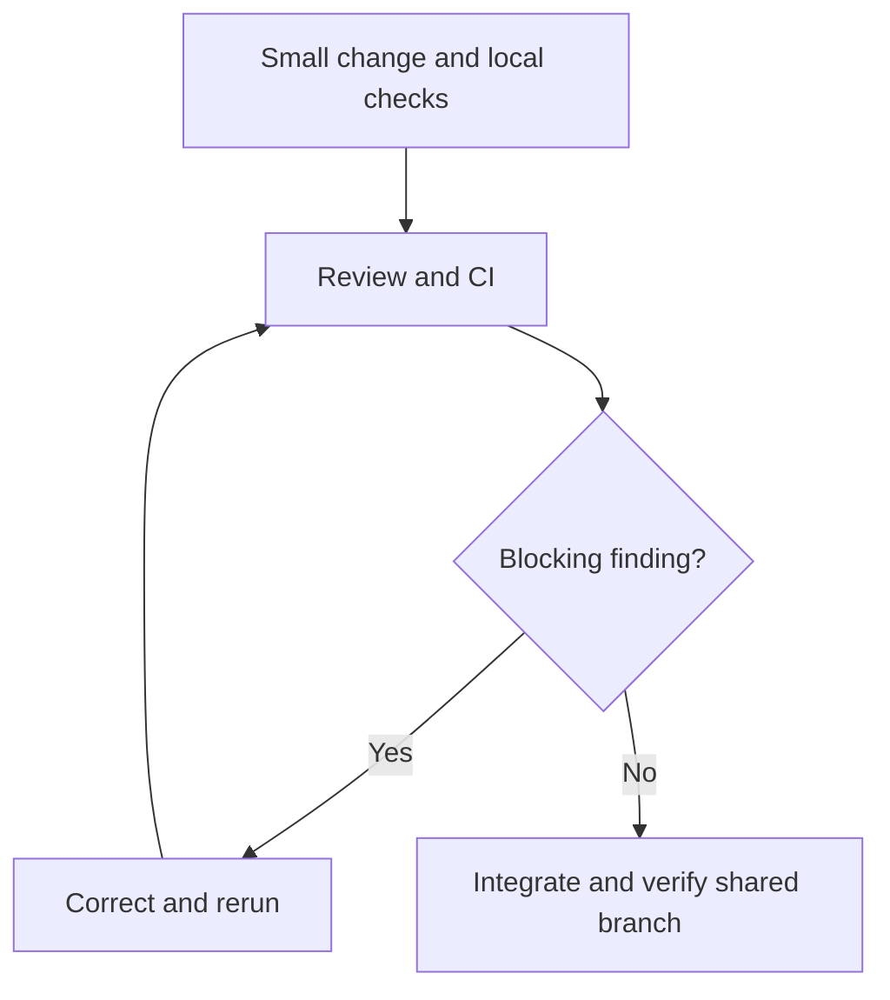

*OO Development and Agile Practices*  
*Designing, Testing and Evolving Software with AI Assistance*

## Opening scenario

The team arrives at its kickoff meeting with six backlog items and a working Java reservation coordinator. One member wants a mobile interface. Another proposes a database. A third suggests completing every story before inviting feedback. Everyone is busy, yet nobody can describe what an equipment officer will be able to demonstrate at the end of the next iteration.

The difficulty is not a shortage of ideas. It is the absence of a shared boundary and a credible route from an idea to evidence. A backlog tells the team what might be valuable. An iteration plan must also explain what it will try to achieve, what it can reasonably finish, and how another person will know that it worked.

This chapter turns Chapter 3’s backlog into a bounded project vision, a thin user journey, a capacity-aware plan and a repository that runs supplied checks. The running project remains the **Campus Equipment Lending System**. The existing reservation behaviour is preserved; availability enquiry remains proposed work. Preparing delivery evidence is useful progress, but it must not be reported as newly implementing behaviour already present in the starter.

## Learning outcomes and reading route

By the end of this chapter, you should be able to:

1. Define a project vision with explicit scope, assumptions and constraints.
2. Slice a feature into a small increment that supports an observable user outcome.
3. Form an iteration plan that includes implementation, review, verification and realistic capacity.
4. Apply a shared repository workflow with clear review responsibilities.
5. Run a starter build and checks, and demonstrate that the checking process detects a deliberate failure.
6. Assemble traceable evidence for the kickoff milestone.

**Module connection:** Week 3; LO5 and LO6; preparation for Milestone 1. The descriptor’s term **Sprint 0** is used here as the local kickoff label. It is not a formal Scrum event. This chapter supplies preparation guidance, not new assessment weights, submission rules or approved module wording. It supports the Week 3 readings: the planning and testing chapters of Martin [6] and the sprint-planning chapters of Rubin [7].

**Prerequisites:** the Chapter 2 Java checkpoint, Chapter 3’s ordered backlog and Definition of Done, and basic Git operations. You need a Java 17 JDK, Git and Bash; on Windows, use Git Bash or WSL. You do not need prior TDD experience. The separate `Chapter_04_Code_Explanations_and_Solutions.md` supplies all Java listings, repository files, commands, model answers and an offline AI exercise solution.

**Core reading.** Read Sections 4.1–4.7 in order and run the supplied checks while reading 4.6.

**Minimum required lab.** Complete steps 1–8 of the practical activity in Section 4.10 on your **Team project**; together they produce the Milestone 1 evidence. The supplied lending repository is the worked model and a starting point, not evidence of your team's own work: your team's availability, board, review record and hosted CI runs are what count. Hosted CI needs a repository your team can use, so start steps 6 and 7 early.

**Optional extension.** Do the Section 4.8 AI activity, the review questions, the transfer challenge and the optional extension in Section 4.10.

## 4.1 Vision, scope and constraints

### Start with a bounded outcome

A vision explains whose problem the project addresses and what improvement would matter. It should guide choices when time is limited. “Build a complete equipment platform” provides little help because almost any proposed feature can be justified under it.

For this teaching checkpoint, use the following working vision:

> Help an equipment officer demonstrate clear reservation decisions for a small, controlled set of student borrowers and equipment, so that accepted requests can be inspected and conflicting requests do not create overlapping records within one running coordinator.

This is deliberately narrower than a production service. It identifies an actor, an observable improvement and the setting in which the claim can be evaluated. It does not promise authentication, a maintained inventory or safe operation by several officers at once. The broader product direction can include borrowing and returns later, while the first evidence remains small enough to inspect.

A Product Goal describes a future product state toward which the team works; an iteration goal gives the next period of work coherence. Neither is a list of every task. In Scrum, the Sprint Backlog combines the Sprint Goal, selected backlog items and an actionable delivery plan [1]. Our worked plan uses that distinction without assuming that a classroom team has already adopted every element of Scrum.

### Make the boundary visible

Scope is most useful when it makes decisions easier. Use a short table that distinguishes present capability, selected work and deferred questions.

| Area | At the Chapter 4 checkpoint | Planning consequence |
|---|---|---|
| Reservation request | Existing Java behaviour accepts eligible, non-conflicting requests | Verify and demonstrate it; do not rebuild it for credit |
| Availability enquiry | Proposed US-02; no query method or interface yet | Refine and plan a thin next slice |
| Storage | In-memory records in one coordinator | Restarting loses records; demonstrate in one process |
| Identity and equipment | Nonblank identifiers; controlled synthetic fixtures | No claim of directory or catalogue validation |
| Loan period | Whole calendar days; start inclusive, end exclusive | Label dates and test adjacency |
| Cancellation and completed loans | Not implemented; all stored reservations count as active | Clarify lifecycle before adding those stories |
| User interface | Scripted console demonstration; proposed wireframes | No web or mobile implementation required for kickoff |
| Concurrent use | Sequential teaching example | No claim that a check prevents races across processes |

Constraints and assumptions are different. Java 17 compatibility is a chosen technical constraint for this starter. Using synthetic borrower identifiers is a teaching boundary. Assuming an officer can recognise a fixture item is an assumption about the demonstration. An unresolved rule about past dates is an open question. Labelling all four as “requirements” hides their different owners and consequences.

An assumption should have a reason to revisit it. For example: “For the controlled demo, the operator uses CAM1 and MIC1 from a supplied fixture list. Before opening input to arbitrary equipment, clarify the catalogue authority and unknown-item behaviour.” The trigger connects a temporary simplification to the point at which it becomes inadequate.

### Use a small decision record

A useful decision record states the question, chosen approach, reason, consequence and review trigger. It need not become a long report. “Use in-memory records for kickoff because the immediate question concerns reservation decisions; records disappear on restart; reconsider when a demonstration must survive restarting” is enough to guide a reviewer.

Contrast this with “Database later.” That phrase records neither the current limitation nor the condition that will make the work necessary. The team could postpone essential persistence indefinitely, or introduce it immediately without a reason. A clear trigger allows the plan to change when the evidence changes.

Do not attempt to settle every future policy before running the starter. Resolve questions that determine the next slice’s behaviour. Keep other questions visible with an owner and a decision point. This supports progress while preventing a temporary assumption from quietly becoming a permanent rule.

## 4.2 Domain assumptions and wireframes

### A wireframe is a question made visible

A lightweight wireframe helps users and developers discuss information, actions and outcomes before spending time on presentation. In this book, a wireframe may be a table, a sketch or a simple sequence of views. Its value comes from the questions it exposes, not from visual polish.

Consider the reservation request journey. What does the officer enter? Does “end date” include that day? What appears when equipment is unavailable? Does a failed request leave a record? Can the officer distinguish a successful reservation from an availability observation?

The following tables are **proposed interface sketches**. They are not screenshots of implemented screens.

**View A: Request a reservation**

| Element | Example or behaviour |
|---|---|
| Borrower identifier | B1 |
| Equipment identifier | CAM1 |
| Start date | 2026-10-20 |
| Duration in days | 2 |
| Period explanation | Includes 20 and 21 October; ends before 22 October |
| Action | Request reservation |
| Scope note | Controlled demo; records last only for this session |

**View B: Request outcome**

| Outcome | Information shown |
|---|---|
| Confirmed | Reservation R1, B1, CAM1, `[2026-10-20, 2026-10-22)` |
| Item unavailable | Request rejected; no new reservation stored |
| Limit or duration failure | Request rejected; no new reservation stored |
| Malformed input | Proposed interface should explain the field to correct |

The current coordinator returns confirmation or rejection strings and throws exceptions for certain invalid arguments. A future interaction layer must translate malformed input into a useful response. Drawing that response does not mean it is implemented. In particular, the coordinator currently combines borrower-limit and duration failures in one message. A sketch showing two precise explanations would introduce new work that the backlog should identify.

**View C: Availability enquiry, proposed US-02**

| Element | Example or behaviour |
|---|---|
| Equipment identifier | CAM1 from the controlled fixture set |
| Start date | 2026-10-22 |
| End date, exclusive | 2026-10-23 |
| Action | Check availability |
| Result | Available, unavailable, or an identifiable invalid-period outcome |
| Explanation | An enquiry creates no reservation and does not guarantee a later request will succeed |

A user can understand this sketch without agreeing to a particular toolkit. That leaves the team free to use a thin console interaction while learning about the domain. Choosing a web framework now would add configuration and presentation tasks without resolving the date-boundary question.

### Walk through concrete examples

Use one example to connect a sketch to the stored state. Begin with no reservations. Submit B1, CAM1, 20 October, two days. Expect one stored reservation ending exclusively on 22 October. Submit B2, CAM1, 21 October, one day. Expect rejection and the original record preserved. Submit B2, CAM1, 22 October, one day. Expect a second stored reservation.

The third step matters because “no overlap” is otherwise ambiguous. If an officer expects collection on 22 October to conflict with the earlier booking, either the period convention or the operational turnaround rule needs discussion. Do not silently add a cleaning interval to the current rule. Record it as a candidate requirement with examples.

For an availability enquiry, record both the displayed answer and the unchanged state. A program that says “available” after quietly creating a reservation has not fulfilled the story. An observation of availability is also different from permission to reserve: a borrower may already have three active records. The proposed query does not establish borrower eligibility.

Wireframes, examples and code are three descriptions of the same intended behaviour. Disagreement among them is useful evidence. Resolve the disagreement explicitly instead of selecting whichever description is easiest to implement.

## 4.3 Prioritisation and vertical slicing

### Preserve the backlog’s history

Chapter 3 proposed the following order. This chapter preserves its identifiers while clarifying what already exists and what remains to do.

| Order | Item | Current interpretation |
|---|---|---|
| 1 | US-01: Record an eligible reservation | Core behaviour exists; confirm interaction and delivery evidence |
| 2 | US-02: Inspect availability without reserving | New user outcome to refine and forecast |
| 3 | EN-01: Automate build and checks | Enabling work supplied in this chapter; hosted evidence still required |
| 4 | US-03: Inspect a borrower’s active records | Filtering and interaction remain new work |
| 5 | US-04: Cancel a confirmed reservation | Authority, lifecycle and count effects need clarification |
| 6 | US-05: Reject unknown equipment identifiers | Depends on a catalogue source and failure policy |

Order communicates current judgement; it is not a rigid instruction to finish every task of one item before examining another. EN-01 supports reliable delivery of US-02, so preparing automation during kickoff is reasonable. Explain that dependency openly. Do not quietly move every technical improvement ahead of user feedback.

The low initial priority of catalogue validation is defensible only within the controlled fixture boundary. A real deployment would require the team to reconsider that order. “Low priority” is a contextual decision, not a claim that unknown equipment is harmless.

### Slice by a user outcome

A **vertical slice** passes through the necessary parts of the system to deliver one observable outcome. It need not use a graphical interface, database or network. For this project, a console request that reaches the coordinator and displays a verified decision is a thin journey through interaction, domain behaviour and storage.

A horizontal split such as “all screens first, then all services, then all storage” can leave substantial work without a demonstrable outcome. Those activities may be implementation tasks, but they do not become useful increments merely because they are separate tickets.

For US-02, a defensible first slice is:

> The officer supplies one fixture item and a valid date interval, receives an availability answer based on current reservations, and can verify that enquiry left every stored reservation unchanged.

The slice also needs an identifiable response to an equal or reversed interval. It can defer calendar styling, multiple-item search, live inventory integration and availability across several servers. It cannot defer overlap semantics or state preservation: those determine whether the promised outcome is true.

The following examples carry forward Chapter 3’s query criteria.

| ID | Given and enquiry | Expected outcome |
|---|---|---|
| AQ-01 | Empty coordinator; CAM1 `[20 Oct, 22 Oct)` | Available; records unchanged |
| AQ-02 | CAM1 reserved `[20 Oct, 22 Oct)`; enquire `[21 Oct, 23 Oct)` | Unavailable; records unchanged |
| AQ-03 | Same reservation; enquire `[22 Oct, 23 Oct)` | Available; records unchanged |
| AQ-04 | Same reservation; enquire about fixture MIC1 for `[20 Oct, 22 Oct)` | Available; records unchanged |
| AQ-05 | Equal or reversed start and end | Identifiable invalid-input outcome; records unchanged |

All dates above are in 2026. “Records unchanged” means preserving their contents as well as their count. A query that replaces one reservation with another can leave the same size and still be incorrect. The exact query API and invalid-input representation remain design choices to settle before implementation; the existing `reserve` method is not a query implementation.

### Decide what must accompany the slice

A feature is small enough when the team can understand and verify it within the iteration, including integration. Making it smaller by removing meaningful rejection behaviour can produce misleading success. A reservation feature that accepts requests but ignores conflicts is not a safe reduction of this particular outcome.

List necessary work separately from attractive additions. For US-02, interpreting the interval, inspecting relevant reservations, reporting the result and checking non-mutation are necessary. A calendar widget is optional. A persistent store becomes necessary only when the selected outcome requires data to survive a restart. This distinction lets the team negotiate scope without treating quality as optional.

Use epics to group the direction of travel, not to enlarge the iteration. “Reservation decisions” can contain US-01 and US-02; “Record lifecycle” can contain US-03 and US-04. EN-01 supports delivery across them. An epic does not require an architecture layer or a Java package with the same name.

## 4.4 Release outlook and iteration planning

### Separate an outlook from a commitment

A release outlook communicates likely steps toward the product goal. It should show uncertainty. For the textbook project, kickoff makes the baseline reproducible; the MVP stage develops a small reservation and loan flow; later stages introduce integration boundaries and respond to a changed requirement. These are the book’s teaching stages, not evidence that every team can deliver identical scope on identical dates.

Use a short outlook with “now”, “next” and “later” if precise forecasts would be invented. Keep the module’s official milestone schedule unchanged. A planning table cannot create a new assessment deadline or promise that a poorly understood story will fit a particular week.

The current kickoff goal is:

> Make the reservation baseline reproducible and reviewable, and prepare a bounded availability slice for the next iteration.

The **candidate next iteration goal**, carried from Chapter 3, is:

> Let the officer inspect availability for one fixture item and interval without changing reservations.

These are different goals. Chapter 4 provides the first goal’s starter materials and plans the second; it does not claim to have implemented US-02.

### Count the work that consumes capacity

The following figures are **invented planning data**, not official contact hours or measured team productivity. Suppose four members report 6, 6, 5 and 5 person-hours available for the next iteration. That gives 22 person-hours. Reserve four for agreed coordination, integration support and routine project administration. The remaining planning budget is 18 person-hours.

| Forecast work for the next iteration | Person-hours |
|---|---:|
| Resolve the query contract and update examples | 2 |
| Implement the read-only enquiry behaviour | 4 |
| Add the thin interaction and invalid-input response | 3 |
| Add and run query checks alongside regression checks | 3 |
| Review, integrate, update notes and rehearse demonstration | 2 |
| **Selected work** | **14** |
| **Unallocated capacity within the 18-hour budget** | **4** |

The estimates are discussion inputs, independently expressed in person-hours. They are not converted from Chapter 3’s story points. Two people pairing for one hour consume two person-hours. Review and correction must fit somewhere in the budget; calling them “after development” does not make them free.

The four unallocated hours provide room for uncertainty. They are not a promise to pull in another feature. If the team learns that the query requires an unexpected policy decision, it can use the capacity to resolve that risk while protecting the goal. If things finish early, improve evidence or select additional work deliberately.

### Check calendar and skill constraints

A total of 18 hours does not establish feasibility. Suppose the only person who can explain the coordinator is unavailable until the last day, while the reviewer is free only at the beginning. The work cannot flow as the arithmetic suggests. Ask when collaboration can occur and whether knowledge must be shared earlier.

Make ownership visible without creating permanent specialists. A task owner ensures that progress and questions remain visible; it does not mean nobody else may help. Agree an early pairing session on the query contract and a review window before the final demonstration. A small amount of coordination can prevent the entire slice waiting at the end.

Inspect the plan when evidence changes. If four hours of implementation become nine, discuss the forecast and remaining scope. Do not hide the overrun by postponing checks or declaring the interaction “almost done”. In Scrum, scope can be clarified and renegotiated with the Product Owner as more is learned, while protecting the Sprint Goal [1]. A classroom adaptation should likewise make its decisions visible.

A practical replanning question is: “What complete, still useful outcome can we verify with the capacity left?” Sometimes the answer is a smaller interface. Sometimes the unresolved behaviour means the item cannot responsibly be called complete. Honest incompleteness is more useful than a green status that conceals unfinished work.

## 4.5 Team agreements and review workflow

### Agree how work moves

Chapter 3’s board used Backlog, Ready, Building, Review and Done, with a combined work-in-progress limit of two across Building and Review. Keep that policy for the worked team. A blocked item still occupies a slot. If review is blocked, helping it finish is usually more useful than starting a third item.

A team agreement should answer practical questions: where requirements live, how questions are raised, who reviews a change, what evidence reviewers need, and how unfinished work is reported. The board tool is interchangeable. A shared Markdown table can work if updates are visible and ownership is clear.

Start from what your team has already decided: the issue board and branch policy from Chapter 2 Part D, the Definition of Done from Chapter 3, and your process note naming which Scrum elements you use as defined and which you adapt for the course. Revise them where experience shows a problem, and record why.

Use small, short-lived branches for the chapter’s review exercise. One branch should contain a coherent change that another person can understand. “Set up every tool and rewrite the coordinator” is difficult to review because functional changes and workflow changes become entangled. A branch that adds the checking script and documentation has a clearer purpose.



This diagram describes the chapter’s team policy, not an automatic guarantee from Git. A repository does not enforce review simply because the README requests it. Where supported, configure the shared branch to require the agreed check and review. If enforcement is unavailable, state that the team follows a manual policy and retain its review evidence.

### Review the claim, the change and the evidence

A useful review starts with the intended behaviour. The reviewer then traces the relevant code or documentation and considers whether the evidence supports the claim. “Looks good” alone does not explain which risk was examined.

For a CI change, ask whether compilation failure stops the job, whether the check programs actually execute, and whether a failed assertion reaches the job result. For US-02 later, inspect whether the query mutates state or depends on a borrower’s eligibility. A code-style comment should not distract from a behavioural defect.

The author should resolve blocking findings and rerun affected checks. The reviewer should inspect the correction. Retain the actual feedback and response; do not invent a review exchange to fill a milestone template. Working alone permits a documented self-review for practice, but it is not independent review and should be labelled accordingly.

### Extend the Definition of Done carefully

Carry forward Chapter 3’s requirements for checked examples, reproducible execution, actual review, integrated code, updated notes and a repeatable demonstration. For this checkpoint, add that the agreed automated check has passed on the integrated revision and that the team can locate its result.

Acceptance criteria remain specific to a story. The Definition of Done addresses the quality and delivery conditions applied across work. A passing pipeline is one part of those conditions. It does not establish that a wireframe was understood, a product decision was approved or a useful outcome was delivered.

## 4.6 Starter build and CI

### Make one command meaningful

Continuous integration needs a check that can run without relying on one developer’s open IDE. Our starter uses Java 17, Bash and the supplied executable Java checks. It has no external Java dependencies. Maven and JUnit remain the planned build and testing tools for the fuller testing stage; this checkpoint preserves the existing plain-Java checks so the kickoff does not require learning a test framework first. On Windows, run the script from Git Bash or WSL; PowerShell cannot interpret it.

The code file supplies a conventional source layout and a script. If you are continuing from the flat Chapter 2 directory, the move is mechanical: application classes go to `src/main/java`, the check classes go to `src/test/java`, and their contents do not change. The classes stay in the unnamed package, so this is a layout change only. It is the directory layout Maven expects, so a later move to Maven changes the build file and the checks, not where the sources live. From the repository root, run:

```bash
bash scripts/check.sh
```

The script clears generated class files, compiles the listed source directories, runs Chapter 2’s 34 checks and Chapter 3’s five acceptance example groups, then prints a completion message. Compilation targets Java 17 through `--release 17`; generated classes go into a separate output directory [2]. The script must stop when compilation or either checking program fails. The final message must only be reached after success.

The five acceptance examples cover eligible reservation, overlap rejection, adjacency, borrower limit and duration boundaries. They do not test US-02, because that feature is not implemented. A passing run therefore establishes something bounded: the supplied reservation checks passed against this revision in the recorded environment. It is not a claim of complete correctness.

After a successful build, run the scripted journey:

```bash
java -cp build/classes Chapter04Demo
```

It confirms the first request, rejects the conflict, confirms the adjacent request and reports two stored reservations. The values are fixed synthetic examples; this is not an interactive application. Run it in a fresh process to reproduce the same initial state.

Line endings matter for shell scripts. Git on Windows may convert LF to CRLF when it checks files out, and a CRLF script fails under WSL or Linux with an error such as `set: pipefail: invalid option name`. The supplied repository therefore includes a `.gitattributes` file that keeps `*.sh` files in LF form. Check that it is committed before a teammate tries a fresh clone.

### Read a check as Arrange, Act, Assert

You do not have to write checks this week, but you should be able to read one. Every supplied check has the same three steps. Here is the AC-02 block from `Chapter03AcceptanceExamples`, with the steps labelled:

```java
// Excerpt from Chapter03AcceptanceExamples.java; the comments are added here.
// Arrange: the coordinator already holds B1's reservation of CAM1 (made by AC-01).
// Act: B2 asks for CAM1 on an overlapping day.
String conflict = coordinator.reserve("B2", "CAM1", day.plusDays(1), 1);
// Assert: the request is refused, and nothing new was stored.
require(conflict.equals("Rejected: item unavailable."), "AC-02 rejection");
require(coordinator.reservations().size() == 1, "AC-02 unchanged count");
```

Arrange builds the situation, Act performs the one operation under test, and Assert states what must be observed, including what must not have changed. A check that asserted only the message would pass for a request that was refused but still stored. Chapter 7 names this structure Arrange–Act–Assert and builds on it.

### Run the same gate in a hosted workflow

The separate code file supplies a GitHub Actions workflow that checks out the repository, installs Temurin Java 17 and runs the same Bash command. GitHub stores workflows under `.github/workflows`; the official documentation also supports invoking the project’s own build commands [3]. The action versions in the supplied example were checked against their official repositories [4, 5].

GitHub Actions is one concrete teaching route. An institution’s alternative CI service is suitable if it checks the intended revision, runs the agreed command and preserves inspectable results. A badge or YAML file alone is not a passing run. Confirm that the workflow actually starts and that its compilation and checking steps execute.

Record the revision, environment, command, result and a link or exported log. For a pull request, identify the tested revision; after integration, retain the shared branch’s passing result too. A branch check can be valid while becoming stale after another change is integrated.

The example uses a Java major version and action major tags for readability. Those selectors can resolve to updated releases, so record the resolved versions in evidence. Stronger dependency pinning, wider environment coverage and delivery stages belong in Chapter 13.

### Prove that a failure is observable

Begin with a passing run. On a clearly labelled disposable branch or copy, change one acceptance check to expect two records after the first successful reservation. That expectation is intentionally wrong: the valid behaviour stores exactly one. Run the same gate and expect a nonzero result identifying AC-01.

This demonstrates that an assertion failure propagates through the runner. Restore the correct expectation and run again. On a hosted practice branch, retain the failed run and the restored passing run; never merge the deliberate defect into the shared baseline.

A failed download or a missing JDK does not prove this property. It shows an environment failure before the assertion was reached. Read the log and identify the actual failed step. Similarly, replacing a test command with `echo passed` can make a green workflow that checks nothing.

**Author verification boundary:** the supplied compilation, 34 checks, five acceptance groups, demonstration and deliberate failing-check experiment were executed locally. The GitHub Actions workflow is supplied for learners to run; no hosted execution or independent team review is claimed. Completing the milestone’s hosted CI evidence requires an observed run in the team’s repository.

## 4.7 Milestone 1 preparation

### Assemble an evidence trail

Milestone 1 connects the project direction to an executable starting point. Its artefacts should agree with one another. A vision promising live inventory, a backlog assuming fixture identifiers and a demonstration using invented equipment without explanation would leave a reviewer unable to interpret success.

Use the following preparation map. It is a navigation aid for the supplied milestone, not an additional assessment rubric.

| Evidence | Question it should answer |
|---|---|
| Vision and scope | Whose outcome matters, and under which boundaries? |
| Epics, stories and ordered backlog | What is already supported, what is next, and what remains uncertain? |
| Wireframes and acceptance examples | What will the officer do, see and change? |
| Capacity and iteration plan | Why is the selected work plausible, including verification and review? |
| Team agreement and review record | How will changes be inspected and integrated? |
| Repository and README | Can another person obtain the intended revision and run it? |
| Passing CI result | Did the configured service execute the gate successfully? |
| Deliberate failure and restored pass | Does a failed check produce failure, and is the baseline healthy again? |
| Decision and limitation notes | Which assumptions restrict the claims being made? |

Trace a small number of meaningful links: story to acceptance examples, examples to checking program, change to review, revision to CI result. Links are useful when they let another person answer a question. A large spreadsheet of repeated identifiers adds little if the linked check does not exercise the promised behaviour.

### Rehearse from another person’s starting point

Ask a teammate to follow the README from a fresh checkout. Watch where they need undocumented help. Does the command assume a shell they do not have? Is the JDK a development kit or only a runtime? Does the demonstration require records created in an earlier session?

Correct the instructions and repeat the affected step. A reliable handoff is evidence of shared understanding. Do not report an unrun command as verified simply because it looks familiar. If the hosted service is unavailable, preserve the local evidence and name the missing hosted result as a gap. A transparent gap gives the team a concrete next action.

The exit checkpoint consists of a bounded plan, inspectable sketches and a repeatable baseline with a delivery gate. It does not require implementing every backlog item or designing the final architecture. Chapter 5 will examine responsibilities in the coordinator using these checks to protect existing behaviour.

## 4.8 AI in practice: challenge an overambitious plan

Chapter 15 will later collect the recurring AI workflows; this activity is self-contained, and it states the task, context and constraints you need.

| Element | For this activity |
|---|---|
| Engineering objective | Evaluate a proposed iteration plan against scope, capacity, behaviour and delivery evidence |
| Input | The Chapter 3 backlog, the capacity figures in Section 4.4 and the Chapter 4 starter |
| Permitted scope | Review and replace the plan; do not implement any feature |
| Independent checks | Your own capacity arithmetic, the code (is there a query method? does `reserve` change state?) and the actual gate output |
| Accept or reject | A verdict and reason for each distinct proposal, then a bounded replacement plan |
| No-account route | The fixture below is sufficient |

**Purpose:** evaluate proposed work against scope, capacity, behaviour and delivery evidence. The fixture below is **author-written fictional AI output**, constructed for this offline exercise. It is not a record of an actual model conversation.

> Four students have 22 person-hours, so plan 22 hours of features. Deliver US-02, cancellation, a mobile app, a database and email confirmations. Assign one student to each layer and integrate on the final evening. Convert the three-point availability story into three hours. Show “available” by calling `reserve` and deleting its record afterwards. Skip failure cases until next sprint. Mark EN-01 complete when the YAML file is committed; a green badge proves the whole story works.

Create a review table with a verdict and reason for each distinct proposal. Replace the plan with a bounded goal, a selected slice, a capacity calculation and explicit evidence. Identify at least one domain error, one estimation error, one integration risk and one unsupported completion claim.

If using an AI service, give it only the synthetic scope and backlog. Ask for risks or alternatives rather than accepting a plan as authority. Record the prompt, the claims you accepted or rejected, and the independent checks you used. The same learning outcome is achievable with the fixture alone.

## 4.9 Common mistakes

| Mistake | Why it fails | Better action |
|---|---|---|
| Count starter behaviour as newly delivered | Hides the actual change | Separate existing capability from new evidence or functionality |
| Slice only by technical layers | Leaves no usable end-to-end result | Select one observable journey and its necessary tasks |
| Fill all nominal capacity with features | Leaves review, coordination and uncertainty unfunded | Budget those activities explicitly |
| Use a wireframe as proof of implementation | Confuses an agreed sketch with working behaviour | Label proposal and implementation separately |
| Treat an availability answer as a reservation | Omits eligibility and later state changes | Keep query and command outcomes distinct |
| Create CI configuration without running it | Provides no evidence that the gate executes | Inspect an actual run against the intended revision |
| “Fix” a red job by ignoring its exit status | Conceals the defect | Correct the cause and preserve failure propagation |
| Invent review or meeting evidence | Makes the project state misleading | Report actual observations and remaining gaps |

## 4.10 Practical activity: prepare the kickoff checkpoint

**Project:** this activity runs on your **Team project**. If your team uses equipment lending, the supplied listings are your starting repository. If your team chose another provided domain, apply each step to that domain's starter codebase and use the supplied files as the model for layout, script and workflow. Do not change domain without following the module's arrangements.

**Input:** the Chapter 3 backlog, current Java baseline and supplied Chapter 4 repository listings.

**Instructor demonstration:** walk through the three reservation requests, then compare an ordinary passing run with the deliberately wrong acceptance check. Ask students to identify precisely what each result establishes.

**Guided practice:** create a one-page scope statement and wireframe. Have another pair explain the journey back to you. Resolve one discrepancy between their interpretation and your intended behaviour.

**Independent team work:**

1. Write the vision, boundaries, assumptions and two decision records with review triggers.
2. Group the backlog into epics, preserve story identifiers, and distinguish existing capability from new work.
3. Refine US-02 or an equivalent thin slice with normal, boundary and rejection examples, including state effects.
4. Create an iteration goal and a capacity plan using your actual availability. Show coordination, review and uncertainty explicitly.
5. Agree ownership, review and board policies. Apply them to one small repository change.
6. Create the starter files, run the gate and reproduce the scripted demonstration.
7. Enable the agreed hosted workflow. Retain a passing run, a deliberate assertion-failure run on a practice branch, and a restored passing run. Record the integrated baseline’s result.
8. Assemble the evidence map and ask another team member to follow the README from a fresh checkout.

**Expected output:** vision/scope notes; ordered backlog and selected story; wireframes; capacity plan; team agreement; review record; repository instructions; verification evidence; unresolved questions with owners.

**Completion checks:** another person can explain the chosen outcome, distinguish implemented and planned behaviour, run the baseline, locate the actual CI results and trace at least one acceptance example to an executed check. A missing hosted run remains an explicit gap. Use the module leader’s submission requirements for the assessed hand-in.

**Optional extension:** review whether the query slice should use duration or an exclusive end date at its interaction boundary. Compare the input errors each choice creates. Update the sketch and examples; do not implement a second interface solely for this extension.

## 4.11 Review questions

### Short concept questions

1. How do a vision, an iteration goal and an implementation task differ? Use the equipment project for each.
2. Why can a console-based journey be a vertical slice even when it has no database?
3. Why is total available person-time insufficient to establish a feasible iteration plan?
4. What does a passing starter check establish, and what does it leave unproven?

### Applied diagnosis

5. A team reports the availability story done because the screen says “available”. Its implementation calls `reserve`, then removes the new record. Identify the violated requirement and the state evidence you would inspect.
6. A CI job compiles successfully, runs `java -cp build/classes Chapter03AcceptanceExamples || true`, then prints “all checks passed”. Explain how this can report success after an assertion failure and how you would verify the correction.

## 4.12 Transfer challenge

A small clinic wants reception staff to inspect appointment-slot availability and make bookings. It has one supplied in-memory booking routine, a draft backlog and a four-person student team with uneven availability.

Create a bounded first-iteration goal, a wireframe and a capacity-aware plan. Identify two assumptions that should be revisited before real use. Give one adjacency example and explain why equipment-lending date rules cannot simply be copied into a time-based appointment domain. Show what the first automated gate would establish and what evidence would still require human review.

Use synthetic appointment data. The exercise concerns planning and software behaviour; it does not ask you to determine clinical policy or process real patient records. A team working on another provided domain may instead apply the same steps to that domain's first user-visible capability.

## Summary and next chapter

A credible iteration connects a bounded outcome to a thin journey, a feasible plan and inspectable evidence. Scope notes expose assumptions; wireframes reveal interaction questions; acceptance examples make behaviour testable. Review and automation help the team preserve a shared baseline while learning what to build next.

The Chapter 4 application behaviour remains the Chapter 2–3 reservation checkpoint. The additions are repository organisation, a repeatable checking command, a scripted demonstration and a hosted-workflow template. US-02 remains planned. Chapter 5 uses this protected starting point to examine responsibilities, extension and substitutability.

## Sources and further reading

Sources checked 12 and 13 October 2026. Process templates, capacity figures, wireframes and classroom policies are author-created examples; they are not requirements imposed by the sources.

1. Schwaber, K. and Sutherland, J. (2020), [The Scrum Guide](https://scrumguides.org/scrum-guide.html). Formal reference for Product Goal, Sprint Goal, Sprint Backlog and adapting scope. “Sprint 0” is a local descriptor label.
2. Oracle, [The `javac` command, Java SE 17](https://docs.oracle.com/en/java/javase/17/docs/specs/man/javac.html). Compilation, output directories and the release target.
3. GitHub, [Building and testing Java with Maven](https://docs.github.com/en/actions/tutorials/build-and-test-code/java-with-maven). Workflow location and reuse of project build commands; this starter runs its Bash gate rather than Maven. The page's own examples show older action versions; the supplied workflow uses the current major versions from the action repositories [4, 5].
4. GitHub Actions, [setup-java](https://github.com/actions/setup-java). Java installation inputs; the supplied workflow uses `setup-java@v6` and Temurin 17.
5. GitHub Actions, [checkout](https://github.com/actions/checkout). Repository checkout action; the supplied workflow uses `checkout@v7`.
6. Martin, R. C. (2002), *Agile Software Development: Principles, Patterns, and Practices*, Prentice Hall. The module's required text; the Week 3 reading is its planning and testing chapters. Publication details as listed in the module descriptor.
7. Rubin, K. S. (2012), *Essential Scrum*, Addison-Wesley. A recommended text; read the sprint-planning chapters named for Week 3. Publication details as listed in the module descriptor.

Read the relevant current action documentation before adopting the workflow in a different runner environment. A template is a starting point whose actual run must still be observed.