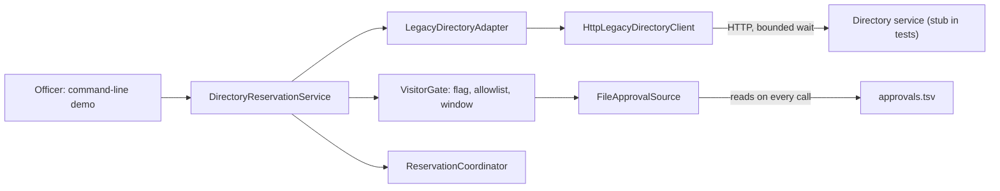
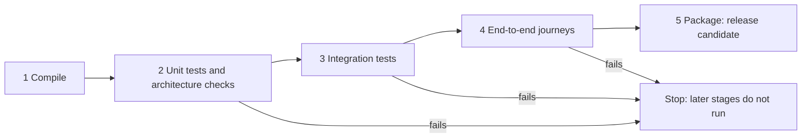
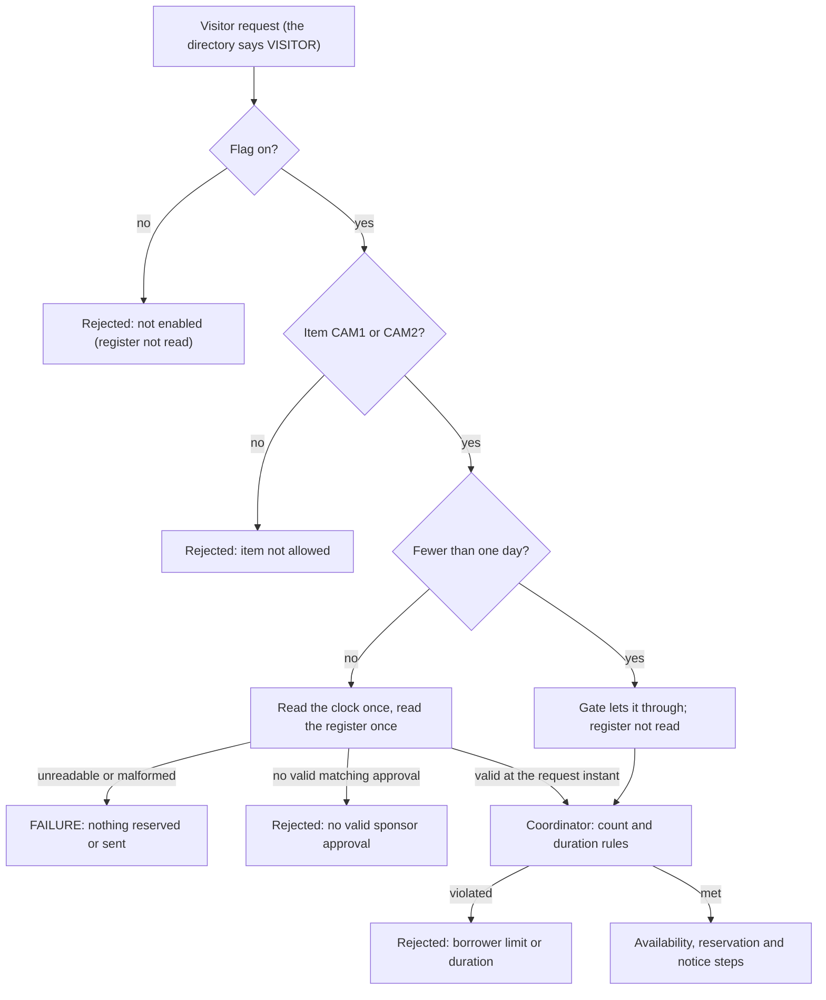

*OO Development and Agile Practices*  
*Designing, Testing and Evolving Software with AI Assistance*

## Opening problem

The visiting-researcher rule passes every unit test, and the demonstration works on the developer's laptop. On the morning of the Milestone 4 demonstration three things go wrong. The sponsor register exported by the office has a stray column, so a visitor request ends in an exception. The borrower directory takes eleven seconds to answer, and the officer's screen freezes. And the new flag is switched on for the demonstration but is off in the build, so the build is green and the demonstration fails.

None of these is a mistake in the rule. Each lives at the **boundary** between our code and something it does not control: a file, a network service, a setting. A unit test that builds its own objects by hand cannot see a boundary, because the boundary is exactly what the test has replaced. This chapter is about checking the places where our code meets something else, putting those checks into a pipeline that runs them in the right order, and releasing a change in a way that can be undone.

The worked change is CR-12 from Chapter 12: visiting researchers, with sponsor approval, behind one flag. It is a **teaching contract**, not an institutional policy, and your team applies its own released variant. The chapter builds on the Chapter 11 checkpoint and on Chapter 12's change specification and plan.

## Learning outcomes and reading route

By the end of this chapter, you should be able to:

1. Choose unit, integration and end-to-end checks for different risks, and say what each cannot show.
2. Explain the scope of a contract test and write one that several implementations must pass.
3. Implement a changed requirement with regression protection and a clear separation between expected rejections and operational failures.
4. Configure a modest delivery pipeline, run it and read a failure in it.
5. Distinguish continuous delivery from continuous deployment, and label a simulated deployment as one.
6. Evaluate a feature flag and a rollback plan, including what rollback does not undo.

**Module connection:** Week 12; LO3 and LO6; Milestone 4 (Sprint 3: the change absorbed, with integration tests and CI/CD). The required reading is Martin (2002), *Testing* (review) [11]; the recommended reading is selected chapters of Humble and Farley, *Continuous Delivery* [12]. The Week 12 lab is an automated build, test and integration pipeline. This chapter creates no new deadlines, weights or marking rules, and the approved Milestone 4 instructions decide what you submit.

**Entry checkpoint:** the Chapter 11 project and Chapter 12's change specification CR-12, its acceptance matrix (examples AC1–AC18) and its ordered backlog. This chapter implements the change. The Chapter 11 listings are not repeated: the companion lists only the files that are new or changed.

**Core reading.** Sections 13.1–13.5 and 13.7–13.8.

**Working-knowledge reading.** Section 13.6 (feature flags, configuration and rollback). Learn to run one flag safely. You do not build a flag platform.

**Minimum required lab.** Steps B1–B4 and T1–T5 of the practical activity in Section 13.11. Steps B1–B4 run on the **Book project** and are running, tracing and diagnosis: the finished checkpoint is supplied and there is nothing to rebuild. Steps T1–T5 run on your **Team project** and produce your Milestone 4 evidence.

**Optional extension.** Steps B5–B7 (deliver and roll back a simulated release, do the AI activity, break a boundary on purpose), the review questions, the transfer challenge and the optional extension.

The separate `Chapter_13_Code_Explanations_and_Solutions.md` contains the new and changed code, the tests, the scripts, the model answers and teaching notes.

## 13.1 Boundary risks and test scope

### Start from the risk, then pick the check

“Which kind of test should I write?” is the wrong first question. Ask what could go wrong in this change, where it would go wrong, and which check would notice. Then choose the cheapest check that can notice it. The table below does that for CR-12.

| What could go wrong | Where | The cheapest check that can notice | What that check cannot show |
|---|---|---|---|
| The validity window is off by one at its edges | Approval record | Unit test with a controlled instant | That the register file is read correctly |
| A visitor is served without a matching approval | Visitor gate and service | Acceptance examples with a controlled approval source | That the real register has the shape the source expects |
| The register has a stray column or a bad date | File adapter | Integration test with a real temporary file | That the office's real export looks like the test file |
| The directory is slow, down or answers nonsense | HTTP client | Integration test against a local stub service | That the real provider behaves like the stub |
| A flag is read in the demonstration but not in the build | Whole program | End-to-end journey in a separate process | Behaviour at scale, or with real users |
| Old behaviour changed by accident | Existing code | The existing regression suite | Anything the old suite never covered |

Notice that three different kinds of check appear. A **unit test** runs a small part of the system in memory, with everything it collaborates with controlled. An **integration test** runs our adapter against the real mechanism it adapts: a real file, a real HTTP client talking to a service under our control. An **end-to-end journey** starts the whole program the way a user would, in a separate process. The chapter uses these three names throughout.



**Figure 13.1.** The two boundaries added by CR-12. Solid boxes are our code; the two outer boxes (the directory service and the register file) are what we do not control. Unit tests stop at the adapters, integration tests cross the labelled arrows with the real mechanism, and an end-to-end journey runs the whole picture in a separate process.

### Narrow checks first

Fowler distinguishes *narrow* integration tests, which cover only the code in our service that talks to another service and replace that service with a double, from *broad* ones, which need live versions of everything [1]. Narrow checks are small, fast and resilient, so most of the boundary evidence in this chapter is narrow. A few broad checks remain worth having, because only they can show that the pieces are joined correctly. The rule of thumb: many narrow checks, a few broad ones, and a reason for each.

### A boundary is where we stop controlling the answer

Our own classes answer the same way every time. A file may be missing today. A network call may not return. A setting may differ between the machine that built the program and the machine that runs it. Each boundary needs two kinds of evidence: what happens when the other side behaves, and what happens when it does not. In this chapter the second kind is not an afterthought. The most important design decision in the change is how a failure at a boundary is reported.

## 13.2 Integration and contract tests

### The file boundary: use a real file

CR-12 puts the sponsor approvals in a small tab-separated register with eight columns. The adapter `FileApprovalSource` reads it, rejects it as a whole if any row is invalid or any request key repeats, and returns the record for one exact request. Its tests write real files into a temporary directory and read them back through the real adapter:

```java
@Test void oneBadRowRejectsTheWholeRegisterEvenWhenTheRequestMatchesAGoodRow() throws IOException {
    failureOf(register(HEADER, GOOD,
            "V9\tCAM2\tnot-a-date\t2026-10-22\tS1\tAPPROVED\t2026-10-18T00:00:00Z\t2026-10-20T00:00:00Z"));
}
```

Nothing replaces the file system or the parser, because those are the boundary under test. The suite also tests a missing file, a wrong header, a wrong column count, an unknown status, a bad date or instant, a blank sponsor, an invalid interval, a duplicate key, text that is not UTF-8, and a file that changes between two calls. A missing record is an expected result (the source returns empty). An unreadable or untrustworthy file is a failure (the source throws). The two must never be confused, because the first means “no sponsor approved this” and the second means “we could not find out”.

### The network boundary: a controlled local service

The directory used to be an in-memory fixture. It is now reachable over HTTP. `HttpLegacyDirectoryClient` asks `GET /borrowers/<key>` and understands one line, the provider's kind and status separated by a tab. To test it we need a service that we control: the JDK includes a simple HTTP server API for building embedded servers [9], which is enough for a stub that answers known keys, returns an error, never answers, or sends nonsense. A real service on the network would make the tests slow and dependent on someone else's availability.

The stub is a stand-in, not the provider. Every test that uses it shows how *our client* behaves when a service behaves in these ways. It does not show that the real service behaves in these ways.

### An explicit policy for the failure case

A client that can wait for ever, retry silently or answer “not found” when it cannot reach the service has made an unreviewed policy decision. The decision is written down instead:

| What the client sees | What the client does |
|---|---|
| 200 with one line, kind and status | Returns the row |
| 404 | Returns no row: the borrower is absent |
| 500 or any other status | Fails: the directory could not answer |
| No complete answer within the bounded wait, even if the headers arrived | Fails with a timeout |
| Connection refused | Fails |
| A body that is not exactly two fields | Fails: a guess is worse than a failure |

**Policy: one attempt, a bounded wait, no retry and no fallback answer.** The wait bounds the whole lookup, including the time to receive the body. A failure becomes a `DirectoryException` in the adapter and stops the request, so no reservation is made and nobody is notified. Two consequences matter. An outage must never look like a missing borrower, because that would tell a real borrower that they do not exist. And no borrower is given a category that the provider did not state: an unknown kind code is also a failure, and it is never defaulted to student or staff. A retry would repeat a slow call while a person waits, and a cached answer would grant a category the provider is not currently stating. Both could be justified later by measured outages, and neither is assumed now.

### A timeout that covers less than you think

The JDK's HTTP client lets a request carry a timeout. The documentation says that if the response is not received within it, the call throws `HttpTimeoutException`, that without a timeout the call can wait for ever, and nothing more about what “received” includes [8]. It does not say whether a response whose headers have arrived and whose body has not is covered.

A client that relies on that timeout alone, tested with a stub that waits **before** sending anything, passes its test. That is the only case the test imagines. Try another: a server that sends the headers and the first byte of the body at once, and then holds the rest for 1,600 milliseconds, with the client's timeout set to 300. The lookup **succeeds after about 1,700 milliseconds**. The policy said “a bounded wait” and the client did not keep it, because the timeout bounded the wait for the headers and not the whole answer.

The fix is a deadline on the whole lookup. The client sends the request asynchronously and waits for the result for at most the configured time; if the time runs out it asks the client to drop the exchange and fails the lookup. Asking is all it can do: the documentation says that cancelling the future attempts to cancel the exchange and that the cancellation is not guaranteed to be prompt or to take effect at all [13][14]. The caller does not depend on it, because the caller has already stopped waiting. The header timeout stays as well. Removing the overall deadline is caught by the new test. Removing the header timeout alone cannot be detected by any test, because the overall deadline still bounds the call: the fault experiment records it as an equivalent change.

A new stub scenario, `SLOWBODY`, sends the headers and the first byte and then holds the rest until the stub is closed. The new test asserts the **outcome**, a failure and not a result, and runs it with a generous outer deadline so that a defect shows as a failed test and not as a hang. Run against a client that relies on the request timeout alone, that test fails with `execution timed out after 5000 ms`. Against the client of this chapter the lookup fails after about 330 milliseconds. The lesson is wider than HTTP: a test of a failure path covers the failure you imagined, so try a different one. A second reader, or a fault experiment that applies a different fault, can find what you could not.

### Contract tests: two meanings, one limit

A **contract test** states what callers may rely on and checks that an implementation honours it. The chapter uses the term in two ways, and they have different scopes.

First, an *interface contract*: `DirectoryClientContract` is a test class that is written once and run against every implementation of `LegacyDirectoryClient`. It says that a known key returns its row, an unknown key returns nothing and is not a failure, and a provider that cannot answer fails and never returns an empty answer. It runs against the in-memory fixture that earlier chapters used, and against the real HTTP client talking to the stub. Two implementations pass the same test, so a caller can swap one for the other.

Second, a *provider contract test*, as Fowler describes it: a separate suite, run periodically against the real external service, that checks that your test doubles still return what the real service returns. It checks the structure of the response rather than exact data, and it follows the provider's rate of change, so it is not part of every pipeline run [2]. This book has no real provider, so no such suite exists here. That is a limit to record, not hide: the stub's fidelity to the real directory is an **assumption**, written in the decision record and tested only when someone has a real service to test against.

## 13.3 Focused end-to-end journeys

### Find the real boundary of a command-line program

A web application has a browser and a server. This program has none of them. Its real boundary is the **process**: how it is started, which settings it reads, what it prints, how it exits, and the network and files it touches. An end-to-end journey therefore starts `Chapter13Demo` as a separate Java process, exactly as a user would, with a directory service on the loopback address and a real approval file, and checks what the user sees.

The program reads its settings from system properties: the directory address, the approval file, the flag (`lending.visitors`, default false), a fixed time for the test, and the directory timeout. The journeys check what no in-process test can: that the flag is actually read, that the pieces are wired together, and that the classpath is complete. The first journey runs with the flag off:

```text
Visitors enabled: false
Student B1: Confirmed: R1 for B1 on CAM1 [2026-10-20, 2026-10-22).
Visitor V1: Rejected: visitor reservations are not enabled.
Visitor V2: Rejected: visitor reservations are not enabled.
Unknown U9: Rejected: borrower not found or inactive.
Outage BROKEN: Unavailable: Borrower directory unavailable
Reservations: 1
Notices: 1
```

The second runs with the flag on and shows an approved visitor served and an unapproved one refused. The third corrupts the register and shows that only the visitor requests fail, with the failure reported as an unavailable register and not as a sponsor's rejection, while the student is still served.

### Keep journeys few and focused

End-to-end journeys are slow, because they start a process, and brittle, because they check output text. Keep the number small. Check the lines that carry the meaning of the journey, fix the clock and the ports so that a run is repeatable, and let the narrower tests carry the detail. A journey that duplicates every unit test is cost without evidence.

## 13.4 CI stages and quality gates

### A pipeline orders the checks by cost

A deployment pipeline splits an automated build into stages. Early stages give fast feedback, and later stages add slower, broader checks [3]. If a stage fails, later stages should not run: there is no point in starting a process when the code does not compile.

| Stage | What runs | Why here | If it fails |
|---|---|---|---|
| 1 Compile | `mvn compile` | Nothing else can run without it | The code does not build |
| 2 Unit tests and architecture checks | Everything not tagged `integration` or `e2e` | Fast, controlled, no outside resources | A rule or a boundary in our own code is wrong |
| 3 Integration tests | Tests tagged `integration` | Real file system, real HTTP client, local stub | An adapter does not meet its boundary |
| 4 End-to-end journeys | Tests tagged `e2e` | Needs compiled classes and a free port | The pieces are not joined correctly |
| 5 Package | `mvn package`, tests skipped because stages 2–4 passed | Produces the release candidate | The artefact cannot be built |



**Figure 13.2.** The pipeline of this chapter. Each arrow means “only if the previous stage passed”. The cheap stages come first so that most failures are reported within seconds, and the process is started only once the pieces it needs are known to work.

The stages are selected with JUnit tags: `@Tag("integration")` and `@Tag("e2e")` on the test classes, and Surefire's `groups` and `excludedGroups` parameters [7], given on the command line as `-Dgroups` and `-DexcludedGroups`. The Surefire page documents the parameters in the POM and not the command-line form, so the pipeline run in the companion is the evidence for that form. The script `scripts/pipeline.sh` runs the five stages in order and stops at the first failure:

```bash
stage "2 unit tests and architecture checks" "$MVN" "${ARGS[@]}" test -DexcludedGroups=integration,e2e
stage "3 integration tests (real file, real HTTP client, local stub service)" "$MVN" "${ARGS[@]}" test -Dgroups=integration
```

The same chain is written as a GitHub Actions workflow, where `needs` makes jobs run one after another [4]. The workflow file is in the companion. It has not been run, and no hosted run is claimed.

### Quality gates are decisions about what blocks a release

A **gate** is a rule that stops the pipeline. Here the gates are: every selected test passes, the architecture checks of Chapter 10 pass, and a stage that selects no tests fails instead of passing silently. The last rule matters: a mistyped tag would otherwise give a green stage that checked nothing.

A pipeline is evidence about the checks it contains. It does not establish that the program is secure, that every rule is right or that real users will be served. Say what each gate checks, and what it does not.

### Read a failure

A failing pipeline is information, so learn to read one. A deliberate fault was introduced: the register parser's header check was removed, so that a file with a wrong header is accepted. Stage 1 passed. Stage 2 passed, because no unit test reads the real file. Stage 3 failed at the test named for the wrong or missing header, with the message of the assertion that did not throw. The companion shows the real output. Three habits help. Find the first failing stage and ignore everything after it. Read the name of the first failing test before the stack trace, because the name says what the test promised. And ask whether the earlier stages *should* have caught it: here they could not, which is the reason stage 3 exists.

## 13.5 Delivery and deployment

**Continuous delivery** is a discipline in which software is built so that it can be released to production at any time; **continuous deployment** goes further, and puts every change that passes the pipeline into production automatically [5]. You can do delivery without deployment, and you must do delivery to do deployment. Our pipeline ends with a release candidate, a jar that has passed every stage. That is delivery. Nothing here deploys it to production.

The course needs an understanding of delivery, not a public deployment, so the companion supplies a **simulation**. `scripts/simulate-release.sh` builds the jar, copies it into a local `build/staging` folder as the current release, and runs the end-to-end journeys against that copied jar as a smoke test. A second delivery moves the old release to “previous”, and `rollback` makes it current again and smoke-tests it. Two limits matter. The script packages with the tests skipped and then runs only the end-to-end journeys, so it assumes that the pipeline has already passed for the same candidate and does not enforce the other gates. And rollback assumes the same version-derived jar name in both releases, so the exercise's two releases are two labels for one build and not a tested rollback between different versions. This is a **simulation**: there is no server, no network deployment and no production. A real deployment would add environment-specific settings, secrets, a health check and monitoring, and those are outside the scope of the module.

## 13.6 Feature flags, configuration and rollback

### One flag, two paths

A **feature flag** lets you ship code without turning the behaviour on. CR-12 has exactly one: `visitingResearchersEnabled`, default **off**. Off means the old behaviour: a visitor request is rejected explicitly, and the approval register is not read. On means the new path. Student and staff requests behave the same under both settings and never depend on the flag. The flag is a *release toggle*: it hides unfinished or unproven behaviour, and release toggles should be short-lived [6].

Both paths are tested, in the acceptance examples, in the end-to-end journeys and in the service tests. Testing both settings is cheap with one flag and becomes expensive with many, because each toggle state may go live. Test the configuration you expect in production and the fallback with the new behaviour off [6]. An “off” that means legacy behaviour and an “on” that means the new behaviour keeps that simple.

### A removal plan is part of the flag

A flag that nobody removes becomes a permanent branch. The decision record sets the conditions: the released variant is accepted, both settings have passed in the pipeline for the release candidate, and a decision to keep visitors enabled is recorded. Then the flag, the disabled path and its tests are deleted together, in one commit. Review the flag at the handover in Chapter 14. Flags are inventory, and inventory has a carrying cost [6].

### Configuration is not a flag

The directory address, the timeout and the register path are *configuration*: they differ between machines and are not decisions about releasing behaviour. A flag chooses between behaviours; configuration chooses between places and values. Mixing them gives a program that nobody can reason about. One more caution: the demonstration reads the flag with `Boolean.parseBoolean`, which treats any text other than “true” as false, so a mistyped value silently means off. That is the safe direction, and it is also a reason to print the effective setting, which the program does on its first line.

### Rollback, and what it does not undo

To stop new visitor reservations, turn the flag off. To go back to an earlier build, redeliver the previous release. Neither removes a reservation that already exists, undoes a notice already sent, or restores a decision a person already made on the strength of it. AC16 pins one consequence: a visitor reservation made before the flag was switched off can still be checked out and returned. A rollback plan is only a plan when it says what stays behind.

## 13.7 Changed behaviour verification



**Figure 13.3.** The order of the visitor decision, as the code does it. Rectangles are results; the one marked FAILURE is an exception that nothing on the request path catches. Every rejection is an ordinary return value. The gate runs first and the coordinator's count and duration rules run last.

The order is observable when more than one thing is wrong. A four-day visitor request with an unreadable register does **not** get the duration rejection: it fails with the register's error, because the gate reads the register before the coordinator applies the duration rule. A zero-day request is the opposite: the gate leaves it alone, the register is not read and the coordinator rejects it. A test pins both. If your team needs a different precedence, such as duration before register, that is a change to the contract, the implementation and the tests together, and not a change to the picture.

### Map every acceptance example to evidence

Chapter 12 specified eighteen acceptance examples. Each has a test, and the companion lists them. Every example builds its own fixture, so one failure cannot hide another. A short excerpt:

```java
@Test void ac9_theRequestInstantAtValidUntilOrBeforeValidFromIsRejected() {
    var atExpiry = new World(true, UNTIL).approve("V1", "CAM1", START, 2);
    assertEquals(VisitorGate.NOT_APPROVED, atExpiry.service.reserve("V1", "CAM1", START, 2));
    var early = new World(true, FROM.minusSeconds(1)).approve("V1", "CAM1", START, 2);
    assertEquals(VisitorGate.NOT_APPROVED, early.service.reserve("V1", "CAM1", START, 2));
    assertNothingChanged(atExpiry);
    assertNothingChanged(early);
}
```

| Group | Examples | What they establish |
|---|---|---|
| Success path | AC1 | One matching, valid approval gives one reservation in the existing confirmation format and one notice |
| Duration and item | AC2–AC5 | The upper boundary of three days, no zero or negative days, and the two-item allowlist |
| Approval matching | AC6–AC9 | Missing, denied, mismatched and expired approvals, and the equality at both ends of the window |
| Failure and flag | AC10, AC12 | An unreadable register is a failure, not a rejection; a disabled flag never reads the register |
| Existing behaviour | AC11, AC13–AC18 | Count rule, student and staff unchanged under both settings, availability, notification failure, lifecycle, directory semantics and the report |

### What the regression suite shows

Adding `VISITOR` to the category enum has a deliberate consequence: the coordinator requires a policy for every category, so every test that builds a coordinator with a complete policy map needed one more entry. That was four constructions in three test files. **No assertion changed.** The inherited Chapter 11 tests passed unchanged after that edit. A regression suite that passes shows that the old behaviours it covers are intact. It says nothing about behaviour the old suite never covered, and nothing about whether the new rule is right.

### Unresolved items keep their names

AC18 deserves attention. A visitor who returns a loan late appears in the overdue report, and the report knows only student and staff kinds, so it applies its “any other kind” rule: one unit a day with no grace and no cap. That is the suspected defect SD-11-1 from Chapter 11, and it now has a real consequence. The change does not fix it: only the records office can say what a visitor's late fine should be. The count rule SD-12 also stays as it is. Naming these items, and showing in a test what each does today, is more useful than silently resolving them.

## 13.8 Milestone 4 evidence

Milestone 4 falls in this week. By your demonstration you should be able to show, on your **Team project**: (1) your released requirement change, implemented from the smallest vertical slice outwards and behind one flag, with acceptance examples; (2) regression evidence from your existing suite, with any necessary fixture changes disclosed; (3) integration evidence for at least one genuine boundary, including its failure cases; (4) an observed pipeline run, and a failing run that you have read; (5) a delivery step, simulated or real, with a smoke test and a rollback; (6) flag evidence: both settings tested and a removal plan; (7) a demonstration and a retrospective with a next action; and (8) a statement of what your evidence does not show. The approved Milestone 4 instructions decide what is submitted, and this list is preparation, not a rubric.

| Item | Artefact | What it should establish |
|---|---|---|
| 1 | Change record and acceptance examples | The requirement and each example are traceable to a test |
| 2 | Regression result | Old behaviour is intact; changed fixtures are listed |
| 3 | Boundary tests | The real file, service or store was used, and both outcomes were checked |
| 4 | Pipeline output | Which stage ran which checks; one real failure read correctly |
| 5 | Delivery record | A release candidate was smoke-tested, and a rollback was tried |
| 6 | Flag evidence | Both paths tested; a named condition for removal |
| 7 | Retrospective | What worked, what did not and one next action |
| 8 | Limits statement | For example: hosted CI not run, real provider not tested, concurrency not addressed |

Do not claim a hosted pipeline run, a public deployment or a peer review that did not happen. A local pipeline run is evidence of a local run.

## 13.9 AI in practice: inspect an integration test that replaces its boundary

Chapter 15 will later collect the recurring AI workflows; this activity is self-contained, and the fixture below is all you need.

| Element | For this activity |
|---|---|
| Engineering objective | Decide what a proposed integration test actually verifies, and repair it so that it verifies what its name claims |
| Input | The approval adapter, the visitor gate and the integration tests of Section 13.2 |
| Permitted scope | Judge and repair the proposed test; do not weaken the adapter or its other tests |
| Independent checks | Introduce one fault into the parser in a scratch copy and see which tests notice it |
| Accept or reject | A verdict on the test, a repaired test and an explanation of what each verifies |
| No-account route | The fixture below is sufficient |

Use this **author-written fictional AI-output fixture**, constructed for offline comparison. An assistant was asked for an integration test of the approval register and produced this:

> I added an integration test for the approval register. It builds a visitor approval, makes the register return it, and checks that the gate accepts the visitor and that the register was consulted.

```java
@Tag("integration")
class ProposedRegisterIntegrationTest {
    @Test void anApprovedVisitorIsAcceptedFromTheRegister() {
        ApprovalSource register = mock(ApprovalSource.class);
        ApprovalRecord record = new ApprovalRecord("V1", "CAM1", start, end, "S1", APPROVED, from, until);
        when(register.find("V1", "CAM1", start, end)).thenReturn(Optional.of(record));

        VisitorGate gate = new VisitorGate(register, clock, true);

        assertEquals(Optional.empty(), gate.rejection("V1", "CAM1", start, 2));
        verify(register).find("V1", "CAM1", start, end);
    }
}
```

Run it. It passes. Now introduce a fault into `FileApprovalSource` in a scratch copy, for example reading the two instant columns the wrong way round, or skipping a broken row instead of rejecting the file, and run it again. Then answer: which part of the system does this test touch? Is there a file anywhere in it? What would it still say after you delete the parser? What does the name `@Tag("integration")` promise that the body does not deliver?

Repair it. Write a real register file in a temporary directory, read it with the real `FileApprovalSource`, and pass that source to the gate. Add the failure case: append a broken row and check that the gate throws the register's exception instead of rejecting politely. Then run both tests against the same fault and compare. (Removing the header check would not separate them, because the repaired test does not exercise the header. Say why that is acceptable, and which test does cover it.) Finally, say what the *original* test is still good for: it is a fine unit test of the gate's decision logic with a controlled source, and it belongs in the unit stage under an honest name.

A secondary activity: take the real failure output in the companion's pipeline run and say, for each stage, what passed and why the earlier stages could not have caught the fault. A live AI service is optional. If you use one, give it synthetic data, keep its actual output, and treat its description of its own test as a claim to check.

## 13.10 Common mistakes

| Mistake | Consequence | Better action |
|---|---|---|
| Mock the boundary and call the test an integration test | The test passes whatever the real adapter does | Use the real file or a controlled local service, and fault-test it |
| Test only the successful response of a boundary | An outage or bad data is found in the demonstration | Test missing, slow, malformed and refused answers |
| Report an unreachable service as “not found” | A real borrower is told that they do not exist | Fail the request and say that the service could not answer |
| Add a timeout without deciding what happens next | The program waits less long and still behaves unpredictably | Write the policy: one attempt, no retry, no fallback, or whatever is chosen |
| Default an unknown category to the nearest known one | A visitor becomes a student without anyone deciding it | Treat an unknown code as a failure |
| Let an end-to-end journey check everything | Slow, brittle, and it duplicates the other tests | Check the lines that carry the journey's meaning |
| Use real clocks, ports or paths in tests | Runs differ by day, machine or luck | Inject the clock, take a free port and use a temporary directory |
| Assume a timeout setting covers the whole call | A slow body or a trickling response holds the caller for as long as the server likes | Bound the whole operation, and test the stall you did not think of |
| Make a stage that can select no tests | A mistyped tag gives a green stage that checked nothing | Fail a stage that runs nothing |
| Treat a green pipeline as proof | Security and unseen behaviour are not examined | State what the stages check and what they do not |
| Switch a flag on by default or never remove it | The old path rots and the code keeps both | Default off, test both paths, name a removal condition |

## 13.11 Practical activity

**Input:** the Chapter 11 checkpoint with the Chapter 13 files from the companion, Chapter 12's CR-12 specification, and your Team project's repository. Steps B1–B7 use the **Book project**; steps T1–T5 use your **Team project**.

**Instructor demonstration:** run `scripts/pipeline.sh` and read each stage's output. Break the register parser on purpose and run it again to show which stage notices. Run the flag-off and flag-on journeys.

**Guided practice:** classify four risks of your choice as unit, integration or end-to-end checks, and say what each check cannot show. Read the directory policy table in Section 13.2 and predict the outcome for a response the table does not list.

**Minimum required lab: Book project (run, trace and diagnose; nothing to rebuild)**

- **B1. Run the pipeline.** Run `scripts/pipeline.sh`, or the five Maven commands in it. Record each stage, the number of tests it ran and its time. Say what a failure in each stage would mean.
- **B2. Trace three acceptance examples.** Choose AC8 or AC9 (the window boundary), AC10 (the operational failure) and AC12 (the flag). For each, name the test, the production class that decides the outcome and the observable result, and say which stage runs it.
- **B3. Make a test bite.** In a scratch copy, introduce one fault into `FileApprovalSource` or `HttpLegacyDirectoryClient`. Predict which stage fails first, run the pipeline, and compare. Restore the original.
- **B4. Complete the evidence table.** Fill in a table for the whole change in the form of Section 13.1: the risk, the check that covers it, the test's name and what that check cannot show. Mark at least one risk that nothing here covers.

**Minimum required lab: Team project (your Milestone 4 evidence)**

- **T1. Implement your released change.** Start with the thinnest vertical slice that behaves correctly, put it behind one flag that defaults to off, and record the acceptance examples. Keep expected rejections apart from operational failures.
- **T2. Test one genuine boundary.** Choose a boundary in your project (a file, a service, a store) and test it without replacing it: a real temporary file, a local stub service or a throw-away database. Cover at least one failure case.
- **T3. Protect the old behaviour and both flag settings.** Run your existing suite, disclose any fixture you had to change, and add tests for the flag on and off.
- **T4. Build and read a pipeline.** Configure at least three stages (for example compile and unit, integration, and a smoke or end-to-end stage). Capture one observed run and one failing run, and read the failing one: first failing stage, first failing test, and why earlier stages could not have caught it.
- **T5. Prepare the Milestone 4 evidence.** Record a flag removal plan and a rollback step, run your demonstration, write the retrospective with one next action, and complete the eight items of Section 13.8, marking each as complete or a gap.

**Optional extension (Book project)**

- **B5. Deliver and roll back.** Run `scripts/simulate-release.sh` twice with different `RELEASE_LABEL` values, then `rollback`, and record which release is current after each step.
- **B6. AI activity.** Complete the Section 13.9 activity.
- **B7. Break a boundary on purpose.** Make the directory timeout twenty seconds in a scratch copy and run the slow-provider test, then explain what the test shows and why a pipeline that waits this long is itself a problem.

**Expected artefacts:** B1–B4 as above; for the Team project, the implemented change with its acceptance examples, the boundary tests, the pipeline output (one passing and one failing), the delivery and rollback record, the flag evidence, and the Milestone 4 checklist. A pull request is a good vehicle where your course workflow permits it.

**Acceptance conditions:** the change is behind a flag that defaults to off; expected rejections and operational failures are distinguishable; one boundary is tested without being replaced, and its failure cases are tested; old behaviour is protected and any changed fixture is disclosed; a stage that selects no tests fails; the delivery step is labelled as a simulation unless it is real; the limits statement says what was not run. Do not claim a hosted run, a public deployment or a review that did not happen.

**Optional extension:** add a third flag setting only if you can say what “on”, “off” and the new setting each mean and how each is tested. Otherwise remove a flag you no longer need.

## 13.12 Review and transfer

### Concept questions

1. Why can a unit test not show that a file adapter parses the real register? What does it show instead?
2. What does the directory contract test say, and what can it never show about the real provider?
3. Why is “not found” the wrong answer when the directory times out? Name two other defaults the policy refuses.
4. What is the difference between continuous delivery and continuous deployment, and which does `simulate-release.sh` imitate?

### Applied diagnosis

5. A teammate replaces the file reader with a mock “so that the test is repeatable” and keeps the name `FileApprovalSourceIntegrationTest`. Which risk is no longer covered, and how would you keep the repeatability without replacing the reader?
6. The pipeline is green and the demonstration fails because the flag was off. Name two checks, one in the pipeline and one in the process of delivering, that would have noticed.
7. A client sets a request timeout of two seconds and the officer's screen still freezes for forty. The server sends its headers at once and then sends the body a few bytes at a time. What does the timeout cover, what does it not, and what would you change and test?

### Transfer challenge

An ML model-serving team adds a rule: only approved model versions may be served to external callers. The approval list is a file produced by another team, and the model registry is queried over the network. Design the checks: which risks are unit, integration or end-to-end checks, how a registry timeout is handled and what it must not default to, what the one flag does, and what the rollback does not undo. Name one thing that your evidence would not show about the model's accuracy. Use synthetic model identifiers: no model needs to be trained.

## Summary and next chapter

A change is only as safe as the checks at the places where our code meets something else. Test the real file and a controlled service without replacing them, write down what happens when they fail, order the checks in a pipeline from cheap to broad, release behind a flag that defaults to off, and say what a rollback cannot undo. A green pipeline is evidence about the checks it contains and nothing more.

The visiting-researcher change is implemented and verified, with two unresolved items still named: SD-11-1, which a visitor's late fine now exposes, and SD-12, the count rule. Chapter 14 reviews how the design accommodated the change, prepares the handover and decides the flag's removal.

## Sources and further reading

Online sources 1–9, 13 and 14 were opened on 13 October 2026. The code, the stub, the policy, the scripts and the decision record are original teaching material.

1. Fowler, M., [Integration Test](https://martinfowler.com/bliki/IntegrationTest.html). Narrow and broad integration tests.
2. Fowler, M., [Contract Test](https://martinfowler.com/bliki/ContractTest.html). A suite run periodically against the real service to check that test doubles still match it; format rather than exact data.
3. Fowler, M., [Deployment Pipeline](https://martinfowler.com/bliki/DeploymentPipeline.html). Stages that give fast feedback first and slower, broader checks later.
4. GitHub, [Workflow syntax for GitHub Actions](https://docs.github.com/en/actions/writing-workflows/workflow-syntax-for-github-actions). Jobs run in parallel unless `needs` makes them sequential. The workflow in the companion has not been run.
5. Fowler, M., [Continuous Delivery](https://martinfowler.com/bliki/ContinuousDelivery.html). Delivery as the ability to release at any time, and the contrast with continuous deployment.
6. Hodgson, P., [Feature Toggles (aka Feature Flags)](https://martinfowler.com/articles/feature-toggles.html). Toggle categories, short-lived release toggles, removal tasks, and testing the configurations that may go live.
7. Maven, [Using JUnit 5 Platform in Surefire](https://maven.apache.org/surefire/maven-surefire-plugin/examples/junit-platform.html). The `groups` and `excludedGroups` parameters. The command-line properties `-Dgroups` and `-DexcludedGroups` are not documented on that page; they were checked by running them.
8. Oracle, [HttpRequest.Builder (Java SE 17)](https://docs.oracle.com/en/java/javase/17/docs/api/java.net.http/java/net/http/HttpRequest.Builder.html). The request timeout and the `HttpTimeoutException`. The page says the response must be received within the timeout and does not say whether a stalled body is covered.
9. Oracle, [com.sun.net.httpserver (Java SE 17)](https://docs.oracle.com/en/java/javase/17/docs/api/jdk.httpserver/com/sun/net/httpserver/package-summary.html). A simple high-level API for building embedded HTTP servers; the page does not call it a production server.
10. JUnit, [User Guide 5.13.4](https://docs.junit.org/5.13.4/user-guide/). `@Tag` and `@TempDir`. This book treats JUnit tests in Chapter 7 and the use of test tags in Section 13.4.
11. Martin, R. C., *Agile Software Development: Principles, Patterns, and Practices.* Prentice Hall, 2002. The module's required text; the descriptor lists the Week 12 reading as “Martin (2002): Testing (review)”. This book treats testing in Chapter 7 and integration and end-to-end testing in Sections 13.1 to 13.3.
12. Humble, J. and Farley, D., *Continuous Delivery.* Addison-Wesley, 2010. The module's recommended reading for Week 12 (selected chapters). This chapter treats pipelines, delivery and deployment in Sections 13.4 and 13.5.
13. Oracle, [HttpClient (Java SE 17)](https://docs.oracle.com/en/java/javase/17/docs/api/java.net.http/java/net/http/HttpClient.html). The futures returned by `sendAsync` are cancelable and cancelling attempts to cancel the exchange, but is not guaranteed to be prompt or to take effect.
14. Oracle, [CompletableFuture (Java SE 17)](https://docs.oracle.com/en/java/javase/17/docs/api/java.base/java/util/concurrent/CompletableFuture.html). `get` with a timeout throws `TimeoutException` without cancelling the future; `cancel` completes it with a `CancellationException`.