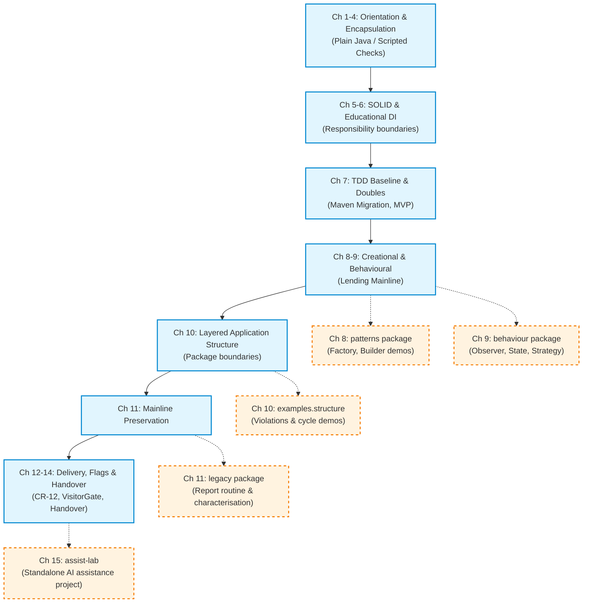
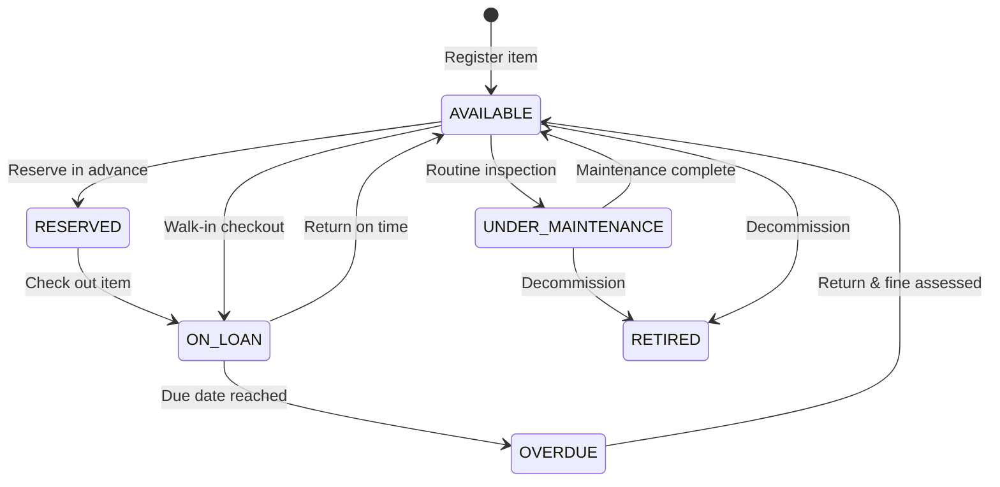

*OO Development and Agile Practices*  
*Designing, Testing and Evolving Software with AI Assistance*

## How to use this appendix

This appendix serves as the single point of truth for the codebase evolution of the **Campus Equipment Lending System** and the technical vocabulary used throughout this textbook. When working across multiple iterations, questions inevitably arise: Which files belong to the production mainline versus isolated pattern demonstrations? How many automated checks should be passing at the end of Week 6? What exact boundary conditions define an equipment loan period? This reference resolves those questions.

* **Use Section D.1 and D.2** to navigate chapter starting points, inspect test counts, reconcile changes across milestones, and verify your local build against the verified reference mainline.
* **Use Section D.3** to understand test execution metrics, parameterised invocation counts, and test grouping flags.
* **Use Section D.4** to verify the core domain invariants, lifecycle states, identifier rules, and policy constraints of the equipment lending system.
* **Use Section D.5** if your project team is applying these techniques to an alternative provided domain (such as Machine Learning Model Serving or Facility Scheduling).
* **Use Section D.6** as an authoritative glossary of object-oriented, testing, architectural, and Agile concepts.

---

## D.1 The Evolution Map: Cumulative Mainline vs. Isolated Branches

The textbook balances two distinct learning needs: building a realistic, cumulative software system that accommodates continuous change across thirteen weeks, and studying specific patterns or legacy refactorings without cluttering the clean production codebase.

To maintain clarity, the repository enforces a strict boundary between the **Cumulative Mainline** and **Isolated Packages**:



### The Cumulative Mainline
The cumulative mainline lives under the package namespace `edu.se506.lending`. It progresses sequentially from an un-encapsulated script in Chapter 1 to a fully structured, multi-layer application with automated verification in Chapter 14. Code in the mainline must never import classes from the isolated packages.

### Isolated Packages and Standalone Projects
1. `edu.se506.lending.patterns` (Chapter 8): Houses creational pattern demonstrations and alternative instantiation designs.
2. `edu.se506.lending.behaviour` (Chapter 9): Contains isolated behavioural pattern exercises (State, Strategy, Observer, Command).
3. `edu.se506.lending.examples.structure` (Chapter 10): Contains intentional architectural anti-patterns, cyclic dependencies, and package stability violations used for diagnostic labs.
4. `edu.se506.lending.legacy` (Chapter 11): Contains an untouched legacy overdue reporting routine with hidden time dependencies, string duplication, and high cyclomatic complexity, accompanied by characterisation tests.
5. `assist-lab` (Chapter 15): A separate, standalone Maven project with 9 acceptance tests used specifically for bounded AI evaluation exercises. It does not import or alter the lending system.

---

## D.2 Master Checkpoints Table

The following table provides the definitive record for every chapter checkpoint in the textbook. Test counts reflect **test invocations** executed by the test runner (plain Java runners for Chapters 1 to 6; Maven Surefire for Chapters 7 to 15).

| Chapter | Baseline Version | Package Root / Location | Test Count (Invocations) | Key Architectural / Domain Addition | Primary Build & Verification Command |
|---|---|---|---|---|---|
| **Ch 01** | `0.1.0-alpha` | Default (flat) | 3 checks | Procedural coordinator, hardcoded loan policies, initial fee calculation. | `javac -d build/classes src/main/java/*.java && java -cp build/classes Chapter01Demo` |
| **Ch 02** | `0.2.0-alpha` | Default (flat) | 34 checks | Encapsulated `ReservationCoordinator`, `LoanPeriod`, unmodifiable `List.copyOf` snapshots. | `javac -d build/classes src/main/java/*.java && java -cp build/classes Chapter02Demo` |
| **Ch 03** | `0.3.0-alpha` | Default (flat) | 34 checks | Agile user story backlog, acceptance criteria, iteration planning (no production code delta). | N/A (Process and planning checkpoint) |
| **Ch 04** | `0.4.0-alpha` | Default (flat) | 18 checks | First formal test runner, Arrange-Act-Assert (AAA), automated script runner. | `bash scripts/check.sh` |
| **Ch 05** | `0.5.0-alpha` | Default (flat) | 26 checks | SOLID refactoring, polymorphic rules (`ReservationRules`), static analysis smell audit. | `bash scripts/check.sh && bash scripts/pmd.sh` |
| **Ch 06** | `0.6.0-alpha` | Default (flat) | 31 checks | Interface segregation, educational dependency injection container (`Container`). | `bash scripts/check.sh` |
| **Ch 07** | `0.7.0` | `edu.se506.lending` | 7 invocations (starter) / 48 (MVP) | Migration to Apache Maven, JUnit Jupiter, first Mockito interface double (`NotificationGateway`). | `mvn --batch-mode verify` |
| **Ch 08** | `0.8.0` | `edu.se506.lending` | 72 invocations | Factory methods, Reservation Builder, repository seams, isolated `patterns` package. | `mvn --batch-mode verify` |
| **Ch 09** | `0.9.0` | `edu.se506.lending` | 98 invocations | Item lifecycle state pattern, notification observers, isolated `behaviour` package. | `mvn --batch-mode verify` |
| **Ch 10** | `0.10.0` | `edu.se506.lending` | 121 invocations | Layered architecture (domain, application, infrastructure, bootstrap), architectural fitness rules. | `mvn --batch-mode verify` |
| **Ch 11** | `0.11.0` | `edu.se506.lending` | 159 invocations | Isolated `legacy` package, characterisation tests, Extract Method/Class refactoring, seam creation. | `mvn --batch-mode verify` |
| **Ch 12** | `0.12.0` | `edu.se506.lending` | 159 invocations | Cycle time and throughput metrics, visiting-researcher change analysis (CR-12), backlog prep. | `mvn --batch-mode verify` |
| **Ch 13** | `0.13.1` | `edu.se506.lending` | 232 invocations (203 unit, 26 int, 3 e2e) | Visiting researcher rules, `VisitorGate` feature flag, HTTP directory adapter, file approvals. | `mvn --batch-mode verify` |
| **Ch 14** | `0.14.0` | `edu.se506.lending` | 235 invocations (206 unit, 26 int, 3 e2e) | Final handover state, `TraceabilityTest`, release notes, architecture decision records (`docs/`). | `mvn --batch-mode verify` |
| **Ch 15** | `1.0.0` | `edu.se506.assist` | 9 invocations | Standalone `assist-lab` project, candidate evaluation, provenance verification scripts. | `cd assist-lab && mvn --batch-mode verify` |

---

## D.3 Checkpoint Reconciliation and Test Invocations

When reviewing project status or comparing local runs with textbook outputs, differences in reported numbers can cause confusion. This section clarifies how test metrics are derived and reconciled.

### Invocations vs. Test Methods
From Chapter 7 onward, the build tool is Apache Maven running the Maven Surefire Plugin with JUnit Jupiter. Surefire reports **test invocations**, not test methods:
* A standard `@Test` method executes once and counts as **1 invocation**.
* A `@ParameterizedTest` method configured with a `@ValueSource` of four items executes four times and counts as **4 invocations**.
* Dynamic tests and test factories count each generated dynamic container or test node as an individual invocation.

Consequently, a test class containing 10 test methods may report 18 invocations if several methods evaluate multiple parameter sets. Always report the exact invocation count as output by `mvn verify`.

### Test Classification and Tagging (Chapter 13 Baseline)
In Chapter 13, the test suite is partitioned into execution categories using JUnit Jupiter `@Tag` annotations:

```java
// Unit test (runs by default in standard phase)
@Tag("unit")
class ReservationTest { ... }

// Integration test (contacts filesystem or local HTTP mock)
@Tag("integration")
class HttpDirectoryClientIntegrationTest { ... }

// End-to-end system test (verifies complete workflow from bootstrap)
@Tag("e2e")
class LendingSystemEndToEndTest { ... }
```

Surefire allows filtered execution using the `-Dgroups` and `-DexcludedGroups` options:

```bash
# Run unit tests only (fast gate)
mvn test -DexcludedGroups=integration,e2e

# Run integration tests only
mvn test -Dgroups=integration

# Run full comprehensive verification (all 232+ invocations)
mvn verify
```

### Known Deliberate Discrepancies and Architectural Decisions
To reflect real-world engineering realities, the project documents several intentional discrepancies and edge cases:
1. **SD-11-1 (Legacy Overdue Reporting Rate):** The legacy overdue routine in Chapter 11 calculates fines for visitor accounts using the fallback "other category" rate ($2.00/day) rather than the updated visitor policy ($1.50/day). The characterisation test explicitly asserts this quirk to prevent regressions during extraction.
2. **SD-12 (Reservation Count Rule):** The reservation rule in Chapter 12 counts all active records in the coordinator, including completed loans that have not been archived. This boundary condition is retained until formal archiving is scheduled.
3. **CR-12 (Visiting Researcher Feature Flag):** In Chapter 13, the visiting researcher functionality is introduced behind `VisitorGate`. When the flag is disabled (`false`), visitor reservations are rejected with an explicit policy message, ensuring backwards compatibility for existing deployments.

---

## D.4 Domain Rules, Invariants, and System Assumptions

The **Campus Equipment Lending System** serves as the primary teaching domain. The rules below are frozen across all chapters to ensure architectural consistency.

### 1. Temporal Semantics and Intervals
* **Half-Open Intervals:** All borrowing periods, reservations, and maintenance windows are strictly **start-inclusive and end-exclusive**:
  $$\text{Period} = [\text{start}, \text{endExclusive})$$
* **No Fractional Dates:** The domain operates at `java.time.LocalDate` precision. Times of day and timezones are excluded to avoid artificial distributed-systems complexity.
* **Duration:** The duration in days between $\text{start}$ and $\text{endExclusive}$ is:
  $$\text{Days} = \text{endExclusive} - \text{start}$$
* **Adjacency and Overlap:** Two periods $A$ and $B$ overlap if and only if:
  $$A.\text{start} < B.\text{endExclusive} \quad \text{and} \quad B.\text{start} < A.\text{endExclusive}$$
  Adjacent periods do not overlap. If Reservation 1 ends on `2026-11-05` and Reservation 2 starts on `2026-11-05`, both may safely book the same physical item.

### 2. Domain Identifiers and Equality
* **Strong String IDs:** Identifiers are non-blank, trimmed strings adhering to standard format prefixes:
  * Borrower ID: `B-XXXX` (e.g., `B-1001`)
  * Item ID: `ITEM-XXXX` (e.g., `ITEM-CAM-01`)
  * Reservation ID: `R-XXXX` (e.g., `R-0012`)
  * Loan ID: `L-XXXX` (e.g., `L-5001`)
* **Reference vs. Value Identity:** Domain entities (`Borrower`, `EquipmentItem`, `Reservation`) are compared by domain identifier equivalence, not Java object reference identity (`==`). Immutable value objects (`LoanPeriod`, `Money`, `FineAmount`) compare all constituent fields.

### 3. Borrower Categories and Loan Quotas

| Borrower Category | Maximum Active Loans | Maximum Loan Duration | Advance Booking Window | Sponsor / Approval Required? |
|---|---|---|---|---|
| **STUDENT** | 2 items | 7 days | 14 days | No |
| **STAFF** | 5 items | 30 days | 60 days | No |
| **VISITOR** | 1 item | 3 days | 7 days | **Yes** (Valid Faculty Sponsor ID) |

* **Quota Enforcement:** Quota counts evaluate the sum of *current active physical loans* and *confirmed future reservations* for that borrower.
* **Visiting Researcher Constraint:** A visitor cannot reserve equipment without an active, verified faculty sponsor ID present in the university directory. When the directory service is unavailable, visitor requests must fail safely with an explicit error rather than silently defaulting to staff privileges.

### 4. Equipment Lifecycle and State Transitions
An `EquipmentItem` transitions through a strictly validated lifecycle:



* An item cannot be reserved or checked out if its status is `UNDER_MAINTENANCE` or `RETIRED`.
* An item marked `RESERVED` for Borrower $A$ cannot be issued to Borrower $B$.

### 5. Encapsulation and Snapshot Safety
* All internal collections (such as `List<Reservation>` inside `ReservationCoordinator`) must be guarded. Public inspection methods return unmodifiable snapshots via `List.copyOf(...)`.
* Callers must not be able to modify the internal state of a coordinator by appending or clearing a returned list.

---

## D.5 Alternative Provided Domains (Transfer Map)

For courses where student teams develop their own semester projects on alternative approved starter domains (Ground Rules G2 and G3), the following mappings translate concepts between the Campus Equipment Lending System and alternative domains.

### Domain Option B: ML Model Serving and Experiment Tracking Service
A platform that manages machine learning model deployments, GPU worker allocations, inference batch jobs, and retraining schedules.

| Equipment Lending Concept | ML Model Serving Equivalent | Implementation Guidance |
|---|---|---|
| `EquipmentItem` | `TrainedModel` or `GPUWorker` | Manages state (`DEPLOYED`, `IDLE`, `BENCHMARKING`, `DRAINING`). |
| `Borrower` | `ServiceClient` / `ResearchProject` | Represents the consumer of inference capacity. |
| `LoanPeriod` | `ComputeLease` / `AllocationWindow` | Time interval for exclusive or shared GPU execution slots. |
| `ReservationRules` | `ResourceQuotaRules` | Evaluates team GPU limits, job priority, and vRAM requirements. |
| `OverdueLoan` | `LeaseExpirationViolation` | Triggers container eviction or resource throttling. |
| `VisitorGate` | `ExternalClientThrottleGate` | Feature flag gating external API traffic versus internal inference. |

### Domain Option C: Academic Facility and Resource Scheduling
A centralized scheduling system for university science laboratories, recording studios, lecture theaters, and specialized hardware rigs.

| Equipment Lending Concept | Facility Scheduling Equivalent | Implementation Guidance |
|---|---|---|
| `EquipmentItem` | `BookableFacility` / `LaboratoryRoom` | Owns capacity, specialized hazards, and cleaning schedules. |
| `Borrower` | `EventOrganizer` / `FacultyMember` | Holds permission credentials and department billing codes. |
| `LoanPeriod` | `Timeslot` | Half-open time window `[startTime, endTime)`. |
| `ReservationRules` | `OccupancyPolicyRules` | Validates safety ratios, certified supervisor presence, and hours. |
| `MaintenanceRecord` | `SanitizationAndSafetyInspection` | Dependent entity bound to the lifetime of the facility. |
| `EquipmentKit` | `RoomSuite` / `FacilityCluster` | Aggregates multiple sub-rooms without shared deletion lifetimes. |

---

## D.6 Authoritative Glossary of Domain and Technical Terms

### Acceptance Criteria
The explicit, testable conditions that a software system must satisfy for a user story to be accepted by stakeholders. In this book, acceptance criteria are written using the *Given-When-Then* structure and serve as the foundation for automated acceptance and integration tests.

### Aggregation (`o--`)
A specialized form of object association representing a "has-a" relationship where the child component can exist independently of the parent container. In class diagrams, depicted by an open diamond at the container end. Example: An `EquipmentKit` aggregates `EquipmentItem` instances; removing the kit from the system does not destroy the physical equipment items. Contrast with *Composition*.

### Architecture Decision Record (ADR)
A lightweight document that captures a significant architectural choice made by an engineering team, along with its context, options considered, trade-offs, and consequences. In this course, ADRs are maintained under `docs/` (e.g., `ADR-013` governing feature flags).

### Arrange-Act-Assert (AAA)
A standard pattern for structuring automated unit tests into three distinct phases:
1. **Arrange:** Set up preconditions, test doubles, and input values.
2. **Act:** Invoke the specific method or operation under test.
3. **Assert:** Verify that expected state changes and return values occurred, without executing additional side effects.

### Association (`-->`)
A structural relationship between two classes indicating that instances of one class navigate to, hold references to, or communicate with instances of the other. In class diagrams, drawn as a solid line with an open navigation arrow and annotated with multiplicities.

### Boundary Object
An object situated at the periphery of an application architecture that translates between external formats (such as HTTP JSON payloads, flat CSV files, or database rows) and internal domain entities.

### Builder Pattern
A creational design pattern that separates the construction of a complex object from its representation. It allows step-by-step configuration of parameters and enforces invariant validation before calling a terminal `build()` method.

### Characterisation Test
An automated regression test designed to capture and document the existing, actual behaviour of a legacy system before attempting refactoring. Characterisation tests preserve legacy behaviour regardless of whether that behaviour is technically correct, providing a safety net against unintended regressions.

### Cohesion
A qualitative measure of how closely related and focused the responsibilities within a class, module, or package are. A highly cohesive class owns a single well-defined concept; changes to unrelated business policies do not require editing it.

### Composition (`*--`)
A strict form of object association where the child component's lifetime is bound to and governed by the parent. In class diagrams, represented by a filled diamond at the owner end. If the owner object is deleted, the contained part is destroyed with it. Example: An `EquipmentItem` composes its `MaintenanceRecord` history. Contrast with *Aggregation*.

### Coupling
The degree of direct interdependence between software components. Tight coupling means changes to one class propagate ripple effects through collaborators. Loose coupling is achieved by programming to abstractions and minimising direct knowledge of collaborator implementations.

### Cycle Time
The elapsed time from when an engineering team begins active development on a work item until that item is integrated, verified, and ready for release. Used in Chapter 12 as a primary metric of team flow. Contrast with *Lead Time*.

### Defensive Copy
A technique where a class creates a new, independent copy of a mutable object before storing it internally or returning it to external callers, preventing external mutation of private internal state.

### Dependency (`..>`)
A usage relationship indicating that a class relies on another class temporarily (such as a method parameter, a local variable, or a return type) without holding a permanent reference field. Represented in UML diagrams as a dashed directed arrow.

### Dependency Inversion Principle (DIP)
The fifth SOLID principle, stating that:
1. High-level modules should not depend on low-level modules; both should depend on abstractions.
2. Abstractions should not depend on details; details should depend on abstractions.

### Double Dispatch
A mechanism where a call is dispatched polymorphically based on the runtime types of two collaborating objects. Used in behavioural patterns such as Visitor and Strategy.

### Encapsulation
The bundling of data with the operations that act upon that data, while restricting direct external access to internal representations. Encapsulation protects class invariants by ensuring state changes occur solely through controlled methods.

### Factory Method
A creational design pattern that defines an interface or method for creating an object, deferring instantiation to derived classes or static factory helpers. Encapsulates complex constructor parameters and decouples callers from concrete types.

### Fake
A lightweight test double that provides a working implementation of a contract using simplified, in-memory structures (such as an in-memory map simulating a database). Fakes run fast in unit test suites and require no mocking frameworks. Contrast with *Mock* and *Stub*.

### Feature Flag (Feature Gate)
A software engineering technique that wraps new or modified functionality behind a conditional check, enabling the code path to be toggled on or off at runtime or configuration without deploying separate branches. In Chapter 13, `VisitorGate` controls the rollout of visiting researcher reservations.

### Half-Open Interval
A mathematical interval $[a, b)$ that includes its lower bound $a$ but excludes its upper bound $b$. Used universally in this textbook for date ranges to ensure that adjacent periods do not overlap.

### Interface Segregation Principle (ISP)
The fourth SOLID principle, stating that clients should not be forced to depend upon interfaces they do not use. Wide, monolithic interfaces should be split into smaller, cohesive, role-based contracts.

### Invariant
A business condition or logical predicate that must always remain true throughout the lifetime of a valid domain object (except momentarily during the execution of an internal mutating method). Invariants are established by constructors and defended by public mutators.

### Lead Time
The total elapsed time from the moment a requirement or user story is proposed until it is delivered to production. Measures organizational responsiveness. Contrast with *Cycle Time*.

### Liskov Substitution Principle (LSP)
The third SOLID principle, stating that objects of a supertype must be replaceable with objects of a subtype without altering the correctness or intended behaviour of the program. Subtypes must not strengthen preconditions or weaken postconditions.

### Mock
A test double pre-programmed with explicit expectations regarding which methods will be called, with what arguments, and in what order. Mocks verify interaction behaviour rather than resulting state. In this course, Mockito is configured strictly for interface-only mocks.

### Open-Closed Principle (OCP)
The second SOLID principle, stating that software entities (classes, modules, functions) should be open for extension, but closed for modification. New behaviour should be introduced by adding new classes or strategies rather than altering existing, stable classes.

### Package Instability ($I$)
A software architecture metric calculated as the ratio of outgoing dependencies ($C_e$) to total dependencies ($C_a + C_e$):
$$I = \frac{C_e}{C_a + C_e}$$
An instability of 0 indicates a maximally stable, heavily depended-upon package; an instability of 1 indicates a completely instable package that depends on others but is not depended upon.

### Refactoring
A disciplined technique for restructuring existing computer code, altering its internal structure without changing its external, observable behaviour. Refactoring is carried out in small, verified steps backed by automated regression tests.

### Seam
A place in a codebase where behaviour can be altered or intercepted without editing the code directly (e.g., an interface parameter, an inherited virtual method, or a configuration hook). Seams allow legacy code to be placed under test.

### Single Responsibility Principle (SRP)
The first SOLID principle, stating that a class should have one, and only one, reason to change. Each class should encapsulate a single, cohesive axis of change.

### Snapshot Unmodifiability
The protection mechanism provided by Java's `List.copyOf(...)` or `Collections.unmodifiableList(...)`, which prevents callers from modifying list structure (adding, removing, or clearing elements). Does not make mutable element instances inside the list immutable.

### Stub
A test double that returns hardcoded, pre-canned answers to method calls during a test, providing necessary indirect inputs without verifying interaction details.

### Technical Debt
A metaphor representing the implied cost of additional rework caused by choosing an expedient, short-term solution over an engineered, maintainable approach. In this course, technical debt is treated as observable evidence (such as duplicated calculations, hidden dependencies, and missing test seams) rather than a vague complaint.

### Test Double
A generic term coined by Gerard Meszaros for any substitute object used in place of a production collaborator during automated testing. Includes Fakes, Stubs, Spies, Mocks, and Dummies.

### Test-Driven Development (TDD)
A software development process relying on the repetition of a short development cycle:
1. **Red:** Write a failing automated test for the desired functionality.
2. **Green:** Write the minimum production code necessary to pass the test.
3. **Refactor:** Clean up structure, remove duplication, and protect invariants while keeping tests green.

### Throughput
The count of verified work items, user stories, or pull requests completed and integrated per unit of time (e.g., per iteration). Used alongside cycle time to assess team delivery pace.

### Verification Record (AI Assistance)
A structured engineering audit log recording human oversight of AI-generated assets. It documents the task definition, tool/model version, prompt context, candidate output, rejected elements, modifications made, and independent test evidence confirming compliance with system invariants.

---

## D.7 Primary Sources and Standards

The architectural principles, patterns, and conventions used across this appendix and the textbook are grounded in primary software engineering literature:

1. **Oracle.** [The Java Language Specification, Java SE 17 Edition](https://docs.oracle.com/javase/specs/jls/se17/html/index.html). Baseline language semantics, constructor rules, and type boundaries.
2. **Martin, Robert C.** *Agile Software Development: Principles, Patterns, and Practices.* Prentice Hall, 2002. Primary reference for the SOLID principles, package cohesion, and package coupling metrics.
3. **Fowler, Martin.** *Refactoring: Improving the Design of Existing Code.* 2nd ed., Addison-Wesley, 2018. Catalog of refactorings, code smell taxonomy, and mechanics of safe code extraction.
4. **Feathers, Michael C.** *Working Effectively with Legacy Code.* Prentice Hall, 2004. Primary authority for characterisation tests, seams, and dependency breaking techniques.
5. **Beck, Kent.** *Test-Driven Development: By Example.* Addison-Wesley, 2002. Core TDD cycle, test list management, and Arrange-Act-Assert discipline.
6. **Gamma, Erich, Richard Helm, Ralph Johnson, and John Vlissides.** *Design Patterns: Elements of Reusable Object-Oriented Software.* Addison-Wesley, 1994. Reference taxonomy for creational and behavioural design patterns.
7. **Humble, Jez, and David Farley.** *Continuous Delivery: Reliable Software Releases through Build, Test, and Deployment Automation.* Addison-Wesley, 2010. Automated build gates, contract testing, and feature flag management.
8. **Forsgren, Nicole, Jez Humble, and Gene Kim.** *Accelerate: The Science of Lean Software and DevOps.* IT Revolution Press, 2018. Research foundation for cycle time, lead time, and team throughput metrics.