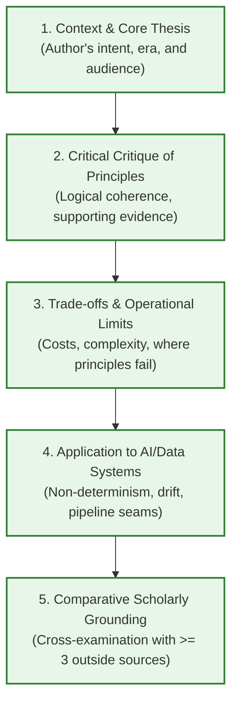
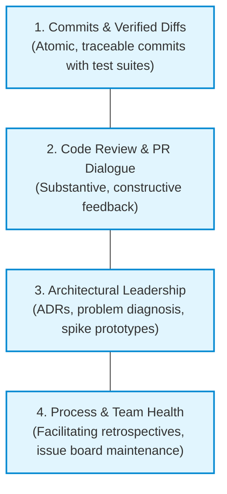

*OO Development and Agile Practices*  
*Designing, Testing and Evolving Software with AI Assistance*

## How to use this appendix

Professional software engineering requires more than writing functional code: it requires evaluating architectural literature with an analytical eye, collaborating transparently within a development team, and documenting evidence of engineering contribution. This appendix provides direct methodological guidance for two major components of the SE506 module assessment:

1. **The Individual Critical Book Review (due Week 8):** Sections E.1 and E.2 guide your reading process, critical analysis, and synthesis of foundational software engineering texts, specifically examining how classic design principles apply to modern, AI-enabled software systems.
2. **Project Contribution Evidence and Final Handover (due Week 13):** Sections E.3, E.4, and E.5 guide your team through compiling an authentic, auditable contribution portfolio, preparing the final project handover dossier, and authoring your individual engineering reflection.

> [!IMPORTANT]
> This appendix guides your method and evidence collection. It does not replace or modify the official module descriptor or assignment brief issued on Moodle. Always refer to your module leader's approved instructions for submission deadlines, exact word count limits, formatting rules, and assessment rubrics.

---

## E.1 The Individual Critical Book Review (Week 8 Assessment)

The module curriculum includes an individual critical review of 1,500 to 2,000 words evaluating a foundational work in software design or Agile engineering. Its goal is not to produce a descriptive book report or chapter-by-chapter summary, but to critically evaluate the author's principles, examine their operational limits, and analyze their relevance to modern software systems that incorporate machine learning and data components.

### 1. Selecting a Book from the Approved Reading Pool
Your selected text must come from the module leader's approved reading list (Decision D8). The candidate pool includes seminal texts cited across the module syllabus:

* **Robert C. Martin (2002):** *Agile Software Development: Principles, Patterns, and Practices.* (Core reference for SOLID, package coupling, and Agile fundamentals).
* **Martin Fowler (2018):** *Refactoring: Improving the Design of Existing Code* (2nd ed.). (Smell taxonomy, mechanics of refactoring, and test-backed restructuring).
* **Michael C. Feathers (2004):** *Working Effectively with Legacy Code.* (Seams, characterisation tests, and dependency breaking in existing systems).
* **Kent Beck (2002):** *Test-Driven Development: By Example.* (TDD cycles, test lists, and feedback-driven design).
* **Eric Evans (2003):** *Domain-Driven Design: Tackling Complexity in the Heart of Software.* (Ubiquitous language, bounded contexts, and domain invariants).
* **Jez Humble and David Farley (2010):** *Continuous Delivery.* (Automated deployment pipelines, gates, and contract-driven verification).
* **Nicole Forsgren, Jez Humble, and Gene Kim (2018):** *Accelerate.* (Empirical measurement of software delivery performance, flow, and team health).

Select your book in Week 1. Beginning late makes deep analytical synthesis impossible.

### 2. The Five Analytical Review Components
Your written review must balance five essential areas:



#### Component 1: Context, Intent, and Core Thesis
Situate the book in its historical and industrial context. What software crisis, programming paradigms, or architectural challenges was the author responding to? Who is the intended reader, and what central thesis does the author argue? Avoid lengthy biographical introductions; establish the book's context in one or two focused paragraphs.

#### Component 2: Critical Evaluation of Principles and Examples
Examine the book's core principles. Do the author's arguments follow logically from their premises? Scrutinize their code examples:
* Are the examples realistic, or are they simplified demonstrations that obscure difficult edge cases (e.g., concurrency, persistence, distributed failure)?
* Does the author claim universal applicability where a recommendation is actually context-dependent?
* Where do their principles offer robust design guidance, and where do they overreach into dogmatism?

#### Component 3: Trade-offs, Friction, and Boundary Conditions
Every sound design pattern or architectural choice imposes costs. A thorough engineering critique identifies:
* **Cognitive load:** Does introducing this pattern create indirection that makes routine inspection harder for new engineers?
* **Runtime overhead:** Does abstraction introduce latency, object churn, or profiling penalties?
* **Premature generalization:** Does the author's advice encourage developers to build speculative flexibility for requirements that never materialize?

#### Component 4: Application to Systems with AI and Data Components
This analysis is central to the SE506 learning outcomes. Classic software engineering literature (e.g., Martin 2002, Beck 2002) assumed deterministic systems where identical inputs reliably produce identical outputs, and where requirements are expressed as unambiguous business rules. 

In your review, critically evaluate how the author's principles hold up when applied to software *surrounding* artificial intelligence and machine learning models:
* **Non-determinism and verification:** How does Test-Driven Development function when component outputs are probabilistic or model weights drift over time?
* **Architectural boundaries:** How do principles like Dependency Inversion (DIP) or Interface Segregation (ISP) protect core domain logic from unstable external model services or heavy Python inference runtimes?
* **Refactoring data seams:** How do legacy code techniques (Feathers) apply when technical debt resides in untracked data schemas or pipeline couplings rather than procedural code?

#### Component 5: Independent Scholarly Cross-Examination
Your evaluation must cite **at least three additional authoritative or peer-reviewed sources** beyond the chosen book itself. Use outside literature to corroborate or challenge the author's claims:
* Cite empirical studies (e.g., IEEE, ACM, or empirical SE research) examining whether the proposed practice actually reduces defect rates or maintenance costs.
* Cite competing engineering schools of thought (e.g., contrasting Martin's pure OO clean architecture with data-oriented design or functional programming perspectives).

### 3. Academic Integrity and AI Policy for the Book Review
The critical book review evaluates **your** synthesis and intellectual critique:
* **Reading cannot be outsourced:** Using an AI assistant to generate a summary or critique of a book you have not personally read is not acceptable scholarship. AI summaries routinely hallucinate examples, miss nuanced qualifications, and generate generic praise without genuine critique.
* **Permitted assistance:** You may use conversational AI as an active reading interlocutor (e.g., "What are the common criticisms of the Open-Closed Principle in modern systems programming?" or "Help me find empirical studies evaluating TDD defect density").
* **Provenance requirement:** If you use an AI tool to brainstorm counter-arguments or refine prose, you must document that interaction in your submission with a brief provenance statement, following the standards outlined in Chapter 15 and Appendix C.

---

## E.2 The Dialectical Reading Journal

Do not wait until Week 7 to begin drafting. Maintain a weekly reading journal from Week 1 to track observations, test code examples, and record critical reflections.

### Recommended Weekly Reading Cadence

| Weeks | Reading Focus | Practical Investigation | Journal Output |
|---|---|---|---|
| **Weeks 1–2** | Foundations and core thesis (Chapters 1–4 of chosen text). | Trace one sample codebase or code example provided by the author. | Identify the author's central definition of design quality. Note initial assumptions. |
| **Weeks 3–4** | Deep dive into principles (e.g., SOLID, Refactoring catalogs). | Attempt to apply one principle to the Campus Equipment Lending System or your team project. | Record where the principle simplified code, and where it introduced unwanted friction. |
| **Weeks 5–6** | Boundary conditions, testing, and architecture. | Re-evaluate the author's testing or modularity advice against probabilistic ML model outputs. | Draft the critique section on AI and data system applicability. |
| **Week 7** | External literature search and synthesis. | Search Google Scholar, ACM Digital Library, or IEEE Xplore for empirical evaluations. | Assemble at least 3 outside supporting or contrasting citations. |
| **Week 8** | Drafting, peer review, and submission. | Review prose against word count constraints (1,500–2,000 words) and check citations. | Final submission to Moodle turnitin portal. |

### Dialectical Reading Note Template
When reading chapters of your chosen book, use a two-column dialectical note structure:

```text
================================================================================
DIALECTICAL READING LOG ENTRY
Book: Martin (2002) - Agile Software Development
Chapter / Pages: Chapter 8, The Open-Closed Principle (pp. 99-112)
Date: 2026-10-20
--------------------------------------------------------------------------------
WHAT THE AUTHOR CLAIMS:
"Modules should be open for extension, but closed for modification. In 
well-designed systems, new functionality is added by adding new code, not by 
changing existing code that already works." (p. 99)

The author illustrates this with a Shape/Drawing routine where adding a new 
Circle requires modifying a procedural switch statement. He demonstrates 
replacing this with an abstract Shape base class and polymorphic draw() calls.
--------------------------------------------------------------------------------
CRITICAL SCRUTINY & REVALUATION:
1. Oversimplified domain: Geometric shapes have trivial, static invariants. 
   In real business systems (like our equipment lending domain), changes are 
   rarely pure additions; policies alter existing relationships (e.g., adding 
   Visitor borrowing limits requires updating how the coordinator counts 
   active loans across all users).
2. Cost of abstraction: Closing a module requires anticipating future axes of 
   variation. If we guess the wrong axis, we build complex interfaces that 
   hinder subsequent changes.
3. AI/ML context: In machine learning systems, model behavior changes without 
   any code changes (via model retraining or parameter drift). The OCP does 
   not protect against distribution shifts or semantic data changes.
--------------------------------------------------------------------------------
OUTSIDE SOURCES TO CONSULT:
- Ousterhout (2018), "A Philosophy of Software Design", on shallow interfaces.
- Sculley et al. (2015), "Hidden Technical Debt in Machine Learning Systems".
================================================================================
```

---

## E.3 Team Project Contribution Evidence (Ground Rule G7)

The collaborative team project (SE506 group component) evaluates both the delivered software product and each student's individual contribution. This section outlines how individual engineering contributions are assessed and how to build a clear, auditable evidence portfolio.

### The Limits of Quantitative Metrics
Engineering contribution is **qualitative, intellectual, and collaborative**. In accordance with Ground Rule G7:

> [!CAUTION]
> Commit counts, total lines of code, and pull request tallies are never used as a direct measure of engineering competence or contribution. 

Raw software metrics obscure the reality of collaborative engineering:

| Raw Metric | What It Actually Shows | What It Completely Misses |
|---|---|---|
| **Lines of Code (LOC)** | Volume of text committed to version control. | Eloquence, concise design, refactoring to reduce duplication, deleting obsolete code, or writing careful test assertions. |
| **Commit Count** | Staging frequency and git habits. | Meaningful work completed during pair programming, architecture design sessions, debugging, or reviewing peers' pull requests. |
| **Pull Request (PR) Tally** | Integration ticket transactions. | The relative difficulty or impact of tasks (e.g., fixing a race condition in a multi-thread seam vs. fixing a typo in documentation). |

A student who refactors a 300-line legacy method into a clean 30-line cohesive class with comprehensive tests may show negative net lines of code ($-270$), yet has delivered far higher architectural value than a student who commits 1,000 lines of un-tested, duplicated script code.

### The Four Pillars of Authentic Contribution Evidence
When assembling your individual contribution portfolio for the final project submission, provide concrete evidence across four distinct pillars:



#### Pillar 1: High-Signal Commits and Verifiable Diffs
* **Atomic changes:** Provide URLs or commit SHAs for commits where you implemented specific user stories or bug fixes.
* **Regression safety:** Demonstrate that your changes were accompanied by passing unit or integration tests following the Arrange-Act-Assert structure.
* **Commit clarity:** Commit messages should follow clear conventions (such as Conventional Commits), explaining *why* the change was made rather than just restating the file diff.

#### Pillar 2: Substantive Code Reviews
Evidence of thorough, respectful, and rigorous code review on peer pull requests:
* Pointing out missed boundary conditions, potential null pointer exceptions, or fragile temporal intervals.
* Suggesting clearer naming, improved encapsulation (e.g., replacing public mutable collections with `List.copyOf`), or better test assertions.
* Validating that the PR author included appropriate test coverage before approval.

#### Pillar 3: Architectural and Problem Diagnosis Notes
* Authoring or co-authoring Architecture Decision Records (`docs/ADR-XXX.md`) documenting trade-offs for structural choices (e.g., choosing a feature flag strategy or configuring a test double).
* Diagnostic write-ups for difficult bugs: documenting the root cause, failing characterisation test, and corrective extraction.

#### Pillar 4: Process Discipline and Teamwork
* Constructive facilitation of sprint retrospectives and creation of actionable improvement cards on the team issue board.
* Maintenance of the continuous integration build (e.g., resolving Maven Surefire failures or updating static analysis configurations).

---

## E.4 Final Handover Dossier (Week 13 Handover Standard)

In Week 13 (Chapter 14), development on the team project halts, and the repository is prepared for final handover. A professional handover ensures that future engineers (and examiners) can build, verify, inspect, and deploy the system without undocumented manual steps.

Your team repository's final tagged release (e.g., `v0.14.0`) must contain a dedicated `docs/` dossier with the following four core files:

```text
team-repository/
|-- pom.xml
|-- README.md                         (Quick start, build status, environment baseline)
|-- scripts/
|   |-- check-setup.sh                (Validates local JDK and build tool versions)
|   |-- build-and-test.sh             (Runs clean compiler, linter, and full test suite)
|   +-- handover-check.sh             (Automates the final acceptance and release check)
+-- docs/
    |-- HANDOVER.md                   (System purpose, architecture map, operational runbook)
    |-- REQUIREMENTS-TO-EVIDENCE.md   (Traceability matrix linking stories to passing tests)
    |-- KNOWN-ISSUES.md               (Explicit log of technical debt and deferred bugs)
    +-- RELEASE-NOTES-v0.14.0.md      (Changelog, deprecated features, and migration notes)
```

### 1. `docs/HANDOVER.md`
This document answers operational and architectural questions for incoming developers:
* **System Overview:** Core purpose, business context, and domain boundaries.
* **Architecture Diagram:** Mermaid class or component diagram showing the primary package layers and dependency directions.
* **Build and Runbook:** Exact commands required to build the artifact, run all test suites, and launch the primary executable.
* **External Boundaries:** Configuration details for external services, file storage paths, and environment variable requirements.

### 2. `docs/REQUIREMENTS-TO-EVIDENCE.md`
A rigorous traceability matrix proving that every user story committed to the iteration backlog was verified by automated tests:

| Story ID | Story Title | Primary Architectural Components | Automated Verification Evidence | Verification Status |
|---|---|---|---|---|
| **US-01** | Student loan limits | `StudentReservationRules`, `Coordinator` | `ReservationTest#studentCannotExceedTwoActiveLoans` | **VERIFIED (Pass)** |
| **US-04** | Visiting researcher gate | `VisitorGate`, `VisitorReservationRules` | `VisitorGateIntegrationTest#visitorRejectedWhenFlagDisabled` | **VERIFIED (Pass)** |
| **US-07** | Overdue fee generation | `OverdueFeeCalculator`, `Loan` | `FeeCalculatorTest#feeAccruesLinearlyOnLateReturn` | **VERIFIED (Pass)** |

### 3. `docs/KNOWN-ISSUES.md`
Professional engineering acknowledges imperfections honestly rather than concealing them. The known issues log lists all unresolved defects, compromises, and technical debt items:

```markdown
# Known Issues and Deferred Technical Debt

### KI-01: Legacy Fine Calculation Category Discrepancy
* **Description:** The legacy overdue reporting service calculates visitor fees using the fallback "other" rate ($2.00/day) rather than the active visitor policy ($1.50/day).
* **Impact:** Affects legacy CSV overdue exports only. The core domain coordinator calculates correct rates.
* **Reason Deferred:** Preserved intentionally to maintain backwards compatibility with existing characterisation tests.
* **Remediation Plan:** Scheduled for refactoring in Iteration 5 under Issue #42.
```

### 4. `docs/RELEASE-NOTES-v0.14.0.md`
Summarizes what is delivered in the final release tag:
* New features added during the final iteration.
* Breaking changes or altered configuration keys.
* Status of active feature flags (e.g., whether `VisitorGate` is enabled by default).
* Test execution totals (e.g., `235 passing test invocations across 3 test suites`).

---

## E.5 Individual Reflective Commentary

Alongside the team handover dossier, each student submits an **individual reflective commentary** (typically 500–750 words, as specified in the assignment brief). This commentary provides personal engineering reflection on decisions made throughout the semester.

### Structural Framework for Reflection

Use the following three-part structure to organize your commentary:

```text
================================================================================
INDIVIDUAL ENGINEERING REFLECTION FRAMEWORK
================================================================================
PART 1: ARCHITECTURAL DECISION JUSTIFICATION
- Select ONE specific design choice or refactoring you championed or implemented.
- Explain the technical dilemma: what were the competing design options?
- Why did you choose this design? Cite specific principles (e.g., ISP, DIP, OCP).
- What was the measurable consequence on the codebase (e.g., testability, 
  reduced coupling, eliminated duplication)?

PART 2: CANDID APPRAISAL OF COMPROMISE OR DEFERRED DEBT
- Select ONE area where you had to compromise, accept technical debt, or where 
  a design choice proved awkward in later iterations.
- Why was this compromise made? (e.g., time constraints, lack of domain clarity).
- How did this choice affect subsequent changes?
- In hindsight, what design seam or pattern would you introduce to fix it?

PART 3: COLLABORATION, FEEDBACK, AND PROFESSIONAL GROWTH
- Describe an instance where peer review or pair programming altered your design.
- How did you use feedback to improve your code or team process?
- Reflect on your development workflow: how did your testing habits, Git usage, 
  and design reasoning evolve from Week 1 to Week 13?
================================================================================
```

### Guidance on High-Scoring Reflections
* **Be specific:** Refer to actual class names, method signatures, commit SHAs, and test classes from your repository. Avoid generic generalities ("I learned that object-oriented programming is important").
* **Embrace critical honesty:** Markers give higher credit to self-aware reflections that identify real compromises and analyze why they occurred than to defensive write-ups that claim perfection.
* **Connect theory to evidence:** Ground your reflections in the literature covered during the semester (Martin, Fowler, Feathers, Beck). Explain how course concepts directly influenced your everyday implementation choices.

---

## E.6 Primary Sources and Standards

The critical review and evidence methods in this appendix adhere to the following foundational engineering literature and academic assessment standards:

1. **Martin, Robert C.** *Agile Software Development: Principles, Patterns, and Practices.* Prentice Hall, 2002. Foundational text for OO design metrics and Agile team dynamics.
2. **Fowler, Martin.** *Refactoring: Improving the Design of Existing Code.* 2nd ed., Addison-Wesley, 2018. Standards for evolutionary architecture and code smell diagnosis.
3. **Feathers, Michael C.** *Working Effectively with Legacy Code.* Prentice Hall, 2004. Methodologies for testing without breaking existing contracts.
4. **Beck, Kent.** *Test-Driven Development: By Example.* Addison-Wesley, 2002. Feedback cycles and developer testing discipline.
5. **Humble, Jez, and David Farley.** *Continuous Delivery.* Addison-Wesley, 2010. Release engineering, handover dossiers, and automated quality gates.
6. **Forsgren, Nicole, Jez Humble, and Gene Kim.** *Accelerate: The Science of Lean Software and DevOps.* IT Revolution Press, 2018. Empirical evaluation of software team performance, flow, and qualitative contribution indicators.
7. **Ousterhout, John.** *A Philosophy of Software Design.* Yaknyam Press, 2018. Counter-perspective on deep modules, cognitive load, and the risks of excessive shallow abstraction.
8. **Sculley, David, et al.** "Hidden Technical Debt in Machine Learning Systems." *Advances in Neural Information Processing Systems (NeurIPS)*, 2015. Foundational paper on applying software engineering principles to AI/ML systems.