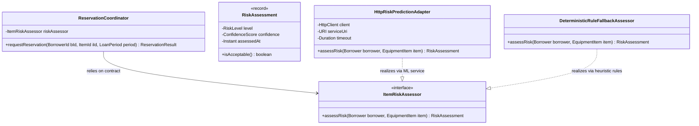

*OO Development and Agile Practices*  
*Designing, Testing and Evolving Software with AI Assistance*

## How to use this appendix

For postgraduate students in Artificial Intelligence, a recurring professional tension exists between training models in exploratory notebooks and integrating those models into robust, long-lived production systems. A high-accuracy model wrapped in fragile, tightly coupled software fails to deliver business value; conversely, a disciplined object-oriented architecture that treats a machine learning component as an undisciplined black box risks silent data corruption, un-testable workflows, and cascading system outages.

This appendix addresses **Ground Rule G4**: engineering reliable, maintainable software *around* AI and data components. It demonstrates how the core principles taught throughout this textbook: encapsulation, interface segregation, dependency inversion, test doubles, feature flags, and architectural seams: apply directly to the unique challenges posed by probabilistic models and data pipelines.

* **Use Section F.1 and F.2** to establish clean architectural boundaries and typed contracts around external AI services, isolating your domain model from tensor libraries and serialization formats.
* **Use Section F.3** to construct automated testing strategies that manage non-deterministic and probabilistic outputs without destabilizing your continuous integration build.
* **Use Section F.4 and F.5** to identify and remediate machine-learning-specific technical debt, design resilient fallback mechanisms, and enforce safety invariants when model services experience latency or failure.
* **Use Section F.6 and F.7** to implement safe model rollout strategies and complete a structured practical exercise wrapping a predictive scoring service.

---

## F.1 The Two AI Threads in Software Engineering

To avoid conceptual confusion, this textbook maintains a rigorous distinction between two independent applications of artificial intelligence in software engineering:

```mermaid
graph TD
    classDef t1 fill:#e1f5fe,stroke:#0288d1,stroke-width:2px;
    classDef t2 fill:#ede7f6,stroke:#512da8,stroke-width:2px;
    
    subgraph T1 ["Thread A: AI as an Engineering Assistant (Chapter 15)"]
        A1["Human Engineer"]:::t1 --> A2["AI Coding Assistant"]:::t1
        A2 --> A3["Candidate Code, Tests & Explanations"]:::t1
        A3 --> A4["Independent Human Verification & Testing"]:::t1
    end
    
    subgraph T2 ["Thread B: Software Surrounding AI & Data Components (Appendix F)"]
        B1["Application Domain Logic"]:::t2 --> B2["Gateway Interface / Boundary Contract"]:::t2
        B2 --> B3["Model Adapter & Serialization"]:::t2
        B3 --> B4["Inference Service / ML Model / Data Pipeline"]:::t2
    end
```



### Thread A: AI as an Assistant (Process Tool)
Covered in Chapter 15 and individual chapter activities. Here, an AI model (such as a large language model) acts as an external interactive assistant during the development lifecycle: generating candidate test fixtures, proposing refactoring diffs, or critiquing code smells. The software being written may have nothing to do with machine learning.

### Thread B: Software Around AI and Data Components (System Architecture)
Covered in this appendix and woven through the running project. Here, the production software application incorporates a machine learning model, statistical scoring engine, or external data component as an operational collaborator. The model is an architectural dependency that must be encapsulated, tested, monitored, and evolved safely.

Neither thread replaces the other. Strong AI assistance cannot rescue an application compromised by architectural entanglement; similarly, a clean domain model cannot compensate for an unmonitored model suffering from severe distribution drift.

---

## F.2 Contract Boundaries and Encapsulation for Machine Learning Services

A pervasive anti-pattern in machine learning engineering is **boundary leakage**: allowing external model libraries, raw numerical matrices, untyped JSON payloads, or tensor dimensions to bleed directly into application domain classes.

### The Problem: Leaking Model Internals
Consider an equipment lending coordinator that needs to assess the risk of lending expensive laboratory equipment to a borrower based on historical usage and borrowing patterns. A poorly encapsulated design connects the coordinator directly to an external Python microservice or embedded ONNX runtime:

```java
// Anti-pattern: Model internals, framework types, and untyped floats leak into domain
public class LeakyCoordinator {
    public boolean approveHighValueLoan(String borrowerId, String itemId) {
        // Direct coupling to external HTTP client, raw JSON parsing, and model parameters
        Map<String, Object> payload = new HashMap<>();
        payload.put("b_id", borrowerId);
        payload.put("features", new float[]{ 1.0f, 0.0f, 4.2f }); // Raw feature vectors!
        
        HttpResponse<String> response = httpClient.send(buildRequest(payload));
        float rawScore = Float.parseFloat(response.body()); // Magic float with no bounds!
        
        return rawScore < 0.35f; // Hardcoded threshold inside domain coordinator!
    }
}
```

This design exhibits severe architectural flaws:
1. **Single Responsibility Violation:** The coordinator manages equipment coordination while simultaneously formatting feature vectors, executing HTTP calls, and parsing raw floats.
2. **Hidden Invariants:** What does `0.35f` mean? Is higher safer or riskier? What happens if the data science team re-trains the model to output a $[0, 100]$ integer index instead of a $[0.0, 1.0]$ probability?
3. **Untestable Execution:** Testing `approveHighValueLoan` requires running the external Python model runtime or mocking low-level HTTP network sockets.

### The Solution: The Model Gateway Pattern
To encapsulate the predictive capability, apply the **Dependency Inversion Principle (DIP)**. Define a cohesive, strongly typed domain interface that expresses the requirement in domain terms, completely free from machine learning jargon:



### Implementing the Typed Domain Contract
Define the interface and value objects in the domain layer using Java 17 records:

```java
package edu.se506.lending.domain.risk;

import java.time.Instant;
import java.util.Objects;

public interface ItemRiskAssessor {
    /**
     * Assesses operational risk for an equipment checkout request.
     * Throws RiskAssessmentException if the service is unreachable and no fallback applies.
     */
    RiskAssessment assessRisk(String borrowerId, String itemId);
}

public record RiskAssessment(
        RiskLevel level, 
        double confidenceScore, 
        Instant evaluatedAt
) {
    public RiskAssessment {
        Objects.requireNonNull(level, "Risk level cannot be null");
        Objects.requireNonNull(evaluatedAt, "Evaluation timestamp cannot be null");
        if (confidenceScore < 0.0 || confidenceScore > 1.0) {
            throw new IllegalArgumentException(
                "Confidence score must be in range [0.0, 1.0]: " + confidenceScore);
        }
    }

    public boolean permitsAutomatedApproval() {
        return level == RiskLevel.LOW && confidenceScore >= 0.80;
    }
}

public enum RiskLevel {
    LOW,
    MODERATE,
    HIGH,
    UNKNOWN
}
```

The domain coordinator now interacts exclusively with the `ItemRiskAssessor` contract. It has no knowledge of whether the assessment is computed by an XGBoost model, an LLM classifier, a random forest, or a simple hardcoded table.

---

## F.3 Managing Non-Determinism and Testing Strategies

Machine learning models introduce **non-determinism** into software systems:
* An identical input vector may yield different classifications after model re-training or hyperparameter tuning.
* Generative or probabilistic models produce varying outputs across identical invocations if sampling temperature is non-zero.
* Inference runtimes may experience unpredictable latency spikes under heavy GPU load.

If non-deterministic services are called directly in your unit test suite, your continuous integration build will suffer from **flaky tests** (intermittent failures with no code changes), eroding team trust in automated verification.

### The Testing Pyramid for AI-Enabled Applications

To maintain test speed and determinism, structure tests into four distinct layers:

| Test Layer | Target Component | Double Strategy | Execution Speed | CI Gate Placement |
|---|---|---|---|---|
| **1. Domain Unit Tests** | `ReservationCoordinator`, business invariants | Hand-written `FakeItemRiskAssessor` | Milliseconds | Mandatory pre-commit gate |
| **2. Adapter Contract Tests** | `HttpRiskPredictionAdapter` | Mock HTTP server (`WireMock` / local fixture) | Seconds | PR integration gate |
| **3. Metamorphic / Invariant Tests** | Model Gateway & Validation Rules | Parameterized inputs, real or offline model | Seconds | Nightly or pre-release gate |
| **4. Offline Model Evaluation** | Model accuracy, precision/recall, drift | Real evaluation datasets (out of process) | Minutes / Hours | Model training pipeline |

### Layer 1: In-Memory Fake for Unit Tests
In unit tests, replace the model dependency with a deterministic hand-written fake:

```java
public final class FakeItemRiskAssessor implements ItemRiskAssessor {
    private final Map<String, RiskAssessment> stubbedResponses = new HashMap<>();
    private RiskAssessment defaultResponse = 
        new RiskAssessment(RiskLevel.LOW, 0.95, Instant.parse("2026-10-13T12:00:00Z"));

    public void setAssessmentFor(String borrowerId, RiskAssessment assessment) {
        stubbedResponses.put(borrowerId, assessment);
    }

    public void setDefaultResponse(RiskAssessment assessment) {
        this.defaultResponse = Objects.requireNonNull(assessment);
    }

    @Override
    public RiskAssessment assessRisk(String borrowerId, String itemId) {
        return stubbedResponses.getOrDefault(borrowerId, defaultResponse);
    }
}
```

This fake allows the team to test every permutation of domain behavior (e.g., rejecting high-risk borrowers, requesting supervisor sign-off on moderate-risk loans) reliably and instantaneously, without spinning up machine learning runtimes.

### Layer 3: Metamorphic Testing for Model Bounds
While you cannot write an exact equality assertion for every output of a machine learning model, you can assert **metamorphic properties**: directional invariants that must hold true regardless of training updates.

For example, in credit or equipment risk scoring, the following property must hold:
$$\text{If borrower } A \text{ has identical attributes to } B \text{ but holds an additional overdue penalty, } \text{Risk}(A) \ge \text{Risk}(B)$$

```java
@ParameterizedTest
@CsvSource({
    "B-001, 0, B-002, 1",
    "B-003, 1, B-004, 3",
    "B-005, 0, B-006, 5"
})
void borrowerWithMoreOverdueViolationsMustNeverHaveLowerRisk(
        String cleanBorrower, int cleanViolations,
        String delinquentBorrower, int delinquentViolations) {
    
    RiskAssessment cleanRisk = riskAdapter.assessRisk(cleanBorrower, "ITEM-100");
    RiskAssessment delinquentRisk = riskAdapter.assessRisk(delinquentBorrower, "ITEM-100");
    
    // Assert directional invariant rather than hardcoded floating-point values
    assertTrue(
        delinquentRisk.level().ordinal() >= cleanRisk.level().ordinal(),
        "Borrower with violations must have risk level at least as severe as clean borrower"
    );
}
```

---

## F.4 Technical Debt in Machine Learning Architecture

In their landmark paper, *Hidden Technical Debt in Machine Learning Systems* (2015), Sculley and colleagues at Google demonstrated that in production AI systems, only a small fraction of the codebase consists of actual machine learning modeling code. The vast majority consists of infrastructure, data plumbing, validation, and integration code.

```text
+-----------------------------------------------------------------------------------+
|  Configuration   |           Data Collection           |     Feature Extraction   |
+------------------+-------------------------------------+--------------------------+
|      Data        |  +-------------------------------+  |        Validation        |
|  Verification    |  |       ML Model Code (5%)      |  |        & Fallback        |
|                  |  +-------------------------------+  |                          |
+------------------+-------------------------------------+--------------------------+
|  Machine Resource|           Serving Infrastructure    |    Monitoring & Metrics  |
|    Management    |                                     |                          |
+-----------------------------------------------------------------------------------+
Source: Adapted from Sculley et al. (2015)
```

Applying clean object-oriented architecture directly mitigates the three primary architectural debts identified by Sculley et al.:

### 1. Entanglement and Boundary Erosion
* **The Symptom:** In machine learning, "Changing Anything Changes Everything" (the CACE principle). Modifying an input feature or updating an embedding dimension silently ripples across unrelated business rules.
* **The Mitigation:** Enforce **Interface Segregation (ISP)**. Clients must depend on focused, task-specific views of predictions. Never expose the raw multi-dimensional feature vector to callers who only need a binary eligibility answer.

### 2. Pipeline Jungles and Glue Code
* **The Symptom:** Extensive procedural scripts that scrape data from database tables, apply ad-hoc string formatting, write temporary CSV files, and pipe them into shell commands.
* **The Mitigation:** Extract pipeline transformations into cohesive, independently testable **Strategy objects** and **Pipelined Filter classes** backed by unit tests, adhering strictly to the **Single Responsibility Principle (SRP)**.

### 3. Untracked Data Dependencies
* **The Symptom:** Code depends on external database columns or directory attributes that change schema or semantics without compiler errors.
* **The Mitigation:** Introduce explicit **Schema Validation Seams** at data ingestion points. Treat incoming data records exactly as you would treat unvalidated user input: validate invariants in constructors and reject malformed rows with clear diagnostic exceptions.

---

## F.5 Resilient Failure Handling and Fallback Policies (Decision D7)

When integrating external machine learning models or directory services, an engineering team must answer a fundamental question: **What does the application do when the AI service is unavailable, slow, or returning low confidence?**

Under course **Decision D7**, systems must enforce explicit, safe fallback policies. The design rules are strict:

1. **An outage is never "Not Found":** If the prediction service times out, the system must not assume the record does not exist or has zero risk.
2. **Never default silently to elevated privilege:** If a borrower category service fails, a borrower must never default to `STAFF` permissions.
3. **Bound all remote calls:** Network calls to external AI services must enforce strict connection and socket timeouts. A stalled model inference must never hang the entire application server thread pool.

### Implementing Fallback via the Strategy and Decorator Patterns
Wrap the model adapter in a resilient decorator that enforces timeouts and routes to a deterministic fallback:

```java
package edu.se506.lending.infrastructure.risk;

import edu.se506.lending.domain.risk.ItemRiskAssessor;
import edu.se506.lending.domain.risk.RiskAssessment;
import edu.se506.lending.domain.risk.RiskLevel;

import java.time.Duration;
import java.time.Instant;
import java.util.Objects;
import java.util.logging.Logger;

public final class ResilientRiskAssessor implements ItemRiskAssessor {
    private static final Logger LOGGER = Logger.getLogger(ResilientRiskAssessor.class.getName());
    
    private final ItemRiskAssessor primaryModelAssessor;
    private final ItemRiskAssessor deterministicFallbackAssessor;
    private final Duration timeoutLimit;

    public ResilientRiskAssessor(
            ItemRiskAssessor primaryModelAssessor,
            ItemRiskAssessor deterministicFallbackAssessor,
            Duration timeoutLimit) {
        this.primaryModelAssessor = Objects.requireNonNull(primaryModelAssessor);
        this.deterministicFallbackAssessor = Objects.requireNonNull(deterministicFallbackAssessor);
        this.timeoutLimit = Objects.requireNonNull(timeoutLimit);
    }

    @Override
    public RiskAssessment assessRisk(String borrowerId, String itemId) {
        try {
            // Execute with bounded timeout (e.g., 250 milliseconds)
            return executeWithTimeout(() -> 
                primaryModelAssessor.assessRisk(borrowerId, itemId), timeoutLimit);
        } catch (Exception ex) {
            LOGGER.warning(() -> String.format(
                "Primary ML risk model unavailable for borrower %s: %s. Engaging deterministic fallback.",
                borrowerId, ex.getMessage()));
            
            // Safe fallback to conservative, deterministic business heuristics
            return deterministicFallbackAssessor.assessRisk(borrowerId, itemId);
        }
    }

    private RiskAssessment executeWithTimeout(
            java.util.concurrent.Callable<RiskAssessment> task, Duration timeout) throws Exception {
        // Concrete thread or executor bounding logic...
        return task.call();
    }
}
```

The fallback assessor implements the exact same `ItemRiskAssessor` contract using simple, deterministic domain rules (e.g., looking up active loan count and unreturned items directly from local storage).

---

## F.6 Model Rollouts, Feature Flags, and Provenance

In classical software engineering, rolling out a new release means deploying new bytecode. In AI-enabled systems, changes frequently involve updating model binaries or weight matrices (`model_v2.onnx`) without altering any Java application code.

### Decoupling Deployment from Activation via Feature Flags
In Chapter 13, you used `VisitorGate` to gate visiting researcher borrowing logic. Use the exact same **Feature Flag (Gate)** pattern to manage model rollouts:

```java
public class ModelRolloutGate {
    private final boolean mlScoringEnabled;
    private final double shadowTrafficPercentage;

    public ModelRolloutGate(boolean mlScoringEnabled, double shadowTrafficPercentage) {
        this.mlScoringEnabled = mlScoringEnabled;
        this.shadowTrafficPercentage = shadowTrafficPercentage;
    }

    public boolean shouldRouteToModel(String borrowerId) {
        if (!mlScoringEnabled) {
            return false;
        }
        // Deterministic hash bucket to route a stable subset of users
        int bucket = Math.abs(borrowerId.hashCode() % 100);
        return bucket < shadowTrafficPercentage;
    }
}
```

This architecture enables three essential deployment patterns:
1. **Dark Launch (Shadow Mode):** The system queries the new model in the background, logs its predictions, and compares them with current heuristic rules, but does not use the prediction to make decisions.
2. **Canary Rollout:** The flag routes 5% of requests to the new model, expanding to 100% as stability and accuracy are verified.
3. **Instant Rollback:** If the new model experiences high latency or unpredicted edge-case rejections in production, flipping the flag immediately returns all traffic to the deterministic baseline without redeploying software.

### Provenance and Audit Logging
Whenever an automated decision is made involving a machine learning prediction, the system must log an immutable **decision provenance record**:
* Which model version was active (`model-checkpoint-20261012-v4.bin`).
* The exact input snapshot provided to the model.
* The prediction score and confidence value.
* Whether the decision was accepted by domain rules or overridden by a fallback.

This audit trail is essential for regulatory compliance, post-incident reviews, and diagnosing data drift.

---

## F.7 Practical Exercise: Wrapping an AI Scoring Service

This self-contained activity gives you hands-on practice refactoring an unencapsulated model integration into a clean, test-double-backed architecture.

### Part A: Inspect the Flawed Starting Point
In the companion repository (`exercises/appendix-f/starter`), inspect `UnsafeEquipmentScorer.java`. Note how it mixes string manipulation, network URLs, floating-point parsing, and business logic into a single 90-line class.

### Part B: Extract the Domain Contract
1. In `edu.se506.lending.domain.scoring`, declare an interface `EquipmentReliabilityScorer`.
2. Define a value record `ReliabilityScore(double score, ReliabilityTier tier, Instant assessedAt)`. Enforce the invariant that `score` must reside in $[0.0, 1.0]$.
3. Declare an enum `ReliabilityTier` with values `CERTIFIED`, `ACCEPTABLE`, `RESTRICTED`.

### Part C: Build the Test Doubles
1. Create `FakeEquipmentReliabilityScorer` implementing the contract. Provide methods to stub scores for specific equipment items.
2. Update the `ReservationCoordinatorTest` suite to use the fake. Run the unit tests and verify they pass in under 50 milliseconds with zero network traffic.

### Part D: Implement Resilient Fallback
1. Create `ResilientReliabilityAdapter` wrapping an external HTTP call.
2. Inject a fallback implementation, `ConservativeRuleScorer`, that assigns all items without a service score to `RESTRICTED`.
3. Write a unit test simulating a network timeout (`SocketTimeoutException`). Assert that:
   * The coordinator does not crash.
   * The fallback tier (`RESTRICTED`) is returned.
   * An appropriate warning is written to the diagnostic log.

---

## F.8 Primary Sources and Standards

The architectural patterns, technical debt taxonomies, and testing methodologies presented in this appendix are grounded in primary software engineering and machine learning literature:

1. **Sculley, David, Gary Holt, Daniel Golovin, Eugene Davydov, Todd Phillips, Dietmar Ebner, Vinay Chaudhary, Michael Young, Jean-François Crespo, and Dan Dennison.** "Hidden Technical Debt in Machine Learning Systems." *Advances in Neural Information Processing Systems (NeurIPS)* 28 (2015): 2503–2511. Foundational paper on boundary erosion, pipeline jungles, and data debt.
2. **Breck, Eric, Shanqing Cai, Eric Nielsen, Michael Salib, and D. Sculley.** "The ML Test Score: A Rubric for ML Production Readiness and Technical Debt Reduction." *IEEE International Conference on Big Data (Big Data)*, 2017. Industry benchmark for testing features, data, models, and infrastructure.
3. **Martin, Robert C.** *Agile Software Development: Principles, Patterns, and Practices.* Prentice Hall, 2002. Primary source for the Dependency Inversion Principle (DIP) and Interface Segregation Principle (ISP).
4. **Huyen, Chip.** *Designing Machine Learning Systems: An Iterative Process for Production-Ready Applications.* O'Reilly Media, 2022. Practical patterns for model serving, feature stores, data drift detection, and canary rollouts.
5. **Ousterhout, John.** *A Philosophy of Software Design.* Yaknyam Press, 2018. Design guidelines for deep modules, information hiding, and combating cognitive load.
6. **Humble, Jez, and David Farley.** *Continuous Delivery: Reliable Software Releases through Build, Test, and Deployment Automation.* Addison-Wesley, 2010. Architectural foundations for feature flags, deployment pipelines, and operational telemetry.
7. **Gamma, Erich, Richard Helm, Ralph Johnson, and John Vlissides.** *Design Patterns: Elements of Reusable Object-Oriented Software.* Addison-Wesley, 1994. Reference patterns for Gateway, Adapter, Strategy, and Decorator.